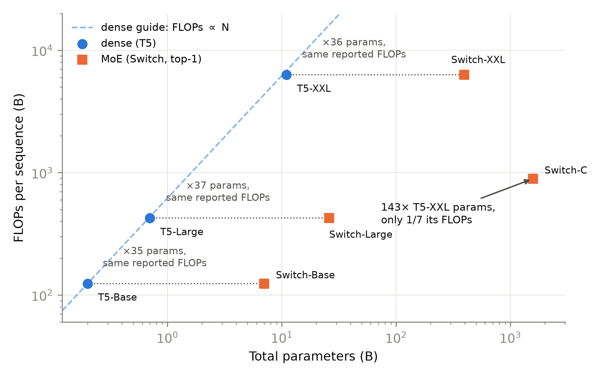

# 第 1 章 效率悖论——三本账分开记

## 1.0 开篇：从全书到这里

读完导览，全册的安排已经清楚：先补件、后拆机——第 2-5 章把前馈插槽换成专家群，第 6 章把注意力插槽做低秩折叠，第 7-8 章补训练侧的工程件，第 9-11 章再分析旗舰整机。导览还介绍了三条贯穿线索，其中一条叫「三本账」。但有一个问题尚未回答：**凭什么敢这么改？**把一台好端端的稠密模型拆成「一堆专家、按 token 挑着用」，这个决定需要清楚的成本核算作为依据，本章就来建立相应的公式。

本章要回答的问题是：**总参数增加时，单 token 的主要计算量能否保持不变，甚至低于某个稠密对照？**先看历史模型怎样尝试这一点（1.1—1.2），再建立总参数、激活参数与每 token FLOPs 三种口径（1.3），随后用四个模型检查计数方法及其证据边界（1.4），最后区分计算、存储与实际耗时（1.5）。本章交付三口径公式（式 (1.1)—(1.3)）、参数核算表（表 1.3）与成本取舍清单。后续每次讨论 MoE，都要先说清比较的是哪一项。

本章结束时，「为什么改造」就有了计算成本层面的答案；「这台机器到底怎么搭」——路由器怎么打分、top-k 怎么选、装不下的 token 去哪儿——留给下一章。

> **最小背景栏**：本章默认你已读过 Book1前馈网络与计算量部分的两本账（FFN 是参数与计算的双重大户；「参数多不等于算得慢，得看乘加次数」的计数口径）；Book2 第 8 章的训练算力账（口诀 $C\approx 6ND$——每参数每 token 六次运算，且该章的 $N$ **不含嵌入**，与本章参数账的「全含」口径不同，用前先对口径）；Book2 第 9 章的显存账（混合精度+Adam 下模型状态约 16 字节/参数）；Book3 第 5 章（untied 词表：输入 embedding 与输出 lm_head 是两份 $V\times d$ 矩阵）。双对数（log-log）坐标「等距=等倍数」的读图纪律见 Book2 第 8 章。符号约定沿用 Book3：残差流宽 $d$、层数 $L$、词表 $V$、查询头数 $h$、KV 头数 $h_{kv}$、头维 $d_k$。

## 1.1 一句埋了三册的话，到了兑现的时候

前三册已经改变过前馈层的内部计算：从两次线性变换夹一个激活，发展为门分支、值分支与输出投影构成的SwiGLU。但对每个token，这整个前馈网络仍要执行一次。现在要改变的是**调用方式**：保留专家内部的SwiGLU计算，把一套前馈参数扩展成多套，再由输入决定执行哪几套。

这种改造并不意味着把已训练的一个FFN机械切片就能得到同等能力。新模型必须学习路由和专家参数；它提供的是一种容量与计算的分配方式。接下来第2章建立路由机构，第3章解释训练难点，第4、5章讨论具体架构与实验。本章先回答预算问题：如果每次只执行少量专家，总参数还能怎样增加？

Transformer 原论文发布前近五个月，2017 年 1 月，Shazeer 等人发表《Outrageously Large Neural Networks: The Sparsely-Gated Mixture-of-Experts Layer》——稀疏门控混合专家层（Sparsely-Gated Mixture-of-Experts，MoE）出现得比 Transformer 更早，最初用于堆叠的 LSTM，而非 Transformer：MoE 层插在两层 LSTM 之间【证据等级：官方论文 1701.06538 v1，2017-01-23 vs 1706.03762 v1，2017-06-12，两摘要页提交记录】。这篇论文在 100B 词的新闻语料上把专家数从 32 一路扫到 131,072，MoE 层最多做到 137B 参数——原文写得很清楚：「This corresponds to up to 137 billion parameters in the MoE layer」【证据等级：官方论文 1701.06538 v1 §5.2】——而摘要的总结是「greater than 1000x improvements in model capacity with only minor losses in computational efficiency」：**容量涨一千倍，计算效率只轻微受损**。

更值得注意的是它与当时最佳已发表模型的比较，将 Table 1 的两行并排看（参数口径均为不含 embedding 与 softmax 层）：仓库 4,303M 对 151M（约 28 倍），每时间步前向乘加 8.9M 对 151M（约 1/17），困惑度反而更低（34.1 对 34.7）——原话是「Even the fastest of these models beats the best published result (when controlling for the number of training epochs), despite requiring only 6% of the computation.」【证据等级：官方论文 1701.06538 v1 §5.1 Table 1】

> **【考据框】**「6% 计算量打平最佳已发表」要对口径再引用：Table 1 的对手是**外部**的最佳已发表模型（Jozefowicz 2016），这是外部对照，不是等算力消融——「6%」是两家 ops/timestep 之比（8.9M/151M），训练设备与日程也完全不同（15h×16 K40 对 59h×32 K40）。论文自己做的**等算力**内部口径在别处：4096 专家模型比计算匹配的稠密基线困惑度低 24%（§5.1），65536 专家（68B 参数）低 39%（§5.2）。结果很突出，但只有先分清这些口径，才能准确理解这项比较。

再完整比较 Table 1 中的训练时长：同样 829M 词的语料、同样 10 个 epoch、同一代 K40（GPU 数不同），MoE 版花 $15\times16=240$ 卡时，最佳已发表花 $59\times32=1{,}888$ 卡时——**参数多 28 倍，训练成本反而只有对方的约 1/8，质量还更好**【证据等级：官方论文 1701.06538 v1 §5.1 Table 1，本书按卡时口径整理；非严格受控实验；卡时是硬件使用量，不等于货币成本或每步延迟】。这张表给出了稀疏条件计算的一组早期大规模证据；条件计算和专家模型的思想本身更早就已存在。

这些结果分别说明容量扩展和特定对照下的计算节省，不能把“千倍容量”与“约 6% 计算”拼成同一组实验的收益。接下来先看选择性执行如何改变账本，再讨论收益成立的条件。

## 1.2 悖论的机制：容量与主要计算分别计量

先把 MoE 层的结构画出来。Book1 的 FFN 车间是「升维、弯折、降维」一条流水线，全体 token 排队走同一条线；MoE 层把它改成**并列的 $N_e$ 个小车间（专家，expert）加一名调度员（路由器，router）**。每个 token 进来，调度员先打分：残差流 $(B,n,d)$ 展平成 $(B\cdot n,\,d)$，与打分矩阵 $W_g$ 的转置相乘（$W_g\in\mathbb{R}^{N_e\times d}$，即一个 $d\to N_e$ 线性层的权重，checkpoint 里 `gate.weight` 存的正是这个形状）——$(B\cdot n,\,d)\cdot(d,\,N_e)\to(B\cdot n,\,N_e)$，每一行是这一个 token 对全部 $N_e$ 个专家的偏好分；取每行前 $k$ 名（top-$k$），得到门控权重 $(B\cdot n,\,k)$；token 只进被选中的 $k$ 个专家，输出按门控权重加权求和。没有被某个 token 选中的专家，**不为这个token执行前向**；它仍可能服务本批其他 token，所以只能说它不参与当前 token 的专家计算。（路由的完整机构——打分函数怎么选、噪声加不加、装不下的 token 去哪儿——是第 2 章的主要内容，这里只需要「每 token 只点亮少数专家」这一个事实。）

这就是**条件计算**（conditional computation）：参数保存在模型中，是否执行某一分支由输入决定。于是要分别问“模型存了多少权重”和“当前 token 用了多少线性权重”。前者表征参数容量，并不直接衡量知识量；后者可用来估计主要矩阵乘法的成本。稠密模型中，大部分线性权重都会执行，二者因而常近似成比例；embedding 查表、注意力矩阵乘法及参数共享仍须另算。MoE 改变了这条近似比例关系，却没有把所有运行成本都变成激活参数的函数。

你可能会问：把 FFN 拆成 8 份、每 token 挑 2 份，如果每份跟原来的 FFN 一样宽，通行费反而从一份涨成两份——「拆」这个动作本身并不省钱。对，省钱不来自拆，来自拆开后获得的两个自由度：**每份可以做窄**（专家宽度 $w$ 独立设定），**挑的份数可以做少**（$k$ 可以小到 1）。Switch 系列取 $k{=}1$ 且专家形状与原 FFN 相同——忽略路由与派发时，每个 token 的专家计算量与同形稠密前馈相同，仓库却扩了上百倍，这就是图 1.1 里那三对「同 FLOPs」能配平的原因；Mixtral 取 $k{=}2$、每份宽度另定。计算开销与参数容量之间的**解耦自由度**，才是条件计算的本质——省不省、省多少，取决于怎样选择这两个自由度，每种配置都要分别计算。

两个年代的模型样本给出了定量结果。GShard（2020，面向大规模Transformer的MoE实现）在图 1 的说明中明确写道：「Increasing the model size from 37.5B to 600B (16x), results in computation cost increase from 6 to 22 years (3.6x).」——模型从 37.5B 涨到 600B（16 倍），训练成本只从 6 涨到 22 TPU v3 核年（3.6 倍）【证据等级：官方论文 2006.16668 v1 §4 图 1】。这台 600B 模型用 2048 个 TPU v3 核训练约 4 天（合计 22.4 核年），翻译质量（BLEU 44.3）也是该家族中最好的；同数据、同 2048 核上训出来的稠密对照组 T(96L)（96 层、2.3B）花了约 235.5 核年、BLEU 只有 36.9——同类设备和数据设置下，稀疏模型报告了更低的训练卡时和更高的BLEU【证据等级：官方论文 2006.16668 v1 §4.3-§4.5 Table 1/3】。

两组训练采用不同架构与日程，比较的是达到所报结果所用的设备时间，不能直接称为等 FLOPs 消融；参数数目不同本身也不能证明 FLOPs 不同——这正是本章要建立的区别。图 1 写作 37.5B，Table 1 写作 37B，引用时保留各自的精度，不把其中一个擅自定为更精确的真值。

Switch Transformers（2021）用一张适合教学对照的表格呈现了这项比较：它有一组**表列每序列 FLOPs 相同**的稠密/稀疏对照（Table 9，同一序列长度口径下的每序列前向 FLOPs）。把七台机器放到「总参数 × 每序列计算量」的双对数图上（图 1.1），悖论就直观地呈现出来：稠密 T5 三点靠近斜率为 1 的参考线——在这些配置与计数条件下，参数与计算量近似成比例，这是 Book2 scaling 的世界；三台同名的 Switch 全部水平右移——**按表中的 FLOPs 口径，计算量相同而参数大幅增加**（Switch-Base 对 T5-Base 是 35 倍参数、同 FLOPs，Switch-Large 37 倍、Switch-XXL 36 倍）；而极点 Switch-C 拥有 T5-XXL 的 143 倍参数（1571B 对 11B），每序列计算量只有它的 1/7（890B 对 6.3T FLOPs）【证据等级：官方论文 2101.03961 v3 §5.6 Table 9，本书整理】。



图 1.1 效率悖论散点：总参数 vs 每序列前向 FLOPs（双对数）。蓝色圆点=稠密 T5（靠近 FLOPs∝N 的参考线），橙色方点=MoE 的 Switch 系列（同 FLOPs 水平右移）；Switch-C 以 143 倍于 T5-XXL 的参数只付其 1/7 的计算量。数据源：Switch Transformers Table 9（官方论文），本书绘制。

MoE 允许增加可存储的专家参数，而不让每 token 的专家计算按相同比例增加。Book2 的 scaling 关系描述特定架构、数据与预算条件下的经验规律，并没有规定参数与成本必须永远绑定；MoE 引入了专家数、专家宽度和选择数这组新的设计变量。结构上能够扩容，仍不等于一定学得更好。前述论文在各自条件下观察到了质量与成本的收益，后面的模块实验还要检查负载、专家配置与训练结果。下一节先把“用了多少参数”写成可核对的公式。

## 1.3 三本账立式：总参、激活参与每 token FLOPs

本节将同一个模型拆成三种可计算的量：所有存储的权重、单个token经过的线性权重，以及近似乘加次数。它们分别帮助估计容量、主要算术和设备成本；只有明确忽略项，才能把近似账本用于具体配置。设一台 decoder-only 的 MoE 模型：$L$ 层，每层先是注意力（参数记作 $A$，GQA 矩形记法承 Book3 第 6 章），随后是 MoE 槽——$N_e$ 个路由专家加 $K_s$ 个共享专家，均假设彼此不共享权重；每个专家是一个宽 $w$ 的前馈网络（SwiGLU 三矩阵，矩阵数记 $n_{\mathrm{mat}}=3$；ReLU 时代的专家 $n_{\mathrm{mat}}=2$），外加一个 $d\times N_e$ 的路由门。词表 $V$、untied（Book3 第 5 章：出入口两份）。

**账本一，总参数**（total parameters）——仓库的货架总数：

$$
N \;=\; L\,\Big(\,A \;+\; \underbrace{(N_e + K_s)\, n_{\mathrm{mat}}\, d\, w}_{\text{专家群：全部货架}} \;+\; \underbrace{N_e\, d}_{\text{路由门}}\,\Big) \;+\; 2\,V d
\tag{1.1}
$$

也就是说，总参数就是「每层的注意力+全部专家+一个小小的打分矩阵」乘层数，再加上出入口两份词表——**不管 token 用不用，全部计入**。（式(1.1)/(1.2)暂不含归一化、偏置等小项，精确算例再补入；此式取每层都是MoE的情形；实际模型常有首几层保持稠密的排布，算例里按 config 逐层处理即可，需要逐层替换相应项。记号约定：式 (1.1)-(1.3) 语境里的 $N$ 专指总参数；自第 2 章起 $N$ 固定让位给展平 token 数 $B\cdot n$——后文形状 $(N,\,E)$ 里的 $N$ 是 token 数，不是参数量。）

**账本二，激活参数**（active parameters）——每 token 的通行费：

$$
N_{\mathrm{act}} \;=\; L\,\Big(\,A \;+\; (k + K_s)\, n_{\mathrm{mat}}\, d\, w \;+\; N_e\, d\,\Big) \;+\; V d
\tag{1.2}
$$

用人话说：把「全部货架」换成「每个 token 真正搬动的 $k$ 份路由专家+常驻的 $K_s$ 份共享专家」，注意力、路由门照付，词表只算出口的 lm_head 一份。为什么词表只算一份还有讲究：输出侧的 lm_head 要执行一次实际的 $(B\cdot n,\,d)\cdot(d,\,V)\to(B\cdot n,\,V)$ 大矩阵乘——每个 token 都要对着整个词表打分，必须承担这项计算；输入侧的 embedding 只是按行号取一行向量（查表），一次乘法都没有。这里必须明确本册的计数口径：**「激活参数」=含 lm_head、不含输入 embedding lookup**；对外引用时**双份口径（再加 $Vd$）并列报数**。为什么要区分到这个程度，本节末尾会用跨厂商的例子说明。

**账本三，每 token FLOPs**——通行费换算成算术：

$$
\text{FLOPs/token} \;\approx\; 2\,N_{\mathrm{act}}
\tag{1.3}
$$

也就是说，每个被使用的参数对应一次乘法和一次加法（Book1前馈网络与计算量部分的乘加口径）；这是**前向**账。训练账在 Book2 第 8 章的口诀里已经埋好——$C\approx 6ND$ 的 6 = 前向 2 + 反向 4，把 $N$ 换成 $N_{\mathrm{act}}$ 便得到MoE线性层训练算力的近似：$C\approx 6\,N_{\mathrm{act}}D$。这两个近似都以线性层为主，尚未计入注意力的 $QK^\top$、概率加权 $PV$、softmax、激活函数、路由选择等开销，也不含通信、重计算与填充。对普通全长注意力，$Q,K,V$ 的逻辑形状均为 $(B,h,n,d_k)$，先得到 $(B,h,n,n)$ 的分数，再将概率与 $V$ 相乘回到 $(B,h,n,d_k)$；$QK^\top$ 与 $PV$ 的完整方阵计算合计约为 $4BLhn^2d_k$ FLOPs（因果三角优化会改变常数），摊到每 token 后仍随长度 $n$ 增加；单步解码则随历史长度增加。MLA 还需按所用的显式或吸收路径重新数乘法，不能把所有存储投影机械代入 $2N_{\mathrm{act}}$。训练的“6”同样是主要线性乘法的近似，不能代替完整训练图的计数。同时明确单位口径：参数的单位是**权重元素个数**（不是字节——字节数还要乘精度宽度，1.5 节用得上），FLOPs 的口径是**乘加各计一**。

表 1.1 汇总三本账的符号、形状与 config 字段对照——它是后续各章都会使用的工具，第 4、9、10 章拆真模型时逐字段用它。

表 1.1 三口径账本符号表（式 (1.1)-(1.3) 的符号与形状；config 字段以 Mixtral 为例）

| 符号 | 含义 | 形状 / 取值 | config 字段（Mixtral 8x7B 例） |
|---|---|---|---|
| $L$ / $d$ / $V$ | 层数 / 残差流宽 / 词表大小 | 标量 | 32 / 4096 / 32000 |
| $A$ | 每层注意力参数 | 按行向量右乘记号：$W_q\in\mathbb R^{d\times hd_k}$、$W_o\in\mathbb R^{hd_k\times d}$、$W_k,W_v\in\mathbb R^{d\times h_{kv}d_k}$ 的元素总数 | $h{=}32,h_{kv}{=}8,d_k{=}128$ |
| $N_e$ | 每层路由专家份数（自第 2 章起全书统一记 $E$，与代码变量同名） | 标量 | num_local_experts=8 |
| $k$ | 每 token 选中的专家数 | 标量（top-$k$） | num_experts_per_tok=2 |
| $w$ | 单个专家的中间宽 | 标量 | intermediate_size=14336（每专家） |
| $K_s$ | 共享专家份数（每 token 常驻） | 标量 | 无此字段（=0） |
| $n_{\mathrm{mat}}$ | 每专家矩阵数 | 2（ReLU）/ 3（SwiGLU） | hidden_act=silu → 3 |
| $W_g$ | 路由门打分矩阵（$d\to N_e$ 线性层权重，打分乘其转置） | $(N_e,\,d)$ | gate 键 |
| — | router 打分 / top-$k$ 门控 | $(B\cdot n,\,N_e)$ / $(B\cdot n,\,k)$ | — |
| $N$ / $N_{\mathrm{act}}$ | 总参 / 激活参（$N$ 限账本语境；第 2 章起 $N$ 记展平 token 数 $B\cdot n$） | 标量（参数=权重元素数） | — |

三本账已经建立，先用本书的小模型验证，再与外部模型核对。取第 2 章会反复使用的那台 d=512 小机器（6 层、$V{=}8192$、GQA）：稠密版 $d_{ff}=1408$，MoE 版 $N_e{=}8$、$k{=}2$、$w{=}704$。按式 (1.1)/(1.2) 手算（[`code/ch01/account.py`](code/ch01/account.py) 的 `check_mini`，逐位对上探针 B 实机的参数量）：

- 总参：稠密 26,089,984，MoE 65,042,944——仓库扩到 2.49 倍；
- 激活参（单份）：稠密 21,895,680，MoE 不含路由门恰好也是 21,895,680——**逐位相同**，因为两个 704 宽专家的线性权重总数，恰与一个 1408 宽专家相同。两个专家各自从 $(B n,d)$ 经 $(B n,704)$ 回到 $(B n,d)$，随后加权求和；这不是直接拼接两个隐向量，也不表示函数与一个宽专家相同。只比较权重数，$2\times 3\cdot 512\cdot 704 = 3\cdot 512\cdot 1408 = 2{,}162{,}688$；计入路由门（$8\times512=4{,}096$）则 MoE 多付 0.1%；
- 另外，等总参的稠密对照臂按 $d_{ff}=N_e\cdot w=5632$ 配，总参 65,018,368，与 MoE 恰差 24,576——正是路由门 $N_e\cdot d$ 的 6 层累计。

【证据等级：本书实验（CPU，2026-10；公式手算与实机参数量逐位对账）】这两个配臂口径——「主要线性权重数接近」（等激活）与「仓库大小打平」（等总参）——值得多看一眼，它们是本册一切 MoE 消融的两条公平线：只报等激活会被质问「你多花了 2.5 倍参数买来的优势吧」，只报等总参又会被质问「你每个 token 算得少，占的是计算的便宜」——两条线分别约束计算与存储预算；若要归因，还须控制数据、训练步数、初始化、优化与实现条件。第 5 章的四臂消融会逐字用这两条配臂公式，那里见分晓。

最后要检查引用口径。“激活参数”并非各家都按同一清单统计，输入 embedding、输出头、路由器和共享权重是否计入，都可能改变结果。表 1.2 并列两种可复算的口径，再与公开说法比较。小数位接近，只能说明相容，不能仅凭舍入数字反推出作者的全部计数规则；若官方说明与手算相冲突，应保留差异而不是硬凑。

表 1.2 跨厂商「激活参数」口径审计（官方口径 vs 本书实算）

| 模型 | 官方所报值 | 本书实算·单份 | 本书实算·双份 | 证据能够支持什么 |
|---|---|---|---|---|
| gpt-oss-20b | 3.61B | **3.608B** | 4.187B | Table 1 与单份结果在所报精度下相符，不是逐位公布全部参数【官方模型卡 2508.10925 v1 Table 1；config 复算】 |
| DeepSeek-V2-Lite | 2.4B | **2.451B** | 2.660B | 单份更接近，但 2.451 按一位小数四舍五入为 2.5，不能擅称官方采用了截位【官方模型卡；config 复算】 |
| Qwen3-30B-A3B | 3.3B | 3.040B | **3.351B** | 双份更接近；小数近似不足以证明唯一计法【官方模型卡；config 复算】 |
| DeepSeek-V3 | 论文 37B；权重说明列 36.7B，并称包含输入与输出两表 | **36.63B** | 37.55B | 说明文字与本书两套计数尚不能同时对齐，保留为待决；主模型总参仍为 671.03B，第 9 章逐项展开【[官方权重说明](https://github.com/deepseek-ai/DeepSeek-V3/blob/main/README_WEIGHTS.md)，本轮读取；config 复算】 |

例如，“3.61B 对 3.3B”即使直接比较，数值较小的也是后者；若进一步想判断哪台模型运行更省，还必须统一统计范围、序列长度、精度、硬件与执行方式。激活参数大小本身并不能回答速度问题。

## 1.4 四个年代的样本，四遍自己的账

上一节在小机器上验了公式，本节用同样的分项计数方法检查四个年代的真实模型——从 2020 到 2025，每个样本都根据公开字段计算，再与官方口径核对。这四遍手算全部在 [`code/ch01/account.py`](code/ch01/account.py) 里（`gshard`/`switch_c`/`mixtral`/`gptoss_20b` 四个函数，CPU 秒级，`--out-name` 防覆写），结果汇成表 1.3。

先以披露了 config 的 Mixtral 为例，完整走一遍手算过程，读者可以拿计算器跟着验。注意力每层：$A=2\cdot 4096\cdot(32\cdot128)+2\cdot 4096\cdot(8\cdot128)=33{,}554{,}432+8{,}388{,}608=41{,}943{,}040$（q/o 全宽、k/v 按 8 个 KV 头缩——GQA 记法承 Book3 第 6 章）。单个专家：$3\cdot 4096\cdot 14336=176{,}160{,}768$（SwiGLU 三矩阵）。MoE 槽：$8\times 176{,}160{,}768+8\times 4096=1{,}409{,}318{,}912$。

代入式 (1.1)：$N=32\times(41{,}943{,}040+1{,}409{,}318{,}912+\text{归一化 }8{,}192)+2\times 32000\times 4096+4096=46{,}702{,}792{,}704$。代入式 (1.2)：$N_{\mathrm{act}}=32\times(41{,}943{,}040+2\times 176{,}160{,}768+32{,}768+8{,}192)+32000\times 4096+4096=12{,}748{,}853{,}248$，双份再加一个 $Vd=131{,}072{,}000$ 得 12,879,925,248。沿这条计算链逐项算完，每一步都无须估计或猜测——这就是 config 级披露的意义。

表 1.3 四样本参数账：自算 vs 官方（激活参为本册单份/双份口径并列）

| 样本（披露等级） | 本书自算 | 官方口径 | 判定 |
|---|---|---|---|
| GShard MoE(2048E,36L)，2020（论文级） | 依 Table 1 的 36,684 个专家，专家矩阵为 **615.455B**；依 36 层、隔层 MoE 的结构，$18\times2048=36{,}864$ 个专家，对应 **618.475B** | 600B 是报告的量级；表中专家总数与层数规则也不一致【官方论文 2006.16668 v1 §4.4、Table 1、附录 A.2】 | 分别记录两个可复算结果；它们都仅含专家矩阵，不能添加无依据的“约 5B”拼成整机总参 |
| Switch-C，2021（论文级，辅以公开配置核查） | 每专家 $2\times2080\times6144=25{,}559{,}040$；若共有 30 个 MoE 层，仅专家矩阵为 **1,570.347B** | Table 9 报 1571B、2048 专家、15 层、专家频率 1；公开旧 config 与论文部分字段不一致 | 30 层假设与官方量级相容，但由总数反解再回代不是独立验证；不能称逐位核平 |
| Mixtral 8x7B，2024（config 级） | 总参 **46,702,792,704**；激活单份 **12,748,853,248** / 双份 **12,879,925,248** | 论文 47B/13B；模型卡 46.7B/12.9B【官方论文 2401.04088 v1；官方 config】 | 精确整数来自结构公式；与官方舍入值相符。路由专家矩阵占总参约 96.6% |
| gpt-oss-20b，2025（config 及历史元数据审计） | 总参 **20,914,757,184**；激活单份 **3,608,307,264** / 双份 **4,187,440,704** | Table 1：20.91B / Active 3.61B【官方模型卡 2508.10925 v1】 | 结构计数与所报精度相符；历史 API/分片头核对是元数据证据，不是三组独立实验，也不是完整权重前向验证 |

这四行说明，账能算到哪一步，取决于已知的几何与统计范围。GShard 的表格给了专家总数，正文又给了隔层布置，两者存在内部不一致；本书应展示差异，不能用无来源的余项补平。Switch-C 的量级可以由专家矩阵解释，但“先用 1571B 猜出 30 层，再算回约 1571B”只是一致性检查。公开的旧 config（提交 5fed660）还列出 12 个解码层、30 个头，而论文 Table 9 给出 32 个头，因此也不能把该文件未经辨别地当成论文配置的完整答案。Mixtral 与 gpt-oss 的细账更完整，可以逐项得到整数，再与官方取整值比较。披露较多有助于核对，却不保证任何两个来源天然一致。

顺带一提，这两次「config 级」复算正是 Book3 第 9 章 config 逆向五步法里「算账对拍」这一步的实际应用——那套程序在第 4 章（Mixtral 实习）与第 10 章（gpt-oss 主场）还会各用一整章来实践。

核对完数值，再汇总三种口径的分工：gpt-oss-20b 的仓库（$N$）是 20.91B，每个 token 的通行费（$N_{\mathrm{act}}$，单份）只有 3.61B——仓库是通行费的 5.8 倍；Mixtral 是 46.7B 对 12.7B，3.7 倍；而且专家在两台模型中都占了绝大部分参数——Mixtral 专家占总参 96.6%，gpt-oss 的 MLP 家族（专家+偏置+路由门）占 19.12B/20.91B≈91.4%【证据等级：本书复算（config 公式，2026-10）】。换算成式 (1.3) 的算术，Mixtral 每个 token 约 $2\times 12.75\mathrm{B}\approx 25.5$ GFLOPs，gpt-oss 约 7.2 GFLOPs【证据等级：本书算术估计，未计注意力矩阵乘法等项】。参数与计算需要分别记账——这也回答了为什么四枚样本里 2024 年之后的占一半：MoE 旗舰的「参数账」里几乎全是专家，读懂专家就读懂了整机的大头，这正是后面几章要逐项分析的内容。

## 1.5 MoE 省什么、不省什么

有了三本账，现在可以如实评估这项改造：节省的开销很可观，没有节省的部分也十分明显。

**可能节省的：主要线性计算。**前向 FLOPs $\approx 2N_{\mathrm{act}}$（式 (1.3)），训练总算力 $\approx 6N_{\mathrm{act}}D$——固定专家宽度与k时，专家计算项不随专家总数线性增长；但路由矩阵Ed仍随专家数增长。这就是 1.2 节那三对「同 FLOPs」对照的算力侧读数：同 FLOPs 的 Switch 比 T5 多出 35 倍参数，等价于**同样的计算预算买了一个大得多的仓库**。

**不省的第一笔：全部权重的存储。**不卸载权重时，所有专家仍须常驻设备；分片和 CPU 卸载可以改变单设备占用，但会引入通信或搬运。Mixtral 的 46.70B 权重若全部按 bf16 存储，需要约 93.4 GB（十进制），还不含缓存与临时张量。训练的模型状态也按总参配置：在 Book2 第 9 章所用的混合精度加 Adam、每参数约 16 字节的具体口径下，约需 $46.7\mathrm B\times16\approx747$ GB。分布式切分、优化器状态精度与惰性分配会改变每卡实际占用，不能把 16 字节当普遍常数。GShard 参数扩大而设备时间也增加，说明额外成本仍然存在；仅凭这组总时长，不能进一步分解通信、内存与调度各贡献了多少。

**不省的第二笔，甚至是新增的：路由与派发的开销。**调度员自己要干活：打分（$(B\cdot n,\,N_e)$ 的矩阵乘）、top-$k$ 选择，以及把 token 从「全体混在一起」的状态搬运到各自专家门口再搬回来（gather/scatter）。理论上这部分开销较小（路由门参数只占 $N_e d$），实际实现中却未必如此——我们在自己的三档机器上实测过，各档结果汇总在表 1.4 中：

表 1.4 历史三组整步耗时对照（朴素 Python 逐专家循环，MPS bf16 独占窗口；证据等级：本书实验）

| 档位（配臂口径随行标注） | dense | MoE | 慢几倍 |
|---|---|---|---|
| 26M 档（等激活：dense 总 26.1M/激活 21.896M vs MoE 总 65.0M/激活 21.920M） | 0.187 s/step | 0.434 s/step | 2.3× |
| 65M 档（等总参：dense 总 65.0M/激活 60.824M vs MoE 总 65.0M/激活 21.920M） | 0.282 s/step | 0.491 s/step | 1.74× |
| 207M 档（等总参：dense 207.1M vs 两刀机 207.1M/激活 101.5M（含 lm_head 口径，第 9 章表 9.2）；两刀机含 MLA，此档同时改动前馈与注意力，只比较整机耗时） | 2.44 s/step | 3.514 s/step | 1.44× |

【证据等级：本书历史实验，MPS bf16，2026-10；探针 B/D/F】两行近似等总参的对照中，稀疏模型的激活参数更少，但整步耗时更长。教学实现逐专家派发，一次 SwiGLU 又包含三次线性运算及门控；多个小矩阵运算、索引和合并都可能降低利用率。不能将它概括成“稠密只有一次乘法、MoE 恰好多 8 次”，也不能在没有算子剖析时把全部差额归因于启动开销。

三行分别采用不同的参数对照与计算图，最后一行还同时改了MLA，不能据此确立“开销随规模收敛”的实验规律。较大的矩阵可能摊薄启动成本，这是待独立控制变量验证的解释。真实系统用「多机分片+融合算子」把这笔开销压回去——专家为什么天然可分片、怎么分，第 2 章末尾给一半答案，工程的那一半在后续册。

因此，MoE 提供的选择是：在给定主要专家计算预算下，保存更多可选择的专家权重，同时承担全部参数存储、路由和派发成本。它能否节省端到端时间，取决于具体配置、负载与实现。这三种账相互关联，但不能由其中一个数替代其余两个。

至此，可以把本章的方法整理成阅读论文的三步检查。遇到新的 MoE 旗舰时，依次进行：第一步判口径——官方「X B 激活」是单份还是双份嵌入（表 1.2 的教训）；第二步算比率——仓库/通行费 $N/N_{\mathrm{act}}$ 是几倍、折成式 (1.3) 每 token 多少 GFLOPs；第三步问对照——宣传里的「更好」是等激活口径还是等总参口径（本节的教训）。前两步主要是算术，第三步还需要阅读实验设置；公开信息不足时应明确保留待决项。至于服务侧（推理时这些权重怎么高效地被批量复用）是另一整本账——本册训练侧讲完，那本账在第六册整册展开。

## 1.6 本章小结

开篇的问题——总参数涨、单 token 成本降如何同时成立——现在有了完整的答案：条件计算把「容量」与「成本」拆进两本账，路由器决定每个 token 只点亮仓库里的一小块；三口径公式（总参 $N$ 式 (1.1)、激活参 $N_{\mathrm{act}}$ 式 (1.2)、每 token FLOPs $\approx 2N_{\mathrm{act}}$ 式 (1.3)）把直觉立成可算的账，四个年代的样本验证了它——既能用细账解释参数量，也能发现 GShard 的表格差异与 Switch-C 的反解局限；最后「省/不省」清单划定了这笔买卖的边界：可能省的是每 token 的主要计算，仍要承担全部权重存储，新增的是路由开销。

**带走的心智**：**容量住在参数里，主要线性计算看激活量——看到一个 MoE 模型，先分头记三本账：仓库多大（$N$）、每token执行哪些参数（$N_{\mathrm{act}}$，实际读取还受批内复用影响）、折多少算术（$\approx 2N_{\mathrm{act}}$）。**还需要养成两个核对习惯：其一，「激活参数」没有国际标准——引任何一家的 B 数之前先判单/双份嵌入口径，最好自己按 config 算一遍；其二，MoE 不是免费午餐，存储成本（显存）与调度开销（路由派发）都是实际成本，等总参口径下它甚至可能更慢——读任何「MoE 更便宜」的断言，先问它省的是哪一本账。

把镜头拉回全书：导览承诺的两刀，第一刀（FFN→MoE）的「为什么」已经算清——同样的专家计算预算可能容纳更多权重，是否值得还需训练与系统证据。这三口径账本也只是导览预告的账本家族里的第一本：第 6 章进行第二项改造时会建立 KV 元素账（注意力侧的「每 token 通行费」另一种记法），第 9 章组装两刀机时会开出预算账（每步多少秒、多少显存）——成本核算这套方法，从本章开始贯穿到卷末。但眼下的缺口很具体：「按 token 挑专家」这台机器本身还没造出来：调度员按什么规则打分、top-$k$ 的 $k$ 定为几、专家门口排不下怎么办、负载偏了谁管——结构方面还有许多问题，下一章开始动手实现。

## 1.7 动手验证

在工作区根目录激活环境后，运行随书脚本：

```bash
source ./env.sh
python from-models-to-vllm/book4-scale-and-efficiency/code/ch01/account.py --out-name review
python from-models-to-vllm/book4-scale-and-efficiency/code/ch01/make_figures.py
```

参数脚本只做整数算术，不下载权重。它会打印 mini 模型的总参、含路由门的激活参及配臂差额；分别保留 GShard 的表列专家数与按层数推得的专家数；Switch-C 仅检查 30 个 MoE 层假设下的专家量级；Mixtral 与 gpt-oss 则给出完整结构公式的计数。JSON 与重绘图默认进入工作区日志目录。相同文件名已有产物时需换名或显式指定新的输出路径。

图 1.1 使用论文 Table 9 的已报告数值。水平连线表示表中 FLOPs 数字相同，不表示实测耗时相同；斜线只是近似比例的读图参考。第 1 章的算术检查不重跑表 1.4 的历史 MPS 训练。
