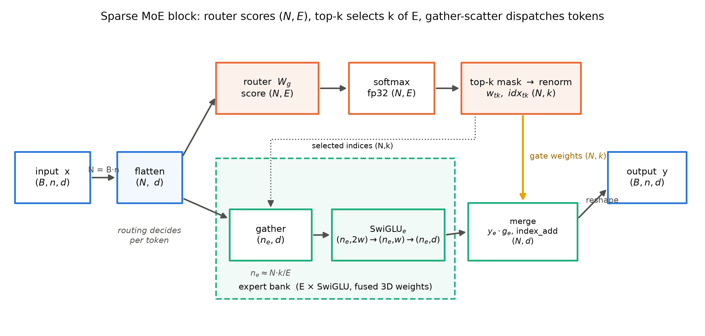
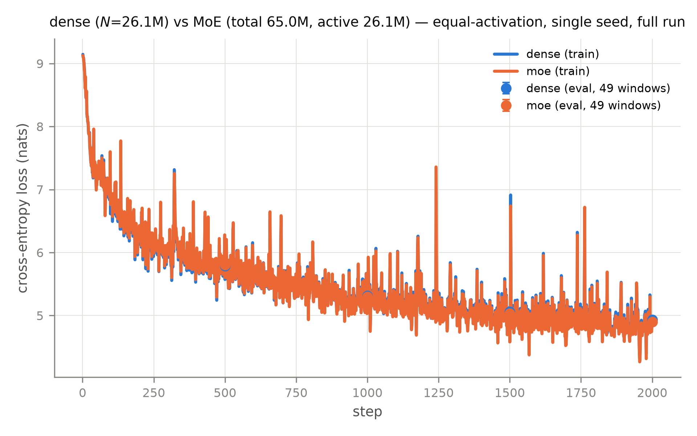

# 第 2 章 MoE 基本机构：路由器、top-k 与容量

## 2.0 开篇：从全书到这里

上一章已经算清了成本：效率悖论说的是总参数可以涨，只要每个 token 只激活其中一小块——参数容量与主要线性计算从此分开记账。但这半句话在我们的机器上还没有对应物：Book3 的 207M 骨架里，每个 Block 中那个升维、门控、降维的前馈层，每次都完整参与计算，每个 token 都要承担全部参数对应的计算开销。第 1 章末尾我们问：「只激活一小块」的结构究竟怎样搭建？本章就来实现它——把一个大 FFN 拆成一群小专家，再给每个 token 配一名调度员。

这项改造并非本书的发明，而是在回应 Book3 留下的一个明确问题。第 9 章分析 Llama 4 时，我们只记录了 config 事实，现在该进一步讲解它的结构了。本章要回答的问题有三个来源：一是那笔欠账的三连问（选法怎么工作、省在哪儿、训练难在哪——前两问由本章回答，第三问会立即显现，交给下一章专门处理）；二是把结构落实为代码：我们自己写一个 mini MoE 块，与组件库参考实现及 HF transformers 逐位对拍；三是拿到本机第一组 dense vs MoE 的对照读数，让「省什么、不省什么」从第 1 章的论文数字变成自己机器上的实测。

到本章结束时，你会拥有一张 MoE 块的形状流转表、一个能跑且对拍通过的 SparseMoE 实现、以及一组在近似等激活参数条件下比较 MoE 与 dense 的历史实验记录。新的问题也会随之出现：把选择权交给一个自己也要训练的路由器，训练时会出什么事——这正是第 3 章的开场。

> **最小背景栏**：本章只补充三项前置知识。①专家内部就是 SwiGLU——门控升维、逐元素乘、降维，Book3 第 3 章已教，本章直接指回；②「FFN 是一个可整体替换的插槽」——Book3 第 8 章组装学的四插槽观（RMSNorm/SwiGLU/RoPE/GQA），本章动的是其中的前馈格；③总参/激活参双口径账本——本册第 1 章立的三口径账本（总参/激活参/每 token FLOPs），本章的每一笔参数账都按这套口径记。softmax 与 top-k 是 PyTorch 基础，不再重教。

## 2.1 三连问的第一问：Book3 的欠账到期了

先重读那段原文。Book3 第 9 章章末欠账框写道：

> 「Llama 4 把前馈插槽换成『16/128 选 1 的专家群 + 一份共享』——选法怎么工作、省在哪儿、训练难在哪，是下一册的开场主角；本册只登记 config 事实。」

这三个问题对应本章的展开顺序。「选法怎么工作」是机构问题：那个「16/128 选 1」里的 1 是谁选的、按什么打分、其余落选的 15/127 份在做什么——2.2 到 2.5 节把这套机构一次讲透；「省在哪儿」是账本问题：只执行少数专家怎样改变主要计算量，质量又应如何比较——2.2 节立公式、2.7 节用本机实验兑现；「训练难在哪」本章只负责揭示这个问题：把选择权交给一个可训练的路由器，等于把「哪些参数得到训练」也交了出去——这个自增强回路的完整记录与处理方法是第 3 章的主要内容。

改造之前，先确定它在整机中的位置。Book3 的四插槽里，MoE 动的只有前馈格：RMSNorm、RoPE、GQA 注意力全部原样保留，残差流的宽度 $(B,n,d)$ 完全不变——MoE 不是一台新机型，而是 FFN 插槽的替换件，装进去之后整机的输入输出接口完全不变。「只换一格」并非本书的推测，第 4 章拆 Mixtral 时你会看到官方实证：它自述与 Mistral 7B 同构、注意力侧 GQA 8kv 与 Llama 2 70B 同款，唯一的结构改动就是 FFN 格换成 8 专家 MoE。

> **【考据框】MoE 比 Transformer 还早五个月**。稀疏门控 MoE 层的论文（Shazeer et al., *Outrageously Large Neural Networks: The Sparsely-Gated Mixture-of-Experts Layer*）v1 提交于 2017-01-23，而 *Attention Is All You Need* v1 是 2017-06-12【证据等级：官方论文，两文 arXiv 摘要页提交记录】——该稀疏门控论文把 MoE 用于堆叠 LSTM，而非 Transformer；2020 年的 GShard 将它用于大规模 Transformer；这里不将该论文当作首次结合两者的证明。概念源头更早：Shazeer §1.3 自述 "Since its introduction more than two decades ago (Jacobs et al. 1991)"——1991 年的 *Adaptive Mixtures of Local Experts* 就有了「门控学习分治」的骨架【证据等级：官方论文 1701.06538 v1 §1.3】。

## 2.2 基本式与形状流转：token 维展平、打分、硬选择、派发

先建立对结构的直观认识。把 Book3 里那个「一间大车间」式的 SwiGLU FFN，换成一个「仓库加调度员」：仓库里放着 $E$ 个窄一些的 SwiGLU（每个就叫一个专家，expert），调度员（路由器，router，Shazeer 原文叫门控网络 gating network）检查每个 token，决定让它进入哪 $k$ 个车间；没有被选中的车间，不处理这个 token。形式化只需要一行：

$$y=\sum_{i=1}^{E} g_i(x)\cdot E_i(x) \tag{2.1}$$

用人话说：每个 token 的输出，等于它选中的那几个专家的输出、按调度员给的门控权重加起来——落选的专家 $g_i(x)=0$，不仅权重为零，也不需要计算其输出，这就是省算力的来源。

式中各量的形状如下表（记号全书统一：$B$ 批大小、$n$ 序列长、$d$ 残差流宽、$E$ 专家数、$k$ 每 token 激活专家数、$w$ 专家宽度、$N=B\cdot n$ 展平后的 token 总数。与第 1 章的桥接：$E$ 即该章的 $N_e$、打分矩阵 $W_g$ 即该章的路由门矩阵；该章式 (1.1)-(1.3) 里作总参数的 $N$ 属账本语境专用，自本章起 $N$ 一律指展平 token 数）。

| 符号 | 含义 | 形状 |
|---|---|---|
| $x$ | 式 (2.1) 中的单个 token 隐状态；批量输入仍记作 $x$ | 单 token 为 $(d,)$；批量为 $(B,n,d)$ |
| $h$ | 展平后的 token 流 | $(N,d)$，$N=B\cdot n$ |
| $W_g$ | 路由器打分权重（承第 1 章路由门矩阵，Shazeer 记号） | $(E,d)$ |
| logits / 概率 | 逐 token 打分 / softmax 后概率 | $(N,E)$ |
| $g,\ \mathrm{idx}$ | top-k 门控权重 / 选中专家索引 | $(N,k)$ 各一 |
| $E_i(x)$ | 式 (2.1) 中第 $i$ 个专家的单 token 输出；派发后按子批执行 | 单 token 为 $(d,)$；子批为 $(n_i,d)$ |
| $y$ | 单 token 输出；批量还原后回残差流 | $(d,)$；批量为 $(B,n,d)$ |

计算分为四步，每步都标明形状（实例取 2.7 节本机模块档：$B=16$、$n=512$、$d=512$、$E=8$、$k=2$、$w=704$，故 $N=8192$）。

**第一步，展平。**路由的决策粒度是 token，不是序列，所以第一件事永远是 $(B,n,d)\to(N,d)$。连续张量的这一步通常只改变视图；非连续张量的`reshape`可能复制，但它也改变了之后所有下标的含义：gather/scatter 的索引全部作用于 $N$ 维，算完必须 `view` 回 $(B,n,d)$。这里有一个 mini 实现中最典型的陷阱：批维展平忘记做或忘记还原，$B=1$ 时 $N=n$，形状恰好都对，程序照常运行，$B>1$ 时输出形状仍对、内容却已错位——静默 bug。教学实现中有一项自检专门检查这个问题：同一段 token 流按 $(1,64,d)$ 与 $(2,32,d)$ 两种批形喂进去，在无噪声、无容量截断的本章模块中，数学输出应相同（2.7 节历史 CPU 实测差为 0）；浮点实现一般以合理容差检查。按批设容量的路由可能因重分批而改变结果。

**第二步，打分。**路由器就是一个无偏置线性层加 softmax：$\mathrm{logits}=h\cdot W_g^{\top}$，形状 $(N,d)\cdot(d,E)\to(N,E)$——每一行是「这个 token 对 $E$ 个专家的偏好分」；softmax（fp32，数值口径对齐 HF）把它变成概率。整件事的计算量是 $N\cdot d\cdot E$ 次乘加，与一个 $d\to E$ 投影相当；相对大专家往往较小，但仍随 $E$ 增长，不能一律忽略。

**第三步，硬选择。**$\mathrm{topk}$ 在 $(N,E)$ 的最后一维上取前 $k$，分别得到形状为 $(N,k)$ 的门控权重与索引。选择是硬的：落选的 $E-k$ 个专家对这一行来说出局。写成掩码视角（Shazeer 的原始写法）：把落选位置的打分置 $-\infty$ 再 softmax，非 top 项概率自然为零。拿一个 token 走一遍全流程（$E=4$、$k=2$）：设它对四个专家的打分为 $(2.0,\ 0.5,\ 1.2,\ -0.3)$，softmax 得概率 $(0.564,\ 0.126,\ 0.253,\ 0.057)$；top-2 选中专家 1 与 3，权重 $0.564$ 与 $0.253$；重归一化 $0.564/0.817=0.69$、$0.253/0.817=0.31$。于是这个 token 的输出就是 $y\approx0.69\,E_1(x)+0.31\,E_3(x)$——专家 2、4 及其全部参数，都没有参与这个 token 的计算。你可能会问：硬选择怎么反传梯度？这个问题在 2.3 节专门回答——此刻只需记住一个口径事实：Mixtral 家族在 top-k 之后还要做一步**top-k 内重归一化**，即 $g\leftarrow g/\sum_j g_j$，让每 token 的 $k$ 个权重和为 1。在打分有限、选中集合相同且不考虑浮点舍入时，「先 top-k 再 softmax」与「先 softmax 再 top-k 再重归一」数学等价（最终有效门值只在选中集合上非零；全专家 softmax 的中间概率并非如此），论文写前者、HF 实现走后者，2.7 节的实现对照框会再次讨论这一点。

**第四步，派发与合并。**对每个专家 $e$，用布尔掩码从 $(N,d)$ 里**gather**（收集）出属于它的 token 子集 $(n_e,d)$（$n_e\approx N\cdot k/E$，均匀时约 2048），过它的窄 SwiGLU 得 $(n_e,d)$，乘上各自的门控权重，再 **scatter**（散射）回 $(N,d)$——同一个 token 的 $k$ 份结果 `index_add` 累加。最后用 `view` 还原为 $(B,n,d)$，接回残差流。全流程整理成形状流转表（表 2.1）与数据流图（图 2.1）。

**表 2.1 MoE 块形状流转表**（实例 $B{=}16,n{=}512,d{=}512,E{=}8,k{=}2,w{=}704,N{=}8192$）

| 步骤 | 运算 | 输入形状 | 输出形状 | 说明 |
|---|---|---|---|---|
| 展平 | reshape | $(16,512,512)$ | $(8192,512)$ | $N=B\cdot n$；路由按 token 决策 |
| 打分 | $h\cdot W_g^{\top}$ | $(8192,512)\cdot(8,512)^{\top}$ | $(8192,8)$ | 逐 token 对 $E$ 专家的偏好分 |
| 概率 | softmax（fp32） | $(8192,8)$ | $(8192,8)$ | 全专家归一化 |
| 硬选择 | topk | $(8192,8)$ | $(8192,2)+(8192,2)$ | 权重 $g$ 与索引 $\mathrm{idx}$；落选者出局 |
| 重归一 | $g/\sum g$ | $(8192,2)$ | $(8192,2)$ | Mixtral 口径：$\sum_k g=1$ |
| gather | 掩码索引 | $(8192,512)$ | $(n_e,512)$ | $n_e\approx N\cdot k/E\approx2048$ |
| 专家前向 | 窄 SwiGLU | $(n_e,512)$ | $(n_e,512)$ | 融合线性 $\to(n_e,1408)$ → chunk 两枚 $(n_e,704)$ → 门控乘 → 降维 |
| 加权 scatter | $\times g_e$ + index_add | $(n_e,512)$ | $(8192,512)$ | 每 token 累加它的 $k$ 份 |
| 还原 | view | $(8192,512)$ | $(16,512,512)$ | 回残差流宽度 |



**图 2.1** MoE 块数据流与形状（自绘示意级）：上路（橙）为路由器三步——打分 $(N,E)$、softmax、top-k 掩码与重归一 $(N,k)$；下路（青）为专家库 gather → 窄 SwiGLU → 加权合并；黄线是门控权重的施加点。通用形状 $B,n,d\ /\ N=B\cdot n\ /\ E,k,w$ 已逐框标注。

现在可以用公式说明「省在哪儿」。按第 1 章的双口径账本记这一格插槽（先不计路由器，原因见下）：总参数是仓库的大小，$E\cdot 3dw$；每 token 激活参数是通行费，$k\cdot 3dw$。代入实例：dense 前馈每层 $3\times512\times1408=2{,}162{,}688$ 参；换成 8 个半宽专家（$w=704$）后，总参 $8\times1{,}081{,}344=8{,}650{,}752$（4.0 倍），而每 token 只激活 2 个专家、$2{,}162{,}688$ 参——**与 dense 完全相同**。这正是 2.7 节实验的「等激活口径」设计：两臂专家矩阵的主要乘加数相同，比的是更多权重能否带来可观察的质量变化。再按第 1 章的第三本账折算 FLOPs——每 token 前向乘加约等于激活参数的两倍，两臂专家计算项相同、整机总参差 2.49 倍；这约束了主要算术，尚未固定路由、实际耗时与内存，因此还要分别观察质量与执行代价。至于路由器自己，$E\cdot d=4096$ 参、每 token 都要过一遍，严格说属于激活参数——第 1 章式 (1.2) 的严格账把它计入（六层累计只占单份激活参的 0.1%，见该章手算），2.7节脚本的`params_active`不含它；官方口径应逐个核对；本书报数时两口径并注，不静默切换。前馈专家矩阵增加到 4 倍、每 token 的专家矩阵计算不变——第 1 章的效率悖论，在这张小表上第一次有了自己机器上的数字。

## 2.3 noisy top-k：2017 年的原版机构，以及一个必须厘清的梯度问题

若有并列分数，top-k 必须按确定的索引规则选出恰好 $k$ 项；式 (2.4) 的“属于 top-k”按这一索引集合理解，不是把所有同值项都保留。

四步机构里最反直觉的是第三步：选择是离散的，离散操作没有梯度，路由器怎么学？2017 年的原版论文对这一步给出了两个相互配合的设计，值得逐字看——因为后续模型逐项去掉这些设计的过程，正是 MoE 十年演化史的主线（第 5 章收口）。

Shazeer 的门控是**噪声 top-k 门控**（noisy top-k gating）：

$$G(x)=\mathrm{Softmax}(\mathrm{KeepTopK}(H(x),k)) \tag{2.2}$$

$$H(x)_i=(x W_g^{\top})_i+\mathrm{StandardNormal}()\cdot\mathrm{Softplus}\big((x W_{noise}^{\top})_i\big) \tag{2.3}$$

$$\mathrm{KeepTopK}(v,k)_i=\begin{cases}v_i & v_i\in\text{top-}k\\[2pt] -\infty & \text{otherwise}\end{cases} \tag{2.4}$$

用人话说：打分时故意掺噪声（式 2.3，噪声幅度由第二枚可训练矩阵 $W_{noise}$ 经 Softplus 保证非负——噪声多大本身是学出来的），然后把非 top-$k$ 的位置置 $-\infty$ 再 softmax（式 2.2/2.4），落选者概率精确为零。这套设计里噪声并非瑕疵，而是承担**双重职能**的设计【证据等级：官方论文 1701.06538 v1 §2.1 与附录 A】：

其一，**探索**。打分带噪声，边界 token 的路由在训练中不断抖动，暂时落后的专家仍有机会重新被选中——否则选择一旦固化，长期落选的专家可能持续缺少主任务梯度，但后续输入与路由变化仍可使它重新入选（这个正反馈回路的完整记录见第 3 章开篇）。其二，**可微的负载估计**。负载（每个专家实收多少 token）是离散计数，天生不可反传；有了噪声，「专家 $i$ 入选」从 0/1 的事实变成了概率事件——在噪声分布下重采一次样，打分还能留在 top-$k$ 内的概率是一个光滑的正态 CDF 值。这样就有了可以求导的负载代理量，基于它才能构造负载均衡损失（公式留给第 3 章）。配套还有一个初始化技巧：$W_g$ 与 $W_{noise}$ 全零初始化，初始打分没有信号项，只有对称噪声，各专家被选择的概率相同；有限批次仍会波动，这减轻初始偏置，却不保证以后始终均衡。

**可学习的是选中后的连续权重；选择集合本身仍是分段常数。**设一个token的打分为$z\in\mathbb R^E$，当前top-k集合为$S$。只在一个不改变排序的小邻域内讨论导数，令$g_i=e^{z_i}/\sum_{j\in S}e^{z_j}$。对$j\in S$有

$$\frac{\partial g_i}{\partial z_j}=g_i(\mathbb 1_{i=j}-g_j),\qquad
\frac{\partial y}{\partial z_j}=g_j\left(E_j(x)-\sum_{i\in S}g_iE_i(x)\right).\tag{2.7}$$

第一式来自商法则：分子只在$i=j$时求导，分母对每个入选分数都求导；第二式把第一式代入$y=\sum_i g_iE_i(x)$，把公共项提出。若下游梯度为$u=\partial\mathcal L/\partial y\in\mathbb R^d$，则$\partial\mathcal L/\partial z_j=u^\top g_j(E_j-y)$。因此学习信号来自“这个专家相对于当前混合输出怎样改变损失”，不等于简单奖励输出数值最大的专家。落选$j\notin S$在这条主任务通路上导数为0；排序交换处通常不可微，自动微分沿当前分支计算。

例如两个专家输出为标量$E_1=2,E_3=-1$，门值为$(0.69,0.31)$，则$y=1.07$，对两个选中分数的导数分别约$0.642,-0.642$。再乘下游梯度，才决定哪个分数上升。

噪声幅度参数可通过打分参与反传，负载辅助项还提供另一条梯度通路；不需要把离散索引当作连续变量，也不是REINFORCE。

这里有一个关键边界：若在选中集合内归一化且$k=1$，唯一门值恒为1，上述导数恒为0。**把同一公式的k直接改成1确实会失去主任务的门值梯度。**Switch解决它时改变了门值定义，而不只是把k减小；第2.5节就比较这两种计算图。

## 2.4 容量与溢出：当专家装不下的时候

前面的实现按实际命中的 token 收集子批，没有固定容量上限。另一些路由实现为适配静态形状和并行派发，会给每个专家预先分配固定大小的输入缓冲区；此时不均衡负载可能使某个专家装不下。这才引出**专家容量**（expert capacity）与**溢出**（overflow）。容量截断是一种实现选择，不是所有 MoE 的必需结构；本章的 dropless 教学块保留全部选中分支，以下用 GShard 与 Switch 说明有容量限制时如何处理。

GShard 的答案是一套记账式方案：总批 $N$ 个 token、每个至多派给 2 个专家、共 $E$ 个专家，则每专家容量按平均流量 $O(N/E)$ 配置；实现按**局部组分发**（local group dispatching）——批均分 $G$ 组、每组 $S=N/G$，每组每专家容量

$$\text{cap}=\frac{2N}{G\cdot E}=\frac{2S}{E} \tag{2.5}$$

用人话说：按每组所有候选派发次数的平均值配置容量（实际缓冲区须取整数），一个运行计数器（running counter）实时计数，专家坐满即闭门。两个都坐满的 token 怎么办？GShard 原文对此有明确说明：「When both experts selected by a token already exceed their capacity, the token is considered as an overflowed token, where $\mathcal{G}_{s,E}$ degenerates into a zero vector. Such tokens have their representation $x_s$ passed on to the next layer via residual connections.」【证据等级：官方论文 2006.16668 v1 §2.2】——门控归零、表示走残差直达下一层。这体现了一个巧妙的工程思路：MoE 块本来就位于残差流的支路上（Book3 的 Block 结构里，FFN 输出是加回主干的加法支路），这一层的前馈不处理这个 token，并不会使信息消失，残差流仍然保留；若只有一个分支被接收，就只留下该分支的加权结果。残差保留当前表示，并不证明跳过前馈没有质量代价。本书将这一处理形象地称为**保险丝**：负载失控时损失的是这一层的一次精炼，而不是整个前向。

> **【考据框】容量因子的记号。**GShard 的组内容量写作 $2S/E$。本书可将其概括为 $\mathrm{cap}\approx(Sk/E)\mathrm{CF}$；在取 $k=2,\mathrm{CF}=1$ 时，回到式 (2.5)。这是对候选派发容量的统一记法，不表示随机路由后的实际负载恰好相等。Switch 则在式 (3) 中明确给出 capacity factor。这里比较两篇论文的写法，不凭关键词检索断言术语的历史首创。

Switch 的显式参数化（原文式 3，top-1 口径）：

$$\text{expert capacity}=\frac{\text{tokens per batch}}{\text{number of experts}}\times\text{capacity factor} \tag{2.6}$$

**容量因子**（capacity factor，CF）由此成为一个正式的超参数。用人话说：容量因子是修座位时的冗余系数——CF=1 按平均流量修座，1.25 就是多备四分之一座；备得越多溢出越少，但空座浪费计算与内存。代入我们的实例手算一遍：$N=8192$、$E=8$、$k=2$，均匀负载每专家期望 $8192\times2/8=2048$；CF=1 座位 2048，CF=1.25 座位 2560。实际训练时，负载可能偏离这个平均值——负载不均到什么程度会触发溢出，第 3 章的历史负载直方图会展示所测配置中的偏斜（预告：无干预时最忙与最闲专家的负载可差数百倍——历史实验记录 max/min 达 327.8——还会出现零负载的死专家；文献侧 Shazeer 报过最忙专家达均值的 17.8 倍）。

GShard 还采用**随机路由**（random routing）减少第二专家的候选派发。将 top-2 门值归一化后记作 $g_1,g_2$，其中 $g_2\le 1/2$；在专家仍有容量时，Algorithm 1 以 $2g_2$ 的概率保留第二分支，保留后仍乘 $g_2$。直觉是：门值很小的分支，较少占用专家容量。只固定当前 token 的门值和专家输出、暂不考虑容量截断，第二分支的期望贡献为 $2g_2^2E_2(x)$，一般不等于 $g_2E_2(x)$。例如 $g_2=0.2$ 时，保留概率为 0.4，期望系数为 0.08；它是改变计算的近似，并非无偏地省掉同一项计算。原文正文说概率“与 $g_2$ 成正比”，算法给出具体系数 2，两者并不矛盾【官方论文 2006.16668 v1 §2.2、Algorithm 1】。

CF 该取多大，要一起看丢弃、利用率与质量。Switch 的 Table 1 给了一个具体对照：CF 从 2.0 降到 1.25、1.0 时，Switch-Base 达到所定质量阈值的时间从 72.8 小时降到 65.0、62.8 小时；但 100k 步后的质量列并非每项都随 CF 减小而改善，因此不能说小容量“全面更优”。同为 CF=1.0 时，top-1 的 Switch-Base 为 62.8 小时，top-2 的 MoE-Base 为 80.1 小时。两者采用同硬件和步数设置，但后者每 token 执行两个专家，论文明确说 FLOPs 更大；这不是等 FLOPs 比较。论文还提醒，速度同时依赖算法与底层实现，不能把全部收益都归给缓冲区变小【官方论文 2101.03961 v3 §2.3、Table 1】。三篇早期论文的主要设计见表 2.2；其中 Switch 辅助损失沿原文用 $N$ 表示专家数，等同本章的 $E$，不能误读成展平 token 数。不同均衡目标的作用在第 3 章展开。

**表 2.2 早期三篇的机制对照**（全部【证据等级：官方论文】，版本见引用锚）

| 维度 | Shazeer 2017 | GShard 2020 | Switch 2021 |
|---|---|---|---|
| 门控 | 主实验 noisy top-k，常取 $k=4$ | softmax top-2；第二专家以 $2g_2$ 概率随机派发 | top-1 保留全 softmax 冠军门值；训练可另加输入 jitter |
| 容量与溢出 | 附录 F 另给按专家选 top-m token 的严格均衡替代方案，并非主实验 top-k 后的普通截断 | 组容量 $2N/(G\cdot E)$（隐含 CF=1），溢出走残差 | 显式 CF（式 2.6），该组实验CF 1.0–1.25表现较好，溢出走残差 |
| 插入密度 | LSTM 层间夹层 | 每隔一层换一个 FFN（enc 与 dec 都是） | Base/Large/XXL 隔层；Switch-C 的专家频率为 1（见 Table 9） |
| 辅助损失 | 双损失：重要性 + 负载（CV² 形） | 单损失：$(c_e/S)\cdot m_e$ 因子式 | 单损失：$\alpha N\sum_i f_i P_i$，$\alpha=10^{-2}$ |

## 2.5 top-1 的反直觉：把 k 减到 1，可微性为何仍能保留

表 2.2 从左到右读，会发现每篇都在去掉前一篇的部分设计：GShard 拆掉噪声、把 $k$ 从 4 减到 2，Switch 则去掉第二个专家，减到 1。前两步都好理解，最后一步却遇到了 2.3 节明确指出的问题——Shazeer 的原版论证是「$k>1$ 才有非平凡的路由梯度」，因为门控值导数来自 top-$k$ 内的 softmax，$k=1$ 时 softmax 只剩一项、$g\equiv 1$，梯度似乎无从谈起。Switch 论文开头转述了这个猜想，逐字：「The authors intuited that learning to route would not work without the ability to compare at least two experts.」然后宣布反例，逐字：「Contrary to these ideas, we instead use a simplified strategy where we route to only a single expert. We show this simplification preserves model quality, reduces routing computation and performs better.」【证据等级：官方论文 2101.03961 v3 §2.1】

Switch保留的是**全专家softmax中的冠军概率**，不把冠军再归一化成1。设$i_*=\arg\max_j z_j$，$p=\operatorname{softmax}(z)$，则$y=p_{i_*}E_{i_*}(x)$。在冠军不变的区域，

$$\frac{\partial y}{\partial z_j}=p_{i_*}(\mathbb1_{j=i_*}-p_j)E_{i_*}(x).\tag{2.8}$$

式 (2.7) 的分母只含选中的 $k$ 项，式 (2.8) 对应的 Switch 分母则含全部 $E$ 项。取$z=(\log3,0)$，全softmax为$(0.75,0.25)$；若冠军输出2，Switch输出1.5，对两个分数的导数为$(0.375,-0.375)$。如果先只保留冠军再softmax，输出为2，门值导数是0。**计算一个专家，不代表归一化只看一个专家。**这才是top-1还能通过主任务训练路由器的原因；并非原有top-k公式的梯度事实被实验推翻。

从 top-2 改为 top-1，首先减少的是专家执行与派发，全 $E$ 维打分并不会随之减半。若 token 数、负载分布、容量因子与每次派发的载荷相同，候选派发数由 $2N$ 降为 $N$，平均所需容量也随之减半；但具体设备的负载、网络字节数和运行时间还受本地命中、分组与不均衡影响。Switch 在其设置下报告了质量与速度的收益，这些条件不能省略。Llama 4 后来同样采用 top-1，但“都选一个专家”并不意味着门值计算与施加位置完全相同，2.8 节会划清这一点。

## 2.6 为什么天然可分片：专家并行的机构学根据

第 1 章算过 MoE 省什么不省什么：在某些对照中激活参数可以减少，但全部专家仍须存储；本章小实验保持专家计算接近，MoE 臂的步末采样最大内存增量是 dense 臂的 3 倍多。总参数装不进一台机器时怎么办？稠密模型的标准答案是**切参数**：把大矩阵沿某维劈到多台设备，每台算一片再拼起来。但这又带来一项每个 token 都要承担的开销：稠密层的每个参数都参与每个 token 的计算，在张量并行方案中，分片的中间结果需要按布局交换或归约；实际通信量随分片方式、设备数和批量而变。

MoE 层的机构在这里给出了一项结构上的优势。注意专家之间的拓扑：它们互不通信——一个 token 的 MoE 输出只是它选中的 $\le k$ 个专家输出的加权和（式 2.1），专家 A 与专家 B 之间没有任何数据依赖。于是「把不同专家放到不同设备」不需要专家彼此交换内部隐藏表示，但仍需token派发、结果回传与组合：路由器天然把 token 按去向分桶，每台设备只收「路由到自家专家」的 token、算完发回。通信形态主要变为token派发和回传；稠密张量并行也主要通信激活，不能一概说它每步同步全部参数。GShard 把这个部署形态画在了它的 Fig 3(c) 里，原文逐字：「When scaling to multiple devices, the MoE layer is sharded across devices, while all other layers are replicated.」——MoE 层分片、其余层复制；它甚至把设备数与每层专家数绑死（每设备约一个专家），扩容等于加设备而不是加单机内存【证据等级：官方论文 2006.16668 v1 §4.3/Fig 3】。这个部署形态后来得名**专家并行**（expert parallelism，EP），而承担 token 搬运的集合通信原语（all-to-all）及其调度、设备级负载对策，属于推理引擎工程——机构学根据在这里止步，工程账留个地址：→ Book8 第 16—17 章（分布式执行）。

还剩一个问题：每台设备究竟承担多少工作？在固定总 token 数、$k$ 且均匀路由时，每专家平均接收 $Nk/E$ 次派发；若一台设备放多个专家，要将它们的负载相加。只有同时说明设备数与专家放置，才能推断单设备开销。像 GShard 那样随专家数增加设备数、保持每设备专家数大致不变，可以扩大总参数而不同比增加单设备专家权重；这不等于专家越多，单设备内存就必然越小。实际路由若偏斜，最忙的设备可能拖慢整个同步步骤。下一章将用负载记录检验这种风险。

## 2.7 mini MoE：实现、对拍与本机第一组读数

讲清结构之后，接下来编写代码并进行对拍。教学件在 [`code/ch02/moe.py`](code/ch02/moe.py)，三个类对应图 2.1 的三个部件：`MixtralTopKRouter`（打分 → softmax → top-k → 重归一）、`ExpertBank`（融合 3D 专家权重 + gather/scatter 派发）、`SparseMoE`（组装两者、管理展平与还原）。核心前向摘录如下（完整实现见文件，每步行内注形状）：

```python
# code/ch02/moe.py —— SparseMoE.forward（摘录）
def forward(self, x, out_router_logits=False):
    shape = x.shape                                  # (B,n,d)
    h = x.reshape(-1, shape[-1])                     # (B,n,d) -> (N,d)，N=B·n：先展平！
    logits, topk_w, topk_idx = self.gate(h)          # (N,E) / (N,k) / (N,k)
    out, _counts = self.experts(h, topk_w, topk_idx) # (N,d)（各专家加权合并）
    out = out.view(*shape)                           # (N,d) -> (B,n,d) 还原残差流宽度
    ...
# ExpertBank.forward 的派发循环（摘录）：
    for e in range(self.n_expert):
        tok, slot = torch.nonzero(topk_idx == e, as_tuple=True)   # 选中 e 的 (token,槽位)
        if tok.numel() == 0:
            continue                                  # 本批无人问津的专家直接跳过
        xe = h[tok]                                   # gather：(N,d) -> (n_e,d)
        gate, up = F.linear(xe, self.gate_up_proj[e]).chunk(2, dim=-1)  # (n_e,2w)->(n_e,w)×2
        y = F.linear(F.silu(gate) * up, self.down_proj[e])   # (n_e,w) -> (n_e,d)
        out.index_add_(0, tok, (y * topk_w[tok, slot].to(y.dtype).unsqueeze(1)).to(out.dtype))    # scatter：加权写回 (N,d)
```

有三个设计决定需要说明。其一，**键位对齐 HF 而非「怎么直观怎么写」**：专家权重存成两个 3D 裸 Parameter `experts.gate_up_proj (E,2w,d)` / `experts.down_proj (E,d,w)`、路由器存 `gate.weight (E,d)`——这是 transformers 5.18.0 的 Mixtral 键位，state_dict 可与 `MixtralForCausalLM` strict 互搬，因此才能进行这一对拍（见下方对照框）。其二，**整机复用已有组件**：对拍用的 mini 整机 `MiniMixtralLM` 里，RMSNorm、GQA、RoPE 全部 import 自 Book3 的 `llama_slots`（跨册双候选 bootstrap），唯一的新零件就是 mlp 插槽里的 `SparseMoE`——「第一刀不碰注意力」直接写在 import 语句里。其三，构造函数兼容 config 单参与关键字两形态（字段别名族 `n_expert|num_local_experts`、`top_k|num_experts_per_tok`——HF `attribute_map` 同款），这是组件库插槽契约的验收口径。

历史对拍分三层，均为 CPU fp32、种子 20261002【本书实验，2026-10】。教学块对参考实现直搬权重后 max$|\Delta|=0$；2,231,552 参数的 mini 整机对 HF 同配置随机权重，max$|\Delta\mathrm{logits}|=8.34\times10^{-7}$、argmax 一致率 100%。另一次可行性探针为 $1.07\times10^{-6}$，只能说误差处于相近数量级；没有进一步定位，不将差异确定归因于某个归约顺序。性质检查还包括无噪声、无截断块的重分批等价、top-2 路由梯度非零，以及派发次数守恒 $\sum_e n_e=Nk=128$。随机权重的一次负载为 [39,28,37,24]，平均 32；这是有限批次的一个样本，既不证明以后持续均衡，也不证明以后必然失衡。聚合脚本中的旧块级零差记录同样只针对当时所测条件。

本轮另以当前 CPU 环境检查同一接口，并增加 bf16 输入、逐 token 参考计算以及 top-1/2 梯度算例。测试输出记录实际库版本；这些局部检查不替代历史训练，也不把新版本结果写成旧环境读数。

> **【实现对照框】键名、归一化与版本。**历史对拍使用 transformers 5.18.0，当前局部核验使用 5.14.1；两者都与旧版逐专家 ModuleList 的存储布局不同，但不意味着旧版教程的数学机制全部失效。当前 Mixtral 路由由全专家 fp32 softmax、top-k 和重归一组成；专家权重为 $(E,2w,d)$ 与 $(E,d,w)$ 两枚融合 Parameter。加载旧 checkpoint 时需要核对转换映射，而不能只改键名。5.14.1 的 one-hot 专家维为 $E$；不能把历史文稿所述 $E+1$ 哨兵当成跨版本不变量。尤其要分清：专家融合 Parameter 的键没有额外 .weight 后缀，但路由器的 gate.weight 与无偏置 nn.Linear 的键可以相同；因此“用了 Linear 必然 strict 失败”并不成立。DeepSeek 的归一化还随配置/路由路径而变，不宜统一概括为一律不归一化。

机构通过了对拍，接下来，是每个 MoE 使用者都要先问的问题：在同等通行费下，换成专家群到底值不值？本机实验（[`ch02/ablation_moe.py`](code/ch02/ablation_moe.py)，协议承 Book2 五件套：AdamW、余弦日程、同数据同种子、顺序分块一次通过）按 2.2 节的等激活口径设置两组对照：dense 臂 $d_{ff}=1408$，MoE 臂 $E=8$/$k=2$/$w=704$（$2\times704=1408$），**FFN 通行费两臂逐位相同（每层 $3dw=2{,}162{,}688$；脚本记账的激活参 26,089,984 为双份嵌入、不含路由门口径——折成第 1 章单份口径 dense 21,895,680 对 MoE 21,920,256，恰差路由门的 24,576），MoE 总参 65,042,944=2.49 倍**。这是对 FFN 结构的两臂比较，但同种子不保证两模型公共层初始化逐位相同：不同构造过程会消耗不同数量的随机数。数据侧也有严格的控制：两臂按步号从同一条 token 流取完全相同的批次，eval 用固定 49 批、每批 16 个长度 512 的窗口（共 401,408 个评测位置，随机窗口可能重叠，fp32 评测）跨臂跨步同集——排除「数据不同造成的假差异」。判据预注册在先（fast 档将 0.03 nat 设为经验判读带；它参考过一次约 0.026 nat 的同种子复跑差异，不是训练方差或统计置信区间），质量与速度的结果分别解读。读数见表 2.3 与图 2.2。

**表 2.3 dense vs MoE 等激活消融（full 档 2000 步）**（模块档 d=512/L=6/V=8192，单种子 20261002；激活参列为脚本 `params_active` 口径——双份嵌入、不含路由门，与第 1 章单份口径的换算见 2.7 节正文；【证据等级：本书实验（MPS bf16 训练/fp32 评测，2026-10）】）

| 臂 | 总参 | 激活参（历史脚本口径） | eval loss@2000 | sec/step | 步末采样最大内存增量 |
|---|---|---|---|---|---|
| dense（$d_{ff}{=}1408$） | 26,089,984 | 26,089,984 | 4.934 ± 0.013 | 0.354 | 654 MiB |
| MoE（E8/top-2/w704） | 65,042,944 | 26,089,984 | **4.896 ± 0.013** | 0.714 | 2,254 MiB |

按预先约定的方向检查，eval@1500 与 @2000 的 dense−MoE 差分别为 +0.030、+0.038 nat，所测末段 MoE 更低；探针 B 的初读为 +0.084 nat，而本实验 fast 档曾为 −0.030 nat。这些运行的步数、批量或学习率日程不同，不能把差值变化全解释为同一噪声分布。表中的 ±0.013 是 49 个评测批均值的标准误估计，不是多个训练种子的标准差；窗口还可能重叠，因此也不宜直接当作独立样本的置信区间。当前证据支持这一次完整训练末段的小幅差异，尚不足以证明 MoE 在该规模普遍更强。

历史整步耗时中，MoE 为 0.714 s/step、dense 为 0.354 s/step，约 2.0 倍（持续平均口径，含热节流段）；中位数比为 1.76，探针 B 在 B=8 条件下约为 2.3。它们说明这套教学实现没有把主要算术相近转化成耗时相近。路由、索引、小矩阵和多次启动都可能贡献差额，但没有算子剖析，不能把差额全部叫作派发开销或确定判为 launch-bound。内存增量 2,254/654 约为 3.4 倍；脚本单位实际按 $2^{20}$ 字节换算，应读作 MiB。这些都是特定历史实现的结果。



**图 2.2** dense vs MoE 历史基线（自产，full 档 2000 步）。细线是训练损失，圆点与误差线来自 49 个固定评测批；每批含 16 个窗口，误差线不是训练种子间波动。图中 active=26.1M 为历史“双表、不含路由门”的统计范围；本册单表含门口径见正文换算。末段两点差为 +0.030/+0.038 nat，限于本次运行。配套 fig_ch02.py 可用原 CSV/JSON 重绘；没有原始记录时保留此历史图，不以插值曲线冒充训练日志。

## 2.8 三种专家配置与各自的设计目标

回到开篇的三连问，现在可以逐一回答。**选法怎么工作**：router 打分 $(N,E)$、softmax、top-k 硬选择、top-k 内重归一 $(N,k)$，gather-scatter 派发；采用容量限制的方案还须检查容量与溢出，dropless 方案则保留全部选中分支。**省在哪儿**：每 token 只付 $k$ 份专家的通行费，仓库（总参）与显存照付全款；等激活口径下 26M 档已见趋势级红利。**训练难在哪**：选择权交给可训练的路由器，负载可能失衡——本章只揭示这个问题，下一章将结合本机记录专门处理。

Llama 4 的「16/128 选 1」现在也可以放到演变脉络中理解。把三台旗舰的 MoE 几何并排（表 2.4），你会发现它们具有**共同的选择与执行框架**——router 打分、top-k 选择、门控加权，共同框架下仍有门控与训练机制的差异，先比较几何取值：份数 $k$ 与单份宽度 $w$ 的二维设计空间里，各家站的位置不同。Llama 4（Scout 16 选 1、Maverick 128 选 1，外加一份共享专家）站在「少份宽选」：$k=1$、专家是整只 FFN 量级。其选中分数经 sigmoid 后缩放专家输入，而 Switch 用全 softmax 门值缩放专家输出；SwiGLU 非线性使二者一般不等价（见 Book3 第 9 章），这里只比较 top-1 几何。gpt-oss（20b 32 选 4、120b 128 选 4，专家宽 $=d$、无共享）站在「多份窄选」：每 token 混 4 份中等宽度的配方。DeepSeek-V3（256 选 8 + 1 共享）站在「细粒度加共享」：专家切到约 0.29$d$ 宽、每 token 混合 8 份路由输出，并加上一份始终执行的共享输出；共享路径用于承载共通特征是设计动机，不能仅凭结构断言分工已经形成。为什么要切细？先看第 5 章的一项组合计数：16 选 2 只有 $\binom{16}{2}=120$ 种专家组合，64 选 8 有 $\binom{64}{8}\approx4.4\times10^9$ 种——可选专家集合的组合数大幅增加；组合数不等于独立函数数或实际学到的知识量【证据等级：官方论文 2401.06066 v1 §3.1】。「细为什么好、共享为什么省」的完整论证是第 5 章的主要内容，这里只登记几何。至于各家路由器打分用 softmax 还是 sigmoid、要不要给负载装免损失的阀门，同样是第 5 章的对照表——共同抽象是选择、执行与合并；打分、归一化、共享路径和均衡机制也会改变训练行为，不能只看E与k。

**表 2.4 三学派的 MoE 几何**（Llama 4 行指回 Book3 第 9 章表 9.1 的完整 config 事实；三家完整账本在第 10 章速览表）

| 模型 | MoE 几何 | 学派 | 证据等级 |
|---|---|---|---|
| Llama 4 Scout / Maverick | 16 选 1 / 128 选 1 + 共享 1 | 少份宽选（top-1 回归） | 【证据等级：config 逆向（Book3 ch9 已核）】 |
| gpt-oss 20b / 120b | 32 选 4 / 128 选 4，专家宽 $=d$，无共享 | 多份窄选 | 【证据等级：config 逆向】 |
| DeepSeek-V3 | 256 选 8 + 共享 1，专家宽 $\approx0.29d$ | 细粒度 + 共享 | 【证据等级：config 逆向】 |

## 2.9 本章小结

回到开篇，前两个问题已有答案——选法是一套四步机构（展平、打分、硬选择、派发），省在激活参数账（每 token 只付 $k$ 份的钱），两者都落到了形状流转表、公式与本机代码上；容量与溢出补上了机构的物理边界（保险丝），top-1 一节拆掉了「可微性需要第二名」的直觉陷阱，专家并行一节给出了「专家互不通信所以天然可分片」的机构学根据；最后，mini MoE 通过三层对拍（参考实现逐位一致、HF 8.34e-07），等激活消融给了第一组本机读数——full 档 2000 步 MoE 4.896 对 dense 4.934（趋势级反超），该实现的整步耗时约为 dense 的 2.0 倍。

**带走的心智**：忘掉细节后，请留下两幅画。其一，**MoE 块由专家库与路由器组成；采用容量限制时，还需明确溢出规则**——router 给每个 token 发 $k$ 张工牌，未选专家的FFN不对该token执行；候选专家的路由打分仍需计算；专家的座位按平均流量修（容量），超容量指派被舍弃时，残差与其他已接受的专家分支仍可能保留。其二，**选择是硬的，门控是软的**——梯度不走「选谁」那条断路，走「选中者权重多大」那条软路；在 Switch 保留全 softmax 冠军门值的定义下，top-1 仍可获得主任务梯度；若选中后再归一成 1，则没有这条梯度，也正因如此，谁来训练调度员、调度员会不会把活派崩，成了 MoE 真正的难题。

从全书的安排看，第一项改造的「机构学」至此完整：我们已有替换组件的图纸、实现和通过对拍的记录。但图纸和实物还不会自己训练——模型开始运行后，2.3 节介绍的自增强回路可能出现：频繁被选中的专家获得更多主任务更新，而长期落选者可能难以获得更新；这会增加偏斜风险，但并非每次训练都必然走向赢者通吃。下一章拿着本机的负载直方图（无干预 200 步，最忙与最闲专家的负载可差数百倍——max/min 实测达 327.8——还会出现零负载的死专家）讨论 MoE 的另一部分：训练难题与为均衡付出的四代「损失税」。

> **【欠账】** 专家前向可以分布到不同设备，但词元表示需要分发和合并，训练还涉及梯度与其他并行通信。多卡基础见Book6第19章，专家路由、分发与合并的执行边界见Book8第18章。

## 2.10 动手验证

在工作区根目录运行：

```bash
source ./env.sh
python from-models-to-vllm/book4-scale-and-efficiency/code/ch02/moe.py --out-name review
python from-models-to-vllm/book4-scale-and-efficiency/code/ch02/fig_ch02.py --which diagram
```

第一条命令执行 CPU 小模型对拍与性质自检，打印实际版本与误差，不下载完整权重。第二条只画数据流图。输出写入工作区日志目录，同名产物需另取名称或目录。

已有历史语料并具备合适运行条件时，可按需执行训练：

```bash
python from-models-to-vllm/book4-scale-and-efficiency/code/ch02/ablation_moe.py --steps 200 --out-name new_fast
python from-models-to-vllm/book4-scale-and-efficiency/code/ch02/ablation_moe.py --steps 2000 --out-name new_full
```

两档使用不同输出名；续跑必须保持原训练总步数与评测设置，不能把 fast 的 checkpoint 当成采用 full 日程的同一运行。历史参考时间来自 MPS，CPU 回退时不可套用。消融采用组件库的 ModuleList 专家实现，与本章用于键位对拍的融合 3D 实现分开；两者使用相同的路由与专家计算原则，不能把历史训练日志说成新融合实现的实测。

曲线重绘另需对应运行的 CSV 与 JSON，脚本可用 --src 指定后缀、--log-dir 指定记录位置；缺少数据时应报缺失，不自动改画另一档却沿用原图注。

参考资料：[Shazeer等，稀疏门控MoE](https://arxiv.org/abs/1701.06538)、[Switch Transformers](https://www.jmlr.org/papers/v23/21-0998.html)。
