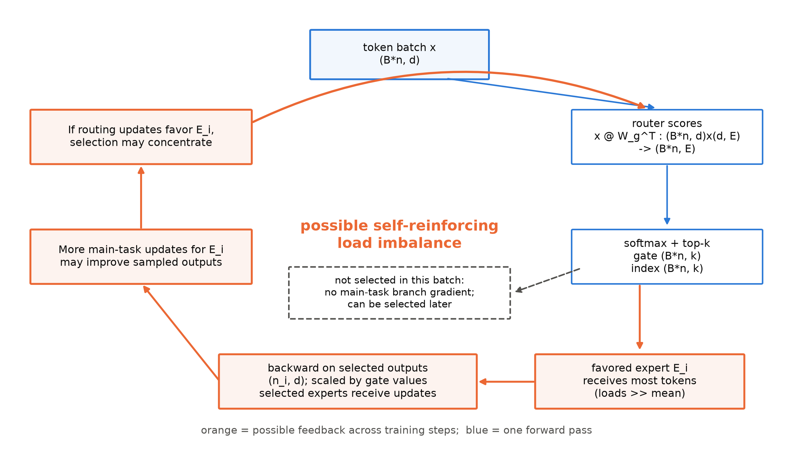
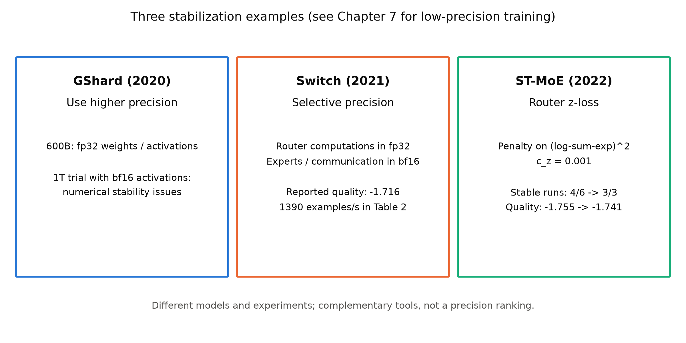
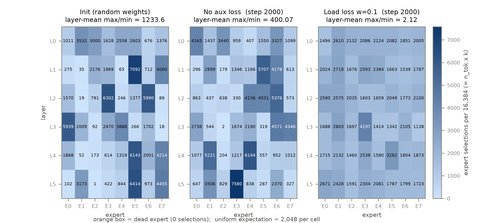

# 第 3 章 MoE 训练难题：负载、不稳定与辅助损失家族

## 3.0 开篇：从全书到这里

上一章我们把 MoE 的机构全部装好了：router 打分、top-k 门控、容量与溢出、专家天然可分片——路由与专家执行已在 dropless mini 模型中运行，容量截断与专家并行则已解释原理，三个问题（「选法怎么工作、省在哪儿、训练难在哪」）的前两问已有答案，第三问却还没有回答。而且这并非随口一问：Book3 第 8 章留下过一段原话，Llama 3 论文在 §1 明确说明了拒绝 MoE 的理由——本章就从这个拒绝开始，逐项讨论这条路线的难点。

要回答的问题是：**把 FFN 换成专家群之后，训练会遇到什么问题？历代模型怎样处理？这些方法有什么代价？**我们将收获三件东西：负载偏斜的历史运行记录、一部辅助损失家族四代演化史、以及一张稳定化案例对照图；产出物是一份两臂干预实验（none vs 辅助损失）与三张表。

到章末，我们将了解三类问题各自的处理方法与代价，而其中「均衡的代价」将被立成一个正式问题——其解决方法要到第 5 章才展开；下一章则先让第一台真实旗舰接受核对。

> **最小背景栏**
> - MoE 块数据流与形状流转：router 打分 $(B\cdot n,\,E)$、top-k 掩码、专家分发/合并——第 2 章 2.2 节与图 2.1，本章直接使用不再重画。
> - noisy top-k 与噪声的双重职能（探索 + 可微的负载估计）：第 2 章 2.3 节——本章 3.3 节第一代辅助损失的依赖。
> - 模块实验协议：Book2 五件套（AdamW + 余弦日程 + 固定 eval 窗），单种子 + 趋势判据 + 判据预注册——Book2 第 10 章立、Book3 第 2 章 2.6 节沿用的口径；语料 `tokens.bin`（sp-8k，306M token 流）。
> - 变异系数（coefficient of variation，CV）$=\mathrm{std}/\mathrm{mean}$：一个统计常识量，本章首次把它用作「负载不均」的度量。
> - 大模型训练的 loss spike 训练记录（PaLM、OPT logbook）：Book2 第 9 章 9.4 节已「认病」；本章看 MoE 时代特有的问题来源与处方前史，完整处方笺在第 7 章。

## 3.1 一份拒绝的证词

Book3 第 8 章读过 Llama 3 的代际逻辑，其中有一句引语，当时原样保留了下来。论文 §1 谈管理复杂度："we opt for a standard dense Transformer model architecture (Vaswani et al., 2017) with minor adaptations, rather than for a mixture-of-experts model (Shazeer et al., 2017) to maximize training stability."【证据等级：官方论文 2407.21783 v1 §1 直引】——宁可要稠密骨架的小修小补，也不把前馈换成专家群，理由写得很明确：训练稳定性。这个「拒绝」本身是一份证词：它说明作者在该项目中优先考虑训练稳定性；单凭这句话，无法知道其内部 MoE 试验的全部结果，也不能推断其他项目必须作同样选择。当时也留下了这个待讨论的问题：

> 「Llama 3 以训练稳定性为由拒绝了 MoE（把 FFN 换成专家群）：被拒绝的路线训练难在哪里、代价几何、又为何在 2025 年后重新成为主流——Book4 开卷的主角。→ Book4 第 3 章」（Book3 第 8 章欠账框）

本章按三类问题展开。**负载问题**是路由可能长期偏向少数专家，使计算与更新分配不均；**数值稳定性问题**是路由、专家计算与精度选择会相互影响；**优化取舍**是辅助目标的梯度可能帮助或干扰语言建模。它们相互关联，却不能简单归为同一个原因，Llama 3 的一句选型说明也不能替代对这些机制的验证。3.2 节先读负载记录，3.3 节比较均衡目标，3.4 节讨论数值工具，3.5—3.6 节再用干预实验区分收益与代价。

## 3.2 赢者通吃：负载崩塌的现场

自由路由的病症，Shazeer 在 2017 年就描述过，而且措辞带有病理学色彩，原文是：「We have observed that the gating network tends to converge to a state where it always produces large weights for the same few experts. This imbalance is self-reinforcing, as the favored experts are trained more rapidly and thus are selected even more by the gating network.」——我们观察到门控网络倾向于收敛到这样一种状态：它总是给同样的少数专家产生大权重；这种不均衡是自我强化的，因为受偏爱的专家训练得更快，从而被门控网络更多地选中【证据等级：官方论文 1701.06538 v1 §4 直引】。把这句话画成机制图，就是图 3.1 那个回路：router 稍微偏爱某专家 → 该专家收到更多 token → 反向传播时梯度只流经被选中的门（第 2 章 2.3 节的梯度通路），于是可能在所见样本上改善 → 若路由更新继续偏向它，就可能进一步增加入选率。这个反馈有条件；本批未选专家没有来自该分支的主任务梯度，但优化器动量、权重衰减或后续重新入选仍可能改变其参数——极端情形下某个专家计数归零，成了**死专家（dead expert）**：该批未被选中时专家参数没有主任务梯度；后续输入、路由参数或均衡策略变化仍可能重新选中它。赢者通吃（winner-take-all）说的就是这条橙色的环。



图 3.1 负载偏斜可能自我强化的路径（自绘教学示意）。蓝色为一次路由前向，橙色为跨训练步的反馈假设：更多派发带来更多更新机会，输出与路由若进一步偏向这些专家，负载可能继续集中。虚线框表示本批未选专家缺少该主任务分支的梯度，并不表示以后永远不能恢复。

图 3.1 中的回路是一种可能的训练反馈。第 2 章式 (2.7) 已给出主任务对选中分数的梯度：它取决于下游梯度与专家输出相对当前混合输出的方向。专家收到更多 token，会获得更多主任务更新机会；只有这些更新使其输出在后续样本上更有利、路由梯度又提高其入选倾向，偏斜才可能继续加强。路由分数由路由器根据隐藏状态计算，并非专家自行给自己打分；“更新次数更多”也不等于必然更强。

用一个示意计数区分两种份额：$E=8,k=2$ 时，均匀情况下每专家接收约 $N/4$ 个 token，占全部 $2N$ 次派发的 $1/8$。若某专家接收 $0.30N$ 个 token，它是平均负载的 1.2 倍；之后若升至 $0.35N$，才是 1.4 倍。这些比例用于解释尺度，不是从梯度公式推得的必然轨迹。是否持续偏斜，要看实际快照。

开始训练前，随机初始化的模型也可能已经呈现负载偏斜；这是一种初始状态，还不是更新反馈已经发生的证明。Shazeer 的配套技巧是把 $W_g$ 与 $W_{noise}$ 全零初始化——「初始时无信号、噪声分布对称，各专家被选中的概率相同，有限批次仍会波动」，免得开局就撞进不均衡的局部极小【证据等级：官方论文 1701.06538 v1 附录 A】。我们的 mini 机器没有做零初始化（router 权重按 std=0.02 随机初始化，本册组件参考实现口径），于是初始化的偏斜可以直接观测：训练开始前用一批固定的 8,192 个 held-out token 做路由探针（下文所有「负载快照」都用这同一批 token，跨臂跨步可比），第 0 层尚近均匀（max/min≈5.2，与探针 B 初始化口径的 ≈5.7 同向），但深层已经高度偏斜——第 1 层最忙专家一人承接 7,092/16,384 = 43% 的选择（均匀份额 12.5%），第 5 层出现计数为 1 的濒死格，六层的层均 max/min 达 1,233.6【证据等级：本书实验（CPU/MPS，2026-10，`ablation_balance.py` init 快照）】。（口径注记：本章探针喂 eval 集 held-out 8,192 token，与探针 B 的训练流口径不同，两表数字不对表、只对同向性。）

那训练是消除这种失衡，还是让它更加严重？Shazeer 的消融给了文献答案：MoE-256 模型训 10 个 epoch，**不加任何均衡损失时，最忙专家的负载是均值的 17.80 倍**，困惑度 39.8；而任何包含至少一项均衡损失的组合都把质量拉回 35.6-35.7 且均衡良好（附录 A Table 6）【证据等级：官方论文 1701.06538 v1 附录 A Table 6】。教科书描述的现象，也出现在本书的模型上，这就是本章的第一手运行记录。

实验设计先明确只改变一个变量：两臂同一份 MoE 机器（$E=8$/top-2/专家宽 704，总参 65,042,944、激活参 26,089,984——沿用第 2 章脚本 `params_active` 口径：双份嵌入、不含路由门，折第 1 章单份口径为 21,920,256；与第 2 章 moe 臂逐位同配置）、同种子同数据同日程（Book2 五件套），唯一差异是 **none 臂不加任何均衡干预**——纯交叉熵训练，让自由竞争贯穿训练；aux 臂的方案在 3.3 节说明。

none 臂的负载快照轨迹（fast 档 300 步）：层均 max/min 从 1,233.6 冲到第 100 步的峰值 6,384.5，死专家格最多时 5/48，300 步末仍有 1 格——该次训练的采样快照仍然明显偏斜；峰值之后的指标也有回落【证据等级：本书实验（CPU/MPS，2026-10）】。另一口径的参照来自探针 B：训练流 8,192 token 探针下，200 步后第 0 层直方图 $[17, 1550, 5572, 509, 25, 3199, 1303, 4209]$——max/min = 327.8，第 5 层 2 个死专家【证据等级：本书实验（CPU/MPS，2026-10，探针 B run2）】。

full 档是同种子、2000 步的另一条训练轨迹：层均 max/min 曾回落到 38—87，末段又升至约 400；第 3 层专家 6 有 4,571 次选择，专家 2 只有 2 次，所采末态没有零计数格【本书历史实验，2026-10】。它与 fast 不能仅按前缀对比：余弦学习率使用各自的总步数，100 步 warmup 之后两档的日程已经不同；full 每 500 步采样也可能漏掉早期瞬态。MPS 的数值非确定性可能再造成差异，但现有记录不足以把不同轨迹专门归因于原子加或“混沌分岔”。

不过，三次运行记录的共同之处，才是问题的根源：**这几次纯CE训练没有把观测负载带回接近均匀**——full 已记录快照的旧 MaxVio_global 均在 0.08 以上（约 aux 末态的 3 倍），个别层也出现严重偏斜。不同运行的偏斜程度有差异，本组运行中“不均衡持续存在”是共同观察，不能外推为所有运行的必然结局。

同时，none 臂的 eval loss 仍在下降：fast 末态为 6.156，full 为 4.897。负载偏斜与数值发散不是一回事；这些结果没有证明损害必然随时间累积。潜在代价主要有三项：一是很多权重很少被使用，名义参数容量未被充分利用，但每 token 仍可能照常执行 $k$ 个专家，激活参数数目并未自动下降；二是采用专家并行时，偏斜可能使某些设备成为等待瓶颈；三是少样本专家的学习机会不足，但状态并非不可逆。Shazeer 的 Table 6 为其配置提供了质量与均衡改善的证据，本章实验则需按自己的比较条件判断。

## 3.3 辅助损失家族四代：把均衡写进损失函数

了解问题之后，再看处理方法。这里选取的四组早期方案有一个共同点：**在训练目标上加一项「均衡惩罚」，与语言建模损失一同反传**，把 router 往负载均衡（load balancing）的方向拉——这类附加项统称辅助损失（auxiliary loss）。四代方案可以串成一条演变线，这些方案的目标与实现条件有所变化（表 3.1 是总账，本节按代展开）。

**第一代：Shazeer双损失（2017）。**这一设计分别约束权重总量与预计派发条数，因为计算量由条数决定，权重很小的token仍可能占一个完整专家执行位置。它同时约束两个量。第一个是重要性（importance）：一个 batch 里各专家拿到的门控值总和 $\mathrm{Importance}(X)=\sum_{x\in X}G(x)$（形状 $(E,)$），惩罚它的不均：

$$L_{\mathrm{importance}}(X)=w_{\mathrm{importance}}\cdot \mathrm{CV}\big(\mathrm{Importance}(X)\big)^{2} \tag{3.1}$$

用人话说：逼着「所有专家的门控值总量」一样大。为什么用 CV 的平方作为惩罚项？式子中体现了三个理由：CV 是「std 除以均值」，**无量纲**——对所有分量同时乘同一个正数保持不变；是否随专家数或采样规模变化，还要看分布；它在完全均匀处恰好取 0，是天然的最优点；平方保住光滑可导。若负载向量为$a\in\mathbb R_+^E$、总量$A=\sum_i a_i>0$，令$f_i=a_i/A$。采用总体方差，可逐步化简：

$$\mathrm{CV}(a)^2=\frac{E^{-1}\sum_i(a_i-A/E)^2}{(A/E)^2}
=E\sum_i(f_i-1/E)^2=E\sum_i f_i^2-1.\tag{3.7}$$

最后一步使用$\sum_i f_i=1$。这说明它不受整体乘常数影响，在均匀分配处为0；全部集中在一个专家时为$E-1$，因此不能说其所有可能取值都与专家数无关。$a=(3,1)$时$f=(0.75,0.25)$，CV²=0.25。这个量衡量离散程度，不判断专家学到了什么内容。

但光压重要性不够，Shazeer 自己点破了漏洞：一个专家可能收到少数大门值样本，另一个收到较多小门值样本——重要性相等、条数悬殊，而分布式硬件上内存与时间取决于**条数**，而不是权重大小。所以要压第二个量：负载（load），即每专家实际收到的 token 数。麻烦在于负载是数出来的离散量，选择之外全是 $-\infty$、计数是阶跃函数，不可导、没法反传。第一代的解法正是第 2 章 2.3 节埋下的那半句：噪声不只用于探索，它还是**可微的负载估计器**。给打分叠上可学习的噪声后，「专家 $i$ 的加噪打分仍能留在 top-k」成了一个概率事件：

$$P(x,i)=\Phi\!\left(\frac{(x\cdot W_{g}^{\top})_{i}-\mathrm{kth\_excluding}(H(x),k,i)}{\mathrm{Softplus}\big((x\cdot W_{\mathrm{noise}}^{\top})_{i}\big)}\right),\qquad \mathrm{Load}(X)_{i}=\sum_{x\in X}P(x,i) \tag{3.2}$$

用人话说：在噪声分布下重抽一次签，专家 $i$ 还能留在 top-k 里的概率——概率大，说明它「稳稳地」吃着这批 token；$\Phi$ 是标准正态 CDF，将硬计数转化为光滑的代理量。式(3.2)还可以从事件本身推得。固定其他专家的加噪分数，设第k高阈值为$t_i$，本专家均值$\mu_i$、标准差$\sigma_i>0$，入选事件为$\mu_i+\sigma_i\epsilon>t_i$，其中$\epsilon\sim\mathcal N(0,1)$。移项得$\epsilon>(t_i-\mu_i)/\sigma_i$，利用正态对称性，其概率为$\Phi((\mu_i-t_i)/\sigma_i)$。求和是期望计数的线性性，不要求不同token的入选事件彼此独立；它也不是将一次实际硬计数直接求导。

负载损失与式 (3.1) 同形：$L_{\mathrm{load}}=w_{\mathrm{load}}\cdot \mathrm{CV}(\mathrm{Load})^{2}$，CV 是变异系数（std/mean，均匀分布处取 0）。LM 实验权重 $w_{\mathrm{importance}}=w_{\mathrm{load}}=0.1$【证据等级：官方论文 1701.06538 v1 §4/附录 A/C】。消融读法见 3.2 节那张 Table 6：无损失 17.8 倍失衡、PPL 39.8；0.1/0.1 拉回 1.14 倍、PPL 35.6——在该组试验中，加入均衡项改善了结果，而更大的系数没有继续改善困惑度（1.0/1.0 也只有 35.7）。

**符号表**（式 (3.1)-(3.3)/(3.6) 按本书记号通用；$E$=专家数（本章实验 8），$k$=每 token 激活专家数（2），$B\cdot n$=展平 token 数。式 (3.4)/(3.5) 逐字转录 Switch/ST-MoE 原文，沿用彼处记号——原文的 $N$=专家数（即本书 $E$）、$T$/$B$=批内 token 数（即本书 $B\cdot n$），见各式后注）

| 符号 | 含义 | 形状/取值 |
|---|---|---|
| $G(x)$ | token $x$ 的门控向量（softmax 后） | $(E,)$ |
| $W_g$ / $W_{\mathrm{noise}}$ | 打分 / 噪声幅度投影 | $(E, d)$ |
| $\mathrm{Importance}(X)$ | batch 内各专家门控值总和 | $(E,)$ |
| $P(x,i)$ | 噪声下专家 $i$ 保住 top-k 的概率 | 标量 |
| $\mathrm{Load}(X)$ | 负载（计数或其平滑代理） | $(E,)$ |
| $\mathrm{CV}(\cdot)$ | 变异系数 std/mean | 标量 |
| $c_e$ / $f_i$ | 第一选择计数 / 选择比例；须区分容量截断前后（不可导通道） | 标量 |
| $m_e$ / $P_i$ | 门控均值 / 概率均值（可导通道） | 标量 |
| $w$ / $\alpha$ / $c_z$ | 各代损失系数 | 标量 |

**第二代：GShard 单损失（2020）。**GShard 去掉了门控中的噪声（第 2 章的演化线），式 (3.2) 的 $\Phi$ 通道因而不再适用——没有噪声，就没有「重抽一次签」这回事。替代方法采用了巧妙的因子式分解：

$$\ell_{\mathrm{aux}}=\frac{1}{E}\sum_{e=1}^{E}\frac{c_{e}}{S}\cdot m_{e},\qquad m_{e}=\frac{1}{S}\sum_{s=1}^{S}g_{s,e} \tag{3.3}$$

其中$c_e$在GShard Algorithm 1辅助损失计算处是第一选择计数，不是将第一、第二专家全部派发相加后的总数（不可导计数），$m_e$ 是门控值均值（可导），$S$ 为组内 token 数（GShard 把大批均分成 $G$ 个 local group 逐组计算，容量机制也在组内实施——第 2 章 2.4 节）。用人话说：**不可导的「份数」乘上可导的「胃口」**——梯度只沿 $m_e$ 这一通路传回 router，但乘积在「份数大、胃口也大」时最大，罚到的正是又吃得多又门值高的专家；在理想均匀配置处$c_e/S=m_e=1/E$，对应$\ell_{\mathrm{aux}}=1/E^2$；这给出量级参照，但代理乘积不能被当作硬负载方差的恒等替代。论文明确说明了设计动机，原文是：「we want to minimize mean square of $c_e/S$. But because $c_e$ is derived from top-2 operation and is not differentiable, we use the mean gates per expert $m_e$ as a differentiable approximation and replace $(c_e/S)^2$ with $m_e(c_e/S)$」——想把 $(c_e/S)^2$ 压到最小，但 $c_e$ 来自 top-2 操作、不可导，于是用 $m_e$ 作可导近似【证据等级：官方论文 2006.16668 v1 §2.2/Algorithm 1 直引】。两项损失并成一项、带噪估计改为无噪 softmax；总损失 $\mathcal{L}=\ell_{\mathrm{nll}}+k\cdot\ell_{\mathrm{aux}}$ 里的乘子 $k$ 论文未给数值（诚实登记：全文与附录均无）。

**第三代：Switch 负载损失（2021）。**形式与式 (3.3) 同构，可导通道与不可导通道的分工写成显式两项：

$$L_{\mathrm{aux}}=\alpha\cdot N\cdot\sum_{i=1}^{N}f_{i}\cdot P_{i},\qquad f_{i}=\frac{1}{T}\sum_{x\in\mathcal{B}}\mathbb{1}\{\arg\max p(x)=i\},\quad P_{i}=\frac{1}{T}\sum_{x\in\mathcal{B}}p_{i}(x) \tag{3.4}$$

$f_i$ 是专家 $i$ 被实派的 token 比例（不可导），$P_i$ 是 router 概率均值（可导）；均匀路由下$f_i=P_i=1/N$，该项等于$\alpha$，作为归一化参照。（记号承 Switch 原文：本式的 $N$=专家数、$T$=批内 token 数，即本章符号表的 $E$ 与 $B\cdot n$——本式为逐字转录，不改动原文记法。）用人话说：**实接的份数乘上想接的胃口**——又忙又馋的专家挨罚，梯度沿「胃口」一条道流回 router。多乘的那个 $N$ 是量级归一：均匀时 $\sum_i f_iP_i=1/N$，乘 $N$ 后该参照值不随专家数变化；这与 CV² 的尺度归一化目的有关，但两者不是同一个目标函数，也不能保证任意分布下的范围都不变。系数经 $10^{-1}$ 到 $10^{-5}$ 十进制扫描定为 $\alpha=10^{-2}$，判据原文是 "balanced load quickly without interfering with training loss"——快速均衡而不干扰训练损失【证据等级：官方论文 2101.03961 v3 §2.2 直引】。这项损失与第 2 章的容量机制是配套的：容量按「均匀负载」预留（按本章 token 数记法，每专家 $(B n\cdot k/E)\cdot\mathrm{CF}$ 个位置——第 2 章 2.4 节的一般式），$f_i$ 均匀则溢出率低、走残差直通的 token 少——均衡损失约束的，正是容量假设成立所依赖的条件。Switch 自己认领了这条简化线：「Switch 简化了 Shazeer et al. 2017 的原始设计——后者有分开的负载均衡与重要性加权两个损失」。

为什么“计数乘概率”会推向更均衡的路由？把当前硬计数$f$视为停止梯度的常数，令第t个token的概率为$p_t$，则

$$\frac{\partial L_{\mathrm{aux}}}{\partial z_{t,j}}
=\frac{\alpha E}{T}\,p_{t,j}\left(f_j-\sum_i f_i p_{t,i}\right).\tag{3.8}$$

由softmax雅可比代入即可得到：对每个$i$求$\partial p_{t,i}/\partial z_{t,j}$，再乘$f_i$累加。若某专家负载$f_j$高于该token概率加权的平均负载，梯度为正，梯度下降会压低它的分数；反之则抬高。更新强度仍依赖当前token的概率，所以均衡梯度并非“与输入内容完全无关”。

但这个局部反馈不等于一个全局最优定理。构造四个token、两个专家，第一专家概率依次为$(0.51,0.51,0.51,0.01)$，则硬份额$f=(0.75,0.25)$，概率均值$P=(0.385,0.615)$。计算$E\sum_i f_iP_i=0.885$，竟小于均匀时的1。这不是负载已经更均匀，而是两个不同统计量相乘的代理性质。判断均衡效果，必须看硬计数与实际训练，不能仅用损失小于某个常数宣布成功。

**第四代：DeepSeek-V2三级损失（2024）。**到多机工程时代，「均衡」一个词拆成了三层对象：专家级（别让个别专家饿死）、设备级（别让个别机器成为瓶颈）、通信级（别让个别链路挤爆）。DSV2 相应配了三级辅助损失，系数 0.003/0.05/0.02，外加容量因子 1.0 的 token dropping（保护约 10% 序列免被丢）【证据等级：官方技术报告 2405.04434 v5 §3.1.2】。第四代的看点不在公式（专家级仍是 $f\cdot P$ 形），而在**超参数选择**：三个系数差着一个数量级——设备级罚得最重（0.05），这些系数是该训练配方的选择，不足以单独证明哪类资源是唯一瓶颈。

连读四代方案，可以看清一条演变线索：均衡手段的中心从「估计技巧」（怎样构造离散计数的平滑代理）一路迁往「工程对象」（均衡谁、罚多重）——损失越配越精细，但**始终是在损失函数里付费**。这项代价是什么、何时开始显现，3.6 节会具体讨论；先看第二件麻烦。

**表 3.1** 辅助损失家族四代对照（公式全部带版本锚；$E$/$N$=专家数，$S$/$T$=批内 token 数）

| 代际 | 均衡损失式 | 可导通道 | 不可导通道 | 系数（实配） | 出处 |
|---|---|---|---|---|---|
| Shazeer 2017 | $w\cdot\mathrm{CV}(\cdot)^2$（importance + load 双项） | 当前分支门控值；噪声下 $\Phi$ 概率 | top-k 集合仍为硬选择 | 0.1/0.1（LM） | 1701.06538 v1 §4/附录 A |
| GShard 2020 | $\frac{1}{E}\sum_e \frac{c_e}{S} m_e$ | $m_e$（门控均值） | $c_e$（第一选择计数，含容量拒绝） | $k$ 未披露 | 2006.16668 v1 §2.2 |
| Switch 2021 | $\alpha N\sum_i f_i P_i$ | $P_i$（概率均值） | $f_i$（实派比例） | $\alpha=10^{-2}$ | 2101.03961 v3 §2.2 |
| DSV2 2024 | 专家/设备/通信三级（专家级仍 $f\cdot P$ 形） | 各级概率项 | 各级频率项 | 0.003/0.05/0.02 | 2405.04434 v5 §3.1.2 |

## 3.4 训练不稳定与 z-loss：三个稳定化案例

回到 Llama 3 拒绝信里的那个词：训练稳定性。相关论文记录了数值稳定性问题，其中低精度是一项影响因素。图 3.2 按案例排列三种互补的处理思路，不把它们当成每降低一种精度就必然增加一项工具的规律。



图 3.2 三个稳定化案例（自绘教学示意）：GShard 的 fp32 配置、Switch 的选择性精度、ST-MoE 的 router z-loss。它们改变的对象不同，可以配合使用；三个框的次序表示论文年代，不表示精度或稳定程度的数值刻度。第 7 章进一步讨论低精度训练。

**案例一：GShard 全程使用 fp32（2020）。**600B 模型是训出来的，但代价写在原文里，逐字：「we use float32 for both model weights and activations in order to ensure training stability」——我们对模型权重和激活都用 float32，以确保训练稳定；他们确实试过 1T 参数档的 bfloat16 激活，结果原文记作「several trainability issues with numerical stability, hence did not include the results for the sake of reproducibility」——遇到若干数值稳定性方面的可训练性问题，为可复现性起见不收录其结果【证据等级：官方论文 2006.16668 v1 §4.3 直引】。这一配置选择较高的数值精度：全部使用 fp32，以算力和内存换取稳定。

**案例二：Switch 精度分区（2021）。**全 fp32 太贵，Switch 的思路是把精度当分区资源：**selective precision（选择性精度）**——只在 router 函数体内把输入 cast 到 float32，算完的选择与组合张量转回 bf16，fp32 不进 all-to-all 通信。用人话说：哪里离散哪里精——做「选择」的几行计算使用高精度，数据搬运和专家计算仍采用较低精度以节省成本。具体结果如下：bf16 直训直接发散（Table 2 记作 −3.780 [diverged]），全 fp32 −1.718，selective −1.716 且吞吐 1390 ex/s（比 fp32 的 1160 快、几乎追平 bf16）【证据等级：官方论文 2101.03961 v3 §2.4 Table 2】。配套第二件是**缩小初始化**：截断正态的系数 $s$ 除以 10，3.5k 步 3 种子均值±标准差从 $-3.60\pm0.68$ 收成 $-2.72\pm0.01$——均值与方差同时改善【证据等级：官方论文 2101.03961 v3 §2.4 Table 3】。

为什么要单独给 router 使用 fp32？可以这样理解：路由器是「小数值撬动大分配」的部件——两个专家的 logits 只差末位的少量数值，top-k 的选择就会完全翻转，而选择决定梯度流向谁；低精度的舍入误差在这个放大器里会被放大成「训练错了对象」。这个直觉在今天的实现里仍是默认动作：历史所核 HF DeepseekV2 路由器使用 fp32 线性打分【证据等级：源码 transformers 5.18.0 `modeling_deepseek_v2.py`】，第 5 章实现对照时还会遇到它。

**案例三：ST-MoE 的 z-loss（2022）。**精度分区之外，ST-MoE 从损失侧补了第三件工具：router z-loss，约束 router 的 log-sum-exp 归一化项：

$$L_{z}(x)=\frac{1}{B}\sum_{i=1}^{B}\Big(\log\sum_{j=1}^{N}e^{x_{j}^{(i)}}\Big)^{2},\qquad L_{\mathrm{tot}}=L_{\mathrm{CE}}+c_{B}L_{B}+c_{z}L_{z} \tag{3.5}$$

这项正则直接约束的是$\log\sum_j e^{x_j}$，并非每个logit的平方或最大绝对值。令单行$z=\log\sum_j e^{x_j}$、$p=\operatorname{softmax}(x)$，则$\partial z/\partial x_j=p_j$，因此该行损失梯度为$2zp_j$（整批再除token数）。给所有logits加常数$c$不会改变softmax，却会让$z$变为$z+c$；z-loss因此能约束softmax看不见的整体平移自由度。相反，一个极负的非冠军logit对log-sum-exp贡献很小，所以它不是逐元素限幅器。模型需要的是降低数值风险而保留路由差异，经验效果仍要由下面的训练比较支持。

$x\in\mathbb{R}^{B\times N}$ 是进 router 的 logits（记号承 ST-MoE 原文：此处 $B$=批内 token 数、$N$=专家数，即本册的 $B\cdot n$ 与 $E$），$c_z=0.001$（超参扫描后的最佳值）。效果：baseline 6 次里 4 次稳定、2 次不稳（−1.755±0.02）；换 z-loss 后 3/3 稳定且质量 −1.741±0.02——不降反微升【证据等级：官方论文 2202.08906 v2 Table 4】。同一张表中还有一个反例值得注意：将 Adafactor 的 update clip 减到 0.1 也能 3/3 稳定，但质量崩到 −4.206±0.17——更强的更新裁剪限制了优化步长，该组结果虽然稳定，却明显损害了质量；这不等于参数完全不更新。z-loss 在表中同时保持了稳定性与所报质量，结论限于这些试验条件。这里还有本章一项重要的文献考据：

> **【考据框】区分最终输出与路由器的 z-loss。**ST-MoE 将此前 Mesh-TensorFlow 用于最终 softmax logits 的正则改用于 router，并给出本文式 (3.5) 与稳定性实验。这里依据论文明确的继承说明，不用几篇文献的关键词检索来证明历史上绝无更早用法。Switch 本文所讨论的稳定化工具是选择性精度与缩小初始化；ST-MoE 还在脚注中提到对注意力 logits 使用 z-loss 的试验，后续章节再讨论相关稳定化思路。

这三个案例分别处理数值表示、计算位置和优化目标，不能归纳成“每降一档精度就多一个工具”。第 7 章的 FP8 还需要额外检查缩放、累加与保留较高精度的组件。模型规模也不能独自预测稳定性：Switch 报告 1.6T 参数的 Switch-C 在其试验中没有观测到不稳定，而 395B 的 Switch-XXL 有时不稳【官方论文 2101.03961 v3 §5.6、Table 9 后讨论】。两配置同时改变深度、宽度和每序列计算量；这只能反驳“总参数越大必然越不稳定”，不能证明 FLOPs 本身造成了差异。

## 3.5 均衡度量与干预实验：本机两臂对拍

方案有了，现在在本机检验效果。要比较「均衡与否」，先定义衡量标准——度量先行，否则「更均衡了」只是形容词。三个指标都以硬计数（实际路由结果，而非概率）为基础：对每层统计各专家收到的选择数 $\mathrm{count}_i$（探针 8,192 token × top-2 = 每层 16,384 次选择），归一化为占比 $f_i=\mathrm{count}_i/(n_{\mathrm{tok}}\cdot k)$，均匀期望 $1/E$。

- **层均 max/min**：每层取最忙与最闲专家的计数比（死格下限取 1 防 $\infty$），再对层取均值——当最小计数为 0 时，它是截断分母后的约定指标，不是真正的有限倍数；须同时查看零计数格数；
- **层均 CV**：每层 $\mathrm{std}/\mathrm{mean}$ 再对层取均值——与式 (3.1)/(3.2) 同族，尺子与损失对齐；
- **MaxVio（最大违例，maximum violation）**：$\mathrm{MaxVio}=\max_i |f_i-1/E|$（跨层聚合后取最大，记 global 口径）——这是本书历史脚本的绝对占比偏差，记为$D_\infty$；保留原表字段名MaxVio_global便于对应代码，但它不同于noaux论文的MaxVio。

noaux论文§4.1的定义是$\max_i(\mathrm{Load}_i-\overline{\mathrm{Load}})/\overline{\mathrm{Load}}=E\max_i f_i-1$，按层计算后取层均值；global表示在整个验证集累计，而非先跨层合并。两者既有归一化差别，又有聚合顺序差别。对于同一层$f=(0.5,0.25,0.125,0.125)$，本书$D_\infty=0.25$，论文MaxVio=1。没有逐层计数，不能把表3.3的数直接乘E后与论文横比。

用人话说：max/min量「贫富差距的倍数」，CV 量「整体离散度」，MaxVio 量「离理想均匀最远的那一格差多少」。拿真实数字感受一下刻度：$E=8$ 时均匀期望 $f_i=0.125$；我们 init 快照的 MaxVio_global=0.118，只说明至少一格偏离 0.125 约 0.118：可能在约 0.243，也可能在约 0.007；单凭绝对偏差，不能断定最大值是哪一个；none 臂崩塌后单层最忙格 $f\approx0.46$-$0.48$（fast/full 两档全部快照一致，见 `log/book4-ch03/ablation_balance_{fast,full}.json`），fast 档最闲格直接归零（full 档末态没有死格、最深饥饿格计数只剩 2——表 3.3 末行）。跨层聚合还可能掩盖偏斜：不同层的“专家 0”不是同一套权重，两层分别偏向不同编号时，合并后可显得均匀。例如计数为 $(8,0)$ 与 $(0,8)$ 的两层，合并份额为 $(0.5,0.5)$，本书 global 指标为 0，但两层都极不均衡。因此部署判断须结合逐层计数、专家放置与具体批量。三个指标都来自同一批 held-out 探针 token，而非训练批——均衡性要看「换一批没见过的 token 还均不均」，否则测到的可能只是模型对训练批的记忆。

实验设计与判据都**预注册**（判据文本写于任何 full 档数字落地之前，已随销项记录存档定版）：两臂单变量，none 臂即 3.2 节的崩塌现场；aux臂使用受CV²形式启发的概率质量均衡项，不能称为原版Shazeer load损失，$w=0.1$（Shazeer LM 档口径）：

$$L = L_{\mathrm{CE}} + 0.1\cdot \frac{1}{L_{\mathrm{layers}}}\sum_{l} \mathrm{CV}\big(\mathrm{Load}^{(l)}\big)^{2},\qquad \mathrm{Load}^{(l)}_i=\sum_{x}\mathrm{softmax}(x(W_g^{(l)})^\top)_i \tag{3.6}$$

用人话说：六层各算一遍「概率质量分得匀不匀」（CV² 越小越匀），层均值乘 0.1 计入总损失。判据三条：①aux 臂末态层均 max/min 相对 none 臂**数量级下降**（阈值：差 10 倍以上）；②aux 臂 MaxVio_global $<0.05$ 且死专家格 $=0$；③质量差落在预设经验带内：$|\mathrm{eval}_{\mathrm{aux}}-\mathrm{eval}_{\mathrm{none}}|\le 0.05$ nat。有一项差异必须先说明：Shazeer 参考实现的 Load 用式 (3.2) 的 $\Phi$ 概率代理，那依赖噪声门；我们的门是确定性 softmax top-k（第 2 章教学件口径），$\Phi$ 通道不存在，故**损失环节**改用 softmax 概率质量 $\sum_x P(x,i)$ 作可导代理（可反传，但概率均衡不保证硬top-k计数均衡），**度量环节**一律用硬计数——损失使用概率，度量使用计数，两者要分开解读。梯度经 router logits 的前向钩子流回 $W_g$，不改参考实现组件一行。这条链路的形状流转见表 3.2。

**表 3.2** load 损失的形状流转（训练批 $B=16, T=512$，$N=B\cdot T=8{,}192$，$E=8$，$L_{\mathrm{layers}}=6$）

| 步骤 | 运算 | 输入形状 | 输出形状 | 说明 |
|---|---|---|---|---|
| 1 | router 线性 | $(N,d){\times}(d,E)$ | $(N,E)$ | $d=512$；钩子截取 logits |
| 2 | softmax | $(N,E)$ | $(N,E)$ | 概率质量，$\sum_i P=1$ 每 token |
| 3 | 列求和 | $(N,E)$ | $(E,)$ | $\mathrm{Load}_i$；$\sum_i \mathrm{Load}_i=N$ |
| 4 | CV | $(E,)$ | 标量 | $\mathrm{std}/\mathrm{mean}$（总体 std） |
| 5 | 平方、层均值、乘 $w$ | 6 个标量 | 标量 | 式 (3.6) 的 $L_{\mathrm{load}}$ |
| 度量侧 | softmax+top-k+计数 | $(N,E)$ | $(N,k)\to(E,)$ | 硬计数，喂三把尺子 |

表 3.3 保留 fast 300 步与 full 2000 步两次历史运行，种子均为 20261002。两档总日程不同，也各自受 MPS 数值行为影响，不能把 fast 当作 full 的前缀。0.03 与 0.05 nat 均是事先设定的经验判读带；前者参考过约 0.026 nat 的一次复跑差异，后者用于本次比较，二者都不是训练方差估计或统计非劣性界限。±se 来自评测批均值，不能代替多种子重复。

**表 3.3** none vs aux 干预读数（探针=held-out 8,192 token；【证据等级：本书实验（CPU/MPS，2026-10，`ablation_balance.py`）】）

| 度量 | none（fast 300 步） | aux（fast 300 步） | none（full 2000 步） | aux（full 2000 步） |
|---|---|---|---|---|
| 层均 max/min（init→final） | 1,233.6 → 2,217.2（峰 6,384.5@100） | 1,233.6 → **1.89** | 1,233.6 → 400.1（L3 单层 2,285.5） | 1,233.6 → **2.13** |
| 层均 CV（init→final） | 0.962 → 0.911 | 0.962 → **0.208** | 0.962 → 0.916 | 0.962 → **0.240** |
| MaxVio_global（init→final） | 0.118 → 0.103 | 0.118 → **0.015** | 0.118 → 0.086 | 0.118 → **0.031** |
| 死专家格（/48，final） | 1（峰 5@100） | **0** | 0（最深饥饿格计数 2） | **0** |
| eval_final（nat，±se） | 6.1561 ± 0.021 | **6.1142 ± 0.020** | 4.8966 ± 0.013 | **4.8535 ± 0.013** |
| aux 损失（首 10 → 末 10 均值） | — | 0.0048 → 0.0006 | — | 0.0048 → 0.0008 |
| sec/step（稳态） | 1.183 | 0.892 | 0.713 | 0.614 |



图 3.3 负载前后对照（自产，展示本机运行记录的主要图；full 档）。六层×八专家的选择计数热图：左=训练前（随机初始化，两臂同种子同快照），中=none 臂末态，右=aux 臂末态；每格标注该专家收到的选择数（均匀期望 2,048）；橙框=死专家（计数 0，本 full 档末态快照恰未出现——最深饥饿格即中图第 3 层的计数 2；死格现场见 fast 档同图：`make_figures.py --which heatmap --tier fast`）。

表中 full aux 的层均比值为 2.13，旧图标题为 2.12，差别来自舍入顺序：实验脚本先把各层比值保留两位小数再求均值，图脚本先对原比值求均值再保留两位。按图中各格计数复算可分别得到这两个数，原计数并未改变；后续比较应保持同一种舍入顺序。

逐条核对 fast 档的三条判据：①1.89 对 2,217.2，差三个数量级——**通过**；②MaxVio 0.015 < 0.05、死专家 0——**通过**；③eval 差 0.042 nat ≤ 0.05 带宽——**通过**（aux 在本次运行中更低；这里只判定满足预设经验带，不作统计非劣性声明）。

再逐条核对 full 档：①2.13 对 400.1，比值 188×（fast 档 1,173×），两档都远超 10× 阈值——**通过**；②MaxVio 0.031 < 0.05、死专家格 0——**通过**；③$|\Delta\mathrm{eval}|$ = 0.043 ≤ 0.05——**通过**，且 aux 更低的方向与 fast 一致（0.042），两档均满足事先约定的差值范围，尚未进行统计非劣性检验。

过程比终值更有教学价值：aux 臂的层均 max/min 轨迹是 1,233.6 → 1,049.7@100 → 2.42@200 → 1.89@300——**干预在开局 100-200 步之间抑制了赢者通吃**；none 臂的对应比值由约 6,384 降到 3,311、2,217，虽回落却仍很大；有限快照不能还原其间每一步的负载变化。full 档把跑程拉长 6.7 倍再验一遍：aux 从第 500 步起就稳定在 1.8-2.1（MaxVio 0.010@500 → 0.031 稳态），none 在 38-87 徘徊后在末段又漂回 400——所采快照显示 aux 臂较均衡；500 步间隔内的状态并未逐步记录，不能声称整个跑程始终如此。图 3.3 把这个对照画成 6×8 格的负载现场：左图训练前深层已偏斜（3.2 节的初始化抽签），中图 none 臂末态=第 3 层整行沦陷（专家 6 吃下 4,571 次选择、专家 2 只剩 2 次），右图 aux 臂呈现出接近均匀的浅色分布。

还有两项结果：aux 损失自身从 0.0048 衰到 0.0006/0.0008（两档同形）——概率质量的偏差惩罚减小，但数值仍非零；硬计数是否均衡需另看快照，这正是辅助损失「应缴税额」的直观形态。

计时还出现了一个需要如实记录的反常结果：预注册预期钩子与损失项开销 <10%，实测两档都是 aux 臂更快（fast 0.89 对 1.18——none 复跑窗口与后台下载重叠、热节流污染；full 干净链 0.614 对 0.713——污染解释不了）。逐专家 Python 循环的 wall-clock 还受路由桶形与机内热状态影响（垄断臂的最大桶更大），跨臂计时在这种教学实现口径下不可作效应解读，钩子的开销混在这些影响之中；正式登记为「未能按预期测出」，不作判据。

还需要说明这些证据的分量：单机两臂只是教学级样本量，论文级的同类证据基线在开源侧——OLMoE（NeurIPS 2024）用 16 组单变量受控消融（原文 "we vary only one hyperparameter for each experiment"，附录另有 4 组）把路由与均衡相关超参扫了一遍，为比较路由与均衡方案提供了公开消融记录【证据等级：官方论文 2409.02060 §4】；本书的增量不在样本量，在于用教学实现观察同类问题，而非照原配方复现论文。最后说明与后文的衔接：第 5 章还会采用 E8/top-2/无共享的粗粒度基线，再比较细粒度、不同均衡机制与稠密对照。相近的专家几何不自动表示相同的门值定义、训练日程或 checkpoint，届时需重新核对这些条件。

## 3.6 损失税：均衡的代价

按预设的经验阈值，两档历史运行均达到了所列目标。这支持本配置中该干预的效果，但不能推出所有辅助损失、系数或训练预算都同样有效。

但「有效」不等于「免费」——辅助损失是加在训练目标上的额外项，它有自己的梯度，而这个梯度与语言建模目标的梯度**不天然同向**。直觉图像：语言目标想让 router 学「按内容分工」（某类 token 该去找最擅长的专家），均衡损失想让 router「把票摊开」（谁都不能太多）——两个方向对同一个 $W_g$ 拉扯。更精确地说，设主任务与辅助项对路由参数的梯度分别为$g$、$a$，一步更新为$\Delta W=-\eta(g+\lambda a)$。主任务的一阶变化近似为$-\eta\|g\|^2-\eta\lambda g^\top a$。内积为负时，辅助项可能抵消主任务下降；内积为正时也可能相互帮助。

因此“干扰”有条件，不能只比较两项损失的数值大小来判断梯度影响。noaux 论文明确指出了这一问题，摘要逐字：「a large auxiliary loss will introduce non-negligible interference gradients into training and thus impair the model performance」，引言逐字：「it also introduces undesired gradients that conflict with the language modeling objective」——过大的辅助损失会向训练引入不可忽略的干扰梯度（interference gradients），从而损害模型性能；这些梯度与语言建模目标相冲突【证据等级：官方论文 2408.15664 v1 摘要/引言直引】。干扰不是纯理论：Shazeer 那张 Table 6 里 1.0/1.0 的重税档并不比 0.1/0.1 更好（35.7 对 35.6）——惩罚加大了，质量仍然持平。

那为什么我们两档的 aux 臂 eval 都更低（约 −0.042/−0.043 nat，落在 0.05 的预设比较带内，但已大于前述 0.03 经验带）？因为这项代价是否显现取决于具体条件。式 (3.6) 的 aux 项量级约 $5\times10^{-3}$，比交叉熵（fast 档约 7 nat）小三个数量级，本实验的总效果未出现明显质量恶化；损失标量小并不能证明梯度干扰小；noaux 文献另外比较了 1B 模型、100B token 的训练结果（noaux 论文的对照实验，数字留给第 5 章）。可以用一句话概括：**辅助项通过改变优化方向改善分配，收益与代价需要在指定模型和配方上共同验证**。能否通过路由机制调节负载，减少对辅助梯度的依赖？2024 年的 noaux 工作给出了一种方案及其试验结果。第 5 章会解释偏置如何更新、它避免了哪条梯度通路，以及仍需付出的代价。

## 3.7 本章小结

回到开篇，Llama 3 的选择提醒我们把稳定性纳入架构取舍。本章分别检查了三件事：路由反馈可能造成负载偏斜，图 3.1 和历史快照解释其机制与边界；图 3.2 的三个案例展示不同数值工具；辅助目标则通过改变优化方向影响分配，既可能帮助也可能干扰主任务。历史两臂在所定阈值下达标：0.1 权重的概率质量 CV² 项大幅降低了所采负载指标，fast 末态零计数格消失，full 两臂末态本来都没有零计数格；eval 差处于预设比较带。它支持的是这套配置中的干预效果。

**带走的心智**：先分清要均衡的对象，再看所用的代理量。概率质量、硬路由条数、设备工作量和通信负载彼此有关，却不是同一个数；损失下降后仍要查看实际分配。其次，稳定化方案要同时检查“能否训练”和“学得怎样”，不能只追求不发散。辅助系数、精度选择与路由规则都需要在具体配置中验证；第 5、7 章沿着这些问题继续。

镜头拉回整机：第一项改造的结构（第 2 章）与难题（本章）都已介绍完整——我们知道专家群怎么搭、会遇到什么问题、四代方案怎样演变。但至今所有证据都来自论文与本机的 mini 机器，还没有一台真实旗舰接受过核对。下一章迎第一台：Mixtral 8x7B，全开源旗舰 MoE 的组装术实证——config 反推法第一次独立实习，顺便看看路由器在真模型里到底把 token 派给了谁。

## 3.8 动手验证

在工作区根目录激活环境。无需训练即可重绘机制与稳定化案例图：

```bash
source ./env.sh
python from-models-to-vllm/book4-scale-and-efficiency/code/ch03/make_figures.py --which diagrams
```

运行概率均衡消融需要准备原语料；下面两条是可选训练命令，历史时间参考分别约为 MPS 每臂 5 分钟和 30 分钟，不能套用于 CPU：

```bash
python from-models-to-vllm/book4-scale-and-efficiency/code/ch03/ablation_balance.py --steps 300 --out-name new_fast
python from-models-to-vllm/book4-scale-and-efficiency/code/ch03/ablation_balance.py --steps 2000 --out-name new_full
```

同输出名只允许恢复同一日程、数据标识与实现版本。路由快照与曲线写入工作区日志目录。热图重绘用 --which heatmap --tier 指定运行后缀，并用 --log-dir 指向含两臂 routing CSV 的目录；缺失记录时报错。探针 B 的旧 JSON 与原始训练 CSV 若未随环境迁移保留，应按历史结果阅读，不声称本轮已经重跑。
