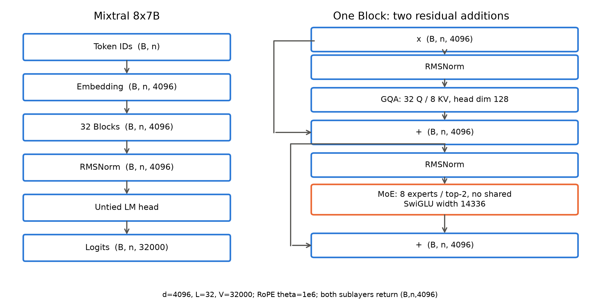
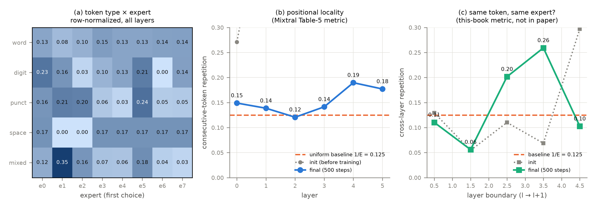
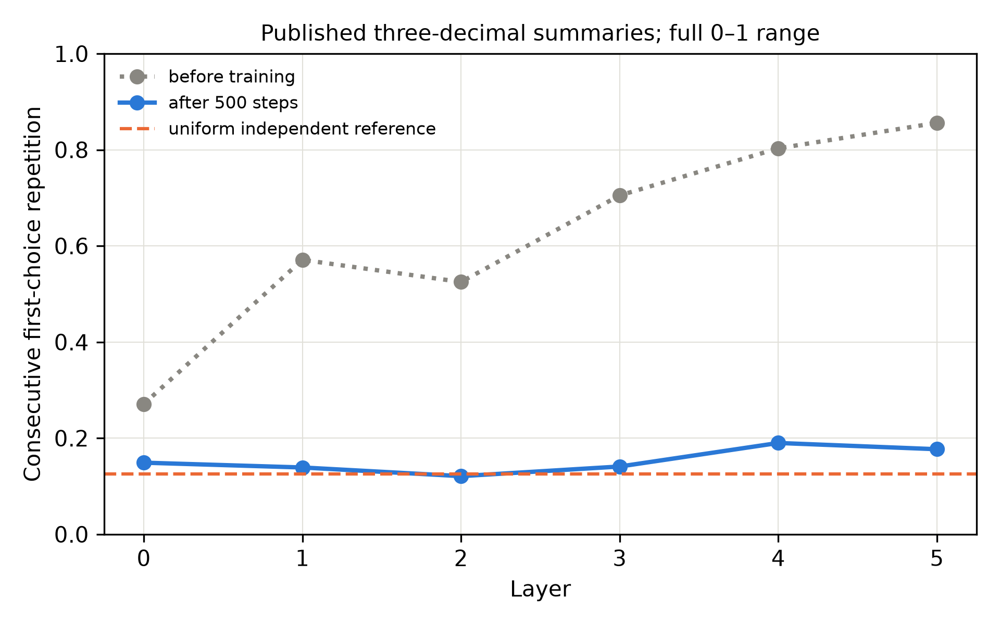

# 第 4 章 Mixtral：开源 MoE 组装术的实证

## 4.0 开篇：从全书到这里

上一章以这段话结束：「下一章迎第一台：Mixtral 8x7B，全开源旗舰 MoE 的组装术实证——config 反推法第一次独立实习，顺便看看路由器在真模型里到底把 token 派给了谁。」【第 3 章成稿直引】

现在来做这次核对。先回顾已有的准备：第 2 章实现了 dropless 的路由、top-k 与派发，并用 CPU 小模型对拍；容量截断另作原理说明。第 3 章介绍四组均衡方案，并用其中一种概率质量辅助项作教学干预。但到此为止，证据只有两个来源——别人的论文与自己 26M 的小机器，还没有一台真实旗舰接受过核对。

Mixtral 8x7B 正是理想的第一台，它在本章有三重作用。其一，它是一台有代表性的 Apache-2.0 开放权重 MoE 模型，适合把前面学到的组件放回真实整机。其二，组装学（assembly，Book3 第 8 章提出的「把各处验证过的零件装进同一台整机」之学）的官方依据：论文自述与 Mistral 7B 同架构、唯一的结构差异是把每层前馈换成 8 个专家块——「插槽世界观」在这里得到了旗舰模型的实证支持。其三，config 反推五步法的实习场：论文正文只有约 9 页，有结构参数表与 MoE 层图，但没有完整整机图，也未披露足以复现预训练的完整配方，checkpoint配置、对应实现和权重形状共同提供结构依据——Book3 第 9 章教了五步法、第 1 章 1.4 节用过其中的「算账对拍」一步，本章第一次独立走完全程，第 10 章还会在主要以官方模型卡与实现披露结构的 gpt-oss 上把它作为主要分析方法。

本章是全册第一个「拆解章」，分析模型时遵循同一顺序：先看整机、再拆局部、最后回到整体；而「核对」二字有具体含义——旗舰模型中的每个组件都要能对应到「我们在第 N 章亲手写过它的 mini 版」：MoE 块指回第 2 章的图 2.1 与对拍证书，负载与均衡指回第 3 章的两臂实验；指不回去的部分，才是本章真正的新知识。

图 4.1 就是整机图（Mixtral 论文没有画过架构总图，本图按 checkpoint config 与论文 §2 的结构自述自绘重制）。先沿数据流看一遍整体过程：token 序号 $(B,n)$ 过 32000 行的 embedding 表查成残差流 $(B,n,4096)$；穿过 32 层 decoder block，每层先是注意力子层——32 个查询头共享 8 组 KV 的 GQA，分组比为 4∶1；Llama 2 70B 虽同为 8 个 KV 头，却有 64 个查询头，分组比为 8∶1——再是前馈子层，只是这里采用的已不是原来那个 4096-14336-4096 的 dense SwiGLU，而是一个 8 专家的 MoE 块：展平成 $(N,4096)$（$N=B\cdot n$），router $W_g\in\mathbb{R}^{8\times4096}$ 打分得 $(N,8)$，softmax 后取 top-2 重归一成 $(N,2)$ 的门控，两个被选中的全宽专家各计算一次 SwiGLU、加权合并写回残差流；出第 32 层后过最终 RMSNorm，由独立的 lm_head 输出 $(B,n,32000)$ 的 logits。四件套（RMSNorm/SwiGLU/RoPE/GQA）一件没换位置——SwiGLU 没有退役，它仍在每个专家内部使用；改变的只有 FFN 插槽的工作方式。这张图请先留在脑中，本章每一节都会回到图中确认所讲组件的位置。



图 4.1 Mixtral 8x7B 整机与单层结构（自绘教学示意，依据官方 checkpoint config 与论文 §2/Table 1）。左侧为输入到 logits 的路径，右侧展开两个 pre-RMSNorm 子层与两次残差相加；MoE 的派发细节见第 2 章图 2.1。几何为 $d=4096,L=32,h=32,h_{kv}=8,d_k=128,w=14336,V=32000,E=8,k=2$，无共享专家。与 Mistral 7B 相比，前馈组织改变；上下文窗口和 RoPE 参数也须按本配置读取。

> **最小背景栏**：本章只补一件前置——Mixtral 是谁、8x7B 怎么读，其余全部指回。MoE 块的数据流与形状流转＝第 2 章图 2.1 与表 2.1（router 打分 $(N,E)$、top-k 掩码、派发合并）；负载均衡与辅助损失＝第 3 章（4.6 节的训练臂直接复用其协议）；config 逆向五步法（认家族→重建图纸→算账对拍→读外围→证据分级）＝Book3 第 9 章，其原型在 Book3 第 5 章；组装学四插槽与代际表＝Book3 第 8 章表 8.4/8.5；三口径参数账＝第 1 章式 (1.1)-(1.3) 与表 1.2 的口径纪律；GQA 的 8 KV 头账本＝Book3 第 6 章。

## 4.1 config 反推实习：五步法第一次独立使用

拆机从哪儿下手？可以先将 checkpoint 的 config.json 与论文 Table 1 并排查看。这个阅读顺序有更有力的事实依据：论文数字是取整口径、HF 模型卡是一位小数、config 字段是结构事实的原始记录，**尺寸先读检查点配置，再用其版本对应的实现与权重核对**。

五步法第一步，认家族：`model_type=mixtral`、`architectures=MixtralForCausalLM`、`transformers_version=4.36.0.dev0`——第三件是年代学证据，提供序列化所用库版本的线索，不能单独精确确定配置写入日期；第二步，重建图纸，逐字段映射到结构部件，这就是表 4.1 与图 4.1 的来源；第三步算账对拍，4.2 节用整节说明；第四步读外围（词表、上下文、特殊字段）；第五步证据分级，把每个字段的等级标进表里——config 逆向≠全知，等级列就是它能「读到什么、读不到什么」的诚实边界。

**表 4.1** Mixtral 8x7B config 字段全表（字段→值→部件→等级；以随书 config 快照及本轮核对为准；字段身份和派生值分开列出）

| 字段 | 值 | 映射部件 | 等级 |
|---|---|---|---|
| hidden_size | 4096 | 残差流宽 $d$ | config 逆向 |
| num_hidden_layers | 32 | 层数 $L$（每层全换 MoE，无首层稠密排布） | config 逆向 |
| num_attention_heads / num_key_value_heads | 32 / 8 | GQA $4{:}1$；70B 的 64Q/8KV 为 $8{:}1$ | config 逆向 |
| head_dim | **缺席** | 有效头维按 $d/h$ 派生 $=128$（$32{\times}128=4096=d$ 自洽） | config 逆向（派生） |
| intermediate_size | 14336 | **每专家** SwiGLU 宽 $w$（全宽专家，未切细） | config 逆向 |
| vocab_size | 32000 | 词表行数 $V$；分词算法及 token-ID 对应须另查 tokenizer 文件 | config 逆向 |
| num_local_experts / num_experts_per_tok | 8 / 2 | $E{=}8$、$k{=}2$（top-2 无共享） | config 逆向 |
| max_position_embeddings | 32768 | 配置记录 32k；论文说明以 32k 上下文训练，不是缓存分配或质量的独立证明 | config 逆向 |
| rope_theta | 1000000.0 | RoPE 底数 $\theta{=}10^6$（长窗出厂档） | config 逆向 |
| sliding_window | null | 字段存在且值为 null；本配置不启用滑动窗口（config 事实；机制的展开属后续册） | config 逆向 |
| hidden_act / rms_norm_eps | silu / 1e-5 | SwiGLU＋RMSNorm（四插槽的两格） | config 逆向 |
| router_aux_loss_coef | 0.02 | HF 检查点中记录的系数；不能据此认定为原预训练所用值（4.4 节） | 检查点配置 |
| tie_word_embeddings | false | untied：出入口两份 $V{\times}d$（Book3 第 5 章） | config 逆向 |
| 训练数据配比 / 完整日程 / 均衡损失配方 | **未完整披露** | 论文提到多语言数据及相较 Mistral 7B 提高多语言比例，但不足以重建配方 | 论文披露范围 |

表中有两处值得仔细看，它们正是这次实习的新收获。**一处是 head_dim 的缺席**：raw config 里根本没有这个字段，128 是按 $d/h$ 派生出来的有效值。这不只是琐碎细节——它是 config 逆向中容易出错的地方：字段缺席不等于「模型没有头维」，也不等于「随便填」，而是要按家族的派生规则补（该家族实现的派生规则与论文 Table 1 的 128 相符）；对比第 10 章的 gpt-oss（head_dim 显式写进 config 且 $h\cdot d_k>d$ 的罕见几何），「字段在不在」本身就是一条家族指纹。

**另一处是检查点与库默认类的差别。**历史记录在 transformers 5.18.0 所选字段中发现两项差异：上下文 32768 对 131072、辅助系数 0.02 对 0.001。它说明调用 MixtralConfig() 并不等于读取这台检查点。随书脚本现在读取原始配置快照，并打印当前实际库版本及差异列表；不将“恰好两处”设为跨版本永远成立的验收规则。某项默认值变化，应先解释来源，再判断结构是否受影响。

读取字段还需区分原始 JSON 与实例化后的配置对象。当前库可能把 RoPE 字段放入 rope_parameters；原始文件仍能保留 rope_theta。随书脚本分别展示原始值与当前对象的读法，避免把封装方式变化误读为模型结构改变。

> **【实现对照框】原始配置与派生值。**随书 mixtral_config.json 保存所核配置，head_dim 并未显式出现；论文 Table 1 列为 128，对应版本实现也按 $d/h$ 派生。三个证据分别回答“文件写了什么”“论文描述什么”“程序怎样解释”，用途不同。笔记可以帮助定位，但结构结论仍应回到这些原始材料。

第四步读外围，还要核对三项：词表大小 32000 与 Llama 1/2 相同；它同样采用 SentencePiece BPE（见 Book3 第 5 章），但词表行数和算法相同，并不意味着 token-ID 映射逐项相同；上下文 32k 是**原生**的，论文摘要逐字 "Trained with a 32k-token context"——这段上下文不是靠外推获得的，与 Book3 第 7 章的外推工程线对照，Mixtral 走的是「出厂长窗」（$\theta=10^6$ 配 32k）；`sliding_window=null` 则是对自家 Mistral 7B 的例外——那台 7B 用了滑动窗字段，Mixtral 反而全稠密。

第五步是给结论划清范围。配置支持几何与运行选项判断，论文支持其已报告的训练与评测事实；它们都不能单独补出未披露的预训练配方。router_aux_loss_coef=0.02 也是检查点字段，既不能无据归为“社区默认”，也不能直接宣布原模型曾以此训练。4.4 节再看它何时会进入 HF 的损失计算。

## 4.2 参数账两口径：47B/13B 的精确底数

图纸重建完，第三步算账。公式一个都不用新立——第 1 章式 (1.1)/(1.2) 就是为此刻备的，将表 4.1 的字段逐一代入，全部用整数精确计算（Python int 无浮点误差，[`ch04/mixtral_infer.py`](code/ch04/mixtral_infer.py) 逐项 assert）【证据等级：本书复算（config 公式，2026-10，与 ch01/account.py 同源）】。

注意力每层 $A=4096{\times}4096+2{\times}4096{\times}1024+4096{\times}4096=41{,}943{,}040$（q/o 全宽、k/v 按 8 个 KV 头缩——GQA 记法承 Book3 第 6 章）；单个专家 $3{\cdot}d{\cdot}w=3{\times}4096{\times}14336=176{,}160{,}768$（SwiGLU 三矩阵）；MoE 槽每层 $8\times176{,}160{,}768+4096\times8=1{,}409{,}318{,}912$（专家群＋router $W_g$）；32 层再加 untied 出入口两份 $2Vd=262{,}144{,}000$ 与最终 norm，总参 $46{,}702{,}792{,}704$。

激活参按本册口径（含 lm_head、不含输入 embedding lookup）$=32\times(41{,}943{,}040+2\times176{,}160{,}768+32{,}768+8{,}192)+Vd+d=12{,}748{,}853{,}248$，双份再加 $Vd=131{,}072{,}000$ 得 $12{,}879{,}925{,}248$。

**表 4.2** 参数账两口径：自算 vs 官方（激活参口径见第 1 章 §1.3；MoE 计入路由门 $E d$，其量级见首行注）

| 项 | 自算（逐位） | 官方口径 | 判读 |
|---|---|---|---|
| 总参 | **46,702,792,704** | 论文 47B【官方论文 2401.04088 v1 摘要】；HF 卡 46.7B【config 逆向】 | 取整口径：46.703→47、46.7 都对 |
| 激活参·单份 | **12,748,853,248** | 论文 13B（摘要取整） | 12.75→13；路由门 $32\times32{,}768$ 占其 0.008%——是否计入，在两位小数的精度下没有影响 |
| 激活参·双份 | **12,879,925,248** | HF 卡 12.9B | 12.88→12.9，一位小数吻合 |
| 单专家 | 176,160,768（≈176.16M） | —— | 与 Mistral 7B 的 FFN 同宽（4.3 节） |
| MoE 专家占总参 | **96.56%** | —— | 读懂专家，就理解了整机的大部分参数（承第 1 章） |

这里要同时区分修约和统计范围。总参 46.7028B 与官方 47B、46.7B 在各自精度下相容；激活参数还需说明输入表是否计入。单份 12.7489B 与双份 12.8799B 都可能写成整数 13B，不能只凭“13B”反推唯一口径；12.9B 则与双份计数更接近。精确整数来自声明清楚的结构公式，不是论文已经逐位公布了所有权重数目。

第二个教学要点与名称有关。8x7B 这个名字容易读成「8 台 7B」——乘出来 56B，与 46.7B 对不上。这个差异是正常的，因为加法分解才符合实际结构：**Mixtral ＝ 一台 Mistral-7B 几何的稠密机（7,241,732,096 参）＋ 7 份 FFN 复件（$7\times32\times176{,}160{,}768=39{,}460{,}012{,}032$）＋ 路由门（$32\times4096\times8=1{,}048{,}576$）**，三项相加等于上述总参（脚本内置 assert）。这是一项参数几何分解，不表示实际训练时复制了 Mistral 的已训练权重。名称中的乘号掩盖了一个组装上的事实：「8 份复制的只是 FFN 插槽、注意力与出入口只装一份」——骨架是共享的，专家是插上去的。第 2 章「MoE 不是新机型、是 FFN 插槽的替换件」的命题，在这行加法中得到了精确到个位的算术说明。

## 4.3 组装学证据：四插槽清点，注意力基本结构延续

核对完参数，回到图 4.1，考察「组装学」的核心问题。Mixtral 论文摘要把同构性说得十分明确，逐字："Mixtral has the same architecture as Mistral 7B, with the difference that each layer is composed of 8 feedforward blocks"——与 Mistral 7B 同架构，差别只是每层由 8 个前馈块组成【证据等级：官方论文 2401.04088 v1 摘要直引】。§2 补充说明它沿用 Mistral 7B 论文描述的全部修改，例外仅两处：32k 稠密上下文（4.1 节已读）与 FFN 换 MoE。逐插槽对齐 Book3 第 8 章的清单：

- **① RMSNorm**：pre 结构、eps 1e-5，沿用 pre-RMSNorm 结构；eps 按本检查点读取；
- **② SwiGLU**：结构不动，**搬家**——从「每层一只宽 14336 的车间」搬进「每层 8 只宽 14336 的专家」，门控三矩阵原样（论文 §2.1 自述专家函数 $E_i(x)$ 用 "the same SwiGLU architecture"）；
- **③ RoPE**：$\theta=10^6$、全头维旋转——机制不动，底数取长窗档；
- **④ GQA**：32 查询头共享 8 组 KV——与 Llama 2 70B 相同的是 KV 头数，查询头数与分组比不同，**注意力投影结构延续，但窗口与位置参数需另核**。

这份清单还需要用源码核对，才能确认其依据。transformers 5.18.0 里 `MixtralDecoderLayer` 与 Llama 的 decoder layer 逐成员同构——两枚 RMSNorm、self_attn、post_attention_layernorm、mlp，唯一的替换就是 `mlp` 从稠密 SwiGLU 换成 `MixtralSparseMoeBlock`【证据等级：源码 transformers 5.18.0 `modeling_mixtral.py`】；从键名来看就更清楚了：hub checkpoint 里注意力四投影的键名 `self_attn.{q,k,v,o}_proj.weight` 与 Book3 整机完全同名，MoE 的键挂在 `block_sparse_moe.*` 目录下——**MoE 化不动注意力键**（第 9 章拆 DSV2 时这张键位对照表还要扩展）。这些材料共同支持前馈结构的变化；注意力键名相同并不能证明窗口、位置参数和全部运行行为相同——第 2 章提出的插槽观，第一次在旗舰模型上得到完整验证。

两个「插槽取值」的细节也值得留意，它们都体现了代际之间的联系。其一是 GQA 的档位：Book3 第 8 章表 8.4 记得很清楚，Llama 2 只有 34B（训而未发）与 70B 两档用 GQA，7B/13B 仍是 MHA——而 Mixtral 这台「13B 激活」量级的机器已经用上与 70B 同款的 8 KV 头。插槽化的含义正在这里：组件一旦进入可选清单，后续模型可以按自己的质量与成本目标选择参数——8个KV头是这些配置采用的折中，不是普适最优值（Book3 第 6 章），Mixtral 对长上下文的追求，使它提前在 13B 激活参数的小档模型上采用了这一配置。

其二是 MoE 层的插入密度：GShard 隔层替换，Switch Base/Large/XXL 也采用隔层专家，Switch-C 的频率才为 1；Mixtral 则把每一层的前馈都换成 MoE。DeepSeek 的若干配置又在开头保留稠密层。这些是各配置的排布选择，不能简单排成“后来者必然更先进”的顺序，也不在缺少消融证据时替作者断定唯一动机。

再回到整体来看：四插槽三件原样、一件改变工作方式，残差流宽度 $(B,n,4096)$ 丝毫不变，MoE 块的输出仍是 $(B,n,4096)$——对外接口与稠密机完全相同。

这也是「组装术」的真正含义：Mixtral 组合了此前研究中的稀疏门控、SwiGLU、RoPE 和 GQA，它做的是把第 2 章那套现成机构装进一个经过验证的模型骨架——论文自己都把路由公式原样写在 §2.1：$y=\sum_{i=0}^{n-1}\mathrm{Softmax}(\mathrm{Top2}(x\cdot W_g))_i\cdot\mathrm{SwiGLU}_i(x)$（与第 2 章式 (2.1) 同一机构），并明确指出它与 GShard 的区别，逐字："This formulation is similar to the GShard architecture, with the exceptions that we replace all FFN sub-blocks by MoE layers while GShard replaces every other block, and that GShard uses a more elaborate gating strategy for the second expert assigned to each token"——例外恰是两处：插入密度（Mixtral 每层全换、GShard 每隔一层，正是上文谱系行的对照项）与第二专家的门控（GShard 为第二专家配了更精巧的选择策略，Mixtral 不做这种处理）【证据等级：官方论文 2401.04088 v1 §2.1 直引】。机构是旧的，装法是新的：全宽专家、每层都换、注意力基本结构延续。

## 4.4 论文数字与诚实条款：成绩单怎么读

核对完结构，再看评测成绩。Table 2 对 Llama 2 70B，表题逐字："outperforms or matches Llama 2 70B performance on almost all popular benchmarks **while using 5x fewer active parameters during inference**"——多数基准持平或反超，推理激活参数少 5 倍【证据等级：官方论文 2401.04088 v1 Table 2】。选取四项来看：MMLU 70.6 对 69.9，HumanEval 40.2 对 29.3，MATH 28.4 对 13.8，GSM8K 74.4 对 69.6（8-shot maj@8 口径）。这个「5x」可以直接用参数数目核算：采用包含两张词表的统计范围时，Llama 2 70B 的活跃路径计数与总参数相同，按 4.2 节同一套 config 公式算 Llama 2 70B 得 68.98B（Book3 第 8 章的账），对 12.88B（双份）≈5.35。

Table 3 再对闭源的 GPT-3.5：MMLU 70.6 对 70.0，MBPP pass@1 60.7 对 52.2，GSM-8K 5-shot 58.4 对 57.1，MT-Bench（Instruct 版）8.30 对 8.32——该版本在这些指定基准与提示设置上达到接近对照模型的成绩【证据等级：官方论文 2401.04088 v1 Table 3】。（GPT-3.5 参数未公开，体量倍数不引。）

同一篇论文两张表都叫 GSM8K、数字却是 74.4 对 58.4——不是矛盾，是 harness 不同：Table 2 用 8-shot maj@8、Table 3 用 5-shot，评测设置写在 §3 的项目符号里。引用时必须同时注明表号与 shot 数，这是「同名指标不同口径」在单篇论文内部的现场版。

比评测成绩更有价值的是 §3 对限制条件的说明，它从官方论文的角度重述了第 1 章「省什么、不省什么」的清单。论文先说明节省之处：激活参数 "directly proportional to the inference compute cost"——主要线性计算可用激活参数量作近似参照；注意力、路由和执行条件仍需另计；随后也列出了两项开销：其一，"the SMoEs layer introduces additional overhead due to the routing mechanism"——路由机制引入额外开销（正是第 1 章 1.5 节的「调度税」与第 2 章整步耗时对照所提示的执行成本；该对照并未单独测出派发开销）；

其二，"The memory costs for serving Mixtral are proportional to its sparse parameter count, 47B"——服务显存随稀疏参数 47B 走，「不过仍小于 Llama 2 70B」。速度则按 batch 分两段说（§1 的 "faster inference speed at low batch-sizes, and higher throughput at large batch-sizes"），措辞克制——但这两种情况恰好分别体现了不同成本上的优势，用第 1 章的三口径能读出所以然：小批量解码通常较难摊薄权重读取，较少活跃专家可以减少每次需要读取的权重；批量增大后，权重复用与矩阵乘利用率提高，但一批token可能共同覆盖更多专家。到底受带宽、计算还是通信限制，需要结合硬件与负载测量，不能把“小batch等于算力瓶颈、大batch等于带宽瓶颈”固定下来。参数账可以解释部分动机，不能替代性能剖析。

这里必须明确一条引用边界：**论文里没有「以 13B 稠密模型的速度运行」这类句子**——全文检索无此表述；显存那句只说「小于 70B」，速度两段论不含与稠密 13B 的直接对比。转述时应保留比较对象和执行条件，不能把参数倍率直接改写成速度倍率。

最后看 0.02。官方 HF 检查点确实记录了 router_aux_loss_coef=0.02，也记录了 output_router_logits=false。论文没有给出足以确认原预训练辅助损失系数的配方；但“论文没写”不能推出“它一定来自社区默认”。所核 transformers v4.36.0 配置类默认值为 0.001，转换脚本也没有显式设置该系数，当前 5.14.1 默认同为 0.001。因此本章能确认的是检查点字段与类默认值不同，不能仅据这些文件确定 0.02 最初为何被选用，或原训练是否采用它。

开放权重、结构披露与完整训练配方是三件事。Mixtral 提供了可以加载的权重和结构依据，论文也介绍了多语言预训练与评测，但不足以逐项重建数据配比、日程和全部稳定化设置。我们应把“已知字段”与“未知训练细节”分开，而不是用一个现成配置系数填补所有空白。下一章的 DeepSeekMoE 提供更多组件消融，可以进一步比较其结构选择，但仍须逐项核对它实际披露了什么。

> **【实现对照框】系数存在不等于损失生效。**本轮所核 transformers 5.14.1 的顶层前向，只有启用 output_router_logits 时才计算辅助项；还须提供 labels，才将该项乘配置系数后加进总 loss。检查点的默认开关为 false，因此不能说“按默认配置微调就必然付 0.02 的辅助损失”。该版本的 helper 将各层 logits 拼接后统计 top-k 选择次数与概率均值；它不是先逐层算损失再求均值，均匀参考值还受 top-k 计数约定影响。运行时必须同时检查调用参数、配置和源码，不能只看一个数值字段。

## 4.5 路由分析三结论：路由器到底把 token 派给了谁

成绩单背后有个所有人都想问的问题：8 个专家到底怎么分工的？论文 §5 做了路由分析（routing analysis），三条结论各有相应的证据强度，值得逐字阅读——因为它们是全章最容易被转述走样的部分。

**结论一：这组探针未观察到明显主题分工（domain specialization，按内容领域给专家分科）。**论文在 The Pile 的八个子集上展示专家分布，并特别指出 ArXiv、PubMed、PhilPapers 三者相近，逐字："Surprisingly, we do not observe obvious patterns in the assignment of experts based on the topic."——出乎意料地，没有观察到基于主题的专家指派模式，三域的分布 "very similar"【证据等级：官方论文 2401.04088 v1 §5 直引】。注意句子的强度：这是对该模型、这些层和三个领域的统计观察，不是证明所有层、所有领域都不可能出现专门化。论文另指出 DM Mathematics 的分布略有差异；领域边际频率相近，也不排除相同频率下 token 级路由不同。

**结论二：句法对齐（syntax alignment），但语气是推测级。**Figure 8 研究标点、缩进这类 token 的专家选择，表题的措辞是 "appears to be more aligned with the syntax rather than the domain"——**看起来**更对齐句法而非领域；正文接 "This suggests that the router does exhibit some structured syntactic behavior"——**这提示** router 确有某种结构化的句法行为，且初始层与最终层尤其明显【证据等级：官方论文 2401.04088 v1 §5/Fig 8 直引】。appears、suggests——论文自己把这条标成推测级，转述时不能升格成定论。

**结论三：位置局部性（positional locality）。**Table 5 统计「连续两个 token 的第一选择（first choice，top-2 的第一槽）专家是否相同」：第 0 层表印 13.6%-14.9%（八个域的区间），论文表注给出随机指派下的基线 12.5%——恰是 8 选 2 下第一选择的均匀概率 $1/8$，层 0 贴着基线（12.5% 不是异常，是基线，表印值还略高于它）；第 15 层升到 23.6%-28.4%、第 31 层 19.7%-26.3%——深两层显著高于基线【证据等级：官方论文 2401.04088 v1 §5 Table 5】。论文还自己给出部署含义：这种局部性在专家并行下可能让个别专家过载（over-subscription），但也可以被缓存利用——"can be leveraged for caching"。

三条结果提供了不同层次的观察：图 7 比较所测层的领域边际频率；图 8 展示若干文本片段，提示路由可能与句法特征有关；Table 5 则报告相邻位置的重复率。它们不支持简单把专家命名为“数学专家”或“医学专家”，也不支持把路由当作完全均匀随机。解释超过 1/8 的重复率时，还应检查每层的边际频率；均匀且独立才给出 1/8。这些探针提供证据，却没有证明模型内不存在任何形式的领域专门化。下一节用小模型练习同样的统计问题。

> **【考据框】「专家按领域分工」的讹传史。**把 MoE 专家讲成「一个管数学、一个管代码、一个管医学」是中文与英文社区共有的流行想象，Mixtral 的这些观察没有支持这种简单分科：若干领域的边际分布相近，并出现句法相关与位置重复现象。讹传的源头不难猜——「专家」这个比喻本身就在暗示分工，而第 5 章 DeepSeekMoE 的「共享专家隔离公共知识」会给出更准确的分工图景：共享路径旨在承接通用处理，但仍需实验证明具体学到了何种分工。读到任何「专家特化于某领域」的断言，先问一句：哪台模型、哪层、什么观测？

## 4.6 替身与自家版：把三条结论带回本机

想在自己机器上看路由，先过一道选型关。Mixtral 真权重 bf16 要 93.4GB（第 1 章 1.5 节的账），48GB 统一内存无法容纳——本册替身（stand-in）清单里排除它，正为此。候选是两台更小的开源 MoE，而**选型过程本身就是五步法的浓缩再演**——导览 0.6 节曾写道「对拍真权重按许可与 48GB 内存选定，选型过程本身是一轮 config 逆向练习（第 4 章演示）」，这里就来完成这项练习。

第一款替身模型 OLMoE-1B-7B-0924（AI2，Apache-2.0）：①认家族读 config——$d{=}2048$、$L{=}16$、$E{=}64$、top-8、每专家宽 1024，路由 softmax 但 `norm_topk_prob=false`（top-8 后不重归一）——与 Mixtral 同属 softmax 族（Mixtral 重归一、它不归一，族内小差异要登记）；②算账——总参 6.92B、激活 1.18B（本册口径），与官方约 7B/1B 的量级比较；概数本身不是逐位参数表；③内存两口径——bf16 权重 13.8GB，本机可载；④保真度声明——**OLMoE 是 MHA（$n_{kv}=16=n_h$）而非 GQA**，细粒度 64 选 8 也与 Mixtral 的粗粒度 8 选 2 不属同一种几何配置，把它的路由观察外推到 Mixtral 要先声明这两条差异【证据等级：config 逆向，2026-10 直读 hub config】。

第二款是作为条件性备选的 Qwen3-30B-A3B：bf16 61.07GB 超内存，4bit 约 17GB 勉强可载（社区量化路径，本版未启用）；它的账（30.53B 总参、3.35B 双份复算对官方 30.5B/3.3B；单份复算 3.04B 与较接近双份的官方概数不可直接按同口径比较）正是第 1 章表 1.2 比较过的口径差异样本——**替身选型的每一步都在复用本册已立的工具**。

先说明当时的预取状态：OLMoE 权重 13.84GB 预取与 V2-Lite 下载共用带宽，本章写作时点落地约 8.5/13.84GB（config 与 tokenizer 已齐、权重分片未全）——真权重路由统计是条件性任务，不阻塞；本版以 config 级的选型演示结束这部分内容，自家版仅练习类型与位置统计，不替代 Mixtral 真权重验证。

自家版采用的就是第 3 章那台 mini MoE：$E{=}8$/top-2/专家宽 704——与 Mixtral 相同的是专家数、top-k 和插入密度（8 选 2、无共享、每层全换），宽度、层数和训练规模不同，单专家半宽是等激活配臂的代价（第 2 章），如实声明。它也已有结构对拍记录：第 2 章的 mini Mixtral（Book3 组件装 FFN 插槽）对 HF `MixtralForCausalLM` 同 config 随机权重 strict 直搬，max$|\Delta\mathrm{logits}|$=8.34e-07、argmax 一致率 100%（可行性探针 G 同口径为 1.07e-06；当前版本的小模型复核见第 2 章）——「组装术」在本机代码层的对应物：整机里唯一的新零件就是 mlp 插槽里那只 MoE 块。

训练臂沿用 ch3 aux 臂协议（load-loss $w{=}0.1$、Book2 五件套、500 步 fast 档、单种子 20261002）——ch3 的快照 ckpt 按破坏性覆写零容忍纪律臂完成即删，故同种子同协议重训（模型构造同种子，初始权重与 ch3 逐位相同）：本实验选择带概率质量辅助项的模型，便于观察较均衡时的路由；这不是说所有真实模型都必须采用同一种干预。历史末态各层 max/min 为 1.2—1.9。500 步日程与第 3 章 300/2000 步日程不同，只能说组件与配方形式相同。

探针用 held-out 16,384 个 token（eval.bin 首段），训练前后各拍一张快照——「训出来的结构」与「初始化自带的几何」必须分开记账。三个指标的定义如下（$L{=}6$ 层、首选项＝top-2 的第一槽）：

$$r_l \;=\; \frac{1}{B\,(T-1)}\sum_{b=1}^{B}\sum_{t=1}^{T-1}\mathbb{1}\big[z^{(l)}_{b,t+1}=z^{(l)}_{b,t}\big] \tag{4.1}$$

用人话说：第 $l$ 层里，一个 token 与它右边相邻 token 的第一选择专家相同的频率——均匀且独立的随机指派期望为 $1/E=12.5\%$（$z^{(l)}_{b,t}\in\{0,\dots,7\}$ 是位置 $(b,t)$ 在第 $l$ 层的首选项专家号，形状 $(L,B,T)$；这正是 Mixtral Table 5 的口径）。均匀且相互独立时，才有$1/E$：$\Pr(z_t=z_{t+1})=\sum_i(1/E)^2$。若边际频率不均匀，独立基线应为$\sum_i p_i^2$（相邻两侧频率不同则为$\sum_i p_iq_i$）。例如两专家频率$(0.9,0.1)$，完全独立也会有0.82重复率；不能把所有超出0.5的部分叫局部依赖。保留论文1/8参照时，应同时报告边际频率，或用保持边际的随机打乱建立对照。

再考察另一个问题：层与层之间是否共用编号？

$$c_l \;=\; \frac{1}{B\,T}\sum_{b=1}^{B}\sum_{t=1}^{T}\mathbb{1}\big[z^{(l+1)}_{b,t}=z^{(l)}_{b,t}\big] \tag{4.2}$$

用人话说：同一个 token 在相邻两层的第一选择是否落在同一个专家上——本书自设口径（Mixtral 论文未报），每层专家是一套独立参数，但面对相关的隐藏状态，路由选择不必统计独立；专家编号也没有自动共享的语义，不能将 $1/8$ 当作必然结果。这个层间编号统计另有一个限制：把后一层专家连同路由器输出行同时做同一个排列，模型函数不变，而编号相等率可以改变。因此它只能描述当前编号，不是跨层语义共享程度。若要研究后者，应比较专家函数或匹配后的路由分布。

第三个指标是分工矩阵：我们的语料是 OWT 子采样，没有 ArXiv/PubMed 式的域标签——Mixtral 的域轴无法照搬，改用 **token 类型轴**（用 sp-8k 词表把每个位置分成词/数字/标点/空白/混合五类），是另一种按词片字符类别定义的探针，不能直接称为句法分析的细化。这个改动是诚实声明的一部分：域级「无分工」我们没测，测的是类型级。

**符号表**（式 (4.1)/(4.2)）

| 符号 | 含义 | 形状/取值 |
|---|---|---|
| $z^{(l)}_{b,t}$ | 位置 $(b,t)$ 在第 $l$ 层的首选项专家号 | $(L,B,T)=(6,8,2048)$，取值 $\{0,\dots,7\}$ |
| $r_l$ | 第 $l$ 层连续 token 重复率 | 标量；均匀独立参照为 $1/E=0.125$ |
| $c_l$ | 层 $l{\to}l{+}1$ 的编号匹配率 | 标量；只描述当前编号，不直接度量语义对应 |
| 探针批 | held-out token（eval.bin 首段） | $(8,2048)=16{,}384$ 个 |

读数全画在图 4.2 里【证据等级：本书实验（MPS bf16 训练/CPU fp32 统计，2026-10，`route_analysis.py`，单种子）】。

**矩阵一（分工）**：主力类「词」（85,788 次首选、占全部首选计数的 87%）的行分布几乎贴着均匀线——八格 0.084 到 0.146，对 $1/8$ 的最大偏离 0.041；而「标点」（11,118 次首选）明显偏斜——专家 1/2/5 合吃 65.3%、专家 3/4/6/7 只剩 18.4%（最大偏离 0.115），「数字」（834 次首选）也偏向专家 0（0.230 对均匀 0.125）。翻成 Mixtral 的语言：词类内部的总体频率较平均，标点类偏斜；这是类型探针的观察，不能替代未进行的领域探针。每一行的样本量也要交代清楚（首选计数＝位置数×6 层，总 98,304）：词与标点计数分别为五位数；每个位置还在六层重复计入，不能当作同样多的独立样本；数字类 834 次，只作方向参考；混合 372 次、空白 192 次，不作判读——**小类需要结合样本量、相关性与置信区间解读，不能将偏离值再除样本量**，这是阅读一切分布对比时应有的习惯（第 1 章口径审计的统计版）。

**矩阵二（位置）**：训练后逐层重复率为 $[0.149,0.139,0.121,0.141,0.190,0.177]$。后两层高于均匀独立参照 0.125，但要判断多少来自位置依赖，还须与各层实际边际分布的独立参照比较。与 Mixtral 的层序现象可以作描述性对照，不能因两者都在深层较高就称为同一机制已被复现。新统计脚本同时输出边际频率和相应参照；历史汇总没有保存这些数，不能倒推一个精确的“去偏局部性”。

**矩阵三（层间，本书口径）**：五条边界的编号相等率为 $[0.110,0.056,0.202,0.259,0.103]$，均值约 0.146。它们只描述当前编号下的匹配率；重排后一层专家及路由输出行即可改变这个数，而保持模型函数不变。因此不能用均值接近 0.125 接受“无跨层耦合”的假设，也不能把 0.259 直接解释为语义共享。研究对应关系需要额外的函数比较或匹配方法。

训练前快照提供了另一项对照：初始重复率为 $[0.271,0.571,0.525,0.705,0.803,0.856]$，明显高于训练后。这说明高重复率在尚未训练时就可能出现，但不能据此唯一归因为相邻表征相似。路由边际频率偏斜本身也会提高独立重复率；训练与均衡干预一起改变了边际分布和表征。要分离这些影响，还需逐层边际或保持频率的打乱对照。Mixtral 未提供相同的初始化对照，本书的小模型也不能替它完成这种分解。保留 init 与 final 的价值，是让我们更谨慎地解释观测变化。



图 4.2 历史小模型路由统计，保留原图（MPS bf16 训练 500 步、CPU fp32 统计，单种子）。(a) 将各层相同编号合并后的类型分布；不同层同编号并非同一专家，这不是全模型语义分工图。(b) 相邻位置的首选编号重复率；虚线只表示均匀独立参照。(c) 跨层编号匹配率，不能据此判断语义共享。原图纵轴上限 0.30 截断了部分初始化曲线；正文所列初始化数值的完整范围见图 4.3。原始 JSON 不在本轮环境中，图中旧统计不冒称重新计算。



图 4.3 以正文已发表的三位小数汇总重绘训练前后位置重复率，纵轴覆盖 0—1，不插值出新的训练数据。六层每个点对应同一批探针的相邻位置比较；训练前后的差异仍须结合边际分布解释。

## 4.7 本章小结

本章把前馈组件放回了真实整机：Mixtral 每层采用 8 个全宽专家、top-2、无共享，注意力为 32Q/8KV，窗口与位置参数另按配置读取。46.7B 的结构分解解释了“8x7B”为何不是八台完整 7B 模型；总参和激活参必须分别说明统计范围与修约精度。路由分析则提供了不同强度的证据：领域边际分布相近、句法相关的案例观察、相邻位置重复率较高。小模型的类型与位置探针帮助理解这些指标，却没有复现 Mixtral 的领域试验，也没有由跨层编号率证明语义独立。

**带走的心智**：先画清整机，再逐字段检查发生了什么改变。配置、论文和对应实现要相互核对；权重开放不等于训练细节全已披露，检查点中的系数也不自动等于原训练配方。对路由统计，还要同时看初始化、训练后状态、边际频率和统计对象。一个容易计算的指标，未必回答了我们最初想问的语义问题。

回到全书的安排：第一刀的「机构—难题—实证」三部曲，到本章补齐了最后一环——但 Mixtral 这台实证机同时也揭示了第一项改造的局限：8 个全宽专家提供了较粗粒度的选择单位，每个 token 拿到的是两份完整配方的混合。第 2 章 2.8 节的三学派表已经预告过另一条路：把专家切细、再留一个常驻的公共底座——16 选 2 只有 120 种组合，64 选 8 有约 44 亿种。切细可能带来什么收益、共享路径解决什么问题、均衡能否减少对辅助梯度的依赖，下一章会分别分析DeepSeekMoE的两项结构设计与后续的noaux方法。

## 4.8 动手验证

在工作区根目录运行结构核算与示意图：

```bash
source ./env.sh
python from-models-to-vllm/book4-scale-and-efficiency/code/ch04/mixtral_infer.py --out-name review
python from-models-to-vllm/book4-scale-and-efficiency/code/ch04/fig_ch04.py --which machine
python from-models-to-vllm/book4-scale-and-efficiency/code/ch04/fig_ch04.py --which summary
```

配置脚本离线读取随书原始配置快照，输出精确整数账与实际库版本的差异列表，不下载权重。summary 图只使用正文已发表的重复率汇总。

有原语料与分词器时，可以另做一次自己的训练与统计：

```bash
python from-models-to-vllm/book4-scale-and-efficiency/code/ch04/route_analysis.py --steps 500 --out-name new_run
python from-models-to-vllm/book4-scale-and-efficiency/code/ch04/route_analysis.py --steps 500 --out-name new_run --no-train
```

`--no-train` 要求模型及其配套训练记录齐全，并核对步数、配置、模型哈希和探针身份；缺失或不符时报错。旧格式记录若没有这些信息，不能靠命令行补填为已核实的训练事实。重算统计使用独立结果文件。新的统计同时记录逐层边际、相邻位置独立参照和逐层类型计数。历史 500 步时间仅供当时 MPS 条件参考，本轮不重跑该训练。

验收时应能完成参数分解，解释缺失字段的派生依据、配置系数的生效条件，以及路由频率和语义分工之间的证据边界。
