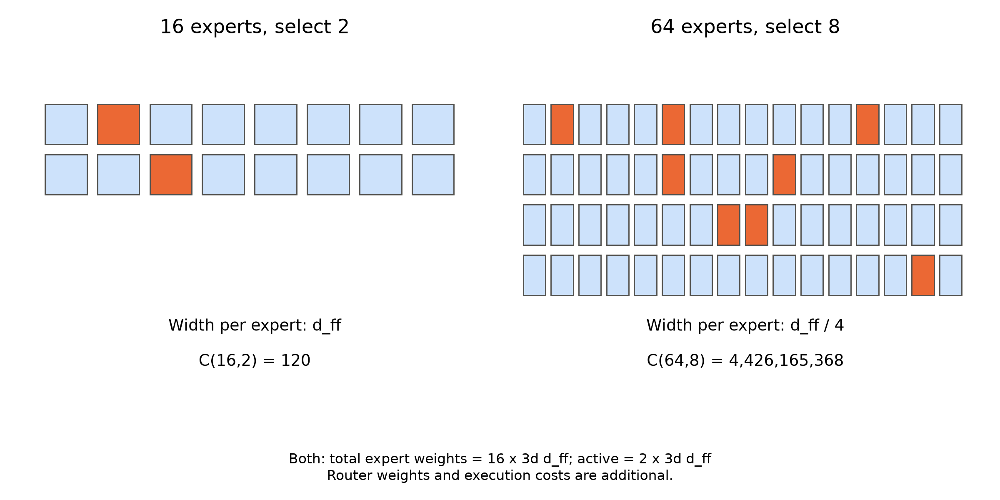
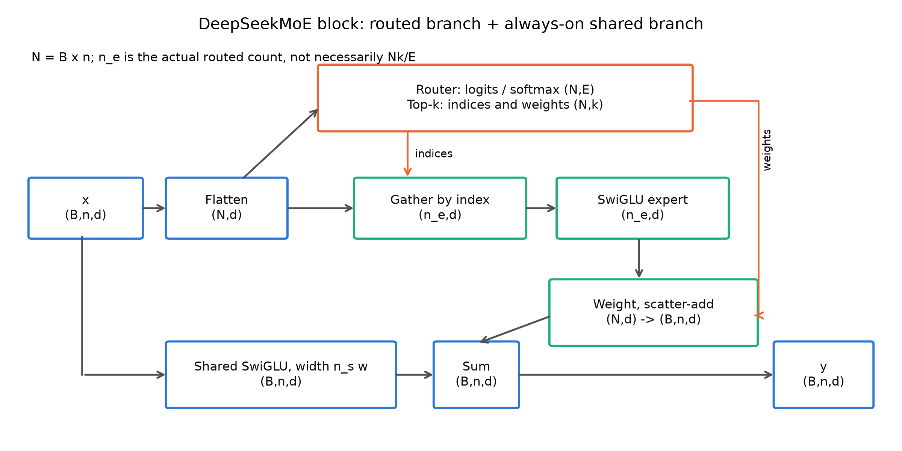
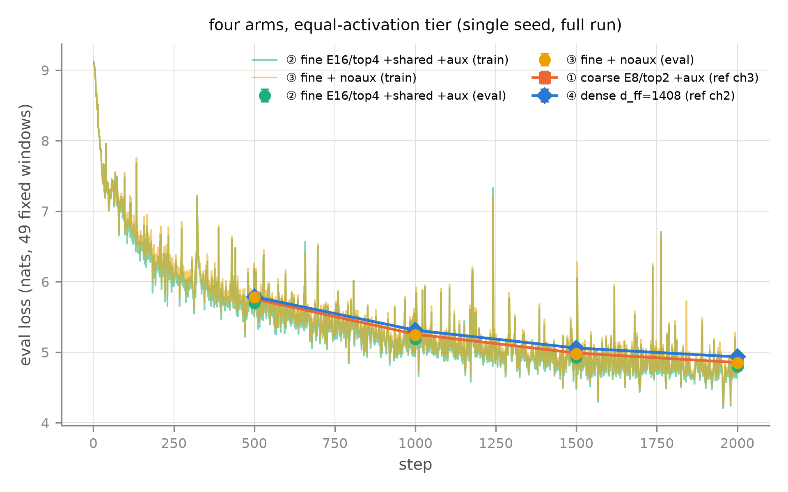

# 第 5 章 DeepSeekMoE：细粒度、共享专家与免损失的均衡

## 5.0 开篇：从全书到这里

上一章把 MoE 放回了 Mixtral 整机：主要改动在前馈组织，窗口与位置参数也须分别核对。路由探针提示了领域边际频率相近、句法相关和位置重复等现象，但并未证明专家没有任何领域专门化。这给我们留下两个问题：8 个全宽专家、每 token 选 2 个，选择单位还能否变小？训练细节未完整公开时，怎样另从有消融证据的方法研究中理解均衡策略？第 3 章已经说明，辅助损失的梯度可能影响主任务优化；本章继续追问，有没有别的调节办法。

本章沿 DeepSeek 的研究路线讨论三项设计：2024 年 1 月 DeepSeekMoE 的细粒度专家分割与共享专家隔离，以及同年 8 月提出、后来用于 V3 的免辅助损失均衡。前两项改变专家的组织方式，后一项改变负载调节方式；它们并非同一篇论文同时提出。我们分别考察切细的选择空间、共享路径的预算和偏置调节的作用，再交付可与 HF 实现核对的教学组件，以及一组保留原始读数的四臂消融。实验要回答的不只是“有没有改善”，还包括“哪些改变尚未被单独隔离”。

到章末，第一项改造将形成完整方案：FFN 插槽的替换件从机构（第 2 章）、到难题（第 3 章）、到两代实证（第 4-5 章）全部备齐；下一章开始第二项改造，注意力与 KV 账本。

> **最小背景栏**
> - MoE 块四步机构与形状流转（展平/打分/硬选择/派发；router 打分 $(N,E)$、top-k索引$(N,k)$）：第 2 章图 2.1 与表 2.1，本章直接使用不再重画基础版。
> - 负载崩塌的自增强回路、辅助损失四代家族与三把均衡尺（max/min、CV、MaxVio）：第 3 章式 (3.1)-(3.6)——本章 5.5 节讨论免去显式均衡损失的一种办法，5.7 节的度量沿用第 3 章 3.5 节同一把尺。
> - Mixtral 的粗粒度几何（E=8/top-2/每专家 $d_{ff}$=14336 整 FFN、无共享）与训练配方未完整披露：第 4 章表 4.1 与 4.4 节。
> - 二项式系数 $\binom{n}{k}$（$n$ 选 $k$ 的组合数）：高中组合计数，本章只用它的「数有多大」。
> - 模块实验协议：Book2 五件套（AdamW/余弦日程/固定 eval 窗/单种子+判据预注册），语料 `tokens.bin`（sp-8k，$V$=8192）——第 2/3 章沿用至今的口径。

## 5.1 从粗粒度专家到更细的选择单位

Mixtral每个token从8个全宽专家中选择2个，共有28种离散的专家集合。这里要区分三个量：选中哪些专家、连续门值怎样配比、每个专家对输入计算什么。28只计算第一个量；由于门值和输入连续变化，整层并非只有28种输出或28种知识表达。

DeepSeekMoE追问的是更具体的架构问题：在相近专家参数与激活计算预算下，能否把每次选择的单位做小，从而更灵活地组合不同处理路径？粗专家可能同时承担多种功能，细专家让路由有机会只组合需要的部分。它是结构提供的潜力，不能仅由组合数证明已经形成专门化，更不能据此解释Mixtral为何没有明显的领域路由。

2024 年 1 月的 DeepSeekMoE 先提出两项结构设计：细粒度专家分割（fine-grained expert segmentation），把专家做小、每次选更多份；共享专家隔离（shared expert isolation），让所有 token 都经过一条常驻路径。随后，V2 用设备受限路由控制通信范围，免辅助损失方法及 V3 又探索了新的均衡方式。本章按理解和构造的顺序把它们串起来，年代与出处分别注明。

这些问题有关联，但没有必然的单向因果：知识冗余在粗粒度模型里也可能存在，切细本身也不保证负载变差。我们的顺序是先看选择单位，再看常驻路径，随后计算更多派发可能带来的通信成本，最后讨论如何调节选择。5.2—5.3 节讲结构，5.4 节讲通信约束，5.5 节讲偏置反馈，5.6 节对照配置与实现，5.7 节回到实验。

## 5.2 细粒度专家分割：保持专家计算预算，扩大可选择的专家集合

细分的方法可以用一句话说明：把每个专家切成 $m$ 份小的，激活份数同比例放大。论文的记法是 $N$ 个标准专家、每个等分 $m$ 份得 $mN$ 个小专家、每 token 激活 $mK$ 个（$K$ 为标准激活数）——换算到本书的符号契约（专家数记 $E$、激活数记 $k$）：$E=mN$、$k=mK$，小专家宽度 $w=d_{ff}/m$。

先把预算写出来：原专家权重为$3dN d_{ff}$，切分后为$3d(mN)(d_{ff}/m)=3dN d_{ff}$；原每token专家计算对应$3dK d_{ff}$个权重，切分后为$3d(mK)(d_{ff}/m)=3dK d_{ff}$。两条等式解释了“同预算”的限定：只比较专家线性权重，要求宽度可整除，暂不计路由矩阵、偏置、对齐填充和派发。

参数上这是“专家部分重新分配”而不是直接扩建：总参与激活参的公式（第 2 章 2.2 节的 $E\cdot 3dw$ 与 $k\cdot 3dw$）里 $E\cdot w$ 与 $k\cdot w$ 的乘积都不变，变的是颗粒度。

说服力来自论文自己的组合数论证，逐字：【证据等级：官方论文 2401.06066 v1 §3.1】16 个标准专家的 top-2 路由 "can yield $\binom{16}{2}=120$ possible combinations"，切细后（每个分 4 份、64 选 8）"can yield $\binom{64}{8}=4{,}426{,}165{,}368$ potential combinations"——同一激活预算（两侧都激活 2 个标准 FFN 等价量：$2\times1$ 对 $8\times\frac14$），可选择的离散专家集合从 $1.2\times10^2$ 涨到 $4.4\times10^9$，七个数量级。论文的断言是这 "enhances the potential for achieving more accurate and targeted knowledge acquisition"（提升更精确、更有针对性的知识获取潜力）。用人话说：**专家激活参数可保持，离散选择集合多了三千六百多万倍；这不是有效函数容量提高同样倍数的证明**。更小的选择单位允许组合不同处理路径；是否形成有用分工，仍由学习结果决定。图 5.1 同时列出专家预算和集合数，避免把组合计数误当作质量倍率。



图 5.1 细粒度与粗粒度的专家预算及离散集合数（自绘教学示意，依据 2401.06066 v1 §3.1）。分割倍数记为 $m=4$，原专家中间宽度记为 $d_{ff}$：16 个全宽专家选 2 个，与 64 个四分之一宽专家选 8 个，专家权重总量和每次激活量相同。路由矩阵及执行开销未纳入这两条等式。

论文提供了有力的对照证据，而且有必要明确对照对象：**粗粒度基线是 GShard，不是 Mixtral**——两文只差三天，DeepSeekMoE 论文全文没有 Mixtral 对照【证据等级：官方论文 2401.06066 v1（负结论，全文核）】。2B 档的结论句逐字："DeepSeekMoE achieves comparable performance with a GShard model containing **1.5× expert parameters and computation**"——论文给对照 GShard 配了 1.5 倍的专家参数与计算（2.83B 专家参数、每 2K token 5.8T 全模型 FLOPs），而 DeepSeekMoE 2B 只有 1.89B 专家参数、0.24B 激活专家参数、每 2K token 4.3T 全模型 FLOPs：对方多花约一半专家参数、多三成半计算，仍被追平；论文还补一句 "nearly approaches the performance of a dense model with 16× FFN parameters"【证据等级：官方论文 2401.06066 v1 表 2】。Mixtral 与 DeepSeekMoE 的对照没有论文级版本，本册 5.7 节将通过四臂消融建立一个对照（①臂就是 Mixtral 式几何）。

在本书选取的 Shazeer、GShard、Switch、Mixtral 主线之后，DeepSeekMoE 系统讨论了细分与共享的组合设计。这个叙事顺序不作整个领域的首创断言；论文自身也将共享路径的原型追溯到 Rajbhandari 等人的工程工作。更直接的证据在其 §4.4：作者分别加入共享、再提高细分程度，并在所设等参数与等激活预算下观察性能。这比仅数专家集合更能支持结构选择。

切细不是免费的。路由器要从 token 表征打分到更多专家，若批内有 $N_{\mathrm{tok}}$ 个 token，指派数便从 $N_{\mathrm{tok}}K$ 变成 $N_{\mathrm{tok}}mK$；这增加了需要组织的工作，却不等于底层算子调用或墙钟时间必然增长 $m$ 倍。第 2 章的约两倍差异是所测实现的整步训练时间，未单独测出派发开销；5.7 节继续比较 E16 档。若专家跨设备部署，更多选中专家还可能覆盖更多目的地，通信取决于专家放置及消息合并方式；这引出 5.4 节的设备受限路由。

## 5.3 共享专家隔离：为公共处理设置常驻路径

共享路径要处理的是知识冗余，而这个问题并不限于细粒度专家。DeepSeekMoE §3.2 的动机是：不同 token 可能需要某些共同处理，多个路由专家便可能各自学到相似功能。若为这些共同需求安排常驻路径，其他专家就有机会把参数用于更有区分度的处理。这里的“公共知识”是设计目标，不是仅凭结构图就已测出的内部知识分区【证据等级：官方论文 2401.06066 v1 §3.2】。

可以把共享路径想成每次都做的基础处理，把路由路径想成按输入选用的附加处理。它并不强制某种语言知识只能存在哪条路径，也不保证公共功能只存一份。负载均衡管的是任务分配是否过度集中；共享路径改变的是计算组织，两者解决的问题不同。

解法是给 MoE 块加一个**不走路由的常驻车间**：共享专家（shared expert）。形式化只需在式 (2.1) 上加一项：

$$y=\sum_{i\in\mathrm{TopK}} g_i(x)\cdot E_i(x)\;+\;\mathrm{Shared}(x) \tag{5.1}$$

用人话说：路由专家的加权求和照旧，再无条件加上共享专家的输出——它不参与路由打分与top-k；是否展平是实现选择，每个 token 必算，像残差流上的一条固定支流。

**符号表**（本章符号契约；$E$ 承批一契约，论文记法首次并注）：

| 符号 | 含义 | 形状/取值 |
|---|---|---|
| $x$ / $h$ | 进入 MoE 块的隐状态 / 展平 token 流 | $(B,n,d)$ / $(N,d)$，$N=B\cdot n$ |
| $E_i(x)$ | 第 $i$ 个路由专家（窄 SwiGLU，宽 $w=d_{ff}/m$） | $(n_i,d)\to(n_i,d)$ |
| $g_i(x)$ | top-k 门控权重（DSV2 口径不归一、$\times$ 缩放因子） | $(N,k)$ |
| $\mathrm{Shared}(x)$ | 共享专家=一个宽 $n_s\cdot w$ 的 SwiGLU，每 token 必算 | $(B,n,d)\to(B,n,d)$ |
| $E$ / $k$ / $n_s$ | 路由专家数 / 激活数 / 共享专家数（论文共享隔离后的记法为 $mN{-}K_s$/$mK{-}K_s$/$K_s$） | 本章实验 16/4/1；16B 档 64/6/2 |
| $W_g$ | router 打分矩阵 | $(E,d)$，打分 $(N,E)$ |

这笔账三个口径都要记清楚，因为这一点很容易被混淆：共享专家**算总参**（权重在仓库里）、**算激活参**（每 token 必算——式 (5.1) 的 $\mathrm{Shared}(x)$ 项每次都参与计算，等激活配臂公式里 $n_s\cdot w$ 计入通行费分子，5.7 节的配臂公式因此是 $d_{ff}=k\cdot w+n_s\cdot w$）、**不占组合空间**（它没有「选不选」的自由度）。图 5.2 是完整的机构图：上路是第 2 章的四步机构换成 DSV2 路由口径（softmax 打分、top-k 后**不重归一化**、乘 routed scaling factor——与 Mixtral 的第一个实现差异，5.6 节展开），下路是常驻的共享专家，两条支路的输出相加。若有 $n_s$ 个同宽 SwiGLU 共享专家，可把它们的 gate/up 矩阵沿输出维拼接、down 矩阵沿输入维拼接，合为一个宽 $n_sw$ 的 SwiGLU；逐通道激活不混合这些分段，最后的线性投影恰好求和。因此这里的合并是参数布局等价，不是把多个不同函数取平均。



图 5.2 细粒度路由支路与常驻共享支路（自绘教学示意）。路由器输出索引和门值：索引决定哪些 token 交给哪个专家，门值用于专家输出的加权合并。共享支路接收同一输入，无须经过 top-k。两路均返回 $(B,n,d)$ 后相加；此处示例采用 V2 的 softmax、选中后不重归一口径。

论文用三档模型展示了切细加共享（表 5.1）。每层 MoE 的专家激活宽度均为两个标准 FFN 的等价量：2B 档 $(1+7)\times0.25=2$，16B 档 $(2+6)\times0.25=2$，145B 档 $(4+12)\times0.125=2$。共享占激活预算分别为 1/8、1/4、1/4，因此不能说共享比例随切分程度持续提高。各档总专家数也须按实配读取，不能由一个统一公式替代配置表。

**表 5.1** DeepSeekMoE 三档配置（全部【证据等级：官方论文 2401.06066 v1】；激活量列=每 token 的标准 FFN 等价数）

| 档 | 层数/宽度 | 路由专家 | 共享 | 每 token 激活 | 数据 | 备注 |
|---|---|---|---|---|---|---|
| 2B | 9 层 / $d$=1280 | 63 个 × $0.25\,d_{ff}$ | 1 | 1+7（=2.0） | 100B token，BPE 8K | 对照 GShard 2B/稠密 2B（表 1/2） |
| 16B | 28 层 / $d$=2048 | 64 个 × $0.25\,d_{ff}$ | 2 | 2+6（=2.0） | 2T token，BPE 100K | **首层 FFN 保持稠密**（§5.1.2） |
| 145B | 62 层 / $d$=4096 | 128 个 × $0.125\,d_{ff}$ | 4 | 4+12（=2.0） | 245B token（13,000 步） | 预实验档，首层稠密（§7.1） |

16B 与 145B 档都保留第一层稠密前馈。论文报告的直接理由是第一层负载均衡收敛尤其慢；它没有进一步证明这由“浅层公共模式更多”造成【证据等级：官方论文 2401.06066 v1 §5.1.2/7.1】。后续实现用 first_k_dense_replace 表示开头保留的稠密层数。V2-Lite 取 1，MoE 部分采用 64 路由、top-6、2 共享、专家宽 1408；其整机另加 MLA，因此不是简单更名的 DeepSeekMoE 16B【证据等级：官方 config】。第 9 章教学整机支持这个字段，但定版主臂取 0、全部层使用 MoE；第 6 章则以 V2-Lite 配置核对 MLA。

三档模型的成绩，本章用一句话概括：16B 档以 **39.6% 的计算量**（74.4T 对 187.9T FLOPs/4K token）在多数基准上胜过 LLaMA2 7B——HumanEval 14.6→26.8、MBPP 21.8→39.2、CHID 37.9→89.4，MMLU 45.8→45.0，分数略低【证据等级：官方论文 2401.06066 v1 表 4】。39.6% 是这两个模型在该 FLOPs 统计下的比值，不代表训练或部署墙钟减少相同比例。145B 档再进一步：28.5% 计算量比肩 DeepSeek 67B 稠密，将专家激活份数减半（Half-Activated 变体）仍以 18.2% 打平【证据等级：官方论文 2401.06066 v1 §7】。

## 5.4 device-limited routing：细粒度的通信账单

这一节讨论 5.2 节记下的第二项代价。专家天然可分片（第 2 章 2.6 节：专家互不通信，路由退化为 token 搬运），但数据搬运也有成本：细粒度把每 token 的激活专家从 2 个变成 6-8 个之后，这些专家在 EP（专家并行）部署下可能散布在多达 8 台设备上——一个 token 的前馈要「寄 8 封信」，每封信都是一次跨设备往返。更高的 top-k 提高了可能覆盖的目的地上限；若多个专家同处一台设备，发往该设备的数据可合并。因此不能把专家数直接当成实际消息数或通信时间。

DeepSeek 的解法叫**设备受限路由**（device-limited routing），机制一句话：先选设备、再选专家。逐字：【证据等级：官方技术报告 2405.04434 v5 §2.2.2】"for each token, we first select **M devices** that have experts with the highest affinity scores in them. Then, we perform top-K selection among experts on these M devices"——每个 token 先选出「含有最高亲和力专家」的 $M$ 台设备，再只在其中的专家里做 top-K；动机原文是 "**to bound MoE-related communication costs**"（给 MoE 相关通信成本封顶）。用人话说：信最多寄往 $M$ 个地址，宁可专家选得次优一点，也不让一个 token 的邮件遍历全机房。效果的论文判据同样逐字可引：$M\ge3$ 时「device-limited routing can achieve a good performance roughly aligned with the unrestricted top-K routing」——限到 3 台设备，质量与不限基本对齐；DSV2 实配 $M=3$【证据等级：官方技术报告 2405.04434 v5 §3.1.2】。

这里必须明确一条勘误，因为两件名字很像的东西常被混为一谈：**device-limited routing 不在 DeepSeekMoE 论文里，它出自 DSV2 §2.2.2**。DeepSeekMoE 论文 §3.3 有的是**设备级辅助损失** $L_{\mathrm{DevBal}}=\alpha_2\sum_i f'_iP'_i$（把路由专家均分 $D$ 组部署，惩罚组间不均——第 3 章 3.3 节第四代家族的成员），动机句是 "load imbalance can exacerbate computation bottlenecks"【证据等级：官方论文 2401.06066 v1 §3.3】。设备级损失鼓励设备间负载均匀，设备受限路由限制一个 token 能访问的设备数，目标并不相同：所有 token 都访问同三台设备，仍可能极不均衡。硬选择本身不求导，但选中专家和门值仍由主任务梯度训练，不能把整条路由称为“零梯度”。工程谱系上，设备受限路由在 HF config 中体现为 `topk_method="group_limited_greedy"` 加 `n_group`/`topk_group`（组是设备组的 config 代理：先选组、再组内 top-k；DSV2-Lite 配 1/1 即不启用，全量 236B 配 8/3——V3 的 8/4 属 noaux_tc 一代的值，两代勿串、见第 9 章表 9.1）【证据等级：config 逆向】——形状流转是打分 $(N,E)$ 按组重排为 $(N,\,n_{\mathrm{group}},\,E/n_{\mathrm{group}})$、组代表 $(N,n_{\mathrm{group}})$、组掩码回 $(N,E)$ 再 top-k。本章历史单机实验未运行专家并行，这项通信效果只引用论文说明；all-to-all 的调度与设备级治理是工程侧的主要内容，第 2 章章末欠账框已给地址（→ Book8 第 16、17 章），此处不重复展开。

## 5.5 noaux：把均衡从损失函数搬进路由机制

现在回到辅助损失的取舍。noaux 方法论文指出，过强的均衡项可能引入与语言建模目标不一致的梯度；V3 也报告辅助系数过大可能损害性能【证据等级：2408.15664 v1 摘要/引言；2412.19437 v2 §2.1.2】。第 3 章小模型的 aux 臂反而更好，这说明效果依赖具体配方，不能反推“只有达到 1B、100B token 才会显现代价”。2024 年 8 月提出的免辅助损失均衡（auxiliary-loss-free load balancing，下称 noaux），尝试用外部更新的专家偏置调节路由，从而去掉主要均衡损失的附加梯度。V3 随后采用这一方法，并保留极小的序列级辅助项；“免辅助损失”指主要均衡机制，不应读成其总损失里绝无辅助项。

直觉先于公式。辅助损失的问题不在「要均衡」而在**它用梯度去均衡**——均衡信号混进语言建模的梯度流，两个目标抢同一个 $W_g$。换一种不通过梯度调节的机制：给每个专家配一个**偏置阀门** $b_i$，它参与前向的选择步骤，却不作为输出门值的一部分，也不由反向传播更新；每个训练步结束后，再按负载表微调一格：欠载的专家阀门开大一点（更容易被选），过载的关小一点。写成公式只需一行：

$$b_i \leftarrow b_i + u\cdot\mathrm{sign}(e_i),\qquad e_i=\bar c_i - c_i \tag{5.2}$$

用人话说：每步看一眼上一步的「欠账单」——$c_i$ 是专家 $i$ 实收的 token 数，$\bar c_i$ 是理想均值（batch 总选择数除以 $E$），欠载 $e_i>0$ 则 $b_i$ 抬一格 $u$，过载则压一格。这就是方法论文 Algorithm 1 的逐字内容（每个 batch 更新一次、无滑动平均、只用上一 batch 计数；$u=0.001$ 为扫描最佳——0.0001 收敛过慢、0.01 后期 $b$ 值波动）【证据等级：官方论文 2408.15664 v1 Alg 1/§4】。控制论的读者会认出这是 **Bang-Bang 控制**：不管误差大小、只看符号、固定步长——负载是输出，$b_i$ 是控制量，构成负反馈回路。更新应在本批前向和训练完成后进行，新的偏置供后续批次使用；不能先利用当前序列全部位置的计数，再反过来修改这条序列自己的路由，否则可能让较早位置间接获得未来信息。DSV3 同样按训练步监控整 batch，$\gamma$（即式 (5.2) 的 $u$）在前 14.3T token 取 0.001、最后 500B 设为 0【证据等级：官方技术报告 2412.19437 v2 §2.1.2/§4.2】。

整个机制的关键在下一句，两文一致、逐字：**偏置只用于路由选择，不进门值**。DSV3 式 (16) 把门值写成 $g'_i=s_i$（当 $s_i+b_i$ 入选 top-K，否则为 0）并注明 "the bias term is only used for routing"；方法论文原句是 $b_i$ "is only used to adjust the routing strategy by influencing the top-K selection"，"not added to the $g_{i,t}$ that weights the output"【证据等级：官方技术报告 2412.19437 v2 式 (16)；官方论文 2408.15664 v1】。用人话说：**阀门改派单，不改工钱**——选谁由 $s_i+b_i$ 决定，进门干活的权重仍按原始打分 $s_i$ 算。正是这一区分实现了「免损失」：门值不带 $b_i$，在选中集合固定时，门值表达式没有额外偏置项；但偏置可能改变选中集合，因而改变实际前向与主任务梯度，均衡动作发生在梯度世界之外。对照第 3 章式 (3.6)：那边的均衡信号要经损失项混进 $\partial L/\partial W_g$，这边 $b_i$ 不产生可由优化器更新的参数梯度——它避免的是显式均衡损失的附加梯度，不是完全不影响优化轨迹。

把选择与门值分开，用四个专家的数值最容易看清。设亲和力$s=(0.6,0.5,0.2,0.1)$，原top-2为$\{1,2\}$。偏置$b=(-0.5,0,0.4,0)$后，选择分为$(0.1,0.5,0.6,0.1)$，改选$\{3,2\}$；若使用V3式选中归一化，输出权重仍由原分数$(0.2,0.5)$得到$(2/7,5/7)$，再乘配置缩放，不使用选择分数$(0.6,0.5)$。这既改变分工，又避免把负载补偿直接解释成输出强度。

对于负载计数$(6,1,0,1)$，平均为2，误差$(−4,1,2,1)$让偏置分别减一步、加一步、加一步、加一步。固定步长反馈可能震荡，步长、统计窗口和数据分布都影响收敛；“符号正确”是必要检查，不是必然均衡的充分证明。

负反馈按整 batch 调节，并不强制每条序列都均匀。比如两个等长序列分别偏向不同专家，合并后可能正好均匀，单条序列却仍极端集中。V3 因而保留一个很小的序列级辅助项 SeqBal：$L_{\mathrm{Bal}}=\alpha\sum_i f_iP_i$，其中 $f_i=\frac{N_r}{K_rT}\sum_t\mathbf1[i\in\mathrm{TopK}(s_t)]$，$P_i=\frac1T\sum_t\frac{s_{i,t}}{\sum_j s_{j,t}}$。这里 $T$ 为序列长度，$N_r$ 与 $K_r$ 分别为路由专家数和选中数；$s$ 为 $(T,N_r)$ 的亲和力，$f,P$ 均为 $(N_r,)$，均衡派发且亲和力均匀时，$f_i=1,P_i=1/N_r$。式中先把亲和力跨全部专家归一，再按序列取均值；不能直接把未归一的 sigmoid 均值代入。报告式 (18) 的选择条件写的是未加偏置的 $s$，也应与实际带偏置派发计数区分【证据等级：2412.19437 v2 式 (17)—(20)】。系数取 $10^{-4}$，目的是抑制单序列极端失衡；它仍然会产生梯度。

所以最终形成的是一个两级系统：**$b_i$ 管全局（免梯度），SeqBal 管序列内（系数取 $10^{-4}$）**——相比 V2 的专家/设备/通信三级均衡项（系数分别 0.003/0.05/0.02）及 token dropping，V3移除了主要的均衡辅助项，并报告不丢token；上述极小SeqBal仍保留。

这项设计是否改善了所测模型？证据来自两篇报告，表 5.2 合并给出。方法论文侧：1B 模型/100B token，免损失 ppl **9.50** 对 aux-loss 基线 9.56，MaxVio_global **0.04** 对 **0.72**——均衡质量提升约一个数量级、性能同时微升；3B/200B 同向（7.92 对 7.97、0.04 对 0.52）【证据等级：官方论文 2408.15664 v1 §3-4】。

DSV3 侧的内部消融（表 5）在同一架构同数据上仅换均衡策略：20 个对比格免损失侧 17 胜 1 平 2 负，大配置的部分指标差值更大，但不能用两组不同日程归纳普适规模规律——小 MoE（15.7B/2.4B 激活）Pile BPB 0.727→0.724，大 MoE（228.7B/20.9B 激活）0.656→0.652、HumanEval 40.2→46.3、GSM8K 70.7→74.5【证据等级：官方技术报告 2412.19437 v2 §4.5.2 表 5】。

V3 §4.5.3 进一步比较了均衡粒度。1B 模型上，序列级辅助损失、batch 级辅助损失和 noaux 的验证损失分别为 2.258、2.253、2.253；3B 档分别为 2.085、2.080、2.080【证据等级：2412.19437 v2 §4.5.3】。在这些实验里，放宽到 batch 级的辅助损失也能达到相近结果，说明不能把优势全部归因于“没有辅助梯度”。粒度是重要解释因素，实验并未唯一分解全部因果贡献。本章小模型的 aux 本来就跨 batch 计算，因此 5.7 节比较的是另外一组具体配方。

**表 5.2** noaux vs aux-loss：论文双源+本机读数（本机行为5.7节③②臂，单种子；其MaxVio_global为脚本命名的D∞，不同于论文指标）

| 来源 | 规模/日程 | 指标 | aux-loss | noaux | 出处 |
|---|---|---|---|---|---|
| 方法论文 | 1B / 100B token | ppl / MaxVio_global | 9.56 / 0.72 | **9.50 / 0.04** | 2408.15664 v1 §3-4 |
| 方法论文 | 3B / 200B token | ppl / MaxVio_global | 7.97 / 0.52 | **7.92 / 0.04** | 同上 |
| DSV3 消融 | 小 MoE 15.7B（2.4B 激活）/1.33T | Pile BPB | 0.727 | **0.724** | 2412.19437 v2 §4.5.2 表 5 |
| DSV3 消融 | 大 MoE 228.7B（20.9B 激活）/578B | HumanEval / GSM8K | 40.2 / 70.7 | **46.3 / 74.5** | 同上 |
| 本书实验 | 26M 模块档 / 2000 步 | eval nat / MaxVio_global | 4.797 / 0.0138 | 4.847 / **0.0112** | 5.7 节表 5.3 |

## 5.6 打分代际与配置活字段：从论文到 config 到 HF 落地

三件创新讲完，还有一类知识尚未得到系统整理：**这些机制在两代旗舰的 config 中对应哪些字段、取值如何变化**。config 是第 9—10 章拆机的主要分析对象，此处先把 MoE 侧的活字段清点成表，并完成本章组件的实现与对拍。

第一件活字段是**打分函数**（scoring function）。DSV2 的打分是 softmax 型：$s_{i,t}=\mathrm{Softmax}_i(u_t^{\top}e_i)$（式 (22)，$u_t$ 为 token 表征、$e_i$ 为专家质心——乘性打分）【证据等级：官方技术报告 2405.04434 v5 式 (22)】；DSV3 换成 sigmoid（式 (15)），并对 top-k 选中集**重归一化**后乘 routed scaling factor 2.5（`norm_topk_prob=True`）【证据等级：2412.19437 v2 式 (15)/§2.1.2；2.5 与 norm_topk_prob 据官方 config】。换用sigmoid的完整设计动机报告没有单独证明。数学上可确认的是：softmax用全专家共享分母，sigmoid对每个logit单独压到(0,1)；V3随后在选中集合内归一化，重新引入选中专家间的相对权重。缩放2.5改变路由分支幅度，但不能仅由该数断言它已与共享支路严格匹配。HF config 的 `scoring_func` 字段（V2 默认 `"softmax"`、V3 checkpoint 配 `"sigmoid"`）是这一代际变化在 config 中的明确证据【证据等级：config 逆向】。

第二件是 **top-k 后的权重处理**，三个模型族各不相同，很容易混淆：Mixtral 在 top-k 内重归一化（和为 1，第 2 章 2.7 节实现对照框）；DSV2 **不归一化**、直接乘 `routed_scaling_factor`（Lite 配 1.0）；DSV3 归一化再乘 2.5【证据等级：config 逆向+源码 transformers 5.18.0】。

第三件是前面已出场的 `first_k_dense_replace`（V2=1、V3=3——首层稠密从「一层」增加到「三层」；为什么是 3，报告未给论证，工程取舍如实标注；GShard 与部分 Switch 配置隔层替换，Switch-C 与 Mixtral 每层替换；不能将整个 Switch 家族简写成每层专家。后续配置账见第 9 章）。第四件是组选择 `n_group`/`topk_group`（5.4 节；V3 的组代表从 V2 的组内最大值改成组内 top-2 求和——都是「组的代表分」的取法）。

把主要差异并排放在表5.4中，读配置时先确定模型版本，再判断字段怎样被实现解释。

**表 5.4** MoE 路由配置对照（Mixtral据第4章官方配置与实现；[V2-Lite配置](https://huggingface.co/deepseek-ai/DeepSeek-V2-Lite/blob/main/config.json)、[V3配置](https://huggingface.co/deepseek-ai/DeepSeek-V3/blob/main/config.json)为官方检查点字段；键名不同的项目按语义对齐）

| 项目 | Mixtral 8x7B | V2-Lite | V3 |
|---|---|---|---|
| 路由专家 / top-k / 共享 | 8 / 2 / 0 | 64 / 6 / 2 | 256 / 8 / 1 |
| 亲和力与选中门值 | softmax，选中归一 | softmax，不重归一 | sigmoid，选中归一 |
| 路由输出缩放 | 1 | 1.0 | 2.5 |
| topk_method | 实现固定 top-2 | greedy | noaux_tc |
| n_group / topk_group | 不使用 | 1 / 1 | 8 / 4 |
| 开头稠密层数 | 0 | 1 | 3 |

V2 全量模型的组限制是8/3，不能从 Lite 的1/1推到全族。以上是检查点及对应实现的行为；“字段存在”仍不能保证放进任意家族类都会生效。

> **【实现对照框】配置须交给对应的模型类解释。**当前核对的 transformers 5.14.1 中，V3 路由器用 Buffer 保存 e_score_correction_bias，参与 state_dict 但不列入可训练参数。教学件沿用此做法；关键是禁止优化器更新它，并用负载规则显式更新，并非所有其他存储方式都在数学上不成立。V2 路由器只实现 greedy 和 group_limited_greedy，且前向明确使用 softmax、不做选中重归一；把 V3 的 noaux_tc 字段塞给 V2 类，即使配置构造成功，也没有获得 V3 算法。V3 则先用 scores+bias 选索引，再从原 scores 提取门值。这三个步骤应分别核对，不能以“字段加载未报错”代替前向验证。

本章的教学件 [`DeepSeekMoE`](code/ch05/deepseek_moe.py) 将上述全部口径实现为一个类 `DeepSeekMoE`（DSV2 键位：`gate.weight`+`experts` 融合 3D+`shared_experts` 三投影；专家件直接 import 第 2 章的 `ExpertBank`——「SwiGLU 住进专家内部」的又一次复用；noaux 档多一枚 `e_score_correction_bias` Buffer，`step_bias()` 实现式 (5.2)）。

验收三层，全部 CPU fp32、种子 20261002【证据等级：本书实验（CPU，2026-10）】：第一层，同权重对拍组件库参考实现 `HFDeepseekMoE`，max$|\Delta|$=0.00e+00 逐位一致；第二层，对 HF `DeepseekV2Moe` 块级 strict 直搬（123,136 参），max$|\Delta|$=0.00e+00；第三层正是**打分→选择→权重三段对拍**——教学件与 HF `DeepseekV3TopkRouter`（sigmoid+偏置+组选择）逐段比对，$n_{\mathrm{group}}$=1（隔离组选择、只验 noaux 本体）与 $n_{\mathrm{group}}$=2（过组选择路径）双档，logits/权重/索引三段 max$|\Delta|$ 全部 0.00e+00。

另有三条历史机制自检：给偏置一个扰动，旧脚本报 56 个 token 的 top-k 索引槽排列改变、而选择未变的 token 门值**逐位不动**（bias 不进门值的本机版证词）；喂一个 $[6,1,0,1]$ 的偏斜计数，过载专家的 $b$ 降、欠载的升（负反馈方向）；块内参数账双口径手算逐位对上。聚合对拍 `00-feasibility/parity_all.py --hf` 已把本件接入注册表，三列对拍全部 0.00e+00。这个组件就是第 9 章两刀机的 FFN 插槽——届时它将带着 DSV2 键位与共享专家，被 import 进 207M 骨架。

当前 transformers 5.14.1 的复核仍在 V2 块级、V3 两种分组档位得到零前向差异。新自检先按专家号对齐无序 top-k，实际改变集合的是 54 个 token；其余 token 的对应门值保持不变，避免把槽次序变化误报成换专家。另以独立的两个共享 SwiGLU 求和核对加宽实现，CPU fp32 最大差为 $2.98\times10^{-8}$。这些是小尺寸组件验证，未重新运行历史长训练。

## 5.7 消融实验：四种配置下的质量与负载

结构、动机和实现都已完整介绍，最后在自己的机器上核对。实验设计沿用第 2-3 章的模块档（$d$=512/$L$=6/$V$=8192，语料 sp-8k token 流，Book2 五件套，单种子 20261002、判据预注册在先——判据文本写于任何 full 档数字落地之前，已随销项记录存档定版）。四个实验臂已按大纲确定，两臂复用批一产物、两臂实跑：

- **① 粗粒度**：E8/top-2/无共享+aux——就是第 3 章的 aux 臂原封不动（E=8/$k$=2/$w$=704，Mixtral 式几何，总参 65,042,944），复用其 full 产物；
- **② 细粒度**：E16/top-4/共享 1+aux——实跑新臂。配臂公式承探针 D：**等激活** $d_{ff}=k\cdot w+n_s\cdot w$，代入 $w=\lfloor 1408/(4{+}1)\rfloor=281$，每 token 激活 $5\times281=1405\approx$ dense 1408；
- **③ = ② 换 noaux**：同几何同种子同日程，唯一差异是均衡手段——去掉式 (3.6) 的 load 损失，换式 (5.2) 的偏置步更新（$u$=0.001/步；消融件的偏置加在 softmax 概率上、门值在选中集内归一——与②臂同一归一化口径，保证②→③的单变量是均衡手段本身；打分代际不在变量里；mini 档不做 $\gamma$ 衰减，如实登记）。③臂替换原 gate 时复用该 gate 的 weight 对象；②③分别构造，但同种子初始化权重数值相同（init 快照 max/min 1036.99、MaxVio 0.05874、首步 loss 9.1244，两臂三数完全一致）；
- **④ 等激活 dense**：$d_{ff}$=1408，复用第 2 章 dense 臂 full 产物。

两种口径下的实验臂配置公式都要说明（探针 D 定版）：等激活 `dense d_ff = k×w+n_s×w`（公平比每 token 通行费），等专家总参`dense d_ff = (E+n_s)×w`（再单列路由矩阵等小项）（排除「总参红利」的质疑）——探针 D 三臂读数 6.2181（MoE）/6.2251（等总参 dense）/6.3032（等激活 dense，300 步口径）【证据等级：本书实验（探针 D）】。本章②臂对④臂用等激活口径（dense 4.93375 复用批一 full）。

参数账先 assert 再训练：②③总参 **57,187,840**（手算=实测逐位）、激活参 26,062,336——比 dense 臂的 26,089,984 差 27,648，即每层 FFN 宽取整缺口（$5\times281=1405$ 对 1408）的 0.11%，如实登记不硬凑（口径注记：模块档脚本的激活参为双份嵌入、不含路由门口径，第 2 章 2.7 节的换算沿用）。

还有一项需要如实说明：细粒度臂总参反而比①臂**小** 12%（每层 FFN 总宽 $(16{+}1)\times281$ 对 $8\times704$）——②胜①若成立，绝不是靠总参数更多获胜，这正好排除了一个反向质疑。

**表 5.3** 四臂消融读数（full 档 2000 步，eval=49 批、每批 16 个 512-token 窗，共计 401,408 个评估位置，探针=held-out 8,192 token 硬计数；①④引用批一产物；【证据等级：本书实验（MPS bf16 训练/fp32 评测，2026-10）】）

| 臂 | 总参 | 激活参 | eval@2000（±se） | MaxVio_global | 层均 max/min | 死专家格 | sec/step |
|---|---|---|---|---|---|---|---|
| ① 粗 E8/top2/无共享+aux（引用） | 65,042,944 | 26,089,984 | 4.854 ± 0.013 | 0.031 | 2.13 | 0 | 0.614 |
| ② 细 E16/top4+共享1+aux | 57,187,840 | 26,062,336 | **4.797 ± 0.013** | 0.0138 | 2.23 | 0 | 0.677 |
| ③ =② 换 noaux | 57,187,840 | 26,062,336 | 4.847 ± 0.013 | **0.0112** | 2.69 | 0 | 0.709 |
| ④ 等激活 dense（引用） | 26,089,984 | 26,089,984 | 4.934 ± 0.013 | —（无路由） | — | — | 0.354 |



图 5.3 四臂消融曲线（自产，`fig_ch05.py` 绘制，full 档 2000 步）：②③为实跑臂（细线=训练损失、圆点=49 批固定窗口 eval），①④为引用臂（方块/菱形=eval 点，批一 full 产物）。末态排序 ② 4.797 < ③ 4.847 < ① 4.854 < ④ 4.934。

逐条核对判据（预注册三条：③的 MaxVio 显著低于或不劣于②；②③的 eval 差落在 0.05 nat 带宽内；②−①的方向 ≤0）。

**第一条按旧判据通过，但只针对指定指标。**③的旧 MaxVio_global 为 0.0112，低于②的 0.0138；两个臂在所保存的快照中均无死专家格，逐层 max/min 均值却是③的 2.69 高于②的 2.23。这个旧 MaxVio 实为跨层合并编号后的绝对份额偏差 $D_\infty$，会受不同层偏差相互抵消影响，也不能直接跨 E8/E16 比较强弱。noaux 论文的指标是各层相对最大超载后求均值，两者不可比较改善倍数。新脚本另报逐层相对超载；现有历史汇总不足以补算全部新指标，所以这里只保留旧结果的有限判读。

**第二条落在预登记的 0.05 nat 带内。**历史完整精度为 $4.84715-4.79741=0.04974$，不是用表中三位小数相减得到 0.0497。③的评估损失略高于②，差值小于 0.05、超过另设的 0.03 参照带；这两条都是工程判断阈值，不是统计置信界，表中 SE 也不衡量跨种子波动。因此只能说本次单种子运行以这点损失差替换了显式均衡项，不能声称已证明不劣性。方法论文在更大规模得到相反方向，但架构、训练长度及配方均不同，不能断定差异只由规模造成。本档 2000 步、每步 8192 token，共处理 16,384,000 个训练位置。

**第三条的方向符合预登记要求。**②−①为 $4.79741-4.85354=-0.05613$，②−④为 $4.79741-4.93375=-0.13634$。这些是本次配置下的观察，不能因超过 0.03 就称为统计显著。①→②同时改变专家数、top-k、宽度、共享路径和总参数，并非只改变粒度；探针 D 与第 2 章还采用不同干预条件，只能作另一个背景对照，不能拼成逐项可加的改善链。

四臂总排序 ② 4.797 < ③ 4.847 < ① 4.854 < ④ 4.934：③略低于①，但差值仅约 0.0064 nat。这个排序没有证明结构与均衡的收益可相加；尤其②到③的损失实际升高。本章的组合数账：$\binom{16}{4}=1820$ 对 $\binom{8}{2}=28$——5.2 节的论证对应65倍的集合数，但该实验同时改变共享路径和参数量，不能将质量改善单独归因于组合数。

noaux 臂的过程比终值更有教学价值，fast 档 300 步的轨迹直接展示了负反馈控制器的作用：第 100 步负载**仍然崩**（层均 max/min 5846、15 个死格——此刻 $|b_i|$ 才 0.05 上下，追不上 softmax 概率的差距），第 200 步死格清零，第 300 步 max/min 7.67、MaxVio 0.0121。mini 档的叙事因此不是「noaux 不崩」，而是「**崩了能被机制慢慢抬回来**」——若需补偿的分差固定，每步移动u可粗估所需步数随1/u增加；真实分数也在训练中变化，此处不是验证了严格比例关系（$u$=0.001 时约两百步）。第 0 层的偏置分布也很典型：多数专家 +0.09，此前的赢家 −0.246——阀门确实在掐最强、扶最弱。full 档还有一项需要如实记录的漂移：2000 步后第 0 层全体 $b_i$ 集体上移到 +0.14~+0.175（一种可能原因是许多步里欠载专家比过载专家多，使 $\sum_i\mathrm{sign}(e_i)>0$；历史汇总未保存每步误差，不能逐步验证这一归因）——均匀分量不改 top-k 的相对序，起作用的只有 $b_i$ 之间的**差**，HF 实现中的 Buffer 也具有这一性质。

这条机制线还有一段必须如实交代的事故。③臂首版实现将 $e_i$ 的方向写反了（取成「实收比例−理想值」）：配合「分数加偏置」的选择规则，反向偏置构成**正反馈**——欠载专家的阀门被一路压负、越死越压。这一版的运行结果触目惊心：96 个专家格里 72 个死格贯穿全程、max/min 钉死 8192。交叉核对才发现方向错了，决定性的证据是方法论文 Algorithm 1 的逐字定义（$e_i=\bar c_i-c_i$，过载降、欠载升）加上 HF 的加号选择（`scores + bias`）——两者拼合才构成负反馈；V3 §2.1.2 也明确写了过载减偏置、欠载加偏置；不能把首版程序的方向错误归因于报告必然含糊。实现时应同时检查误差定义、更新符号和选择时的加号。修正后重新运行，buggy 轨迹以 `fine_noaux_signflip` 留档作 signflip 反向对照【证据等级：本书实验（事故留档，`log/book4-ch05/`）】。这个事故本身就是 5.5 节的教学素材：**偏置方向是机制成立的必要条件**——同一行代码、差一个负号，从负反馈控制器变成垄断加速器。

最后回到执行成本。历史整步时间为：dense 0.354 秒；第 2 章 E8/top-2 无辅助项臂 0.714 秒；第 3 章同几何 aux 臂①为 0.614 秒；本章 E16/top-4 的②为 0.677 秒、中位数 0.539 秒，③为 0.709 秒。②比 0.714 略低、比 0.614 略高，选哪个参照都会改变方向。③/②约 1.047，也只是两次整步计时的比值，不能把全部差异单独归为偏置更新开销。

因此，预期的“专家数越多，派发越慢”没有被这组测量单独检验：E、k、w、共享与辅助计算同时变化，跨 run 也有计时差异。②/dense 约 1.9 倍是这两个训练配置的总耗时差，不是纯派发成本。第 1 章不同实现的开销梯度同样各有条件。要隔离 E 的效应，需要控制其余变量并单独剖析路由、专家计算与通信；本章保留现有单机结果，不从中承诺增加专家没有代价。

## 5.8 本章小结

本章把三个问题分开回答。细分在保持专家线性权重预算时扩大了可选集合，原论文的组件消融提供了额外支持；共享路径让每个 token 都接受一段常驻处理，具体知识分工仍要测量；noaux 用负载反馈更新选择偏置，去掉主要均衡损失的附加梯度，却仍改变前向与优化路径。历史四臂实验保留了这些设计在小模型上的结果：②比①损失低约 0.056 nat，③比②高约 0.050 nat，旧均衡指标与逐层 max/min 的排序也不完全一致。它说明具体取舍，尚不能把粒度、共享和均衡三项收益逐一拆开。

**带走的心智**：先问专家怎么组织，再问 token 怎么选择，最后问负载怎样调节。细分与共享改变计算路径；设备限制缩小可访问范围；偏置反馈和辅助损失分别提供不同的均衡手段。这些办法可以并存，不能排成一条必然替代的进步路线，也不能说切细本身减少了需要均衡的路由任务。

阅读 MoE 配置时，可以把这些问题逐项对应到字段：n_shared_experts 与 moe_intermediate_size 描述常驻路径和专家宽度；scoring_func、norm_topk_prob 与缩放因子描述门值；n_group/topk_group 描述选择范围；e_score_correction_bias 描述负载补偿。参数预算与执行成本须分开：切细可保持专家权重乘积，却会增加路由输出宽度和指派数，通信还取决于专家放置与消息合并。

回到全书的安排：第一项改造到此完成。FFN 插槽的替换件从机构（第 2 章的路由与派发实现，以及容量限制原理）、到病症与方案（第 3 章的赢者通吃与损失家族）、到两代旗舰实证（第 4-5 章）全部到齐，`deepseek_moe.py` 这台 DSV2 键位件已列入第 9 章两刀机的 import 清单。但两刀只动了一刀——注意力插槽里还是 Book3 的 GQA，KV 账本仍是 $2Lh_{kv}d_k$ 的老记法。下一章动第二刀：把 K 和 V 一起压进一个小箱子，位置信息拎在手上——MLA，本册数学最重的一章。

## 5.9 动手验证

在工作区根目录运行组件对拍；程序记录实际库版本，输出到独立文件：

```bash
source ./env.sh
python from-models-to-vllm/book4-scale-and-efficiency/code/ch05/deepseek_moe.py --out-name review
```

它检查 V2 块级前向、V3 路由的打分/选择/门值，以及偏置方向与参数账。对拍是 CPU 小尺寸随机权重验证，不代表旗舰权重或吞吐已验证。

有原始语料时，四臂实验中的②③可另行运行；①④是已标明来源的历史参照：

```bash
python from-models-to-vllm/book4-scale-and-efficiency/code/ch05/ablation_granularity.py --steps 300 --out-name my_fast
python from-models-to-vllm/book4-scale-and-efficiency/code/ch05/ablation_granularity.py --steps 2000 --out-name my_full
```

两个日程使用不同产物名。同名续跑须保持步数、数据、实现与干预参数一致；fast 不能直接改成 full 接着训。历史 MPS 时间为 fast 约 9 分钟、full 约 45 分钟，本次精修不重跑这些训练。图5.1/5.2可用随书 make_figures.py 重绘，历史图5.3沿用原曲线。
