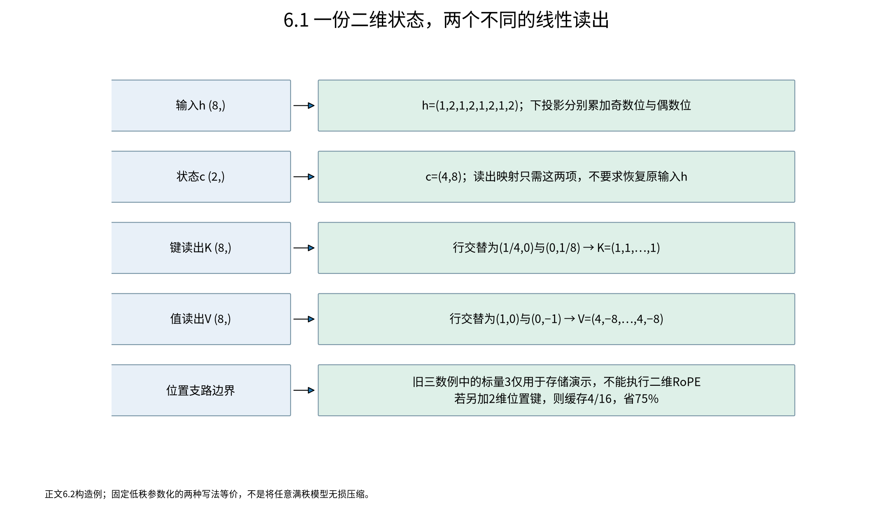
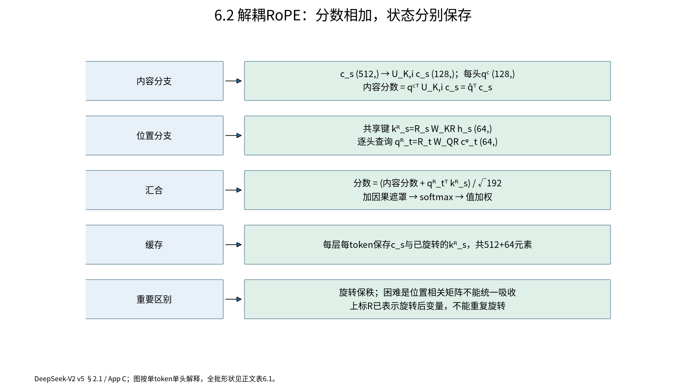
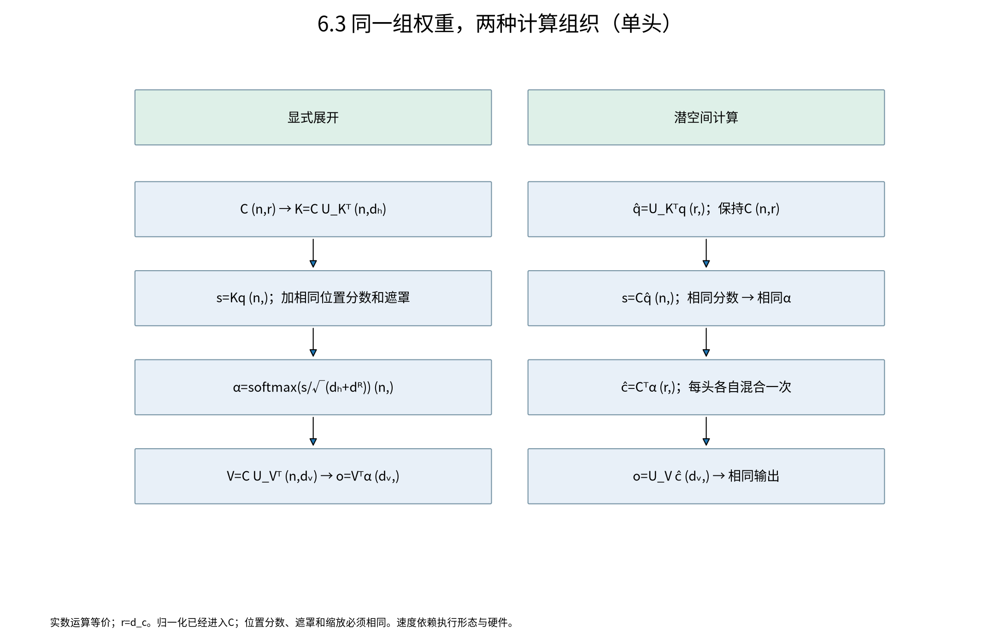
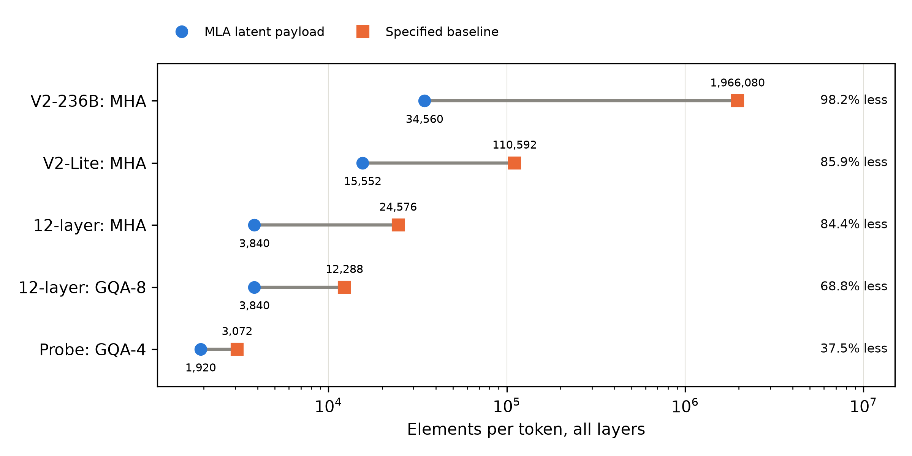

# 第 6 章 MLA：把 KV 装进小箱子

## 6.0 开篇：从全书到这里

前五章已经把前馈插槽换成专家群，并讨论了结构、负载和实验中的取舍。现在转向注意力插槽：第9章将使用的 Book3 终态骨架有16个查询头、8组KV，而本章要改变的，正是它保存历史信息的方式。我们会依次建立低秩共享、解耦位置与计算吸收的模型，逐步标出形状；这些概念最终要同时回答两个问题——需要保存什么，以及下一步怎样读取它。

要回答的问题一句话就能说清：**KV 账本上剩下的那个乘积 $h_{kv}\cdot d_k$，怎样改变参数化以缩小缓存，并用实验检验质量代价？**产出三样：一个可以运行且全部对拍通过的 MLA 教学件（[`ch06/mla.py`](code/ch06/mla.py)，双路径实现）、一本续写的 KV 元素账（表 6.2，含一条「三种报价」的红线）、一份「吸收等价性」的本机数值证据。本章结束时，两刀机的注意力格有了新零件，第 9 章的整机整合只需再完成 import；而新问题也随之显形——KV 装进小箱子之后，还需考察低精度训练与稳定化方法能否适配这些计算路径（第 7 章的 QK-Norm 一节会直接用到本章的记号）。

> **最小背景栏**：只补三件前置。①KV 账本与 GQA/MQA 的族谱——Book3 第 6 章（该章式 (6.2) 的每 token 字节账、MQA 砍份数、GQA 组内共享、质量与KV状态量的取舍），本章是它的直系续篇；②RoPE 的相对位置性质——Book3 第 4 章（旋转只活在 $\boldsymbol{q}^\top\boldsymbol{k}$ 内积处、$(R_tq)^\top(R_sk)=q^\top R_{s-t}k$，式 (4.8) 两行正交性证明），这是 6.5 节解耦论证的前提①；③低秩分解——本章 6.2 节现场教（不假设你见过），教到「能凭手算例画出它」为止。RMSNorm（Book3 第 2 章）与残差流恒宽的插槽观（Book3 第 8 章）直接指回。

## 6.1 同一本账的第三刀：Book3 的欠账到期

先原样重读那个遗留问题。Book3 第 6 章章末欠账框写道：

> 「架构侧更深的一次改造——把 $h_{kv}\cdot d_k$ 本身做更低秩的折叠——属于 Book4 第 6 章。本册把账立好，收账的留给他册。」

Book3 的每 token KV 有效载荷为 $2Lh_{kv}d_kb$：$L$ 是层数，$b$ 是每元素字节数。MQA/GQA 减少 KV 头数 $h_{kv}$；固定每头宽度时，保存的份数随之减少。Book3 的特定小模型实验中，MQA 比 MHA 高约0.267 nat；V2 附录D.1也报告了其设置下的质量差异。这些结果提示共享表示存在取舍，却不证明所有模型都按同一规律损失质量。MLA接着改变联合KV的参数化，让历史状态不必按逐头K/V的形状保存。本章V2证据均锚定 arXiv:2405.04434v5。

Book1 第3章也留下过这一问题：标准多头注意力如何通过头共享或不同压缩方式减少历史状态。Book3讨论了前一条路线，本章继续后一条。

Book3 第6章收束时强调，共享表示换取较少状态，收益与代价要分别检验。这里继续沿用这个判断：缓存复用是同一函数的计算重排，改变KV参数化则改变模型的表达约束，不能混称为无损压缩。

据此继续往下推：GQA/MQA 砍的是「每 token 记几份」，MLA 砍的是「每份本身有多大」——但不是 2017 年那种直接缩 $d_k$，而是把 $h_{kv}\cdot d_k$ 这个乘积整体折叠进一个低秩潜空间：保留每头输出宽度，却约束跨头KV表示所能变化的子空间；头宽不变不等于表达自由度不变。账还是同一本（Book3 式 (6.2) 的直系推广，6.7 节立式），只是记账对象从「头份数×头维」换成了「箱子容量」。

先明确它在整机中的位置。MLA（Multi-head Latent Attention，多头潜在注意力）动的是 Book3 四插槽里的**注意力格**：GQA 的 q/k/v/o 四个投影被替换为下投影、上投影与独立位置支路等部件；残差流宽度 $(B,n,d)$ 丝毫不变，插槽接口照旧是 $(B,n,d)\to(B,n,d)$——第 9 章把它 import 进两刀机时你会看到，改动全部发生在格子内部。

先用一句话概括整体机制（细节 6.3-6.6 逐件拆）：**按 V2 的压缩态缓存设计，每 token 每层保存一个 512 维的小箱子 $\boldsymbol{c}^{KV}$ 和一条 64 维的共享位置键 $\boldsymbol{k}^R$——前者装内容、可折叠可吸收，后者承载显式位置旋转，并在所有头之间共享；读缓存时要么拆箱物化 K/V，要么把上投影吸收进查询与输出、直接在箱子语里做注意力。**「箱子」与「拎在手上」这两个图像，本章会反复用到。

## 6.2 低秩直觉与手算例：一个箱子、两副镜头

折叠的数学名字是**低秩分解**（low-rank factorization）。设一个线性映射 $M\in\mathbb{R}^{8\times 8}$——共有 64 个数；若它的秩是 2，就存在 $A\in\mathbb{R}^{8\times 2}$、$B\in\mathbb{R}^{2\times 8}$ 使

$$M = A\,B \tag{6.1}$$

用人话说：一个「8 进 8 出」的映射，如果只在 2 个方向上真正起作用，就能拆成「先压到 2 维、再撑回 8 维」两步——中间的 2 就是瓶颈。数据流上 $k=Mh=A(Bh)$：8 维的 $h$ 先过 $B$ 压成 2 维的 $c=Bh$（论文称**潜向量**，latent vector），再过 $A$ 还原 8 维。若M精确低秩，c足以恢复Mh，但未必能恢复原输入h；近似低秩，损失就是被瓶颈扔掉的那部分成分。

低秩参数化还可与 LoRA（Hu等，2106.09685）作一个数学对照。LoRA 固定预训练权重，用低秩矩阵表示微调增量；MLA从训练开始对KV通路施加共享瓶颈，并把可保存状态留在瓶颈处。两者使用相似的因式写法，约束对象与目的不同；这里不把它解释成对现成满秩KV权重的无损分解。【考据框见下】

数字要小到可以手算，读者才能清楚地把握过程。取 $d=8$、瓶颈 $r=2$：设 $\boldsymbol{h}=[1,2,1,2,1,2,1,2]$，下投影与两副「拆箱镜」取（矩阵见 [`ch06/kv_probe_mla.py`](code/ch06/kv_probe_mla.py) Part 0，数字都采用便于手算的 0/±1/2 的幂）：

$$\boldsymbol{c}=W^{DKV}\boldsymbol{h}=[4,\,8],\qquad \boldsymbol{k}=W^{UK}\boldsymbol{c}=[1,1,1,1,1,1,1,1],\qquad \boldsymbol{v}=W^{UV}\boldsymbol{c}=[4,-8,4,-8,4,-8,4,-8]$$

这里把具体矩阵也写出来，读者不必跳到代码补定义：$W^{DKV}$的两行分别是$(1,0,1,0,1,0,1,0)$与$(0,1,0,1,0,1,0,1)$；$W^{UK}$的行交替为$(1/4,0)$、$(0,1/8)$；$W^{UV}$的行交替为$(1,0)$、$(0,-1)$。例如$k_1=(1/4)4=1$、$k_2=(1/8)8=1$，$v_2=-8$。这是一份构造好的共享低秩映射。

这个例子分三步读。第一，内容状态只有 $[4,8]$ 两个数。若为存储演示再附一个标量 $k^R=3$，就是 $3/16$、少81.25%；这还没有实现RoPE，不能作为完整MLA缓存实验。若位置键改为两维，账为 $4/16$、少75%。第二，K和V是同一状态的两种读出：$W^{UK}$给出全1，$W^{UV}$给出4与−8交替。第三，$M_K=W^{UK}W^{DKV}$在此构造中精确秩为2，因此先乘成大矩阵或先计算状态，输出相同。真实MLA采用受约束的参数化重新训练，质量是否合算要看6.8节的实验；后面的吸收证明只比较同一MLA的两种计算组织。

换个输入再手算一遍可以确认箱子装的是「$\boldsymbol{h}$ 的摘要」而非某个固定值：取 $\boldsymbol{h}'=[1,1,1,1,1,1,1,1]$，则 $\boldsymbol{c}'=[4,4]$、两副镜头分别读出 $[1,0.5,1,0.5,\dots]$ 与 $[4,-4,4,-4,\dots]$、$k^{R\prime}=2$——输入改变，箱子里的状态随之改变，读取方式不变。

> **【考据框】数学联系与影响关系。**V2/V3在MLA说明中没有把LoRA列为该设计的灵感来源；仅凭共同采用低秩因式，不能补出作者未声明的因果关系。反过来，没有引用也不能证明研究者的思想从未受其影响。本章只使用可核对的数学参照：LoRA约束微调增量，MLA约束KV表示通路。

K和V同源于h，并不自动意味着可以无损共用一个很小的瓶颈。设无归一化的联合映射为$J=[W^K;W^V]\in\mathbb R^{(d_K+d_V)\times d}$，共享瓶颈写成$J=UW$，其中$W\in\mathbb R^{r\times d}$。要精确成立，必须有$\operatorname{rank}(J)\le r$。仅有K、V各自低秩还不够：若$W^K=(1,0)$、$W^V=(0,1)$，二者分别秩1，堆叠后却是秩2，不能共享一个标量而同时保留两个输出。

几何上，W决定从h中保留哪些组合，U决定怎样把这些组合映到多个头。MLA选择从训练开始施加这种共享结构，由任务损失学习有用的子空间；它付出了表示约束，换得较小状态。后面证明的“显式与吸收等价”，只是同一套MLA权重的两种计算方式等价，与“任意MHA可无损变成MLA”完全是两个命题。



**图6.1** 共享低秩状态的手算读出；标量位置支路仅是存储演示，完整RoPE另需偶数维。按输入→状态→键/值的顺序读，可核对正文每个数。

## 6.3 KV 联合压缩：一个箱子怎么装下 K 和 V

本节把共享瓶颈落到注意力的数据流：一次下投影生成可跨步保存的状态，再通过不同上投影供给各头的K和V。模型收益来自缓存这份共享状态，而代价是各头KV不再具有完全独立的输入子空间。DSV2 §2.1.2 的第一句话就是定义：「The core of MLA is the low-rank joint compression for keys and values to reduce KV cache」【证据等级：官方论文 2405.04434 v5 §2.1.2 首句】。三个式子（编号承论文 Eq 9-11）：

$$\boldsymbol{c}_t^{KV}=W^{DKV}\boldsymbol{h}_t \tag{6.2}$$

$$\boldsymbol{k}_t^{C}=W^{UK}\boldsymbol{c}_t^{KV},\qquad \boldsymbol{v}_t^{C}=W^{UV}\boldsymbol{c}_t^{KV} \tag{6.3}$$

用人话说：(6.2) 把每个 token 的残差流压进 $d_c$ 维箱子（下投影，down-projection）；(6.3) 从箱子出发，用两副不同的上投影（up-projection）分别还原出该 token 对全部头供给的 K 与 V。「联合」（joint）指的正是共用状态：**K 与 V 共用同一个 $\boldsymbol{c}^{KV}$**——若各自各压一个箱子要存 $2d_c$ 个元素，联合后只存 $d_c$，在两个独立瓶颈都取同样d_c且不考虑表达差异的比较下，状态个数减半，正是 6.2 节「同源两读法」的形式化。记号统一采用论文写法，全章保持一致（与 config 字段对照如下；社区材料常把 $d_c'$ 误当 RoPE 维——那是查询压缩维，见 6.4 节）：

| 论文符号 | 含义 | DSV2-236B 值 | 形状/注 | config 字段 |
|---|---|---|---|---|
| $d$ | 残差流宽 | 5120 | 输入 $(B,n,d)$ | `hidden_size` |
| $n_h$ | 头数 | 128 | 每头独立 $q$ | `num_attention_heads` |
| $d_h$ | 每头内容维 | 128 | 无位置段（nope） | `qk_nope_head_dim` |
| $d_h^R$ | 解耦 RoPE 维 | 64 | 共享位置键宽 | `qk_rope_head_dim` |
| $d_c$ | **KV 压缩维（箱子容量）** | 512 | $\boldsymbol{c}^{KV}\in\mathbb{R}^{d_c}$ | `kv_lora_rank` |
| $d_c'$ | 查询压缩维 | 1536 | 不减少历史KV缓存；影响查询参数化 | `q_lora_rank` |
| $W^{DKV}$ | KV 下投影 | — | $(d_c,d)$ | `kv_a_proj_with_mqa` 前段 |
| $W^{UK},W^{UV}$ | K/V 上投影 | — | $(n_hd_h,d_c)$ / $(n_hd_v,d_c)$ | `kv_b_proj` 行块拼接 |
| $d_v$ | 每头输出维 | 128 | 可与 $d_h$ 不同 | `v_head_dim` |

按形状逐步看一遍（V2-236B 实维，$(B,n,\cdot)$ 记批×序列）：压缩 $\boldsymbol{h}\,W^{DKV\top}$ 是 $(B,n,5120)\cdot(5120,512)\to(B,n,512)$；K 上投影 $(B,n,512)\cdot(512,16384)\to(B,n,16384)$ 再切头成 $(B,128,n,128)$；V 同型（$16384=128\cdot128$）。把 (6.2)(6.3) 连起来，可以看到一个代数事实：

$$\boldsymbol{k}_t^{C}=W^{UK}\big(W^{DKV}\boldsymbol{h}_t\big)=\big(W^{UK}W^{DKV}\big)\boldsymbol{h}_t \tag{6.4}$$

用人话说：MLA 的 K 投影等价于一个**秩至多 $d_c=512$** 的整映射——MHA 的 $W^K$ 是 $16384\times5120$ 的满秩候选（秩上限 5120），MLA 把它因式化成 $16384\times512$ 乘 $512\times5120$。所以「折叠」与 2017 年的「砍 $d_k$」本质不同：砍维是把每头的 128 维直接削短（每头输出宽度减少），折叠是把整条通路限秩（$h$ 仍先见过全部 5120 维、每头仍输出完整 128 维，只是两步乘积的秩受 512 限制）。

权重是否减少要另算—— MLA 的注意力参数反而略省（DSV2 维度每层 149,227,520 对同宽 GQA-8 的 178,257,920，省 16.3%【证据等级：本书复算，`kv_probe_mla.py` Part 3】；较小的模型配置下，参数量反而会增加，见 6.7 节注）——采用压缩态缓存时，历史内容部分可从「K 一份 16384 + V 一份 16384」变成「$\boldsymbol{c}$ 一份 512」。论文自己的缓存声明（可直引）：「During inference, MLA only needs to cache $\boldsymbol{c}_t^{KV}$, so its KV cache has only $d_c\,l$ elements, significantly reducing the KV cache like MQA」【证据等级：官方论文 §2.1.2】（口径注：此句行文略去 $\boldsymbol{k}^R$ 那条车道，$d_c\,l$ 只计箱子；正式口径以 Table 1 的 $(d_c+d_h^R)\,l$ 为准，即表 6.2 的 576/层——严格按引文原式计算会少 64×60 一项，论文的文字叙述与表格采用了不同的记账范围）。

还有一个作用于潜向量、容易被忽略的组件：**RMSNorm**。本章的式 (6.2)-(6.3)（论文 Eq 9-11）里没有它，但 §3.1.2 交代「additional RMSNorm layers after the compressed latent vectors」【证据等级：官方论文 §3.1.2；DSV3 §4.2 同款重申】——潜向量 $\boldsymbol{c}^{KV}$ 过完下投影要先归一化再进缓存与上投影。HF 落地为 `kv_a_layernorm`，且只作用 $\boldsymbol{c}$ 段、不碰 $\boldsymbol{k}^R$ 段（这是「解耦」的一部分，6.5 节见）。

归一化也改变了式(6.4)的解释：实际$c=\operatorname{RMSNorm}(W^{DKV}h)$不是h的固定线性函数，因此不能把完整路径合成一枚常数$W^{UK}W^{DKV}$。不过$k^C=W^{UK}c$仍对“已归一化的c”线性，输出仍落在$W^{UK}$列空间中；后面的权重吸收只依赖这个线性关系，所以仍严格成立。这是公式与完整实现之间必须接上的一步。这也提醒我们，推导所用的简化公式要与完整实现对应起来——公式告诉你压缩在哪，完整实现中还包含维持训练稳定的辅助组件。

## 6.4 查询压缩：改变查询参数化，不减少历史缓存

查询压缩不减少KV缓存，因为过去的Q无需保存；它提供另一个训练时表示瓶颈与激活存储选择。是否节省实际峰值还取决于实现保留或重算哪些中间量。论文在查询侧给出同型的低秩两步（Eq 12-13）：

$$\boldsymbol{c}_t^{Q}=W^{DQ}\boldsymbol{h}_t,\qquad \boldsymbol{q}_t^{C}=W^{UQ}\boldsymbol{c}_t^{Q} \tag{6.5}$$

式(6.5)的内容查询路径是 $(B,n,5120)\to(B,n,1536)\to(B,n,16384)$，切头后为 $(B,128,n,128)$；这里还没有位置段。下一节的 $W^{QR}$ 从同一查询潜向量产生每头64维的位置查询。实现可把两套上投影按头拼接，一次得到 $(B,n,128\times192)$，但不能把这个合并输出直接标作只有内容的 $q^C$。

论文将查询压缩的动机表述为减少训练激活，而不是减少推理KV缓存【证据等级：V2 §2.1.2】。当前查询每步重算，旧查询不必保存；实际训练峰值能省多少，还取决于哪些激活被保留或重算。参数账也会随查询秩改变。V2-236B与V3取 $d_c'=1536$，V2-Lite则为 null、不压缩查询【官方config；V2附录B】。Lite与大模型还有许多其他差异，不能据其质量差隔离查询压缩的效果。

对应实现有两个分支：null时使用单个 q_proj；否则经过 q_a_proj、潜向量RMSNorm与q_b_proj。教学件 MultiHeadLatentAttention 同样实现两支，当前对拍和历史记录在6.8节分开列出。

三个维度贯穿后文：$d_c=512$ 是KV瓶颈，$d_c'=1536$ 是查询瓶颈，$d_h^R=64$ 是位置段宽度。它们分别决定保存状态、生成查询和显式旋转的几何，不能因为都属于“压缩后的尺寸”就混用。

## 6.5 解耦 RoPE：把位置旋转与内容读出分开

机构至此还缺一块：位置。Book3 第 4 章介绍过 RoPE 作用在哪里——旋转作用在 Q 与 K 上、相对位置性质只在 $\boldsymbol{q}^\top\boldsymbol{k}$ 内积处兑现（式 (4.8)：$(R_t\boldsymbol{q})^\top(R_s\boldsymbol{k})=\boldsymbol{q}^\top R_{s-t}\boldsymbol{k}$），而且 KV cache 里存的就是**旋转后的 K**（在参数、位置规则及可见历史固定时，写入后可复用）。现在把这件老零件装进新机构，会遇到本册最精妙的一个难题。

**问题不是旋转必然破坏低秩，而是位置依赖妨碍一次性的权重吸收。**设单头内容上投影为$U\in\mathbb R^{d_h\times d_c}$，缓存状态$c_s\in\mathbb R^{d_c}$。若给完整键加RoPE，则位置s的键为$R_sUc_s$。它依然是d_c维状态的线性读出，且$\operatorname{rank}(R_sU)=\operatorname{rank}(U)$，旋转没有凭空增加秩。

但当前查询t与它的分数变成$q_t^\top R_t^\top R_sUc_s=q_t^\top R_{s-t}Uc_s$。若把右边读成“某个转换后的查询点乘$c_s$”，转换矩阵就依赖历史位置s；不能像无旋转时那样，每头只把查询转换一次再读取整个前缀。

这留下三种计算选择。直接缓存旋转后的逐头键，会增大保存状态；只缓存 $c$，每次逐位置恢复并旋转，则增加重复工作。若想把旋转统一搬到共享潜空间，需要更强的结构条件：把各头上投影堆叠为 $U_{\mathrm{all}}\in\mathbb R^{n_hd_h\times d_c}$，把各头旋转组成分块对角矩阵 $\mathcal R_s$，要求同一个潜空间变换满足 $\mathcal R_sU_{\mathrm{all}}=U_{\mathrm{all}}\widetilde R_s$。这要求联合列空间对旋转不变，普通训练并未保证它。

这里必须看联合映射。单头矩阵可能是宽矩阵且满行秩，例如V2的 $128\times512$；此时不能仅凭单头列空间断言变换不存在。但各头可分别找到变换，不等于它们能共用一个。一个小例子是 $U_1=I_2$、$U_2=\operatorname{diag}(1,2)$：第一头要求潜变换等于90度旋转 $R$，第二头又要求 $RU_2=U_2R$，而这两个乘积不同。障碍在于共享表示与一致的高效旋转规则，不是“矩阵不能相乘”。

最小反例取$U=(1,0)^\top\in\mathbb R^{2\times1}$，90°旋转后$RU=(0,1)^\top$。不存在标量$\widetilde R$使$RU=U\widetilde R$，因为后者第二维恒为0。不过$RUc=(0,c)^\top$当然仍能由一个标量c计算出来。由此看见真正障碍：**无法把所有位置旋转统一搬进这个固定的一维子空间**，而不是“旋转后任何低维表示都不存在”。

解决办法是将两条通道分开（图 6.2）：**位置不进箱子、拎在手上**。单独开一条共享通道（编号承论文 Eq 14-17）：

$$[\,\boldsymbol{q}_{t,1}^{R};\dots;\boldsymbol{q}_{t,n_h}^{R}\,]=\boldsymbol{q}_t^{R}=\mathrm{RoPE}\big(W^{QR}\boldsymbol{c}_t^{Q}\big) \tag{6.6}$$

$$\boldsymbol{k}_t^{R}=\mathrm{RoPE}\big(W^{KR}\boldsymbol{h}_t\big) \tag{6.7}$$

$$\boldsymbol{q}_{t,i}=[\,\boldsymbol{q}_{t,i}^{C};\,\boldsymbol{q}_{t,i}^{R}\,],\qquad \boldsymbol{k}_{t,i}=[\,\boldsymbol{k}_{t,i}^{C};\,\boldsymbol{k}_t^{R}\,] \tag{6.8}$$

每个头的键由两段拼接：128维内容键 $k^C$ 由潜状态读出，不再施加本层的显式RoPE；64维位置键 $k^R$ 从输入另行投影并旋转。前者仍可能携带来自前层的位置信息，因此“内容段不旋转”不等于“内容与位置无关”。

两段的共享方式不同。位置查询由 $W^{QR}\in\mathbb R^{n_hd_h^R\times d_c'}$ 逐头生成，而位置键由 $W^{KR}\in\mathbb R^{d_h^R\times d}$ 生成一份供所有头使用；批量形状分别为 $(B,n_h,n,d_h^R)$ 与 $(B,1,n,d_h^R)$。在固定位置规则下，压缩态缓存可以保存归一化后的 $c^{KV}$ 与已旋转的 $k^R$，随后只计算新token对应的状态。具体程序是否这样存，要检查缓存写入点，不能只看一个expand广播；后面的拼接仍可能分配完整逐头张量。

拼接之后，打分公式中的两个细节必须明确。其一，拼接内积自动分解（由论文附录C式(40)、(44)的拼接直接得到）：

$$\boldsymbol{q}_{t,i}^{\top}\boldsymbol{k}_{s,i}
=\boldsymbol{q}_{t,i}^{C\top}\boldsymbol{k}_{s,i}^{C}
+\boldsymbol{q}_{t,i}^{R\top}\boldsymbol{k}_s^R.\tag{6.9}$$

用人话说：打分 = 内容积 + 位置积，两条车道各自内积再相加；式(6.6)/(6.7)已将上标R定义为旋转后的量，这里不能再转一遍——「对暗号」在 $\boldsymbol{q}^{R\top}\boldsymbol{k}^R$ 处自然涌现相对位置。其二，完整注意力式（Eq 18）的**缩放因子**：

$$\boldsymbol{o}_{t,i}=\sum_{j=1}^{t}\mathrm{Softmax}_j\Big(\frac{\boldsymbol{q}_{t,i}^{\top}\boldsymbol{k}_{j,i}}{\sqrt{d_h+d_h^R}}\Big)\boldsymbol{v}_{j,i}^{C} \tag{6.10}$$

用人话说：注意力权重还是那套 softmax 内积——只是每把钥匙加长到 192 维（128 内容 + 64 位置），分母的缩放尺度也随之改变。分母是 $\sqrt{128+64}=\sqrt{192}$——**不是** $\sqrt{128}$（忘了位置截）、更**不是** $\sqrt{512}$（把箱子容量当头维）：逻辑头维是拼接后的 192。这是 MLA 实现里最典型的静默错误之一，当前HF代码按 qk_head_dim 的负二分之一次幂设置基础缩放，与此公式一致；更反直觉的是它在**吸收形态下依然按 192 算**——物理乘法发生在 512 维潜空间，但数学上等价于 192 维逻辑内积，尺度不变（6.6 节对拍会证）。

最后补充一点，作为本节的收束：DSV2 的上下文外推（YaRN）**作用于解耦的位置分支**——论文原句「YaRN was specifically applied to the decoupled shared key $\boldsymbol{k}_t^R$ as it is responsible for carrying RoPE」【证据等级：官方论文 §3.1.4】。实现时位置分支的Q与K需要使用一致的频率规则，不能按引文简写理解成只改K不改Q；相关logits尺度也需对应处理——这也是解耦设计直接带来的便利。



**图 6.2** 解耦 RoPE 的双车道（自绘示意级）：内容车道走箱子（可压缩、可吸收）；位置键 64 维全头共享、位置查询逐头生成、写入时旋转定型（式 (6.9) 的两条内积车道；缩放 $\sqrt{192}$ 在汇合处）。

## 6.6 权重吸收：改变计算次序，避免重复展开历史

若采用压缩态缓存，其中只需保存 $\boldsymbol{c}^{KV}$（512）与 $\boldsymbol{k}^R$（64），但显式形态（式 (6.3) 物化 K/V 再注意力）在解码阶段有一项重复开销：每个解码步都要把**全部前缀**的 $\boldsymbol{c}$ 上投影回 $\boldsymbol{k}^C/\boldsymbol{v}^C$——前缀越长，读一遍箱子的开销越大。论文 App C 的解法直引：「Fortunately, due to the associative law of matrix multiplication, we can absorb $W^{UK}$ into $W^{UQ}$, and $W^{UV}$ into $W^O$. Therefore, we do not need to compute keys and values out for each query」【证据等级：官方论文 App C】。

这里的结论是：对同一组 MLA 权重，改变乘法顺序可以保持分数和输出不变，同时省去每步对全历史的K/V展开。它不保证所有硬件、所有序列长度都更快；先把等价性推清，再分别计算不同执行形态的成本。

**K 侧：上投影吸进查询。**单头 $i$、查询位置 $t$ 对全部前缀的内容分数，由式 (6.9) 前半：

先统一矩阵方向：以下单个头、单个序列，令$C=[c_1^\top;\ldots;c_n^\top]\in\mathbb R^{n\times d_c}$，$U_K\in\mathbb R^{d_h\times d_c}$，列向量$q\in\mathbb R^{d_h}$。显式键矩阵为$K=CU_K^\top\in\mathbb R^{n\times d_h}$。将所有前缀分数排成列，得到

$$s^C=Kq=(CU_K^\top)q=C(U_K^\top q)=C\hat q,
\qquad\hat q=U_K^\top q\in\mathbb R^{d_c}.\tag{6.11}$$

每个等号都是同一批数的重新分组：先生成n个d_h维键再做点积，改成先生成一个d_c维查询再与n个缓存状态做点积。内容分数相同，位置分数保持原式，因果遮罩和缩放也一致，所以softmax权重逐项相同。

用人话说：与其给每个前缀 token 拆箱生成 K，再计算内积，不如把**查询**换算到「箱子坐标系」——每头把自己的 128 维问题翻译成一个 512 维的箱子语查询 $\hat{\boldsymbol{q}}^C=W_i^{UK\top}\boldsymbol{q}^C$，直接对着 512 维的 $\boldsymbol{c}$ 点积。代价每步只付一次（每头一次 $128\times512$ 乘法），前缀侧零加工。位置车道不变（64 维直接对缓存）。

**V 侧：上投影吸到输出。**注意力加权与上投影交换次序：

$$\boldsymbol{o}_{t,i}=\sum_j\alpha_{tj,i}\big(W_i^{UV}\boldsymbol{c}_j^{KV}\big)=W_i^{UV}\underbrace{\sum_j\alpha_{tj,i}\boldsymbol{c}_j^{KV}}_{\hat{\boldsymbol{c}}_{t,i}\,\in\,\mathbb{R}^{d_c}} \tag{6.12}$$

用人话说：先在箱子空间做注意力加权平均（得到本头512维的 $\hat{\boldsymbol{c}}_{t,i}$）、再上投影出本头 128 维输出——「先搅匀、再分杯」，而不是「每杯先分好、再搅匀」。缓存里的 $\boldsymbol{c}$ 从头到尾没被展开过。两式的等价性来源就是**矩阵结合律** $A(BC)=(AB)C$——实数运算下不引入近似；执行成本与浮点误差仍要另外检查。

把V侧也写成完整矩阵路径：$U_V\in\mathbb R^{d_v\times d_c}$，显式$V=CU_V^\top$；令$\alpha\in\mathbb R^n$为当前头的注意力权重列，则$o=V^\top\alpha=U_VC^\top\alpha$。先求$\hat c=C^\top\alpha$，再算$U_V\hat c$，就得到式(6.12)。不同头的α不同，因此$\hat c$必须带头索引，不能只混合一次供所有头共用。

再把输出投影按头分块为$W^O=[O_1,\ldots,O_{n_h}]$，其中$O_i\in\mathbb R^{d\times d_v}$，整层输出为$\sum_i O_iU_{V,i}\hat c_i$。固定权重下可以预合并$O_iU_{V,i}$；同样可把查询上投影与$U_{K,i}^\top$合并。预合并可能增大权重存储或改变矩阵乘形状，所以实现也可以只在运行时改变结合次序，不一定真正持久化合并矩阵。

一个两位置例子把两边接起来。取$C=\begin{pmatrix}1&2\\3&-1\end{pmatrix}$，$U_K=\begin{pmatrix}1&0\\0&2\end{pmatrix}$，$q=(2,1)^\top$，则$K=\begin{pmatrix}1&4\\3&-2\end{pmatrix}$，显式分数$Kq=(6,4)^\top$。吸收侧$\hat q=(2,2)^\top$，$C\hat q$仍为$(6,4)^\top$。为便于手算，取同一权重$\alpha=(1/4,3/4)^\top$（此处演示V等价，不声称它是上述分数的softmax），以及$U_V=(2,-1)$。显式值为$(0,7)^\top$，加权得21/4；潜空间加权$\hat c=(5/2,-1/4)^\top$，再读出$2(5/2)-(-1/4)=21/4$。配套验证将使用真实softmax，并同时核对梯度。

代数等价成立于实数运算；浮点归约顺序不同会产生舍入差。若中间插入非线性、依赖位置的旋转或不同的量化步骤，就需要重新证明，不能直接套用结合律。

计算重排能省去多少重复工作，算一笔解码账就能直观看清（V2 维度、批 1、前缀长 $n$，每层每步的乘加数【证据等级：本书复算】）。显式形态对每个前缀 token 都要拆箱：$n_h\,(d_h+d_v)\,d_c=128\times256\times512\approx1{,}678$ 万次乘加每 token——前缀 4096 时仅此一项每层约 687 亿次；吸收形态把这部分计算移到查询侧，每步只做一次（$n_hd_hd_c+n_hd_vd_c\approx1{,}678$ 万，**不乘 $n$**），前缀侧每 token 只剩内容内积、位置内积与箱内混合 $n_h(d_c+d_h^R+d_c)=128\times1{,}088\approx13.9$ 万次——**与“每步重新展开整个前缀”的朴素路径相比，该展开项约为潜空间逐位置运算的120倍**，这不是相对优化MHA/GQA或实际硬件的120倍加速，转换查询的固定开销不随前缀长度增长，但读取状态与加权混合仍为O(n)。这就是论文说 naive formula 会阻碍推理效率的定量含义：显式路径先展开箱子里的内容再计算，吸收路径直接使用压缩状态计算。

表6.1把两种计算组织并排展开：左列是全序列显式物化，右列是采用压缩态缓存时的单步读取示意。前者便于使用常规注意力内核，后者避免重复恢复历史K/V；两者谁更快取决于实现和负载。随书 mla.py 的 explicit/absorbed 两条路径都以完整序列为输入，用来验证同一权重的等价计算；它没有实现右列的增量缓存接口，因此不能把这次前向对拍说成实际服务缓存节省。

**表 6.1** MLA 双形态形状流转表（V2-236B 实维；右列查询长度为1，$h=n_h=128$）

| # | 形态一：显式上投影（训练/HF eager） | 形状 | # | 形态二：吸收后（推理） | 形状 |
|---|---|---|---|---|---|
| 1 | 层输入 $\boldsymbol{h}$ | $(B,n,5120)$ | 1 | 缓存读取 | $\boldsymbol{c}^{KV}$ $(B,1,n,512)$ + $\boldsymbol{k}^R$ $(B,1,n,64)$ |
| 2 | KV下投影后RMSNorm | $(B,n,512)$〔压缩态缓存①〕 | 2 | 逐头查询转换 $\hat q_i^C=q_i^CW_i^{UK}$ | $(B,h,1,128)\cdot(h,128,512)\to(B,h,1,512)$ |
| 3 | 位置键投影后旋转 | $(B,1,n,64)$〔压缩态缓存②〕 | 3 | 已旋转的位置查询与键内积 | $(B,h,1,64)\cdot(B,1,64,n)\to(B,h,1,n)$ |
| 4 | 查询下投影后RMSNorm | $(B,n,1536)$ | 4 | 内容内积 $\hat q^CC^\top$ | $(B,h,1,512)\cdot(B,1,512,n)\to(B,h,1,n)$ |
| 5 | 查询切截 $\boldsymbol{q}^C$ / 旋转后 $\boldsymbol{q}^R$ | $(B,h,n,128)$ / $(B,h,n,64)$ | 5 | 分数 $(3+4)/\sqrt{192}$ + softmax | $(B,h,1,n)$ |
| 6 | K/V上投影切头 | 各 $(B,h,n,128)$ | 6 | 逐头混合 $\hat c_i=\alpha_iC$ | $(B,h,1,n)\cdot(B,1,n,512)\to(B,h,1,512)$ |
| 7 | 拼接 $\bar{\boldsymbol{q}},\bar{\boldsymbol{k}}$（64 维广播） | $(B,h,n,192)$ | 7 | 出箱 $\boldsymbol{u}_i=\hat{\boldsymbol{c}}\,W_i^{UV\top}$ | $(B,h,1,512){\cdot}(512,128)\to(B,h,1,128)$ |
| 8 | 分数 $\bar{\boldsymbol{q}}\bar{\boldsymbol{k}}^\top/\sqrt{192}$ | $(B,h,n,n)$ | 8 | 拼头 $W^O$ | $(B,1,5120)$ |
| 9 | softmax 加权 $\boldsymbol{v}^C$ → 拼头 $W^O$ | $(B,n,5120)$ | | | |



**图6.3** 显式与吸收两条路径。两列共享C与权重，沿箭头比较分数、softmax、值加权；图采用单头列向量约定，整批张量见表6.1。

吸收形态还带来一个有意思的谱系观察：MLA 的缓存读法是「**共享箱子、各配镜头**」——128 个头读取同一个 $(n,512)$ 的 $\boldsymbol{c}$，每头经自己的 $W_i^{UK\top}/W_i^{UV}$ 读出**不同的线性函数**；而 GQA 组内 $g$ 个头拿到的是同一份 K/V 的**复制品**（Book3 `repeat_kv` 把 $(B,h_{kv},n,d_k)$ 撑回 $(B,h,n,d_k)$，组内连号共享）。换句话说，MLA 像「2.25 组的 GQA」（6.7 节复算这个数）却给了每头独立的读法——共享的是货源，不共享的是镜头；MQA 则是全头同一份且无镜头。这一格差异提供一种理解其表示能力的结构视角，但质量改善仍由训练结果支持，不能从结构直接证明，也是它与 GQA/MQA 真正区别开来的地方。

> **【实现对照框】缓存形态必须按实现版本核对。**当前 transformers 5.14.1 的 DeepseekV2Attention 先执行 kv_b_proj，拼接内容键与位置键，再把展开后的 key_states、value_states 交给缓存；它没有执行本章的吸收路径。因此，论文的压缩态账不能直接当作该版本HF运行时缓存实测。旧稿引用的5.18.0压缩缓存实现属于另一版本记录，不能移用于本次环境。当前代码仍将KV下投影与位置投影合在kv_a_proj_with_mqa中，将逐头K/V上投影合在kv_b_proj中；潜向量RMSNorm默认eps为 $10^{-6}$，外层RMSNorm则读取config。RoPE使用相邻维配对；与Llama两半配对的表示互换时，须同时置换Q/K位置投影的行，仅改变旋转函数会改变相对位置分数。引擎侧如何实现压缩态读取，见Book7第8章。

阅读实现时，分别定位缓存写入、查询转换、位置分数、状态加权与输出投影，便能判断代码是在执行哪一种等价形态。

## 6.7 KV 账本三代同表：三种报价与一条红线

各个组件已介绍完整，回到开篇的成本问题。DSV2 Table 1 把三代注意力与 MLA 列入同一张表（单位＝**元素数**，与存储精度无关——表注原话先立纪律）【证据等级：官方论文 §2.1.4 Table 1 逐字】：

**表 6.2** KV 账本三代同表（上＝Table 1 逐字；中＝config 实算每 token 元素与 bf16 字节；下＝三口径红线行）

| 机制 | KV 缓存/token（元素） | 能力（论文对其所测设置的概括） |
|---|---|---|
| MHA | $2n_hd_h\,l$ | Strong |
| GQA | $2n_gd_h\,l$ | Moderate |
| MQA | $2d_h\,l$ | Weak |
| MLA | $(d_c+d_h^R)\,l\approx\frac{9}{2}d_h\,l$ | **Stronger** |

| 机型（config 实算） | 每层元素 | 层数 | 元素/token | bf16 字节 |
|---|---|---|---|---|
| DeepSeek 67B（GQA-8） | 2,048 | 95 | 194,560 | 380.0 KiB |
| DSV2-236B（MLA） | 576 | 60 | 34,560 | 67.5 KiB |
| DSV2 同构 MHA 反事实（$n_h{=}128$） | 32,768 | 60 | 1,966,080 | 3840 KiB |
| DSV2-Lite（MLA，$n_h{=}16$） | 576 | 27 | 15,552 | 30.4 KiB |
| DSV3-671B（MLA） | 576 | 61 | 35,136 | 68.6 KiB |

| 口径 | 数值 | 分子/分母 | 证据 |
|---|---|---|---|
| 架构口径（同构 MHA 反事实，**本章主数字**） | **−98.24%** | $1-576/32768$ | 本书复算 |
| 部署设置解释（摘要报告−93.3%） | 复算93.34%，与其舍入相容 | $1-\frac{576\times60\times6}{2048\times95\times16}$ | 官方论文摘要+本书复算 |
| 跨机 bf16（vs DeepSeek 67B） | −82.24% | $1-34{,}560/194{,}560$ | 本书复算 |

【证据等级：上=官方论文 Table 1；中/下=本书复算（config 公式自算，`kv_probe_mla.py` Part 2/3 逐位 assert）】

Table 1 的表注是全章最值得逐字记住的一句话：「For DeepSeek-V2, $d_c$ is set to $4d_h$ and $d_h^R$ is set to $d_h/2$. So, its KV cache is equal to GQA with only 2.25 groups, but its performance is stronger than MHA」【证据等级：官方论文 Table 1 表注】。复算：每层 576 元素 $=2\times128\times2.25$，等效组数 $576/(2\cdot128)=2.25$ ✓——576是元素数等价，不是存在2.25个离散KV组的实际GQA。表中的能力词是作者对其训练比较的概括，质量证据还须回到6.8节的具体模型、基准和训练预算。

这三行口径是本章必须严格区分的内容，也是读二手材料最常见的错数源。**架构口径 −98.24%**：把头数（128）、头维（128）、层数（60）全部固定，只替换注意力机制——这台现实中不存在的「同构 MHA 反事实」（counterfactual）就是对照组，读数是指定几何下的存储差，不是同质量、同参数或同训练预算的因果消融，本册拿它当主数字。

**部署口径 −93.3%**：DSV2 摘要原句「reduces the KV cache by 93.3%」【证据等级：官方论文 摘要】，但论文没给算式；下面的**部署态对比**可以复算出这一数值，属于本书依据公开设置的解释，论文未明示该等式，也不能宣称唯一——V2 侧是「MLA + 每个缓存元素压进平均 6 bit」（§3.2.3 原文「perform KV cache quantization … into 6 bits on average」）对 67B 侧的 bf16 GQA-8，复算：

$$1-\frac{576\times60\times 6}{2048\times95\times16}=1-\frac{207{,}360}{3{,}112{,}960}\approx\mathbf{93.34\%} \tag{6.13}$$

用人话说：分子是 V2 侧每 token 的缓存比特数（576 元素×60 层×6 bit），分母是 67B 侧（2,048×95×16 bit）——四舍五入到一位小数后与论文的93.3%相容【证据等级：本书复算（逆向工程口径，论文未自述）】，在这套解释中，节省由压缩结构、层数差（60对95）与精度假设（6对16 bit）共同得到，引用时必须带「部署口径」限定（缓存精度工程的机制与账本归 Book6，此处只作口径拆解）。

**跨机 bf16 −82.24%**：两台机器都按 bf16 记账、机制与层数一起换——也包含了「V2 层数更少」带来的节省。同一个「MLA 省多少」，三种报价各答各的问题：这一刀本身值多少（−98.24%）、按所列部署假设能否解释报告值（约−93.3%）、两台机器差多少（−82.24%）。

与 Book3 式 (6.2) 的续写还有一个**因子语义**变化要交代：MHA/GQA/MQA 每层 $2h_{kv}d_k$ 里的 2 是「K、V 各记一遍」；MLA 每层 $(d_c+d_h^R)$ **没有 K/V 因子**（K、V 共用 $\boldsymbol{c}$）。bf16 下 MLA 全模型写成 $60\times576\times2=69{,}120$ B 时，那个 2 是**字节数**不是「K/V 各一遍」——若按旧语义读，就会多算一倍。单位约定也须保持一致：本表全按元素数记（Table 1 口径），字节只在标注处出现。这些算式统计有效载荷，不包括分配器保留、对齐、索引与量化元数据，也不是运行中的GPU显存峰值。

这里再补充参数量的计算（对应存储、参数与质量三方面收益的线索）：DSV2 维度下 MLA 每层 149,227,520 参对同宽 GQA-8 的 178,257,920——参数不升反降 16.3%，同时该GQA-8存储参照下每层缓存少71.9%；质量表采用另外的训练对照，不能把三项拼成同一次实验。

参数是否节省，不能只用 $n_hd_h/d_c$ 一个比值判断。令查询秩为 $r_q$，无偏置、含潜向量归一化权重时，每层账为

$$P_{\mathrm{MLA}}=dr_q+r_qn_h(d_h+d_h^R)+d(d_c+d_h^R)+d_cn_h(d_h+d_v)+n_hd_vd+(r_q+d_c).\tag{6.14}$$

用人话说：依次加查询下/上投影、KV与位置下投影、内容K/V上投影、输出投影和两枚归一化权重；每项都能在参数表找到。无查询压缩时，将前两项及查询norm改为 $dn_h(d_h+d_h^R)$。比较对象的GQA头数、头维与残差宽度也须固定说明。

本册 $d=1024,h=16$ 的重MLA取 $d_c=r_q=512,d_h=d_v=128,d_h^R=64$，投影权重6,881,280，加norm的1,024个权重后共 **6,882,304**；相对Book3 GQA槽的3,145,728多3,736,576。定版轻MLA取 $d_c=r_q=256,d_h=d_v=d_h^R=64$，投影2,686,976，加norm512后共 **2,687,488**。这些整数已与meta参数枚举核对。轻档的选择依据是整笔账，而不是“低秩一定参数更少”。

## 6.8 质量证据与本机对拍

「低秩假设是赌注，赌注由消融埋单」——现在看验证结果（表 6.3）。

**表 6.3** MLA/GQA/MQA 质量证据表（论文侧两臂+张力行；基准格值见引文）

| 证据源 | 设置 | 读数 |
|---|---|---|
| DSV2 App D.1【官方论文】 | 7B 稠密、1.33T token、三臂 | 「MHA demonstrates significant advantages over GQA and MQA」——小档上 GQA/MQA 都不及 MHA |
| Llama2 A.2.1【官方技术报告 2307.09288】（Book3 第 6 章已引） | 30B、150B token、参数补齐协议 | 「GQA 与 MHA 大体相当」 |
| DSV2 App D.2 小 MoE【官方论文 Table 9】 | 16B 级 MoE、1.33T | MLA 3/4 项基准更优（BBH 37.9→39.0、MMLU 48.7→50.0；**C-Eval 51.6 对 50.9 一格 MLA 反低 0.7，照录**）；KV 15.6K 对 110.6K，约 **14%** |
| DSV2 App D.2 大 MoE【官方论文 Table 9】 | 250B 级 MoE、420B | MLA 4/4项基准更优（BBH 46.6→50.7、MMLU 57.5→59.0）；KV 34.6K 对 860.2K，约 **4%** |

这些比较的条件必须随结果一起读。V2附录D.1为使总参数接近7B，调整了层数；Llama2的设置也有自己的参数补齐协议、规模与训练预算。前者得到MHA更好，后者得到GQA与MHA接近，现有材料不能把差异唯一归因为规模、训练量或某种补齐方式。因此不能写成“换到30B再补参数就必然补平代价”。

V2附录D.2比较的两个小MoE模型中，MLA在四项基准里胜三项，C-Eval从51.6降为50.9；大MoE四项均更高。小档表印KV为15.6K对110.6K，其比例约14.1%；按V2-Lite几何算得15,552/110,592=14.06%，与表的舍入精度相容，但不能由概数证明全部未列配置唯一相同。大档为34.6K/860.2K，约4.02%。激活参数从2.5B到2.4B、25.0B到21.5B，总参数也略有不同【V2 Table9】。这支持MLA在所测配置下的质量与存储取舍，不能概括为所有MLA都优于MHA，或据此列尽旗舰采用它的全部原因。

以下先保留历史五层核验记录（CPU fp32、种子20261002，2026-10）；本轮当前版本的验证随后单列。

第一层，教学件 `ch06/mla.py::MultiHeadLatentAttention` 对组件库参考实现 `MLAAttention` 同权重直搬，`q_lora_rank=64` 与 `=null` 两变体、显式与吸收两路径全部 **max|Δ|=0.00e+00**——两份代码写法不同，但计算的是同一内容。

第二层，双路径互拍（probe 档几何 $d{=}512/h{=}8/d_c{=}256$）：显式对吸收，注意力块输出 max|Δ|=2.24e-07（多窗长 16/256/1024 复验均 <2.4e-07，探针 C 同几何 2.83e-07 同量级），**注意力权重级 max|Δ|=5.96e-08**、更小几何（调研期 `mla_math_check.py`，$d{=}64/n_h{=}4$）低至 9.3e-11——分数相等的口径下权重相等，残差是 fp32 结合序噪声，参考实现吸收路径对拍逐位为 0。

第三层，HF 整机对拍：SlotLLaMA 注意力插槽换成本件、其余用参考实现件，对 `DeepseekV2ForCausalLM` 小 config 随机权重 **strict 直搬**，$q_lora{=}64$ 与 $q_lora{=}null$ 两臂 max|Δlogits| 均 **9.54e-07**、argmax 一致率 100%——探针 G 路径复跑，同量级数字二次出现；null 臂正是 V2-Lite 式整机结构的验证记录。

第四层，聚合对拍 `parity_all.py`：本件两个变体注册入表，教学件↔参考实现 0.00e+00 PASS。

第五层是存储布局核对：kv_probe_mla.py为7个case分配连续bf16张量，按其实际底层storage字节与公式比较。这验证指定布局的有效载荷，不是调用模型获得的真实KV cache或推理峰值。多几何结果见图6.4：probe档少37.5%，Book3基座改装后的轻MLA相对GQA少68.8%、相对同头数MHA参照少84.4%，V2-Lite几何少85.9%，V2-236B几何少98.2%。其中两刀机的3,840对基座12,288元素/token，会在第9章再次核对。

当前环境为torch2.10.0+cpu、transformers5.14.1。8/16/32长度快档中，双路径注意力块输出最大差约 $2.49\times10^{-7}$，两种查询分支对HF整机的logits最大差分别为 $8.94\times10^{-7}$ 与 $8.34\times10^{-7}$，argmax一致率均为100%。另用独立float64矩阵推导核对输出与梯度，最大差分别为 $4.44\times10^{-16}$、$8.88\times10^{-16}$；完整小组件含RMSNorm与RoPE时，参数梯度最大差小于 $9\times10^{-8}$，因果前缀检查通过。这些测试验证等价计算，不是速度或质量训练实验。

缓存也作了独立检查：在 $B=1,h=2,n=4,d_h=d_h^R=d_v=4,d_c=6$ 的HF小模型中，实际缓存键/值形状分别为 $(1,2,4,8)$ 与 $(1,2,4,4)$，每层每token为24个元素；论文压缩态的对应账则为 $6+4=10$。当前实现已物化逐头KV，num_key_value_heads也须与查询头数一致，避免通用GQA重复逻辑再次扩展。增量追加结果与整段最后位置logits的本次最大差为0，说明“缓存可正确复用”和“缓存是否压缩”是两项不同检查。



**图6.4** 五组指定几何的缓存有效载荷比较（依据kv_probe_mla.py公式，make_figures.py重绘，对数横轴）。蓝点为压缩态MLA，橙点为该行标明的MHA/GQA参照；两点之间的差不是跨机实测峰值。12层行表示由Book3基座改装的注意力配置，不能由“207M基座”名称反推改装后总参数仍为207M。

V2-Lite的官方配置已作为随书快照保存：27层、16头、KV秩512、位置维64、查询秩null，MoE为64选6加2共享、首层稠密。历史写作窗口内权重分片未下载完整，这一条件性任务仍与随机权重对拍分开。本轮程序只读取单个snapshot的分片索引，核对所列文件、键及注意力投影形状；缺文件就明确报告未完成，不再凭文件总字节超过某个阈值宣布完整。即便形状检查全部通过，也不等于已做真实权重数值前向。本轮没有下载权重，但发现已有单一snapshot的索引完整：5,291个声明键齐全，27层共135个注意力张量形状核验通过；只读了索引和张量头部，没有运行这台真实模型的前向。

## 6.9 V3 延续与定位收束

MLA 已被两代旗舰沿用。DSV3 §2.1.1 把同一套公式重述一遍——核心句逐字同型（「The core of MLA is the low-rank joint compression for attention keys and values to reduce Key-Value (KV) cache during inference」），缓存声明逐字（「only the blue-boxed vectors (i.e., $\boldsymbol{c}_t^{KV}$ and $\boldsymbol{k}_t^R$) need to be cached during generation」）【证据等级：官方技术报告 2412.19437 v2 §2.1.1】；config 逐字段核对，MLA 自己的六个几何字段两代**逐项同值**（$d_c{=}512$、$d_c'{=}1536$、$d_h{=}d_v{=}128$、$d_h^R{=}64$、128 头——这里核对的是这六个字段；其他配置与执行细节仍须分别读取）。V3 还给了显式继承声明：「For other minor details not explicitly mentioned, DeepSeek-V3 adheres to the settings of DeepSeek-V2」；就这里对照的基本架构而言，新增均衡机制位于MoE侧。所以 6.7 的账两代通用：V3 每层同样 576 元素，61 层 35,136 元素/token，对同构 MHA 反事实同样 −98.24%。

V3报告在本章所述范围内沿用了MLA的核心公式，不能把后续版本出现的新注意力路线倒写进V3。本册到此只核对公开报告的结构，不以定向检索代替对所有实现优化的完整证明；后续架构变化留到Book5。

最后明确 MLA 在注意力谱系中的位置。它与 MQA/GQA 同族——都在缩 KV 账本，但下刀位置不同（前者砍每份内容量，后两者砍份数）；它**不改注意力的算法本体**——开箱之后仍是那场 $O(n^2)$ 的精确 softmax 内积，一个内积都不少。「MLA 改变KV表示与读取方式，仍使用因果softmax注意力」这句话要带走：想把 $O(n^2)$ 本身换掉的线性与稀疏算子一族，是与 MLA 并行的另一条战线（其 2025 年后的谱系归 Book5）；缓存侧每位数上的精度工程则与 MLA 正交可叠——前述93.34%的解释就叠加了6 bit假设（机制归 Book6）。还有一条向后的线：Kimi K2 在 15.5T token 的训练里给 MLA 配稳定化组件时写道，QK-Norm「is not applicable to multi-head latent attention (MLA), because its Key matrices are not fully materialized during inference」【证据等级：官方技术报告 2507.20534 v2 §2.1】——6.6 节「K 不物化」的架构选择，使标准逐头QK-Norm不能直接插入同一条线性吸收链。这是特定执行组织下的兼容性问题，不是说任何归一化变体在数学上都不可能；第7章继续分析这种限制与替代办法。


## 6.10 本章小结

本章补齐了注意力插槽的三部分：联合瓶颈规定历史内容如何表示；解耦RoPE让内容上投影不再依赖历史位置；结合律把重复恢复K/V改为转换查询和混合潜状态。完整实现中的RMSNorm不妨碍对已归一状态作线性吸收，但会改变“整个输入映射是固定低秩矩阵”的解释。表6.1给出两种计算组织，表6.2区分几何载荷、跨模型比较与部署假设，表6.3保留具体质量结果及反例。组件数值对拍、参数枚举与布局字节核对各自验证不同问题，不能互相替代。

**带走的心智**：第一，历史内容可以保存为共享潜状态，再由各头用自己的投影读取；这是表示约束，不是对任意MHA的无损压缩。第二，位置分支单独旋转，使内容读出保持便于吸收的线性关系；潜状态仍可能包含前层传来的位置信息。第三，节省多少要先给分母和执行形态：同几何MHA参照约98.24%、跨模型同精度约82.24%，而约93.34%是额外采用所列精度假设的解释。落到程序，还须检查实际缓存到底存了什么。

回到全书的安排：两刀机的零件至此备齐——前馈格是第 5 章的 DeepSeekMoE，注意力格是本章的 MLA，外层RMSNorm与残差骨架延续Book3；MLA内部新增潜向量归一化，并改变RoPE作用的分支。第 9 章把它们写进同一份 import 清单、组装 409M 两刀机并验收。但在拆旗舰之前还需要准备两项训练侧的补充：更低精度的数值格式（FP8/MXFP4）与降低训练不稳定风险的组件——第 7 章开课，7.7 节将用到本章的「K 不物化」。

> **【欠账】** MLA 把 KV 装进了小箱子，但完整历史注意力的预填充仍有$O(n^2)$两两交互——把注意力算子本身换掉的线性与稀疏算子一族（及其 2025 后的谱系、Gated MLA 等变体）是另一条战线，→ Book5 第 2/6 章；箱子在推理引擎里的落地读取（吸收形态的后端实现）是工程正菜，→ Book7 第8章。

## 6.11 动手验证

在工作区根目录激活环境，用快速档核对组件；完整档会额外检查256/1024长度，均不训练：

```bash
source ./env.sh
python from-models-to-vllm/book4-scale-and-efficiency/code/ch06/mla.py --fast --out-name review
python from-models-to-vllm/book4-scale-and-efficiency/code/ch06/kv_probe_mla.py --out-name review
```

第一条命令检查有/无查询压缩、显式/吸收两路径及HF小模型对照，并打印实际库版本；第二条核对手算例、指定布局的分配字节与几何账。程序使用独立结果名，旧结果保留。基础教学件不支持YaRN等外推配置直接代入，也没有增量缓存接口。

若本地已有完整V2-Lite权重，可通过 `--snapshot /本地/单个snapshot目录` 指定索引与形状核验；这不会下载权重，也不冒称完成真实权重前向。图6.4可用本章 make_figures.py 重绘，前三幅机制示意保留原图。

参考资料：[DeepSeek-V2 v5，§2.1与附录C/D](https://arxiv.org/html/2405.04434v5)、[DeepSeek-V3 v2，§2.1.1](https://arxiv.org/html/2412.19437v2)。
