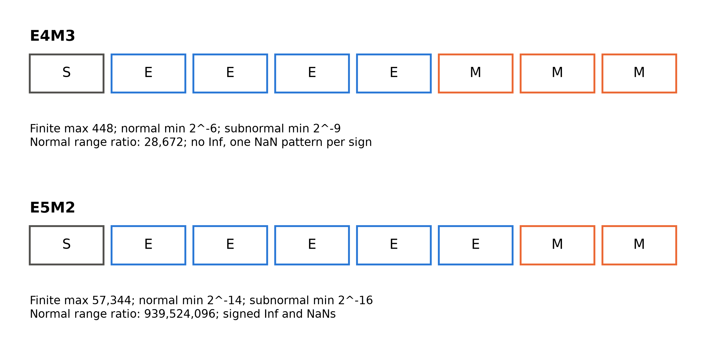
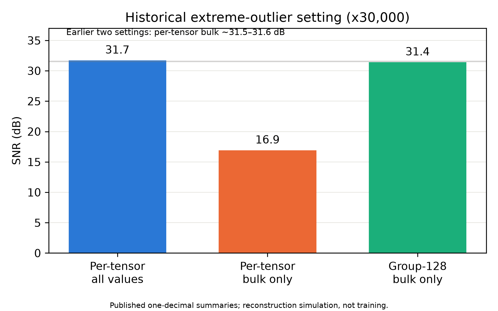
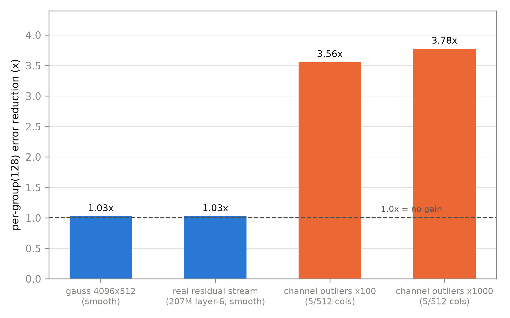
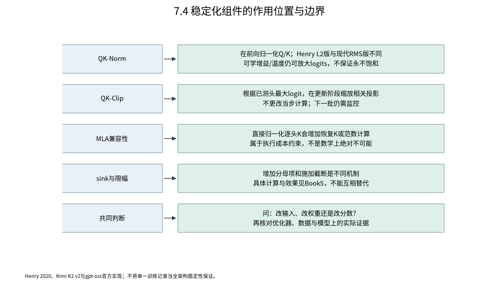

# 第 7 章 训练侧工程：低精度与训练稳定性

## 7.0 开篇：从全书到这里

前两项整机改造已经备齐：前馈采用MoE，注意力采用MLA。此前的历史训练主要使用bf16混合精度，结构对拍则采用CPU fp32；“模型用了什么精度”需要逐条计算路径说明。现在进一步问：哪些张量可以降低位宽，哪些运算仍须保留较高精度？第3章介绍过选择性精度与z-loss，本章把格式、缩放、累加和稳定化组件放回训练流程，考察它们怎样相互配合。

要回答的问题是：**更低的精度（FP8、乃至 4.25 bits 的 MXFP4）凭什么敢进训练循环？降低大模型训练不稳定风险的组件级方案怎样工作？**产出三样：一张 FP8 格式账（表 7.1）、一张 DSV3 的 FP8 全栈清单（表 7.2）、一张三路线稳定化对照表（表 7.3），外加一份本机模拟实验（`fp8_sim.py`，CPU 秒级）。

到本章结束时，训练侧的「格式—缩放—稳定化」三件事都有对应的实物可看，下一章只剩训练目标侧最后一件（MTP）；再往后，就是用已学的全部组件分析旗舰整机了。

> **最小背景栏**
> - fp16 刻度尺（1/5/10 位、最大 65,504、最小正次正规数 $2^{-24}$）与混合精度三件套：Book2 第 9 章 9.4 节已立，本章只回指不重教；浮点的「符号/指数/尾数」三元组同出彼处。
> - 三站训练记录（BERT-LARGE 随机重启、PaLM 540B 约 20 次 spike 与「数据批×参数状态」归因句、OPT-175B 的 63 天 logbook 与动态损失缩放大幅下降）：Book2 第 9 章 9.6 节——本章将接着讨论这些问题的处理方法。
> - z-loss与选择性精度的案例对照：本册第 3 章 3.4 节。
> - MoE 的 router 打分与 gating（门控）：第 2 章 2.2 节；RMSNorm：Book3 第 2 章。
> - MLA 的四路记号 $q^C/k^C/q^R/k^R$ 与「推理时 K/V 不物化」（权重吸收后只缓存 $c^{KV}+k^R$）：第 6 章 6.6 节——7.7 节的桥。
> - 本章全部低精度实验为 **CPU fp32 模拟口径**（这些实验未调用原生FP8/FP4矩阵乘），声明随每个数字走。

## 7.1 从历史记录到可检验的机制

先把前册的两个问题接起来。Book1第8章讨论GNMT时区分了训练准备和量化推理：8-bit权重与乘法、16-bit循环状态及逐元素运算，矩阵乘另用更宽累加器；所测配置增加0.0072 log-PPL，不能改称全机fp16或16-bit累加。Transformer论文没有报告相同方案，也不能据此断定作者有意拒绝量化。Book2第9章则从不同训练记录引出低精度与稳定性问题，明确把进一步的归一化、裁剪和诊断方法留到本章。

先用一句话回顾这些训练记录：BERT-LARGE在部分小数据微调任务上使用多次随机重启、PaLM 把病根写成「特定数据批与特定参数状态的相遇」、OPT 的动态损失缩放一路崩到 0.000122——这些记录来自不同训练阶段与处置流程，不能合并成一个统一病因，Book2 第 9 章 9.6 节已逐条记下。

还有一条分工需要说明：Book2预告的模型状态多卡分摊，是另一种降低单卡负担的办法。本册先讨论模型与训练数值设计，多卡的成本及执行机制继续见Book6第19章与Book8第16、17章。

本章给出两张处方笺。**处方一：更低精度**。fp16 三件套只是第一棒，往下还有两级——FP8（7.2 格式课、7.3 缩放粒度、7.4 DSV3 全栈）与 MXFP4（7.5）。

**第二类办法：稳定化组件**。归一化与裁剪不再只是损失函数里的正则（第 3 章 z-loss 的路数），而是成为架构与优化器中的部件——QK-Norm（7.6）与 Muon 系（7.7）。7.8 将三条稳定化路线放在一起比较，并用本机模拟检验第一张处方的机制。这些办法处理的对象不同：位宽决定表示误差，稳定化组件影响训练中的数值轨迹。它们需要一起设计，但不能仅凭使用某个组件就认定更低位宽一定可行。

## 7.2 FP8 格式课：8 个 bit 怎么花

处方一从格式本身开始。Book2 的刻度尺上，fp16 把 16 位花成 1/5/10——指数 5 位换量程、尾数 10 位换刻度。现在预算砍半，只剩 8 个 bit，怎么花？答案不是砍半尾数了事，而是**重新分配位数**：E4M3 花成 1/4/3，E5M2 花成 1/5/2。同一组取舍，可以有两种分配方式：E4M3 留 3 位尾数（每个完整二进制区间内8个正规格点），量程缩到 448；E5M2 留 5 位指数，量程拉到 57,344，但每个完整二进制区间只有4个正规格点。用人话说：**E4M3 是刻度细但尺子短，E5M2 是尺子长但刻度粗**（图 7.1、表 7.1）。



图 7.1 E4M3/E5M2 位布局与动态范围（自绘，示意级；数字锚定官方论文 2209.05433 v2 Table 1/§2）。E4M3 的特殊值取舍：不表示无穷、每个符号下保留一个NaN尾数模式，换来 256-448 段的 7 档量程。

**表 7.1** FP8 两种格式参数对照【证据等级：官方论文 2209.05433 v2 Table 1+§2】

| 属性 | E4M3 | E5M2 |
|---|---|---|
| 位分配（符号/指数/尾数） | 1 / 4 / 3 | 1 / 5 / 2 |
| 指数偏置 | 7 | 15 |
| 每个完整正规区间$[2^e,2^{e+1})$的格点数 | $2^3=8$；顶指数段因NaN保留少一个 | $2^2=4$ |
| 最大正规数 | $1.75\times 2^8=448$ | $1.75\times 2^{15}=57{,}344$ |
| 最小正规数 | $2^{-6}$ | $2^{-14}$ |
| 最小次正规数 | $2^{-9}$ | $2^{-16}$ |
| 特殊值 | **不表示 Inf、每符号一个NaN模式**（S.1111.111）——多换 7 档量程 | 遵循 IEEE 754 惯例（±Inf/NaN） |
| 论文推荐用途 | 前向（权重与激活） | 梯度 |

先看正规有限数的编码规则；零、次正规数和特殊值另列。正规值为

$$v=(-1)^{S}\times 1.M\times 2^{\,E-\mathrm{bias}},\qquad \text{bias}=2^{\,\text{指数位}-1}-1 \tag{7.1}$$

用人话说：指数位减去偏置就是二进制小数点的位置，尾数是小数点后面的有效数字——E4M3的正规指数从−6到8，E5M2从−14到15；最终数值还要乘有效数部分。还有一段这条公式不适用的范围：指数全零时隐含前导从 $1.M$ 变成 $0.M$，进入**次正规数（subnormal）**区——E4M3 的正次正规数从 $2^{-9}$ 到 $7\cdot2^{-9}$，共有7个格点；更小值会按舍入规则落到最小格点或零。本章后面要用这段精度较低的范围解释一次精度骤降，先记住它的边界。

补上次正规式才能把整把刻度尺接起来。若尾数有m位、尾数整数为F，则正规值为$(-1)^S(1+F/2^m)2^{E-bias}$；指数编码E=0时改为$(-1)^S(F/2^m)2^{1-bias}$。E4M3取m=3、bias=7，因此最小正数是$2^{-3}2^{-6}=2^{-9}$。在普通正规区间$[2^e,2^{e+1})$，相邻间距为$2^{e-m}$，舍入到最近值时绝对误差至多半个间距，相对误差上界约$2^{-(m+1)}$；次正规区间则是固定绝对间距，所以越接近零，相对误差越大。饱和、NaN与端点规则要另行处理。

E4M3的特殊值取舍可以直接从编码读出：保留正负零，以及每个符号下尾数全1的一个NaN编码；不设置Inf。由此新增256、288、320、352、384、416、448七个正幅值及其负值，原最大有限值240扩到448【2209.05433v2 §3.1】。格式规定可表示什么，溢出时饱和还是转特殊值、平局怎样舍入，是另外的转换策略。原论文建议权重/激活用E4M3、梯度用E5M2，依据的是所测张量的精度与动态范围需求；并非每个模型的梯度都必然比激活宽若干数量级。

以12.5为例：$12.5=1.5625\times2^3$，E4M3在这个区间相邻值为12与13。它正好处于中点；若采用ties-to-even，即平局取最低有效位为偶数的一侧，结果为12，误差0.5。E5M2在同区间格距为2，刻度更稀，但不能由此断定每一个输入的误差都恰为两倍。再看次正规区：E4M3的0.003会取到 $2\times2^{-9}=0.00390625$，相对误差约30.2%；在同一平局规则下，正数不超过 $2^{-10}$ 时舍入为零。这个例子同时说明，格式、舍入模式与输入所在区间都影响结果。

8 位浮点不是「fp16 砍半精度」，是在位数预算里重排了量程与刻度的配比——这句话值得反复体会，因为下一节整节都在讲它的代价。

先在本机检验格式的表现：对同一张 $(4096,512)$ 高斯矩阵做量化-反量化往返（`fp8_sim.py`，CPU fp32 模拟、种子 20261002，含次正规建模），E4M3 相对 L2 误差 **2.649%**、E5M2 **5.256%**——这张输入的误差比约1.98，符合少一位尾数、格距更粗的直觉【证据等级：本书实验】。

同一矩阵整体乘0.011、0.088、0.88，再各自重新计算max-scale，历史相对误差都为2.649%。原因是 $x\mapsto ax$ 时，$s\mapsto as$，所以送入量化器的 $x/s$ 不变；重建误差与信号一起缩放，相对误差保持。只要未触及scale的数值下限或溢出边界，动态缩放的整数量化也可以有这项性质。这个实验验证的是整套缩放规则，不能据此区分浮点与整数的本质，更不能单独证明per-tensor对任意分布都足够。

**符号表**（本章各式通用；$B\cdot n$=展平 token 数、$d$=残差流宽、$d_h$=头维、$h$=头数——承全册记号）

| 符号 | 含义 | 形状/取值 |
|---|---|---|
| $S,E,M$ | 浮点编码的符号/指数/尾数 | 式 (7.1)；E4M3 各 1/4/3 位、E5M2 各 1/5/2 位 |
| $\mathrm{bias}$ | 指数偏置 | E4M3=7、E5M2=15 |
| $s$ | 缩放因子（组内$\max\lvert x\rvert$除以格式上限） | 标量（per-tensor）或 $(B\cdot n,\,d/128,\,1)$（1×128 tile） |
| bulk SNR | 非离群主体子集的信噪比 | 标量 dB（$\S$7.3 主指标） |
| $g$ | QK-Norm 可学温度 | 标量；$g_0=\log_2(L^2-L)$，$L$=97.5 分位序列长 |
| $\hat Q,\hat K$ | 逐头归一化后的查询/键 | $(B,h,n,d_h)$，归一化沿末维 |
| $W_q^h,W_k^h$ | 第 $h$ 头 Q/K 投影权重（逐头切片） | $(d,d_h)$ 级 |
| $S^h_{\max}$ | 第 $h$ 头 batch 内最大 logit | 标量；式 (7.4) |
| $\gamma_h,\ \tau$ | 逐头裁剪系数与阈值 | 标量；$S_{\max}^h>\tau$时取$\tau/S_{\max}^h$，否则取1；$\tau=100$ |
| $q^C,k^C,q^R,k^R$ | MLA 四路（承第 6 章记号） | $q^C,k^C,q^R$：$(B,h,n,\cdot)$ 逐头；$k^R$：$(B,n,d_h^R)$ 全头共享 |
| $N_C$ | FP8 GEMM 分段累加长度 | 128（表 7.2） |

## 7.3 缩放粒度：per-tensor 的边界与分组的解决方法

格式定了，还剩一个自由度：**缩放因子**。浮点数近似固定的相对精度只适用于正规数区，于是标准做法是把张量整体除以一个$s$，让最大幅值贴着格式上限（$s=\max|x|/448$）。令Q表示目标格式的舍入与饱和，则$\widetilde x=sQ(x/s)$：先除scale落入可表示区间，再乘回来恢复单位。令$a=\max|x|$，s=a/448；某个主体值x仍在正规区要求$|x|/s\ge2^{-6}$，即$a/|x|\le448\cdot2^6=28672$。这只判断某个元素是否进入次正规区，不代表所有小于该比值的张量都满足任务精度要求。全张量共用一个s，就是per-tensor缩放。2022年论文讨论了这类缩放，但未把本章的即时max规则指定为唯一实现。

它够用到什么时候？算一笔账：E4M3 正规数动态范围 $=448/2^{-6}=28{,}672\approx2^{14.8}\approx 2.9\times 10^{4}$。该比值远低于阈值时，所选主体幅值可留在正规区；是否够用仍取决于整体分布与任务敏感性；一旦逼近，灾难的机制是：**离群值把 $s$ 撑大，全张量的主体被压进次正规数区**——$2^{-9}$ 到 $2^{-6}$ 之间只剩 7 个稀疏格点，主体的精度断崖式跌落。

历史CPU模拟记录如下（`fp8_sim.py` 实验②，$(4,512,1024)$ 张量、加入 0.05%-0.1% 的离群点）：离群 ×30（max/中位数 ≈187）与 ×300（≈1,800）时，per-tensor 的主体信噪比（bulk SNR，只统计非离群元素）稳在 31.5-31.6 dB；离群拉到 ×30000（≈$1.7\times 10^5$，越过 $2^{14.8}$ 的边界）时，主体元素的中位数缩后只剩 0.0026——落进次正规区，**bulk SNR 从 31.6 dB 断崖跌到 16.9 dB**；而最强离群档的per-group(128)主体SNR约31.4 dB，仍接近前两档的水平【证据等级：本书实验（CPU fp32 模拟口径；此脚本不测原生低精度硬件性能，下同）】。

最强离群档还报告了一个容易误读的数：全体SNR仍约31.7 dB，而主体子集仅16.9 dB。SNR比较信号与误差的能量；离群值占据大量信号能量，只要其相对重建误差不大，整体指标便可能掩盖低幅值主体的损伤。这里不是说所有离群值都被完美量化。图7.2把这个历史档位的三个已发表汇总并排显示，阅读时须区分总体与主体。



图7.2 最强离群档的历史汇总（CPU fp32往返模拟，原文已报告的一位小数）：per-tensor总体31.7 dB、主体16.9 dB，per-group(128)主体31.4 dB。前两档per-tensor主体约31.5—31.6 dB，相关设置与结果仍见正文。本图只重排已发表汇总，不补造原始采样数据。

分组的作用是缩小一个scale覆盖的范围。V3的前向激活可把 $(Bn,d)$ 重排为 $(Bn,d/128,128)$，每个token的每128通道一组；权重 $W\in\mathbb R^{d\times d_{\mathrm{ff}}}$ 则按两个维度组成128×128块。某个离群值会抬高所在组的scale，该组内的普通值仍可能受损，其他组则可使用自己的scale。收益来自影响范围变小，绝不是离群点一出现就单独拥有一组。本书模拟中离群通道自身约0.7%的误差，也只是所测输入的结果。

为什么前向激活与权重用不同分组，还要结合计算轴和数据结构。跨token共享scale会把多个位置绑在一起；若这些位置的梯度幅值差异很大，一处离群可能影响整个块。V3附录B.2报告的block量化反例支持研究这一问题，但“token相关离群”是作者的解释假说，并未证明所有权重都适合方块、所有激活都必须采用同一粒度。前向与反向的转置布局也要分别处理，下一节列出其实际设置。

但分组不是免费午餐，更不是普遍真理——它的收益是**有条件的**。历史模拟的实验③把两种分布摆在一起：平滑分布（高斯矩阵、以及探针A所述207M第6层前向采样，历史std 0.975；生成代码使用新初始化模型与随机token，非训练后的语料激活）上，分组相对 per-tensor 的误差只降 **1.03×**——几乎没有收益；带通道离群的合成激活（512 通道中 5 个 ×100/×1000）上，误差降 **3.56×/3.78×**【证据等级：本书实验；调研期探针在另一随机布点下测得 2.6×/2.7×——倍数随布点漂移，两次采样都显示这些通道离群输入受益更多】。用人话说：**分组缩放的收益取决于组内动态范围与误差分布**——残差流本身足够干净时，所测per-tensor缩放已经给出接近的相对误差（图 7.3）。所以正确的读法不是「分组更精细所以更好」，而是「激活里到底有没有离群、离群长什么样」决定处方。



图7.3 历史分组收益（fp8_sim.py实验③）：所测平滑输入约1.03×，通道离群输入约3.56×/3.78×。旧图real_act标签指网络前向采样，不代表训练后的真实语料分布：探针A代码用随机初始化权重与随机token生成样本。原act_sample.npz目前缺失，无法进一步核对该文件身份；保留历史图，不用合成输入冒充该列复测。

沿着这条机制，可以看到历史上的三级演变。第一级，2022 年原论文：per-tensor 配方，验证到 175B 参数级【证据等级：官方论文 2209.05433 v2】。第二级，2023 年 FP8-LM（2310.18313 v2）：分三个层级扩展到梯度、优化器状态与分布式训练（自动混合精度框架，开源 MS-AMP），摘要报告GPT-175B在H100平台相对Megatron-LM BF16基线实存内存减少39%、速度提高75%【证据等级：官方论文，厂商自报口径】。第三级，2024-12 的 DSV3：将缩放粒度从「每张量」细化到「每 tile/每 block」，并把整套纪律写成框架——下一节逐件清点。

## 7.4 DSV3 的 FP8 全栈：一张表读 §3.3

细粒度分组在 DSV3 中发展成的并非单点技巧，而是一整套工程纪律——671B总参、14.8T tokens的训练采用FP8混合精度框架，并非所有运算与状态都变为FP8【证据等级：官方技术报告 2412.19437 v2 §3.3】。完整清单列在表 7.2 中，正文只讲三件事：哪里用 FP8、哪些路径保留较高精度、如何保证累加的精度。

**表 7.2** DSV3 FP8 训练框架全清单（canonical = 2412.19437 v2 §3.3 + 附录 B；逐字核对于 HTML 全文）

| 件 | 处方 | 出处 |
|---|---|---|
| 三个 GEMM | 主要Linear的Fprop/Dgrad/Wgrad使用FP8输入，输出BF16/FP32；理论计算吞吐可比BF16高2倍，不能直接等同整步加速 | §3.3.1 |
| **五类组件保留原精度** | embedding、output head、MoE gating、normalization、attention；原文写例如BF16或FP32，不能统一缩写成全BF16 | §3.3.1 |
| 激活量化粒度 | 1×128 tile（每 token 每 128 通道一组） | §3.3.2 |
| 权重量化粒度 | 128×128 block（128 输入 × 128 输出通道） | §3.3.2 |
| 缩放因子选取 | 在线逐组读取最大幅值并定scale；与报告当时比较的历史最大值延迟方案不同，不能据此概括所有版本Transformer Engine | §3.3.2 |
| 元素格式 | 需量化的FP8张量采用E4M3；作者将其可行性归于细粒度缩放，并非全模型每个张量都变成E4M3 | §3.3.2 |
| GEMM累加 | 报告所用H800 Tensor Core累加路径约保留14位；随机矩阵K=4096预试最大相对误差近2%。每$N_C=128$个归约元素转FP32寄存器累计，并恢复组scale | §3.3.2 |
| 优化器状态 | AdamW 一二阶矩用 BF16 跟踪；master 权重与梯度 FP32 | §3.3.3 |
| 激活存储 | 激活 FP8 缓存；两处特例：attention 后 Linear 输入用自定义 E5M6 格式（scale 取 2 的幂，免二次量化误差）、SwiGLU 输入缓存+反向重算输出 | §3.3.3 |
| MoE 通信 | dispatch 前 FP8 量化（与 FP8 Fprop 兼容）、combine 保 BF16 | §3.3.3 |
| 质量对照 | 附录 B.1：16B MoE 训 1.33T tokens + 230B MoE 训 ~0.9T tokens 双规模，FP8 vs BF16 训练曲线**相对误差 <0.25%**——「训练随机性的可接受范围内」；注意证据是 loss 曲线级，无 benchmark、无速度对照 | 附录 B.1 |
| 反例 | 将Dgrad相关张量改为128×128 block量化的约16B MoE，在约300B tokens处发散；作者推测激活梯度的token相关离群导致其敏感性 | 附录B.2 |

三件事的第一件，FP8 用在哪：主要核心计算应用于Linear的矩阵乘，另外也用于部分存储与通信。一个 Linear 层从头到尾要算三次 GEMM——前向的 Fprop $y=xW$：$(B\cdot n,d)\times(d,d_{\mathrm{ff}})\to(B\cdot n,d_{\mathrm{ff}})$；反向的 Dgrad $\partial L/\partial x=\partial L/\partial y\cdot W^{\top}$：$(B\cdot n,d_{\mathrm{ff}})\times(d_{\mathrm{ff}},d)\to(B\cdot n,d)$；反向的 Wgrad $\partial L/\partial W=x^{\top}\cdot\partial L/\partial y$：$(d,B\cdot n)\times(B\cdot n,d_{\mathrm{ff}})\to(d,d_{\mathrm{ff}})$——这些是主要线性计算；保留高精度的特殊组件须按表7.2另行处理。权重侧的 128×128 block 沿的正是 $W$ 的 $(d,d_{\mathrm{ff}})$ 两个维度切；激活侧的 1×128 沿 token 维切到 1，两次反向的形状对得上。

第二件，哪些组件在这套配方中保留较高精度——五个组件的名单本身就是一份「哪里的小数值撬动大分配」的复习提纲：embedding 与 output head 的词表宽矩阵（词表接口的量化误差可能直接影响表示与损失；保留高精度是该配方的选择）、normalization的统计与归一化计算、以及我们在第 2 章就见识过的 router——两个专家的 logits 只差末位一点，top-k 的选择就整个翻转（第 3 章 selective precision 的同一直觉，DSV3 的 gating 稳定件还包括第 5 章的 sigmoid 打分）；attention也被保留较高精度；softmax对分数差异敏感是理解此选择的一条直觉，不能代替作者对算子精度与成本的整体评估。低精度化必须遵守的原则就在这里：**砍精度是局部手术，不是全局开关**。

第三件，累加兜底：长归约在有限有效精度下可能积累明显误差，并不意味着任何长求和都无法执行——每 128 个就把部分和升到 FP32 再继续累加。乘法可以采用较低精度，累加必须保持高精度。

分组缩放也必须进入乘法的代数。若$x_k\approx s_{x,g}\widetilde x_k$、$w_k\approx s_{w,g}\widetilde w_k$，第g组的点积贡献为$s_{x,g}s_{w,g}\sum_{k\in g}\widetilde x_k\widetilde w_k$。全点积需要先按组恢复scale再相加；不同组scale不同时，不能把所有低精度部分和先混成一个数，最后只乘一个scale。分段高精度累加正好与这个分组结构配合。

在标准浮点舍入模型、无溢出/下溢且nu<1时，顺序累加n项的绝对误差可界为$\gamma_n\sum_k|a_k|$，$\gamma_n=nu/(1-nu)$，u为单位舍入误差。这里若有大量正负抵消，真实和很小，即使绝对误差不大，相对误差也可能很大。该界说明为什么长归约和累加精度值得单独处理，不用于精确预测某个Tensor Core的实现误差。

表尾两行说明了这套方法的证据与限制：正面，双规模对照的 <0.25%——注意它证明的是「训练曲线几乎无差」，任务级质量与吞吐并无公开对照【证据等级：官方技术报告 2412.19437 v2 附录 B.1，负结论见调研复核】。

反面，V3附录B.2将Dgrad相关张量改为128×128 block后，在约16B、300B token的实验中出现发散。作者推测激活梯度跨token高度不均衡，因此较大的跨token块难以处理这些离群。这里应保留“推测”一词；它支持检查分组方向，却不证明某种粒度对所有任务必然成功。其前向1×128与反向128×1的转换，也说明只记“组大小128”还不足以重建实现。报告§3.5进一步讨论累加精度、tile/block支持、在线量化与转置GEMM等硬件需求。

本节引用的V3材料没有给出仅由FP8带来的端到端加速倍率；不能将GEMM的理论2倍吞吐直接换算成整步收益。报告同时讨论了多种计算与通信优化，其总效率不由格式一项决定。它将细粒度策略与microscaling联系起来；下一节继续看块内共享缩放如何写进数据格式。

## 7.5 MXFP4：块内共享指数与 gpt-oss 的用法

FP8 的台阶往下还有一级：4 位浮点。单独的 FP4（E2M1，可表示 $\pm\{0,0.5,1,1.5,2,3,4,6\}$）非零幅值范围只有 $6/0.5=12$ 倍，未经缩放时难以覆盖许多训练张量；使它可用的是 OCP MX 规范（2023-09，AMD、Arm、Intel、Meta、Microsoft、NVIDIA、Qualcomm等共同参与的规范）定下的**块内共享指数**：把张量按最后维切成 **32 元素一块**，块内元素用 E2M1，全块共享一个 **8 位纯指数 scale（E8M0，无尾数，即 2 的幂）**【证据等级：官方论文 2310.10537 v3 + OCP MX v1.0 规范】。存储账一目了然：

$$\text{MXFP4}:\quad 32\times 4\ \text{bit（元素）}+8\ \text{bit（共享 scale）}\ \Rightarrow\ 4+\frac{8}{32}=4.25\ \text{bit/参数} \tag{7.2}$$

式(7.2)统计的是完整32元素块的有效载荷：元素128 bit加scale 8 bit，平均4.25 bit；padding、索引及未量化的小张量另计。E8M0表示 $2^e$，指数范围为 $-127\le e\le127$，没有零与Inf，保留一个NaN编码。全零数据块仍可用正scale配零元素表示。2的幂有利于指数调整，也可避免某些重复缩放的额外舍入；但不能仅由格式推出硬件必定一个周期处理32次、完全不需要乘法电路。V3给E5M6激活选择2的幂scale，原文强调的是转置分组时减少二次量化误差。

格式还没有唯一决定scale怎样选。OCP MX v1.0 §6.3建议先把块内最大幅值向下取2的幂，再除以元素格式能表示的最大2的幂。对E2M1，这个除数为4，因此推荐式为 $s=2^{\lfloor\log_2 a_{\max}\rfloor-2}$，并对超范围元素饱和。旧模拟使用 $2^{\lceil\log_2(a_{\max}/6)\rceil}$，选择更保守的无输入溢出尺度。规范允许其他转换算法，但二者不应混称同一算法；新脚本分别报告两种策略。

gpt-oss提供了一个可核对权重存储的MXFP4案例。官方口径值得逐字引：模型卡论文写「We **post-trained** the models with **quantization of the MoE weights to MXFP4** format, where weights are quantized to 4.25 bits per parameter. The MoE weights are responsible for 90+% of the total parameter count」，并注明所有评测都在同样量化态下进行【证据等级：官方论文（模型卡）2508.10925 §2.1 + HF 模型卡】。

这段披露支持三项判断。第一，MXFP4主要用于MoE专家投影，不能把4.25 bit平均到整个检查点；偏置、其他权重及运行状态须按各自格式记账。第二，模型卡将120B档可装入单张80GB GPU、20B档可在低至16GB内存的系统运行作为此压缩的结果；实际可用上下文和批量仍受缓存、内核与运行开销影响。第三，每32值一个scale字节的布局可以从权重文件核查，第10章会把这笔存储账单独算出。

> **【考据框】训练阶段与发布格式要分开。**所引模型卡明确说的是后训练时对MoE权重采用MXFP4量化，并在量化状态评测。这不足以重建预训练阶段全部算术，也不支持未经证据就写成“从零QAT”。本章保留已披露阶段与格式，未知的训练细节不补猜测。

历史CPU模拟采用32元素块、保守ceil尺度和E2M1格点，同一高斯输入上E4M3约2.6%、块FP4约11.5%；另一个离群输入的汇总为全张量E2M1约16.0%、块尺度约11.5%。这些是特定输入与转换策略的往返误差，不是MXFP4的固定误差率。全张量E2M1仍有一个实数scale，不能称为“没有scale”。当前脚本修正中点舍入为ties-to-even，并把OCP建议式与历史ceil式分列；本轮高斯输入分别为11.49%与11.54%，通道离群输入的结果另列于输出JSON。

往返误差只检验重建值，不能单独决定某种格式是否适合训练。gpt-oss的公开材料同时涉及后训练量化和发布存储，仍不足以重建所有前向、反向和累加格式。fp16混合精度、bf16、FP8分组和MX块格式，分别在表示范围、保存状态和计算实现上作了取舍；这些方法有交叉时间线，不能排成每一代都必然更细、更好的单一路线。

## 7.6 组件级稳定化一：QK-Norm——把点积变余弦

接下来讨论训练中的数值增长。Wortsman等人的小规模代理研究复现了两类慢性发散：注意力logits增长，以及输出logits偏离对数概率【2309.14322v2】；作者明确区分了慢性发散与loss spike，不能据此替Book2的不同历史案例确定共同病因。注意力分数 $q^\top k/\sqrt{d_h}$ 随投影与表征变化，可能使softmax过度集中。饱和会改变局部雅可比，但完整损失和其他通路仍须分别分析，不能直接推出梯度爆炸。z-loss从损失侧施加约束，本节则从输入softmax的Q/K表示入手。

一种办法是先归一化查询和键。Henry 等 2020 年的 Query-Key Normalization：对 Q 和 K 沿**头维**做 L2 归一化（$\hat{Q}=Q/\|Q\|$，$Q\in(B,h,n,d_h)$ 归一化作用在最后一维 $d_h$ 上），再进注意力：

$$\mathrm{Attn}(X)=\mathrm{softmax}\big(g\cdot\hat{Q}\hat{K}^{\top}\big)V,\qquad \hat{q}\cdot\hat{k}\in[-1,1] \tag{7.3}$$

用人话说：先把每根查询/键向量都压成单位长度，点积就变成余弦相似度——天然有界 $[-1,1]$，乘上温度g后的分数范围为[−|g|,|g|]；g本身若增长，仍可能导致尖锐分布；原来除 $\sqrt{d_h}$ 的温度，换成可学习的标量 $g$（初始化 $g_0=\log_2(L^2-L)$，$L$ 取源与目标训练序列长度的97.5百分位；这是原论文的初始化选法，并非对所有数据的熵保证）【证据等级：官方论文 2010.04245 v1 Eq 2 及附录】。原文明白地说明了动机："make the softmax function less prone to arbitrary saturation"——让 softmax 不那么容易被推着任意饱和。它管的位置是**进 softmax 之前**——这与后面两路线的分野；在机器里的位置则要交代一句顺序：Qwen3/Gemma3 的实现都是先投影、归一化、再进 RoPE（源码序，norm 住在投影与旋转之间）——后续旋转仍保持输入向量的范数；现代RMSNorm含增益时并非单位向量，不能直接等同Henry版（RoPE 机制=Book3 第 4 章）。

余弦边界来自Cauchy–Schwarz：$|q^\top k|\le\|q\|_2\|k\|_2$，除以两个非零范数后即落入[−1,1]；零向量需用epsilon保护。以$q=(3,4)$、$k=(4,3)$为例，原点积24，归一化后为24/25=0.96。对q乘10，原点积变240，而单位归一化结果仍0.96，因此在忽略epsilon影响、向量非零时，单位归一化消除了对单个向量正尺度的敏感性；接近零时须以实际epsilon实现为准。

RMSNorm版本不同：忽略epsilon且无增益时，$q/\sqrt{\|q\|^2/d_h}=\sqrt{d_h}\,q/\|q\|$，故两向量点积为$d_h$倍余弦；带逐通道增益后还会改变方向和上界。两类都控制范数，但不能把“现代模型有QK-RMSNorm”直接翻译为“分数就是[−1,1]余弦”。

有一条勘误事实必须明确：

> **【考据框】Henry et al. 没有主张「免 warm-up」。**论文原话是「我们最好的结果用了 8,000 步线性 warmup」，且明说 warmup 的作用待研究。二手材料里流传的「QK-Norm 免除 warm-up」不能安在这篇论文头上。同链另一处 ID 勘误：ViT-22B 的「QK-LayerNorm」参考实现是 2302.05442（2309.16580 是一篇无关的代数几何论文——检索层引入的错误 ID，已核 K2 参考文献本身不带 arXiv 号）。

后续研究采用了不同形式的QK归一化。ViT-22B与Wortsman代理实验讨论QK-LayerNorm；Chameleon报告在注意力查询、键上加LayerNorm。其7B模型去掉QK-Norm后约0.2个训练epoch发散，但7B还需要dropout，34B进一步需要调整norm位置【2405.09818v2 §2.3】。所以该消融支持QK-Norm在这些配方中的作用，却不能说一项归一化足以稳定所有规模，也不能把7B的发散时刻直接套给34B。到Qwen3与Gemma3，还需核对它们具体采用的是哪种norm。

> **【实现对照框】**当前transformers 5.14.1的Qwen3与Gemma3均先投影，再沿head_dim执行RMSNorm，然后应用RoPE。它们没有独立的QK-Norm启停字段，但head_dim、eps等配置仍参与实现。看见字段表没有写“QK-Norm”，不代表模块不存在；这里必须由config走到构造函数和forward。现代RMSNorm不等于Henry的单位L2归一化，式(7.3)的余弦边界不能原封不动套用。

同时记下一个反例：gpt-oss **不用** QK-Norm（所核官方参考实现及当前transformers注意力模块均未采用q_norm/k_norm）【证据等级：所核官方参考实现及transformers 5.14.1】。它走的是第三条路——7.8 节三路线对表时再见。

## 7.7 组件级稳定化二：Muon 系——优化器也是稳定性变量

QK-Norm从前向处理数值尺度；接着还要检查更新权重的优化器，因为它也会影响后续的logit变化。本节的主角 Muon 来源特殊——它最初通过技术博客与公开代码介绍：Keller Jordan 等 2024 年的技术博客加开源实现（见[公开实现](https://github.com/KellerJordan/Muon)；K2报告也按此引用原始工作），靠 modded-nanogpt 训练竞速出名。Muon把矩阵更新方向作为整体处理。先设动量矩阵$M\in\mathbb R^{m\times n}$的紧致SVD为$M=U\Sigma V^\top$。理想的谱整形方向为$UV^\top$，即把非零奇异值改成1，保留左右奇异方向。矩形情形不是“两边都正交”：m≥n且满列秩时，$Q^\top Q=I_n$；m<n时相反。这个方向是优化器设计，不是由损失函数唯一推出来的最优更新。

例如$M=\operatorname{diag}(4,1)$，普通动量一步在两方向移动比例4:1，理想整形后变为$I$，比例1:1。它避免最大的奇异方向独占更新，但也丢弃了原奇异值携带的幅度信息；实际步长需要重新校准。

不显式求SVD时，可使用Newton–Schulz类矩阵多项式。经典原型对非零矩阵令$X_0=M/\|M\|_F$，再迭代$X_{r+1}=\tfrac12X_r(3I-X_r^\top X_r)$。代入SVD，左右方向不变，每个奇异值独立执行$\sigma\mapsto\tfrac12\sigma(3-\sigma^2)$；在适当初值范围内向1靠近，零奇异值仍为0。实际Muon采用为少步低精度计算设计的多项式、动量及尺度修正；所核公开代码使用五阶系数(3.4445,−4.7750,2.0315)，并明确有限步结果不精确等于 $UV^\top$。不能把这条经典教学迭代冒充生产实现。它说明了为什么矩阵乘可以近似完成谱整形，以及为什么初始化缩放不可省。

embedding、输出头和一维参数通常继续由AdamW等方法处理；这是一种混合优化配方，不是对全模型每个参数都做相同的正交化。[Muon公开实现](https://github.com/KellerJordan/Muon)提供实际算法定义。

Moonlight进一步研究了权重衰减和更新尺度。对满秩的理想谱整形矩阵，更新RMS为 $1/\sqrt{\max(m,n)}$，矩阵尺寸不同就会改变每参数步幅；乘 $0.2\sqrt{\max(m,n)}$ 可把这一理想量级调到0.2。作者用它匹配所观察到的AdamW更新范围，不能理解为任意一步都与AdamW逐项相等。其compute-optimal scaling-law实验报告约2倍计算效率，另训练了自称3B激活/16B总参、5.7T token的Moonlight模型【2502.16982v1】。这里比较的是达到目标质量所需计算，不是优化器单步必定快两倍。

但规模化又遇到了新问题：在所测配方中，Muon更容易伴随注意力logits过度增长。K2 技术报告（2507.20534v2）写得很直白：在 9B 激活/53B 总参的中间规模上，原版 Muon 训练的 max logits 迅速超过 1000，spike 接连出现——"an issue that occurs more frequently with Muon but less with AdamW"（这个问题在 Muon 下更常发生、AdamW 下较少）【证据等级：官方技术报告 2507.20534 v2 §2.1/Figure 2 直引】。

两个既有方案为什么不够？K2 的原句正好一条联系第 6 章，另一条联系上一节。logit softcap 的问题：它 "directly clips the attention logits, but the dot products between queries and keys can still grow excessively before capping is applied"（直接截断 logits，但截断生效之前点积已经可以涨过头）；QK-Norm 的问题更根本——原句逐字：**"QK-Norm is not applicable to multi-head latent attention (MLA), because its Key matrices are not fully materialized during inference"**。用人话说：第 6 章 6.6 节的权重吸收之后，推理时缓存里只有压缩向量 $c^{KV}$ 与共享解耦键 $k^R$，**K 矩阵根本不被物化出来**——直接在逐头K上做归一化会要求恢复K，或计算每个头随token变化的范数。这是「ch6 的架构选择反过来约束 ch7 稳定化工具箱」的具体例子：装了 MLA 的机器，直接照搬QK-Norm会破坏原本简洁的吸收路径；这是一种计算与实现约束，不是归一化在数学上绝对不可能。

于是 K2 采用了新方法 **QK-Clip**，思路与 QK-Norm 相反——不在前向动手，在**权重上事后裁剪**。

定义每头最大logit：全部Q/K为$(B,h,n,d_h)$，固定头$h$后，$Q^h,K^h$为$(B,n,d_h)$。

$$S^{h}_{\max}=\frac{1}{\sqrt{d_h}}\max_{X\in\mathcal{B}}\max_{i,j}\,Q_i^hK_j^{h\top},\qquad \gamma_h=\begin{cases}1,&S^h_{\max}\le\tau\\ \tau/S^h_{\max},&S^h_{\max}>\tau\end{cases} \tag{7.4}$$

（K2原文将头维记作$d$，本章统一写$d_h$；$X\in\mathcal{B}$指当前batch中的序列。）用人话说：盯着每个头的最大 logit，一旦超过阈值 $\tau=100$，就把该头的 Q/K 投影权重按 $\gamma_h$ 重缩放（朴素版 $W_q^h\leftarrow\gamma^\alpha W_q^h$、$W_k^h\leftarrow\gamma^{1-\alpha}W_k^h$，$\alpha$ 通常 0.5，实用版逐头）——logit 只当**信号**用，报告明确「不改动当前步的前向/反向计算」，梯度照旧流，权重在优化器步之外再作一次调整。

MLA 机器上的适配四件套恰好是第 6 章四路记号的解剖图：头特定的内容向量 $q^C$、$k^C$ 各乘 $\sqrt{\gamma_h}$，头特定的 RoPE 查询 $q^R$ 乘 $\gamma_h$，**共享**的解耦键 $k^R$ 不动——共享部分一旦按某个头缩放，就会影响所有头，因此保留共享键，只让本头位置查询承担完整缩放；内容两侧的平方根因子相乘也为$\gamma_h$。

为何MLA需要三种不同缩放？内容分数$q^{C\top}k^C$两侧各乘$\sqrt\gamma$后变为$\gamma q^{C\top}k^C$；位置键跨头共享，不动它，只把该头$q^R$乘γ，则位置分数同样乘γ。二者相加整体乘γ。若原测得最大分数200、阈值100，就取γ=1/2，内容两侧各乘$1/\sqrt2$、位置查询乘1/2。此代数针对相同输入和相应投影权重；实际算法先在当前前向测量，再执行优化器更新，最后按旧测量裁剪；中间权重已经变化，所以连同一批输入重新计算也不必严格落到阈值内。例如测得200、优化器更新后变为800，按旧值算$\gamma=1/2$，裁剪后仍可为400。它是反馈调节，不能承诺下一步或所有未来输入都有硬上界。

效果与超参数选择的报告如下：K2 全程 15.5T tokens **零 loss spike**（摘要原话 "zero loss spike"）；logits 先被压在 100 附近，约 30% 训练进度后自然衰减、无需再动 $\tau$；附录D在0.5B激活/3B总参的小模型上比较原Muon与$\tau=30$的MuonClip，loss 曲线无可观差异——在所测配置中未观察到明显质量退化；前 70,000 步里只有 **12.7%** 的头触发过至少一次，之后所有头都不再触发裁剪——**最小干预原则**的实证【证据等级：官方技术报告 2507.20534 v2 §2.1/摘要/附录 D/Figure 2-3】。

整套配方的其余参数也都公开（MuonClip + WSD 日程，15.5T tokens：先500步warmup，前10T主体阶段学习率2e-4、后 5.5T 余弦降到 2e-5，weight decay 0.1 全程，全局 batch 67M tokens）【证据等级：官方技术报告 2507.20534 v2 §2.5】。

为什么Muon在这些实验中更容易出现大logit，K2附录E将解释明确标为假说：谱更分散的更新可能与权重方向叠加，增加某些奇异值。注意力含双线性乘积，能够确认的范数关系是 $\|W_qW_k^\top\|_2\le\|W_q\|_2\|W_k\|_2$，而非一般都等于某个谱范数的平方。例如 $W_q=\operatorname{diag}(1,0)$、$W_k=\operatorname{diag}(0,1)$ 各自范数为1，乘积却为零。只有特定对齐或共同缩放条件下，才呈现平方量级增长；这提供风险分析，不能证明Muon每次更新都增大logit。

本节的大规模稳定性证据来自K2团队报告。15.5T token零spike和后期停止触发裁剪，是其模型、数据与训练设置下的观察；本书没有独立重跑该规模训练。局部代数检查可以确认缩放关系和更新时序的边界，不能代替整条训练轨迹的复现。

> **【考据框】MuonClip 没有 Vim、也没有 ρ。**K2 v2 全文没有「Vim/variance-reduced momentum」，也没有「按 update 与权重谱范数之比 ρ 裁剪」的参数——机制就是式(7.4)的阈值触发重缩放，谱范数只出现在附录 E 的*解释*里。二手转述常见此类走样，以报告 §2.1 逐字为准。

## 7.8 不同稳定化机制的比较

表7.3把作用位置不同的机制放在一起。QK-Norm在前向归一化查询/键，QK-Clip在更新阶段缩放相关权重；gpt-oss所核实现则包含attention的额外softmax分母项与SwiGLU支路限幅。后两者也不是同一操作：前馈限幅不直接截断注意力logit，额外分母项也不等于强制Q/K范数有界。这里保留配置事实，机制细节见Book5第2章，不把三者当作可互换的稳定性保证。

**表7.3** 不同作用位置的稳定化设计对照（MLA 记号承第 6 章）

| 维度 | QK-Norm | QK-Clip | sink与SwiGLU限幅 |
|---|---|---|---|
| 下手位置 | 前向：逐头归一化Q/K | 优化器更新后：重缩放Q/K相关投影 | attention分母与MoE前馈支路，两处分别处理 |
| 机制一句话 | Henry版单位点积在$[-1,1]$，仍受可学温度影响；现代RMSNorm另论 | 用已测最大logit调节权重，不修改当步已完成的前向/反向 | softmax分母多一项；前馈限幅是另一部件 |
| 与优化器的关系 | 前向组件；效果仍需结合更新配方 | MuonClip组合使用，但裁剪思想不由优化器名称限定 | 所述机制位于前向，不能据此断言效果与优化器无关 |
| 采用者 | Qwen3/Gemma3（源码级）、Chameleon | Kimi K2（15.5T 零 spike） | gpt-oss（gate 7.0/up ±7.0） |
| MLA适配 | 直接逐头K归一化会改变简洁吸收路径的计算组织 | $q^C,k^C$相关投影各缩$\sqrt{\gamma_h}$，$q^R$缩$\gamma_h$，共享$k^R$不动 | 不能由gpt-oss案例推断对所有MLA实现的兼容性与效果 |
| 机制与收益深讲 | 本章 7.6 | 本章 7.7 | → Book5 第 2 章 |



图7.4 稳定化组件的作用位置与边界（自绘，示意级；处方与采用者锚定表 7.3 各行证据源）。

对照表的用途是定位约束。选择MLA之后，逐头K归一化需要重新安排计算或采用其他方法；换优化器，也需要重新检查更新尺度与数值增长。架构、格式和稳定化设计相互影响，但“搭配出现”还不是因果证明，最终仍要在具体配方里验证。

本机模拟给出三项有限结论：第一，聚合SNR可能掩盖低幅值主体的损伤；第二，分组收益随输入分布和分组方向改变；第三，重新计算scale可以带来整体缩放下的相对误差不变性，整数与浮点方案都可能具备。它们帮助理解V3的工程动机，但不是复现了该旗舰的训练发散实验。全部测试为CPU往返模拟，不测原生FP8/FP4吞吐。

本轮以torch2.10.0+cpu复核了量化器：E4M3的254个有限编码及252个相邻中点、E5M2的248个有限编码及246个中点，与对应PyTorch转换一致；E2M1的全部中点另核ties-to-even。原激活样本缺失，当前合成输入的最强离群档为总体31.61 dB、主体16.33 dB、group-128主体31.37 dB；通道离群×100/×1000的分组收益为2.59×/2.68×。这些新读数不替换历史网络采样；样本分支还会改变后续随机数消费，不能把两次差异单独归因于量化规则。

回到开篇，低精度训练需要同时处理表示、缩放、累加和优化轨迹。V3提供了一套具体组合：需量化的张量采用E4M3，细粒度在线scale与分段FP32累加配合，敏感组件保留原精度，并以双规模loss曲线验证。它说明成套配方怎样落地；未覆盖的模型质量、其他硬件与其他训练设置仍需各自检验。

> **【欠账】** 训练侧这一棒到此交棒：推理侧的量化（GPTQ/AWQ/KV 量化、FP8/MXFP4 部署矩阵）→ **Book6 第12—14章 / Book8 第24章**（Book1 F18 登记的下半程在此执行）。低精度训练的下一站（K3 的 MXFP4 QAT 路线）→ **Book5 第 7 章**。

## 7.9 本章小结

本章先从位布局解释E4M3/E5M2的格距与范围，再把scale、分组方向及累加精度放回Linear前后向。历史模拟保留了主体SNR下降、分组收益与块FP4误差；新的边界核验区分了ties-to-even、OCP建议scale和旧ceil策略。V3案例进一步说明，低精度框架通常同时保留高精度算子与状态，而不是把全模型切到同一个dtype。

稳定化部分区分了单位L2、现代RMSNorm、更新阶段裁剪及其他支路的数值控制。Muon的理想谱整形与有限步实现也不是一回事；K2的零spike与12.7%触发比例是该次训练的报告，不能变成通用保证。判断一种办法是否有效，需要同时说明它控制的量、作用时机和实验范围。

**带走的心智**：读低精度方案，先找scale覆盖哪些值，再看舍入、饱和、累加和保留精度的位置；同样位宽也可能有不同误差。读稳定化方案，先找它改变的是前向表示还是更新后的权重，再核对它与架构、优化器的配合。格式知识帮助我们设计检查，而不是替代训练证据。

回到整机来看：两刀齐备（FFN→MoE、GQA→MLA）、训练侧的数值格式与稳定化选择也已讨论——但训练目标本身还是老样子：每个位置只承担下一个token的预测监督。下一章补最后一件：多 token 预测（MTP），让模型一次多想几步棋——它训练时是目标，推理时会变成资产，那根线到 Book6 才见分晓。

## 7.10 动手验证

在工作区根目录运行模拟，使用新的结果名：

```bash
source ./env.sh
python from-models-to-vllm/book4-scale-and-efficiency/code/ch07/fp8_sim.py --out-name review
```

程序只测重建误差，记录激活文件是否存在；文件存在也不自动证明来自训练后的模型或真实语料。缺少act_sample.npz时会使用合成替代；替代样本不能作为“真实残差流复测”。MXFP4输出同时列OCP建议scale与历史ceil策略，浮点格点使用ties-to-even，NaN/Inf输入不在此教学模拟范围内。

图7.1与图7.2可由本章make_figures.py重绘；前者为格式示意，后者仅使用已发表历史汇总。图7.3保留历史分组收益，图7.4为机制比较，不冒称本轮重新训练或原生低精度硬件实测。
