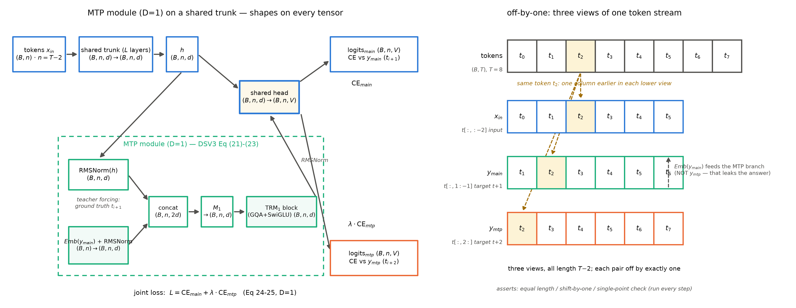
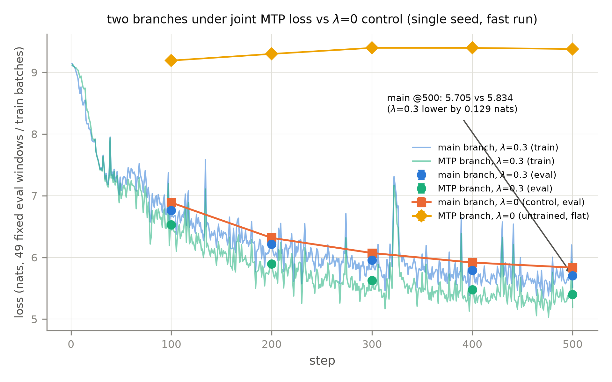

# 第 8 章 MTP：让一个位置承担多步预测

## 8.0 开篇：从全书到这里

第7章讨论了数值格式与训练稳定性，但训练循环中的主目标仍是：每个位置预测下一个词元。本章继续追问，能否让同一个位置的表示也承担后续几步的预测，让它更早保留接下来会用到的信息？

前面已经介绍了MLA、低精度格式与稳定化组件。它们分别改变注意力表示、数值计算和更新过程，而本章改变的是**训练目标**：多词元预测（multi-token prediction，MTP）在下一词元目标之外，让一个位置的表示继续服务于更远位置的预测。这样会增加训练约束，也会增加计算与优化负担，是否有益需要实验回答。

要回答的问题有三个：把「多想几步」写进损失函数，结构上怎么落地（两代方案：Meta 的并行头与 DeepSeek 的串行模块）？它对小模型和大模型一视同仁吗（一组随规模改变的实验结果）？训练期挂上的东西，推理时怎么处置（「训练目标转身成为推理资产」的定位）？产出两样：一张两代方案的对照账（表 8.4），和一台亲手造的 mini MTP 机——26M 主干上接一个 DSV3 式 D=1 模块，冒烟五判据加 500 步双臂对照，表8.5、8.6保留历史实际运行的读数。

本章结束时，补件阶段（ch6-8）将全部完成，下一章拆解旗舰整机，并把MoE与MLA装进两刀机。

> **最小背景栏**
> - 交叉熵损失与教师强制（teacher forcing）：训练时全位置并行出预测、真值整段喂入——Book1训练与目标函数部分已立（教师强制正是「训练可并行」的机关），第 8.1 节只回指不重教；初始 loss $\approx\ln V+d\sigma^2/2$ 的自检传统——Book2 第 10 章/Book3 第 10 章冒烟判据。
> - 训练五件套与模块档几何（$d$=512/$L$=6/$h$=8/$h_{kv}$=4/$V$=8192，语料 sp-8k token 流，单种子 20261002+判据预注册）：第 2/3/5 章沿用至今的口径，本章实验同款。
> - RMSNorm/SwiGLU/RoPE/GQA 四件插槽：Book3 第2、3、4、6章；模块档参考实现 `moe_mla_slots.py`（第 2 章起 import 复用）。
> - DSV3 的 MoE 与训练侧两件（noaux/FP8）：第 5 章与第 7 章——本章的 MTP 是同一台整机的第三项新组件。

## 8.1 从下一词元目标到多步监督：要改变什么

标准自回归训练在每个有效位置预测下一个词元，一次训练前向本来就产生整段序列的多个交叉熵，而不是只监督一个词。它的联合概率分解也是完整的；“只预测下一词”不意味着理论上只能学会局部规律，下一词本身可能依赖很远的上下文。

MTP改变的是**同一个位置表征接受哪些训练约束**。让该表征同时服务更远位置的预测，可能促使它提早保留对后续有用的信息，也可能与主目标争夺表示容量。这是一项归纳偏置与多任务训练选择，收益必须由实验判断，不能从“监督更多”直接证明推理或规划能力更强。

新增目标还需要额外的头、矩阵乘和反向传播，因此不是免费复制监督。设计时应同时问：额外头看到了哪些信息、训练增加多少成本、推理是否保留它们。下面两代方案对这三个问题给出了不同答案。

路线图：8.2 讲Gloeckle等人的预训练方案（Gloeckle 2024，多 token 目标的参考实现）；8.3检查一组随规模改变的实验结果；8.4 讲工业模块化（DSV3 的 MTP 模块，深度维串行）；8.5 给推理资产定位；8.6 上本机实验。

## 8.2 Gloeckle：n 个头与一条共享主干

把「多想几步」写成损失函数，最直接的形态来自 Meta（FAIR）2024 年 4 月的论文《Better & Faster Large Language Models via Multi-token Prediction》（arXiv:2404.19737，本章采用v1）【证据等级：官方论文】。训练目标可以写成一行：

$$L_n = -\sum_t \log P\left(x_{t+n:t+1}\,\middle|\,x_{t:1}\right) \tag{8.1}$$

**符号表**：

| 符号 | 含义 | 形状/取值 |
|---|---|---|
| $x_{t:1}=(x_1,\dots,x_t)$ | 位置 $t$ 的全部上文 | 序列前缀 |
| $x_{t+n:t+1}=(x_{t+1},\dots,x_{t+n})$ | 从 $t{+}1$ 起的未来 $n$ 个 token | $n$ 个词元 |
| $P(\cdot\mid x_{t:1})$ | 由下述结构参数化的联合预测 | $\mathbb{R}^{V^n}$（经分解实现） |
| $n$ | 预测深度（每个位置同时预测 $n$ 个未来 token） | 主训练取 4；8-byte 字节级取 8 |

用人话说：每个位置不再只预测 $t{+}1$ 一个词，而是把 $t{+}1$ 到 $t{+}n$ 的 $n$ 道题一起作答——同一份上下文，$n$ 倍的考试量。

这套结构把模型分成共享主干与多个预测头。主干$f_s$将词元序列$(B,T)$映射为隐藏状态$(B,T,d)$；第$i$个头$f_{h_i}$读取同一份隐藏状态，经一层因果Transformer得到$(B,T,d)$，再由共享词表投影$f_u$映射为$(B,T,V)$，预测$t+i$。这里“独立”是指各头有各自的Transformer参数、彼此不读取输出；它们仍共享主干和词表投影。因此单个位置的预测可写为$P(x_{t+i}\mid x_{\le t})=\mathrm{softmax}(f_u(f_{h_i}(f_s(x_{\le t}))))$。这叫**头维并行**，与后面DeepSeek的深度维串行相对。附录B还测试了线性头和因果、反因果头链，部分指标更高，但没有显示比默认并行结构更一致的优势【证据等级：官方论文2404.19737 v1 §2、附录B表S4】。

这里的联合预测采用条件独立的参数化：

$$P_{\mathrm{MTP}}(x_{t+1},\ldots,x_{t+n}\mid x_{\le t})
=\prod_{i=1}^n p_i(x_{t+i}\mid x_{\le t}),\qquad
L_n=-\sum_t\sum_{i=1}^n\log p_i(x_{t+i}\mid x_{\le t}).\tag{8.4}$$

第一行是该架构的建模选择，不是任意联合分布都满足的概率恒等式；第二行由乘积的对数等于对数之和得到。每个头仍可处理一整段因果隐藏状态，但它不接收其他未来头的输出，也不额外接收上文之外的未来真值。因此无需显式构造Vⁿ维张量，只产生n份V维分布。

例如上文之后只有“红球”与“蓝盒”两种续写，各概率1/2。两个独立头若分别学到第一词红/蓝各1/2、第二词球/盒各1/2，其乘积还会给“红盒”“蓝球”各1/4概率。各位置边际可以学对，联合依赖仍未表达出来。这解释了为什么独立未来头的输出不能不经验证直接当成原自回归模型的一串采样；也为DeepSeek保持逐步因果条件的方案留下动机。

比较新增目标时，还要控制参数预算。论文每增加$n-1$个未来预测头层，就从共享主干中移走$n-1$层，使总参数保持相等（表S14）。例如原本有一条12层路径，其中末层视为下一词元头；改成4头时，共享主干从11层减为8层，再接4个独立头，总层数仍为12。但下一词元实际经过的路径从12层变成9层。**等总参数控制了容量账，却没有保持主干深度和计算图不变**；因此实验检验的是整套MTP设计，不能把效果全归因于“只多了监督”【证据等级：官方论文2404.19737 v1 §3开头、表S14；12层为教学算例】。

实现侧还要控制中间张量。若$n$个头的词表输出和梯度同时保留，忽略批次、序列等公共因子后，这部分空间随$nV$增长。论文在共享主干前向之后，逐头计算前向与反向，把传向主干表示的梯度累加起来，释放当前头的词表输出后再处理下一头，最后把累积梯度传过主干。这样相关中间量从$O(nV+d)$降为$O(V+d)$；它不是全模型所有参数、优化器状态与激活的完整显存公式【证据等级：官方论文2404.19737 v1 §2、图2】。

省中间量也不等于训练免费。论文正文概述为不增加运行时间，但附录C表S5实际列出：$n=4$时，六档模型训练时间为下一词元基线的1.07—1.22倍。作者将这部分开销归因于其逐头反传实现失去了一部分分片通信与计算重叠，并认为可进一步优化。应同时保留算法上的复用与实测开销，不能只引用概述。这里的“逐头顺序计算”是执行安排，与8.4节深度之间的数据依赖不同。

深度 $n$ 取多少？在7B模型、200B代码token的实验中，MBPP与HumanEval各项指标上，$n=4$表现最好：MBPP pass@1 33.8 对基线 30.0、HumanEval pass@1 24.0 对 22.8【证据等级：官方论文 2404.19737 v1 表 1】。本节介绍了这种MTP方案的结构、对齐方法与显存技巧；不过，最佳深度还随任务改变：同表APPS/Intro上$n=6$更强。下一节再看模型规模对结果的影响。

> **历史联系。**Stern等2018年的[blockwise parallel decoding](https://arxiv.org/abs/1811.03115)已经训练附加预测器，用于提出多个未来词元并交给基础模型验证。不能把它写成“训练目标完全不动”，也不能据此宣布2024年才首次出现未来预测训练。Gloeckle等系统研究把多步目标用于语言模型预训练的质量与效率，DeepSeek-V3则把它组织成主干后的串行模块。这里区分的是研究目标与具体计算图。

## 8.3 规模实验：收益如何随规模变化

多一份监督是否总有好处？Gloeckle等人的规模实验给出了否定答案：在相同参数预算下，小档模型的某些指标下降，较大模型则受益。下面摘出附录表S7的MBPP pass@1；它描述的是这组代码任务、数据与训练配方中的趋势【证据等级：官方论文2404.19737 v1 图3、表S7】。

**表 8.1** 六档规模阶梯（全部【证据等级：官方论文 2404.19737 v1 附录 E 表 S7】；代码语料 ≥91B token 起档）

| 规模 | 0.3B | 0.6B | 1.3B | 3B | 6.7B | 13B |
|---|---|---|---|---|---|---|
| $n{=}1$（基线） | 1.8 | 4.7 | 6.8 | 11.1 | 23.9 | 26.0 |
| $n{=}4$ | **1.0** | **3.0** | **7.4** | **12.7** | **26.0** | **30.5** |

0.3B档从1.8降到1.0，下降约44%；0.6B档仍低于基线，1.3B档则略高于基线。就表中已测点而言，**差值在0.6B与1.3B之间由负转正**。这并没有测出区间内的精确临界规模，也没有证明换任务、配方或MTP结构后仍会出现同一转折。

论文还观察到，多轮训练后MTP仍可保持部分优势。作者据此提出一种历史解释：早期小规模实验中的负结果，可能使这种训练目标受到的关注较少。这里的“可能”是作者的判断，不能改写为已经证实的技术发展原因【证据等级：官方论文2404.19737 v1 §3.1、3.5】。

因此，不能把这张表浓缩成“4B以上才有效”。这不是论文给出的普遍门槛；表8.1中的1.3B已经出现正差值，而其他指标在相同规模下也未必同步转正。读取规模曲线时，要保留任务、指标和训练设置。

为什么会有反转？一种可能的解释是共享表示容量有限，多项预测任务会相互影响；同时，这套等参数设计还缩短了共享主干。因此，小模型受损可能与容量分配、路径深度及目标之间的关系有关，不能只凭该表确定成因。论文第5节也讨论了信息论与关键选择位置等解释，但并未建立通用的规模反转定理。额外监督即使有益也需要额外头的训练，并非“免费信号”。8.6节采用另一种结构与任务，不能预先放在同一条曲线上。

较大模型的结果还需要分清百分比和百分点。13B档HumanEval pass@1从14.1到15.8，约相对提高12%；MBPP从26.0到30.5，约相对提高17%，合起来对应论文“代码题平均多解出约15%”的概述。这里“多解出”指解出更多题，**不是名为multiple-solutions的另一种评测指标**。字节级7B模型中，8-byte预测使MBPP pass@1从19.3到32.3，相对提高约67%、绝对提高13.0个百分点；正文将训练量写为314B bytes，约等于116B token，表1则记为313B bytes，这一小处原文差异保留说明【证据等级：官方论文2404.19737 v1 摘要、§3.3、表1、表S7】。推理收益另有成本账，留到章末导航。

## 8.4 DSV3 的 MTP 模块：深度维串行，保完整因果链

这项工作启发了DeepSeek-V3的MTP目标，但V3采用了不同结构——DeepSeek 在 V3 上把 MTP 重新设计成**可插拔的模块**（MTP Modules，报告 v2 §2.2）【证据等级：官方技术报告 2412.19437 v2 §2.2】。先在整机上定位：DSV3 是第 9 章要拆的那台 61 层 MoE 旗舰，三项新组件中 noaux（第 5 章）与 FP8（第 7 章）都已讨论，MTP 是第三件——挂在 $L$ 层主干**之后**，config 字段 `num_nextn_predict_layers=1`；训练时它接在模型中，推理时可整体拆除（8.5 节）。

第$k$个模块由共享词嵌入$\mathrm{Emb}$、共享输出头$\mathrm{OutHead}$、Transformer块$\mathrm{TRM}_k$和拼接投影$M_k\in\mathbb{R}^{d\times2d}$组成。**共享是分别与主模型共享**：附加模块复用主模型的输入嵌入和输出投影，不表示输入嵌入与输出投影彼此绑权。报告式(21)—(23)把数据流写成下面两步；$k=1$就是V3的实际深度$D=1$【证据等级：官方技术报告2412.19437 v2 §2.2】。

$$h_i^{\prime k} = M_k\left[\,\mathrm{RMSNorm}\left(h_i^{k-1}\right)\;;\;\mathrm{RMSNorm}\left(\mathrm{Emb}\left(t_{i+k}\right)\right)\,\right] \tag{8.2}$$

$$h_{1:T-k}^{k} = \mathrm{TRM}_k\left(h_{1:T-k}^{\prime k}\right),\qquad P_{i+k+1}^{k} = \mathrm{OutHead}\left(h_i^{k}\right) \tag{8.3}$$

用人话说：把「上一深度在位置 $i$ 的总结」和「前一步目标词元的真值嵌入」各归一化后拼起来，过一个小 Transformer 块，读出再远一步的词——$k{=}1$ 时模块吃主模型表征 $h_i^0$ 与真值 $t_{i+1}$ 的嵌入（教师强制），吐出 $t_{i+2}$ 的分布。式(8.3)沿用报告的记号：$T$为输入序列长，训练时另有$t_{T+1}$标签；$h^{\prime k}$取$1{:}T-k$同算——**位置维全并行**，教师强制原有的优势完整保留。两步运算的形状流转逐行列在表 8.2。

**表 8.2** MTP模块形状流转表（$D=1$；下文以$S$表示手中包含标签的词元总数，$n=S-2$为有效位置数；DSV3 档 $d{=}7168$/$V{=}129,280$ 换数字即得，mini 档见 8.6 节）

| 步骤 | 运算 | 输入形状 | 输出形状 | 说明 |
|---|---|---|---|---|
| 主干前向 | 嵌入后经$L$层；mini另取末norm后的状态 | $(B,n)$ | $(B,n,d)$ | $h^0$，主支路logits同源 |
| 真值嵌入 | $\mathrm{Emb}(t_{i+1})$ | $(B,n)$ | $(B,n,d)$ | 教师强制：共享词嵌入 |
| 归一拼接 | $[\,\mathrm{RMSNorm}(h);\mathrm{RMSNorm}(e)\,]$ | $(B,n,d)\times2$ | $(B,n,2d)$ | 式 (8.2) 方括号 |
| 投影 | $M_k\in\mathbb{R}^{d\times2d}$ | $(B,n,2d)$ | $(B,n,d)$ | 两路信息合流 |
| TRM 块 | 同主模型插槽的一层 | $(B,n,d)$ | $(B,n,d)$ | 式 (8.3) 左，位置维并行；DSV3 同构层=MLA+MoE，mini 档=GQA+SwiGLU |
| 共享头 | 词表投影后softmax | $(B,n,d)$ | $(B,n,V)$ | 式(8.3)给概率；代码直接把logits交给交叉熵，目标$t_{i+2}$ |

报告与代码的长度记号要分开。报告给$T$个输入词元，另有$t_{T+1}$标签，因此深度$k$可用$i=1,\ldots,T-k$。若手中总共只有$S$个词元$t_1,\ldots,t_S$，则主干$h_i^0$最多看见$t_{\le i}$，第$k$个模块接收$t_{i+k}$、预测$t_{i+k+1}$，有效索引应为$i\le S-k-1$。令$S=T+1$，两种写法就一致了；不能把报告的$T$直接当成现有词元总数，再误判其多算一个有标签位置。

逐层归纳可证明其因果性：假设$h_j^{k-1}$最多依赖$t_{\le j+k-1}$，拼入$t_{j+k}$后最多看到$j+k$；模块内部对位置j使用因果注意力，位置i只读j≤i，因此$h_i^k$最多依赖$t_{\le i+k}$，没有看到目标$t_{i+k+1}$。这也是模块必须保留因果遮罩的理由；若位置维变成双向，后续位置拼入的词可能直接泄漏当前标签。

以五词元$(A,B,C,D,E)$、D=1为例：主干输入$(A,B,C)$，主损失标签$(B,C,D)$，附加嵌入$(B,C,D)$，附加标签$(C,D,E)$。第一行附加模块看到A的主干表征与真值B，预测C；它看不到第二行附加嵌入C。这个例子应与后面的三视图代码逐项对应。

两代结构的关键差别至此就清楚了。Gloeckle的各个未来头都从同一份主干状态出发；DeepSeek的第$k$个模块则依赖第$k-1$个模块的隐藏状态，并拼入下一段真值前缀。它保留的是逐深度推进的条件依赖，**不是把前一模块的概率向量或采样结果作为训练输入**。串行发生在深度维，位置维仍可借助因果遮罩并行处理整段【证据等级：官方技术报告2412.19437 v2 §2.2】。

这里需要分别明确三处「并行/串行」的含义：**Gloeckle 并行在头维**（$n$ 个独立头同读主干输出、互不可见）；**DSV3 串行在深度维、并行在位置维**（式 (8.3) 整段切片同算）；**Gloeckle 显存技巧的 sequentially 在训练实现维**（逐头算梯度省显存，8.2 节）。常见转述把 DSV3 说成「并行预测 D 个附加词元」——与原文划界句正好相反。

报告还作了第二项区分：保因果链的原则与 EAGLE（Li et al., 2024）同源，但主要目的不同——EAGLE 生来为推理加速服务，DSV3 的 MTP 为改进训练服务【证据等级：官方技术报告 2412.19437 v2 §2.2，转述】。

训练时，将附加任务损失加到主损失上：$\mathcal L=\mathcal L_{\mathrm{CE}}^{main}+\mathcal L_{\mathrm{MTP}}$，其中$\mathcal L_{\mathrm{MTP}}=\frac{\lambda}{D}\sum_{k=1}^{D}\mathcal L_{\mathrm{MTP}}^k$。也就是说，先汇总各预测深度，再用$\lambda$控制附加任务对更新的影响。

还有一个常被省略的归一化细节：报告式(24)的每个深度损失为$-\frac1T\sum_{j=k+2}^{T+1}\log P_j^k[t_j]$，分母仍是输入长度$T$；它含$T-k$项。教学代码则对实际有效项取均值。在$S$个现有词元、$D=1$时，代码的两支路都取$S-2$项，并分别求均值。因此本章的$\lambda=0.3$沿用报告的权重选择，但不声称有限长度下与报告的全部归一化约定逐项等同。

V3将附加深度设为$D=1$：主任务预测下一词元，附加模块再预测一个。附加损失权重在前10T训练词元取$\lambda=0.3$，剩余4.8T取0.1，与14.8T总量一致【证据等级：官方技术报告2412.19437 v2 §4.2】。

报告未提供$D=1$对$D=2,3$的直接消融，因此不能断言1是最优深度。增加模块会增加参数和运算，并延长深度依赖路径；实际墙钟增长还受并行、重算和算子实现影响，不能简单视为严格线性。8.6 节本机实现同样取 D=1、$\lambda{=}0.3$ 起步（沿用报告前段权重，短训不做权重调度）。

效果证据来自报告表4：在两档MoE基线上保持训练数据和主模型架构不变，外加一个MTP模块进行训练；评测时拆掉模块。因此每档比较的主模型推理结构相同，质量差异来自训练过程的改变。训练总参数与计算量则增加了。这与Gloeckle把主干层预算挪给多个头的等参数设计不同【证据等级：官方技术报告2412.19437 v2 §4.5.1】。

**表 8.3** DSV3 MTP 消融（Small=15.7B 总参/2.4B 激活/1.33T token，Large=228.7B/20.9B/540B；【证据等级：官方技术报告 2412.19437 v2 §4.5.1 表 4，厂商自报】）

| 基准 | Small：基线 → +MTP | Large：基线 → +MTP |
|---|---|---|
| Pile-test（BPB，越低越好） | 0.729 → 0.729 | 0.658 → 0.657 |
| MMLU 5-shot | 50.0 → 53.3 | 67.5 → 66.6（略降） |
| BBH 3-shot | 39.0 → 41.4 | 70.0 → 70.7 |
| HumanEval 0-shot | 20.7 → **26.8**（+6.1） | 44.5 → **53.7**（+9.2） |
| MBPP 3-shot | 35.8 → 36.8 | 61.6 → 62.2 |
| GSM8K 8-shot | 25.4 → **31.4**（+6.0） | 72.3 → 74.0 |
| MATH 4-shot | 10.7 → 12.6 | 38.6 → 39.8 |

这张表中HumanEval的增益最明显，Small档GSM8K也提高6.0个百分点；但收益不限于代码和数学，Small档MMLU同样提高3.3个百分点，Large档MMLU则下降0.9个百分点。Pile-test的BPB近乎持平。两代实验共同说明，附加目标可以在部分生成任务上带来较大收益；它们没有证明MTP只对生成任务有用，也没有证明各项基准都会改善。

共享还影响参数账。官方仓库把发布规模概括为685B，其中主模型671B、MTP部分14B；这些是发布标签，不是精确到个位的计数。历史分片头审计记载，MTP模块独有张量合计11,610,068,224，若再计入文件中实体化的输入嵌入和输出头各926,679,040，则为13,463,426,304。模块本体包含一层完整MLA+MoE、$M_1$投影$7168\times14336=102,760,448$，以及入模、层内和出口归一化等小件。这里“独有”排除了与主模型共享的两张词表矩阵，不是删去模块中的所有norm【证据等级：config逆向复算与历史分片头审计；完整163片头文件未重新核验】。

官方README_WEIGHTS另写“11.5B unique”。它与上述11.610B不精确相等，也不能用保留一位小数解释为相同值；是否采用不同细项口径，现有说明没有交代。保留两套数字及差异，不以“吻合”替代核对。下一章把主模型与附加模块的账合起来看。

按上述计数，模块独有参数约占主模型1.73%；参数占比小不等于训练FLOPs或峰值显存只增加相同比例，额外词表投影也要计入。报告 §3.2.3 还交代了部署细节：最浅层与最深层放同一流水线并行 rank，共享件得以物理共享参数与梯度【证据等级：官方技术报告 2412.19437 v2 §3.2.3】。

现在可以把两代方案放在一起对照——表 8.4 汇总了 8.2 与 8.4 的全部对照：

**表 8.4** Gloeckle vs DSV3 的 MTP 对照

| 维度 | Gloeckle（Meta，2024-04） | DSV3（2024-12） |
|---|---|---|
| 预测结构 | $n$ 个独立头**并行**，同读主干输出 | $D$ 个模块**串行**，模块 $k$ 读 $k{-}1$ 的输出 |
| 头/模块构成 | 每头 1 层 Transformer 层 + 共享 unembedding | 共享 Emb + 共享 OutHead + $M_k(d{\times}2d)$ + 1 个 TRM 块 |
| 条件依赖 | 各头同看既有前缀，未来预测间条件独立 | 逐模块接入真值前缀及上一深度状态 |
| 参数对齐 | 加 $n{-}1$ 头层、删 $n{-}1$ 主干层（等参数） | 外加模块（训练在网、推理可拆） |
| 损失加权 | 本文实验各头等权相加 | $\frac{\lambda}{D}\sum_k$，$\lambda$ 0.3→0.1 |
| 实践取值 | $n{=}4$（7B/200B token） | $D{=}1$（671B/14.8T token，无论证如实标注） |
| 增益画像 | 两代码基准pass@1相对约+12%/+17%（13B） | HumanEval提高6.1/9.2个百分点，其他任务有升有降 |

> **【实现对照框】** 核验所用的transformers 5.14.1仍是“config有字段、模型类未实现该模块”：`DeepseekV3Config`含`num_mtp_layers`及旧字段映射，但`modeling_deepseek_v3.py`没有对应MTP模块；文档字符串提到某个生成参数，不等于该路径已经可用。vLLM v0.30.0的`deepseek_mtp.py`另有实现，具体协作留到Book8第20章。本章mini复用“归一、拼接投影、Transformer块、共享词表件”的结构，但使用GQA+dense，读取主干最终norm后的状态，并另设出口norm，不是官方MLA+MoE权重的直接加载器。mini拼接为$[h;\mathrm{Emb}]$，vLLM为$[\mathrm{Emb};h]$；若要改序而保持线性函数不变，还必须同时交换投影矩阵的左右两组列。

## 8.5 训练目标转身成为推理资产

结构讲完，再看两个生命周期。训练期，附加损失经MTP模块向共享表示、嵌入和输出头回传梯度，改变主模型学到的参数；部署时可以直接拆掉附加模块，主模型仍独立执行下一词元预测。表8.3测到的主模型收益不要求部署时继续计算MTP。另一种选择是保留模块，为生成过程提供附加候选；它是否降低时延，还要算验证成本与接受率，见Book6第16—17章【证据等级：官方技术报告2412.19437 v2 §2.2、§4.5.1】。

两代方案都允许丢弃附加预测部分，也都讨论过将其用于生成加速，不能把后一种用途只归给DeepSeek。可带走的区别是：优化器状态在普通推理中不参与前向，而MTP保留了一个可执行的预测器；训练结束之后，它既可移除，也可在合适的部署流程中继续使用。是否值得保留，由部署侧决定。

到2025年，其他模型也沿用了这条路线。例如Nemotron 3报告将MTP用于Super和Ultra，模块位于网络末端；不能由此推成全系列、所有旗舰的标配【证据等级：官方技术报告2512.20856 v1 摘要、§2.3、§2.4】。

## 8.6 mini MTP：26M 主干挂一个 D=1 模块

最后在自己的机器上核对。设计原则与第 2/3/5 章同款：不私搭模型，主干就是那台模块档 dense（$d{=}512$/$L{=}6$/$h{=}8$/$h_{kv}{=}4$/$V{=}8192$，探针 B 验过的 26,089,984——第 2-5 章四臂消融的 dense 臂同几何同语料），再按式(8.2)—(8.3)的连接方式接入 MTP 模块（D=1）：共享主干 embedding 与 lm_head（零新增，共享写在调用点、可审计）、两枚入模 RMSNorm、$M_1$ 投影（$2d{\to}d$）、一个与主干同型的 TRM 块、出口 RMSNorm（[`ch08/mtp.py`](code/ch08/mtp.py) 的 `MTPModule`）。

参数账先算后跑：新增 = $3\times512$（norm）+ $2d^2$=524,288（投影）+ 2,950,144（TRM 层）= **3,475,968**，总参 **29,565,952**——主干 26.1M、模块 3.5M、+13.3%，这一小模型中新增参数的明确代价（对照 DSV3 的 1.7%：模块占主干的比重随层数摊薄——本档 $L{=}6$，一枚同型层加投影就占 13.3%；DSV3有61层，按前述独有参数计数约占1.73%；两者专家结构也不同，层数并非唯一差别）。

联合损失 $\mathcal{L}=\mathrm{CE}_{main}+0.3\cdot\mathrm{CE}_{mtp}$（`joint_loss`，λ=0 时联合恒等主支路）。对照臂设计成单变量：λ=0.3 主臂与 λ=0.0 对照臂**同种子、同日程、同数据、同代码路径**——唯一差异是支路损失进不进总账；λ=0 臂的 MTP 模块照旧前向与记录（附加损失梯度权重为零；模块自身仍可能受到优化器的权重衰减，共享件也继续由主损失更新），因此两臂使用同一配置的整机，这一配方下的差值主要检验附加损失是否参与更新；它不是外挂相对裸主干的参数与速度对照。

动手前必须先教本档最常见的静默 bug——**off-by-one**（差一位的切片错位）。全部关键都在三个视图的切片方式上：$x_{in}=t_{[:,:-2]}$（主干输入）、$y_{main}=t_{[:,1:-1]}$（主支路目标，$t{+}1$）、$y_{mtp}=t_{[:,2:]}$（MTP 支路目标，$t{+}2$），各长$S-2$、互相恰错一位；代码和图8.1把这个现有词元总数记为T；支路的输入嵌入是 $y_{main}$——教师强制喂的是**真值 $t{+}1$**，不是支路自己要预测的 $t{+}2$（图 8.1 右半的三视图）。

错位可能表现为不同故障。目标比logits长一个位置，正常的交叉熵形状检查应报错；若程序自行截断到较短长度，错误才可能被掩盖。把$y_{mtp}$直接喂作嵌入则给了模块答案，学会利用它后损失会异常低，但随机初始化时未必立即暴露。最隐蔽的情形是输入和标签始终等长，却错开了错误的距离：曲线仍可能下降，学的却不是预定任务。

三道检查全部内置（`three_views`/`assert_off_by_one`）：等长与错位断言每步训练前跑一遍（检查量为$O(BT)$，设备同步仍有代价）、功能核验用探针 embedding 记录支路实际喂入逐位比对 $y_{main}$、初始loss提供量级检查（答案泄漏有时导致异常低损失，但随机初始化未必能利用泄漏，正常初始loss不能排除它——冒烟判据②因此不只是仪式）。



图8.1 mini MTP结构与三视图（自绘示意级）。左侧主干框省略了输入嵌入；主干与支路分别复用同一输入嵌入、同一词表输出矩阵，黄色框画出共享输出头，支路另有独立出口norm。`Emb+RMSNorm`表示先嵌入再归一化，不是两者相加。右侧零起点编号以$T=8$表示现有词元总数（相当于正文$S$），三视图长度均为6；支路嵌入读取$y_{main}$，标签为$y_{mtp}$。黄色单元追踪同一个$t_2$，它在各视图中处于不同列。

历史冒烟五判据通过（表8.5；CPU fp32，产物 `log/book4-ch08/mtp_smoke_run1.json`）：

**表 8.5** 冒烟五判据（判据预注册在先——notes/07 §B.3.3，写于任何 fast 数字落地之前）

| # | 判据 | 期望 | 实测 |
|---|---|---|---|
| ① | 参数账两级 assert | 26,089,984 + 3,475,968 = 29,565,952 | 逐位相等（共享件只计一次） |
| ② | 初始 loss | $\ln V$=9.0109；主支路期望 $\ln V+d\sigma^2/2$≈9.113 | 主 **9.1154** / MTP 支路 9.1090（带 [8.6, 9.6]） |
| ③ | off-by-one 三视图 | 等长$S-2$（代码中记T−2） / 恰错一位 / 喂入=$y_{main}$ | 结构断言 + 功能核验双 PASS |
| ④ | λ 恒等式 | λ=0：$\mathcal{L}\equiv\mathrm{CE}_{main}$ 逐位 | PASS |
| ⑤ | 反向一步 | 有限、无 NaN、梯度回流主干 | 联合 11.8481 有限；70 个参数张量梯度全有限；主干梯度范数3.85；联合反传本身不足以单独证明MTP回流 |

②中有一处对应关系值得注意：主支路初始 9.1154 对期望 9.113，量级接近（Book2/Book3 冒烟传统的延续）；MTP 支路初始也在 $\ln V$ 量级——共享头压在随机 TRM 输出上，同样近均匀。**明显低于初始参考值时应检查泄漏、标签和初始化，但正常loss也不能替代因果性测试**。

局部复核补上了原五判据缺的一步：**只回传MTP支路的交叉熵**，检查主干首层查询投影确实获得非零有限梯度。CPU小模型还通过了未来词元扰动测试：改变某位置以后才应可见的输入，前缀两支路logits保持不变；长度3、4的边界切片也通过。全尺寸参数用meta张量计数仍为29,565,952。另用合成词元完成两步训练及中断恢复，两臂最终权重和评测值逐位一致。这些检查验证计算图与实现，不替代500步历史结果或跨种子质量实验。

历史fast档完成了500步双臂实验（表8.6）。复查原代码后，需准确说明其计算口径：MPS训练和评测前向都启用BF16 autocast，交叉熵计算前才把logits转为FP32；原文“FP32评测”并不完整。每步从512长的输入/下一词对重建513个连续词元，两支路各有511个监督位置。评测则取49批、每批16个512长窗口，每支路各有510个标签，共399,840次位置监督；窗口可能重叠。虽沿用相同采样起点，它不是第2/3/5章dense臂的完整512标签评测。双臂之间的评测集与计算路径相同。历史约0.44秒/步与早先dense的0.354秒/步比约为1.24，但长度和运行条件并非严格相同，不能把全部差额都归因于MTP模块。

**表 8.6** λ 双臂读数（500 步；【证据等级：本书实验（2026-10，M5 Pro/48GB）】）

| 臂 | eval_main@500 | eval_mtp@500 | 读数 |
|---|---|---|---|
| λ=0.3（主臂） | **5.7054 ± 0.020** | **5.4000 ± 0.020** | 双支路同降（train 首/末 10 步：main 8.94→5.69、mtp 9.04→5.38） |
| λ=0.0（对照） | 5.8342 ± 0.021 | 9.3776（全程 9.2-9.4 平走） | 本次支路未持续改善——附加损失对照 |



图8.2 历史双支路损失曲线（自产，原绘图脚本读取mtp_fast.json与曲线CSV）。细线是训练批损失，点是49个评测批的均值；图内“49 fixed eval windows”应理解为49批、每批16窗。λ=0.3的主/MTP支路为圆点；λ=0的主支路为方块，未接受附加损失训练的支路为菱形。共享参数仍在更新，因此图中untrained不表示该支路涉及的所有参数冻结。保留原训练曲线，末态主支路5.705与5.834的差值只代表这次运行。

把三个读数与预注册判据逐条核对。

**第一，预注册的“主支路劣化超过0.05 nat才排障”没有触发。** 主臂减对照为$5.7054-5.8342=-0.1288$ nat，本次运行中附加监督对应更低的主支路损失。0.05是工程排障阈值；此前约0.03的同种子重跑漂移也不是统计置信区间。表中的$\pm$来自49个评测批均值的标准误，既不表示跨种子方差，也未消除窗口重叠的相关性。因此保留“小幅改善”的单种子观察，不宣称四倍噪声带或统计显著。实际结果好于原先持平或略差的预期，也应如实记录。

比较口径的差异也要说明清楚：Gloeckle 的交叉点结论是等参数并行头、代码任务、包括pass@1在内的评测；本实验是 DSV3 串行模块、通用文本、逐位置交叉熵——两项研究不能直接套用同一解释，数字并排、解释权留给读者。若要提出一种可能的机制解释（标注为解读）：支路的交叉熵梯度经共享主干回流，每位置监督任务从1变2，但标签仍来自同一文本并非独立新增数据——8.1节“同一表示承担多个任务”的小型例子。

**第二，“MTP支路损失总应高于主支路”的预期被数据推翻。** 五个评测点的支路损失都更低：6.53/5.89/5.63/5.48/5.40，对主支路的6.76/6.21/5.95/5.79/5.71；训练中只有22/500步相反，主要在早期。原因不能从“预测距离更远”直接推定：串行模块已经拿到真值$t_{i+1}$，再预测$t_{i+2}$，而不是只凭原始$t_{\le i}$前瞻两步。

不过，“输入更多”仍不是这两行损失必然大小有序的证明。条件熵的关系$H(Y\mid X,Z)\le H(Y\mid X)$比较的是**同一个目标变量**在不同条件下的最优分布；这里两支路的目标位置、模型参数与训练状态均不同。真值前缀提供了支路可以利用的信号，是合理解释，但不能单凭一条曲线确定唯一因果。并行独立头同样没有“距离越远损失必越高”的无条件定理。预注册的作用正是让不成立的预期也能被明确识别。

**第三，λ=0 臂的支路 9.2-9.4 平走微升**——主干在变、模块没有附加损失梯度，eval随共享主干、嵌入和输出头漂移，某次运行也可能下降；此记录中未观察到持续改善：附加损失权重为0的对照，也说明本次支路改善需要相应的训练信号，不能视为结构一接上就自动获得（同一台模块，只换 λ，loss 曲线就发生了根本变化）。

## 8.7 本章小结

本章回答了三个问题。怎样增加多步目标：Gloeckle用共享主干上的独立头，DeepSeek用接入真值前缀的串行模块，两者的参数对齐和条件依赖不同。效果是否随规模一致：表8.1在特定代码配方中出现由负转正的差值，但不能推广成固定参数门槛；表8.3也保留了改善、持平和下降的指标。推理时如何处理：附加预测部分可以拆除，也可以交给部署流程继续使用。mini实验则展示了切片与共享如何落地，以及一次单种子训练中主支路改善0.1288 nat、附加支路损失反而更低的实际结果。

**带走的心智**：理解MTP，先问每个预测器究竟看到了什么，再问损失如何回到共享表示。独立头只读取原前缀，串行模块在训练时还接入真值前缀，两者的“多预测几步”不是同一道题。其次，把训练收益与部署成本分开：模型可能从附加监督中受益，而部署时不必保留模块。实现检查应同时覆盖切片、因果遮罩、共享关系与支路梯度；正常的初始loss只是量级检查，不能替代这些验证。

回到全书，两刀改装（MoE、MLA）、数值格式与稳定化方案、MTP训练目标至此都已介绍。证据强度各不相同：有官方训练报告，也有本书局部对拍、模拟与短训，不能都称为本机完成了旗舰验证。下一章先拆DSV2到DSV3的逐字段演进，再把MoE与MLA装进409M两刀机；FP8、Muon与MTP仍作为可选组件讨论，不声称全部已进入该整机训练。

> **【欠账】** MTP 模块在推理侧的另一重身份——作为投机解码的 draft（起草-验证-回滚）：DSV3 报告称第二个预测 token 的接受率 85%–90%、端到端解码提速 1.8× TPS【证据等级：官方技术报告 2412.19437 v2 §5.4.3，厂商自报】；同一定位的旁证——Gloeckle 7B 自投机加速 3.0×（3 建议平均收 2.5，代码）【证据等级：官方论文 2404.19737 v1 §3.2，厂商自报】、Nemotron 3报告中8B激活MoE消融的前两个预测token接受率约97%【证据等级：官方技术报告 2512.20856 v1 §2.3，厂商自报】。机制与收益账 → **Book6第16—17章**；源码路径见Book8第20章。

## 8.8 动手验证

在工作区根目录运行，先激活现有环境并选择新结果名：

```bash
source ./env.sh

# CPU冒烟；需要既有sp-8k eval.bin，不会下载语料
python from-models-to-vllm/book4-scale-and-efficiency/code/ch08/smoke_mtp.py --out-name review

# 可选历史规模短训；本轮精修不重跑此项
python from-models-to-vllm/book4-scale-and-efficiency/code/ch08/mtp.py --steps 500 --out-name new_fast --lambdas 0.3,0.0
```

冒烟结果写入log/book4-ch08，已有同名结果会拒绝覆盖。训练断点只允许在日程、数据身份、lambda、模型几何、实现与设备版本匹配时恢复；旧无运行约定的报告须保留，另取新名字。图8.2继续使用历史曲线，不用本轮小型核验替换训练记录。
