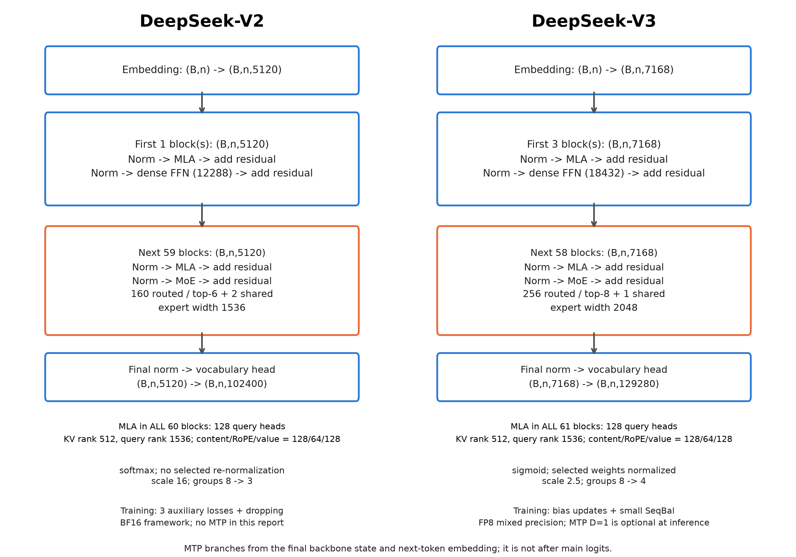
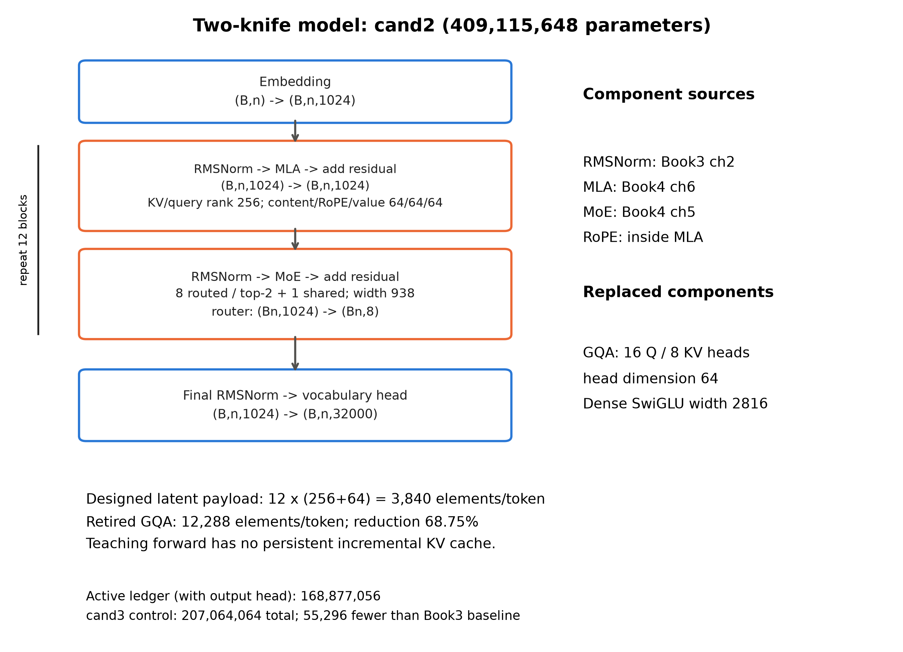
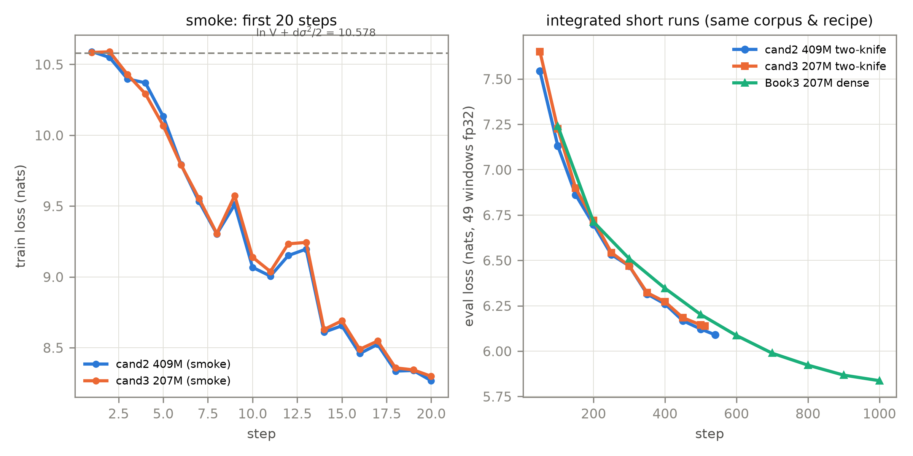

# 第 9 章 DSV2→DSV3 整机拆解与两刀整合（大项目·设计文档版）

## 9.0 开篇：拆机的资格

上一章完成了MTP训练目标的讨论。现在回到整机：先看DeepSeek-V2到V3怎样组合这些组件，再把MoE与MLA接入我们自己的409M模型。

前面各章已经给出了拆解所需的基础：路由与容量、负载均衡、细粒度与共享专家、MLA权重吸收、低精度训练和MTP。证据层次各不相同，有本书教学实现与局部对拍，也有量化模拟、短训和官方大规模实验；它们并不意味着我们亲自复现了旗舰的全部训练。本章把这些知识放回同一条前向与训练链中，检查组件怎样协作，以及哪些结论仍需额外证据。

本章回答三个问题。其一，两台真实旗舰模型各自怎样构成——DSV2 的五件套、DSV3 的三新件，以及从 V2 到 V3 **每个字段变化与设计含义**（区分结构事实、有据动机和未披露的选择）。其二，我们自己的两刀机怎么组装、怎么验收——把 Book3 的 207M 骨架动两刀（FFN→MoE、GQA→MLA），四件套交付：整机代码、冒烟、整合短训、设计文档。其三，全量长训暂缓之后，我们拿什么当凭据、凭据的边界在哪里——这本身是一次方法论练习：把「没法做完的事」做成「别人可以直接重启的事」。配套实践包含短训与数值对照，尚未完成全量预训练；它能检验组装与训练流程，不能证明长期训练质量。本章结束时，单轨代码主线的本册部分完成，409M 两刀机连同重启手册一并交付，下一章把五步法带上 gpt-oss 的「无论文」主场。

> **最小背景栏**（已学指回，本章不重教）：① config 逆向五步法与参数公式（认家族→重建图纸→算账对拍→读外围→证据分级，Book3 第 5 章式 (5.2) 起步、第 9 章升级为式 (9.1)/(9.2) 与手算、模型计数与权重资料核对）；② 细粒度/共享专家及后续noaux方法（第5章式(5.1)—(5.2)）与三级辅助损失谱系（第 3 章表 3.1）；③ MLA 全套记号 $d_c$/$d_c'$/$d_h^R$ 与 KV 元素账（第 6 章式 (6.2)-(6.3)/(6.9)/(6.11)，表 6.2 三口径红线）；④ FP8 训练侧全栈（第 7 章 7.4 节表7.2所列组件保留BF16或FP32）；⑤ MTP 模块结构与 $\lambda$ 调度（第 8 章式 (8.2)-(8.3)）；⑥ Book3 的 207M 四插槽整机与训练五件套（Book3 第 10 章、`DESIGN-215M.md` 先例）。

## 9.1 DSV2 整机：五件套与第一本逐位账

拆机先看整机。图 9.1 左半是 DSV2-236B 的整机粗图：一条 $(B,n,5120)$ 的恒宽残差流流过 60 层，每层仍有Book3熟悉的两条残差子层——pre-RMSNorm → 注意力格、pre-RMSNorm → 前馈格——注意力格换为MLA，除首层以外的前馈格换为MoE。逐件清点，一共五件套：



图9.1 DSV2与DSV3整机结构对照（依据官方报告与config自绘，示意级）。每个层组内部都先执行MLA残差子层，再执行前馈残差子层；V2有60个MLA层、59个MoE层，V3有61个MLA层、58个MoE层。训练方案另列为注释，MTP从主干状态接出，不能把它画成主词表logits之后串接的层。

**第一件，MLA。** 128 头、$d_c{=}512$、$d_c'{=}1536$、$d_h{=}d_v{=}128$、$d_h^R{=}64$——第 6 章逐投影拆过的那台（式 (6.2)-(6.6)），在采用压缩缓存的实现中，将形状$(B,n,512)$的潜向量 $\boldsymbol{c}^{KV}$ 与 $(B,n,64)$ 的共享位置键 $\boldsymbol{k}^R$ 写进缓存。

**第二件，细粒度 MoE。** 160 个路由专家 top-6 加 2 个共享，每专家宽 1536——恰为标准前馈 12,288 的 $1/8$（$m{=}8$ 细粒度切分；每token的专家激活宽合计$(6+2)\times1536=12{,}288$，与首层稠密FFN相等；路由和通信开销仍须另计）。第 5 章的组合数论证（式 (5.1) 的 $\binom{E}{k}$）在此取值 $\binom{160}{6}\approx2.1\times10^{10}$。

**第三件，设备受限路由**（device-limited routing）：每个token最多选择$M=3$台设备，再在所选设备的专家中取top-K，动机是限制跨设备的专家通信范围，$M\geq 3$ 时性能与无限制 top-K 大致对齐【证据等级：官方技术报告 2405.04434 v5 §2.2.2】——第 5 章 5.4 节教过的机构，在 config 中体现为 `topk_method="group_limited_greedy"` 与组参数 $8/3$（8 组先选 3 组）。

**第四件，三级辅助损失**：专家级 $\alpha_1{=}0.003$、设备级 $\alpha_2{=}0.05$、通信级 $\alpha_3{=}0.02$【证据等级：官方技术报告 2405.04434 v5 §3.1.2】——第 3 章表 3.1 谱系的旗舰落点；一个 config 侧的诚实注记：checkpoint 的 config 只给出 `aux_loss_alpha=0.001` 这一项，与论文三级系数并不同名同值——config 读不出论文的全部配方，这一差异本身就是同时核对论文与 config 的理由。

**第五件，训练中的token dropping。** V2按每台设备的平均计算预算设容量因子1.0，超预算时优先丢弃亲和分数低的路由计算，并保证约10%训练序列不被丢弃。丢弃发生在受限的专家计算支路，不是从整段输入中删除词元，也不能理解为该词元所有专家和共享支路都一并失效；残差连接仍保留状态【证据等级：官方技术报告2405.04434 v5 §2.2.4；结构解释参见第2章】。

把这些部件放回数据流：查表$(B,n)\to(B,n,5120)$进入残差流；**60层均有MLA**，首层后接稠密FFN，其余59层后接MoE。MLA把KV压缩为$(B,n,512)$，另有共享位置键$(B,n,64)$，逻辑Q/K头维为$128+64=192$，值头维为128；合头与输出投影后回到$(B,n,5120)$。MoE把$N=Bn$个位置展平，路由打分为$(N,160)$，选出每位置6个专家索引及对应门值，再把路由输出与宽度$2\times1536$的共享SwiGLU输出相加。60层之后，经最终RMSNorm和独立词表输出矩阵，得到$(B,n,102400)$。每个注意力与前馈子层外各有一次残差相加；图9.1将重复层组展开说明。

V2预训练使用8.1T token。报告与DeepSeek 67B比较，给出训练成本减少42.5%、部署KV缓存减少93.3%的结果【证据等级：官方论文2405.04434 v5 摘要、§3.2.3，作者自报】。后者同时涉及不同层数、架构与缓存精度；第6章给出的带假设复算与93.3%相容，但不能据此声称已唯一还原官方内部测量，也不能把它当作所有MLA实现的固定压缩率。

看过整机概图，接下来使用五步法。这是它的**第二次整机使用**——第 4 章在 Mixtral 上独立实习过一次（教→实习），本章在 DSV2/V3 上做整机互证，第 10 章才到 gpt-oss 的主场：四环“Book3第9章讲方法→第4章Mixtral实习→本章整机核对→第10章继续应用”由此衔接。

认家族一步从简（V2为`deepseek_v2`，V3为`deepseek_v3`，字段标明具体家族），直接进算账对拍：官方直发的 config 快照逐字段读入（含 `q_lora_rank=1536`、`first_k_dense_replace=1`、`routed_scaling_factor=16.0`、`norm_topk_prob=False`、`max_position_embeddings=163840` 等【证据等级：config 逆向，deepseek-ai/DeepSeek-V2 官方直发】），按 config 公式整数精确算账，再与权重分片头（55 片、逐张量）对拍——**总参235,741,434,880，约235.74B，取整到十亿位与官方236B相符**【证据等级：本书config整数复算；55片逐名核对为2026-10历史记录，未在本轮重做完整分片审计】。

分项来看更有教学价值：MLA $\times$ 60 层共 8,953,651,200（每层 149,227,520，即第 6 章 6.7 节算过的每层账）、MoE $\times$ 59 层共 225,549,844,480、首层稠密前馈 188,743,680、出入口两份嵌入 1,048,576,000、层内双 norm $\times$ 60 加最终 norm 共 619,520（121 枚 $\times$ 5,120——零头也入账，五项加总恰为 235,741,434,880）——**专家群占全机 96%**，与 Mixtral 的 96.6% 同一量级：这两个案例的参数都主要集中在专家中。

激活参双口径：双嵌 21.38B / 单嵌（含 lm_head）20.85B——官方报 21B，两个口径四舍五入到十亿位都为21，不可分辨，登记为两可【证据等级：本书复算】。

检查外围字段时，还会遇到一个需要明确口径的问题：摘要说「128K 上下文」，config 写 `max_position_embeddings=163840`——这不是取整，是**两个官方语义**：163,840 = 论文 YaRN 的 target 160K（「the target maximum context length to 160K」），摘要的128K对应报告所测上下文能力（「respond well for a context length of 128K」，报告的长针检索覆盖至128K；这不保证任意任务和输入都同样有效）【证据等级：官方技术报告 2405.04434 v5 §3.1.4 逐字】。本书引用 config 实值 163,840、脚注登记两个口径。另外，DSV2 的 KV 账在表 6.2 已算过：每 token $60\times(512+64)=34{,}560$ 元素——同构MHA反事实的1.76%。

五步法这一环的收获值得单独记录，因为它与 Book3 的 Llama 4 案例正好互补。Llama 4案例综合模型卡、配置与参考实现，不同资料的职责不同，空字段要过一遍 config 类的默认语义才敢读成「没有」；DSV2/V3 是「有论文、有 config」的正常态——这一次需要注意的差异来自另一处：config 只给出 `aux_loss_alpha=0.001` 这一项，论文的三级系数（0.003/0.05/0.02）在 config 里对不上号。两案合读，五步法的「证据分级」一步落实为两条操作规则：**无论文时，config 的默认值接管点是危险区；有论文时，config 与论文的命名缝隙是危险区**——两头都要「逐字段核对、不假设任何一边是全集」。这也是把五步法放在 DSV2/V3 上整机互证的理由：它教的不是这两台机器，而是「下一个新旗舰出现时你该怎么做」。

## 9.2 DSV3 整机：三新件与一次账本纠错

图9.1右半是DSV3。它沿用V2的MLA机制，头数、查询/KV压缩秩、内容维、RoPE维和值维六项仍相同；但输入输出残差宽度从5120增至7168，因此投影矩阵的完整形状和参数量并未冻结。MoE规模、路由策略、数值精度与训练目标也有变化。下面先看三项主要训练改动，再把结构扩容算进同一份账【证据等级：官方技术报告2412.19437 v2 §2.1—2.2及两代config】。

**其一，noaux 从方法变配置。** 第 5 章 5.5 节那枚「只改派单、不改门值」的偏置阀门，在 V3 中成为一整套路由配置：打分函数 softmax 换 sigmoid（DSV3 报告式 (15)；第 5 章 5.6 节已拆）、top-8 选中集内归一再乘 `routed_scaling_factor=2.5`、组选择升为 $8/4$、偏置逐训练步更新（$\gamma{=}0.001$，前 14.3T 后归零）、外加一个 $\alpha{=}10^{-4}$ 的序列级互补损失 SeqBal【证据等级：官方技术报告 2412.19437 v2 §2.1.2/§4.2】。V3不再沿用V2那套三级损失和token dropping，但仍保留小权重SeqBal；不能把“免辅助损失路由”读成训练中完全没有均衡损失。组限制在V2对应设备，在V3训练部署中对应最多4个节点，也不是同一物理通信范围。

**其二，FP8混合精度训练。** Linear的前向、输入梯度和权重梯度矩阵乘采用FP8输入；嵌入、输出头、路由、归一化与注意力等敏感组件保留较高精度，例如BF16或FP32。激活向量组与权重块的缩放、反向布局以及累加器精度共同决定数值误差，不能概括为所有计算都变成FP8。V3把这套框架用于671B/14.8T训练；附录B.1在较小规模对照中报告FP8与BF16损失曲线相对差异低于0.25%，并非另跑一遍完整671B BF16训练后的比较【证据等级：官方技术报告2412.19437 v2 §3.3、附录B.1】。

**其三，MTP 模块。** 第 8 章拆过的结构（共享嵌入与输出头、$M_k\in\mathbb{R}^{d\times 2d}$ 投影、一个 TRM 块、深度 $D{=}1$）在 V3 成为出厂配置，损失权重 $\lambda$ 前 10T 取 0.3、后 4.8T 降到 0.1【证据等级：官方技术报告 2412.19437 v2 §2.2/§4.2】——推理侧的另一半身份已在第 8 章欠账框登记，此处不重复。模块的参数量也在这里算清（下面的主模型与MTP分账会用到）：一枚 $2d\to d$ 投影 $102{,}760{,}448$ 参、一对 enorm/hnorm、一个与主模型隐藏层同构的 MoE 层；「共享」嵌入与输出头在 checkpoint 里**实体化成两份拷贝**（各 926,679,040）——逻辑上共享、物理上各存一份，文件存储账要分别计入，训练中的参数共享账则不能重复计算；分片头本身也不能证明两份数值始终相同【证据等级：本书复算（分片头逐名，2026-10）】。

注意力槽的代际账能进一步说明“部分尺寸相同”是什么意思。V2每层MLA为149,227,520，V3为187,107,328。查询入口$q_a$、KV下投影$kv_a$和输出投影$o$都含残差宽$d$，V2合计94,699,520，随$d$从5120到7168放大1.4倍；查询出口$q_b$和KV上投影$kv_b$合计54,525,952不变，两枚潜norm共2048也不变。因此$94{,}699{,}520\times1.4+54{,}525{,}952+2048=187{,}107{,}328$。这不是整个MLA按1.4倍放大，也不说明所有上投影都免费。全模型中注意力参数占比从V2约3.8%降至V3约1.7%，原因是专家参数扩张得更快；参数占比低也不等于注意力计算或缓存成本可以忽略。

本书早期算V3时曾得到约670.00B，比官方671B少约0.15%。核查先排除了“MTP混入主模型”的解释：官方仓库将主模型与MTP分开发布。进一步对照每层投影清单，发现总账漏了`kv_b_proj`，每层$512\times128\times(128+128)=16{,}777{,}216$，61层就是1,023,410,176；还漏了每层2048个潜norm参数，共124,928。两项合计1,023,535,104，足以解释约1.02B的差额。路由修正bias另有14,848个状态值，应单列，不把它与可训练投影参数混成同一项【证据等级：本书整数复算、历史分片头审计记录】。

将口径分开后，账目如下。主模型投影、专家、嵌入和norm合计671,026,404,352；若把58层路由修正bias也数作状态元素，再加14,848。历史MTP文件中，非FP8缩放张量合计13,463,426,304，其中已含自己的256个路由修正bias，以及两张实体化词表矩阵；扣除两张矩阵后为第8章的11,610,068,224。再加全部FP8块scale 41,540,496，存储张量元素总数为684,531,386,000【证据等级：config与张量清单复算；完整分片头计数为历史记录】。

这一精确总数与官方“685B＝671B主模型＋14B MTP”的规模标签接近，但各分项不都能由普通四舍五入得到；官方“11.5B unique”与11.610B之间的细项差异也尚未解释。正确做法是保留精确账和官方概数各自的含义，不能写成“逐位吻合”。不同dtype的元素还要分别乘每元素字节数，参数个数不是检查点文件字节数。

这次计算错误比正确结果本身更有教学价值：错在「每层账对、总账漏项」——第 6 章的每层 MLA 账 149,227,520 从来是对的，错的是总账式子把它抄漏了一块。**自算账本漏一个上投影就错 1B；共享同一漏项的两份公式可能相互认同，因此还需与独立权重键及形状清单核对**——第 1 章立的「引别人的 B 数之前先自己算一遍账」在这里补上了后半句：算完还要逐名对拍。

激活参数不能沿用旧稿的“官方36.6B且只含输出头”判断。本轮核对的官方README_WEIGHTS写的是36.7B，并明确列入输入嵌入和输出头各约0.9B；该文件的初始发布提交也相同。按本书未吸收投影、单token选中专家的账法，含输出头约36.63B、再计整张输入嵌入约37.55B，两者都不能精确解释官方36.7B。官方未详细公开此数的逐项计算表，暂保留差异，不擅自指定它采用本书哪种定义【证据等级：官方README_WEIGHTS发布提交4c2fdb8及本书复算】。

训练资源则保留报告的2.788M H800 GPU小时；它汇总预训练、上下文扩展与后训练等列明阶段，不等于所有研发、消融和失败尝试的总资源。报告另按指定租赁价格估算费用，这里只讨论GPU小时【证据等级：官方技术报告2412.19437 v2 表1及相邻说明】。


## 9.3 逐字段演进：结构变化、设计动机与未知项

将两份官方config逐字段对齐，可以区分结构变化与训练变化。残差宽从5120到7168、层数60到61、词表102,400到129,280，总参数约增至2.85倍。MoE侧专家数、top-k、共享数、专家宽和稠密层数均变；路由侧改了评分、归一化和分组限制；训练侧增加FP8框架与MTP。MLA的六个头/秩维度字段相同，但不能由此说整个架构没变。表9.1将config能直接读出的事实与报告给出的动机分开；未披露的选值理由继续保留为未知。

表 9.1 DSV2→DSV3 逐字段演进账（两列均 config 逆向·官方直发快照，2026-10-04；「变化与设计含义」一列：论文有据处引论文，标〔解读〕处为本书解读、非论文主张）

| 字段 | DSV2-236B | DSV3-671B | 变化与设计含义 |
|---|---|---|---|
| `hidden_size` $d$ / 层数 $L$ | 5120 / 60 | 7168 / 61 | 下一代扩容（+40% 宽）；主模型 61 层之外另有一枚 MTP 模块的 TRM 块（checkpoint 编号 layers.61，不计入 671B——9.2 节分账）具体宽深配比的完整选择过程未披露 |
| 词表$V$ / untied | 102,400 | 129,280 | 词表扩容、两张矩阵仍独立；具体词表设计见各自数据与tokenizer说明 |
| `n_routed_experts` $E$ / top-k | 160 / 6 | 256 / 8 | 名义组合上界$\binom{160}{6}\approx2.1\times10^{10}$到$\binom{256}{8}\approx4.1\times10^{14}$；组限制会缩小可选集合。V3专家激活宽$9\times2048=18432$等于其稠密FFN宽 |
| 共享专家数 | 2 | 1 | 总参涨了、共享反减——共享数减少是配置事实，不能据此断言公共知识已转移给路由专家 |
| 专家宽 $w$ / 首层稠密 | 1536（1/8 前馈）/ 1 层 | 2048（1/9 前馈）/ 3 层 | 前几层保持稠密的层数从一层增至三层；报告未给论证，工程取舍如实标注（首层负载收敛较慢是首篇报告给出的动机，这并未证明梯度“最不稳”，稠密层是缓冲垫〔解读〕） |
| `scoring_func` | softmax | sigmoid | 前者各分数相互耦合，后者逐项计算；两者都能加路由偏置，换函数的完整选型实验未披露 |
| top-k权重处理 | 不重新归一，乘16.0 | 选中集归一，乘2.5 | V2总门值为$16\sum_{\mathrm{top6}}s_i$，V3总门值为2.5；不能由这一差别精确推导两个倍率 |
| `topk_method` / 组选择 | group_limited_greedy，8组选3组 | noaux_tc，8组选4组 | V2限制设备，V3限制节点；组评分规则也应随实现核对 |
| 均衡手段 | 三级aux与设备预算token dropping | 路由偏置+$10^{-4}$SeqBal，不丢token | 最后500B训练token将偏置更新步长设0；小权重辅助梯度仍保留 |
| MLA头数与压缩维（$d_c/d_c^\prime/d_h/d_h^R/d_v$/头数） | 512/1536/128/64/128/128 | 六项相同 | 输入输出宽$d$不同，完整投影形状与参数数目仍变化 |
| 上下文 | 163,840（YaRN target 160K） | 163,840 | 配置上限相同；解耦Q/K位置分支的缩放系数不同，所测长上下文能力另看报告 |
| 训练低精度 | BF16框架 | FP8混合精度框架 | GEMM理论吞吐、系统训练效率和精度消融是不同证据；不把理论2倍当整机加速 |
| 训练目标 | 下一 token | $+$ MTP $D{=}1$，$\lambda$ 0.3→0.1 | 第 8 章正菜：监督增密与推理资产的双重身份 |
| 总参 / 激活（单嵌） | 235.74B / 20.85B | 671.03B / 36.63B | 总参 2.85×、激活仅 1.75×——第 1 章效率悖论在代际升级上的重现 |

首部稠密层值得单独比较。GShard在隔层FFN中使用MoE，Switch论文研究了不同稀疏层配置，V2保留首1层稠密、V3保留首3层稠密。这些是不同架构的具体选择，不能串成普遍的“先增后减”规律。初篇DeepSeekMoE解释16B首层稠密时，提到该层负载均衡收敛较慢【证据等级：2401.06066 v1 §5.1.2】。本书另一次小模型实验的第0层计数为$[17,1550,5572,509,25,3199,1303,4209]$，max/min为327.8，说明早期层也可能出现严重不均衡；但零负载专家曾出现在第5层，不能说只在浅层发生。没有将1层与3层稠密作受控比较的证据，就不能从这些观察推导V3为何恰好选3层。

评分函数变化可以从数学上解释，但选型动机仍要保留边界。softmax各项和为1，改变一个logit会影响其他专家概率；sigmoid逐项变换，不受这一总和约束。**两种分数都能加偏置来改变top-k**，第5章小型noaux消融就是在softmax概率上加偏置。sigmoid同样有饱和与尺度敏感性，因此不能说只有它能赋予固定步长明确意义，也不能把两项配置同时变化当作不可分离的因果关系。

再看门值总量。V2的softmax在全部160个专家上归一，选中6个后不再次归一；门值总和为$16\sum_{\mathrm{top6}}s_i$。均匀分数时它是$16\times6/160=0.6$，分数集中时可以大得多，所以“top-k和远小于1”不是恒真条件。V3先在选中集归一，再乘2.5，总门值固定为2.5。这个差别能说明缩放与归一化需要一起读，却不能证明16或2.5是唯一正确值；专家输出幅值、相关性和共享支路也会影响合并结果【证据等级：config逆向；小数字为本书复算】。本章不另列旗舰基准排行榜，重点仍是结构与训练配方怎样对应。

## 9.4 我们的两刀机：cand2 主臂与写在 import 里的改装史

核对完旗舰，再回到自己的模型。底座不动：Book3 的 207M 骨架（$d{=}1024$、$L{=}12$、$h{=}16$、$V{=}32000$ untied、RoPE $\theta{=}10000$、无 bias）。动两刀：前馈格 dense SwiGLU→MoE、注意力格 GQA→MLA。三个候选的定版见表 9.2——近似等专家激活的“每层专家激活宽与前代接近”与等总参的「总参与 Book3 207M 持平」两条配臂口径，第 2 章 2.8 节与第 5 章 5.7 节已立，这里作最后一次整机级应用。

表 9.2 两刀 config 定版（探针 F 手算=模型实测 assert 逐位，锁定值；激活参口径=含 lm_head、不含输入 embedding lookup、含路由门）

| 候选 | 专家宽 $w$ | MLA 几何 | 总参 | 激活参 | KV/token | 定位 |
|---|---|---|---|---|---|---|
| cand1 近似等专家激活·重MLA | 938 | $d_c{=}512$/$d_c'{=}512$/$d_h{=}d_v{=}128$ | 459,453,440 | 219.2M | 6,912（−43.75%） | 参数账教学点，不设训练档 |
| **cand2 近似等专家激活·轻MLA（主臂）** | 938 | $d_c{=}256$/$d_c'{=}256$/$d_h{=}d_v{=}64$ | **409,115,648** | 168.9M | **3,840（−68.75%）** | 409M 两刀机 |
| cand3 等总参·轻 MLA | 329 | 同 cand2 | **207,064,064** | 101.5M | 3,840（−68.75%） | 与 Book3 207M 差 55,296=0.027%——同预算两刀 vs 稠密 |
| 对照：Book3 207M dense | —（$d_{ff}{=}2816$） | GQA $h_{kv}{=}8$ | 207,119,360 | 174.35M（单份） | 12,288 | 消费线默认服务对象 |

cand1说明，MLA是否省参数必须把全部投影和潜norm算完，不能只看压缩比。重档完整注意力槽为6,882,304，对GQA的3,145,728多3,736,576；其中投影为6,881,280，潜norm另有1024。轻档把秩和头维减小，完整注意力槽降为2,687,488，才比GQA少458,240。旗舰模型中某组压缩维有收益，并不保证缩小残差宽后仍然节省。cand3将专家宽降到329，使整机总参仅比Book3基线少55,296，差约0.027%；它控制了总参数规模，但初始化、注意力和FFN同时变化，后面的短训只能按实际日程解释。

第6章的尺度直觉仍有用：KV上投影项为$d_c h(d_h+d_v)$，相对直接从$d$投出K/V的对应项，较小的压缩秩可能节省矩阵参数；但查询压缩、解耦位置键、输出投影和norm也要计入。DSV2的$hd_h/d_c=32$，完整MLA相对其MHA反事实约少16%参数；cand1该比值降为4，且比较对象换成已压缩KV头的GQA，完整账反而更贵。压缩比只能提示趋势，不能单独作为省参数的充分条件。

整机长什么样，图 9.2 已画。


图9.2 cand2两刀机的串行前向（自绘示意级）。每层先经过MLA并加残差，再经过MoE并加残差；输入输出始终为$(B,n,1024)$。右侧列出模块来源和退役GQA/dense FFN。KV数字表示采用潜向量缓存时的设计载荷，教学前向并未实现跨步增量缓存。

而它的代码形态，最诚实的呈现就是那段 import——**两刀改装史写在 import 语句里**（Book3 第 10 章手法的延续）：

```python
# llama409.py —— 五件 import 即改装史（供货方=各章教学件，键位/签名承参考实现）
RMSNorm, SwiGLUMLP, rope_mod = bootstrap()      # Book3 ch02 归一化（不动件）/ ch03 稠密件 / ch04 位置（不动件）
from deepseek_moe import DeepSeekMoE             # 本册 ch05：第一刀（E=8/top-2/共享 1，DSV2 键位）
from mla import MultiHeadLatentAttention         # 本册 ch06：第二刀（d_c=256+解耦 64，双路径）
```

正文实现见[llama409.py中的TwoKnifeLM](code/ch09/llama409.py)。归一化复用Book3教学件，前馈与注意力换成本册组件。RoPE沿用已有原理，但MLA内按解耦位置维自行生成频率，外层传入的cos/sin仅保留接口、未用于实际旋转；退役的GQA在图9.2右侧列出。值得回顾一下被替换组件的作用：GQA 在 Book3 第 6 章教会我们的是「KV 账本」这门手艺——每 token 记几份、每份多大、质量付多少税；这套方法没有随着组件被替换而失效，MLA 的箱子账（第 6 章）与两刀机的 3,840 元素/token（式 (9.2)）都是它的续篇。**插槽会换，账本方法长存**——这正是四插槽观的深层用处：它把架构差异翻译成了可比较的账。

层循环处理首部稠密层（`first_k_dense_replace` 字段，DSV2 同款）：cand2/cand3 定版取 0（12/12 层 MoE），与探针 F 锁定的参数账逐位一致；把它置 1 会把首层前馈换回稠密、总参降到 391,824,384——大纲行文里的「首层稠密」与锁定账的出入如实登记在设计文档 §3，作为重启时的可选项而非默认值【本书设计决策】。这不是无关紧要的细节：如果定版悄悄改 1，总参变了、cand3 与 Book3 207M 的等参对照就不再成立、正文三处引用的 409M 也要跟着改——**锁定数的意义正在于它锁住的不只是数字，还有以它为锚的整条叙事**。

账本随机器交付。下面通式假设各层均为MoE、查询有低秩路径；cand2代入即409,115,648：

$$N_{\text{two-knife}} = 2Vd + d + L\Big[\underbrace{d\,r_q + r_q h(d_h{+}d_h^R) + d(d_c{+}d_h^R) + d_c h(d_h{+}d_v) + h d_v d}_{\text{MLA 投影/层}} + \underbrace{2d + d_c + r_q}_{\text{四枚RMSNorm}} + \underbrace{Ed + 3dw(E{+}n_s)}_{\text{MoE：路由门+专家+共享}}\Big] \tag{9.1}$$

用人话说：出入口两份嵌入加最终 norm，加上每层「MLA 五投影、四枚norm、路由门、八份专家加一份共享」——每一项都能在 `llama409.py::hand_account` 里找到同名行，assert 双向逐位。KV 账沿用第 6 章的元素口径：

$$\text{KV/token} = L\,(d_c + d_h^R) = 12\times(256+64) = 3{,}840 \ \text{元素}\quad\text{vs 退役 GQA } 2Lh_{kv}d_k = 12{,}288\ (-68.75\%) \tag{9.2}$$

配臂的定宽公式一并编号存档：

$$w_{\text{等专家激活}}=\left\lfloor\frac{d_{ff}}{k+n_s}\right\rfloor=938.\tag{9.3}$$

它近似对齐前馈专家的激活宽度：$3\times938=2814$，比稠密2816少2。整机同时把GQA换成MLA，所以不能称两台整机的所有活跃参数严格相等。等总参对照还必须补上注意力参数差：设$A_G=3,145,728$、$A_M=2,686,976$分别为GQA与MLA投影参数，MLA另有$d_c+r_q=512$个潜向量归一化参数；两层外部RMSNorm与词表在两臂相同。逐层对齐得

$$A_G+3dd_{ff}=A_M+(d_c+r_q)+Ed+3d(E+n_s)w,$$

$$w=\frac{A_G-A_M-d_c-r_q+3dd_{ff}-Ed}{3d(E+n_s)}
=329+\frac16.\tag{9.4}$$

取整数329后，每层少$3d(E+n_s)/6=4608$个参数，12层共少55,296，恰好解释表9.2的0.027%差异。若只对齐FFN而漏掉注意力差，就推不出329。这里的$r_q$就是查询压缩维$d_c'$，两种写法在本章对应同一配置值。

**符号表**（式(9.1)—(9.4)；通式假设各层均为MoE、查询有低秩路径）：

| 符号 | 含义 | 形状/取值（cand2） |
|---|---|---|
| $d$ / $L$ / $h$ | 残差流宽 / 层数 / 查询头数 | 1024 / 12 / 16 |
| $V$ | 词表（untied 两份） | 32000 |
| $d_c$ / $d_c'$ | KV 压缩维 / 查询压缩维（论文正字） | 256 / 256 |
| $d_h$ / $d_h^R$ / $d_v$ | 每头内容维 / 解耦 RoPE 维 / 每头输出维 | 64 / 64 / 64 |
| $E$ / $k$ / $n_s$ / $w$ | 路由专家数 / 激活专家数 / 共享专家数 / 专家宽 | 8 / 2 / 1 / 938（cand3: 329） |
| $W_g$ | 路由打分矩阵（转置乘法） | $(E,d)$=(8,1024) |
| $N$ | 展平 token 数（$B\cdot n$） | 8192 |

一次前向的形状主干（$B{=}8$、$n{=}1024$）：查表 $(8,1024)\to(8,1024,1024)$；每层 MLA 内 $\boldsymbol{c}^{KV}$ 走 $(8,1024,1024)\xrightarrow{\text{下投影}}(8,1024,256)$、$\boldsymbol{k}^R$ 走 $(8,1024,64)$，注意力在 128 维逻辑头维里做；每层 MoE 内 router 打分 $(N,E)=(8192,8)\to$ top-2索引及门值各$(8192,2)\to$ 加权合并回 $(8,1024,1024)$；出口 $(8,1024,1024)\to(8,1024,32000)$。逐运算的形状注记在 `llama409.py` 行内注释里与正文一一对应。

逐项代入式(9.1)，cand2的MLA投影每层共2,686,976：查询侧两步$1024\times256+256\times16\times128=786432$，KV下投影$1024\times320=327680$，KV上投影$256\times16\times128=524288$，输出投影$16\times64\times1024=1048576$。再加两枚潜norm共512，完整MLA槽为2,687,488，对GQA少458,240。把投影和norm分列，既能看见大项，也不会把较小的归一化参数漏到整机账外。

MoE槽每层25,942,016：路由门$8\times1024=8192$，8份路由专家与1份共享专家各有$3\times1024\times938=2881536$。路由门约占该槽0.03%，虽小仍应计入。完整MLA、MoE和两枚外层norm相加：$2687488+25942016+2048=28631552$；12层合计343,578,624，再加输入/输出词表矩阵与最终norm的65,537,024，得到409,115,648。这个总数原本已经包含潜norm，校正分项时不能再向总数多加一次。

运行时间也要说明，因为它的变化并不与参数量一致。探针 F 的实测：cand2 3.007 s/step、cand3 3.514，对照 Book3 207M 稠密的 2.44——**cand3 与同总参的稠密比，墙钟慢 1.44×**。两臂同时改变注意力与前馈，不能由整机总时长单独分离派发成本。一个可能因素是：朴素Python逐专家循环会对有token的专家分别启动多次矩阵乘及索引操作（launch-bound），专家越窄（cand3 的 $w{=}329$）每次内核越「不经济」，这个开销比例就越大——第 1 章的开销梯度（26M 档 2.3×→65M 档 1.74×→207M 档 1.44×）到这里完成讨论：**较少的活跃参数不能单独保证更短wall-clock；实际收益依赖内核、批量与通信**；把调度费压下去的是第 2 章 2.6 节预告的专家并行与内核融合，那是工程侧的另一册故事。

## 9.5 整合验收四件套：assert、冒烟、短训、对拍

以下先列历史整机验收记录，再说明当前版本的局部复核；没有把本轮小模型检查当成重新完成409M训练。

**第一关，参数逐项账。** `python llama409.py` 自测：cand2 总参 409,115,648、cand3 207,064,064、cand1 459,453,440——手算=实测=探针 F 锁定数，三臂逐位【证据等级：本书实验（CPU，2026-10）】。激活参三口径随行打印：cand2 non-embedding 136,109,056 / 含 lm_head（本册口径）168,877,056 / 双份嵌入 201,645,056（三级同为含路由门的修正版账本）；脚本随行另报探针 F 历史口径 201,546,752（不含路由门——与上一级的差额恰为 12 层 $\times$ 8,192=98,304），供与探针 JSON 对照，路由门这一小项是否计入，都在正文中说明。

为什么要这样仔细区分？因为这些激活参数口径回答不同的记账问题：总参是权重存储与模型状态显存的基础、含lm_head口径用于近似主要线性层计算（预算公式6ND里的N采用活跃线性权重近似，D仍是训练token数）、双份口径可与明确采用相同定义的其他模型比较——一台机器三本账，每种口径供什么用途，交付时都要写清。

**第二关，冒烟。** 判据的来历先说一句，因为它有明确依据：随机初始化下，出口 logit 的方差是 $d\sigma^2$（末态RMSNorm在初始增益为1时，把每个词元向量的均方值归一到约1、lm_head 行按 $N(0,\sigma^2)$ 初始化），于是在独立随机输出权重和小logit方差近似下，初始loss的二阶估计是 $\ln V+d\sigma^2/2=10.3735+0.2048=10.578$——**一个不用训练就能算出来的数**（Book2 式 (10.3) 的纪律：untied解除权重共享，并不消除方差修正，也不证明数据或标签无泄漏）。实测：cand2 初始 loss 10.5910、cand3 10.5843，接近该数量级参考；20 步降至 8.27/8.30，全程有限【证据等级：本书实验（2026-10）】。

初始损失的量级能帮助发现异常初始化、输出维度或数值问题，但不能同时证明三者都正确。错误标签、某些内部接线错误甚至未来信息泄漏，也可能产生接近这个量级的初始损失；不同错误还可能相互抵消。因此还需逐项参数账、因果性检查与独立实现对拍。20步冒烟仍完全处在100步warmup内，它只验证启动阶段。

第三关是历史整合短训，判据是有限数值与固定评测集损失下降。原规划按3.007秒/步估计，540步训练约27.1分钟，想为30分钟窗口留余量；但步时若增加12%，仅训练就约30.3分钟，还没计评测和保存。因此540步只是规划值，不能称为可靠覆盖12%波动的上限。cand3规划512步，两臂均应按实际窗口记录，中断则以相同总日程恢复。

历史两窗带有后台下载与写作负载。cand2稳态4.318秒/步，比探针3.007慢约44%；cand3为2.751秒/步，比探针3.514快约22%。仅将稳态步时乘总步数，cand2约38.9分钟、cand3约23.5分钟，尚未计评测与保存；这些估算不等于完整墙钟，但已说明不能把两次都写成“30分钟内完成”。后台负载、系统状态与计时区间都会影响结果，单凭这两个窗口无法分离各项原因【证据等级：本书历史MPS实验】。

读数：cand2 eval 自 7.5428（第 50 步）一路降至 **6.0898**（第 540 步，4.4M token）、cand3 降至 **6.1389**（512 步，4.2M token），全程无 NaN——**两种组件在这些短程设置下可共同运行的证据**到手。

再把cand3与Book3稠密基线并列：cand3在512步为6.1389，稠密模型500步约6.202、1000步约5.837。前两个点相差约0.063 nat，但并非同一步；更重要的是，总训练步数分别为512和1000，余弦日程按各自总长度计算，所以500步处学习率并不相同。相同优化器、峰值学习率和种子，不等于相同训练轨迹；不同结构也没有逐张量相同的初始化。这里仅能说损失处于相近量级，不能把差值解释为两刀改装的净收益。图9.3保留这组历史曲线及上述比较限制。

**第四关，对拍。** 结构对拍走探针 G 已验路径的整机复跑：`llama409.py --parity` 两臂 vs HF `DeepseekV2ForCausalLM` 同 config 随机权重 strict 直搬——mini 臂（首层稠密混排演练）max|Δlogits|=9.537e-07（探针 G 同量级复现）；**cand2 全机 409M 臂 max|Δlogits|=7.629e-06**、argmax 一致率 100%——本书迄今最大的一次 strict 直搬，两刀机结构的验证记录【证据等级：本书实验（CPU fp32，2026-10）】。

历史聚合对拍`parity_all.py`：ch02/ch05/ch06 教学件 vs 参考实现 vs HF 三层互拍全 PASS——MLA 双路径 1.12e-08、两族教学件对参考实现 0.00e+00 逐位、HF 块级 0.00e+00（产物 `log/book4-feasibility/parity_all_batch3.json`）。

本轮聚合检查覆盖全部3个注册教学件：两族MoE的教学件、参考件与HF块级输出逐位一致；MLA含查询压缩与不压缩两分支，教学/参考一致，显式与吸收路径最大差约8.38e-9。全尺寸三候选用meta计数与整数账对齐；两步合成训练的连续执行、中断恢复得到相同最终权重和评测值，末步断点也能只补写报告而不重训。409M全尺寸数值对拍仍引用历史结果，完整sp-32k语料检查与长训未重跑。

V2-Lite在历史交付时尚未下载完整，原记录为9.5/31.4 GiB、快照零完整分片。本轮已有一个完整本地snapshot：索引声明5291个张量，文件及所需键齐全；第6章核过135项注意力形状，本章再核26个MoE层的78项共享专家形状。检查只读取索引与张量头，**没有执行真实权重数值前向**。因此“当前权重仍不完整”已不成立，而真实权重输出对拍仍属于未完成项。

> **【实现对照框】专家内核与对拍路径。** 历史transformers 5.18.0/torch 2.13记录中，融合专家默认使用grouped_mm时，相关矩阵步长需满足16字节对齐；本书宽度938、329并非4的倍数，在该布局下曾触发步长错误。strict权重加载成功只说明键与形状可对应，不能保证随后选中的计算内核支持该布局。历史处置是改用eager专家路径；本轮transformers 5.14.1/torch 2.10.0同样显式选择eager专家与注意力，mini模型max|Δlogits|约9.24e-7，argmax与top-5集合一致率均100%。当前HF的MLA先展开K/V头，桥接config的num_key_value_heads须等于查询头数；退役GQA的KV头数只用于反事实账，不能误传给这个实现。



图9.3 历史冒烟与整合短训曲线（自产，保留原图）。左侧虚线是初始损失二阶近似10.578；右侧评测实际为49批、每批8窗、每窗1024个标签，图中49 windows为旧简写。两刀机540/512步与Book3稠密1000步使用相同语料及评测起点协议，但余弦总日程不同；曲线可作背景参照，不是控制其他因素后的效果比较。

## 9.6 设计文档导览与暂缓声明

四件套的最后一件是设计文档 `DESIGN-409M.md`——它不是正文的附录，而是**重启手册**：目标是让后续开发者据此了解历史设计并准备重启。这个标准落到实处是三条写作纪律：每个 config 字段自带依据与出处（不是「照抄定版」而是「为什么是这个值」）、每条验收判据可机器判定（assert 数字、loss 阈值、对拍上限都写成能跑的命令）、每个风险配预案（不是免责声明，是「出这个症状、走这条路」的决策树）。形态沿用 Book3 `DESIGN-215M.md` 的十一节先例：§1 目标与依赖清单（五件 import 的物理落点、跨册双候选 bootstrap——只拷 `ch09/` 三个文件到空目录会 ImportError，依赖的物理落点必须照单核对）；§2 实践范围与计算预算与量化论证；§3 config 逐字段依据+双口径参数账（含首层稠密出入登记与反事实账）；§4 数据（tokens32k 七件套校验）；§5 配方五件套；§6 预算表；§7 验收四判据；§8 风险与预案（含 MoE 负载崩塌的升级件——aux 钩子与 noaux 件都已备好，全量长训时单变量对照）；§9 重启 checklist 十步；§10 消费线衔接声明；§11 参考锚。checklist 摘要见表 9.4。

> **实践范围**：本大项目全量训练暂时略过，待获得高算力机器后可凭此文档直接重启设计与开发。（历史实践记录）

暂缓意味着先估算所需资源，并把「将来怎么训」写成可执行的文件。这一决策的合理性在于交付物的边界明确：整合短训已给出「两刀在已测短程配置中可共同运行」的机器凭据（第三关），全量训练仍可能暴露新的稳定性、数据与质量问题，短训不能提前排除——而时间与算力恰好是**文档可以封装、机器不能凭空变出**的两种东西。

先明确表9.3的两层假设。示例token预算取总参数的20倍，来自稠密模型的经验比例，只用于数量级规划，不声称是MoE的最优数据配比。cand2对应8,182,312,960个token，按8192位置/步向上取整为998,818步；乘历史3.007秒/步，约34.8天连续训练。这个外推不含评测、故障、保存及长期性能变化。

GPU列另用$F\approx6N_{\mathrm{act}}D$估主要训练FLOPs，$N_{\mathrm{act}}$取含输出头的活跃参数近似，$D$为token预算。假设整体达到40%模型FLOPs利用率（MFU），单卡BF16非结构稀疏峰值取A100约312 TFLOPS、H100 SXM约989 TFLOPS，得到约18.5小时和5.8小时；8卡列再假设维持同样效率，理想并行约44分钟。MoE稀疏路由不等于芯片规格表的2:4结构稀疏，不能拿带sparsity的翻倍峰值直接代入【证据等级：[NVIDIA A100规格](https://www.nvidia.com/en-us/data-center/a100/)、[H100规格](https://www.nvidia.com/en-us/data-center/h100/)及本书假设计算】。

显存另算：16字节乘409M约6.55GB（6.10GiB）只是某种常见参数、梯度和优化器状态账；实际还需激活、通信和临时空间，也随实现改变。预算公式既不保证24GB设备一定能运行，也不保证这些GPU能在表列时间内训完。

表中15T一行仍使用cand2的活跃参数，仅把训练词元数提高到15T，按同样假设得到8卡约55.6天。它不是V3旗舰模型的训练预算，也不能与V3的2.788M H800 GPU小时直接作效率比值：模型规模、硬件、精度、并行实现与计入阶段都不同。把变量逐一写清楚，才能让预算表提供有用的量纲直觉。

表 9.3 预算外推（6ND 口径，N=活跃参数近似（含lm_head），D=训练token；GPU 行按 40% MFU 假设，教学估算，尚无这些GPU上的端到端实测）

| 档 | tokens（约数） | 历史MPS步时外推 | 1×A100-80G | 1×H100 SXM | 8×H100 SXM |
|---|---|---|---|---|---|
| cand2 示例token预算（8.2B） | 8.2B | 34.8 天 | ≈18.5 h | ≈5.8 h | ≈44 min |
| cand3 示例token预算（4.1B） | 4.1B | 20.6 天 | ≈5.6 h | ≈1.8 h | ≈13 min |
| cand2的15T示例（保持本模型） | 15T | —（未执行，预计时间过长） | — | — | ≈55.6 天 |

表 9.4 重启 checklist 摘要（完整十步见 `DESIGN-409M.md` §9）

| 步 | 动作 | 判据 |
|---|---|---|
| 1-2 | 备齐五件 import 落点与语料三件套 | `llama409.py` 自测过；已验证的数据项目通过；原文缺失时重编码检查须记未验证 |
| 3-4 | 参数 assert / HF 结构对拍 | 409,115,648 与 207,064,064；$\max\lvert\Delta\rvert<10^{-4}$ |
| 5-6 | 冒烟双臂 / 整合短训双臂 | 初始 loss≈10.578、无 NaN、eval 下降 |
| 7 | 决策点：均衡件（aux 钩子或 noaux 件） | 单变量对照、预注册判据 |
| 8-10 | 全量训练（按另行确定的token预算准备语料）/ 曲线入档 / 消费线登记 | 按预定日程与预算训练、记录eval；改变总日程须另起运行，不伪接原短训曲线 |

## 9.7 展望与消费线衔接

单轨代码主线本册段就此收官：Book1 的 Transformer 原典 → Book2 的 GPT-2 → Book3 的 207M 四插槽 → 本册的两刀机——组件复用与重新组装串起四册的演化主线，训练权重并非逐册直接接续。往后的分岔也登记清楚：Book5 的 3:1 混合改装是选做支线（注意力手术的另一片战场），本册两刀机不参与。

后续系统学习的接口如下：**Book6 mini 推理引擎的默认服务对象仍是 Book3 最终稠密+GQA 小模型**（207M、KV 账 24 KiB/token——引擎侧容量规划以它为准）；两刀机在消费线上的身份是**账本算例与选做扩展**——Book6第3—4章的计算与缓存账本用两刀机算 MoE 激活参数账与 MLA latent KV 账（3,840 元素/token），mini 引擎接入两刀机属选做大作业（后端选择与缓存访问契约见Book7第8章、Book8第11/19章，本册只登记缓存布局的接口事实）。这条「默认不换」的登记不是保守，是课程设计的诚实：推理引擎的第一课可以从结构熟悉、缓存布局清晰的模型开始，不要求读者完成本册长训练；两刀机的 latent 缓存与路由给引擎带来的是新问题（缓存布局变了、每个专家的实际批量和负载随路由变化），把新问题放在第二遍讲，比一开始就混在一起更符合构造的逻辑。设计文档 §10 已把这条交接写进重启手册——模型训练可以暂缓，账本的衔接不能中断。

下一章将以五步法为主要分析方法：拆一台主要依据模型卡、config与参考实现分析的旗舰（gpt-oss），并配上十机型的速览表。本章练成的「逐字段问为什么」与「逐名对拍兜底」，在那里都是经常使用的方法。

> **【欠账】** B4-7（文档锚，非叙事钩）：两刀机的全量训练重启手册与预算账——一切细节见 `code/ch09/DESIGN-409M.md`（重启即可执行标准）。

## 9.8 本章小结

本章把两代旗舰与教学整机放回完整数据流。V2与V3保留了相同的MLA头数和压缩维，但残差宽度、专家规模、路由与训练配方均有变化；字段事实不能自动推出选型动机。两刀机的409M/207M参数账、形状流转与前馈宽度推导已逐项列清，MLA潜norm没有漏到总账外。历史冒烟、整合短训和409M结构对拍保留为各自范围内的证据；本轮补做小模型HF对拍、meta参数计数、组件聚合检查及断点恢复测试。全量训练和真实旗舰权重输出验证仍不能由这些局部检查替代。

**带走的心智**：比较两代模型，要同时核对完整形状、前向机制和训练配方。部分字段没变，不代表整台机器没变；配置同时改变，也不证明它们之间存在唯一因果。算账时则把可训练权重、路由状态、量化scale和共享件的文件副本分开，再用独立形状清单核对。官方概数接近、自算整数一致、真实权重数值对拍是不同强度的证据。

镜头拉回全书：本册的主线任务——在好骨架上动两刀——到此完成。后面三章继续展开案例并完成收束：第 10 章把五步法带上 gpt-oss 的主场，第 11 章看一条 MoE 支线，第 12 章合账收尾。带走的机器、账本与判断力，会在 Book6 的推理系统里再开一册的新篇。

## 9.9 动手验证

在工作区根目录激活环境，使用独立结果名。下面的fast档只做全尺寸参数计数与小模型数值检查：

```bash
source ./env.sh
python from-models-to-vllm/book4-scale-and-efficiency/code/ch09/llama409.py --fast --out-name review
python from-models-to-vllm/book4-scale-and-efficiency/code/ch09/llama409.py --parity --fast --out-name review
python from-models-to-vllm/book4-scale-and-efficiency/code/00-feasibility/parity_all.py --hf --out-name review
python from-models-to-vllm/book4-scale-and-efficiency/code/ch09/llama409.py --v2lite --out-name review
```

去掉fast会分配完整模型进行数值检查；V2-Lite入口只检查已有本地快照，可用snapshot参数指定revision，不下载权重。聚合检查要求所有注册教学件及所请求的HF路径均通过，不能把组件失败标为“仅自检通过”。

历史训练入口仍保留：train_409.py的smoke为20步，integrated默认cand2为540步、cand3为512步。运行前须备齐既有sp-32k语料与tokenizer，并按实际设备与窗口预算决定是否执行；本轮没有重跑这些历史训练。断点须与总日程、语料身份、模型几何、实现和设备版本相符。旧结果保留，变更运行约定时另取out-name。
