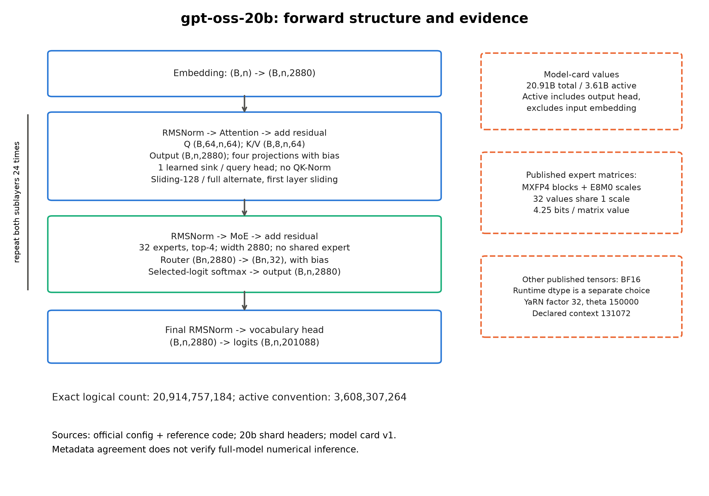
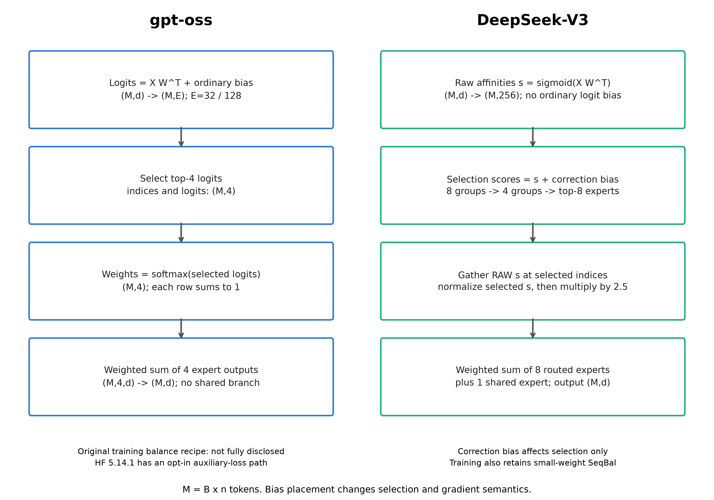

# 第 10 章 旗舰整机拆解：gpt-oss 精拆与速览表

## 10.0 开篇：从全书到这里

上一章将MoE与MLA装进两刀机，并区分了结构对拍、短训和长期质量证据。本章把同一套分析方法用于gpt-oss：当模型卡、配置和参考实现各自只提供一部分信息时，怎样把它们拼成一份可检查的整机说明？

DeepSeek的技术报告给出了许多公式与消融，gpt-oss公开材料的侧重点不同：模型卡说明结构与训练概况，配置给出尺寸和开关，参考实现补足前向细节，权重分片头显示实际存储。材料不一定按教学顺序组织，也不一定解释每个设计选择。本章要练习的是让证据相互核对，而不是只从config猜出所有机制。

本章用 gpt-oss（OpenAI，2025-08 发布的 20b/120b 两档开放权重模型）作答。它要兑现 Book3 立下的一笔旧账，也是本册方法论的主场：**config 逆向五步法在一台「无架构论文」旗舰上的完整应用**。交付四项内容：一张全图标注证据等级的结构推断图（图 10.1）与关键配置字段表（表10.1）、一份精确参数账及明确范围的交叉核验（式 (10.1) 与表 10.2）以及跨厂商活跃参数定义的比较（10.4 节）、一份从分片头字节中核实的 MXFP4 存储账与 KV 元素账、一张十机型旗舰速览表（表 10.3）加七条未决问题（表 10.4）。走完本章，「拆旗舰=检验本册全部组件」的完整过程就此完成；之后第11章讨论MoE支线，第12章完成收束。

> **最小背景栏**：本章只补一件前置——gpt-oss 是谁（OpenAI于2025-08发布的两档推理模型，开放权重；专家投影采用MXFP4，其他张量另计），其余内容全部指回前文。config 逆向五步法（认家族→重建图纸→算账对拍→读外围→证据分级与未决问题）＝Book3第9章，其参数公式原型＝Book3 第 5 章式 (5.2)、MoE 扩展＝式 (9.1)/(9.2)；safetensors 分片头的 HTTP Range 审计（不下权重、只读头部）＝Book3 第 5 章；三口径账本与「引 B 数先判口径」＝第 1 章式 (1.1)-(1.3) 与表 1.2；三学派 MoE 几何＝第 2 章表 2.4；noaux 偏置更新＝第 5 章式 (5.2)；MXFP4 的 4.25 bits 格式账＝第 7 章式 (7.2) 与 7.5 节；KV 元素账本＝Book3 第 6 章与第 6 章表 6.2；GQA 的 $h$/$h_{kv}$ 双头数记号＝Book3 第 6 章。

## 10.1 承接前册：公开材料怎样相互核对

Book3第9章已经将“config→架构图→参数核对→证据分级→未决问题”作为分析流程，并把旗舰精拆与各家配置速览交给本章。这里兑现架构与账本部分；如何审视厂商自报评测，仍指向Book5第11章。沿用的是方法，不是对旧稿措辞的逐字引述。

这项方法的学习过程值得先回顾一遍：五步法在 Book3 第 9 章是「教」（Llama 4 全程演练），在本册第 4 章是「实习」（Mixtral config 反推），第 9 章是「整机互证」（DSV2/V3——有技术报告交叉的拆机），本章是第四环「主场」——主要设计动机披露有限的一次应用。

先交代材料范围。arXiv:2508.10925 v1是官方模型卡，包含架构、tokenizer、预训练与后训练说明；§2.2的架构描述较简短，未给出全部路由训练细节或设计消融。因此本章所谓“无架构论文”，指缺少一份逐项解释设计与实验的完整技术论文，不能理解为完全没有官方架构信息【证据等级：官方模型卡2508.10925 v1 §2】。

第一类材料是官方发布配置。与Book3的Llama 4案例相比，gpt-oss可以直接读取这些字段，不必通过第三方镜像绕过配置访问限制。镜像核对是证据条件需要时采用的办法，不是越多份材料就自动越可靠。官方配置仍要注明快照，并与实现和权重结构相互核对。

第二类材料是**官方参考实现**（github.com/openai/gpt-oss 的 `gpt_oss/torch/model.py`，另有 Metal/Triton 后端），机制层证据从「第三方逆向」升格为「厂商一手源码」，本轮另核transformers 5.14.1的`modeling_gpt_oss.py`；它是另一份可比较实现，但不能假设与官方参考代码完全独立。

第三类材料是权重分片头——索引实际列出3个safetensors分片：编号00000、00001、00002；文件名后缀of-00002不能直接当分片数量（Book3 第 5 章的 Range 手法），MXFP4 的存储结构能直接从字节里读出来。仍有不足的是各项选型的完整动机与消融。本章的任务，就是把「知道什么」明确到实线证据所能支持的最远处，把「不知道什么」登记成表。

## 10.2 认家族与重建图纸：config 全表与结构推断

五步法第一步，认家族。`model_type = "gpt_oss"`、`architectures = ["GptOssForCausalLM"]`、`transformers_version = "4.55.0.dev0"`——第三件是年代学证据（Book3 第 5 章的手法）：字段记录了4.55开发版本，可提供实现来源线索；单靠它不能确定精确写入日期或完整转换过程【证据等级：config 逆向】。

第二步，重建图纸。20b 与 120b 两份 config 并列展开、逐字段比对，核对结果是：**全字段 diff 只有三项——`num_hidden_layers`（24 对 36）、`num_local_experts`（32 对 128）、`layer_types` 的列表长度**；残差流宽 $d=2880$、注意力全套、词表 201,088、RoPE 配置，两档完全相同【证据等级：config 逆向，本书脚本实跑】。从这两份配置可以直接看出：**保持宽度，增加专家数与层数**——120b 就是把每层的 32 个专家换成 128 个、再增加 12 层，其他配置字段相同；这不意味着两个检查点使用相同权重或相同训练过程。

表10.1 gpt-oss关键配置字段（20b/120b 并列；「→ 部件/读法」列即结构推断；等级未注明者均为【证据等级：config 逆向】）

| config 字段 | 20b | 120b | → 部件/读法 | 等级补注 |
|---|---|---|---|---|
| `hidden_size` | 2880 | 2880 | 残差流宽 $d$（两档同宽） | |
| `num_hidden_layers` | 24 | 36 | Block 数 $L$ | 论文 §2.2 同值【官方论文】 |
| `num_local_experts` | 32 | 128 | 专家份数 $E$ | 论文 "128 for gpt-oss-120b and 32 for gpt-oss-20b"【官方论文】 |
| `num_experts_per_tok`（与 `experts_per_token` 同值 4——OpenAI 原名与 HF 名并存的转换痕迹） | 4 | 4 | 每 token 激活 $k$ 份 | 论文 "top-4"；html 版渲染损伤为 "top-44"，以 config 为准 |
| `intermediate_size` | 2880 | 2880 | 专家宽$f=d$；三份逻辑矩阵各为$d\times d$，融合gate/up矩阵则不是方阵；字段名要按家族解释 | |
| `num_attention_heads` / `num_key_value_heads` / `head_dim` | 64 / 8 / 64 | 同 | GQA 8 组；$h\cdot d_k=4096>d=2880$：矩形投影 | |
| `attention_bias` | true | true | 四个注意力投影全带偏置（分片头证实 o_proj.bias 也在） | 权重审计佐证 |
| `layer_types` | 24 项 | 36 项 | sliding/full 逐层**1:1 交错**，首层 sliding | 原实现 `layer_idx % 2 == 0 → sliding`【官方参考源码】 |
| `sliding_window` | 128 | 128 | 滑窗带宽 128 token（极窄；只作 config 事实） | 论文 "the bandwidth is 128 tokens" |
| `rope_theta` / `rope_scaling` | 150000 / yarn factor 32（4096→131072，无 attention_scaling 字段） | 同 | YaRN 32× 外推；缩放常数在实现中给出（见下文） | |
| `max_position_embeddings` | 131072 | 同 | 声明上下文 128k | 论文 "131,072 tokens using YaRN" |
| `swiglu_limit` | 7.0 | 同 | SwiGLU 限幅常数（config 字段与实现硬编码冗余并置） | 【官方参考源码】 |
| `router_aux_loss_coef` / `output_router_logits` | 0.9 / false | 同 | 默认不输出路由logits；当前HF启用输出且给labels时会加入aux | 原训练是否使用这一损失未披露 |
| `quantization_config` | mxfp4；排除self_attn/router/embed/lm_head | 同 | 专家投影矩阵量化；偏置、norm等存储dtype由分片头核实 | 不能只从排除清单推出所有运行dtype |
| `vocab_size` / `tie_word_embeddings` | 201088 / false | 同 | o200k_harmony 词表，untied 出入口两份 | 论文 §2.3 "201,088 tokens" |
| `rms_norm_eps` / eos/pad | 1e-5 / 200002 / 199999 | 同 | pre-RMSNorm；harmony 特殊 token 区段锚点 | |
| （config 无字段）`self_attn.sinks` | 每头 1 可学标量，24×64 枚 BF16 | 36×64 | 结合权重审计与源码才能读到 | 【权重审计+官方参考源码】 |
| （config 无字段）QK-Norm | **无** | 无 | 双实现注意力通路均无 q/k 归一化（负结论，见 10.7 考据框） | 【官方参考源码×2】 |

图 10.1 把这张表画成结构推断图——主列画 config 与分片头能证明的（实线），右列画官方模型卡论文的口径（虚线），证据等级直接画进图里。



图10.1 gpt-oss-20b的前向与证据来源（依据官方config、参考实现和分片头自绘，示意级）。每个Block都包含注意力残差子层与MoE残差子层，重复24次；虚线注释表示模型卡发布的概数与训练说明，不参与前向。精确参数数目来自本书公式和元数据核验，不能把模型卡概数写成逐位发布值。

先看图 10.1，建立整机的整体认识，再梳理一遍数据流：token 序列 $(B,n)$ 查表得嵌入 $(B,n,2880)$，进 24 个 Block——每个 Block 是 pre-RMSNorm 接注意力、再 pre-RMSNorm 接 MoE 前馈的残差结构——离开残差流后经过最后一层 norm，最后 lm_head 将 $(B,n,2880)$ 打成 $(B,n,201{,}088)$ 的词表logits。这仍可用Book3第8章的四插槽框架分析；模型卡自身将其谱系描述为建立在GPT-2/GPT-3架构之上：归一化与位置仍采用pre-RMSNorm和RoPE，但尺寸与缩放设置要逐项核对，注意力格是 GQA 加新零件（sink、交错窗口），前馈格在**全部** 24 层上换成了 MoE——注意这个「全部」：无首层稠密，与 DSV2-Lite 的 `first_k_dense_replace=1`、DSV3 的 3 都不同，gpt-oss 连第一层都直接上专家群【证据等级：config 逆向】。接下来逐一核清四个值得细看的字段。

**其一，矩形注意力（rectangular projection）。** $h\cdot d_k = 64\times64 = 4096 > d = 2880$：q 投影从 2880 **升维**投出 4096、o 再降回——注意力工作在比残差流更宽的空间里。逐运算标形：$(B,n,2880)\xrightarrow{W^Q}(B,64,n,64)$、$k/v$ 各 $(B,8,n,64)$、$W^O$ 把 $(B,64,n,64)$ 收回 $(B,n,2880)$。头维 $d_k$ 在 config 里是独立字段、彻底与 $d$ 解耦——Book3 第 6 章立 $h$/$h_{kv}$/$d_k$ 双头数记号时预留的自由度，在旗舰上得到了充分使用（Qwen3-32B 的 $64\times128=8192>5120$、Gemma2 9B 的 $16\times256=4096>3584$ 同款；后文的参数账会看到，注意力项必须按 $h\cdot d_k$ 写、不能按 $d^2$ 写，否则第一个错的就是最大的一项）。

**其二，`attention_bias=true`。** 所核权重中q/k/v/o四个投影均带偏置。它与本表所列Llama 3、Qwen3、DeepSeek-V2-Lite、Gemma2配置不同，后者相应注意力投影不带偏置。偏置并非2025年才重新出现；这里登记的是具体模型之间的差异，不从有限案例推断整个谱系的流行程度【证据等级：config、参考实现与分片头】。

其三，`layer_types`给出sliding/full逐层1:1交替，首层为sliding，窗口长度128。模型卡§2.2也给出这个结构事实，并提到GPT-3的交替模式。这里只登记层型与窗口，不由字段直接推断质量、缓存回收或长文本能力；机制与收益留到Book5第2章。

其四，RoPE底数为$1.5\times10^5$，YaRN因子32，对应从4096到131072的长度设置。模型卡强调把全局层的上下文扩展至131072；但这句话并不等于“滑窗层代码中不用YaRN”。所核OpenAI参考实现为所有AttentionBlock构造相同的RoPE缩放，transformers 5.14.1也把同一份位置嵌入交给各层。窗口限制控制可见位置，位置频率控制相对相位，两者需要分别核查。

这份配置没有显式attention_factor。官方参考代码按$0.1\ln32+1\approx1.3466$计算concentration并乘入cos/sin；HF的YaRN默认缩放也取同一公式。若只看普通Q/K内积，两侧各乘一次，使这一部分分数乘约1.81；learned sink项并不因此自动乘相同倍数。它承接Book3第7章的频率与幅度分析，但不是所有注意力logits统一变温度的无条件结论【证据等级：官方参考源码及transformers 5.14.1源码】。

还有两个字段值得记下：num_experts_per_tok与experts_per_token在官方配置中都为4，读取时应检查别名一致；intermediate_size在这里表示专家宽，因为模型没有稠密FFN层。不同家族的命名并不统一：Mixtral也使用intermediate_size，Qwen3MoE则另有moe_intermediate_size，不能靠字段有没有moe前缀判断网络是否稀疏。

每层还有一个形状为[64]的self_attn.sinks张量，每个查询头对应一个可学标量。config的主尺寸字段未单独列它，模型卡、实现与分片头共同说明其存在；参数账必须把它计入。这里仅把它作为注意力中的额外参数，相关机制以及它与SwiGLU限幅各自作用的位置见第7章和Book5第2章，不能从“都与稳定性相关”推出它们可互换。

结构之外，还应查看tokenizer与生成配置。eos_token_id=200002、pad_token_id=199999提供了检查特殊词元的入口，但单靠两个编号和vocab_size=201088，不能反推出“约1088个Harmony扩展词”。模型卡仅说明o200k_harmony扩展了o200k并提供格式专用词元。词条、保留ID、特殊项与嵌入行数之间的对应，需要实际tokenizer定义才能确认；本章没有完成这项审计，也未逐项核对生成默认值，继续登记为未核事项【证据等级：官方模型卡§2.3、config；完整构成未核】。

## 10.3 精确参数账：公式与元数据怎样相互核对

第三步是算账。公式依据配置与实现列出逻辑权重；HF Hub API提供元数据统计；分片头给出张量形状、dtype和数据区间。三者可以交叉检查，但HF统计可能同样来自分片信息，并非三个完全独立的测量。相同计数也不能排除权重数值损坏或前向语义错误；这些需要另作验证。第9章漏掉MLA上投影的例子说明，公式应与逐键形状清单对照，而不是只比较两个接近的总数。

gpt-oss 的参数公式在 Book3 式 (9.1) 的骨架上只改三处小件——注意力加偏置与 sink、专家加偏置、q/o 按矩形写——每一项都有字段或分片头作为依据：

$$N \;=\; \underbrace{2Vd}_{\text{untied 出入口}} \;+\; L\Big[\underbrace{2\,d\,d_k\,(h{+}h_{kv})}_{q/k/v/o\ \text{权重}}+\underbrace{(h{+}2h_{kv})\,d_k+d}_{\text{四投影偏置}}+\underbrace{h}_{\text{sink}}+\underbrace{dE+E}_{\text{router}}+\underbrace{E\,(3df+2f+d)}_{\text{专家：三权重+偏置}}+\underbrace{2d}_{\text{双 norm}}\Big]+\underbrace{d}_{\text{收尾}} \tag{10.1}$$

用人话说：总账 = 出入口两份词表账 + 层数 × 每层账（注意力四投影连偏置带 sink、路由门连偏置、$E$ 个连偏置的方阵专家、两枚 norm）+ 收尾那枚 norm——与Book3第9章相应公式相比多出的每一件，都有字段依据，并非凭空设定。

式(10.1)符号表（$N$在本式表示总参数；10.6节用$M=Bn$表示展平词元数，避免混淆）

| 符号 | 含义 | 形状/取值（20b） |
|---|---|---|
| $d$ / $L$ / $V$ | 残差流宽 / 层数 / 词表 | 2880 / 24 / 201,088 |
| $h$ / $h_{kv}$ / $d_k$ | 查询头数 / KV 头数 / 头维 | 64 / 8 / 64（$h d_k=4096\neq d$，矩形） |
| $E$ / $k$ / $f$ | 专家份数 / 每 token 选中数 / 专家宽 | 32 / 4 / 2880（$=d$） |
| $W^Q,W^O$ | 查询/输出投影 | $\mathbb{R}^{4096\times2880}$ / $\mathbb{R}^{2880\times4096}$ |
| $W^K,W^V$ | 键/值投影（按 KV 组） | 各 $\mathbb{R}^{512\times2880}$ |
| $W_g$ | router 打分矩阵（含偏置 $b\in\mathbb{R}^{E}$） | $\mathbb{R}^{32\times2880}$ |
| 专家三投影 | gate/up/down（各含偏置） | $\mathbb{R}^{2880\times2880}$×3，偏置 $2880+2880+2880$ |
| sink | 每头一枚可学标量 | $[64]$（BF16） |

以 20b 为例手算一遍，读者可以用计算器逐项核对：注意力每层 $2\times2880\times4096+2\times2880\times512=26{,}542{,}080$，偏置 $4{,}096+512+512+2{,}880=8{,}000$，sink 64；router $2880\times32+32=92{,}192$；专家 $32\times(3\times2880^2+2\times2880+2880)=796{,}538{,}880$；双 norm $5{,}760$——每层合计 $823{,}186{,}976$。代入式 (10.1)：$2\times579{,}133{,}440+24\times823{,}186{,}976+2{,}880=20{,}914{,}757{,}184$。在给定几何与参数定义下，这条计数链可以用整数精确计算【证据等级：本书复算（config 公式手算，CPU，2026-10）】。

本轮用CPU meta建模得到20,914,757,184，与手算相同；HF API也报告这一逻辑参数数。进一步按同一revision读取20b的3个分片头，合计52,112字节JSON头：BF16参数1,804,459,584，MXFP4块按每字节两个值还原逻辑个数19,110,297,600，二者之和再次相同。这里没有下载完整权重，也没有执行整机前向。官方表1的20.91B是舍入后的规模，与精确账相符，但不是逐位相等的声明【证据等级：本书meta、HF API与Range元数据实核；官方模型卡表1】。

120b把层数改为36、专家数改为128，得到每层3,213,080,192、总数116,829,156,672。本轮meta计数与HF API同值，与官方116.83B的舍入数相符；本轮未读取120b全部分片头，不能把20b的逐头审计范围自动扩到120b。两档配置的三个差异解释了本公式中的规模变化，但不穷尽两台训练后模型的差异。

表10.2 逻辑参数分项（手算与meta核对；官方表1列舍入概数）

| 家族 | gpt-oss-20b | gpt-oss-120b | 官方 Table 1 |
|---|---|---|---|
| MLP（专家权重+偏置+router） | 19,119,145,728 = 19.12B | 114,714,874,368 = 114.71B | 19.12B / 114.71B ✓ |
| Attention（权重+偏置+sink） | 637,203,456 = 0.64B | 955,805,184 = 0.96B | 0.64B / 0.96B ✓ |
| Embed+Unembed | 1,158,266,880 = 1.16B | 同左 | 1.16B ✓ |
| 双norm+收尾（包含在总账中） | 141,120 | 210,240 | 官方表未单列 |
| **总参** | **20,914,757,184** | **116,829,156,672** | 20.91B / 116.83B ✓ |

家族分解的读法与第 1 章 Mixtral 一致（表 10.2）：MoE 部分占 19.12/20.91 = **91.4%**——读懂专家群，就理解了整机参数的主要部分，这正是官方那句「MoE weights are responsible for 90+% of the total parameter count」的实算版（官方口径保守）。

而 120b 相对 20b 新增的参数几乎都在 MLP 部分：每层注意力参数个数与两张词表矩阵尺寸相同；这一部分的总量仅随层数增加，不表示权重字节内容相同——MLP 家族 $+95.6$B（专家份数与层数），注意力家族随多出的 12 层涨 $+0.32$B、norm 零头 $+69{,}120$，合计 $+95.9$B 中 MLP 占 99.7%。

精确计数的价值在于能发现漏项。即使一项只有几千个参数，也应先计入整数总账，再按展示需要舍入；不能先忽略小项，最后仍把结果称为逐位核对。模型理解还需要前向与证据边界，不能由一个总数独立完成。

## 10.4 活账口径：官方「3.6B」数的是哪一本账

总账之外是活账。按本册口径（第 1 章式 (1.2)：含 lm_head、不含输入 embedding lookup）：

$$N_{\mathrm{act}} \;=\; Vd+L\Big[2\,dd_k(h{+}h_{kv})+(h{+}2h_{kv})d_k+d+h+dE+E+k\,(3df+2f+d)+2d\Big]+d \tag{10.2}$$

用人话说：每层只数被选中使用的组件——注意力全家、router、$k$ 个被选中的专家、双 norm——出入口只计出口那份对全词表打分的大矩阵。代入 20b：每层 $126{,}215{,}456$（注意力 26,550,144 + 4 个专家 99,567,360 + router 92,192 + norm 5,760），$\times24$层，加出口头579,133,440及最终norm的2,880，得到**3,608,307,264**。官方表1的Active 3.61B与其舍入值相符——而且这一次无需猜测：Table 1 的表注自己写了口径，「**Unembedding parameters are counted towards active, but not embeddings**」【官方论文 2508.10925 v1 Table 1 caption 直引】——输出头计入、输入嵌入不计，正是本册的单份口径。120b 同法 5,132,849,472≈5.13B ✓。两档的仓库/通行费之比分别是 5.8× 与 22.8×——同一个家族，专家份数把这两本账拉开的幅度完全不同。

跨厂商比较时，这种明确表注比“数值最接近”更有力。gpt-oss给出输出头计入、输入嵌入不计的定义；V2-Lite官方2.4B与本书单表2.451B不能直接称为精确吻合。V3的README_WEIGHTS为36.7B且说明包含两表，而本书未吸收投影账分别为36.626B和37.552B，差异仍未解释。Qwen3-30B-A3B本书双表账约3.353B更接近宣传的3.3B，也不能据此唯一证明其内部定义【证据等级：各自官方公开说明与本书复算；未决差异见第9章】。

一句话：**这些已核配置中，gpt-oss有明确单份定义；DeepSeek与Qwen案例按其具体公开数和账本分别判断，不能推广到全部型号**——一个嵌入的差额 0.2-0.9B，足以显著影响某些百分比比较，因此必须先统一定义。

第9章已经说明，早期V3总账漏了kv_b_proj及潜norm；修正总账，并不会自动解决官方活跃参数的定义问题。尤其不能继续引用旧过程稿中不存在于原发布文档的“官方36.6B单表”说法。这是两类不同问题：一类是本书公式漏项，能够复算修正；另一类是公开统计细项未解释，应保留为待决。把它们分开，才能避免一次纠错又带出新的过度结论。

## 10.5 MXFP4 存储解剖与 KV 账：从字节里读出 4.25 bits

参数账之外还有一本**存储账**。第 7 章式 (7.2) 给过 MXFP4 的格式账：32 个元素一组、块内 E2M1（可表示$\pm\{0,0.5,1,1.5,2,3,4,6\}$）、组共享一枚 8 位 E8M0 纯指数 scale，$4+8/32=4.25$ bit/参数——并预告「第 10 章会从分片头逐字节把它自证出来」。现在兑现。

以第0层为例，每份融合投影的存储由blocks、scales和bias组成。gate_up_proj_blocks为$[32,5760,90,16]$、U8：32个专家，5760个输出行，每行2880个逻辑值，分成90组，每组16字节装32个FP4值。gate_up_proj_scales为$[32,5760,90]$、U8；有限编码$u$表示$2^{u-127}$，255是NaN编码。gate_up_proj_bias为$[32,5760]$、BF16。down投影对应blocks为$[32,2880,90,16]$、scales为$[32,2880,90]$、bias为$[32,2880]$。矩阵在文件中的输出行/输入列布局，还需按具体计算实现转置【证据等级：本轮20b同revision分片头实读、OCP MX格式及HF解包实现】。

全模型累计：块 9,555,148,800 字节 + scale 597,196,800 字节，全部 U8；BF16 侧（embedding、注意力全套、router、专家偏置、sink、norm）合计 1,804,459,584 参数。将块与scale字节相加，再除以逻辑矩阵参数数，得到：

$$\frac{(9{,}555{,}148{,}800+597{,}196{,}800)\times 8\ \text{bit}}{19{,}110{,}297{,}600\ \text{个 fp4 参数}} = 4.25\ \text{bit/参数}$$

这与模型卡给出的专家矩阵4.25 bit/参数口径一致【证据等级：官方论文 §2.1 + 本书算术】。仅计张量载荷、不含分片头与索引，字节账如下：$1{,}804{,}459{,}584\times2\text{B}+10{,}152{,}345{,}600\times1\text{B}=13{,}761{,}264{,}768$ B，约12.82GiB，与 Table 1 的「Checkpoint Size 12.8GiB」吻合（120b的公式载荷估算同样约60.8GiB；不是本轮120b完整分片实读）。

这里有个引用时容易混淆的计数口径：HF API 报的「U8 19,110,297,600」按**逻辑参数**计数（每块字节算 2 个 fp4 值、scale 不计），而字节数要按物理 U8 总数 10.15GB 算——两套口径并存，引用时先分清自己要的是参数数还是字节数【本书审计注记】。

模型卡§2.1明确说明后训练阶段带有MoE权重的MXFP4量化；发布权重的专家矩阵也采用这一格式。这说明格式在训练与发布环节的作用，不足以推出从预训练开始就全部使用FP4算术。各项评测还需遵循模型卡列出的精度、推理强度和工具设置；本章的存储审计本身不能验证评测执行条件。训练侧格式见第7章，部署量化见Book6第12—14章与Book8第24章。

这些字节可以按格式解包。gptoss_reverse.py的条件性real-weights入口，读取第0层路由器，再只切出第一个输入词元首选的一个专家。它分别核对gate/up和down两份矩阵的自实现解包与当前HF反量化结果，再计算这一专家的门控贡献。**这是top-4合并中的一项，不是完整MoE输出或整机生成**；down矩阵也必须按输入/输出方向转置，方阵形状相同不能替代方向检查。

本轮未找到完整本地gpt-oss-20b快照，因此没有运行真实权重前向，也没有触发权重下载。历史写作期曾记录预取1.5/13.76GB，该数字只能说明当时进度。当前已实际完成两档API与meta核验、20b三个分片头审计，以及合成数据的解包对拍；真实权重入口遇快照缺失会明确返回未执行。

范围还要与内存账相配：若把20b全部逻辑权重展开为BF16，仅权重就约41.83GB，尚有激活、缓存和临时副本，接近历史48GB统一内存机器的实用限制。单专家切片可避免一次解包整层32个专家，但峰值仍依实现和临时张量而变，不预报未经测量的“约2GB”。CPU合成测试已覆盖全部256种打包字节、非方阵投影方向以及NaN scale拒绝；这些是格式与实现检查，不是原生FP4硬件性能。

最后一笔是KV账。先计算假设所有层保留完整前缀时的单位token存储，随后再加窗口约束：每 token KV $=2Lh_{kv}d_k = 2\times24\times8\times64 = 24{,}576$ 个元素，bf16 下 48 KiB（120b：36,864 元素 = 72 KiB）【证据等级：config 实算】。用第 6 章表 6.2 的谱系读这个数会更清楚：KV 账本的三个历史压缩站——MQA 砍每 token 记几份（$h_{kv}\to1$）、GQA 折中份数、MLA 砍每份本身多大（箱子 $d_c$）——gpt-oss采用GQA；在所列案例中每层KV宽较小：$h_{kv}\cdot d_k = 8\times64 = 512$，只有残差流宽的 18%。与同代模型并列比较，差异就很清楚：gpt-oss 48 KiB、DSV3 的 MLA（61 层 × 576 元素）68.6 KiB、Qwen3-32B 的 GQA-8（$h_{kv}d_k=1024$、131,072 元素）256 KiB——同是 GQA-8，gpt-oss 用不到四成的层数（24 对 64）配一半的每层 KV 面（512 对 1,024），账面只有 Qwen3-32B 的 19%；单位纪律照表 6.2，一律元素数、字节另注。

窗口层的存储要再加一项条件：运行时是否按窗口回收旧KV。下面只列理论载荷公式，便于读懂参数与缓存的区别；窗口机制见Book5第2章，实际缓存分配与回收留到Book6。

以20b的12个全局层、12个窗口层为例，若运行时能按窗口回收，长度n的单序列理论状态元素为

$$M(n)=2h_{kv}d_k\,[12n+12\min(n,128)].\tag{10.3}$$

对n≤128，它等于前面的$24,576n$；n远大于128后，全局层继续线性增长，局部层有界。实际存储还受缓存布局、块对齐、后端是否回收及批量影响。这条分段式解释了为什么“每token 48KiB”必须注明完整前缀口径，不能把跨模型的层数差、窗口差与机制差混成同一次质量等价比较。

## 10.6 路由与未决问题：比较前向，也辨认训练边界

整机图已经建立，最后细看路由器。模型卡与官方参考实现都给出同一前向选择：线性层对各专家打分，选择top-4，再仅对这4个logit做softmax。这个前向规则能确定选中集合和混合权重，不能单独说明训练时怎样保持负载均衡【证据等级：官方模型卡§2.2、官方参考源码】。

所核OpenAI参考实现与transformers 5.14.1都采用带常规偏置的线性路由层。令$M=Bn$，输入$(B,n,d)$展平为$(M,d)$，经$W_g^\top$与偏置得到$(M,E)$，top-4返回索引和logit各$(M,4)$；对这4项softmax得到门值，再加权合并专家输出$(M,4,d)\to(M,d)$。普通router bias进入logit和后续门值，能接受主损失梯度；它与V3只改变选择、不进入门值的负载纠偏状态不是同一类偏置。

对照对象是DSV3——前一年年底发布的另一台MoE旗舰，两者采用了不同的路由方案（图 10.2，DSV3 侧 config 实值见第 5 章 5.6 节）。逐维读：**打分**，gpt-oss 是线性层带常规偏置，DSV3 是 `scoring_func: sigmoid`；**选法**，gpt-oss 直接 top-4，DSV3 先按 8 组选 4 组、组内再 top-8；**归一**，gpt-oss 只在 4 个选中者内部 softmax，DSV3 选中归一（`norm_topk_prob`）后再乘 `routed_scaling_factor 2.5`；**均衡治理**，DSV3用`noaux_tc`把主要均衡反馈放进路由选择——偏置只改路由选择、不进门值（第 5 章式 (5.2) 与本机对拍证词），主要均衡通过偏置反馈，仍保留极小SeqBal，gpt-oss的原始训练均衡方案在所核材料中未完整披露；**几何**，gpt-oss 是 32/128 选 4、方阵专家、无共享、全层 MoE，DSV3 是 256 选 8 加 1 共享、$f\approx0.29d$、首 3 层稠密。



图 10.2 两学派路由对照（自绘，config 与参考实现事实；左＝gpt-oss，右＝DSV3；$(M,\cdot)$为展平词元维形状标注）【证据等级：官方config、参考源码及本轮实现核对】

这个公开前向没有Shazeer早期noisy top-k中的噪声项，不能由此进一步推断训练时也没有任何随机化或负载约束。结构越简短，越需要分清推理参考实现覆盖了哪些阶段；它不是训练代码的完整替代品。

原始训练是否使用了config中的router_aux_loss_coef=0.9，仍不能确认。但“实现从不计算”已经不准确：当前transformers 5.14.1在output_router_logits=true时计算辅助负载损失，并在同时提供labels时乘系数加到主损失；默认false只表示该路径默认不启用。OpenAI的torch推理参考没有对应训练损失入口。这两条实现事实都不能证明OpenAI原训练器采用了同一策略。不同损失归一化下的系数不可直接比较，也不应因0.9较大就判定其错误。

五步法最后一步是登记未决问题。模型卡对训练数据只写trillions of tokens，没有精确总量；优化器、学习率、批量和完整日程也未列成可复现配方。§2.4报告120b训练约2.1M H100 GPU小时，20b约少一个数量级。资源总量不能替代训练配方，也不能从文档类型推断作者为何省略这些细节【证据等级：官方模型卡§2.4】。

七条未决问题（另含选型消融、后训练可复现细节、长上下文组件贡献、tokenizer审计）收进表 10.4，与本章收官的速览表一起在 10.7 节给出。

## 10.7 十机型速览表：旗舰世代的横读

五步法在 gpt-oss 上走完了。最后把镜头拉远——本册分析过的模型按配置复算，Llama4复用Book3已核账本，汇成一张速览表（表10.3）。它兑现了 Book3 留下的「各家 config 速览」任务：

表 10.3 旗舰世代 config 速览（十机型＋本章主角 gpt-oss 两档；除注明外为本书配置复算；本轮已修正norm小项并作meta核验，历史来源另标；「精度信息（训练与发布分别注明）」列引官方口径另标）

| 模型（发布） | 总参 | 激活参（口径） | MoE 几何 | 注意力 | 上下文 | 精度信息（训练与发布分别注明） | 证据等级 |
|---|---|---|---|---|---|---|---|
| Llama 3 8B（2024-04） | 8,030,261,248 | =总参（dense） | — | GQA 32:8，$d_k$ 128 | 8k | BF16 | Book3 ch5 四方逐位指回 |
| Llama 3 70B | 70,553,706,496 | dense | — | GQA 64:8 | 同上 | BF16 | 同上（本表复算） |
| Llama 4 Scout / Maverick（2025-04） | 107.77B / 400.71B（文本侧；整机 108.6B/401.6B 含 0.87B 视觉塔） | 17.17B / 17.18B（双份） | Scout全48层MoE；Maverick24稠密+24MoE，专家层16/128选1+共享1 | GQA 40:8；3层RoPE+chunk / 1层NoPE+global交错（仅 config 事实） | 10M / 1M（声明） | BF16 | Book3 ch9手算/meta及索引字节相容性核验 |
| Gemma 2 9B（2024-06） | 9,241,705,984（text，tied） | dense | — | GQA 16:8，$d_k$ 256 矩形；**无 QK-Norm**（分片头审计）；softcap 50/30；三明治四 norm | 8k | BF16 | config 逆向（unsloth 单镜像+分片头——**降档标注**） |
| Gemma 3 27B（2025-03） | 27,009,346,304（text） | dense | — | GQA 32:16；QK-Norm 有（分片头 `q_norm/k_norm` (128,) 权重级）；**5:1 交错**、局部窗 1024、双 RoPE 1e4/1e6 | 128k | BF16 | config 逆向（unsloth+RedHatAI **双镜像所核几何字段一致**） |
| Qwen3-32B（2025-04） | 32,762,123,264 | dense | — | GQA 64:8，$h d_k$ 8192>5120 矩形；QK-Norm 有（源码级） | 40,960 | BF16 | config 逆向（官方直发） |
| Qwen3-30B-A3B | 30,532,122,624 | **3.353B（双份）** | 128 选 8，无共享，专家宽 768 | GQA 32:4 矩形；QK-Norm 有；norm_topk_prob | config 40,960；更长扩展需另核配方 | BF16 | config 逆向+官方 model card |
| DeepSeek-V2-Lite（2024-05） | 15,706,484,224 | **2.451B（单份）** | 64 选 6 + 2 共享，专家宽 1408，首 1 层 dense | **MLA**（kv_lora 512+rope 64，Lite 不压 q）；KV 15,552 元素 | 32k/163,840 | BF16 | config 逆向+分片头逐名对拍（P8 参考实现） |
| DeepSeek-V3（2024-12） | 671,026,404,352 | **36.626B（单份）** | 256 选 8 + 1 共享，首 3 层 dense；sigmoid+noaux | **MLA**（q 1536/kv 512/rope 64）；KV35,136元素；相对同层数/同头维MHA的元素账少98.24% | 128k（config 163,840） | **FP8**（e4m3+块 128×128） | config复算；官方活账细项仍未决 |
| **gpt-oss-20b（2025-08）** | **20,914,757,184** | **3.608B（单份）** | 32 选 4，$f{=}d$，无共享，全 24 层 MoE | GQA 64:8 矩形；sink；1:1 窗 128；**无 QK-Norm** | 131,072（YaRN 32×4096） | **发布权重MXFP4**（仅专家投影；非完整训练算术声明） | config 逆向+参考实现+权重审计+模型卡论文 |
| gpt-oss-120b | 116,829,156,672 | 5.133B（单份） | 128 选 4，36L | 同上 | 同上 | 同上 | 同上 |

表下注明三点。其一，**Gemma3 行只计文本栈**：它出厂带视觉塔（config 的 `vision_config` 字段，一台 27 层 SigLIP 小机器）——整机参数比文本栈多约 0.4B，本表不并入；视觉侧与能力扩展是 Book5 第 10 章的地界，这里只留 config 事实边界注记。

其二，Gemma2 行维持降档标注（官方 gated、单镜像+分片头）；Gemma3 行经第二镜像（RedHatAI量化镜像，仅对所列几何与位置字段交叉）交叉后升档双镜像。

其三，速览表的十机型计数不含 gpt-oss 两行——它们是本章主角，已在 10.2-10.5 逐位核对。

这些整数还体现了一个容易忽略的共享关系：Qwen3每层的两枚QK-Norm各只有$d_k$个增益参数，并与各头共享；Gemma3同样如此，不能乘查询头数或KV头数。完整计入残差norm与QK-Norm后，Qwen3-30B-A3B为30,532,122,624，Qwen3-32B为32,762,123,264，Gemma3文本栈为27,009,346,304；本轮HF meta计数逐项相同。小项不大，但“精确整数”就必须把它们放在正确的位置。

还可以把总参数除以选中路径参数，但必须说明定义。dense行暂按总参展示，若统一排除输入表，活跃数也不再严格等于总参。MoE各行按表中约定算得约5.8倍（gpt-oss-20b）、6.3倍（Scout文本侧）、6.4倍（V2-Lite）、9.1倍（Qwen3-30B）、18.3倍（V3）、22.8倍（gpt-oss-120b）、23.3倍（Maverick文本侧）。这里存在单/双表口径差异，只能展示参数库与选中路径之间的距离，不能直接排列训练或推理效率。

横读三笔。**第一笔，MoE 几何三学派**（第 2 章表 2.4 的旗舰全景）：Llama 4「少份宽选」（16/128 选 1 加共享）、gpt-oss「多份窄选」（32/128 选 4、$f=d$、无共享）、DeepSeek/Qwen「细粒度」（256/128 选 8、$f\approx0.29d\sim0.375d$）——同一套四步机构，$k\times w$ 二维设计空间的三个落点；速览表里 dense 一侧还站着 Llama 3、Gemma、Qwen3-32B 一排——稠密与稀疏都有相应实例，是否合适还要结合任务和系统条件判断。

**第二笔，注意力三家三样**：MLA（本表的DeepSeek案例，以潜向量保存KV）、GQA+矩形+sink/窗口（gpt-oss，48 KiB 的小 KV 面）、GQA+QK-Norm（Qwen3/Gemma3）——Book3 第 6 章的 KV 账本从未离开主叙事，48/68.6/256 KiB 同框并读。

**第三笔，精度信息（训练与发布分别注明）两落点**：DSV3 的 FP8（训练侧全栈）与 gpt-oss 的 MXFP4（后训练带量化、发布专家矩阵用MXFP4）——第 7 章的两条主线各自有旗舰案例作为参照。

速览表之外，本章的第二份登记表也一并给出——10.6节预告的七条未决问题：

表10.4 gpt-oss未决问题七条（范围限定为所核模型卡、配置和参考实现；“未披露”与“本章未核”分别标注）

| # | 未决问题 | 已知边界 |
|---|---|---|
| ① | 训练 token 无确数 | 论文只有「trillions of tokens」的定性表述【官方论文 §2.4 原文即模糊】——对照 DSV3 的 14.8T 精数，OpenAI 不给 |
| ② | 原训练是否使用router_aux_loss_coef=0.9 | 当前HF有条件性的aux路径，官方推理参考没有对应训练入口；原训练器策略未知 |
| ③ | 关键设计选择的消融依据 | 专家数、top-k、窗口128与1:1交替已披露，所核材料未提供这些选值的完整比较实验 |
| ④ | 缺少完整可复现训练超参 | 所核模型卡未列优化器、学习率、批量与完整日程；另给资源账：120b 耗时 2.1M H100-hours、20b 约少 10 倍【官方论文 §2.4】 |
| ⑤ | 后训练的可复现细节 | §2.5给出与o3相近的CoT RL、高层格式、推理强度与工具训练说明；完整数据配方与优化过程未给出 |
| ⑥ | 131k长程与sink/窗口的因果贡献 | 所核材料没有拆分各项贡献的完整消融 |
| ⑦ | tokenizer与生成默认值尚未完整核验 | 本章未逐项核对词条、保留/特殊ID及生成配置；不能将未核内容说成没有公开资料 |

> **【实现核对】** 所核OpenAI参考代码与transformers 5.14.1的注意力通路均没有QK-Norm，20b分片头也没有q_norm/k_norm权重；这与“使用RMSNorm预归一化”不冲突，后者作用于残差输入。其SwiGLU限幅和attention sink分属不同位置。层型也应分别记：gpt-oss为1:1，Gemma3为5:1，Llama4的3:1描述RoPE分块层与NoPE全局层；相同术语不能代替逐模型读取。若HTML数字出现重复渲染，先回PDF原表，再用config与实现核对，不把任何一种来源当作自动覆盖其他证据的唯一依据。

速览表收官，「拆旗舰=检验本册全部组件」的完整过程可以逐项核对：MoE 机构与几何（第 2 章四步机构、第 3 章负载难题、第 5 章细粒度与共享——表 10.3 三学派每一格都能指回）；MLA 认得（第 6 章——DSV3 行整行是它的整机版）；路由两学派认得（第 2/3/5 章）；MXFP4 从字节里读得懂（第 7 章格式课）；YaRN 配置读得出波长谱（Book3 第 7 章）；矩形注意力算得清账（Book3 第 6 章记号）；组装学闭环（Book3 第 8 章四插槽——每台机器都是一张已填的插槽表）。

至于那几件 config 只能给出部分信息的内容——窄窗、sink、交错模式的机制与收益——它们的详细讲解在 Book5 第 2 章；而 Book3 那笔欠账的另一半「读厂商自报数字的操作手册」，地址仍在 Book5 第 11 章，原表保留。

> **【欠账】** 1:1 交错窗 128 与 attention sink 在 config 面上只是两行字段——机制与收益的详细讲解（为什么窗口这么窄也不塌、sink 存的是什么）在 **Book5 第 2 章**。→ Book5 第 2 章

## 10.8 本章小结

本章把gpt-oss的公开材料拼成了一条可核对链：配置确定尺寸，参考实现补前向，逻辑参数公式与meta计数、Hub统计及20b分片头相互核对。模型卡表注明确了活跃参数的单表定义，存储账则把MXFP4逻辑值、打包字节与scale分开。速览表进一步显示，同一个小项在不同模型中可能有不同共享方式；精确整数必须计入norm，不能只看大矩阵。未披露的训练细项、未完成的真实权重前向和外围审计继续保留为未决事项。

**带走的心智**：公开材料应按职责拼接。config给尺寸与声明，源码给某个版本的执行路径，分片头给存储事实，模型卡给发布规模和实验说明；它们彼此补充，也可能留下差异。比较数字时先统一对象：逻辑权重与物理字节不同，单token选中路径与全部参数不同，官方概数与本书整数账也不同。精确算术帮助发现漏项，无法替代对训练过程和运行语义的验证。

镜头拉回全书：两刀已装、训练侧组件已齐、旗舰已拆——本册的「怎么办」到此全部交付。但第 5 章之后 MoE 的演化还有一条支线没走：专家本身住得太大了，能不能把整个车间搬进紧凑作坊？下一章用 LatentMoE 收掉这条支线，然后全书收束、三本账移交。

## 10.9 动手验证

在工作区根目录运行，使用新的结果名：

```bash
source ./env.sh
# 严格离线：随书配置复算、明确跳过在线审计
python from-models-to-vllm/book4-scale-and-efficiency/code/ch10/gptoss_reverse.py --no-net --out-name review

# 在线读取API与20b分片头；只允许Range响应，不下载完整权重
python from-models-to-vllm/book4-scale-and-efficiency/code/ch10/gptoss_reverse.py --out-name online_review

# 绘图另存log/book4-ch10/figures_figure_review
python from-models-to-vllm/book4-scale-and-efficiency/code/ch10/gptoss_reverse.py --no-net --figure all --out-name figure_review
```

JSON逐项记录配置来源、在线审计是否实际完成、逻辑参数和物理载荷。已有同名结果会拒绝覆盖；网络不可用时只保留已完成部分，不将历史汇总冒充当前审计。real-weights仅使用已有本地完整快照，缺失则返回未执行；它计算单token的单专家贡献，不运行整机。验收时应能独立说明三种区别：总参与活跃路径、逻辑参数与存储字节、前向实现与原训练配方。

参考资料：[gpt-oss模型卡](https://arxiv.org/abs/2508.10925)、[官方参考实现](https://github.com/openai/gpt-oss)。
