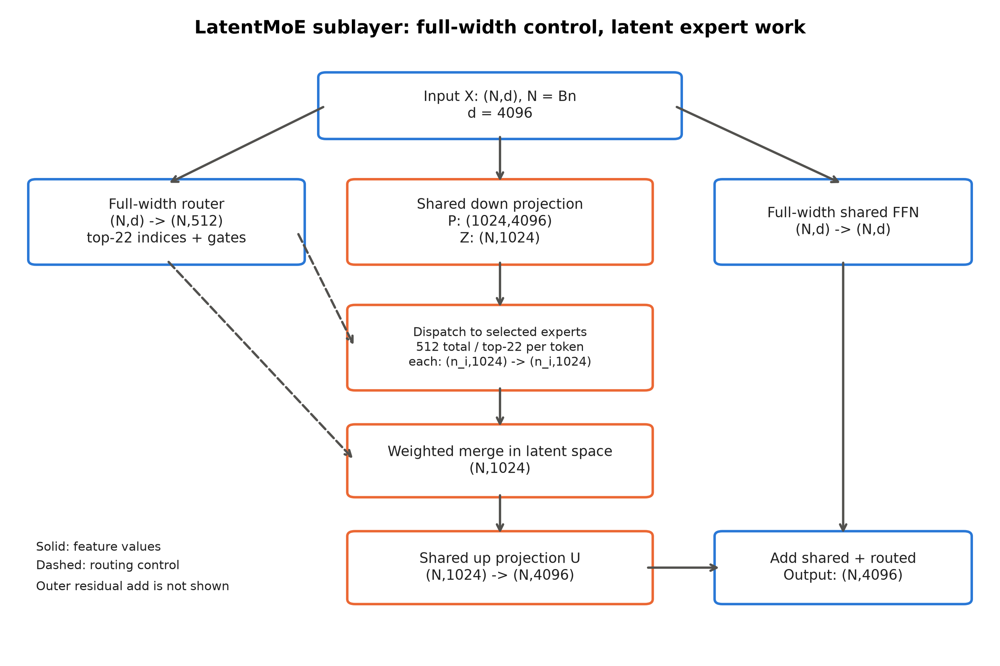
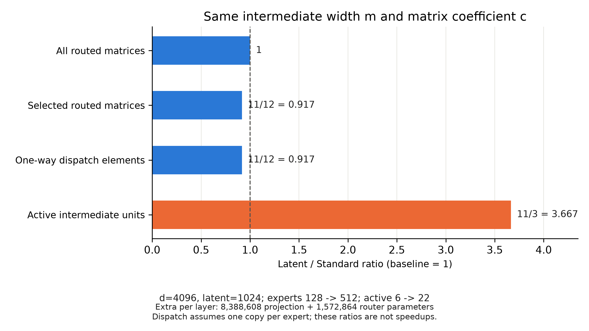

# 第 11 章 LatentMoE 支线：把专家搬进更小的空间

## 11.0 开篇：从全书到这里

上一章把旗舰模型的参数、存储与缓存分开核算。本章再问一个前馈层的问题：既然路由专家的权重与通信载荷都受输入输出宽度影响，能否只缩小专家工作的空间，把省出的预算用于更多专家？

按全书安排，本章位于「拆机与整合」部分的尾声，也是本册最后一章新知识——并且属于一条**支线**：它不属于两刀改装的主线（第 9 章的两刀机不装它），单独开一章，是因为 MoE 的演化过程还有一部分需要介绍。

第5章讨论了细粒度、共享专家与后续的免辅助损失路由；它们并不是MoE设计的终点。在此前主要案例中，专家虽有不同中间宽度，却仍接收和输出全宽$d$的表示。LatentMoE尝试改变这个输入输出宽度。我们采用NVIDIA于2025年12月发布的Nemotron 3报告§2.2作为案例，检查它怎样在表示约束与成本之间作取舍。

本章给出数据流图、完整标明假设的成本账，以及报告中的两组配置对照。路由专家的矩阵总量可以近似维持，投影和扩大后的路由器则增加额外成本；质量是否改善，交给具体评测。正文保留手算例子，不增加训练项目。下一章再将本册几种效率思路放回整机，清点后续学习接口。

> **最小背景栏**：本章只补一件前置（两种部署档位的瓶颈情况，11.1 节随引文即补），其余内容全部指回前文。MoE 块四步机构与形状流转（展平、打分 $(N,E)$、top-$k$ 硬选择、gather-scatter 派发）＝第 2 章图 2.1 与式 (2.1)——本章沿用这一基本机构，再改变工作维与专家配置；细粒度分割的组合数论证、细分前后专家矩阵预算的条件性比较与共享专家＝第 5 章 5.2/5.3 节式 (5.1)；all-to-all 通信账单（每 token 寄 $k$ 封信、载荷随激活份数与表征宽增长）＝第 2 章 2.6 节与第 5 章 5.4 节；总参/激活参双口径与「引官方数先判口径」＝第 1 章式 (1.1)-(1.3)；把 $(B,n,d)$ 用一部下投影矩阵压进低维箱子再干活的直觉＝第 6 章式 (6.2) 的 $W^{DKV}$（箱子 $d_c$）——本章把同一方法用于 FFN 插槽。

## 11.1 从专家宽度看读取、通信与非线性预算

先明确这里讨论的是哪一个维度。从 GShard 到 DSV3，无论粗粒度（Mixtral：8 个整 FFN 专家，中间宽 14336）还是细粒度（DSV3：256 个专家、中间宽 2048），专家的**工作维**始终等于全模型宽 $d$：每个专家接收 $(n_i,d)$、输出 $(n_i,d)$，与残差流同宽。细粒度分割缩小中间维$m$，同时增加专家数，这些案例中的专家输入输出宽度仍为全宽。改变这个宽度之前，得先问：哪些成本取决于它？

要答这道题，先要了解模型部署时的情况——报告区分两类部署目标，实际运行可处在它们之间。第 1 章 1.5 节说过「显存照付全款」：全部 $E$ 个专家的权重都得装进显存。装下之后呢？

以时延为主要目标时，单次参与MoE计算的词元较少，一份专家权重可能只服务少量输入，显存读取较难摊薄。报告讨论的这类设定中，权重搬运可能主导耗时。不过，几十或几百个词元不是通用分界：矩阵尺寸、精度、缓存、硬件和内核都会改变瓶颈。

以吞吐为主要目标时，同一批中更多词元可能被分到同一专家，读取权重后可用于更多乘加。在采用专家并行的报告设定中，跨设备分发和回收表示成为重要成本。它也不是“大batch必然通信受限”的定律；专家映射、负载分布和通信重叠仍须实测。

把报告的论述改写为三项账目，就能看清设计动机【证据等级：官方技术报告2512.20856 v1 §2.2】。

第一项是专家矩阵读取。若一个专家有$c$份主要线性矩阵、输入输出宽$d$、中间宽$m$，参数主项约为$cdm$。本书沿用SwiGLU作示例时$c=3$；两矩阵FFN则$c=2$。报告该节未说明消融所用具体激活形式，所以后面的倍数比较保留$c$，不把三矩阵实现冒充官方细节。在权重精度和复用条件相同时，减小$d$或$m$都会减少这部分读取字节；压缩精度或增加复用也能改变读取成本。

第二项是路由表示的通信。按“为每个选中专家发送一份输入，并回收一份同宽输出”的朴素分发方式，单词元单向载荷主项正比于$kd$，往返约为$2kd$个元素，再乘每元素字节数。中间宽$m$不直接进入这一载荷，因为中间激活留在专家所在设备。但同设备多个专家可合并发送、共享路由元数据也有成本，因此$kd$是比较设计的近似账，不是所有实现的精确网络流量。

第三项是报告所说的有效非线性预算，粗略用$km$表示每个词元经过多少中间非线性单元。它能提示设计方向，却不是完整表达能力的定理：输入输出维度、门控、专家相关性和训练是否充分同样重要。尤其不能把$km$增加几倍直接译为模型质量增加几倍。

把这三行放在一起，就能逐个维度查看成本。

**工作宽$d$**影响上述通信和矩阵读取主项。虽然$km$没有把它列入计数，整体函数的表达能力仍受它约束；压缩这个维度会同时改变成本与表示。

**中间宽$m$**同时影响专家矩阵规模和中间非线性单元数。减小它会降低部分成本，也可能改变质量；效果并非必然下降，仍取决于其余设计和训练。

**激活数$k$与总专家数$E$需要分开。** $k$直接影响单词元执行的专家数与朴素分发载荷；$E$主要影响模型总权重和路由打分矩阵。增大$E$而保持$k$，并不意味着每个词元要读完更多专家矩阵；它可能改变选择多样性、命中模式与批内复用。

由此得到报告的策略：保持模型残差宽$d$，只把路由专家的输入输出压到$\ell<d$，再把部分节省用于增加$E$和$k$。第5章细粒度分割主要改变中间宽$m$；这里改变的是工作维。两种设计可以分别讨论，但都需要把额外路由成本算回来。第6章MLA已经给出低维投影的直觉，本章把类似的压缩思路用于前馈支路；它与缓存压缩的成本对象不同。

> **【来源与范围】** 本章采用NVIDIA署名的Nemotron 3报告v1（2025-12-24）§2.2及图3b。报告把LatentMoE用于Super/Ultra；该家族另有混合序列结构，本章只分析前馈块，不展开后续册内容，也不把图中的算术当成Nano的完整结构。这里的accuracy per byte是设计目标，不表示准确率与字节数存在固定函数。v1尚未给出Super/Ultra的完整配置，本章沿用其表1消融，不追补后续版本。

## 11.2 LatentMoE 机构：投下去、扩开来、投回来

先看图11.1的三条支路。原始全宽表示送入路由门，同时送入共享专家；路由专家这一路先经公共下投影，进入$\ell$维空间，合并选中专家输出后再经公共上投影回到$d$维。这里的两份投影由同一MoE层的路由专家共用，不表示整本网络所有层共用参数。按报告机制写成教学公式如下；$g_i(x)$保留为一般门值，具体评分与均衡策略不凭空补入【证据等级：官方技术报告2512.20856 v1 §2.2、图3b；下式为教学记法】。

$$y \;=\; W^{\uparrow}\Big(\sum_{i\in\mathrm{TopK}_{k'}} g_i(x)\cdot E_i\big(W^{\downarrow}x\big)\Big)\;+\;\mathrm{Shared}(x) \tag{11.1}$$

这条式子把三条支路合在一起：路由门仍读取全宽输入，路由专家在潜空间计算后投回全宽，再与共享专家的全宽输出相加。它保留了第2章“选择部分专家、按门值加权”的基本抽象，同时改变了工作维与专家数。形状逐框流转（$N=B\cdot n$ 展平 token 数；数值取表 11.1 右列 $d$=4096、$\ell$=1024、$E'$=512、$k'$=22）：

| 符号 | 含义 | 形状 |
|---|---|---|
| $x$ | 进入 MoE 块的隐状态 | $(B,n,d)$，$d$=4096 |
| $W^{\downarrow}$ / $W^{\uparrow}$ | 下投影 / 上投影（形状承第6章$(d_c,d)$记法） | $(\ell,d)$ / $(d,\ell)$ |
| $W_g$ | 路由器打分矩阵（**不搬家**，全宽打分） | $(E',d)$，$E'$=512 |
| 打分 → 门控 | 逐 token 打分 → top-$k'$索引与门控 | $(N,d)\to(N,E')\to(N,k')$ |
| $h=W^{\downarrow}x$ | 潜表征（展平后下投影） | $(N,d)\cdot(d,\ell)\to(N,\ell)$ |
| $E_i$ | 潜宽专家（中间宽$m$；SwiGLU为本书示例） | $(n_i,\ell)\to(n_i,\ell)$ |
| $\sum g_iE_i$ | 选中专家加权合并（gather-scatter 照第 2 章） | $(N,\ell)$ |
| $W^{\uparrow}(\cdot)$ | 上投影回全宽 | $(N,\ell)\cdot(\ell,d)\to(N,d)$ |
| $\mathrm{Shared}$ | 共享专家（全宽、不参与路由，承式 (5.1)） | $(B,n,d)\to(B,n,d)$ |

（记号换算：论文把专家数记 $N\to N'$、激活数记 $K\to K'$；本册契约 $N$ 是展平 token 数、激活数记 $k$——本章一律写 $E\to E'$、$k\to k'$，引用时按此对表。）拿单个token沿图11.1的特征箭头梳理一遍：全宽表征 $(1,d)$ 先经下投影$W^{\downarrow}$ 压成 $(1,\ell)$；路由门在**原表征**上打分（$W_g$ 吃 $(N,d)$ 吐 $(N,E')$，top-$k'$索引$(N,k')$），点名 22 个专家；这枚 $(1,\ell)$ 被寄往 22 个专家、各自执行专家FFN；若用本书SwiGLU示例，则有两路升维和一路降维（每个 $(1,\ell)\to(1,\ell)$，中间过 $(1,m)$）；门控加权并成 $(1,\ell)$，再经上投影$W^{\uparrow}$ 回到 $(1,d)$，与共享专家的全宽输出相加，得到MoE子层输出；最后将$(N,d)$还原为$(B,n,d)$，再交给外层残差相加。式(11.1)按单词元列向量写，形状表按批内行向量排列，所以实现中的右乘使用相应权重的转置。

图11.1 LatentMoE子层数据流（依据Nemotron3 §2.2与图3b自绘，示意级）。实线为特征，虚线为路由索引和门值；路由门与共享专家留在全宽，路由专家使用潜宽。图中输出为共享与路由支路之和，尚未加外层残差；512/22等数取报告消融，未展示的评分函数不作猜测。

报告明确把路由门、共享专家及其他非路由计算留在全宽$d$，理由是它们对所针对瓶颈的贡献相对较小。这样路由门可以继续使用未经下投影的表示，参数形状为$(E',d)$；共享专家也继续处理全宽输入。不过，“贡献较小”是报告的设计判断，不意味着零成本。共享支路是独立的全宽前馈路径，也不能仅凭结构把它等同于只存公共知识的部件。

“潜空间”说的是专家的输入输出维度，不是取消离散选择。报告仍使用top-$k'$，对每个词元只执行选中的22个专家FFN，其余490个不执行该词元的专家前向；路由器仍需为所有候选专家打分。

还要区分**离散选择**与**凸组合**。top-k决定哪些输出参加合并；若选中的门值非负且和为1，它们的加权结果仍可构成凸组合。要排除的误解是“全部512个专家都连续参与计算”，而不是说硬top-k与凸组合在数学上互斥。报告未给出这里全部门值规则，式(11.1)因此不预设某一种归一化。

压缩的代价可以直接从式(11.1)看出。令$P=W^\downarrow$、$U=W^\uparrow$，路由输出可写作$y_r=UF(Px,x)$，第二个$x$表示门值还可以依赖全宽输入。无论当前选中哪几个专家，$y_r$都在$U$的列空间内，维数至多$\ell$。这个输出约束不要求门值固定；只有讨论输入方向是否不可辨认时，才需要下面的额外条件。

若选中集合和门值均固定，输入方向$v\in\ker P$满足$P(x+v)=Px$，所有选中专家看到的潜向量相同，路由分支无法区分$x$与$x+v$。共享全宽分支和残差可以补充信息，但不能据此断言瓶颈完全无损。

一个二维到一维的例子：$P=(1,0)$、$U=(1,1)^\top$，两个专家分别输出$E_1(z)=z^2$、$E_2(z)=\max(z,0)$。对$x=(2,3)^\top$，若门值$(1/4,3/4)$，潜空间混合为$(1/4)4+(3/4)2=2.5$，上投影输出$(2.5,2.5)^\top$。在选择和门值不变时，把输入第二维3改成9，路由输出仍相同。如果全宽路由门因第二维变化而把门值改成$(3/4,1/4)$，相同潜向量却会得到$(3.5,3.5)^\top$。因此，输入不可辨认的判断依赖固定选择与门值；两种输出都位于直线$y_1=y_2$上，输出子空间的限制则始终存在。

现在算$d/\ell$的账。报告表1附近给出基线$d=4096,E=128,k=6$，潜空间方案$\ell=1024,E'=512,k'=22$。其一般设计式$E'=Ed/\ell,\ k'=kd/\ell$在这里会给出512个专家和24个激活，实际激活数是22。以下以实际22个为准；报告未完整交代该数值的选型过程。相同$c,m$条件下，路由专家矩阵的两项关系为：

$$E'\,\ell \;=\; E\,d, \qquad k'\,\ell \;\approx\; k\,d \tag{11.2}$$

第一项表示路由专家线性矩阵总量可以保持；第二项表示每词元选中矩阵规模接近。实际$22\times1024/(6\times4096)=11/12$，约少8.33%。它们没有计入公共投影、路由器、偏置或其他组件，不能称为整机所有预算不变。

逐线验算。**通信载荷**若按前述逐专家分发计，同样把激活数扩到24却保留全宽，会从$6\times4096=24576$涨到$24\times4096=98304$个单向元素；潜宽实配为$22\times1024=22528$。相对基线少约8.33%，相对那个全宽24专家反事实少约77.08%。两个分母不同，不能混用；往返系数与字节精度在同条件比较时才约掉。

**选中专家矩阵**从$kcdm$变为$k'c\ell m$，在同$c,m$、同精度且暂不计跨词元重用时，也为原来的$11/12$。实际batch中的显存读取还取决于被多少词元共同命中，以及权重是否已在缓存中。这笔账可比较主要矩阵规模，不能直接给出实测带宽时间。

**全部路由专家矩阵**满足$E'\ell=512\times1024=128\times4096=524288$；乘相同$cm$后，主矩阵参数数目相等。扩大路由器与新增投影则另计，完整总参数并不严格相等。

**激活的中间单元数**从$6m$到$22m$，为原来的$11/3\approx3.67$倍。这一比较把$m$保持不变；报告没有公布足以恢复全模型的$m$与层数，因此它是解释设计比例的条件性算例，不是逐个参数重建官方整机。

报告据此提出，在相近计算与通信预算下，用更窄的专家工作维换取更多专家选择和中间非线性单元。是否得到更好模型，仍取决于压缩损失与训练收益的实际平衡；下面的评测表才是该配置质量的直接证据。

新增的两项成本不能漏掉。公共上下投影共$2d\ell=8388608$个矩阵参数；路由器从$Ed$扩大为$E'd$，增加$(512-128)\times4096=1572864$，合计每层9,961,472。由于上投影是线性的且各专家共用它，可以先在$\ell$维合并，再上投影一次；若每个专家各有不同上投影，就不能这样交换。

实际只激活22个而非理想公式的24个，主矩阵项少了$c m(6d-22\ell)=2048cm$，在账面上为公共投影等开销留出了空间；这可以解释为什么要看完整账，但不能据此证明作者选择22的全部理由。两项新增量还须乘实际MoE层数，不能把单层8.4M直接除整机8B后宣布可忽略。

图 11.2 把这笔账画成与经典 MoE 的并排对照：相近主矩阵预算下的两种工作宽度。

图11.2 主要成本项的并排比较（自绘算术示意）。固定中间宽$m$及矩阵系数$c$时，路由专家矩阵总量比为1，逐词元选中矩阵和朴素单向载荷比为11/12，激活中间单元数比为11/3；新增投影和路由器单列。图中比例不是墙钟速度或表达能力倍率。两图的生成入口为[make_figures.py](code/ch11/make_figures.py)，使用`--out-dir`指定独立输出目录。

## 11.3 收益与消融：相近预算下的五项指标

成本算式不能独自回答质量问题。报告表1比较了两种配置：都训练1T token，作者说明采用相同超参数；总参72.6B对72.8B、激活参8.09B对8.02B，只是接近而非严格相等。专家数、激活数、工作维和公共投影同时改变，因此它检验的是整套几何方案，不能把差异单独归给某一因素。

**表11.1** 相近参数预算的对照：Standard MoE vs LatentMoE（Nemotron 3 表 1 重排；两模型均训 1T token、超参相同【证据等级：官方技术报告 2512.20856 v1 §2.2 表 1（厂商自报）】；Δ 列为本书整理）

| | Standard MoE | LatentMoE | Δ |
|---|---|---|---|
| 激活 / 总参 | 8.09B / 72.6B | 8.02B / 72.8B | ≈持平 |
| 工作维 | $d$=4096（全宽） | $\ell$=1024（潜宽，$d/\ell$=4） | 工作维÷4 |
| 专家数 / 每 token 激活 | 128 / 6 | 512 / 22 | ×4 / ×3.7 |
| MMLU-Pro | 48.30 | **52.87** | +4.57 |
| MMLU | 70.10 | **72.11** | +2.01 |
| Code | 51.95 | **55.14** | +3.19 |
| Math | 78.32 | **80.19** | +1.87 |
| Commonsense Understanding | 81.73 | **82.10** | +0.37 |

（聚合口径，论文原文：Code＝HumanEval/HumanEval+/MBPP/MBPP+ 平均；Math＝GSM8K CoT 与 MATH-500 平均；Commonsense Understanding＝RACE/ARC-Challenge/HellaSwag/Winogrande 平均。）

表中五项指标都更高，其中MMLU-Pro提高4.57个百分点，常识聚合提高0.37个百分点。准确说，这是两个独立基准加三个聚合指标，不是五项都为聚合。聚合平均上升也不必然表示组成它的每个子任务都上升，更不能仅凭分差大小证明某个基准在所有意义上“最难”。

对这个结果的机制解释，可以沿着 11.2 的成本分析展开：$d\to\ell$ 的线性投影理论上是有损的（第6章低维表示的直觉；在整个$d$维空间上，$\ell<d$的线性映射不可能单射），但再投资换来的专家多样性（$\binom{128}{6}$ 对 $\binom{512}{22}$）与非线性预算（×3.7）可能抵消或超过了瓶颈的代价；仅靠两臂总体结果无法分别识别各机制贡献。不同任务的分差不直接证明“常识由共享专家负责、难题由路由专家负责”。要验证这样的解释，需要隔离共享路径、检查表示或增加消融，不能从总分倒推知识已被分配到指定部件。

这与第2章、第5章的比较共享一种方法：先说明控制了哪笔预算，再用实验判断配置的取舍。本章比较全宽和潜宽专家，前文比较稠密与稀疏、粗粒度与细粒度；这些干预都可能同时改变多个结构量。公平不等于“只留一个数字变化”，而是把比较对象、受控量、未受控量和可支持的结论说清楚。

理解这些读数时，要遵守三项如实报告的要求。

其一，结果来自作者自报。表中给出了任务和聚合方法，可据此解释观察；本书没有独立复训，不能把这一张表当成对所有负载和数据分布都成立的质量保证。

其二，报告没有列出重复种子与置信区间。大模型同样存在训练随机性；没有重复测量，就不能宣称各个差值都已排除随机因素，尤其不能对0.37这类较小差值作过强解释。

其三，§2.2未给出表1所用完整层数、头数、中间宽、激活形式和路由训练细节。已公开的$d,\ell,E,k$足以核对主要比例，却不足以独立重建72.6B/72.8B整机或复现训练。这是本章证据的边界，不用后续发布配置倒填历史消融。

## 11.4 谱系定位与 K3 注记：支线，不是主干

最后把这项设计放回MoE谱系。噪声路由、容量约束、top-1、细粒度与共享、负载反馈分别解决不同问题；它们不是后一种出现就使前一种全部退出的单线演化。共享专家和潜空间投影也不自动提供负载均衡，均衡损失、路由反馈与架构可以并存。

LatentMoE在本册中是一条结构支线：它保留稀疏选择，却把路由专家的输入输出移到潜空间。与此同时，示例配置增加了专家总数与激活数，不能说只变了一个空间维。它与细粒度分割作用于不同维度，可以作为组合设计的出发点；是否互补、是否更好仍需整机验证。第9章教学两刀机没有装入它，不能把本章报告中的收益算进本书短训成绩。

这条岔口上还有两处与前文的联系，值得说明。

其一，与 MLA 同母题：第 6 章为**缓存**压 KV——箱子装的是状态，写一次、读多次；本章为**计算与通信**压 token——箱子装的是流水线，每个 token 现场进出。「用一部下投影把工作间搬进低维」在注意力与前馈两个插槽上各自发挥作用，是 2024-2025 年同一个设计母题的两面。

其二，与 device-limited routing 同账单：第 5 章 5.4 节那张「每 token 寄 $k$ 封信」的 all-to-all 账单有两种应对方法——DeepSeek 限地址（先选 $M$ 台设备，宁可次优、不让邮件遍历全机房），NVIDIA 缩包裹（把表征本身压窄四倍）；一个限制目的设备/节点集合，一个缩小特征载荷，两者可能组合；实际收益仍受映射与通信实现影响。

后续边界只记一句：Kimi K3官方报告将Stable LatentMoE扩到896个路由专家选16，并报告2.8T总参/104B激活，配合聚合后RMSNorm、SiTU-GLU与Quantile Balancing等稳定化方案；这些机制留到Book5第7章，不在本章展开【证据等级：Kimi K3官方技术报告§2.3及官方模型页】。

回到开篇的问题：缩窄专家工作维，能降低每个专家的矩阵规模与逐次分发载荷；扩群后，这些节省又用于更多被选专家和更多中间单元。全宽路由门和共享支路保留了另一条信息通道，公共投影则引入表示与成本约束。这几项要一起看，不能只凭“潜空间”三个字判断便宜或高效。

## 11.5 本章小结

本章先区分权重读取、通信载荷与非线性单元预算，再给出LatentMoE的三支路结构。路由门与共享专家保留全宽，路由专家经过公共下投影、离散选择和加权合并，再投回全宽。式(11.2)的一条等式与一条近似关系只控制主要专家账；新增投影、扩大路由器及低维表示约束都不能忽略。报告的两个基准与三个聚合指标支持该组配置的价值，但不足以推导普遍质量无损或固定速度增益。

**带走的心智**：先区分专家的输入输出宽度、中间宽度、总专家数和激活数，再问它们分别影响哪笔账。LatentMoE压的是工作维，保留硬选择；选中输出仍可能按归一化门值形成凸组合。参数比例只是设计起点，表示限制和实际质量必须另验，通信载荷也要经过具体系统才能变成耗时。

本册最后一章新机制到这里结束：两刀改装、训练侧组件、旗舰分析与潜空间支线已经相互连接。下一章回到全景，区分哪些结论来自算术、哪些来自局部验证、哪些来自官方实验，再把计算、存储与缓存三本账交给后续系统学习。

> **【欠账】** Stable LatentMoE 的三件稳定化处方（聚合后 RMSNorm／SiTU-GLU 限幅／Quantile Balancing）各自怎么工作、它们在报告所述配置中分别针对什么问题——那才是它的核心内容，→ **Book5 第 7 章**。

参考资料：[NVIDIA Nemotron 3 v1，§2.2](https://arxiv.org/abs/2512.20856v1)。上述公式是依报告机制整理的教学记法，性能数字是报告的指定对照结果。
