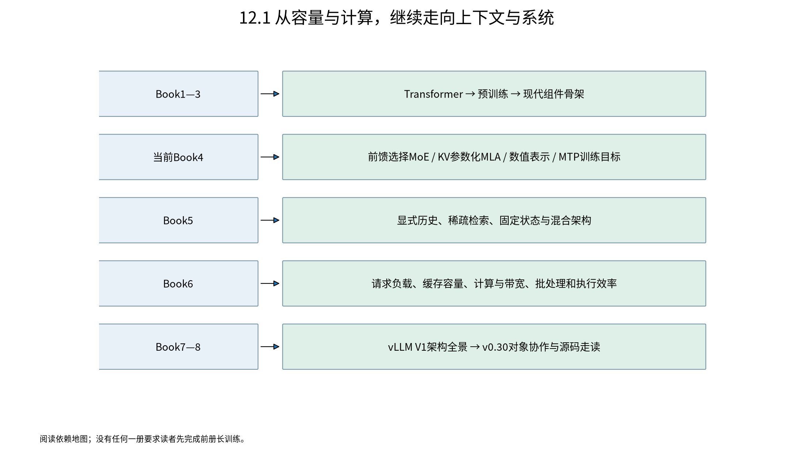
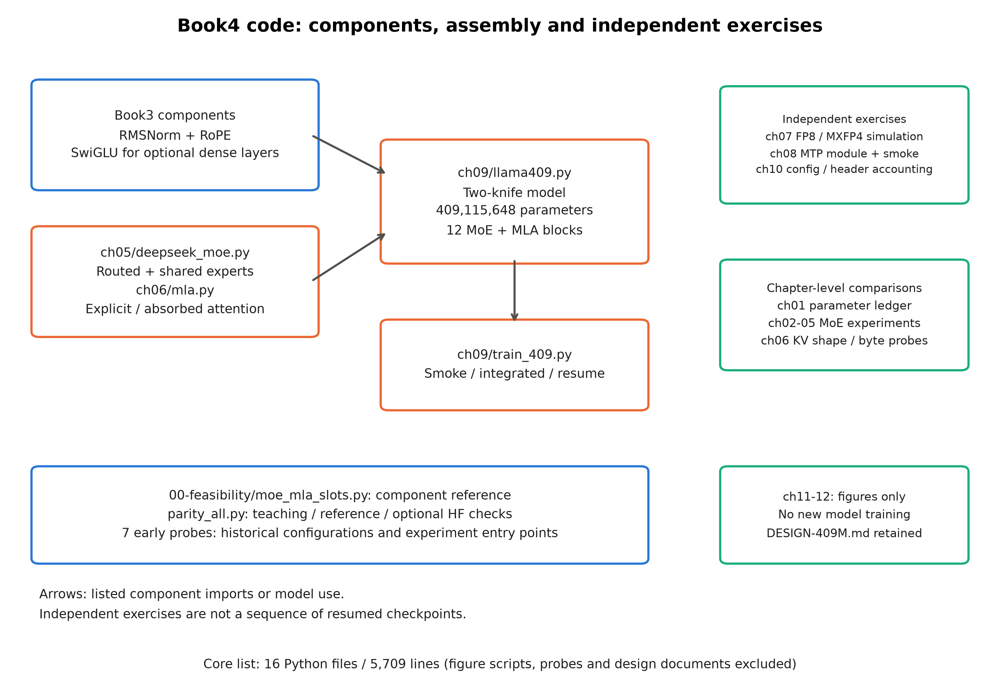

# 第 12 章 收束：效率设计的边界与瓶颈转移

## 12.0 开篇：从全书到这里

上一章把路由专家移入潜空间，展示了另一种分配表示与成本预算的方法。到这里，本册已经完成两刀改装、训练侧组件、旗舰分析和LatentMoE支线。收束时不再增加新机制，而要回答：这些方法各自改变了什么，证据能支持到哪一步，剩下的问题交给谁？

我们先沿四条改造轴回看全册，再核对两刀教学机的证据链，最后清点后续阅读入口、代码与术语。计算、存储和缓存需要分开核算；一项成本降低后，整体瓶颈是否移动，还取决于其他部分及运行负载。

本章没有新训练实验和模型组件。12.1讨论效率结论的条件，12.2回望两刀机，12.3保留前后章节的问题联系，12.4说明账本如何用于系统分析，12.5整理代码与术语。读完后，应能分清结构设计、局部正确性、短训观察和整机性能这几类证据。

> **最小背景栏**：本章没有新的前置知识，全部调用已教内容——三口径账本与派发开销（第 1 章）、MoE 机构与训练难题（第 2-3 章）、Mixtral 与 DeepSeekMoE 两代实证（第 4-5 章）、MLA 全链（第 6 章）、低精度与稳定化处方（第 7 章）、MTP（第 8 章）、两刀整合与设计文档（第 9 章）、旗舰拆解方法论（第 10 章）、LatentMoE 支线（第 11 章）。数字一律指回原处，不重新论证。

## 12.1 四条改造轴：改变了什么，又留下什么

先看路由机构。Shazeer 2017在所述配置中采用带噪声的top-k与两个均衡辅助项；GShard选两位专家，Switch进一步尝试top-1。它们简化了某些计算步骤，却同时引入或调整容量、溢出与训练精度等配套条件。Switch保留选中专家的门值，让主损失可沿这条连续路径回传；离散的选择本身并未因此变成可微操作。GShard约600B与Switch约1.571T的规模标签，应按第1章已经列出的结构口径和未决细项理解，不能仅由路由变简单推出规模增长。

因此，这段历史可以用来比较设计取舍，却不能归纳为“每一代都减少超参数并获得更大模型”。哪些机制留下，取决于模型目标、训练条件与执行系统。

DeepSeekMoE增加激活专家数，同时缩小中间宽。例如，第5章的条件性算例将可选集合从$\binom{16}{2}=120$扩到$\binom{64}{8}=4{,}426{,}165{,}368$；这说明组合空间扩大，不证明学到了同等数量的知识。旗舰配置也保留不同选择：Llama 4的16/128选1、gpt-oss的32/128选4、DSV3的256选8再加共享专家。几何相似不等于门值规则相同，具体区别见第2、5、10章。

这些取舍都需要回到第1章的成本区分。与同总参数的稠密模型相比，MoE让每个词元只执行部分专家；全部权重的存储需求、路由计算与分发成本仍在。GShard从37.5B到600B的报告配置，参数标签增至16倍，训练成本从6到22 core-years，约3.67倍。它说明参数规模与成本并非同比增长；训练成本还受设备、并行效率和具体配置影响，不能直接当成每词元FLOPs的倍率【证据等级：官方论文2006.16668 v1图1；细项见第1章】。

第10章同时列出Llama 3、Gemma3和Qwen3-32B等稠密模型，提醒我们稀疏并非唯一答案。容量、单词元计算、实际批内权重读取和设备间通信是不同目标，设计者可能对它们赋予不同优先级。

第二条轴是负载控制。早期importance/load辅助项、GShard与Switch的代理损失、V2的专家/设备/通信三类约束，关注对象并不完全相同；ST-MoE的z-loss又主要处理路由数值尺度。noaux增加负载反馈偏置，偏置影响选择而不直接进入合并门值；V3仍保留较小的序列级均衡项。细粒度、共享专家与LatentMoE改变表示和成本分配，不能自动保证负载均匀。架构、辅助目标和反馈路由是可以并用的手段，不能写成相互替代的三个历史阶段。

第5章模块实验提供了较小尺度的观察：细粒度加共享臂的评估损失约4.797，noaux臂为4.847，完整精度差为0.04974 nat。差值落在事先指定的0.05工程容忍带内，尚不能证明统计不劣。旧MaxVio字段从0.0138到0.0112，记录的是跨层合并编号后的绝对份额偏差$D_\infty$；它低了，但逐层max/min的均值并未同向改善，故不能概括为所有负载指标都更好【证据等级：本书历史单种子实验，表5.3；指标解释见第3、5章】。

第三条轴是数值格式与稳定化。GShard所述实验曾放弃不稳定的低精度尝试；Switch的选择性精度把路由相关计算保留FP32；V3进一步把大量线性矩阵乘输入改为FP8，并配合细粒度缩放、较高精度累加与敏感组件保留BF16或FP32。第7章已区分这些试验的范围：Switch表2的−3.780是失稳臂的指标，V3的小规模FP8/BF16损失对照也不等于重训一遍完整旗舰。V3报告2.788M H800 GPU小时，不能把全部成本表现单独归因于FP8。gpt-oss又通过后训练阶段的量化，把专家矩阵以MXFP4发布，块内权重连同scale为4.25 bits/param；这也不是全模型平均位宽。

QK-Norm、QK-Clip以及gpt-oss的汇聚元与SwiGLU限幅，分别作用在不同位置。MLA的吸收形态不显式展开逐头K，因而直接沿用某种QK归一化还要解决范数计算问题。第7章的对比支持“组件需要结合架构判断”，不支持它们可无条件互换，或其中任一组件独自保证稳定。

第四条轴是训练目标。MTP增加未来位置的监督，也增加训练模块与计算；推理时如何复用另属后续问题。V3的主模型、MTP独有参数、重复存放的词表矩阵和FP8 scale必须分开：第9章复算主参数约671.026B，MTP文件的非scale元素约13.463B，含两张词表矩阵；官方685B及11.5B unique等概数与精确分项尚未全部解释，不能称为官方逐位对平。

路由与专家几何、负载控制、数值格式、训练目标四条轴共同扩大了设计空间，现有证据却不足以宣布训练效率已接近物理极限或工程平台期。不同方案常改变多项条件，质量对照与硬件实测也不是同一套实验。合理的结论是：**只看参数或FLOPs已经不足以判断整机效率，收益需要在表示能力、数值行为和执行成本之间联合评估。**

三条证据边界贯穿本书。首先，计算匹配、参数匹配、设备配置相同是不同的比较条件；Shazeer的外部最佳模型对照不能冒充单变量实验。其次，FP8训练损失接近只支持指定训练的数值结果，不自动保证所有下游任务与硬件吞吐。最后，公开配置没有包含全部训练配方，未知动机不能用“某个参数看起来合理”补成事实。带着这些边界读下一份模型报告，才知道它真正回答了哪一个问题。

## 12.2 两刀机回望：207M→409M 的证据链

再看本书两刀机。Book3的稠密底座总参数为207,119,360；本册主臂为409,115,648，含输出头、不含输入嵌入查表的活跃参数账为168,877,056。MLA设计载荷为每词元3,840个元素，对原GQA的12,288少68.75%；教学前向尚无持久增量缓存，所以这不是实际服务峰值下降幅度。等总参对照臂为207,064,064，比原底座少55,296，约0.027%；参数匹配并不能控制其余结构与训练日程。

第9章的验证逐层回答不同问题。参数逐项计数与meta构造检查几何；历史冒烟初始损失10.5910/10.5843与$\ln32000+\tfrac12d\sigma^2\approx10.578$的二阶近似处于相近量级。但接近初始损失预期并不排除标签错误或未来信息泄漏，还需形状、因果性与目标对齐检查。

结构对拍检查相同随机权重下的函数一致性。历史cand2完整409M模型严格载入HF后，最大logit差为$7.629\times10^{-6}$、argmax一致率为100%；第6章两种查询压缩配置和第2章mini Mixtral也有各自的局部对拍。在transformers 5.14.1上另作小模型整机对拍，最大差约$9.24\times10^{-7}$。它们支持所测实现一致，不等于已经用旗舰真实权重复现所有输出，更不证明训练质量相同。

短训再检查组件能否共同优化。历史主臂实际540步、对照臂512步，所测损失下降且未出现NaN；半小时只是规划窗口，不能把步数表当成所有设备上的耗时保证。与Book3基线比较时，总余弦日程并不相同，故第9章曲线是背景参照，不能直接归因成改装净收益。全量长训仍未执行，配套项目文档保留原件供后续计划参考。

运行成本则是另一类证据。历史MPS探针中，稠密基线1.907秒/步（Book3另一次为1.702），两刀主臂3.007秒/步；8,550这一内存读数来自步末allocated采样，单位MiB，不是完整捕获的峰值。不同模块对照的耗时比约2.3、1.74、1.44，E16/E8约0.95；它们受几何、矩阵尺寸和执行方式共同影响。朴素循环可能增加启动与索引开销，但没有隔离剖析就不能把全部差异归因于未融合内核，更不能据此推出随规模变化的普适规律。

改装过程可沿[llama409.py](code/ch09/llama409.py)的导入与构造追踪：沿用Book3的RMSNorm与RoPE，引入第5章DeepSeekMoE和第6章MLA。定版12层均为MoE；SwiGLU只在可配置的稠密层变体中用作独立前馈件。第7、8章的FP8模拟、优化器讨论与MTP教学模块没有全部装入这台409M模型，不能把理解过的组件都当成已经集成的功能。

表12.1把组件、局部实验与来源并列。模块消融检验特定设置下的训练观察，数值对拍检验实现关系，整机短训检验组合可运行性；三者互补，不能相互替代。

表12.1 两刀的组件与证据。训练差值来自各自的历史单种子对照，不能跨实验拼成累加收益。

| 插槽 | 旧件 → 新件 | 动刀章 | 消融证据（本机） | 文献锚 |
|---|---|---|---|---|
| 归一化 | pre-RMSNorm（沿用） | Book3第2章 | 参见Book3的指定模块对照，不泛称所有任务等价 | Book3表10.3 |
| 前馈 | dense SwiGLU（1024–2816–1024）→MoE（8选2、共享1、专家宽938；12层均替换） | 第2—5章 | 历史等激活组MoE低约0.038 nat；细粒度加共享较粗粒度低约0.056；noaux较对应辅助损失臂高0.04974。均为各自单种子设置 | 1701.06538 / 2006.16668 / 2101.03961 / 2401.06066 / 2408.15664 |
| 位置 | RoPE（不动；第二刀新增解耦车道 $k^R$ 的施加位） | —（Book3 第 4 章） | —（机制不变，只改施加范围） | 2104.09864（Book3 已核） |
| 注意力 | GQA（16Q/8KV）→MLA（$d_c=256,d_h^R=64$） | 第6章 | 显式/吸收路径局部对拍；七组张量storage字节与公式相等；设计载荷少68.75%，尚非服务缓存实测 | 2405.04434 v5 §2.1及附录 |
| 出入口 | untied、$V$=32000（不动） | —（Book3 第 5 章） | —（单/双份口径开关承 Book3） | Book3 表 10.3 |

MLA是否省参数也要逐项计算。重档cand1的注意力槽为6,882,304，比GQA多3,736,576；轻档为2,687,488，比GQA少458,240。查询压缩、KV投影、RoPE维度和norm都在这笔账内，仅看某一压缩秩不足以判断总量。教学机的价值在于把改造位置、账目与验证过程展示完整，而不是保证缩小后的模型保留旗舰的全部收益。

## 12.3 问题的来路与后续阅读地图

下表保留本册各问题的前后联系。读者可以用它定位：前馈、状态、数值和训练目标已经在哪里展开，哪些问题将进入后续的混合架构与推理系统。

表12.2 关键问题与阅读位置

| 问题 | 本册讲解位置 | 后续阅读 |
|---|---|---|
| 自回归串行与训练目标 | 第8章：多词元监督及其训练结构 | 推理机制见Book6第16—17章；源码见Book8第20章 |
| 文本之外的模态 | 第10章：Gemma3配置中视觉塔与文本栈的边界 | Book5第10章 |
| 前馈层如何扩展 | 第1—5章：由普通FFN进入路由、容量、均衡与专家组织 | 用表12.1定位组件 |
| 头数与头维怎样影响成本 | 第6章：从GQA继续核算MLA状态 | Book6第3—4章 |
| 从GNMT量化推理到低精度训练 | 第7章：权重、激活、累加与敏感组件精度 | Book6第12—13章；Book8第24章 |
| 低精度与训练稳定性 | 第7章：表示误差、缩放和组件级方案 | 回看各方案的适用条件 |
| KV状态的进一步压缩 | 第6章：联合潜状态与解耦RoPE | Book6第4、14章 |
| 配置与权重信息怎样相互核对 | 第10章：gpt-oss逻辑参数、存储和活跃口径 | Book5第11章 |
| 稠密模型为何仍有价值 | 第3章：Llama 3报告的稳定性选择及教学负载实验 | 结合训练证据与运行成本判断 |
| Llama 4的MoE配置 | 第2章：top-1输入门控与专家几何 | 第10章不同路由方案比较 |
| 分布式专家并行 | 第2章：分发与合并的基本需要 | Book6第19章；Book8第18章 |
| MLA之后的注意力与后端 | 第6章：状态压缩未消除完整历史交互 | Book5第2、6章；Book7第8章；Book8第11章 |
| 推理侧量化 | 第7章：训练侧表示与误差基础 | Book6第12—13章；Book8第24章；K3扩展见Book5第7章 |
| MTP的候选生成用途 | 第8章：训练模块与推理资产的区别 | Book6第16—17章；Book8第20章 |
| 窄窗与汇聚元 | 第10章：仅列旗舰配置事实 | Book5第2章展开机制 |
| Stable LatentMoE | 第11章：后续谱系注记 | Book5第7章 |
| 两刀机的后续使用 | 第9章：模型、短训、预算与重启说明 | 项目文档保留；成本算例连接Book6第3—4章 |

图12.1把这些关系放回整个系列：Book4承接组件骨架，Book5继续研究上下文信息的保存与读取；Book6–8研究同一模型怎样在服务系统中运行。前者改变模型的计算与状态，后者组织请求、批次、内存和设备，两条线相互依赖。



图12.1 本册在系列中的位置。按模型结构→信息保存→系统执行的关系阅读，后续章节承接的是问题与知识，不是审稿台账编号。

## 12.4 三本账移交与瓶颈转移

清点完前后线索，再交接账本。本册立起的三本账，各有明确的后续使用位置。

**参数账用于Book6的成本分析。** 总参帮助估算权重存储，活跃参数给出主要矩阵计算的近似规模；实际字节还须按dtype分组，实际FLOPs还要计入与序列长度有关的注意力等项。官方规模标签的定义不能只靠数值接近来猜：gpt-oss明确不计输入嵌入而计输出头，V3官方写含两表，但尚与本书细账有差异；Qwen3的概数也不足以唯一反推定义。具体口径与未决项见第1、9、10章。

两刀机提供一个具体算例：409,115,648个参数若全部以BF16存放，仅权重载荷为818,231,296字节，约818.2MB；实际运行还需缓存、临时张量与框架开销。每词元3,840个元素是MLA设计状态。Book6默认服务对象仍为Book3的稠密GQA小模型，两刀机用于成本练习和选做扩展，不构成启动后续册的前置训练要求。

**KV账连接架构与运行时。** 第6章把状态量从GQA的头数与头维乘积改写成MLA的$(d_c+d_h^R)L$；换成字节还要乘精度和词元数。Book6第4、14章继续讨论KV容量及压缩，Book7第8章与Book8第11章再看后端实现。当前所核HF eager路径缓存展开后的K/V，本书教学MLA也没有持久增量缓存；只有具体后端实现并保留潜状态，公式中的载荷才可能成为实际运行的对应部分。

**MTP的推理用途留给Book6第16—17章与Book8第20章。** 第8章完成训练目标、串行支路和标签对齐；起草结果如何验证、接受与回滚，以及收益何时覆盖额外成本，需要另一套推理流程和测量。训练质量改善与推理加速不是同一个命题。

**预算与重启资料留在册内。** 第9章给出按历史步时和假设MFU外推的预算，明确区分实测与算术。项目文档保留原件；实际重启前仍应以当前脚本参数、正文已核计数及目标设备重新估时，并核对数据身份、余弦总日程和断点约定。不能把未复核的历史计划视为新硬件上可直接保证的运行承诺。

这些交接说明，结构上的节省必须与执行条件一起看。某一部分的成本减少后，原来次要的部分可能成为瓶颈；这是相对成本发生变化，不是整个领域已按固定顺序从训练转向推理。

MoE减少同总参下每词元执行的专家矩阵，却增加路由与分发；MLA压缩设计状态，却要求后端按该表示保存和读取；MTP增加训练监督，推理加速要另行组织；低精度减少部分数据量，也引入量化、缩放与数值稳定性要求。各项是否改善耗时，取决于其新增成本是否被覆盖。

这些方法在训练和推理中都可能产生收益或代价。例如，V3的FP8框架本来就是训练方法，不能说其收益只在服务阶段兑现。Book6继续研究的是：给定模型与请求负载，怎样把参数、状态、计算和带宽组织成实际可测的执行。

读到“瓶颈转移”时，应能指出具体比较：原来哪个环节占时最多，改造后哪个环节超过了它，依据是什么。只有结构公式时可以提出预测，有剖析与计时之后才能确认；负载反馈替代部分辅助目标，则是控制手段的变化，不应混称为同一种物理瓶颈转移。

Book5接续另一个问题：在保持完整历史精确注意力时，MLA没有消除预填充关于序列长度的$O(n^2)$两两交互；自回归单步的历史读取也仍随长度增长。若进一步改变保存哪些信息、如何访问历史，就进入下一册的注意力与混合结构。第11章的Stable LatentMoE注记也在那里继续展开。

## 12.5 册末清点：代码资产与术语表

最后清点两份可带走的资产。

**第一份是代码。** 图12.2将导览中的组件、整机与独立练习按使用关系放在一起。

图中首先区分模型导入和独立练习。第5章DeepSeekMoE、第6章MLA汇入第9章两刀整机，RMSNorm与RoPE沿用Book3；训练脚本消费该整机。第2—8章的模块消融和数值练习各有独立入口，不是把所有实验依次续训成一个检查点。

另一组资产负责检查实现关系：[moe_mla_slots.py](code/00-feasibility/moe_mla_slots.py)是本册组件参考实现，[parity_all.py](code/00-feasibility/parity_all.py)聚合指定的MoE与MLA对拍，启用`--hf`后再检查HF路径。参考实现与教学件可能共享设计错误，因而还需独立数学例子、官方结构或来源核对。七个早期探针保留为历史实验入口，它们的设备读数与原配置绑定。

FP8量化模拟、MTP教学模块与gpt-oss元数据分析可单独使用，图中没有把它们画成409M训练脚本的后继阶段。第11、12章只增加绘图入口，没有新的训练任务。[项目设计文档](code/ch09/DESIGN-409M.md)记录历史计划与重启安排，使用时须结合当前正文和脚本核对运行条件。

核心组件与实验入口仍为16个Python文件，清单由本章绘图脚本显式维护，不含各章图脚本、参考实现与早期探针。行数随修订变化，只作资产清点，不衡量模型质量。代码能否运行取决于入口：纯算例与小模型可在CPU执行，历史训练还需准备对应语料与tokenizer；真实权重验证需要相应模型文件。



图12.2 代码资产总览（自绘示意）。实线表示本图列出的组件导入或模型使用关系；旁列为独立的数值、目标与元数据练习，不表示串行调用。图下计数只含16个核心Python文件，不含图脚本、探针和设计文档。

**第二份是术语表。** 下面保留70项概念与方法，并给出讲解入口。导览和预告可能更早提到某个名字，入口列着重指向能够理解定义的章节，不把它当成逐字首次出现的检索结果。“本书用语”表示教学归纳，未声称存在统一英文术语。

阅读时先由定义判断这里说的是参数、计算、状态还是实验方法，再回对应章查看条件与例子。涉及经验结论的条目只概括已测配置，不用一句定义替代完整证据。

| 术语 | 英文 | 讲解入口 | 一句话定义 |
|---|---|---|---|
| 两刀机 | （本书用语） | 导览 | 在 Book3 207M 骨架上换前馈（MoE）与注意力（MLA）两插槽的最终整机（主臂 409M） |
| 效率悖论 | efficiency paradox | 导览／第1章 | 总参数与每词元执行量可以分开增长；比较效率时须说明基线和成本种类 |
| 三口径账本 | （本书用语） | 导览／第1章 | 总参、活跃参和FLOPs分列；$2N_{\mathrm{act}}$仅近似主要矩阵乘，未自动包含长序列注意力等项 |
| 单份/双份口径 | （本书用语） | 第1章 | 活跃参数账分别计输出词表矩阵，或再计输入嵌入矩阵；查表访问不能当整张矩阵乘法 |
| 等激活/等总参口径 | （本书用语） | 第1—2章 | 三矩阵专家主项可按$d_{ff}=k w_e+w_s$或$Ew_e+w_s$匹配；路由、取整与其他组件另计 |
| 派发开销 | dispatch overhead | 第1—2章 | 将词元组织到专家并合并结果的额外工作；历史耗时比包含多个因素，不能全归因于分发 |
| gather/scatter | gather / scatter | 第 1 章 | 按 top-k 索引把 token 聚到各专家、再散回原位的搬运原语 |
| launch-bound | launch-bound | 第1章 | 内核启动相对计算成为主要耗时的状态；小矩阵循环可能接近该状态，确认仍需剖析 |
| 取整口径 | （本书用语） | 第 1 章 | 官方 B 数与逐位实算之差的常见成因（Mixtral 47B vs 自算 46.703B） |
| 条件计算 | conditional computation | 第 1 章 | 每个 token 只激活参数子集的范式——「容量」与「每 token 成本」分账的机制根源 |
| 逻辑参数三方核对 | logical parameter cross-check | 第10章 | 对齐统计对象后核对手算、API和检查点形状；量化块需还原逻辑元素，非权重数值逐位相等 |
| 未决问题 | open questions | 第1／9—10章 | 公开资料不足或相互冲突的细项明确列出；数值接近、字段存在均不能替代证据 |
| 噪声 top-k 门控 | noisy top-k gating | 第 2 章 | 打分加噪再 top-k 的原始门控；噪声=探索+可微的负载估计 |
| top-k内重归一化 | top-k renormalization | 第2章 | 只在选中集合内归一门值；top-1会变成常数1，与Switch保留全softmax门值不同 |
| 专家容量 | expert capacity | 第2章 | 按批量、激活数、专家数与容量因子设置的处理上限；常见主项为$Nk\,\mathrm{CF}/E$，具体取整与溢出策略另定 |
| 容量因子 | capacity factor, CF | 第2章 | 容量相对均匀分配量的放大系数；某实验中1.0—1.25合适，不是普遍最优区间 |
| 溢出 | overflow | 第2章 | 专家指派超过容量；被舍弃的专家分支不计算，残差及其他已接受分支仍可能保留 |
| 随机第二路由 | random routing | 第2章 | GShard按$\min(2g_2,1)$的接受概率尝试第二专家，并受容量限制；不是任意随机挑专家 |
| 专家并行 | expert parallelism, EP | 第2章 | 将专家分布到不同设备；路由表示需分发与合并，训练还涉及梯度和其他并行通信 |
| 三类几何选择 | （本书归纳） | 第2／10章 | 对少量宽专家、多量窄专家、细粒度加共享的配置比较；不是互斥的学术流派 |
| 赢者通吃 | winner-take-all | 第 2 章（预告）／第 3 章 | 被偏爱专家的自我强化过程：训得多→更强→更被偏爱 |
| 死专家 | dead expert | 第3章 | 指定观察窗口中路由计数为零的专家；有限窗口无命中不等于永久不再被选中 |
| 辅助损失 | auxiliary loss | 第 2 章（预告）／第 3 章 | 为均衡附加的损失项家族（importance/load→单损失→三级） |
| 辅助目标的代价 | （本书归纳） | 第3／5章 | 均衡梯度可能与主任务梯度发生冲突；是否降低质量要实测，noaux也有自己的调参成本 |
| router z-loss | router z-loss | 第3章 | 正则化路由log-sum-exp的平方；不等于逐个约束所有logit绝对值，ST-MoE使用$c_z=0.001$ |
| 选择性精度 | selective precision | 第 3 章 | 路由器内 cast fp32、专家仍 bf16 的精度分区 |
| MaxVio与历史同名字段 | maximum violation | 第3章 | 论文为逐层相对最大超载$E\max_i f_i-1$；本书旧字段为跨层合并后的$D_\infty$，不可直接互换 |
| 干扰梯度 | interference gradients | 第3章 | 辅助目标引入、可能与主目标方向冲突的梯度；并非所有辅助梯度都必然有害 |
| 路由分析 | routing analysis | 第4章 | 在指定样例检查主题、句法与邻近路由模式；样例未见清晰主题分工不等于全模型不存在语义专门化 |
| 替身 | stand-in | 第 4 章 | 因许可与体量选定的对照真权重（OLMoE/Qwen3-4bit）——选型即 config 练习 |
| 细粒度专家分割 | fine-grained expert segmentation | 第5章 | 缩小专家中间宽并增加专家数；$120\to4.4\times10^9$计的是条件性选集组合数，不是已学知识量 |
| 共享专家 | shared expert | 导览（预告）／第 5 章 | 不走路由的常驻组件：旨在承接通用处理、减少冗余；实际分工由训练决定 |
| 免辅助损失路由 | auxiliary-loss-free routing (noaux) | 第5章 | 按负载反馈更新选择偏置，合并门值不直接使用该偏置；V3仍保留序列级均衡项 |
| 路由打分与门值 | routing scores and gates | 第5／10章 | V2 softmax、V3 sigmoid再选中归一、gpt-oss线性打分后对top-4做softmax；选择偏置须单列 |
| 前若干层稠密 | first-k-dense | 第5／9章 | MoE模型前若干层保留普通FFN的布局；V2为1层、V3为3层，两刀定版为0层 |
| 设备受限路由 | device-limited routing | 第 5 章 | 先选 M 台设备再 top-K（限 EP 通信；出自 DSV2 §2.2.2 非首篇论文） |
| 配置字段与实现 | configuration and implementation | 第5章 | 字段存在不保证当前类使用它；须追踪读取位置、默认值和所执行路径 |
| signflip反向对照 | （本书用语） | 第5章 | 把负载偏置更新方向反过来的实验；反例说明反馈符号重要，不代表符号决定全部训练行为 |
| 低秩分解 | low-rank factorization | 第6章 | 用两个瘦矩阵的乘积表示或近似大矩阵；共享低秩结构会约束可表示的映射 |
| 多头潜在注意力 | multi-head latent attention, MLA | 导览（预告）／第 6 章 | KV 联合压进 $d_c$ 箱子+解耦 RoPE 键的注意力形态 |
| KV联合压缩 | joint KV compression | 第6章 | K/V共同由潜状态$c^{KV}$展开；与各存一份同宽潜状态相比主体少一份，仍须另计RoPE键 |
| 查询压缩 | query-side compression | 第6章 | 查询投影的可选低秩结构，影响参数与训练激活，不减少历史KV本身；V2-Lite未使用 |
| 解耦 RoPE | decoupled RoPE | 导览（预告）／第 6 章 | 位置走 $d_h^R$ 维共享车道 $k^R$ 不进箱子——解决三步矛盾的办法 |
| 权重吸收 | weight absorption | 第6章 | 按矩阵结合律把K/V上投影移到查询和输出侧，须满足所述非线性与RoPE位置条件 |
| 显式/吸收形态 | explicit / absorbed forms | 第6章 | 同一MLA的两种计算组织；教学代码验证数学等价，持久增量缓存与融合内核另属实现 |
| KV比较口径 | KV comparison scope | 第6章 | 分别比较相同几何元素、跨模型元素和带精度假设的字节；约93.3%的相容复算不证明官方唯一计量方式 |
| KV 元素账 | KV element ledger | 导览（第 6 章立式） | 每 token 元素数 $(d_c+d_h^R)\cdot L$——Book3 式 (6.2) 的续本，单位=元素 |
| E4M3／E5M2 | FP8 formats | 第7章 | 位分配为1/4/3与1/5/2，最大有限值448与57,344；V3的所述FP8张量采用E4M3，非前反向各分一种 |
| 次正规数 | subnormal numbers | 第7章 | 指数全零区域中的非零有限数，按固定绝对步长表示；靠近零时相对精度下降 |
| 缩放粒度 | scaling granularity | 第7章 | 一份scale覆盖的元素范围；整张量、向量组、矩阵块和MX块适用不同布局与成本 |
| 主体信噪比下降 | （本书归纳） | 第7章 | 极端离群值决定全局scale后，主体值进入低精度区域的现象；必须区分整体与主体SNR |
| FP 尺度自相似 | FP scale self-similarity | 第 7 章 | 动态max-scaling使整体缩放前后的归一化输入相同，整数方案也可有此性质 |
| MXFP4 | microscaling FP4 | 第7章 | 32个E2M1元素共用一个E8M0指数scale，载荷4.25 bits/param；OCP选scale与历史ceil方案须区分 |
| QK-Norm | query-key normalization | 导览（预告）／第 7 章 | 沿头维归一化 Q/K——Henry版用单位L2归一化；现代RMS版需另算增益，直接用于MLA会增加范数计算约束 |
| QK-Clip | QK-Clip | 第7章 | 依据本步逐头最大注意力logit在优化器更新后缩放相关权重；$\tau=100$为报告配置，不保证下一步严格不超界 |
| Muon／MuonClip | Muon / MuonClip | 第7章 | 对矩阵更新作近似正交化的优化器／结合QK-Clip的方案；有限Newton–Schulz迭代不等于精确SVD结果 |
| 多词元预测 | multi-token prediction, MTP | 第8章 | 为多个未来偏移设置训练目标；并行预测头与串行真值条件支路是不同结构 |
| 规模相关的收益变化 | scale-dependent gains | 第8章 | 指定代码实验中0.6B与1.3B测点之间差值由负转正；未测出通用临界规模 |
| off-by-one 三视图 | （本书用语） | 第 8 章 | 主/支路 target 恰错一位的静默 bug 的结构/功能/运行时三视图 |
| 教师强制 | teacher forcing | 第8章 | 串行MTP支路训练时使用真值$x_{t+1}$嵌入；任务与主头条件不同，不能仅靠两个损失大小排除泄漏 |
| 逐字段演进账 | （本书用语） | 第 8 章（预告）／第 9 章 | V2→V3 逐字段对照「什么改成这样、为什么」的读法 |
| 等总参对照臂 | parameter-matched control | 第9章 | cand3与Book3底座总量相差约0.027%；注意力、前馈及总日程差异仍需单独分析 |
| 双候选 bootstrap | dual-candidate bootstrap | 第 2 章（预告）／第 9 章（承 Book3） | 工作区/书仓两布局自适应的跨册 import 寻址 |
| 矩形注意力 | rectangular attention | 第 10 章 | $h\cdot d_k>d$ 的头数×头维几何（gpt-oss 4096>2880） |
| 旗舰速览表 | flagship config digest | 导览（预告）／第 10 章 | 十机型 config 实算的横读表，每行都注明证据等级 |
| LatentMoE／潜空间专家 | LatentMoE | 第11章 | 路由专家在$\ell<d$空间计算，路由门与共享专家留全宽；扩群后仍须重算投影和通信总成本 |
| 工作宽／中间宽 | input-output / intermediate width | 第11章 | 专家输入输出维与内部非线性维；前者影响载荷，后者影响矩阵和中间单元，二者均约束表示 |
| 预算匹配的结构比较 | budget-matched comparison | 第2／5／11章 | 先说明匹配总参、活跃矩阵还是载荷，再列未控制因素；质量证据与速度证据分开 |
| 离散选择与凸组合 | hard selection and convex combination | 第11章 | top-k只选部分专家；若门值非负且和为1，选中输出仍构成凸组合，两者并不矛盾 |
| 瓶颈转移 | bottleneck shift | 第12章 | 某项成本下降后另一项可能主导执行时间；须由具体负载下的剖析确认，非训练到推理的必然历史阶段 |

## 12.6 本章小结：合上这本书

回看整册，MoE改变每个token执行哪些前馈参数，MLA改变跨步保留什么状态，低精度改变数值表示与累加，MTP改变训练监督。这些选择没有抹去代价，而是把成本重新分配到权重存储、路由、表示约束、数值误差和额外训练上。两刀教学模型把前馈与注意力的改造接入同一个残差骨架；参数核算、数值对照与短训分别检查不同层次，不能相互替代。

**带走的心智**：第一，先分清统计对象。总参、活跃参数和KV状态各管一部分成本，计算量还需要单独估算。官方概数、检查点元素与运行时字节不能混用；遇到无法解释的细项差异，保留问题比强行对平更有价值。

第二，组件收益受整机条件约束。MoE改变被执行的前馈参数，MLA改变状态表示，精度与优化器改变数值行为。某一处节省不保证总参数、质量和耗时同时改善；参数核算、函数对拍、训练对照与计时分别回答不同问题。

第三，始终追问代价由哪里承担。均衡目标与反馈路由可以并用，表示压缩伴随约束，低精度需要缩放与稳定化，额外监督需要训练计算。新的方案有价值，应当能说明它解决的具体问题以及为此新增的成本。

回到图12.1，Book4已经完成从组件到整机的连接。Book5继续讨论如何保存与读取上下文，Book6继续讨论模型如何在给定设备和负载下运行。你可以沿着同样的方法进入下一册：先看完整数据流，再核对每一步的表示、计算与状态，最后用适当的证据判断收益。

## 12.7 动手验证（本章图表与复述自测）

- **复现代码资产图**（秒级，CPU）：在工作区激活环境后运行下方命令。脚本以自身所在书目录寻找16个核心文件，只向指定新目录写图；图12.1为保留的系列阅读地图，不宣称由本脚本重建。
  ```bash
  source ./env.sh
  python from-models-to-vllm/book4-scale-and-efficiency/code/ch12/make_figures.py --out-dir log/book4-ch12/figures
  ```
  核对图12.2中的DeepSeekMoE与MLA是否连到两刀整机，训练脚本是否消费该整机，独立的FP8/MTP/元数据练习是否被正确分开。输出目录已存在同名图片时脚本拒绝覆盖。

- **复述自测**：①两刀分别替换什么，参数账、对拍和短训各证明什么？②为什么现有案例不足以断言效率已到极限？③MLA状态公式怎样换算为字节，还缺哪些运行时条件？④后续哪些问题属于模型结构，哪些属于执行系统？回答时保留比较对象和适用范围，不只背一个倍率。