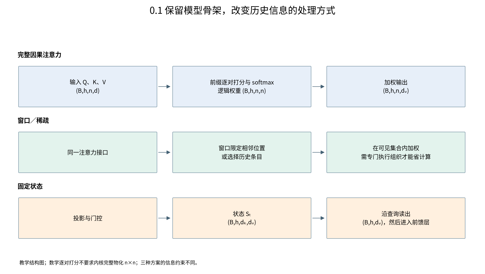
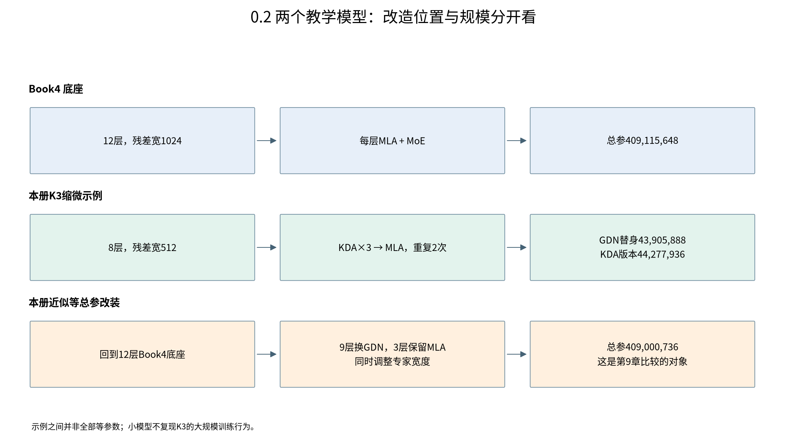

# 导览：从全注意力走向混合架构

> 带着一个问题读：**满注意力还是唯一解吗？如果不是，2026 年的旗舰为什么各自选择了不同的改造方案？**后面十二章都是这句话的展开。

Book4 分别改造了前馈与注意力状态：MoE 控制每步参与的参数，MLA 改变 KV 的低秩表示。但全局注意力仍需要考虑越来越长的历史。本册继续沿插件式演进的思路，保留残差骨架，研究能否限制读取范围、选择相关历史，或把历史压入持续更新的状态。每一种改造都要说明收益、信息代价与实现条件。

在八册地图上，这是第五站。前四册依次建立模型结构、训练方法、现代组件和规模账本，本册继续问：一次注意力计算究竟需要读多少历史，哪些信息必须逐项保存，哪些可以合并进状态？先说明每种改造保留和舍弃了什么，再用任务结果与运行成本判断它是否合适。

全册围绕三条设计路线展开，再用固定版本的旗舰报告和配置作综合案例。这里的**满注意力**指一个查询可读取因果前缀内的所有位置；它不要求程序真的把整张打分矩阵存入显存。“全局”描述可访问范围，“精确softmax”描述运算，二者也不能混用：一个全局索引器可以从整个前缀选出少量位置，主注意力仍只读取这些位置。

> **最小背景栏**：本册只假设你完整读过 Book1-4——$O(n^2)$ 账与点积消融（Book1注意力与收束章节）、KV 账本与 GQA（Book3 第 6 章）、RoPE 与外推链 PI/NTK/YaRN（Book3 第 4/7 章）、组装学四插槽（Book3 第 8 章）、config 逆向五步法（Book3 第 9 章）、207M 整机（Book3 第 10 章）、MoE 全链/MLA/FP8 与 MXFP4/MTP（Book4 第 2-8 章）、两刀机 409M（Book4 第 9 章）、gpt-oss 精拆与十机型速览（Book4 第 10 章）、LatentMoE 基座（Book4 第 11 章）。除此之外自包含：滑窗注意力（SWA，sliding window attention）、attention sink（汇聚元）、原生稀疏注意力（NSA，Native Sparse Attention）、DeepSeek 稀疏注意力（DSA，DeepSeek Sparse Attention）、线性注意力（linear attention）、门控 Delta 网络（GDN，Gated DeltaNet）、KDA（Kimi Delta Attention）——本册主角都会先教到「你能凭书稿画出它」再投入使用。

## 0.1 读完这本书，你会拥有什么

先说明学习目标。读完本册，你会有五项具体收获，还会形成一套理解模型的思路。

**第一，比较注意力方案的判断力。** 图0.1把改造分成三条线：滑窗用位置规则限制读取范围；可学习稀疏用输入相关的评分选择部分历史；线性与递归状态模型改变历史的表示和更新方式。这个顺序用于讲清机制，不是成本高低的固定排名，也不是互斥分类：NSA含有滑窗分支，混合模型还可把不同层型组合使用。读完后，你应能说明候选方案怎样访问历史、付出什么代价，以及还需什么实验才能作选择。

**第二，三条路线的可运行教学组件。** 第2章滑窗与汇聚、第3章块稀疏、第5章GDN双形态分别接受掩码、因果性、数值和状态检查。参考实现对拍只验证同条件下的函数关系；文献核验检查机制对应，任务实验再检查学习效果。第3章还会区分已修正实现与旧实验轨迹，不能把任何一组历史低损失都当成当前实现质量的证据。

**第三，两组用途不同的教学模型。** 第6—7章的8层玩具用于观察K3相关组件：GDN替代分支为43,905,888参数，换成KDA后为44,277,936，两个配置分别记账。它们保留Book3/4组件作为底座，并不完整复刻K3。第9章另回到Book4的409M模型，把9层注意力换成GDN，同时把专家宽938调到810，得到409,000,736参数的三刀机。它与两刀机409,115,648近似等总参；前一代Book3是207M，三者并非全部等参，近似等总参也不意味着相同计算量或相同训练轨迹。

**第四，分类型KV与状态账。** 固定模型维度、batch和数值精度后，保留完整历史的全局层状态随长度增长；窗口层若及时丢弃过期缓存，保存量可受窗宽约束；递归层的矩阵状态大小不随长度增长，但还可能有短卷积等辅助状态。混合模型把这些量逐层相加。第6章会展开K3约0.75%的矩阵状态比较，说明层数、上下文长度、精度和未计辅助量；第8章再讨论交叉点。状态大小可以算清，能保存多少任务所需信息则不能只由这个数字决定。

**第五，核对自报数字的方法。** 本册案例有的提供论文与权重，有的以预览报告、配置或模型卡为主，公开程度各不相同。第11章用GLM-5的两组评测分数说明：先查任务、工具框架、采样与预算，再判断分差能支持什么；来源不足时保留未知，不凭差值猜原因。

贯穿这些收获的是一个问题：**当前词元需要什么历史信息，模型通过什么表示读到它？** 逐项读取、选择性读取与递归合并各有约束。后续公式把这些约束写清，算例让它们可见，实验再检验其效果。



图0.1 三类信息处理方式（教学示意）。各行是候选方案，不是顺次执行；窗口与稀疏还可以组合。第一行的Q/K末维为$d_k$、V末维为$d_v$，图中简写的$d$只表示投影宽度。固定状态行画单步读出；多头输出仍须合并、投影，并按模型的残差拓扑连接前馈层。图中的逻辑权重形状不代表必须物化同尺寸矩阵。

## 0.2 卷间契约：从 Book4 出发

先说明册与册之间的约定：上一册交付什么、本册新增什么、改变什么。表 0.1 是本册与前四册的完整契约——迷路时回来看一眼。

| 契约栏 | 明细 | 地址 |
|---|---|---|
| **已知基础**（四册已教，直接指回、不再重教） | $O(n^2)$ 账、点积兼容性函数与消融 | Book1注意力与收束章节 |
| | 注意力三角色/因果掩码/FFN 数据流 | Book1注意力与模型组装章节 |
| | GPT-2 底座与训练五件套 | Book2 第 10 章 |
| | 四插槽组件（RMSNorm/SwiGLU/RoPE/untied 词表） | Book3 第 2-5 章 |
| | KV 账本与 GQA | Book3 第 6 章 |
| | 外推工程线 PI/NTK/YaRN | Book3 第 7 章 |
| | 组装学（插槽世界观） | Book3 第 8 章 |
| | config 逆向五步法（含 iRoPE config） | Book3 第 9 章 |
| | 207M 整机与训练配方 | Book3 第 10 章 |
| | MoE 全链（机构→难题→DeepSeekMoE） | Book4 第 2-5 章 |
| | MLA（KV 低秩装箱/解耦位置键/权重吸收） | Book4 第 6 章 |
| | FP8/MXFP4 格式课与训练侧低精度 | Book4 第 7 章 |
| | MTP（多 token 预测） | Book4 第 8 章 |
| | 两刀机 409M 与四件套先例 | Book4 第 9 章 |
| | gpt-oss 精拆与十机型速览（窄窗与 sink 的 config 事实） | Book4 第 10 章 |
| | LatentMoE 基座 | Book4 第 11 章 |
| | 激活参数口径与单双份判定 | Book4 第 1/10 章 |
| **本册新增** | 改造动机：三笔旧账+三条路线地图+分类型账本立式 | 第 1 章 |
| | 路线一：滑窗与汇聚（SWA/sink；合成检索任务及位置扫描） | 第 2 章 |
| | 路线二：NSA、DSA及DSV4、GLM-5/5.2案例；1M档位按具体版本区分 | 第 3-4 章 |
| | 路线三：线性注意力（kernel/delta rule/GDN；Qwen3-Next 整机） | 第 5 章 |
| | K3 报告精读·上（KDA/Gated MLA/NoPE/AttnRes+GDN/KDA两种教学配置） | 第 6 章 |
| | K3 报告精读·下（Stable LatentMoE 三处方/MXFP4 QAT/原生多模态） | 第 7 章 |
| | 长上下文位置与状态两条设计线（位置表示与历史存储；iRoPE 调和） | 第 8 章 |
| | 2026 混合配方谱系+选做三刀机四件套 | 第 9 章 |
| | 能力扩展专题（多模态三步曲/后训练链概览） | 第 10 章 |
| | 读厂商自报数字五步法 | 第 11 章 |
| **架构修改**（一刀，演化线本册段） | 注意力插槽：满注意力→3:1 混合（3 线性:1 全局）——K3 玩具 $[\mathrm{KDA}\times3,\ \mathrm{MLA}]\times2$（第 6 章）与三刀机 $[\mathrm{GDN}\times3,\ \mathrm{MLA}]\times3$（第 9 章选做，与两刀机近似等总参）；外层残差接口沿用，前馈宽度及层内位置/门控机制按配置分别说明 | 第 6/9 章 |

表 0.1 卷间契约三栏（自排）

已知基础提供起点，新知识解释内部机制，改造模型则检验它们如何进入同一条前向链。“只改一个插槽”是定位主改动的教学说法：线性层不再执行原注意力的RoPE路径，为保持总参接近还要调整前馈宽度；不能把这句话当成所有其他因素均已控制的实验条件。

真实模型同样组合不同层型，但变化不限于排布。K3的93层由69层KDA与24层MLA组成：前92层重复3∶1，最后再加一层MLA，因此全机比例并非恰好3∶1。Qwen3-Next的48层则为36层线性与12层全局注意力。层数来自各自官方配置；K3还改变残差、前馈和训练方案，这些在第6—7章分别展开【证据等级：[K3配置](https://huggingface.co/moonshotai/Kimi-K3/raw/main/config.json)、[Qwen3-Next配置](https://huggingface.co/Qwen/Qwen3-Next-80B-A3B-Instruct/raw/main/config.json)，本书保存所核快照】。

## 0.3 先看一眼我们要造的机器

出发前先看清两样东西：改造的对象，以及最终要得到的模型。

**例 0.1（构造例）** 改造之前，先看清具体要改什么。设 1 个头、3 个 token（$n=3$）、$d_k=2$，取好算的数，将$1/\sqrt{d_k}$缩放计入打分后，已知可见位置的logit如下（点号暂代被掩蔽位置）：

$$S=\frac{QK^{\top}}{\sqrt{2}}:\ (1,1,3,2)\cdot(1,1,2,3)\ \to\ (1,1,3,3)=\begin{pmatrix}2&\cdot&\cdot\\ 1&3&\cdot\\ 0&1&2\end{pmatrix}$$

先沿三步计算：①$QK^\top/\sqrt2$在逻辑上给出9个配对分数；②因果掩码把右上3格置为$-\infty$，它们的softmax权重为0；③对其余位置逐行归一，第3行$[0,1,2]$得到约$[0.0900,0.2447,0.6652]$。再取标量值$V=(1,0,2)^\top$，形状$(1,1,3,1)$，这一行读出的值为$0.0900\times1+0.2447\times0+0.6652\times2\approx1.4205$。分数决定怎样混合，V提供被混合的内容。

这个例子把“读历史”落到了一个输出值。第2章改变允许读取的位置，第3—4章依据评分或压缩表示组织读取，第5章再改变历史的累积和读出公式。它们不仅改变是否存放这9格；精确满注意力也可以采用不完整物化矩阵的实现。

图0.2再把局部改动放回模型。上行是Book4的12层两刀机，中行是本册8层玩具，其线性分支可选GDN或KDA；下行才是返回Book4尺度的近似等总参改装。8层玩具采用“3层线性、1层MLA”重复两次，用于观察状态与全局读取怎样交替，不是从409M模型直接裁成的同预算对照。

K3报告§2.1说明了3层KDA后接1层Gated MLA、并追加末层MLA的布局。玩具借用了部分结构思路，仍有明显差别，例如其MLA保留Book4式位置路径，普通残差与前馈也不等于K3的AttnRes和Stable LatentMoE。第6—7章会按“报告机制—教学对应—未实现部分”逐项说明；不能把小模型的短训结果外推成2.8T旗舰的效果。



图 0.2 上、中两行是两个不同规模的教学对象；底行才是基于Book4底座进行的近似等总参改装，不能将三者混成同一预算。

Book4 的模型作为本册改造底座保留，新的混合模型另行定义，便于比较参数与状态的变化。

模型代码继续复用Book3/4组件，并在本册实现新的状态更新和组合方式。沿import可以追踪组件来源；是否正确连接，还要检查接口形状、参数计数、因果性和数值结果，第6、9章分别完成这项核对。

## 0.4 旅程地图：五段

整册书是一条旅程，分五段加一场收束。迷路时回到这张地图：

| 段 | 章 | 我们在做什么 | 一句话 |
|---|---|---|---|
| 为什么 | 第 1 章 | 三笔旧账开题+三条路线地图+分类型账本立式 | 满注意力凭什么被质疑 |
| 三条路线 | 第 2-5 章 | 改视野（滑窗与汇聚）→改参与集合（NSA、DSA与旗舰版本对照）→换算子（kernel→delta rule→GDN） | 由固定可见域到内容选择，再到状态更新 |
| 真机精读 | 第 6-7 章 | K3官方报告精读（注意力侧/效率侧）+两种教学配置与历史短训 | 把结构、推导与实验分开核对 |
| 哲学与谱系 | 第 8-9 章 | 位置表示与历史存储这两条设计线+2026 配方谱系+选做三刀机 | 路线走完后的收拢 |
| 扩展与方法论 | 第 10-11 章 | 多模态三步曲与后训练链概览+读厂商自报数字五步法 | 架构册的能力地图与防身术 |
| 收束 | 第 12 章 | 三条路线判决+知识关系回顾+新账移交 | 满注意力不再是唯一解 |

这样的顺序是为了逐步建立前提。先理解窗口和稀疏选择，才能区分读取范围与表示压缩；再理解delta更新，才能读KDA；K3的新残差、前馈和门控机制仍需当场讲清，不能假设前几章已实现每一个部件。第8章把位置表示与历史存储作为两条不同设计轴讨论，第9章再用它们比较整机。

路线章从外部接口变化较少的窗口开始，逐渐进入内容选择与状态递推。每节都先指出当前要解决的成本或信息问题，再给出必要定义和推导；“接口改得少”并不保证实际运行一定更快。

配置字段也能提供阅读线索。实物0.1摘自本次核对的transformers 5.14.1掩码分派表；它告诉我们某个层型使用哪类掩码构造函数，尚未展示该层的全部计算：

```text
LAYER_PATTERN_TO_MASK_FUNCTION_MAPPING = {
    "full_attention": create_causal_mask,
    "sliding_attention": create_sliding_window_causal_mask,
    "chunked_attention": create_chunked_causal_mask,
    "compressed_sparse_attention": create_sliding_window_causal_mask,
    "heavily_compressed_attention": create_sliding_window_causal_mask,
    # 中间一项省略
    "deepseek_sparse_attention": create_causal_mask,
    "linear_attention": create_recurrent_attention_mask,
    "conv": create_recurrent_attention_mask,
    # 后续混合映射省略
}
```

实物0.1 掩码分派表节选（transformers 5.14.1，masking_utils.py第1476—1489行；省略说明为本书所加）。这是具体库版本的源码事实，不是各模型架构的完整定义。

例如，compressed_sparse_attention仍映射到滑窗掩码函数；它的压缩和选择工作需要继续追踪模型代码。linear_attention使用递归掩码，也不能仅由这个名称判断矩阵状态有多大。第1章会从字段走到形状和公式：配置帮助定位问题，算子与缓存实现才说明它怎样执行。

## 0.5 三条贯穿线索

旅程里有三条线。沿着它们阅读，十二章就能连成一个故事。

**一条代码线。** 前册组件分别服务于本册的小型玩具和三刀机；两者是不同实验对象，不是一条连续继承权重的训练轨迹。新增滑窗、块稀疏、GDN、KDA与稳定化组件分别用适合自身的检查方法验证；双路径一致、与HF一致和任务改善是三种不同结论。

阅读机制和纸面例子不要求启动大模型。代码练习需按各入口准备依赖与数据，某些实验只做局部组件检查；能够导入一个模块，也不能替代整机验证。

**一条问题线。**从Book1的受限注意力和外部信息输入，到Book3的位置编码，再到Book4的KV压缩、潜空间专家与低精度，这些问题在本册继续展开。第12章按教学问题汇总它们的来源与落点，而不是要求读者记住内部编号。

**一本新账。** 每一层到底保存逐项历史、窗口内历史，还是递归状态，决定了它的状态量怎样随长度变化。将分层结果相加，再计入精度和辅助状态，才能估算同一模型的有效载荷。运行时是否回收过期窗口、是否保留潜状态，还会影响实际占用；本册建立这种需求，后续系统册再解释怎样实现。

## 0.6 这本书的纪律与约定

阅读时采用以下约定。

**本册范围。**围绕窗口、可学习稀疏、递归状态三类设计，选取截至所据版本的代表模型作综合案例。前沿配置和报告可能更新，正文将结构事实、作者动机、数学推论与实验观察分开说明。我们关心的是这些设计如何保存和读取历史，而不是型号发布日期的竞赛。

**理论与实践。**核心推导、手算和必要验证保留在正文；配套mini组件帮助检查数据流与边界。大型模型的性能来自公开报告，不能由小模型冒烟替代。选做整机的历史实践包括短训与设计文档，没有完成全量预训练；阅读主线不要求先完成这些训练。

**数字注明来源和条件。** 论文、报告、配置、代码与第三方评测分别支持不同事实；来源更权威，也不能跳过比较条件。构造例和算术复算不称硬件实测，历史Mac/MPS训练与当前CPU局部检查分开记录。有限快照或单种子观察不能自动升级为普遍结论。

**怎样使用例子与代码。**每个关键知识点配一个可心算的 toy 例——编号、小数字、步骤化、每步标输入输出、结尾用一句话说明如何理解结果（本章样例=例 0.1）；每个关键产物给实物本体——原样摘录或同构缩样，不用形容性描述代替实物（本章样例=实物 0.1）。例子展示流程，实物展示产物，贯穿全册。

**环境与先修。**先修只要 Book1-4；原训练记录使用Apple Silicon环境；能否复现取决于依赖、内存和数据，不能承诺任意笔记本都能完成（模块实验分钟级、短训半小时级、计时独占窗口）；语料沿用前册两套缓存（引用数字带词表标签）；单种子加判据预注册——先确定判据再运行，结果无论方向都如实报告；随书仓库零数据零权重，语料与权重运行时下载、缓存落本地。

回到开篇，满注意力之外的方案必须同时回答两类问题：成本怎样改变，所需信息是否仍可得到。账本检查前一类，理论、反例和任务实验共同检查后一类。下一章先建立成本坐标，后续章节再逐步补足不同机制的证据。

第一站先回答三个最早留下的问题——2017 年论文 Table 1 第 4 行的那个占位、点积兼容性函数那句预言，还有 $O(n^2)$ 这笔从 Book1 记到今天的账：到 1M 时代，它涨成了什么规模。

先从下一章的成本与信息保存方式开始，再判断每项改造的理由。

---

*下一章：第 1 章 满注意力仍是唯一解吗——三笔旧账、三条路线与一本新账：打分矩阵与 KV 两本账随 $n$ 涨到什么规模，三条突围路线的地图怎么画，分类型账本立式；从 2017 年那扇论文自己留的门读起。*
