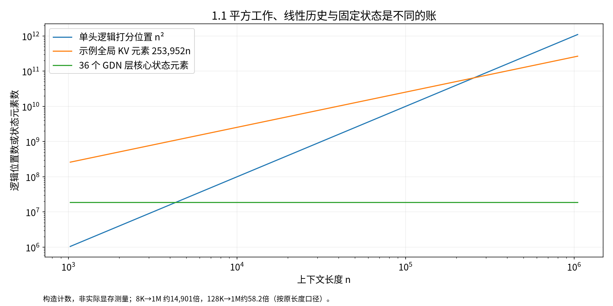
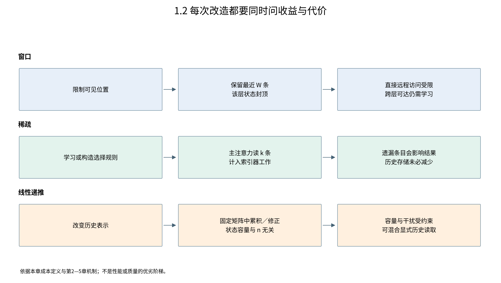

# 第 1 章 满注意力仍是唯一解吗——三笔旧账、三条路线与一本新账

## 1.0 开篇：从全书到这里

导览已经区分了两组实践：8层GDN/KDA玩具用于观察组件，三刀机则在Book4的409M底座上比较混合层型。本章先回答它们共同的动机：为什么继续改造注意力？前四册已改变头数、状态表示和部分可见域，不能说算子始终原封不动；但在保存完整历史的层中，查询仍要面对不断增加的候选位置。要选择下一步改哪里，必须先把这部分成本拆开。

本章先回看全注意力的配对计算、局部可见域和兼容性函数三个问题（1.1—1.2），再组织本册选取的三条路线（1.3—1.4），最后把它们写进按层计算的状态账（1.5—1.6）。路线图不是穷尽所有方法的分类，也不是改动越多越先进的排序；它帮助读者定位每种机制改变了哪个成本或信息条件。

读完后，你应能分别估算逻辑配对工作量与持久状态，解释何时可以把历史合并成固定大小的表示，并知道哪些运行开销仍未进入公式。下一章从接口变化较少的窗口开始，进一步检查其可见范围与任务限制。

> **最小背景栏**：本章默认你已读过 Book1注意力与收束章节（缩放点积、因果可见域和复杂度）；Book3 第 6 章（KV 账本与 GQA 记号：每 token 每层 KV 元素 $=2h_{kv}d_k$）、第 8 章（插槽组装学）、第 9 章（config 逆向五步法）；Book4 第 6/9 章（MLA 与两刀机）、第 10 章（gpt-oss 精拆与十机型 config 事实）。符号沿用：层数 $L$、上下文长度 $n$、查询头数 $h$、KV 头数 $h_{kv}$、头维 $d_k$、残差流宽 $d$；「层/头/token」三口径的账本单位是**元素个数**（不是字节；字节数再乘精度宽度，与 Book3/Book4 口径一致）。

## 1.1 三笔旧账：2017 年记下的、1M 时代到期的

原版Transformer留下了三个可以继续追问的问题。第一，全注意力让每个位置直接访问全部可见历史，代价是成对计算随长度二次增长。第二，原论文复杂度表已列出局部受限注意力：缩小邻域可以降低工作量，但会增加远处信息到达当前位置的路径长度。第三，点积只是兼容性函数的一种选择，改变打分形式可能带来不同的表示与计算性质。

这三个问题决定了本册的路线。我们先改变可见范围，再让可参与的历史由内容选择，最后改变历史的保存与更新方式。它们不是互斥分类，也不是后者必然淘汰前者：同一模型可以在不同层、甚至同一层内组合几种机制。以下用长上下文的账本说明为何值得这样改造；之后每章还要解释它改变了哪些信息路径。

原论文的局部注意力和兼容性函数讨论是历史线索，不是九年后所有变体的预言或唯一来源。前沿模型的1M、262K等窗口声明也不等于已经验证了所有长程任务。预算先算清，能力再检验。

## 1.2 两本随 $n$ 涨的账：打分矩阵与 KV 缓存

问题列清楚了，现在开始算账，先看打分账。满注意力每层每头要做全部 query 对全部 key 的打分：输入$Q,K\in\mathbb{R}^{B\times h\times n\times d_k}$，将K转置最后两维，一次矩阵乘 $(B,h,n,d_k)\cdot(B,h,d_k,n)\to(B,h,n,n)$——打分矩阵（score matrix）本身就是账：

$$
a_{\text{score}}(n) \;=\; n^2 \quad\text{（每层每头打分元素；因果情形有效格 } \tfrac{n(n+1)}{2}\text{）}
\tag{1.1}
$$

这张逻辑表有$n$行查询与$n$列候选位置，所以整表有$n^2$格；因果注意力只允许下三角含对角线的配对。若朴素实现物化整表，这也是需要保存的元素数；分块实现可以重排执行而不保存全部中间分数。Book1的小尺寸实验帮助看清物化情形，下面将同一个计数式用于更长的序列。

**例 1.1（构造例：$n$ 翻倍，表翻四倍）** 取可心算的小数字：输入 $n=4$ 个 token → 打分矩阵 $4\times4=$ **16 格**（因果下三角有效格 $4\times5/2=10$）；输入 $n=8$ → $8\times8=$ **64 格**（下三角36）。输出对比：长度只翻了一倍（$4\to 8$），表的格数翻了四倍（$16\to 64$）。这个例子直观地展示了平方律——**每加长一倍上下文，打分账就乘 4**；加长三个数量级，账乘六个数量级。

把四档真实长度代入式 (1.1)（code/ch01/context_account.py::score_matrix_account 复算，JSON 落 `log/book5-ch01/`）：$n=2{,}048$（用于比较的长度档；GPT-2原配置窗口是1024）→ 每层每头 $4.19\text{M}$ 格；$n=8{,}192$（Gemma 2 上下文）→ $67.1\text{M}$；$n=131{,}072$（Gemma 3 / gpt-oss 声明上下文）→ $17.2\text{G}$；$n=1{,}000{,}000$ → **$10^{12}=1\text{T}$ 格**【证据等级：本书公式复算；CPU仅执行整数计数】。

先区分两种“1M”：打分演示取$10^6$，表1.3中标为1M的配置档位取$2^{20}=1{,}048{,}576$。后者长度多4.8576%，线性KV载荷也多4.8576%，平方配对数则多约9.95%。引用同一个“1M”标签前，要先确定它代表哪个$n$。

式(1.1)按单样本、单层、单查询头计数；若所有层均为满注意力，总配对数还要乘$BLh$。例如62层、32个查询头对应每样本1,984张逻辑表。不过，Gemma3实际混合了窗口层与全局层，这个乘数只能用于假想的全满参照，不能直接当真机实际配对量。

以8192为基准，131072的整表配对数是256倍，$10^6$时约14,901倍。若把一张131072平方的分数表以FP32完整物化，需$17{,}179{,}869{,}184\times4=68{,}719{,}476{,}736$字节，即64GiB，约68.72GB；这个单头中间量已超过约54GB的27B模型BF16权重载荷。它说明朴素物化的问题，不说明每个精确注意力实现都必须分配这块内存。

> **实物1.1（算术输出）** 新入口`context_account.py::score_matrix_account`保留原计数，改用含义明确的因果有效位置字段：
> ```json
> {"n": 131072, "n2_elements_per_layer_head": 17179869184, "causal_valid_pairs": 8590000128, "ratio_vs_8192": 256.0}
> {"n": 1000000, "n2_elements_per_layer_head": 1000000000000, "causal_valid_pairs": 500000500000, "ratio_vs_8192": 14901.2}
> ```
> 两行最后的`ratio_vs_8192`都以8192为分母。若直接比较这两行，倍率约58.2；不能把14,901误读成从131072到1000000的倍率。这是CPU算术复算，不是硬件吞吐实验。

这里数的是数学上的打分位置，不是所有实现都要同时存放的显存张量。分块融合实现可以不物化整个n×n矩阵，仍计算同样的全注意力；因此“避免显式打分矩阵”不等于“改变二次成对运算”。下面分别讨论计算工作量与持久缓存，避免把两本账混成一个OOM结论。

第二本账是推理时跨步保留的KV。若每层用GQA、K/V同宽，每个词元新增$2h_{kv}d_k$元素；$L$层保留$n$个位置则为$2Lh_{kv}d_kn$。例如Gemma3-27B若假想62层全为全局层，每词元为253,952元素，$n=131072$时共33,285,996,544元素，按每元素2字节为66.57GB；取十进制$n=10^6$则为507.904GB。真机窗口层会减少这部分存量，不能把假想账当成实际占用。Gemma3报告也以长上下文KV增长作为引入局部层的动机【证据等级：Gemma3技术报告§1与本书配置复算】。

两本账记录的时间含义不同。KV是跨解码步保留的状态；配对数是完成指定前向所需的逻辑工作。在长度$n$的因果预填充中，有$n(n+1)/2$个可见配对；若已有长度$p$的前缀，再对$m$个新增位置依次执行前向，单头新增配对数为$mp+m(m+1)/2$。前者描述整段，后者描述追加生成，不能把一次解码步也写成$n^2$。配对数还不是FLOPs：打分需乘头维，值加权也要计算。

全前缀读取把两本账联系起来：为了让未来查询仍可访问任一历史位置，通常要保留相应状态；每个新查询再与候选历史配对。重算或转移存储可以改变显存需求，却不自动消除工作量。图1.1把平方配对数、线性增长的KV和固定矩阵状态并排，目的是比较增长形式，不是把单位不同的量直接相减。



图 1.1 比较增长阶数。蓝线是逐对位置数，另两线是指定配置的状态元素，不能直接相减作为显存节省量；实际缓存还需逐项乘数据类型字节数。

## 1.3 三条突围路线：可见范围、内容选择与状态更新

有了这两个坐标，再看三条路线。它们分别限制可见域、选择读取对象、改变历史表示，按本册的教学次序展开。这个次序没有给运行时间排座次；索引器、矩阵尺寸、融合实现和负载都可能改变实际成本。

**路线一，限制可见域。** 滑窗注意力令位置$t$只读取$[\max(0,t-W+1),t]$，这里$W$包含当前位置。每行有效配对至多W个，因此总量不超过$nW$；但只有执行时跳过窗外计算，才把逻辑稀疏转为算术节省。对这个局部层，窗外旧KV可以回收；同机全局层仍须按自己的语义保存历史。Gemma3与gpt-oss的交替层型在第2章具体计算。

**路线二，依据内容选择读取对象。** 窗口之外仍可能有任务所需信息，于是先用评分器查找候选，再对选中位置作注意力。NSA主要按块组织选择；DSA的主索引选择token，不能都叫块级top-k。索引可能覆盖整个前缀，而主注意力只读少量条目；学习评分并不使离散top-k自动可微，训练信号从哪里来要在第3章单独说明。索引自身的计算与状态也须另计。

**路线三，改变历史表示和更新。** 一个起点是把相似度写成有限维特征内积，再把历史的特征和值累积进固定形状的状态；1.4节将补出这一步结合律。GDN与KDA进一步加入遗忘和按写入误差更新，已不只是简单的特征外积相加。固定模型维度与精度时，矩阵状态不随词元数增大；代价是不能无条件保留任意长、任意可区分的历史。有限任务仍可能精确读取，能力边界将在第5章展开。Qwen3-Next与K3用线性层和全局层组合，K3还多一个末层MLA。



图 1.2 按改动位置比较三条路线。每行右端都是设计代价，不能只读中间的成本收益。

表 1.1 三条路线速览（机制一行 / 账本行为 / 代表机型 / 主场章）

| 路线 | 动什么 | 打分账 | KV/状态账 | 代表机型 | 章 |
|---|---|---|---|---|---|
| 一 改视野 | mask 几何（窗宽 $W$，静态） | $nW$ | 滑窗层有界 $\min(n,W)$，全局层仍无界 | Gemma3（5:1）、gpt-oss（1:1 窗 128） | ch2 |
| 二 改参与集合 | 内容评分后选择块或token | 选k块约$nkb$，选k词元约$nk$；索引另计 | 参与集合变小，KV仍可能逐token存 | NSA→DSA、GLM-5（78 层全 DSA） | ch3-4 |
| 三 状态更新 | 有限特征累计及后续delta/门控递推 | 固定状态维度和块长时对$n$线性 | **固定状态，与 $n$ 无关** | GDN（Qwen3-Next）、KDA（K3） | ch5 |

三条路线都在改变序列位置间的信息混合，但“全局、精确、逐对”不是所有注意力的必要定义。窗口仍可以精确计算所选位置的softmax，稀疏选择可以访问远处却漏掉关键条目，状态模型也可以在有限任务中精确读取。必须区分运算是否按公式精确执行，以及模型是否找回了任务需要的信息。

混合架构提供了把不同约束组合起来的办法：局部或递归层承担较便宜的处理，全局层保留跨位置读取路径。但“各自有局限”只构成尝试混合的动机，不能直接推出某个比例最佳；还需要模型和任务上的对照实验。Gemma3、Qwen3-Next与K3的层型排布是具体选择，第9章会逐项比较其证据。

因此，本章不是判定满注意力退出，而是把它放进可组合的设计空间；有些模型仍全部使用它，有些只在部分层保留。

## 1.4 从相似度函数到可累积的状态

前两条路线主要改变读取哪些位置，第三条路线还改变怎样表示和混合历史。为理解后者，先从最熟悉的归一化注意力出发，检查一个附加条件能带来什么：如果相似度可以写成固定维度的特征内积，能否先合并历史，再回答查询？

把注意力的输出改写成统计学里的非参数核平滑（kernel smoother，Nadaraya-Watson 估计）形式：

$$
\mathrm{Attn}(q_i) \;=\; \frac{\sum_{j\le i}\kappa(q_i,\,k_j)\,v_j}{\sum_{j\le i}\kappa(q_i,\,k_j)}
\tag{1.2}
$$

这里$\kappa(q_i,k_j)\ge0$，且分母必须非零；$q_i,k_j\in\mathbb{R}^{d_k}$，$v_j$与输出均为$d_v$维。分子是按相似度加权的内容，分母把权重和归一为1。缩放点积softmax对应$\kappa(q,k)=\exp(q^\top k/\sqrt{d_k})$。这个写法描述一类归一化混合，并不把所有带门控或delta更新的序列模块都定义成非负加权平均【证据等级：[Katharopoulos等，ICML2020](https://proceedings.mlr.press/v119/katharopoulos20a.html)，§3.1—3.3】。

关键不是只给相似度换个名字，而是要求它可分解为固定$r$维的$\kappa(q,k)=\varphi(q)^\top\varphi(k)$。取状态初值$S_0=0,z_0=0$，将式(1.2)中与当前查询无关的历史部分先合并：

$$
\begin{aligned}
S_i&=\sum_{j\le i}\varphi(k_j)v_j^\top
    =S_{i-1}+\varphi(k_i)v_i^\top,\\
z_i&=\sum_{j\le i}\varphi(k_j)=z_{i-1}+\varphi(k_i),\\
o_i^\top&=\frac{\varphi(q_i)^\top S_i}{\varphi(q_i)^\top z_i}.
\end{aligned}
$$

单头中$S_i\in\mathbb{R}^{r\times d_v}$、$z_i\in\mathbb{R}^{r}$；外积由$(r,1)(1,d_v)$写入$(r,d_v)$，读出由$(1,r)(r,d_v)$得到$(1,d_v)$，分母为标量。批量多头只需在这些张量前加$(B,h)$。每一步增加一份外积和一份特征向量，再从两个累计量读出；固定$r,d_v$时不必重新遍历全部旧key，因此序列长度方向的工作量线性增长，推理核心状态形状固定。

这个改写对所选可分解核成立，不会把任意softmax注意力无损变成有限维状态。论文的一个选择是$\varphi(x)=\mathrm{elu}(x)+1$，逐元素作用、特征维仍为$d_k$；在精确实数下它为正，保证非空前缀的归一化分母为正。ELU负区间仍有指数，但特征只需按位置计算，不再对每个query-key配对重新算指数核。第5章将完整讨论其递推、梯度和后续delta改造。

不同核也会改变输出。取一维$q=2$、$k_1=3,k_2=1$：指数核权重比为$e^6/e^2=e^4\approx54.6$，ELU+1核则为$(3\times4)/(3\times2)=2$。前者的归一权重约为$(0.982,0.018)$，后者为$(2/3,1/3)$。这组输入中，指数核更集中；但改成$q=0$，指数核会变为$(1/2,1/2)$，ELU核仍是$(2/3,1/3)$，所以它们没有对所有输入成立的“谁更锐”排序。

该例说明，降低计算成本可能同时改变信息混合方式，却不能单靠权重集中程度判断任务质量。实际训练中Q/K投影也会改变；第5章会把具体公式、表示限制和任务实验放在一起讨论。

原Transformer论文讨论过头维缩小时的质量变化，并提出更复杂兼容性函数可能有帮助。这为“怎样比较query与key”留下了研究问题，但并非线性注意力或所有后续方法的唯一理论来源。本节真正得到的结论来自结合律和有限特征条件：先明确能合并哪些历史量，才能解释固定状态为何可行。

## 1.5 层类型词表：三条路线已进入工程实践

公式说明可行的机制，接下来用实际库的字段定位实现。导览已摘出transformers 5.14.1的掩码分派表；本节再把它与模型和缓存代码联系起来。字段是入口，不能单凭名字推断复杂度。

> **实物1.2（当前安装版本的源码节选）** [context_account.py::vocab_excerpt](code/ch01/context_account.py)读取实际安装包并记录版本、文件路径和行号，不优先使用另一版本的源码仓：
> ```text
> LAYER_PATTERN_TO_MASK_FUNCTION_MAPPING = {
>     "full_attention": create_causal_mask,
>     "sliding_attention": create_sliding_window_causal_mask,
>     "chunked_attention": create_chunked_causal_mask,
>     "compressed_sparse_attention": create_sliding_window_causal_mask,
>     "heavily_compressed_attention": create_sliding_window_causal_mask,
>     "minimax_m3_sparse": create_causal_mask,
>     "deepseek_sparse_attention": create_causal_mask,
>     "linear_attention": create_recurrent_attention_mask,
>     "conv": create_recurrent_attention_mask,
>     "hybrid": {"full_attention": create_causal_mask, "linear_attention": create_recurrent_attention_mask},
>     "hybrid_sliding": {"sliding_attention": create_causal_mask, "linear_attention": create_recurrent_attention_mask},
> }
> ```
> 来源：transformers 5.14.1 masking_utils.py第1476—1489行。较早版本可能使用不同字段名，不能把旧行号直接套在当前安装包上。

这里映射的是**掩码构造函数**。例如压缩稀疏层仍可调用滑窗掩码函数，说明压缩与选择还发生在别处；相同函数名不代表相同算子。缓存又有独立的层类选择，模型前向决定传给缓存的具体张量。当前GLM-5的eager代码先展开K/V再缓存，并以选择结果构造掩码；这种参考路径仍可能计算完整矩阵。要兑现稀疏或潜状态的成本优势，还须有对应的执行组织，不能由layer_types直接得出速度或显存结果。

再看GLM-5。随书保存其官方小配置，以GlmMoeDsaConfig构造配置对象；这一步只展开元数据，不分配744B模型权重。实际模型的索引与注意力机制在第3—4章解释。

> **实物1.3（配置展开结果）** transformers 5.14.1按所核GLM-5配置生成：
> ```text
> num_hidden_layers = 78
> counts = {"deepseek_sparse_attention": 78}
> layer_types[:3] = ["deepseek_sparse_attention",
>                   "deepseek_sparse_attention",
>                   "deepseek_sparse_attention"]
> ```
> 所有层均声明为DSA层。对应前向中索引器选择至多2048个历史位置，短前缀按可用位置处理；主注意力读取范围与索引器搜索范围不同。配置中没有full_attention标签，不表示不保存完整历史，也不意味着任意后端都已实现稀疏加速【证据等级：[官方GLM-5配置](https://huggingface.co/zai-org/GLM-5/raw/main/config.json)与当前GlmMoeDsaConfig/modeling代码】。

## 1.6 分类型 KV/状态账本：本册的新账如何计算

现在可以把模型分成几类状态路径，而不是只数某个字段出现几次。Gemma3同时有窗口与全局KV，Qwen3-Next有全局KV与递归状态，GLM-5的主注意力虽然稀疏，历史表示仍随长度保存。先写一个简化账：batch为1，各全局/窗口层每位置的KV宽度相同，窗口最多保留W个可用位置，递归层仅计矩阵状态。

$$
\mathrm{Ledger}(n) \;=\; c_{kv}\Big(\underbrace{L_g\cdot n}_{\text{全局层：随 } n \text{ 线性，无界}} \;+\; \underbrace{L_s\cdot \min(n,\,W)}_{\text{滑窗层：过窗封顶，有界}}\Big) \;+\; \underbrace{L_l\cdot s_{\text{state}}}_{\text{线性层：固定，与 } n \text{ 无关}}
\tag{1.3}
$$

其中$c_{kv}$为每位置每层的KV元素数：K/V同宽的GQA是$2h_{kv}d_k$，潜状态MLA可按压缩内容与共享键分支分别计。所核K3、GLM-5配置为$512+64=576$；这是相应压缩布局的设计账，不是当前HF eager实际缓存的尺寸。NoPE表示不施加显式旋转，也不能仅凭这个名字删掉仍被实现保留的64维。式(1.3)的三栏分别描述随长度增长、被窗口约束和固定维度三种行为；“无界”意为公式中没有固定窗口封顶，不意味着模型支持无限长输入。

表 1.2 分类型 KV/状态账本公式表（式 (1.3) 的符号；单位=元素个数）

| 符号 | 含义 | 形状 / 口径 | 单位 |
|---|---|---|---|
| $L_g$ / $L_s$ / $L_l$ | 全局 / 滑窗 / 线性层数（$L_g+L_s+L_l=L$） | 标量；由 config `layer_types` 逐层数出 | 层 |
| $c_{kv}$ | 每 token 每层 KV 增量 | GQA/MQA：$2h_{kv}d_k$；MLA：压缩维+绳位（如 576） | 元素 |
| $n$ / $W$ | 上下文长度 / 窗宽 | 标量 | token |
| $\min(n,W)$ | 滑窗层缓存上限 | 标量；$n>W$ 后不再增长 | token |
| $s_{\text{state}}$ | 递归层核心矩阵状态 | $(h_v,d_k,d_v)$；本简式暂不含卷积/归一化等辅助状态 | 元素 |
| $\mathrm{Ledger}(n)$ | 全机缓存存量 | 标量（三栏之和） | 元素 |

实际模型应逐层列张量：$M(n)=\sum_{l\in G}c_ln+\sum_{l\in W}c_l\min(n,W_l)+\sum_{l\in R}s_l$。这里一般式的$s_l$应包括递归矩阵、短卷积历史，以及具体机制需要的其他累计量。稀疏索引键、压缩缓冲和分配对齐另列；batch增大通常再复制对应请求状态。转为字节时每类张量乘自己的dtype宽度，不能默认矩阵状态也使用BF16。

例如，两层全局各8元素/位置，一层窗口$W=3$且同宽，再加一层24元素固定状态。当$n=5$时，按上述布局总量为$2\times8\times5+8\times3+24=128$元素；到$n=6$只增加两层全局的16元素。若某后端在步间只保存$W-1$个旧位置，则窗口项会再少8个元素。当前HF动态窗口类采用这种约定，预填充临时返回的K/V还可能更长，因此载荷公式不是分配峰值公式。

矩阵形状由具体配置决定。Qwen3-Next每个GDN层有$32\times128\times128=524288$个核心元素，K3每个KDA层有$96\times128\times128=1572864$个。它们还使用短卷积。下表统一按每条卷积通道保留核长减1个历史值计算最小历史载荷；有的实现保留整个核长缓冲，实际应回到分配形状检查。所有数据由[context_account.py::MACHINES](code/ch01/context_account.py)读取随书小配置复算。

表1.3 五机型在所列长度下的主体状态账。GB列统一假设每元素2字节、十进制换算；不代表真实混合dtype占用。MLA按潜状态布局，窗口按最多W个位置估计；索引键另列，模型权重与前向临时量不在表内。

| 机型与长度 | 随n增长的KV主体 | 窗口KV | 固定矩阵及最小卷积历史 | 所列主体合计 | 读法 |
|---|---|---|---|---|---|
| Gemma3-27B @131K（10 全+52 滑，$W{=}1024$） | 5.37G 元素 | 218M（封顶） | — | 11.17 GB | 全满 66.57 GB，**省 83.2%** |
| gpt-oss-20b @131K（12 全+12 滑，$W{=}128$） | 1.61G | 1.57M（封顶） | — | 3.22 GB | 全满 6.44 GB，省 50% |
| GLM-5 @202,752（78层DSA） | 9.109G元素（latent 576/层/位置） | — | — | 18.22GB，索引key另计 | 每query选择至多2048项，不等于仅存2048项 |
| Qwen3-Next @262,144（12全局+36 GDN） | 3.221G元素 | — | 18.874M矩阵+0.885M卷积 | 6.48GB | 核心矩阵交叉点$n^*=1536$ |
| Kimi K3 @1,048,576（24 MLA+69 KDA） | 14.496G元素 | — | 108.528M矩阵+7.631M卷积 | 29.22GB | 仅核心矩阵与全局KV之比约0.75% |

【证据等级：随书所核config快照与本书整数复算。Gemma3字段沿用Book4已核镜像，gpt-oss使用官方配置，GLM-5/Qwen3-Next/K3使用所核官方快照；各路径和SHA由配套脚本与核验记录保存。】

第一，Gemma3的52个窗口层在该估计下封顶约436MB，占所列状态总量3.9%；对假想的62层全局参照少83.2%。长度继续增加时，绝对增量为$c_{kv}L_g$元素/位置，Gemma3为40960，gpt-oss-20b为12288。相对各自全局参照的渐近存储比才是$L_g/L$，分别约16.1%与50%；百分比不能当成绝对增长斜率。

第二，GLM-5的18.22GB只计潜状态KV主体。每层索引器另保留128维的索引key，78层、202752位置共2,024,275,968元素；若也按2字节示意，再加约4.05GB，共22.27GB。实际索引精度、scale与缓存布局可能不同。选择少量位置减少的是主注意力读取候选，不能据此删掉索引搜索和历史存储；CSA等压缩路线如何改变这一点，留到第4章。

第三，K3的69层核心矩阵共108,527,616元素，按2字节约217MB，相对24层MLA在$2^{20}$位置的28.991GB约为0.75%。此比值只比较矩阵主体与KV，不含7,630,848个最小卷积历史元素，也不保证实际二者用相同精度。加入这些卷积历史后，表中所列载荷为29.223GB；核心矩阵仍然不随序列长度增加。

五个案例都采用了不同于“所有层始终完整读取所有历史”的安排，但其中多数仍保留全局层。这个事实支持继续比较不同组合，不能改写成“五台机器没有任何一处满注意力”，更不能从缓存预算直接宣布某条路线质量更好。

三栏之间还有一个值得单独命名的量：**交叉点**（crossover point）$n^*$——同一台机器里，全局层无界增长的 KV 达到线性层固定状态总量时的 token 数：

$$
n^* \;=\; \frac{L_l\cdot s_{\text{state}}}{c_{kv}\cdot L_g}
\tag{1.4}
$$

$n^*$只表示同一模型的全局KV主体与递归矩阵总量相等，不是速度或质量门槛。它要求$L_g c_{kv}>0$；若没有全局增长项，就不存在这样的有限追平点。同精度且不计辅助状态时，Qwen3-Next为$36\times524288/(1024\times12)=1536$，K3为$69\times1572864/(576\times24)\approx7850.7$。

计入上述最小卷积历史，两者分别变为1608和8402.7。若矩阵与KV使用不同字节宽度，还要先乘各自精度再求相等点。它们相对本表最大长度较小，却未必小于任意日常请求长度；玩具配置也要用自己的状态形状计算。第6、8章将沿用同一方法，而不是把某个交叉点当成模型选型答案。

> **动手验证**：在工作区激活环境后运行`python from-models-to-vllm/book5-frontier-hybrid-architectures/code/ch01/context_account.py --out-name run1`。脚本离线读取随书配置，打印配对数、五机型载荷及当前安装包的字段结果；输出到`log/book5-ch01/`，重名拒绝覆盖。没有大型模型前向与训练，原记录和本次算术输出分别保存。

## 1.7 本章小结

本章从配对工作量与持久状态出发，解释了为什么值得继续改造注意力。窗口限制可见域，稀疏方法先选择读取对象，有限特征分解则允许把特定核的分子与分母累积成状态；GDN/KDA将在这个起点上加入不同更新规则。配置和源码帮助定位具体实现，分层账本把有效载荷按类型相加；它们都不能单独替代任务质量与运行时测量。

**带走的心智**：先问历史信息以什么形式留下，再问查询怎样读取它。逻辑配对数、持久状态元素与实际显存是三种量；字段名也不是复杂度证明。成本计算必须带上层数、长度、精度、辅助状态与执行方式，判断质量则要另看信息约束和任务证据。

回到全书，Book3的稠密骨架与Book4的两刀机提供改造起点；本册将检验哪些层适合局部、稀疏或递归处理。下一章从窗口开始：限制为最近128个位置究竟意味着什么，跨层路径和全局层能提供什么，又有哪些信息仍然可能到不了当前查询？这些问题需要机制与实验共同回答。