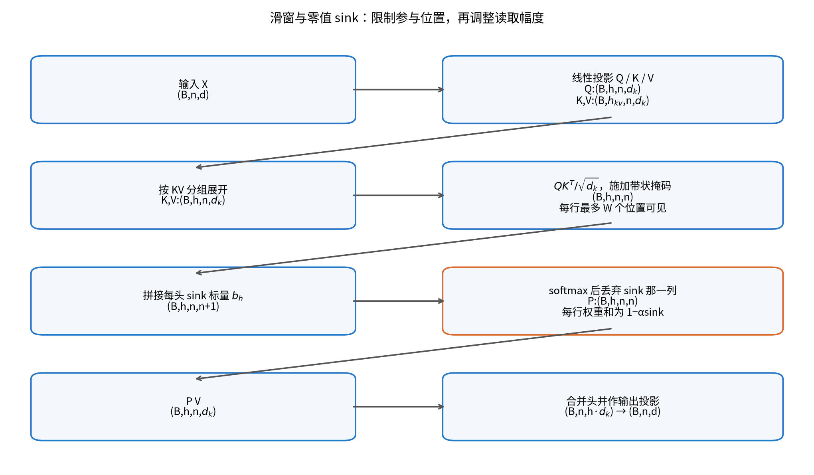
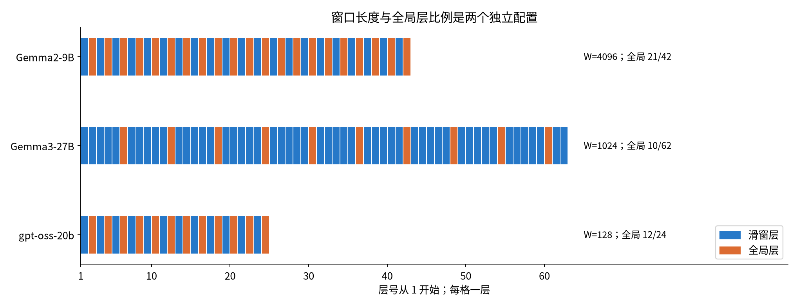
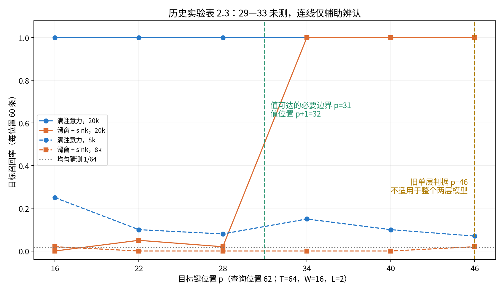

# 第 2 章 路线一：滑窗与汇聚——SWA 与 attention sink

## 2.1 为什么先限制可见范围

上一章区分了逐对注意力计算、逐条历史存储与固定状态。现在从最容易定位的一次改造开始：保持点积、缩放、softmax与值加权，只改变每个查询允许访问哪些历史位置。原来能看整个前缀，现在只允许最近的 $W$ 条。

这不是2026年才出现的问题。2017年Transformer论文的受限注意力方案已将计算量写为 $O(rnd)$，同时指出局部连接会增加远程信息经过的路径长度。后来的模型将这种取舍做成具体的层配置：例如gpt-oss的局部窗宽128，而声明上下文为131,072。128只是后者的约0.098%，但它并非让整台模型只看128个位置——全局层仍然保留。

MLA解决的是每条历史怎样表示，窗口解决的是保留和读取哪些位置。前者可以压窄每个KV条目，后者可以让局部层的条目数封顶。两种改造能够组合，也各有信息与实现代价。本章先把滑窗的掩码和层间传播讲清，再区分保留初始token的attention sink与可学习的零值sink，最后用缓存账和检索任务检查它们的作用。

> **最小背景栏**：读懂本章只需要三项已有知识——KV 账本与 GQA 记号（$2Lh_{kv}d_k\cdot n$，Book3 第 6 章）；MLA 的压缩思路（Book4 第 6 章，本章只作对照不展开）；gpt-oss 的 config 拆解（Book4 第 10 章，五步法与 layer_types 字段在那里首次介绍）。

本章要回答两个问题：**窗口凭什么敢开这么窄？sink 存的究竟是什么？**本章将给出四项结果：一个可对拍的滑窗+sink 组件（`swa_sink.py`）、本册新账本「分类型 KV 账本」的第一笔算例、一次研究位置与可达性的合成检索实验（也将如约呈现一个负结论）、以及理解窄窗模型的三项设计因素。章末我们会发现：窗口封顶了局部层的 KV，但全局层的缓存仍随上下文长度增长。这项局限，正是第三章让参与集合可学的起点。

## 2.2 滑窗机制：参与集合成了一条滑动邻域

现在把“看多远”写成明确的参与集合，先看机制。满注意力下，第 $t$ 个 query 对全部历史 key 计分；滑窗注意力（sliding-window attention, SWA）只改一件事——把参与集合从「全部历史」裁成「最近 $W$ 个」：

$$
M_{ij}=\mathbb{1}\big[\,j\le i\ \text{且}\ i-j<W\,\big]
\tag{2.1}
$$

| 符号 | 含义 | 形状/取值 |
|---|---|---|
| $M$ | 带状因果掩码（banded causal mask） | $(n,n)$，布尔 |
| $i,j$ | query 与 key 的位置下标 | $0\le i,j<n$ |
| $W$ | 窗宽：每 token 回看的 key 数 | 超参（4096/1024/128） |
| $n$ | 序列长 | — |

用人话说：$M$ 在因果下三角中再划出一条宽带——第 $i$ 行只在 $[\max(0,i-W+1),\,i]$ 放行，最多 $W$ 格，带外一律 $-\infty$。这是静态的几何限制：不依赖内容，也不依赖训练，写进 config 就固定了。

**例 2.1（构造例）** 取 $W=3$、$n=4$，手画这张掩码。输入：位置 0-3 共 4 个 token。逐行套用式 (2.1)：

| query | 放行的 key 集合 | 掩码行 |
|---|---|---|
| $q_0$ | $\{0\}$（左边不够 3 格） | `1 0 0 0` |
| $q_1$ | $\{0,1\}$ | `1 1 0 0` |
| $q_2$ | $\{0,1,2\}$ | `1 1 1 0` |
| $q_3$ | $\{1,2,3\}$（$0$ 已出窗） | `0 1 1 1` |

输出就是那 16 格的 0/1 阵——第 4 行告诉你：$q_3$ 看得见 $k_1,k_2,k_3$，唯独看不见 $k_0$。整个机制的直觉就在这里：**每层每个查询能直接访问的历史最多只有 $W$ 个位置**。（code/ch02/swa_sink.py::banded_causal_mask 的运行自检打印的正是这四行。）

再把它放回整层的数据流（图 2.1）：$x\ (B,n,d)$ 经 q/k/v 投影得 $(B,h,n,d_k)$ 与 $(B,h_{kv},n,d_k)$，GQA 展开后做点积 $(B,h,n,d_k)\cdot(B,h,d_k,n)\to(B,h,n,n)$，掩码在 softmax 之前以 $-\infty$ 遮掉带外格，之后一切照旧——$(B,h,n,n)\cdot(B,h,n,d_k)\to(B,h,n,d_k)$，再展平回 $(B,n,h\cdot d_k)$ 经输出投影。算子一个没换。



图 2.1 滑窗与标量 sink 的数据流（教学示意）：先按 GQA 投影及展开，再施加带状掩码，最后把每头标量作为额外 logit 加入归一化。这里取 $d_v=d_k$；零初始化是教学件的选择，不能据此推断官方训练的初始化。

这一刀减少的是有效参与位置。$n\ge W$ 时，前 $W$ 行依次放行 $1,\ldots,W$ 个位置，其余每行放行 $W$ 个，因此合计为 $W(W+1)/2+(n-W)W=nW-W(W-1)/2$，大 $n$ 时近似 $nW$。局部层也不必永久保存全部历史；按最多保留 $W$ 条 KV 的容量口径，需求封顶于 $\min(n,W)$。实际实现可能在处理完当前 token 后只留 $W-1$ 条旧记录，而 prefill 的临时张量又可能更大，不能把容量公式当成峰值显存。教学件为便于对拍，仍先算完整 $QK^\top$ 再加掩码，尚未实现滚动缓存，矩阵乘也仍是二次工作量；真正获得 $O(nW)$ 工作量需要窗口化或稀疏实现。静态掩码允许同层各位置并行计算；第五章的递归状态路线则需要进一步说明如何通过分块组织训练。

先核对这张掩码，再看模型配置。历史教学件曾在 transformers 5.18.0 上检查三组几何；本轮以实际安装的 5.14.1 重新调用通用滑窗掩码构造函数，覆盖上述三组及 $W=1$、$W\ge n$、例 2.1 等边界。比较的是每个位置是否可见，不把实现使用的有限极小数与数学记号 $-\infty$ 混为不同机制。后文给出复核入口。【证据等级：本书 CPU 局部验证；实现版本随运行结果记录】

表 2.1 三家 config 事实（窗口与交替比例；均为首层滑窗）

| 机型 | 交错比例（滑窗:全局） | 窗 $W$ | $W$/上下文 | 渐近存储比 $L_g/L$ | 证据等级 |
|---|---|---|---|---|---|
| Gemma2-9B（2024-06） | 1:1（42 层各半） | 4096 | 50% | 50.0% | 官方技术报告 2408.00118 §2+Table 1 |
| Gemma3-27B（2025-03） | 5:1（52+10） | 1024 | 0.78% | 16.1% | 官方技术报告 2503.19786 §2 + config |
| gpt-oss-20b（2025-08） | 1:1（24 层各半） | 128 | 0.098% | 50.0% | config + 官方论文 2508.10925 §2.2 |
| （对照，勿串）Llama 4 | 3:1，前三层RoPE+chunk、第四层NoPE+global | — | — | — | 承 Book4 ch10 考据框 |

按层型读取，Gemma2 与 gpt-oss 都是滑窗、全局交替的 1:1；Gemma3 则从局部层开始，每五个局部层接一个全局层，62 层中有 52 个局部层、10 个全局层。Llama 4 的 3:1 描述的是 RoPE 分块层与 NoPE 全局层的组合，不能直接当成同一种滑窗配置。比较这些模型，必须同时说明层的类型、排列与窗口定义，而不能只抄一个比例。【证据等级：Gemma2 报告 §2；Gemma3 报告 §2 与 config；gpt-oss 论文 §2.2】



图 2.2 三家窗口层排布（据表 2.1 绘制）：蓝格为滑窗层，橙格为全局层。三者的窗宽占声明上下文的比例依次减小，但全局层比例并不单调下降：Gemma3 为 $10/62$，gpt-oss 又保留一半。

这些配置同时在调两个旋钮：局部层一次看多远，以及隔多少层提供一次全局访问。Gemma2 的固定窗本来就能使局部缓存封顶；Gemma3 把窗口从 4096 缩到 1024，并降低全局层比例，进一步减小容量。gpt-oss 把窗口缩到 128，却仍保留一半全局层。三家都保留全局层，是这些具体设计的共同选择；它为何有用，2.4 节将从信息路径解释，不能反推任何其他结构都必须如此。

> **【考据框】滑窗的血统链。** gpt-oss 那句「Following GPT-3」不是客套：GPT-3 论文 §2.1 原句确为「we use alternating dense and locally banded sparse attention patterns in the layers of the transformer」，且句内自注 similar to the Sparse Transformer（arXiv:1904.10509）【官方论文 2005.14165 §2.1 直引】。于是交错窗的谱系是 Sparse Transformer(2019)→GPT-3(2020)→gpt-oss(2025)；Gemma2 报告则把滑窗直接引到 Longformer 一系（2020）——两条血统在 2024-2025 的旗舰上合流。这条演变路线在 2026 仍在延伸：DSV4 的滑窗层窗宽同样是 128【证据等级：config 逆向；DSV4 正菜在第 4 章】。

## 2.3 attention sink：多余概率质量的去处

先区分两种实验：从训练开始就使用局部注意力，与对一个按全注意力训练的模型在推理时强行删除旧缓存，改变的条件不同。StreamingLLM研究后者：直接滚动截断缓存可能破坏原模型已经形成的注意力模式，不能据此断言原生SWA模型都会崩溃。StreamingLLM 用实验量化了这种失败情形：在 PG19 首本书的约 65K token 上，Llama-2-13B 使用总容量 1024 的纯窗口（0+1024，开头一个不保）的困惑度高达 **5158.07**；保留最初 4 个 token（4+1020 配置）后回落到 **5.40**【证据等级：官方论文 2309.17453 v4 Table 1（本地 PDF 逐字复核）】。看到的 token 总数没有增加，只是把开头 4 个固定保存在 cache 里，困惑度就相差近一千倍。

被固定保留的那几个开头 token，就是 attention sink（注意力汇聚）。为什么偏偏是开头？因果掩码放行「所有历史」，初始 token 于是出现在之后**每一个**位置的 softmax 分母里——它是全序列中可见次数最多的 key，持续可见性为其成为汇聚位置提供结构条件，但不能只按出现次数断言梯度最大或证明唯一成因。

为何删除少数初始位置就会改变输出？先固定一行 logits 与 values 来看：删掉一个原本占有较大权重的 key，既去掉它的 value 贡献，也使其余权重重新归一化。若模型已经依赖这种分配，滚动删缓存便会改变其熟悉的读取方式。真实多层网络的后续表示还会随之变化，所以这是解释失稳的一条机制线索；表 1 的巨大困惑度差异是该模型、数据与缓存协议下的观察，并非仅靠分母公式就能算出的普遍结论。

Lost in the Middle观察的是相关信息位置与任务成绩的关系；StreamingLLM观察的是注意力权重集中与删缓存的影响。两者可能有关，但原实验没有证明U形曲线的首部优势完全由sink导致，不能把两个现象直接等同。StreamingLLM 的消融补了细节：Llama-2-7B 上保 0/1/2/4/8 个开头 token 的困惑度是 3359.95/11.88/10.51/**9.59**/9.54——1-2 个不够、4 个基本饱和【官方论文 Table 2：拼接 PG19 的 400K token；Llama-2 总缓存 4096，其他所列家族为 2048】。

但注意家族差异：Falcon-7B、MPT-7B、Pythia-12B 都是保留 1 个就达到平台，「4 个附近趋于饱和」是该组 Llama-2 实验的观察——论文自释为其 `<s>` 在分块前打头、第 0 位近乎随机 token（§3.1 末段）。还有一组置换实验：把保住的 4 个 token 换成 4 个换行符，困惑度 5.60，几乎没差——该替换实验说明这些初始位置的作用不依赖原来那几个词的具体含义；不代表所有层的sink value必为零或不含内容【官方论文 Table 1】。

保住初始 token 还不是 StreamingLLM 的全部流程。窗口滚动后，论文按缓存中的位置重新计算相对位置，而不沿用原长序列的时间戳。例如保留原位置 $[0,1,2,3,6,7,8]$，再处理位置 9 时，注意力使用的连续位置为 $[0,1,2,3,4,5,6,7]$。RoPE 实现需保存旋转前的 key，再按当前缓存位置旋转；ALiBi 也按连续缓存位置构造偏置。这样才把“初始部分始终可见、近期部分滚动更新”连成可执行的协议。它支持有限缓存持续处理输入，并不保留全部远古内容供精确检索。【官方论文 v4 §3.2】

接下来再问：这些初始位置究竟只接收多余权重，还是也参与信息处理？现有工作从不同侧面给出解释；两者不必互相排斥。

**从 value 的作用看，sink 可以参与信息处理。** Catch-Tag-Release 研究的机制是：sink 的 value 提供一个共享方向，注意它的 token 因而获得某种“标签”，后续层可利用带标签的表示进行聚合与检索。这里不能说序列开头的位置先收集了未来全文：在严格因果网络中，位置 $j$ 的表示只能依赖 $0$ 到 $j$。OutRo 则主动在早期层放松特定 sink 位置的因果掩码，并结合输出方向对齐，在七个视频问答基准上报告改进；这恰好改变了原有的信息路径，不能作为未改因果掩码的语言模型也能读取未来的证据。【官方论文 2502.00919 v2 §2—3；预印本 2603.14337 v1 §4—5】

**从归一化的约束看，sink 也可能承担分配多余权重的作用。** softmax 要求一行权重之和为 1；即便当前头不需要读取任何具体 token，也必须把权重分给某处。始终可见的初始位置容易成为这样的接收位置。StreamingLLM 的换行符替换说明，在该实验中，恢复性能不依赖原来那四个词的具体内容。Gu 等人的小规模训练比较进一步观察到：去掉归一化的 sigmoid 注意力显著减少了 sink，验证损失与 softmax 接近；Table 6 的对应损失为 3.70 与 3.73。它支持归一化与 sink 之间的联系，不能推广为所有规模、任务上换算子都无损。【官方论文 2309.17453 v4 §3.1；2410.10781 v2 §7.4】

归一化解释讨论权重为何集中，value 侧解释讨论集中之后能做什么：一个位置可以同时接收较多权重，并向其他位置提供有用的方向。不同论文的模型、任务及干预方式又不相同，不能把所有发现拼成单一的普遍机制。以下只采用公式可以明确表达的部分：真实初始 token 有自己的 key/value；零值 sink 则只改变归一化。K3 的 Attention Residuals 作用于残差流，是第 6 章的另一种结构。

由归一化约束可以构造一个更直接的改法：在分母增加常数 1，即 $\mathrm{SoftMax}_1(x)_i=e^{x_i}/(1+\sum_j e^{x_j})$，等价于加入一个 logit 为 0、value 为零的虚拟项。StreamingLLM 用从零训练的 160M 模型比较了它与可学习的初始占位 token。要读懂表格，必须同时看训练方案与推理时保留什么：Zero Sink 的纯窗口困惑度为 29214；Learnable Sink 若不保留初始 token，仍为 1235，保留一个后才为 18.01。这里的 Learnable Sink 是序列中的可学 token，并非 gpt-oss 的每头标量。附录 Table 10 中，训练两个 sink 却只保留一个时为 25.73；两个都保留后为 18.05。因此实验支持“该配置中保留一个训练好的 sink 已足够”，而非“两个 sink 本身一定更差”。【官方论文 2309.17453 v4 式 (2)、Table 3、Table 10】

这套流式方案把持久缓存限制在固定容量内。论文 Fig 10 报告的每 token 生成最高 22.2 倍加速，比较对象是需要重新计算窗口的基线；不能将它写成对任意满注意力实现的加速倍数，也不能把流式困惑度稳定理解为保留了窗口外全部内容。【官方论文 2309.17453 v4 Fig 10】

gpt-oss 采用另一种明确的参数化形式：每个注意力头学习一枚标量，作为额外 logit 参与 softmax，再丢弃这项的输出权重。于是该头可以减少分给真实 token 的总权重，而不用额外保存一个历史 key/value。【官方论文 2508.10925 §2.2】写成公式：

$$
\alpha_j=\frac{e^{s_j}}{e^{b_h}+\sum_{j'}e^{s_{j'}}},\qquad
\alpha_{\mathrm{sink}}=\frac{e^{b_h}}{e^{b_h}+\sum_{j'}e^{s_{j'}}}
\tag{2.2}
$$

| 符号 | 含义 | 形状 |
|---|---|---|
| $s_j$ | 一个头、一个 query 对第 $j$ 个 key 的缩放打分 | 标量；整批打分为 $(B,h,n,n)$ |
| $b_h$ | 第 $h$ 头的可学 sink 标量 | 标量，共 $h$ 枚 |
| $\alpha_j$ | 真实 token $j$ 分到的权重 | 标量；整批权重为 $(B,h,n,n)$ |
| $\alpha_{\mathrm{sink}}$ | 单头单查询分给 sink 的权重 | 标量；广播后为 $(B,h,n,1)$ |

用人话说：分母多了一项 $e^{b_h}$，真实 token 的权重整体乘上 $(1-\alpha_{\mathrm{sink}})$，窗内相对比例不变——注意力想「谁都不看」时，把概率质量分配给这枚标量对应的 sink，而不是分配给某个开头 token。$b_h\equiv 0$ 时它退化成 softmax₁；$b_h$ 可学时，它与保留真实初始token不同：这里的虚拟value为零，没有可被读取的历史内容。

这一差别可以从分子、分母分别看清。固定一个头的一次查询，设有 $m$ 个可见位置，$s\in\mathbb R^m$、$V\in\mathbb R^{m\times d_v}$，$Z=\sum_j e^{s_j}>0$。原输出 $o=\sum_j(e^{s_j}/Z)v_j\in\mathbb R^{d_v}$。加入零值 sink 后，分子仍为 $\sum_j e^{s_j}v_j=Zo$，分母变为 $Z+e^{b_h}$，所以

$$o_{\mathrm{sink}}=\frac{Z}{Z+e^{b_h}}\,o,
\qquad\frac{Z}{Z+e^{b_h}}=\sigma(\log Z-b_h).\tag{2.5}$$

因此它相当于对本头当前读取结果增加一个标量门，门值同时依赖query产生的logits与sink参数。固定 $s$ 和 $V$ 时，对 $b_h$ 的偏导为$-\alpha_{\mathrm{sink}}(1-\alpha_{\mathrm{sink}})o$；训练可据下游损失调节读取幅度，但这不是向过去写入一份新的记忆。若真实初始token的value非零，输出还含那份value的贡献，便不能再用这个纯缩放等式描述。

**例 2.2（构造例）** 3 个 key、单头单 query，打分 $s=[1,\,2,\,0.5]$，来看 sink 标量怎样重新分配权重。分三步计算：

1. 无 sink：$e^{s}=[2.72,\,7.39,\,1.65]$，分母 $=11.76$，权重 $=[0.23,\,0.63,\,0.14]$。
2. 加 $b=-2$（少吸档）：分母多 $e^{-2}=0.135$，变 $11.89$；权重 $=[0.229,\,0.621,\,0.139]$，三者同乘 $0.989$；$\alpha_{\mathrm{sink}}=0.011$。
3. 换 $b=+2$（多吸档）：分母多 $e^{2}=7.39$，变 $19.15$；权重 $=[0.142,\,0.386,\,0.086]$，同乘 $0.614$；$\alpha_{\mathrm{sink}}=0.386$。

输出读法：sink 以一枚标量进入分母，真实 token 的权重**整体缩小、相对比例保持不变**——$b$ 从 $-2$ 拧到 $+2$，sink 吸走的质量从 1% 涨到 39%。gpt-oss 真实参数的范围是什么？看下面的实物。

**实物 2.1**（gpt-oss 的 sink 参考对象：历史源码摘录与权重读数；看什么——「sink 从现象变成参数」体现在哪三个地方）

```text
# 历史摘录：transformers 5.18.0 modeling_gpt_oss.py；行号仅用于该版本
L293:  self.sinks = nn.Parameter(torch.empty(config.num_attention_heads))
L251:  sinks = module.sinks.reshape(1, -1, 1, 1).expand(…)
L252:  combined_logits = torch.cat([attn_weights, sinks], dim=-1)
L259:  scores = probs[..., :-1]  # we drop the sink here
```

```text
# 历史 gpt-oss-20b 权重读数；原记录路径 log/book5-ch02/sinks_dump.txt
L00 model.layers.0.self_attn.sinks shape=(64,) sinks[:8]=[+2.5156, +0.5586, ...] min=-2.4531 max=+4.0625 mean=+1.1161
L03 model.layers.3.self_attn.sinks shape=(64,) sinks[:8]=[+1.6016, +5.3750, ...] min=+1.5234 max=+7.4375 mean=+4.0908
# 24 层逐层 dump：mean全为正、多数落在+1.1～+4.1；实际吸走比例还取决于注意力logits
```

【证据等级：历史源码摘录与本书 2026-10 CPU 惰性读记录；本轮未重新读取完整模型权重】重点看两处：L293 那行——sink 是 `nn.Parameter`，每头一个标量、是**参数**不是 token；dump 的 mean——24 层的均值全部为正，多数在 +1 到 +4 之间，b的正负本身不能决定吸走比例：还要比较当前logZ；大量高分键可使正b的sink质量仍很小。

与 StreamingLLM 的 4-token 方案对照：标量 sink 是常驻模型参数，不随窗口淘汰，也不新增历史 KV 条目；代价是只有一维自由度——存不了内容，只能表示「多少注意力可以不分配给任何 token」。

教学件用同名参数与 HF 的 eager 注意力层对拍。本轮明确初始化随机参考层的 sink，并同时检查恒等旋转与非零角度的 RoPE；直接构造层时的未初始化参数不能作为可信对照。验证针对相同掩码、相同权重的一层输出，以及“拼接—归一化—丢弃”与式 (2.2)、(2.5) 的等价性，不涉及真实模型精度或速度。

> **【考据框】「sink+clamp」的精确口径（对 Book4 表 7.3 的表述精确化）。** 官方实现在**注意力通路上没有任何 logit 截断**——掩码全用 $-\infty$，唯一的 clamp 在 SwiGLU：gate 上限 7.0、linear 分支 $\pm 7.0$，论文脚注自认「Our SwiGLU implementation is unconventional, including clamping and a residual connection」【官方论文 2508.10925 §2.2 脚注 1 + 官方参考源码】。transformers 版 softmax 前减最大值是数值稳定技巧，注释自明「not in the original implementation」。因此 gpt-oss 的稳定化处方应写成「sink+SwiGLU 限幅」，社区「注意力分数 ±30 截断」一类说法，应以源码为依据反驳。

> **【考据框】sink 与 softcap 作用的位置不同。** Gemma2 的 soft-capping 用 $c\tanh(\mathrm{logits}/c)$ 限制 logits 的幅值；QK-Norm 调整点积之前的 query/key；sink 改变真实 token 获得的总权重；gpt-oss 的 SwiGLU 限幅则发生在前馈分支。它们可以影响数值范围或训练行为，但不能视为可互换的同一种处方。模型间同时改变了多项设计，更不能仅凭配置沿革判定哪一项带来了收益。

## 2.4 怎样理解窄窗模型：归一化、信息路径与局部性

回到开篇：窗宽 128 为什么能出现在长上下文模型里？需要分开看三件事：单头怎样分配读取权重，整机怎样传递远处信息，以及任务有多少依赖落在近处。这三项给出理解设计的线索；gpt-oss 未公开对应的逐项消融，不能将其拼成已经证明的性能归因。

**第一件，读取幅度可以调整。** 对已经形成 sink 模式的模型，删去初始位置可能改变输出；但原生滑窗训练与事后删缓存条件不同。保留初始token与增加零值分母项都可影响归一化，但两者不同，也不能保证所有模型在任意窗宽下稳定。StreamingLLM的5158→5.40支持其截断协议下保留初始token的效果，不是gpt-oss窗128与标量sink的消融。值得注意的是这个先验也用于路线二：NSA 的选择分支把「1 个初始块+2 个局部块」固定放进 top-k 选择，不允许训练将它们排除【官方论文 2502.11089 §4.1】——路线二的模型也沿用了路线一的经验。

**第二件，全局层提供跨窗路径。** 以 Gemma3 的层号从 1 开始计数，第 6、12、…、60 层是全局层，末尾 61、62 层仍为局部层。设当前处理位置 $i$，某条句首信息位于局部窗外：在全局层中，位置 $i$ 可以直接读取它，并把读取结果写入位置 $i$ 的残差表示。下一层仍在位置 $i$ 上计算，因此即使只访问附近位置，也能继续处理已经传来的信息。这里没有等待未来层再回头修改旧缓存；数据沿网络深度向前传递。全局访问提供了路径，却不保证模型一定选择、准确编码并一直保留那条远处信息。

Gemma3 的官方消融给了定量支持：1:1、5:1、7:1 三种比例对验证集困惑度影响极小（"The impact is minimal, even with 7-to-1"）【官方技术报告 2503.19786 §5.2 Fig 3，2B text-only 模型】。BigBird 的理论是更早的锚：常数个全局 token 就能保住 universal approximator 与图灵完备——该理论针对特定稀疏图与计算假设提供充分性结论，不能反推所有没有全局token或全局层的模型都不够用。

位置编码是否分工，要继续看具体模型。Gemma3 的全局层采用 $10^6$ 的 RoPE base，并使用八倍缩放，局部层保持 $10^4$；它把长距离相位调整集中在全局访问上。gpt-oss 的官方参考实现则在各注意力层使用同一套 YaRN 参数，不能写成只有全局层做 YaRN。固定窗口确实限制了局部层直接比较的相对距离，但这只解释一种设计动机，不能代替源码事实。【Gemma3 报告 §2；gpt-oss 官方参考实现 AttentionBlock】第 8 章再把位置编码与历史保留方式分开讨论。

**第三件，语言本身的局部性。** 语言有局部依赖，这是窗口先验的动机之一；Lost in the Middle的U形不能证明模型只利用开头和局部；NSA 从训练侧补了佐证："local patterns typically adapt faster and can dominate the learning process"【官方论文 2502.11089 §3.3.3】。窗口先验与语言的统计性质相符。

判断效果时还需区分指标。Gemma3 的 Fig 3、4 分别比较层比例与窗宽对验证困惑度的影响，Fig 5、6 比较内存；不能把内存图也当成精度证据。Fig 4 图例和图注的比例写法有差异，不据此认定唯一方向。Gemma2 的 Table 10 只改变推理窗宽，4096、2048、1024 对应困惑度 1.63、1.63、1.64；这不是重新训练三种窗口的比较。gpt-oss 未提供窗宽与 sink 的独立消融，最优窗口为何选 128 仍未披露。长程任务又是另一维度：Gemma3 的预训练 27B 模型在 RULER 上从 32K 的 85.9 降到 128K 的 72.9，这是声明长度以内的跨长度变化；报告 §5.3 另谈 128K 之外的困惑度快速退化，二者不能混成一项实验。上述变化都不能单独归因于窗口，位置编码与训练分布也会影响结果。

本书的历史短训也只能作有限对照：sp-8k 语料、$T=512$、窗宽 128 的四层小模型训练 200 步，满注意力与滑窗加 sink 的验证交叉熵为 6.608、6.525 nat/token。代码返回的是交叉熵，困惑度应再取指数；这两个数不能直接叫困惑度。两臂结果接近，但一次短训不足以证明质量等价，且掩码和 sink 同时变化，无法拆开两者的作用。【本书 2026-10 Mac/MPS 历史实验】下面换用位置可控的检索任务，检查更具体的信息路径。

## 2.5 分类型账本第一算：局部层封顶之后

机制与证据都齐了，现在把 2.2 节那笔「$\min(n,W)$ 封顶」写成账本。本册给全书立一本新账——**分类型 KV 账本**（按层类型分开记，单位=元素数，沿用 Book3/Book4 口径）：

$$
\mathrm{KV}(n)=\underbrace{2\,d_k\,h_{kv}}_{\text{每层每 token}}\Big(L_g\cdot n+\sum_{\text{滑窗层}}\min(n,W)\Big)
\tag{2.3}
$$

| 符号 | 含义 | 取值例 |
|---|---|---|
| $L_g$ | 全局层数 | Gemma3-27B：10 |
| $L_s$ | 滑窗层数（$=L-L_g$） | Gemma3-27B：52 |
| $2d_kh_{kv}$ | 每层每 token 的 KV 元素 | gpt-oss：$2\times64\times8=1024$ |

用人话说：全局层那部分随 $n$ 线性增长，没有上限；滑窗层那部分涨到 $W$ 就停。于是 $n\to\infty$ 时整本账相对于同几何、全部使用全局层的模型的渐近存储比为$L_g/L$；绝对增长斜率为$2d_kh_{kv}L_g$——这是式 (2.3) 最重要的读法。

表 2.2 五个机型与一行假想外推算例（`swa_sink.py`::kv_account 整数精确复算，与调研底单逐位互证断言通过；bf16 字节=元素×2）

| 机型@上下文 | 每层每 token | 全局层（无界） | 滑窗层（封顶） | 混合合计 | vs 全满 | 渐近存储比 |
|---|---|---|---|---|---|---|
| Gemma2-9B@8192 | 4096 | 21 层×8192＝704.6M（1.41 GB） | 21×4096＝352.3M（705 MB） | 1.06G 元素 | 省 25.0% | 50.0% |
| Gemma3-27B@131072 | 4096 | 10 层＝5.37G（10.74 GB） | 52×1024＝218.1M（436 MB） | 5.59G（11.17 GB） | **省 83.2%** | **16.1%** |
| Gemma3-27B@1M（假想外推） | 4096 | 41.0G（81.92 GB） | 436 MB（纹丝不动） | 41.2G | 省 83.8% | 16.1% |
| gpt-oss-20b@131072 | 1024 | 12 层＝1.61G（3.22 GB） | 12×128＝1.57M（3.1 MB） | 1.61G | 省 50.0% | 50.0% |
| gpt-oss-120b@131072 | 1024 | 18 层＝2.42G（4.83 GB） | 18×128＝2.36M（4.7 MB） | 2.42G | 省 50.0% | 50.0% |
| Gemma3-1B@32768 | 512（MQA） | 4 层＝67.1M（134 MB） | 22×512＝5.77M（11.5 MB） | 72.9M | 省 83.3% | 15.4% |

【证据等级：config 与整数公式复算；统一按每元素两字节换算十进制 GB/MB，非显存实测】此处 Gemma3 假想行取 $n=10^6$，不表示该模型支持此长度；表内真实 Gemma3-27B 声明长度为 131072。第 1 章 K3 的 config 长度 1048576 则为 $2^{20}$，不能把所有写作“1M”的长度混成同一个整数。式 (2.3) 还假设批量为 1、各层使用表中同一种 KV 几何；不同层的头数或头维若不同，应逐层求和。

两句话读表 2.2。正向读：**局部层的缓存占比可以很小**——Gemma3-27B 在 128K 上下文时，52 个滑窗层合计只占全机 KV 的 3.9%；gpt-oss-120b 的 18 个滑窗层只占 0.10%。上下文再增长十倍，这两项的大小仍然不变。反向读：全局层的存储没有减少——Gemma3-27B 的全局层占全机 KV 的 96.1%，gpt-oss 更是整整一半层无界。**滑窗只封顶了局部层，缓解长上下文的整体 KV 压力，仍要靠全局层占比 $L_g/L$ 与 GQA/MLA 压缩**——这正是表 2.1 把「渐近存储比」单列一栏的原因，也是第 9 章混合配方谱系要正面算的总账。

口径再对一次账：Book4 ch10 给 gpt-oss 记过一笔 $2Lh_{kv}d_k$（20b 为 24,576 元素/token）的主账——那是假设各层都保留完整前缀的每token容量系数；式 (2.3) 是**上下文末端的存量**口径，窗口饱和后实际增量只来自全局层，不能把全层系数一直当作每步新增。

这本新账还提出了一个需求：滑窗层在推理期要求缓存「滚动淘汰」——只保窗内 KV、逐 token 驱逐窗外条目，而全局层全保。同一个缓存池里两类层两种生命周期，逐块记账与淘汰给 prefill/decode 带来的不对称，是推理系统部分要讨论的问题（章末欠账框）。

## 2.6 合成实验：needle 位置扫描，以及可达性与可学习性的区别

最后用一个位置可控的玩具任务检查可达性，而不把它当成自然语言 Lost in the Middle 的完整复现。任务借用多查询关联检索（multi-query associative recall，MQAR）的布局：长度 $T=64$，8 个干扰键值对占 $[0,16)$；目标键固定为同一个专用 token，放在位置 $p$，其随机值放在 $p+1$，值有 64 种；$[48,64)$ 是查询区，前七个查询要求找干扰值，目标查询位于 62，答案位于 63。每个查询的紧邻答案在其未来、被因果掩码遮住，但答案在前面的键值区已经出现。损失只监督八个查询位置，目标召回率则只统计最后一个查询，两个指标不能混读。

模型为两层、$d=256$、$h=8$、$h_{kv}=4$、$d_k=64$，窗宽 $w=16$；关闭 RoPE，便于分析掩码路径。满注意力与滑窗加 sink 两臂共享公共参数的初始权重，后者另将 sink 初始化为零。训练目标位置一半取自 $[16,42)$，另一半固定为 46；评估取 16、22、28、34、40、46 六个位置。原判据 A 要求满臂各位置召回不低于 0.8；B 区分滑窗臂可达位置学成或未学成的结果。原判据 C 还试图判断“sink 不救远端、不伤近端”，但两臂同时改变了掩码与 sink，缺少无 sink 的滑窗臂，无法独立识别 sink 的作用。以下保留实测结果，同时修正这个设计限制。

试点记录了五项设计教训：单个目标的稀疏监督在 200 步内未学会；若监督错放到已经看见答案的位置，会出现自拷贝捷径；这个小模型需要更长训练才表现出检索能力；目标对撞进查询区会引入位置混淆；比较两臂应对齐公共权重。零初始化 sink 是本实验的可控选择，并非 gpt-oss 的必要训练条件，而且即使 $b_h=0$，分母也已多出 1，两臂初始函数并不相同。

生成器还有两个边界：干扰键有放回抽样，可能出现同键异值；目标键固定且其值来自专门的词表区间。因而八查询平均损失可能受干扰键歧义影响，目标召回也不等于一般随机键的关联检索能力。保留这些条件，才能知道下面的结果究竟证明了什么。

表 2.3 needle 位置扫描（20k 步正档 + 8k 参照档；acc=argmax 命中率，60 序列；随机基线 1/64≈0.016）

| 臂/档 | p=16 | 22 | 28 | 34 | 40 | 46 | 训练 loss |
|---|---|---|---|---|---|---|---|
| full @8k | 0.25 | 0.10 | 0.08 | 0.15 | 0.10 | 0.07 | 9.03→2.16 |
| **full @20k** | **1.00** | **1.00** | **1.00** | **1.00** | **1.00** | **1.00** | 9.03→0.34 |
| swa_sink @8k | 0.02 | 0.00 | 0.00 | 0.00 | 0.00 | 0.02 | 9.05→4.15 |
| **swa_sink @20k** | **0.00** | **0.05** | **0.02** | **1.00** | **1.00** | **1.00** | 9.05→3.80 |

【证据等级：本书实验（CPU/MPS，2026-10）】（MPS 23.7/24.5 ms/步；20k 档两臂 10.6/8.4 分钟）

先看训练预算：8k 档满臂在六个位置仅有 0.07—0.25 的召回，未达到判据 A；20k 档在每个位置抽测的 60 条序列全部命中，达到了该次评估的标准。两档采用不同总步数的余弦学习率日程，20k 是另一档训练，并非沿着 8k 完全相同的轨迹再多走 12k 步。因此可以说较长预算的该次运行学会了此任务，不能把差异精确归因于增加 token 数这一项。

再看位置：20k 档滑窗加 sink 在 $p\ge34$ 的三个采样位置全部命中，在 $p\le28$ 时为 0、0.05、约 0.02。每个位置仅评估 60 条，0.05 只对应 3 次命中；低准确率与随机猜测相容，不能当成精确等于 $1/64$ 的证明。近处学成、远处未学成是观察；标量 sink 无法额外打开一条历史输入路径，则要由下面的计算图分析来说明。

原预注册把单层可见值的边界 $p=46$ 当成了整个两层模型的边界。单层中，查询 62 只看 47—62，确实要 $p+1\ge47$；但第 2 层读取的是第 1 层的输出，而非原始 token。将这一步补上，才能得到整机的可达范围：

$$
L\text{ 层滑窗的最大可达长度}=L\,(w-1)+1,\qquad \text{最早可触达位置}=62-2\times 15=32
\tag{2.4}
$$

层会复合：query 62 的第二层看 47-62，这 16 个位置的**第一层输出**各自又看过 $[j-15,j]$——并起来最早触到位置 32。

一般地，设第 $\ell$ 层位置 $i$ 的依赖集合为 $R_\ell(i)$，则 $R_0(i)=\{i\}$，$R_\ell(i)=\bigcup_{j=\max(0,i-w+1)}^i R_{\ell-1}(j)$。归纳可得其左端点为 $\max(0,i-\ell(w-1))$。逐 token 的归一化、前馈网络与残差连接不增加跨位置边，因此本实验适用这个推导；若再加卷积、全局层或真实初始 token，必须重新计算路径。目标值位于 $p+1$，故值可达至少要求 $p\ge31$；一般键值关联还可能要求键 $p$ 也可达。此任务目标键固定，不能只凭召回曲线断定它学到了哪种键匹配电路。

用人话说式 (2.4)：窗宽 $w$ 的滑窗叠 $L$ 层，最远能回头 $L(w-1)+1$ 个位置——每层接力往外传 $w-1$ 步。实测边界恰好落在 28（随机）与 34（满分）之间（图 2.3 用连线标出相邻采样点的差异），与式 (2.4) 吻合（评估网格未覆盖 29-33，边界未逐点明确，如实）。

例如 $p=34$ 的值位于 35，第 1 层位置 47 可以看 32—47，含该值；第 2 层位置 62 又能读到位置 47，于是存在一条两跳路径。路径存在只给出可能性，不保证训练一定利用它；准确率也不足以确认具体通过了哪些中间位置。反过来，若值是独立均匀随机量且在整个依赖集合之外，模型输入中就没有预测它的线索，最优猜测命中率才是 $1/64$。这把“是否可达”与“是否学会”分开，也呼应了全局层提供跨窗路径但不保证读取成功的讨论。



图 2.3 历史位置扫描，数据按表 2.3 重绘。圆点、方点表示实际评估位置，连线仅便于辨认。绿色线位于 $p=31$，对应值位置 $p+1=32$ 的理论可达起点；黄色线 $p=46$ 是原单层判据。29—33 未评估，不能把连线插值当作实测的精确跳变位置。

**实物 2.2**（探针设计记录读数；看什么——正档之前的两次「差点」：试点几何的 0.83 与 T=96 版的随机水平）

```text
# ① 试点直引（T=64 几何定档依据；00-feasibility/02_probe_swa_sink.py 脚本头试点记录④）
④两化简定版：L=2（归纳头最小电路，24ms/step）+ 无 rope（隔离 mask 变量）+ 8000 步
   试点 full 臂 acc 0.83（远端均匀）
# ② T=96 负结论（正式件前一代设计：原运行完整配置待核；probe02_swa_sink_run5-full.json 读数整理，数值保留 3 位）
"swa_sink": {"loss_last_20_mean": 4.157, "recall_acc_by_pos":
             {"18": 0.017, "42": 0.0, "58": 0.017, "62": 0.05, "74": 0.033}}
```

【证据等级：本书实验（CPU/MPS，2026-10；①为设计记录直引、②为 10k 步探针 JSON 读数）】分别来看这两处记录。①试点 8k 步就到 0.83，但正式件把判据与位置协议明确后，同一 8k 档只到 0.07-0.25（表 2.3）——试点协议更宽松，两个数都予以保留，**档位以正式预注册为准**；试点还显示位置 46 刚出训练分布时只到 0.67（边界效应先记一笔）。

②T=96 版的记录显示滑窗臂未学成，损失 4.157 接近 $\ln64\approx4.16$，满臂同档也只有 0.08—0.18。原文把它解释为“全部查询都在可达范围外”，但现存随书探针使用两层、窗宽 32，查询位于 94，复合视野最早到 32；42、58、62、74 等目标位置并非结构上不可达，而且训练生成器包含远近混合位置。原运行完整 JSON 当前不可得，不能用现在的源码断言当时参数，也不能给低分补上无证据的几何归因。这里保留负结果，只撤去过强解释：损失接近随机基线可能来自不可达、尚未学会或任务歧义，必须结合完整协议判断。

满注意力的 20k 位置曲线在本次六个采样点上是平的：这个构造任务没有出现自然语言测试中的 U 形，说明 U 形并非满注意力算子必然产生的曲线形状，但不能据此确定其现实成因。滑窗臂的结果则与复合视野的几何限制相容。比较二者时，应分别问“路径是否存在”与“模型是否有效利用路径”，再用任务实验回答后一个问题。

## 2.7 本章小结

本章从两个问题出发：窄窗如何参与长上下文模型，sink 究竟保留什么。带状掩码限制每层直接访问的范围；层间传递与全局层使整机视野可能超出单层窗口；真实初始 token 可以提供 value，而零值标量 sink 只调节读取幅度。配置、公式与合成实验分别回答了不同层面的问题：既看到了局部缓存的封顶，也看到两层路径怎样改变检索边界，不能把单层不可见直接写成整机不可达。

**带走的心智**：先画信息能经过的路径，再算需要保存的历史。滑窗层最多保留固定长度的 KV，但全局层仍随上下文增长；同几何下的渐近存储比是 $L_g/L$，绝对增量还要乘每层每 token 的 KV 元素数。再区分“内容”和“读取幅度”：初始 token 有自己的 value，标量 sink 没有历史内容，它只是把真实 token 的总权重乘以一个门。这个门由 $b_h$ 与当前 logits 共同决定，正的 $b_h$ 并不自动代表吸走很多权重。

回到全书的路线，我们已经完成了第一项改造，但仍有两个明显的局限——「看多远」是手工超参（gpt-oss 为什么是 128？论文零解释，本章分析表明，纯局部模型的复合视野之外没有读取独立输入的路径），而全局层还在付无界的账。下一章动第二刀：让「参与哪些 token」本身变成可学的——选择机制从 config 中的常数变成参数。


## 2.8 动手验证

```bash
cd 工作区根目录 && source env.sh

# ① 教学件三重对拍+分类型账本（CPU fp32 秒级；2.2/2.3/2.5 节全部自测数字的来源）
python "code/ch02/swa_sink.py" --out-name run1
#   验收行：[① mask 对拍] 六组几何 elementwise_equal=True
#           [③ 整层对拍] strict_load=ok, max_abs_diff=0.0
#           [④ 分类型账本] 六行算例断言全过（省 83.2%/3.9%/0.10% 等）

# ② needle 位置扫描（两臂；MPS；表 2.3 与图 2.3 数据源；判据预注册见脚本头）
python "code/ch02/needle_probe.py" --arm full    --steps 20000 --out-name full20k
python "code/ch02/needle_probe.py" --arm swa_sink --steps 20000 --out-name full20k
#   （冒烟 300≈10 s/臂；fast 8k≈3.3 min/臂；正档 20k≈8-11 min/臂）
#   上述数值为历史结果，非新运行的逐位保证；冒烟和截断档不作完整预算验收。
#   同一总步数与参数续跑加 --resume；checkpoint 保存模型、优化器及随机状态。

# ③ gpt-oss 真权重 sinks dump（实物 2.1 素材；存量缓存零下载，条件性：失败降级源码行）
python "code/ch02/gptoss_sinks_dump.py" --out-name reread

# ④ 本章三图由 code/ch02/make_figures.py 生成；图 2.3 为历史表 2.3 重绘

# ⑤ 旧设计探针（可另行运行；当前脚本不保证重建实物 2.2 当时的全部条件）
python "code/00-feasibility/02_probe_swa_sink.py" --out-name reread
```

参考资料：[StreamingLLM v4](https://arxiv.org/abs/2309.17453v4)、[Lost in the Middle](https://arxiv.org/abs/2307.03172)、[Gemma3报告](https://arxiv.org/abs/2503.19786)。
