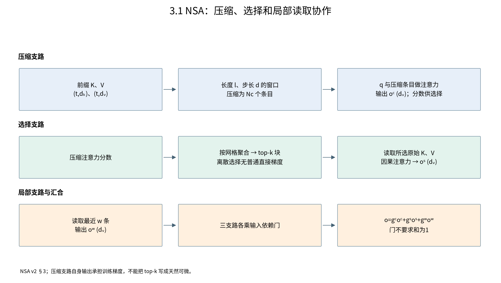
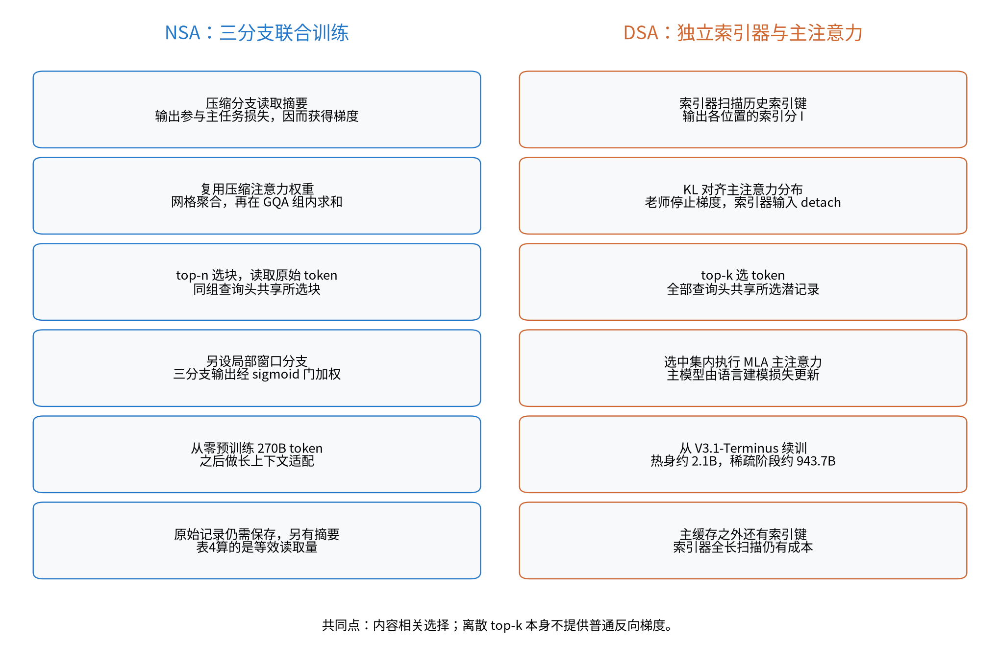
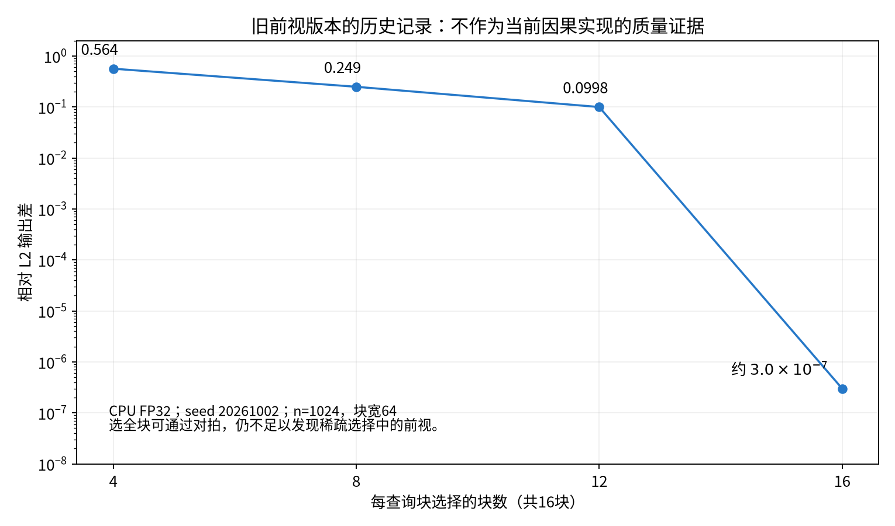

# 第 3 章 路线二：可学习稀疏——NSA 到 DSA

## 3.0 开篇：从全书到这里

上一章限制了每层直接访问的范围。滑窗层只需保留有界的局部 KV，全局层则提供跨窗路径、继续保存完整前缀。gpt-oss 的窗宽为 128，但不能用 StreamingLLM 的删缓存实验代替它的窗宽消融。沿这条路线继续看，有两个限制：全局层仍承担随序列平方增长的注意力工作量；局部层的窗口由设计者预先给定，不能根据当前问题去读取某个远处位置。于是我们需要让查询决定“具体读谁”，而不只是固定“最多回看多远”。

本章动第二刀：改参与集合——让「参与哪些 token」本身变成可学的。这条路线的名字叫可学习稀疏（learnable sparsity）：打分、选择、只对选中的部分做精确注意力。其中有代表性的研究方案是 NSA（Native Sparse Attention，原生稀疏注意力，arXiv:2502.11089v2），以及另一种面向生产的方案 DSA（DeepSeek Sparse Attention，arXiv:2512.02556v1）——后者已经被装进 DeepSeek-V3.2 与 GLM-5 两台旗舰。本章要回答三个问题：选择这种离散操作怎样纳入梯度训练？省下的账到底记在哪一本上？以及不同底座怎样安排选择粒度与训练路径？到章末账本会给出这把刀的边界：主注意力少读取一些历史条目，并不意味着那些未选中的条目可以永久删除；摘要或索引还可能带来额外缓存——这个「没省到」，正是第 4 章把可学习稀疏推上 1M 真机的起点。

先回顾第 1 章提到的一句话：2017 年原典 §6.2 (B) 行写过 *"a more sophisticated compatibility function than dot product may be beneficial"*（比点积更精巧的兼容性函数可能有益）。本章仍然保留点积——主注意力仍对选中项做缩放点积、softmax 与值加权——但它多了一项用途：兼容性函数（相似度打分）还用于选择「参与集合」。完整地替换算子，要等到第 5 章。

> **最小背景栏**（只补本章所需，已学指回）：KV 账本与 GQA 分组共享——Book3 第 6 章；打分矩阵随 $n$ 平方增长的账——本书第 1 章 1.2 节；满注意力公式与 softmax 注意力——Book1 第 2 章；MoE 的 top-k 路由（「选一部分、其余不动」的第一次见面）——Book4 第 2 章；滑窗机制与 sink——本书第 2 章。本章按 NSA 的分支记号组织，并明确本书的形状与索引约定，见 3.1 节符号表。

## 3.1 NSA 三分支：让「参与哪些 token」变成可学的

窗口把参与集合固定为近邻，可学习稀疏想根据内容选择，但首先遇到梯度问题。top-k 返回的是整数索引：只要分数排序不变，稍微调整某个分数就不会改变集合；排序交换时，集合又发生跳变。因此不能像训练普通线性层那样直接穿过索引求导。NSA 的作者曾比较独立预测器加辅助损失，以及免参数的启发式打分，两种具体实现的 3B 训练损失均逊于 NSA 与满注意力。这是该组方案的实验结果，并不证明所有独立索引器都无效；后面的 DSA 恰好采用了另一套独立索引器训练方法。【官方论文 2502.11089v2 §6.1 Figure 7】

NSA 的办法同时处理了这两个问题：**不另立预测器，让选择打分复用压缩分支的注意力分数**——分数本来就要算，梯度经 softmax 自然回传。这是全章最重要的机制。先让压缩分支实际完成读取，再说明它怎样顺便提供选择依据。

论文把三个分支记为集合 $\mathcal{C}=\{\mathrm{cmp},\mathrm{slc},\mathrm{win}\}$——压缩（compress）、选择（select）、滑窗（window），总输出是三分支注意力的门控加权和（论文 Eq. 5）：

$$o_t=\sum_{c\in\mathcal{C}} g_t^c\cdot \mathrm{Attn}\big(q_t,\ \tilde K_t^c,\ \tilde V_t^c\big) \tag{3.1}$$

用人话说：每个分支各自构造一份紧凑的键值表示 $\tilde K_t^c/\tilde V_t^c$、各自做一次标准注意力，最后由三个可学标量门 $g_t^c\in[0,1]$（输入特征过 MLP 加 sigmoid）加权合成输出。符号表如下（形状列为单 token 查询视角，批量口径在各量前加 $(B,h)$）：

| 符号 | 含义 | 形状/取值 | 注 |
|---|---|---|---|
| $t$ | 当前查询位置，也是含当前项的前缀长度 | 标量 | 本节位置从 1 开始；代码从 0 开始，序列长记 $n$ |
| $q_t$ | 当前查询向量 | $(d_k,)$ | 每 token 每头一支 |
| $k_{:t},v_{:t}$ | 前文键/值 | $(t,d_k)/(t,d_v)$ | 全量在场（见 3.2 节账本） |
| $l$ / $d$ | 压缩块长 / 滑距 | 32 / 16 | $d<l$ 相邻块重叠；$d$ 勿与头维 $d_k$ 混 |
| $l'$ / $n$ | 选择块长 / 选中块数 | 64 / 16 | 论文正字；代码记 $k_{sel}$ 避与序列长冲撞 |
| $w$ | 滑窗宽 | 512 | win 分支专属 |
| $g_t^c$ | 分支门控标量；三支合记为 $g_t$ | 单项标量，$g_t$ 为 $(3,)$ | 三个门分别取 sigmoid |
| $\tilde K_t^c$ | 分支紧凑键 | 见各行 | 长前缀下希望 $\sum_c \mathrm{size}[\tilde K_t^c]\ll t$ |

三个分支是三种粒度：cmp 粗粒度看全局、slc 细粒度挑重点、win 局部保近邻——论文摘要自称动态层级稀疏策略（dynamic hierarchical sparse strategy）。图 3.1 先展示整机的数据流，下面再逐支拆解（拆解时随时回看此图定位）。


图 3.1 NSA 三分支数据流（自绘示意级，单 token 查询视角，张量框与箭头标形状）：cmp 压缩、slc 选择、win 滑窗三条路径各自完成注意力计算后，再经门控求和；底注标明压缩分支提供训练路径。依据 arXiv:2502.11089v2 §3.2-3.3 的机制描述绘制。

**压缩分支 cmp（论文 Eq. 7）**把前文切成重叠块、每块压成一条「摘要键」：

$$\tilde K_t^{\mathrm{cmp}}=\Big\{\varphi\big(k_{id+1:id+l}\big)\ \Big|\ 0\leqslant i\leqslant\Big\lfloor\tfrac{t-l}{d}\Big\rfloor\Big\},\qquad \tilde K_t^{\mathrm{cmp}}\in\mathbb{R}^{N_c(t)\times d_k} \tag{3.2}$$

以步长 $d$ 滑动一个长 $l$ 的窗口，将其中 $l$ 个键经带块内位置编码的 MLP $\varphi$ 压成一条摘要键。精确的完整块数记为 $N_c(t)$，因此形状为 $(B,h_{kv},t,d_k)\to(B,h_{kv},N_c(t),l,d_k)\to(B,h_{kv},N_c(t),d_k)$。值也要沿同一组位置压缩，得到 $\tilde V^{\mathrm{cmp}}\in\mathbb R^{B\times h_{kv}\times N_c(t)\times d_v}$，否则只有摘要键还无法输出读取内容。重叠窗口 $d<l$ 让相邻摘要共享一些 token，缓解边界信息被割开的风险；它不保证压缩一定保留所有细节，这正是还需要选择分支的原因。

按式 (3.2) 的闭区间索引，$N_c(t)=\max(0,\lfloor(t-l)/d\rfloor+1)$。例如 $t=8,l=4,d=2$，窗口为 1—4、3—6、5—8，共三块，不能漏掉起点 $i=0$。当 $t<l$ 时没有完整块，压缩分支不能对空集合做 softmax；实现应让该支输出为零或采用明确的边界方案，由当前可见的局部分支承担读取。任何摘要都只能由当前已经可见的 token 构成：把未来 token 混入摘要以后，再遮住未来摘要的位置，并不能消除泄漏。

**选择分支slc**负责从较粗摘要找到值得读取的原始记录。块重要性分数不新算，直接复用 cmp 分支刚算出的注意力分数（论文 Eq. 8）：

$$p_t^{\mathrm{cmp}}=\mathrm{Softmax}\big(\tilde K_t^{\mathrm{cmp}}q_t/\sqrt{d_k}\big)\in\mathbb{R}^{N_c(t)} \tag{3.3}$$

先在每个查询头内用摘要键计算权重，再用这些权重读取摘要值：展开 GQA 共享头后，$(B,h,1,d_k)\cdot(B,h,d_k,N_c)\to(B,h,1,N_c)$，softmax 后再乘 $(B,h,N_c,d_v)$，得到 $(B,h,1,d_v)$。压缩分支因此既有输出，也有可复用的权重。式 (3.3) 显式写出标准注意力的缩放因子；论文 Eq. 8 省写了这一因子，这里按其“复用压缩注意力分数”的含义与前面的 Attn 定义保持一致。

这些权重反映摘要对当前查询的贡献，可用来筛选原始块，但还要把两个网格对齐。当压缩块与选择块完全一致，即 $l'=l=d$，分数可直接使用；不同网格则按论文 Eq. 9 转换，前提是 $l\le l'$、$d\mid l$、$d\mid l'$。这一步复用了点积分数，仍有聚合、排序与 gather 的开销：

$$p_t^{\mathrm{slc}}[j]=\sum_{m=0}^{l'/d-1}\sum_{r=0}^{l/d-1} p_t^{\mathrm{cmp}}\big[\tfrac{l'}{d}j-m-r\big] \tag{3.4}$$

式(3.4)容易让人迷失在下标里。它做的是将两套网格的覆盖关系写成重复求和；越界的压缩分数按0处理，不能让负下标在Python中绕回数组尾部。例如$l=4,d=2,l'=4$时，两重和各有2项，故$p^{slc}[j]=p^{cmp}[2j]+2p^{cmp}[2j-1]+p^{cmp}[2j-2]$。若$p^{cmp}=(0.1,0.2,0.4,0.3)$，则j=0得到0.1，j=1得到0.4+0.4+0.1=0.9。中间项出现两次是该覆盖计数规则的结果，不能把它误当已归一化概率。实际实现必须与所用块起点、截尾和因果边界保持一致。

随后两步（论文 Eq. 10-12）：GQA 组内把各头分数求和，保证同组各头**选同一批块**——

$$p_t^{\mathrm{slc}\prime}=\sum_{h=1}^{H} p_t^{\mathrm{slc},(h)};\qquad \mathcal{I}_t=\big\{i\ \big|\ \mathrm{rank}\big(p_t^{\mathrm{slc}\prime}[i]\big)\leqslant n\big\},\qquad \tilde K_t^{\mathrm{slc}}=\mathrm{Cat}\big[\{k_{il'+1:(i+1)l'}\mid i\in\mathcal{I}_t\}\big]\in\mathbb{R}^{nl'\times d_k} \tag{3.5}$$

得到每头的块分数后，先按 GQA 组求和，再取前 $n$ 名。若每组有 $H$ 个查询头，形状依次为 $(B,h,N_b)\to(B,h_{kv},H,N_b)\to(B,h_{kv},N_b)\to(B,h_{kv},n)$。同一组共享这些索引，选出原始 K/V 的块，最多得到 $nl'$ 条记录；候选不足时只能取已有块，末尾不完整块必须逐位置遮住尚未出现的 token。同分时也应采用明确的择序规则，恰好保留预算允许的索引数。

这里有四处不同的聚合：块内压缩、两个网格间的分数汇总、GQA 组内各头合票、三分支输出的门控求和。组内合票既决定共同的候选集合，也便于多头复用一次加载的 KV；它不是对最终输出做平均。选择分支仍读取原始 token 级记录，“原始”表示没有变成块摘要，不等于必须使用 FP32。

离散索引并没有因这条数据流而变得可微。压缩分支自己产生输出并参与语言建模损失，摘要键、摘要值和 query 因而能获得梯度；选择分支再使用同一份分数决定整数索引。NSA 没有通过 top-k 回传“改选另一块会怎样”的导数，也没有在这里引入 straight-through 估计器。它实现的是带共享评分表示的联合训练，使稀疏从训练阶段就参与模型计算。【官方论文 2502.11089v2 §3.3、§7.2】

三个 sigmoid 门也有各自的主任务梯度，因为改变门值会连续地改变最终输出。它们只要求分别落在 $[0,1]$，不要求三者之和为 1，因此式 (3.1) 一般不是凸组合。这一点与“对所有候选位置做一次 softmax”不同：各分支先独立读取，再由门调节其贡献。

下面用一个可以手算的小例子，走一遍选择过程。

> **例 3.1（构造例：块选择 top-k 手算）** 取 $d_k=4$、8 个 token、块长 $l'=2$（4 块），查询 $q=(0.5,-0.3,0.8,0.1)$，$K\in\mathbb{R}^{8\times 4}$（seed 20261002 抽样，数值为本机核验；块分此处以块内 $q\cdot k$ 求和模拟压缩分数——真实 NSA 用压缩分支的 softmax 分数，教学简化）。
> 1. **块打分**：每块内两个 $q^\top k_j$ 求和，输入 $K\ (8,4)\to$ 块分 $(4,)$：$[-1.480,\ 1.368,\ 1.011,\ 0.719]$；
> 2. **top-2 选块**：输入 $(4,)\to$ 选中块号 $(2,)$：选块 $\{1,2\}$（0 起编号）。注意块分数是「块的代言」而非 token 分数：块 3 得分 0.719 并不低，却整块落选；反过来，块 1 里那个权重只有 0.105 的低分 token 搭了整块的便车——选择以块为单位、整进整出；
> 3. **整块 gather**：输入 $K\ (8,4)\to K_{\mathrm{sel}}\ (4,4)$（$n\cdot l'=4$ 个 token，块内保序）；
> 4. **块内注意力**：$\mathrm{softmax}(K_{\mathrm{sel}}q/\sqrt{d_k})$，输入 $(4,4)\times(4,)\to$ 权重 $(4,)$：$[0.105,\ 0.405,\ 0.401,\ 0.089]$。
>
> 5. **读取值**：再取所选四条值 $V_{\mathrm{sel}}=(1,0,2,-1)^\top\in\mathbb R^{4\times1}$，权重 $(1,4)$ 乘值 $(4,1)$，得到标量输出约 $0.818$。
>
> 这个例子让你看见：预算 $n{=}2$ 决定「看多少」，分数决定「看谁」；块分数决定整块去留，重新归一后的 token 权重决定最终输出。对应代码件见 3.5 节 code/ch03/nsa_block.py::block_sparse_attention。

**滑窗分支 win**保留最近 $w$ 个位置。按本章从 1 开始且包含当前项的闭区间约定，取 $k_{\max(1,t-w+1):t}$ 与对应的值，最多 $w$ 条；这也消除了把 $t-w:t$ 按闭区间读成 $w+1$ 条的歧义。论文给它单独分支的动机是：局部模式较容易学到，可能让模型过于依赖局部线索，因此为局部与远程读取分别提供训练路径。三个分支有独立的 K/V，最后用门融合，开销需结合投影、摘要及缓存具体核算，不能因打分复用就视为零成本。【官方论文 2502.11089v2 §3.3.3】这使 NSA 在内容选择之外仍保留局部先验；DSA 是否保留该支路，稍后再看。

三分支之外还有一条贯穿的设计线：**为什么选择单位是块而不是散 token**。三层答案：GPU 对连续块访存的吞吐远高于随机索引读取；块状计算对 Tensor Core 友好；以及分布证据——27B 满注意力模型的注意力图本身就呈块状聚类（邻近键分数相近）【证据等级：官方论文 2502.11089v2 §6.2 Figure 8】。硬件特性与数据分布在这里难得地支持同一种选择。

同一算法还要同时适应两个阶段：训练与预填充（prefill）以批量矩阵乘组织，在论文所分析的长序列条件下主要受算力限制，目标是省乘法次数；满注意力的小批量自回归解码每步查询很少，却要读取完整历史 KV，往往更受带宽限制，目标是省搬运量——NSA 的块对齐设计同时兼顾这两个目标（专用 kernel 的三特征——按 GQA 组装载、按选中块连续取 KV、外层循环交给调度器——只到「为什么块对齐」这一层，kernel 工程的展开是推理册的地界）。表 3.1 把三分支的形状账合在一张表里。

表 3.1 NSA 三分支形状流转表（单 token 视角；批量口径各量前加 $(B,h)$，slc 组内求和后为 $(B,h/\text{组内头数},\cdot)$）

| 步骤 | 运算 | 输入形状 | 输出形状 | 说明 |
|---|---|---|---|---|
| 1 | 分块（stride $d$ 重叠滑窗） | $k_{:t}$ $(t,d_k)$ | $(N_c(t),l,d_k)$ | $d<l$ 重叠防碎裂 |
| 2 | $\varphi$ 压缩 | $(N_c(t),l,d_k)$ | $(N_c(t),d_k)$ | MLP+块内位置编码 |
| 3 | cmp 注意力 | $q_t\,(d_k,)$、摘要 K $(N_c,d_k)$、摘要 V $(N_c,d_v)$ | $(d_v,)$ | $N_c>0$ 时做摘要读取 |
| 4 | 复用 cmp 权重 | 缩放点积 $(N_c,)$ | $(N_c,)$ | softmax 权重，后续聚合/选择仍有开销 |
| 5 | 网格换算+组内求和 | $(N_c(t),)$ | $(n_{blk},)$ / 组共享 | 式 (3.4)(3.5) |
| 6 | top-$n$ 选择 | $(n_{blk},)$ | $\mathcal{I}_t$ $(n,)$ | 离散索引，不反传选择边界 |
| 7 | 整块 gather | $k_{:t}$ $(t,d_k)$ | $(n l',\,d_k)$ | 连续搬运、块内保序 |
| 8 | slc 注意力 | query、选中 K/V，最多 $nl'$ 条 | $(d_v,)$ | 读取原始 token 级记录，逐位置因果遮罩 |
| 9 | win 切片及注意力 | query、最近 $\min(t,w)$ 条 K/V | $(d_v,)$ | 最多 $w$ 条，含当前位置 |
| 10 | 门控求和（式 3.1） | $3\times(d_v,),\ g\,(3,)$ | $(d_v,)$ | 三分支投票 |

> **【考据框】记号正字。**社区转述里常见的 $g^{ct}/g^{st}$ 一类分支记法并非论文用语——NSA 论文正字是三分支集合 $\{\mathrm{cmp},\mathrm{slc},\mathrm{win}\}$ 与门控 $g_t^c$，摘要自称 "dynamic hierarchical sparse strategy"（动态层级稀疏策略），全文没有 "macro"（宏间隔）一词。本章记号一律按论文正字。

## 3.2 NSA 的实验与解码账本：四列全中的那本账

机制讲清了，先看它在真实模型上是否可行，再把省下的账算清楚。实验底座【证据等级：官方论文 2502.11089v2 §4.1】：27B 总参/3B 激活的 MoE 模型（GQA+DeepSeekMoE，30 层，hidden 2560，64 头分 4 个 GQA 组，$d_q=d_k=192$、$d_v=128$，72 路由+2 共享专家 top-6）；NSA 侧超参即符号表里的 $l{=}32$、$d{=}16$、$l'{=}64$、$n{=}16$（含固定激活 1 个首块与 2 个局部块）、$w{=}512$。

**训练口径务必读准**（v1.1 勘正后的参考对象）：两个模型都在 **8k 长度的文本上预训练 270B token**，随后 **YaRN 续训+SFT 至 32k** 完成长上下文适配，训至收敛保证公平对比；64k 干草堆检索是 **YaRN 外推到 64k 后的评测**（所测位置的检索全对）——不是 64k 训练、更没有 128k 外推【证据等级：官方论文 2502.11089v2 §4.1/§4.3 Figure 5】。

表 3.2 NSA 四张表的关键行（数值逐字转录；benchmark 一律追加厂商自报）

| 表 | 关键读数 | 口径 |
|---|---|---|
| Table 1 通用九项 | NSA 均分 **0.456** vs 满注意力 **0.443**（NSA 胜 7/9；MMLU 0.565/0.567、BBH 0.521/0.497、GSM8K 0.520/0.486、DROP 0.545/0.503、HumanEval 0.348/0.335） | 8k 预训练同预算同收敛【官方论文+厂商自报】 |
| Table 2 LongBench | NSA **0.469** > 满注意力 0.437 > Exact-Top 0.423 > Quest 0.392 > InfLLM 0.383 > 推理期逐出类基线 0.303 | 四种稀疏基线各用 2560 token 预算；满注意力不限该预算；对齐 NSA 的平均激活量【官方论文+厂商自报】 |
| Table 3 AIME24 | NSA-R **0.121/0.146** vs Full-R 0.046/0.092（生成上限 8k/16k） | R1 蒸馏 SFT 10B token 的 32k 数学轨迹；16 采样【官方论文+厂商自报】 |
| Table 4 解码加载 | 8k/16k/32k/64k → NSA **2048/2560/3584/5632** vs 满注意力 8192/16384/32768/65536 → **4×/6.4×/9.1×/11.6×** | 解码每步等效加载 token 数；本机复现见实物 3.1【官方论文】 |

这四张表回答的问题不同。Table 1 中，NSA 在九项指标里七项较高、两项较低，均分 0.456 高于 0.443，说明这次原生稀疏训练没有牺牲总体平均表现，不是每项都无损。Table 3 中，两种底座都再用 10B token 的数学轨迹做 SFT；NSA-R 在 8k、16k 生成上限下分别为 0.121、0.146，高于 Full-R 的 0.046、0.092。它支持该配置下的任务收益，不能只凭得分推出“更长思维链内部更稳定”的具体因果机制。

Table 2 还加入四种推理期稀疏基线。2560 token 是这些稀疏基线的每查询预算，对齐 NSA 处理 32k 输入时的平均激活数；满注意力对照没有被截成 2560，NSA 在最长前缀处的最大近似加载数也不是 2560。预算包含首部 128 与局部 512 token，所测 LongBench 子集的 NSA 均分比满注意力高 0.032，多跳问答 HPQ、2Wiki 分别高 0.087、0.051。这里比较的是训练方法和分支结构一起变化后的完整方案，尚不能单独分离出“可学习选择”贡献了多少分。【官方论文 v2 §4.2—4.3、Table 2】

速度要单列口径。论文在 8 张 A100 的实验环境中比较同为 Triton 实现的 NSA 注意力与 FlashAttention-2 kernel，64k 序列上报告前向 9.0 倍、反向 6.0 倍加速。这是注意力 kernel 的对比，不能当成整个模型训练都快了相同倍数。【官方论文 v2 §5 Figure 6；厂商自报】

尤其值得记下的是 Table 4 的解码账。按 Table 4 的等效 token 口径，长前缀处的近似加载数写成三项之和：

$$\mathrm{load}(t)=\Big\lfloor\tfrac{t}{d}\Big\rfloor+n\,l'+w \tag{3.6}$$

用人话说：压缩键 $t/d$ 条 + 选中块 $n\cdot l'$ 个 token + 窗口 $w$ 个。手算 64k：$65536/16=4096$，加 $16\times64=1024$，加 $512$，得 **5632**——正是 Table 4 末列。四档都与表中数字一致，见实物 3.1 的双栏对照。

> **实物 3.1（NSA Table 4 原文 × 本机复现对照）**。看什么：左栏论文数字、右栏本机按式 (3.6) 逐档复算——四列**逐位**相同，这具体展示了「账本公式精确复现」的含义。
>
> ```
> Context Length    8192   16384   32768   65536        ← 论文 Table 4（arXiv:2502.11089v2 §5.2）
> Full Attention    8192   16384   32768   65536
> NSA               2048    2560    3584    5632
> Expected Speedup    4x    6.4x    9.1x   11.6x
> 表题：Memory access volume (in equivalent number of tokens) per attention
>       operation during decoding.
> —— 本机复现（log/book5-ch03/nsa_block_fast150.json，seed 20261002）：
> "8192":  {"load_formula": 2048, "table4_nsa": 2048, "match": true, …}
> "65536": {"load_formula": 5632, "table4_nsa": 5632, "match": true, …}
> ```
>
> 【证据等级：官方论文 2502.11089v2 §5.2 Table 4｜本书实验（CPU，2026-10），四列全中断言校验】

现在把读取量与持久存储分开。选择器在本步没选中的原始块，下一步仍可能需要，因此选择分支不能仅凭一次 top-k 就永久删除它们。NSA 还需压缩摘要，三分支的独立 K/V 也有各自的保存方式。准确的结论是“原始历史没有因本步未选中而消失”，而不是“总缓存字节数与普通注意力完全相同”。DSA 同样还要保存索引键；第 1 章已经把 GLM-5 的索引缓存单独列账。

变的是**访问账**：每步搬运量从 $t$ 压到 $\lfloor t/d\rfloor+nl'+w$，其中随 $t$ 增长的项只剩 $t/d$——斜率从 1 压到 $1/16$，再加上 1536 的常数项（$nl'+w$）。接到第 1 章的分类型账本上，这就是 NSA 行：满注意力层每步加载 $t$，NSA 层加载 $\lfloor t/d\rfloor+nl'+w$。64k 处只付原账的 8.6%（5632/65536），且序列越长折扣越深——4×到11.6×是等效访问量比，不是同一个端到端硬件加速结论；t继续增长时该比趋近16而不是无界增加。

> **【考据框】两处论文内部的小出入。**其一，论文Eq.7集合端点包含0，按枚举应为$\lfloor(t-l)/d\rfloor+1$（8k档511、64k档4095）；论文旁边形状行少了+1，而 Table 4 的数值与 $t/d$（512、4096）精确一致——账本公式以表格口径 $t/d$ 为准，与Table4按t/d记的近似负载差1项，不能把论文表格近似解释成所有边界上精确【证据等级：本书实验复现，见 JSON 的 eq7_literal_compress 字段】。其二，摘要写预训练 260B token、§4.1 写 270B——引用取 §4.1 的 270B 并加此注。两处都不影响结论，但这些细小出入最能提醒我们养成「引用前先复算」的习惯。

## 3.3 DSA：面向生产的结构简化

NSA 把三条读取路径放在一起，从零训练一台原生稀疏模型。若已有一台训练好的 MLA 模型，另一个问题是：怎样尽量保留原骨架，再引入稀疏读取？DSA 从 DeepSeek-V3.1-Terminus 继续训练，新增轻量索引器，由它挑出主注意力要读取的 token。DSA 报告将这一改动列为相对 V3.1-Terminus 的架构变化；这是另一种约束下的方案，不能把它简单描述成删掉 NSA 两个分支后的同一实现。【官方论文 2512.02556v1 §2.1】

DSA 将工作分成“先廉价打分”和“再对选中项精确读取”。负责第一步的是闪电索引器（lightning indexer）；它对当前查询与每个可见历史位置计算索引分，第二步再选出有限数量的记录。索引分写为：

$$I_{t,s}=\sum_{j=1}^{H^{I}} w^{I}_{t,j}\cdot\mathrm{ReLU}\big(\boldsymbol{q}^{I}_{t,j}\cdot\boldsymbol{k}^{I}_{s}\big) \tag{3.7}$$

索引器先将输入表示投影成 $H^I$ 个查询向量、一个各头共享的索引键，以及 $H^I$ 个头权重。对一次解码，$Q^I:(B,H^I,d^I)$ 与历史索引键 $K^I:(B,t,d^I)$ 做点积，得到 $(B,H^I,t)$；ReLU 后乘以 $w^I:(B,H^I,1)$，沿头维求和，输出 $I:(B,t)$。GLM-5 的配置取 $H^I=32,d^I=128$。注意 ReLU 只保证每个点积激活非负；公式没有要求头权重非负，不能据此认定最终索引分也非负。

论文选择 ReLU 的理由是吞吐，并指出少头的索引计算可用 FP8 实现。它没有宣称投影、归约、排序等所有操作都以 FP8 累加；实际数值口径由实现决定。得到索引分后，再作细粒度选择：

$$u_t=\mathrm{Attn}\Big(h_t,\ \big\{c_s\ \big|\ I_{t,s}\in\mathrm{Top\text{-}k}(I_{t,:})\big\}\Big) \tag{3.8}$$

对可见前缀先施加因果约束，再选最高的 $\min(k,t)$ 个索引，V3.2 的预算为 $k=2048$。选的是位置而不是“所有达到第 k 大分数的项”，并列分数仍须通过择序规则控制数量。式 (3.8) 是模块级简写：$h_t$ 先经主注意力的查询投影，再与选中缓存记录计算相容的点积，不能把残差宽度的 $h_t$ 直接乘潜向量。在 MLA 的吸收形式中，记录包含潜向量及解耦 RoPE 键；索引器用自己的低维表示挑位置，主注意力再读取相应的主缓存。

为什么两者采用不同粒度？NSA 按 GQA 组共享一批连续块，便于组内查询头复用加载。DSA 建立在 MLA 的 MQA 计算形式上，同一条潜缓存记录由全部查询头共享，因此可以把预算按 token 条目分配。这里的“MQA 形式”指 Book4 讲过的权重吸收与共享潜记录，不表示把 MLA 改成了普通 MQA；也不表示细粒度 gather 自动高效，仍需对应的算子实现。【官方论文 2512.02556v1 §2.1、Appendix A】

附录 A 还交代了模式分工：V3.1-Terminus 训练与预填充用 MHA 模式、解码用 MQA；短序列预填充专门实现 masked MHA 模式来模拟 DSA（短上下文下更高效）【证据等级：官方论文 2512.02556v1 §2.3/附录 A，本地 PDF 核】。

索引器自己怎么训？答案是两阶段续训（§2.1.1），起点是上下文已扩到 128K 的 V3.1-Terminus。**稠密热身**（dense warm-up）：冻结索引器之外的全部参数、保持稠密注意力；对第 $t$ 个查询，先把主注意力经过 softmax 的权重跨头求和再沿序列 L1 归一，得到目标分布 $p_{t,:}\in\mathbb{R}^t$，用 KL 损失对齐（论文 Eq. 3）：

$$\mathcal{L}^{I}=\sum_{t} D_{KL}\Big(p_{t,:}\ \Big\|\ \mathrm{Softmax}\big(I_{t,:}\big)\Big) \tag{3.9}$$

用人话说：让索引分经过 softmax 后尽量像「满注意力真正在关注谁」。超参：学习率 $10^{-3}$，1000 步 × 16 序列 × 128K = **2.1B token**，只训索引器。**稀疏训练**随后引入 token 选择、放开全部参数；索引器继续对齐主注意力分布，但只在选中集 $S_t$ 上算（论文 Eq. 4）：

$$\mathcal{L}^{I}=\sum_{t} D_{KL}\Big(p_{t,S_t}\ \Big\|\ \mathrm{Softmax}\big(I_{t,S_t}\big)\Big) \tag{3.10}$$

KL的优化意义可以直接展开。令老师分布p停止梯度，学生$r_s=\exp(I_s)/\sum_j\exp(I_j)$，则$D_{KL}(p\|r)=\sum_s p_s\log p_s-\sum_s p_sI_s+\log\sum_j e^{I_j}$，因此$\partial L/\partial I_s=r_s-p_s$。学生给某位置的概率高于老师时压低该索引分，反之抬高。稀疏阶段老师也基于选中集合计算，p在该集合上归一化；若只是截取稠密p而不重归一，就不是同一个概率分布KL。

例如老师p=(0.7,0.2,0.1)，学生r=(0.3,0.4,0.3)，梯度为(−0.4,0.2,0.2)。这条监督使索引器学会近似主注意力的选择倾向；它并不保证每次top-k都覆盖所有重要位置。

稀疏阶段学习率为 $7.3\times10^{-6}$，预算为 2048 条，15000 步、每步 480 条长度 131072 的序列，共 $943718400000$ token，约 943.7B；热身阶段对应 $1000\times16\times131072=2097152000$，约 2.1B。两套梯度各走各的路径：索引器输入 detach、老师分布停止梯度，KL 只更新索引器；语言建模损失只更新主模型。detach 保留前向数值，只切断向输入表示反传的边。这样解释了为什么“放开全部参数”仍不等于用同一个损失更新所有参数。【官方论文 v1 §2.1.1】

把这段与 3.1 节对照，关键区别就清楚了：**这是两种不同的可训练化路线**。NSA 让打分器兼职（复用压缩分支分数、压缩读取支路提供梯度），DSA 让打分器单干（独立轻索引器、KL 蒸馏、输入 detach）——前者复用已有读取分支来训练评分表示，后者用独立监督训练索引器，不必笼统判断孰优孰劣，先看各自的约束：NSA 从零预训练，兼职顺路；DSA 要续训上生产，单干可控。图 3.2 与表 3.3 将两种组织方式并列展示。


图 3.2 NSA 与 DSA 的学习路径对照（教学示意）：左侧由压缩读取分支获得主任务梯度，右侧由独立 KL 监督训练索引器。两者都使用硬选择；底部对照原始记录、摘要与索引的成本。依据两篇原论文归纳，非厂商公布的版本改造流程。

表 3.3 NSA→DSA 十维差异表（左列出处=NSA 正文、右列=DSA 正文；标 † 者为两文对照后的归纳。须声明：DSA 论文引用了 NSA 但**未逐条列举差异**，本表为本书对照归纳）

| 维度 | NSA（2502.11089v2） | DSA（2512.02556v1） |
|---|---|---|
| 分支数 | 三分支 cmp/slc/win+门控 $g_t^c$（Eq. 5） | **单分支**：索引器 top-k 一条路（Eq. 2）；全文无压缩/滑窗分支、无门控 |
| 选择粒度 | 块级（连续块 $l'{=}64$，top-$n$ 块） | **token 级**（top-$k{=}2048$ 个 KV 条目） |
| 重要性来源 | 复用压缩分支注意力分数（Eq. 8），无独立预测器 | **独立闪电索引器**（Eq. 1），KL 对齐主注意力分布（Eq. 3-4） |
| 可训练化路线 | 打分器兼职、压缩读取支路提供梯度，免辅助损失 | 索引器单干：输入 detach、单独优化 |
| 训练形态 | 从零预训练（8k×270B+YaRN 32k） | **续训**：稠密热身 2.1B+稀疏 943.7B |
| 底座注意力 | GQA（64 头 4 组） | **MLA 的 MQA 模式**（潜向量即共享 KV 条目） |
| 数值精度 | 论文未单列索引路径精度 | 索引计算可用 FP8，激活为 ReLU；具体累加/选择精度看实现 |
| 短 prefill 特例 | 无 | masked MHA 模式模拟 DSA（附录 A） |
| † 块压缩 MLP $\varphi$ | 有，带块内位置编码 | 无该摘要分支；底座 MLA 仍压窄每条 KV 的表示 |
| † 滑窗 | 显式分支 $w{=}512$ | 无显式窗口分支 |

这十项说明，两者保留了内容相关选择，却采用不同的读取组织和监督路径。DSA 的单主分支与轻索引器适合在既有 MLA 底座上继续训练，是否划算仍需看实际运行。报告称 V3.2-Exp 与 V3.1-Terminus 在所测长短任务上总体接近，并转述 Artificial Analysis 的 AA-LCR 推理模式高 4 分；此处的直接依据仍是模型报告对第三方结果的转述，不当作本书独立复测。【官方论文 v1 §2.2】

复杂度口径则要诚实：核心注意力 $O(L^2)\to O(Lk)$，但**索引器仍是 $O(L^2)$**——只是头少、FP8、无指数，「远廉价于 MLA」【证据等级：官方论文 2512.02556v1 §2.3】。换句话说，$O(n^2)$ 没有消失，只是换了一本便宜许多的账——这笔账在第 4 章的 IndexShare 那里还会再砍一刀（那是后话）。端到端成本在 H800 实际部署上测得，分位置成本曲线在论文 Figure 3 图内、正文未给汇总倍数，本书不引用未经核的倍数。

“选中集合内精确”究竟能保证什么？固定同一组分数和值，设完整 softmax 权重为 $a_j$，$v_j\in\mathbb R^{d_v}$，非空选中集为 $S$，遗漏质量 $\epsilon=\sum_{j\notin S}a_j<1$。选中项重新归一后，$o_S=\sum_{j\in S}a_jv_j/(1-\epsilon)$。当 $0<\epsilon<1$ 时，再将遗漏项归一成 $o_{\bar S}=\sum_{j\notin S}a_jv_j/\epsilon$，就有 $o=(1-\epsilon)o_S+\epsilon o_{\bar S}$。因此 $o-o_S=\epsilon(o_{\bar S}-o_S)$；若每个值的范数不超过 $M$，用三角不等式可得：

$$\|o-o_S\|=\epsilon\|o_{\bar S}-o_S\|\le2M\epsilon.\tag{3.11}$$

若 $\epsilon=0$，直接有 $o=o_S$，不必定义空的遗漏平均。这个界说明：在值范数受控时，保住足够多的注意力质量可给出小误差保证；它不是误差小的必要条件，遗漏值可能彼此抵消。也不能据此保证预算增加时实际误差逐点下降。例如 $a=(0.5,0.3,0.2)$、标量值 $v=(0,1,-1.5)$，完整输出为 0；按权重依次选 top-1、top-2、top-3，输出分别为 0、0.375、0。这个反例保留了嵌套集合和越来越小的遗漏质量，实际误差仍先升后降。式 (3.11) 约束的是上界，且固定了分数和值；稀疏续训后的整机效果仍要另测。

## 3.4 GLM-5 把 DSA 带上旗舰：第二次投产的读法

一条架构路线上了 DeepSeek 的生产线，故事只讲了一半；另一半是其他厂商的旗舰也整体采用了它。GLM-5（744B 总参/40B 激活【证据等级：官方论文 2602.15763v2 §2.1】）的模型卡写得直白——见实物 3.2。

> **实物 3.2（GLM-5 卡面直引 × config 字段）**。看什么：一句厂商自报把出处点到了 DeepSeek 名下——报告明确称其采用 DSA，实际变体仍应结合配置与实现判断；config 四行则给出索引器的实配几何。
>
> ```
> "GLM-5 also integrates DeepSeek Sparse Attention (DSA), largely reducing
>  deployment cost while preserving long-context capacity."
>         —— zai-org/GLM-5 模型卡【证据等级：厂商自报（模型卡）】
> config（本地快照原样摘录，code/ch01/configs/glm5.json）：
>   "index_head_dim": 128,
>   "index_n_heads": 32,
>   "index_topk": 2048,
>   "indexer_rope_interleave": true,
>         ——【证据等级：config 逆向】
> ```
>
> 逐行读数：top-k 为 2048，索引器 32 个查询头、头维 128。原始 config 未显式列出 layer_types；实际 transformers 5.14.1 配置类将其展开为 78 层 deepseek_sparse_attention，第 1 章已给出本地展开结果。标签名称及默认行为属于该实现版本，不用历史版本的 indexed_attention 名称代替。

GLM-5 报告说明其训练使用 DSA，并把长上下文中大量注意力条目可被省略作为动机。报告中的“九成冗余”是作者对所测模型的概括，不代表任意输入、任意层都有固定九成条目可无损删除。它从 mid-training 结束的底座开始，热身 1000 步，每步 14 条、每条 202752 token，峰值学习率 $5\times10^{-3}$；随后按原 mid-training 数据与超参数继续稀疏适配 20B token。20B 约为 DeepSeek 所报 943.7B 的 $1/47.2$，但两者底座、数据和目标不同，不能据此声称适配方法本身节省了 47 倍训练。【官方论文 2602.15763v2 §2.1.1】

报告给出的收益是长序列注意力计算约 1.5—2 倍改善、128K 情形约一半 GPU 成本，均按厂商实验口径理解，不能由 top-k 比例直接推成这些数。Table 3 提供更具体的质量边界：MLA/DSA 在 MQ-NIAH 上为 100.0/100.0，MV-NIAH 为 95.5/97.0，SQuAD 为 79.7/86.0，HotpotQA 为 66.3/63.0，即两项升、一项平、一项降。这支持整体接近的描述，不支持所有任务无损。【官方论文 v2 §2.1.1 Table 3；厂商自报】

DSA 之前还有底座适配：GLM 报告在其 Muon 配方下，576 维潜缓存的 MLA 起初未达到 GQA-8 的整体表现，因而把上投影矩阵按头拆分后分别正交化，称为 Muon Split。随后把内容与位置合计的查询/键头维从 192 改为 256，并减少三分之一头数，主要针对解码计算成本；这不是把每条 576 维潜缓存改成 256 维，也不是同一个质量问题连续追平两次。第 4 章再对照配置展开。【官方论文 v2 §2.1】

> **【实现对照框】top-k 的确定性：RL 阶段暴露出的一项工程问题。**GLM-5 在 RL 阶段发现：SGLang 的 DSA 索引器用 CUDA top-k，非确定性的选择让训练与推理错配，RL「仅几步就性能骤降、熵急落」；换成略慢但确定的 naive torch.topk 后问题消失，且整个 RL 期默认冻结索引器参数【证据等级：官方论文 2602.15763v2 §3.2，直引级转述】。`torch.topk`对相等元素的索引次序也不能无条件保证跨设备一致；生产比较需固定tie-break规则和执行后端——选择一致性不只是复现问题，也直接关系到生产效果。

最后明确一个区别，避免混淆这两条路线：本章的 NSA/DSA 是**训练侧可学**——选择进训练循环，模型学着与稀疏共存；而推理期 KV 逐出类启发式（NSA §7 分类里的「动态 token 剪枝」一支，代表作 H2O 一类）是**训练后替换**——模型没学过被剪，靠事后打分硬选。两者都在「改参与集合」，它们的训练前提与误差来源不同；机制的展开是推理册的地界，此处一句点名即止。

## 3.5 本机块稀疏：BlockSparseAttention 与 gap 阶梯

下面实现块选择与 gather 的教学骨架。code/ch03/nsa_block.py::BlockSparseAttention 使用块均值键给过去块打分，再对选中的原始 token 做注意力；它没有 NSA 的可学压缩 MLP、摘要读取输出、三分支门，也没有论文的 GQA 组内共享选择。因此它验证的是因果块稀疏算子，不能用它的训练曲线验证完整 NSA 如何学会选择。该教学策略没有同算法的 HF 参考类，验证采用文献机制检查、显式满注意力参照及因果扰动；DSA 的实现对照放在第 4 章。

**实现边界。**原教学代码用整块query求和决定该块全部位置的选择，当前块的摘要键也可能包含未来位置；末端对K/V加因果掩码并不能修复选择过程的前视。因此旧的选全块对照通过，只证明全部候选时运算一致，不能证明稀疏选择时因果正确。配套代码现在改为：每查询块固定保留当前块，以块首query仅给严格过去的完整块打分，再选剩余预算；当前块内部仍施加逐位置因果mask。这个教学策略保证选择不读取未来，但不是原论文完整NSA压缩分支。

下列旧gap和短训数字保留为原版本的历史记录，其质量与耗时不作为修正后实现的测量。修正实现另验证未来扰动、选全等价与梯度；不将历史训练曲线改名为修正后的实验。

当前版本的局部检查包括：选全块的前向与梯度一致；在每个截断点分别扰动未来 query、key、value，早期输出不变；当前块和短前缀始终有可见位置；值维度可以与键维度不同。CPU FP64 小构造的选全最大差为 $4.44\times10^{-16}$；同历史几何的当前 CPU FP32 算子运行最大差约 $4.47\times10^{-7}$。这些是算子检查，未重跑 150 步语料训练，不能据此新增语言模型质量结论。

核心 op 是 `block_sparse_attention(q, k, v, block, n_selected)`，形状流转逐步标注（对拍几何 $B{=}2,h{=}4,n{=}1024,d_k{=}64,b{=}64$，共 16 块）：

1. 投影与块化：$x\ (B,n,d)\to q,k,v\ (B,h,n,d_k)$；`reshape` 成查询块/键块 $(B,h,n_b,b,d_k)$，块均值 `k_mean` $(B,h,n_b,d_k)$ 充当压缩键——`unfold` 一行就能教「$d<l$ 重叠」，本件取 $d=l$ 简化；
2. 块选择分：每个查询块的首个 query × 块均值键 `einsum` → 选择矩阵 $(B,h,n_b,n_b)$，候选只含严格过去块；当前块独立固定保留；
3. 选择：过去候选按稳定降序排列，同分取较小块号，取预算内索引并加入当前块 → 选中块号 $(B,h,n_b,k_{sel})$；
4. 整块 gather：按选中槽位取整块再拼接 → $(B,h,n_b,k_{sel}\cdot b,d_k)$——**整块搬运、块内保序**，与散 token 索引的差别就在这一步的访存形态；
5. 块内注意力：分数 $(B,h,n_b,b,k_{sel}\cdot b)$，因果位掩码按「键全局位 ≤ 查询全局位」逐元素放行，softmax 后加权 → 输出 $(B,h,n,d_k)$。

正确性首先需要检查一个退化情形：当 $k_{sel}=n_b$（选全块）时，输出应与满因果注意力在浮点容差内一致——同一个参与集合，只允许求和顺序差的噪声。历史实测（CPU fp32，seed 20261002）：$\max|\Delta|=5.36\times10^{-7}$，恰为浮点求和序差量级【证据等级：本书实验（CPU/MPS，2026-10）】。

原版本在一组固定随机输入上记录过 $k_{sel}=4,8,12,16$ 对应的相对 L2 差 0.564、0.249、0.0998、约 $3.0\times10^{-7}$（图 3.3）。这些数值随预算增加而下降，但只是旧选择规则在该输入上的结果：0.564 不是损失了 56.4% 的能量，也不是任意输入的上界。式 (3.11) 后的反例已经说明，增加预算一般不保证实际输出误差单调。当前因果版本需重新测量，不能沿用旧曲线冒充修正后的数字。



图 3.3 原版本的历史 gap 记录（对数纵轴；数据按正文历史读数重绘）。原选择规则存在前视，不作为当前因果实现的质量证据；选全块时仍可与满注意力一致，正说明单独做这一项检查不足以发现稀疏选择中的泄漏。

质量对照（MiniLM 四层、$T{=}1024$、sp-8k 词表 V=8192 语料、fast 150 步档）：满注意力 eval 6.906 / 块稀疏 $k_{sel}{=}8$ 6.912 / $k_{sel}{=}16$ 6.895，训练损失 9.06→7.06/7.09/7.05——原版本三臂数值保留，但稀疏实现的因果性缺陷使其不能用于有效LM质量比较；数值差距 ≤0.02 nat（$k_{sel}{=}16$ 略优在小档噪声之内，如实报不渲染）【证据等级：本书实验（CPU/MPS，2026-10）】。这些数字仅说明原程序曾运行并下降，不能证明因果块稀疏模型质量不劣。

计时要如实报、只做相对比值：教学实现的 gather-scatter 未融合，训练步速 0.126/0.361/0.638 s/step（满/稀 8/稀 16，独占 MPS 窗口实测，慢 2.9×/5.1×）；更早的探针设计记录里 $n{=}2048$ 纯前向为 10.0/37.8/74.1 ms（复现命令指向 `00-feasibility` 探针）【证据等级：本书实验（MPS，2026-10）】。

这组历史计时还说明，减少参与位置并不会自动缩短运行时间：Python 搬运循环、中间张量、块选择与 gather 开销可能超过节省的计算。融合实现可以改善这些问题，究竟快多少仍须在具体设备和长度上测量。Table 4 只给出等效访问量，论文 Figure 6 才是在指定后端上的 kernel 计时；两者都不能直接替代这个教学程序的 wall-clock。

还有一条关于几何配置的教训（探针问题实录）：首轮实验 $n{=}512,b{=}64$ 只有 8 块，$k_{sel}\geqslant8$ 全被钳到「选全块」、gap 恒零——做 top-k 阶梯实验，块数要预留（本件固定 16 块）。

## 3.6 本章小结

本章把固定窗口推进到了内容相关选择。NSA 用压缩读取分支提供评分表示的学习路径，DSA 用独立索引器接受 KL 监督；二者都需要明确离散索引之外的梯度来源。账本则显示，减少主注意力参与数可以降低访问量，但不会自动删去未选历史，索引和摘要还有自己的成本。论文实验说明这些完整方案在指定条件下可行；教学件负责让我们看清选择、gather、重新归一与因果遮罩，历史有缺陷的短训不能替代新的质量证据。

**带走的心智**：先找评分从哪里学，再问省下哪一笔账。分数决定“看谁”，预算决定“看多少”，但整数索引本身不是可直接求导的模型参数；NSA 和 DSA 为评分器安排了不同的训练路径。选中集合里的注意力可以精确计算，它与完整注意力的输出仍可能不同。最后，把历史是否保存、索引扫描多少位置、主注意力真正读取多少条分开：这三项一起决定稀疏方案的成本与能力边界。

回到全书的路线：三项改造已经完成两项——第 2 章改视野、本章改参与集合，第 5 章才换算子。本章留下的伏笔在下一章兑现：比较 DSV4 的 CSA/HCA 与 GLM-5 的 MLA+DSA，并按各自配置核算上下文与缓存，以及面对预览版论文、厂商自报与 config 三档证据时该怎么读——这将是应用证据等级制度的一次实践。

## 3.7 动手验证

```bash
cd 工作区根目录 && source env.sh

# ① 当前因果教学件：默认只做 CPU 算子对拍、gap 测量及 Table4 整数账本
python code/ch03/nsa_block.py --out-name verify
# 需要语料质量实验时另起运行；结果不得标作旧版历史曲线
python code/ch03/nsa_block.py --steps 150 --out-name causal150
# 相同参数、相同总日程续跑使用 --resume；已有结果文件拒绝覆盖
# Table4四行应为2048/2560/3584/5632；gap数值随版本与输入变化

# ② 图3.2/3.3由 code/ch03/make_figures.py 重绘；图3.3使用明确标记的历史读数

# ③ 例 3.1 手算核验（numpy，seed 20261002，秒级；块分/选块/权重三步对书）
python - <<'EOF'
import numpy as np, torch, torch.nn.functional as F
np.random.seed(20261002); K = np.random.randn(8, 4)
q = np.array([0.5, -0.3, 0.8, 0.1]); Kb = K.reshape(4, 2, 4)
s = (Kb @ q).sum(1)                                    # 块分 (4,)
idx = sorted(np.argsort(-s)[:2].tolist())              # top-2 选块
w = F.softmax(torch.tensor(Kb[idx].reshape(-1, 4) @ q / 2.0), dim=-1)
print("块分:", s.round(3), "| 选块:", idx, "| 权重:", w.numpy().round(3))
EOF

# ④ 旧探针入口现已复用因果核心；若另行运行，所得计时属于当前实现，不是旧版数值复现
python code/00-feasibility/03_probe_nsa.py --out-name timing-rerun
```
