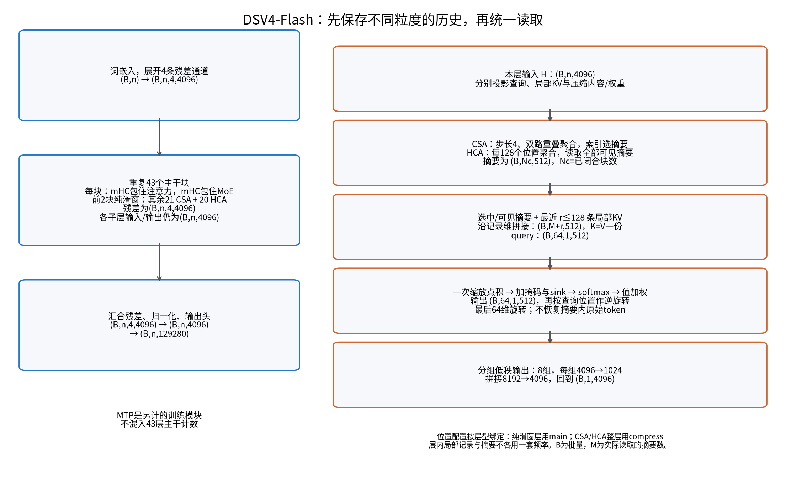
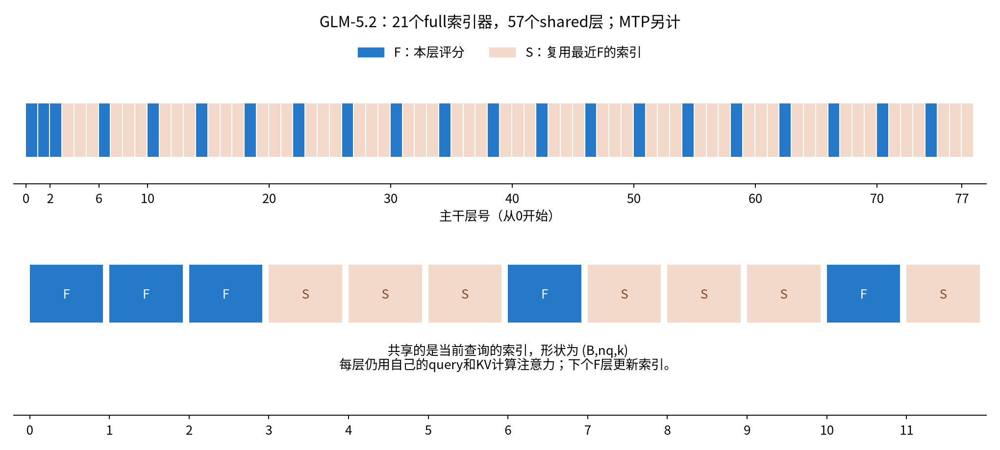

# 第 4 章 路线二续：DSV4 与 GLM-5 家族的长上下文

## 4.0 开篇：从全书到这里

第 3 章把稀疏注意力拆成评分、选择与读取，并区分了 NSA 的共享评分路径和 DSA 的独立索引器。主注意力参与的位置少了，索引器却仍要扫描历史，而且没有理由仅因本步未选中就永久删除一条记录。现在把上下文继续拉长：$1{,}048{,}576$ 个位置需要怎样保存，索引器的工作又能否进一步减少？本章沿这两个问题读真实模型。

我们对照两个家族：DeepSeek-V4（DSV4）的 CSA/HCA 把多条历史压成摘要，再决定读哪些摘要；GLM-5 使用 MLA+DSA，GLM-5.2 则让部分层复用前层的索引，减少重复评分。GLM-5 的配置上限是 202752，5.2 才是 1048576，比较时始终区分这两个版本。

同时本章是**证据等级标注的主场**：DSV4 只有一篇预览版论文加 config，GLM-5 有正式论文加 config，证据条件一薄一厚，正好可以将第 1 章提出的证据等级制度（官方论文 > 官方技术报告 > config 逆向 > 第三方复测 > 厂商自报）应用到旗舰模型的分析中。

本章将给出四项结果：一张 DSV4 整机结构推断图（图 4.1）、一本统一长度下的分类型账本横表（表 4.2）、一次「config 与权重逐层互证」的完整过程（4.4 节），以及一份悬案登记表（表 4.3）。到章末，我们会再次看到这一结论：可学习稀疏把 $O(n^2)$ 换成了一本便宜许多的账，而核心读取仍用选中集合内的缩放点积与softmax——第三把刀，在下一章。

> **最小背景栏**（已学指回，本章不重教）：DSA 闪电索引器与两阶段续训＝第 3 章；MLA 的潜在 KV 压缩（$d_c{=}512$ 潜向量 + $d_r{=}64$ 旋转键）＝Book4 第 6 章；config 逆向五步法（认家族→重建图纸→算账对拍→读外围→证据分级+悬案登记）＝Book3 第 5 章立、第 9 章无交叉演练、Book4 第 10 章无论文主场——本章是它第四次整机使用；MXFP4 的 4.25 bits 格式账＝Book4 第 7 章；MTP＝Book4 第 8 章；分类型 KV/状态账本（全局层无界/滑窗层有界/线性层固定，单位=元素数）＝第 1 章。先介绍本章会用到的两个新名字：**CSA**（Compressed Sparse Attention，压缩稀疏注意力）与 **HCA**（Heavily Compressed Attention，重压缩注意力），机制在 4.2 节教到「能画出来」。

## 4.1 到期的账：1M声明背后的不同计算与训练选择

Book3讨论过位置扩窗，本章还要追问历史如何保存和读取。DSV4、GLM-5.2与K3的配置都声明1,048,576个位置，但声明长度相同不等于训练课程、位置机制和检索表现相同。GLM-5本身为202,752，Qwen3.5原生为262,144，约1.01M属于启用扩展配置后的部署口径。先区分这些对象，后面的比较才不会把家族不同版本拼成同一台模型。

本章拆的两台机器，证据条件恰好是制度的两档。**DSV4**：有一篇 58 页的论文，但摘要自述 "We present a preview version"——**预览版**，本章引用它的一律带这三个字，且全部数字都据本地 PDF 引用（调研期发现 HTML 版在 §5.2.1 处截断，漏掉了整段 MXFP4 明文——这个教训本身就是 4.2 节的考据框素材）【证据等级：官方论文·预览版 2606.19348 v1】。

**GLM-5**：有正式论文（arXiv:2602.15763 v2，40 页）加 config 双锚——可将两类材料相互核对，但它的 1M 版本 GLM-5.2 在本书已核材料中主要依靠模型卡与config。一台薄一台厚，五步法在两档里各走一遍，读者就能体会：可用证据越少，每一步越要依靠 config 与权重来验证，需要登记的疑点也越多。

各模型的结果保留其报告与实验条件；配置支持结构事实，评测表支持特定协议下的质量，二者不互相代替。

## 4.2 DSV4：预览版论文与 config 并读

先看配置身份：DSV4 的 model_type 为 deepseek_v4、architectures 为 DeepseekV4ForCausalLM；transformers_version=4.57.1 只记录保存配置时的库版本字段，不能推断训练环境。以下将发布配置、官方 inference/model.py 与实际安装的 transformers 5.14.1 分开核对：配置给出几何，代码说明这些字段怎样作用于前向，CPU 小模型则检验当前实现是否走通。

第二步是重建结构，先看整机（图 4.1）。V4 家族两档：**Flash 284B 总参/13B 激活、43 层、hidden 4096；Pro 1.6T/49B、61 层、hidden 7168**【证据等级：官方论文·预览版 §4.2.1，卡面同值】。

层表不是论文给的全表，而是 config 里的一个数组：Flash 的 `compress_ratios` 长 44 项、Pro 长 62 项——本机断言发现长度恰为 `num_hidden_layers + num_nextn_predict_layers`（43+1、61+1），**尾项是 MTP 层的占位**，被 HF 配置的 `layer_types[:n]` 截断规则弃掉（Book3 第 9 章的「config→源码」双跳手法，这里反过来用源码行为反推 config 意图，推断级但双向可验）。截断后的层表（本机实读，`code/ch04/dsv4_glm5_reverse.py::reverse_dsv4`）：

- **Flash：2 层滑窗 + 21 层 CSA + 20 层 HCA**——前 2 层纯滑窗，其后 CSA/HCA 严格交替（约 1:1），末层是 CSA；
- **Pro：0 层滑窗 + 30 层 CSA + 31 层 HCA**——前 2 层换成了 HCA 引导，同样交替。

先把这些层放回整机：词嵌入进入重复的注意力与 MoE 子层，mHC 负责残差通道的混合，最后经归一化与输出头产生 logits。Flash 的前两层是纯滑窗；其余层以及 Pro 的各层，在压缩历史之外仍保留一个局部窗口。CSA 层筛选较细的摘要，HCA 层读取更粗的全部摘要，约 1:1 交错。这里有两层结构，不能混为一张“三分支”图：CSA/HCA 是不同层型，局部窗口则是它们各自内部的读取来源。



图4.1 DSV4-Flash整体与一次查询的读取路径（教学示意）。左侧每个主干块都有注意力、MoE及其mHC残差组织；右侧展示CSA/HCA层如何构造局部记录与摘要、统一归一化并投影回残差宽度。图中位置参数按层型绑定。

下面分别讲解这两种注意力机制的各个组件（位置都在图 4.1 右栏）。

**CSA：先压缩，再选择。** 第 3 章的 NSA 选择分支最终读原始 token，压缩分支还另有摘要输出；DSA 则直接选择 MLA 的 token 级记录。CSA 的变化发生在历史表示本身：先每隔 $m$ 个位置形成一条摘要，再由索引器从摘要中选择。每条记录已经混合多个位置，之后即使把它读得很精确，也不能一般性恢复那些原始 token。【官方论文·预览版 §2.3.1】

从输入往下走。Flash 的隐状态 $H:(B,n,d)$，其中 $d=4096$；四组投影分别产生两路内容 $C^a,C^b$ 与两路分数 $Z^a,Z^b$，各为 $(B,n,c)$，$c=512$。第 $i$ 条摘要取当前 $m$ 个位置的 a 路和前一组 $m$ 个位置的 b 路，合成 $2m$ 个候选，而不是两路各自再取 $2m$。加入块内位置偏置后，沿这 $2m$ 个位置、逐通道做 softmax 和加权求和，得到 $(B,c)$；步长为 $m$，所以处理完 $n$ 个位置后，已闭合摘要数为

$$n_{\mathrm{cmp}}=\left\lfloor \frac{n}{m}\right\rfloor \tag{4.1}$$

条（实配 $m{=}4$：1M 上下文压成 262,144 条）。用人话说：**每前进 4 个 token 形成一条摘要；远程读取改用摘要，近期内容还由未压缩窗口提供**。

索引器另用自己的压缩参数生成宽度 128 的索引键，主注意力摘要仍宽 512；两者对应相同历史区间，却不是同一组向量。一个查询产生 $(B,64,128)$ 的索引查询，与历史索引键 $(B,n_{\mathrm{cmp}},128)$ 点积，得到 $(B,64,n_{\mathrm{cmp}})$，经 ReLU、头权重与求和变成 $(B,n_{\mathrm{cmp}})$。先限制为已形成的可见摘要，再取 Flash 的最多 512 条，Pro 的最多 1024 条。原 DSA 的 2048 是 token 级条目，这里的预算单位是摘要，不能按“512×4”宣称保存了等量的精确信息；双路重叠又使一个摘要最多接触 $2m$ 个源位置。【官方论文·预览版 §2.3.1、§2.3.4】

主注意力把选中摘要与最近最多 128 条未压缩 KV 拼接，在同一次带 sink 的 softmax 中读取。它没有把局部输出和压缩输出各算一次后再套 NSA 的三分支门。K 与 V 使用同一份记录，因此相对“同宽 K、V 各存一份”少一份数据；这不等于整机缓存恰好减半，因为压缩率、索引键和其他状态也在改变。

把这一步单独写成公式。对一个样本，$H:(n,d)$，四个投影矩阵均为 $(d,c)$，故 $C^a,C^b,Z^a,Z^b:(n,c)$；推广到batch即为前述 $(B,n,c)$。将当前组的a路和前组的b路排成 $(B,2m,c)$，加上两组 $(m,c)$ 位置偏置后，沿 $2m$ 这一轴逐通道归一。每个通道得到自己的位置权重，而非整个块共用一个标量。

具体地，将这2m个候选通道值排成$a_{j,r}$、分数（含块内位置偏置）排成$z_{j,r}$，则

$$w_{j,r}=\frac{e^{z_{j,r}}}{\sum_{u=1}^{2m}e^{z_{u,r}}},\qquad
C^{Comp}_{i,r}=\sum_{j=1}^{2m}w_{j,r}a_{j,r}.\tag{4.6}$$

每个通道的权重和为 1，不同通道可以从不同位置提取信息。首块没有前一块时，相应分数置为 $-\infty$、内容补零，权重只在已有候选间归一。式 (4.6) 描述聚合阶段；实际送入注意力前还要做归一化和位置旋转，不能把最终 KV 直接等同于未变换的凸平均。

摘要何时可见也属于算法。采用代码的 0 起位置，查询 $t$ 处理完当前输入时，只能访问编号小于 $\lfloor(t+1)/m\rfloor$ 的已闭合摘要。例如 $m=4$，位置 0、1、2 尚无完整摘要，位置 3 完成第一组后才可以使用它。未闭合组的内容由局部窗口提供；在长 prefill 中即使预先并行算出了未来摘要，选择掩码也必须排除它们。官方实现与当前 HF 都按这个边界处理。

以m=2、c=1为例，四个候选值$(1,3,2,6)$、分数$(0,0,\log2,\log2)$给出权重$(1,1,2,2)/6$，摘要为$(1+3+4+12)/6=10/3$。不同原记录可产生同一摘要，后来即使完整读取摘要也无法一般性地恢复全部原值。HCA和CSA的关键差别于是明确：前者更强压缩但全读摘要，后者较弱压缩并选择部分摘要；两者都改变了历史表示。

**例 4.1（构造例）：CSA 块压缩 mini——8个token压成2条**。取 8 个 token、$m{=}4$、条目维 $c{=}2$，KV 序列 $k_1{=}(1,0),k_2{=}(0,1),k_3{=}(1,1),k_4{=}(0,0),k_5{=}(2,0),k_6{=}(0,2),k_7{=}(2,2),k_8{=}(1,1)$。 为单独观察压缩与选择，本例省略局部记录、sink、RMSNorm和RoPE，并以单头查询读取已经完成的八个输入位置。
① 压缩（教学简化为等权平均；真实 CSA 是双窗 softmax 加权+可学偏置）：输入 8 条 2 维 KV $(8,2)$ → 输出 2 条摘要卡 $C_1{=}\mathrm{mean}(k_{1:4}){=}(0.5,0.5)$、$C_2{=}\mathrm{mean}(k_{5:8}){=}(1.25,1.25)$，形状 $(2,2)$；
② 打分：query $q{=}(1,0.5)$ 与 2 张卡内积 → 分数 $(0.75,\ 1.875)$，形状 $(2,)$；
③ top-1 选卡：选 $\{C_2\}$（它代言 token 5-8）；
④ 主注意力：只算 $q$ 对 $C_2$ 的一份注意力，输出取 $C_2$ 的 value（共享 K=V）。
效果读法：满注意力要打 8 次分，这里只打 2 次、算 1 次——**压缩后候选条目更少，主注意力再只读其中部分**；代价是若 token 3 其实最相关、但它的「代言卡」$C_1$ 落选，信息就整块丢失——压缩是有损的，这说明需要在粗摘要、内容选择与局部细节之间折中；具体混编比例的收益仍需消融支持。

**实物 4.1**（DSV4 预览版论文 §4.2.1 Model Setups 原样摘录，Flash 段，本地 PDF，中段省略；【证据等级：官方论文·预览版 2606.19348 §4.2.1】）：

```text
DeepSeek-V4-Flash. We set the number of Transformer layers to 43 and the hidden
dimension d to 4096. For the first two layers, we use pure sliding window attention.
For the subsequent layers, CSA and HCA are used in an interleaved manner. For CSA, we
set the compression rate m to 4, the number of indexer query heads to 64, the indexer
head dimension to 128, and the number of KV entries selected for sparse attention
(i.e., attention top-k) to 512. For HCA, we set the compression rate m' to 128. …
```

重点看两处结构信息，它们体现了「论文只给半张图纸」。其一，"the number of KV entries selected … (i.e., attention top-k) to 512"——top-k 的单位明写是 **KV entries（压缩条目）**，与 DSA 的 2048 token 不是同一种对象；其二，层表只说 "interleaved"、不给逐层排列——逐层的 43 格在 config 的 `compress_ratios` 里，两处信息结合起来，才能还原整机（本节开头正是这样做的）。

**HCA：重压缩+稠密**。每 $m'{=}128$ 个 token 压成 1 条（单窗 softmax+偏置、不重叠），1M 上下文只剩 8,192 条；然后**不做任何选择**——无索引器、无 top-k，稠密注意力对全部条目做。心智一句话：**CSA 保留「选」的能力（在哪看由内容定），HCA 放弃「选」（全看，但看的对象已被压到 1/128）**——它减少了远程记录数，但每步仍读取所有已形成的摘要，计算随历史继续增长。

两种层型都把近期未压缩记录和摘要一同送入核心注意力，因此近期位置既可通过局部记录提供细节，也可能已经进入某个摘要；它们是不同表示，不是按 token ID 去重。每个查询头另有一枚 sink 标量，作用仍是第 2 章的读取幅度门。query 与 KV 在核心注意力前经过 RMSNorm，位置旋转只作用于最后 64 维，占条目宽度的 12.5%。【官方论文·预览版 §2.3.3】

K=V 带来一个额外步骤：value 也带着位置旋转。设旋转子空间内第 $j$ 条记录为 $R(p_j)c_j$，查询位置为 $p_t$，读取结果是 $\sum_j a_jR(p_j)c_j$。输出再乘逆旋转 $R(-p_t)$，就得到 $\sum_j a_jR(p_j-p_t)c_j$。这样贡献与相对位置相关；它没有逆推出摘要里每个原始 token 的顺序。对单次查询，核心输出 $(B,h,1,c)$ 合并为 $(B,1,hc)$，再按组作低秩输出投影：Flash 的 64 头分成 8 组，每组 $8\times512=4096$ 维先投到 1024，拼成 8192 维后投回残差宽度 4096。注意力由此回到整机的 $(B,1,d)$ 接口。

表 4.1 DSV4 双机型配置表（预览版 §4.2.1 与 config 逐项互证；「读法」列=结构推断；等级未注明者均为【证据等级：config 逆向×预览版论文双锚】）

| 字段 | V4-Flash | V4-Pro | → 部件/读法 |
|---|---|---|---|
| 层数 / hidden | 43 / 4096 | 61 / 7168 | 此行比较层数与残差宽度；专家数和专家宽度也同时变化 |
| 层表（实读） | 2 SWA + 21 CSA + 20 HCA | 30 CSA + 31 HCA（头 2 层 HCA 引导） | CSA:HCA≈1:1 交错 |
| 压缩率 | CSA $m{=}4$ / HCA $m'{=}128$ | 同 | KV 本体压到 1/4 与 1/128 |
| 索引器 | 64 头×128，top-k **512** | 同头数，top-k **1024** | top-k 单位=压缩条目（≠DSA 的 token） |
| 注意力 | 64 查询头，条目 $c=512$，共享 K=V；query低秩宽1024 | 128 查询头，条目同宽；query低秩宽1536 | query低秩宽不是MLA的KV压缩维；最后64维旋转 |
| 滑窗支路+sink | $n_{\mathrm{win}}{=}128$ + 每头可学 sink | 同 | 路线一以支路回归 |
| MoE | 256+1共享、top-6、专家宽2048、前3层Hash路由 | 384+1、top-6、宽3072 | 路由专家数/每token所选路由数约42.7:1、64:1，不是全模型总参/活跃比 |
| 精度 | FP8（e4m3/ue8m0，128×128 块）+ **专家 FP4** | 同 | MXFP4 打点见下方考据框 |
| 位置 | 纯滑窗层用 $\theta=10000$；带压缩器的整层用 $\theta=160000$、YaRN×16；上限1048576 | 同一规则，Pro没有纯滑窗层 | 层内局部KV与摘要使用相同频率配置 |
| 其他 | mHC $n_{hc}{=}4$、MTP 深度 1、vocab 129280 | 同（Sinkhorn 20 迭代同） | mHC 见段末 |

> **【考据框】MXFP4 打点勘误——HTML 截断的一课**。调研期从 arXiv HTML 版读 DSV4，§5.2.1 的量化段落是空的；回本地 PDF 逐字重读，明文是："We apply FP4 (MXFP4) quantization (Rouhani et al., 2023) to two components: (1) MoE expert weights, … (2) the Query-Key (QK) path in the indexer of CSA, where QK activations are cached, loaded, and multiplied entirely in FP4"【官方论文·预览版 §5.2.1，直引】——**MXFP4（QAT）打点=专家权重 + 索引器 QK 路径**两处，不是笼统的「FP4 模型」。这与 K3 的 MXFP4 QAT（第 7 章的重点内容）同型不同位；两家对照表在第 7 章。另：arXiv 编号 2606.19348 的前缀（六月段）与 v1 提交日期（2026-04-26）不一致，成因不明，连同预览版身份一并如实登记（悬案表 4.3）。

第三步算账对拍延后到 4.5 节（1M 账本是本章的重点内容），先把 **1M 证据链四层**排开——这是本章首次具体应用证据等级制度：

1. **训练侧**：序列长度阶梯 4K→16K→64K→1M；Flash 先稠密注意力热身 1T token，"introduce sparse attention at the sequence length of 64K and keep sparse attention during the rest of the training"【官方论文·预览版 §4.2.2，直引】——Flash 练到 1M；Pro 同样逐级扩到 1M，但其稠密阶段只说明更长，不能照搬 Flash 的 1T 数值。
2. **位置侧**：报告没有展开YaRN参数，位置实现要继续对照发布配置和源码。

发布 config 同时带有 YaRN、factor=16、original_max_position_embeddings=65536。代码解释了它的绑定位置：纯滑窗层使用 main 组的 $\theta=10000$；带压缩器的 CSA/HCA 层使用 compress 组的 $\theta=160000$ 与 YaRN×16，层内 query、未压缩局部 KV、摘要及索引器使用相容的频率配置。因而不能说 CSA/HCA 内的局部窗口单独使用 main 组。$65536\times16=1048576$ 与声明长度相合，但这种一致性只确认发布配置，仍不能确定缩放在哪个训练阶段启用。报告的长序列训练与发布代码的位置缩放是两条互补证据，不宜压成“纯训练”或“纯外推”的二选一。

3. **效果侧**：1M 档评测选 MRCR（OpenAI 8-needle）与 CorpusQA。引用时要锚定图表号：Table 7 给 DSV4-Pro Max 的 MRCR 1M(MMR)=**83.5**（Flash Max 78.7）【官方论文·预览版 §5.3 Table 7+厂商自报】；而 Fig.9 的 8-needle 曲线在 1M 处只有 0.59——同名 benchmark、同长度档，图与表差 24.6 分，论文未解释聚合口径差异（该差异的成因未披露）。论文自评的原话值得整句读："retrieval performance remains highly stable within a 128K context window. While a performance degradation becomes visible beyond the 128K mark, the model's retrieval capabilities at 1M tokens remain remarkably strong"【官方论文·预览版 §5.3.2，直引】。
4. **成本侧（厂商自报；4.5节另作逻辑载荷复算）**：1M 单 token 推理，Pro 只需 V3.2 的 27% FLOPs / 10% KV cache，Flash 10% / 7%；KV cache 约为 BF16 GQA8（head dim 128）基线的 2%【官方论文·预览版 §1/§2.3.4+厂商自报】。

还需要把新的残差设计放回整机。mHC不是注意力压缩件，而是改变层与层之间如何混合表示。将一个d维残差流扩为$X_l\in\mathbb R^{n_{hc}\times d}$，层输入、残差混合、输出注入分别由$A_l\in\mathbb R^{1\times n_{hc}}$、$B_l\in\mathbb R^{n_{hc}\times n_{hc}}$、$C_l\in\mathbb R^{n_{hc}\times1}$控制：

$$X_{l+1}=B_lX_l+C_lF_l(A_lX_l).\tag{4.7}$$

内部注意力或 MoE 因此仍处理 $d$ 维表示。把 batch 与位置补回，$X_l$ 为 $(B,n,n_{hc},d)$；输入映射 $(B,n,1,n_{hc})$ 乘它得到 $(B,n,1,d)$，子层输出再经 $(B,n,n_{hc},1)$ 的注入系数回到多通道残差形状。矩阵由当前表示动态生成；mHC 对输入映射用 sigmoid，对输出注入用两倍 sigmoid，对残差混合矩阵 $B_l$ 则要求非负且行列和均为 1。

为什么最后一个约束有用？固定 $B_l$，对任一通道向量 $x$，由非负行权重和为 1 及平方函数的凸性，有 $(\sum_jB_{ij}x_j)^2\le\sum_jB_{ij}x_j^2$。对 $i$ 求和后再用列和为 1，得到 $\|Bx\|_2^2\le\|x\|_2^2$。逐特征列应用，便有 $\|BX\|_F\le\|X\|_F$。两个这样的矩阵相乘仍非负，且 $(B_1B_2)\mathbf1=\mathbf1$、$\mathbf1^\top B_1B_2=\mathbf1^\top$，因此固定残差混合的这一性质可沿深度保留。

例如$B=\begin{pmatrix}0.75&0.25\\0.25&0.75\end{pmatrix}$把$(1,-1)^\top$变成$(0.5,-0.5)^\top$，却保持共同方向$(1,1)^\top$不变。它抑制差异方向的放大，不是把所有信息都压成零。

实现通过正值矩阵的反复行列归一化近似满足这个约束，报告用20次Sinkhorn–Knopp迭代；有限迭代误差要另检。更重要的是，上述证明只针对**固定B的残差混合项**，没有约束整个含非线性F、动态A/B/C的网络雅可比。因此它提供稳定性设计依据，不是训练永不发散的定理。报告中的Muon与归一化配套同样是整套实验选择，不能由归一化一项推出“logits绝不会变大”。

> **【实现对照框】位置配置绑定到层型。** 官方 inference/model.py::Attention 根据 compress_ratio 是否为零构造本层的频率表，再将同一表用于局部 KV 和压缩路径。transformers 5.14.1 的 DeepseekV4Attention 同样令纯滑窗层使用 main，其余层使用 compress；配置类对 YaRN 设 attention_factor=1.0，保持单位幅度的旋转。这里核对的是发布实现，训练启用时间仍须训练资料确认。

## 4.3 GLM-5：有论文的旗舰怎么读

换到证据厚的那一档。GLM-5（智谱，2026-02）有正式论文【官方论文 2602.15763 v2】+ config + 权重（MIT，代码 Apache-2.0 双轨），可以很直接地识别其模型家族：`model_type="glm_moe_dsa"`、78 层 hidden 6144、`first_k_dense_replace=3`（3 稠密 + 75 MoE）、256 专家 top-8 + 1 共享（稀疏度 32:1）、vocab 154,880【证据等级：config 逆向】。

注意一段小考据：论文 prose 写 "reduces its layer count to 80"，但**同一论文 Table 10 自己给 3 dense + 75 MoE + 1 MTP**（=78 主干层），config 也是 78，IndexCache 论文附录的层模式串长度还是 78——三证合一，**GLM-5=78 层，prose 的 "80" 与自家表格不自洽**；GLM-5.2 同为 78 层、没动层数（动的是索引器排班与上下文，见 4.4）。

注意力侧一句话：**全层 MLA + DSA**。论文 §1 明文 "we adopt DSA (DeepSeek Sparse Attention)"——这是第 3 章「DSA 上生产」的谱系句参考对象，config 侧 `layer_types` 未显式写出、由源码 `__post_init__` 填成 78 层全 `deepseek_sparse_attention` 互证【证据等级：官方论文+config 双锚】。

GLM 的一项适配是 Muon Split：把多头上投影矩阵按头拆分后分别正交化，改变各头更新的尺度。其 Table 1 中，MLA 相对 GQA-8 的整体差距有所缩小，但并非每项指标都完全追平；论文称整体表现接近。另一项 MLA-256 将查询/键头维从 192 调到 256，并减少三分之一头数，着重降低解码计算，同时保留近似的质量。这不是再次修复同一个质量问题，更不是将 576 维潜缓存压到 256 维。【官方论文 §2.1 Table 1；厂商自报】

另一项适配是把 DSA 接到已有 MLA 底座。GLM-5 在约 2.84B token 的索引器热身后，再以 20B token 做稀疏适配；DeepSeek-V3.2 所报稀疏阶段为 943.7B，两者起点与训练数据不同，不能据此认定方法本身有 47 倍优势。GLM 报告在其长序列条件下获得约 1.5—2 倍的注意力计算改善、128K 约一半 GPU 成本。Table 3 的 MLA/DSA 质量为 MQ-NIAH 100.0/100.0、MV-NIAH 95.5/97.0、SQuAD 79.7/86.0、HotpotQA 66.3/63.0；两升、一平、一降，应与效率数字一起读。【官方论文 §2.1.1；厂商自报】

论文还把几种高效注意力的改装放到小模型上比较，但有两组不同的实验。Table 5 从 GLM-9B 出发，各方案都继续训练 190B token，长度 64K，并保留一半满注意力层；比较的是滑窗、GDN 和 SimpleGDN，没有 DSA 这一行。其 RULER@128K 相对原底座的差距为 −30.35、−5.69、−11.28、−8.25，实物 4.2 保留这些读数。

**实物 4.2**（GLM-5 论文 §2.1.2 Table 5 原样摘录，RULER 列+差距列，其余三基准列略；原文为双列 64K/128K 记法）：

```text
RULER (64K / 128K)            ∆@128K
GLM-9B          85.35 / 75.28        —
SWA Interleave  65.94 / 44.93   (↓30.35)
SWA Pattern     83.72 / 69.59   ( ↓5.69)
GDN             76.76 / 64.00   (↓11.28)
SimpleGDN       81.76 / 67.03   ( ↓8.25)
```

这张表说明，在该续训配置下，“换哪些层”与“如何适配已有权重”都会影响长程任务。DSA 的小模型实验另见 Table 6：底座为 GLM-4.7-Flash，128K RULER 原分 79.21，只有索引器热身时为 71.35，再联合训练 150B token 后为 78.86，仍有 0.35 分差距。两张表不能拼成同底座的三路线排名；报告对 DSA 的“结构上无损”描述也不能替代第 3 章已经区分的有限集合误差与任务结果。第 9 章再将这些实验用于讨论混合配方的适用条件。

最后用参数账练习区分统计对象。GLM-5 报告写744B，公开checkpoint聚合元数据为753864139008个张量元素；GLM-5.2为753329940480。这里的“全量”包括MTP和持久缓冲区，并不等于只计主干可训练参数。两份发布索引清单都列出主干之外的第78号MTP层；读取其相关分片头，可得MTP共9952920576个元素，其中256个为FP32路由校正项。

将MTP从GLM-5全量中扣除，得到743911218432个主干state_dict元素。当前HF主模型的参数数为743911199232，另有19200个路由校正缓冲区，两者相加正好闭合。于是744B可以近似理解为含词嵌入与输出头、去掉MTP的主干规模，但这个四舍五入数没有表达全部统计细节。本次核验使用官方聚合元数据、发布索引清单、MTP分片头和meta主模型；并未下载完整权重。【证据等级：官方发布元数据与分片头；本书meta复算】

再对照论文Table10的计数说明：它称包含MTP，却排除词嵌入和输出层。两张词表矩阵共有 $2\times154880\times6144=1903165440$ 个元素，从全量扣除后为751960973568，约751.961B，仍不是744B。缓冲区只有约两万个元素，也解释不了约80亿的差距。因此保留“报告744B”和“发布工件全量753.864B”两个来源口径，并明确说明该计数句与工件复算不吻合；不替作者猜测另一套未公开的计数规则。40B激活及28.5T预训练token仍按报告自报引用。第11章将用它说明为什么原论文的口径句也要复算。

## 4.4 GLM-5.2：IndexShare 与「权重级承诺」

GLM-5 的 config 声明的上下文上限是 202,752（198K）；1M 属于 GLM-5.2（2026-06，MIT）。本节的重点是 config 中一个 78 项数组：它明确哪些层运行索引器，哪些层复用前层结果。

**实物 4.3**（`zai-org/GLM-5.2` config.json 原样摘录，截取 DSA 排班与上下文字段；`indexer_types` 共 78 项，此处只列前 6 项；【证据等级：config 逆向】）：

```json
  "index_topk": 2048,
  "index_topk_freq": 4,
  "index_skip_topk_offset": 3,
  "indexer_types": [
    "full",
    "full",
    "full",
    "shared",
    "shared",
    …（共 78 项：21 个 "full" + 57 个 "shared"）
  ],
  "max_position_embeddings": 1048576,
```

重点看这几行中同时发生的两项变化——`max_position_embeddings` 从 5 的 202,752 跳到 1,048,576（`rope_theta` 同步 1e6→8e6，无任何 scaling 字段），而 78 层的索引器排班从「全 full」变成 **21 full + 57 shared**。full 层位号 = $\{0,1,2\}\cup\{6,10,14,\dots,74\}$（config 0 起索引；人读即第 1-3 层全 full，此后每 4 层 1 个 full）——本机断言该展开与 `index_skip_topk_offset=3`、`index_topk_freq=4` 的源码公式逐位一致（`reverse_glm`）。图 4.2 把 78 项画成一条带子，周期 4 的模式一眼可见。



图 4.2 GLM-5.2 IndexShare 层模式图（config 自动绘制）：78 层中 21 层 full（蓝，自跑索引器）+ 57 层 shared（浅色，复用最近前一个 full 层的 top-k）；下排放大前 12 层。依据配置层表绘制。

模型卡将 IndexShare 链接到 IndexCache 论文（arXiv:2603.12201v1）。这支持两者的机制联系，却不能单靠名称相近就推断发布模型使用了论文的全部训练细节。论文分析的 30B DSA 模型中，索引器占总时延的比例随长度增加：prefill 在 10K、60K、120K、200K 时为 27%、50%、68%、81%，decode 对应为 27%、31%、38%、41%。主注意力减少读取后，反复扫描全长索引键会成为新的主要开销。【官方论文 §1；厂商自报】

可复用的依据来自跨层选择的重叠：论文在 47 层、30B 模型的 768 个 200K 校准样本上，测得相邻层 top-k 集合的平均重叠率约为 0.7—1.0，且出现若干层簇。这个指标只数“多少位置相同”，没有告诉我们少数不同位置是否关键，所以高重叠还不足以保证直接共享无损。下一步必须把共享后的整机输出或任务损失也纳入判断。【官方论文 Appendix A】

因此，解法可以用一行公式（式 (4.2)）写完（模式串 $c\in\{F,S\}^N$，首层设为F，提供可复用的初始索引）：

$$T^{(\ell)}_t \leftarrow T^{(f(\ell))}_t,\qquad f(\ell)=\max\{j<\ell:\ c_j=F\} \tag{4.2}$$

式 (4.2) 只用于 S 层：它复用当前查询在最近 F 层得到的索引，F 层则根据自己的输入重新评分。索引张量在解码时为 $(B,k)$，在一次含 $n_q$ 个查询的 prefill 中为 $(B,n_q,k)$，随着新的 F 层结果被更新。S 层仍用自己的 query 和自己的 KV 计算注意力，复用的是“读取位置”，不是另一层的 value，也不是上一次生成 token 的选择结果。

论文在 SGLang 的 H100 节点上评测30B底座：200K prefill 19.5 秒降到 10.7 秒，约1.82倍；单请求每GPU解码58升到86 token/s，约1.48倍。其免训练搜索版保留约四分之一索引器，长文均分49.9，对照50.2；八分之一时降至46.1。GLM-5上的免训练初步结果为78.0对78.4，100K以上报告至少1.3倍改善。这些都是相应模型、后端和并发条件下的结果，不直接等同于GLM-5.2在1M处的收益。【官方论文§4、Table1/2/4；厂商自报】

配置 F/S 排班有两种路线，论文也报告了一个负结果。**training-free**（免训练，现成 DSA 模型直接用）：贪心逐层搜索——每步选定「改成 S 后校准集 LM loss 最小」的层，直到只剩目标份数。关键发现：该30B免训练对照中，四分之一均匀排班的长文均分下降7.2分，「哪些层保留远比保留多少重要」——早层最敏感（扰动传播路径最长）。

**training-aware（带训练）**让保留下来的索引器同时服务本层和后续共享层。它不只学习本层“想看哪里”，而是接受这些层的联合监督。若共有 $M$ 个服务层，平均 KL 目标与对它们平均分布的 KL 目标具有相同梯度；下面将这一结论展开。论文的这组训练实验有自己的原始 DSA 对照，长文均分为51.0，四分之一均匀共享后为50.6，不能与上一组免训练实验的50.2混用。【官方论文§3.2、Table3】

另一种尝试先测每层注意力输出的余弦相似度，再用动态规划选择共享分组，结果未优于均匀交错。它说明该实验中的局部相似度不足以替代最终质量指标：少数关键位置的差别可能经后续层放大。基于校准集语言建模损失的贪心搜索直接评估这种累积影响，虽然不保证全局最优，却在论文比较中更有效。【官方论文Appendix C】

把多层监督写开。对同一次查询，索引器给出概率向量 $q\in\mathbb R^k$，它服务的 $M$ 层给出停止梯度的老师分布 $p^{(1)},\ldots,p^{(M)}\in\mathbb R^k$，各自非负且和为1，并使用同一个候选支持集。令 $\bar p=M^{-1}\sum_l p^{(l)}$，则

$$\frac1M\sum_l D_{KL}(p^{(l)}\|q)
= D_{KL}(\bar p\|q)+\left[\frac1M\sum_l\sum_jp_j^{(l)}\log p_j^{(l)}-\sum_j\bar p_j\log\bar p_j\right].\tag{4.8}$$

展开KL后，所有含q的项都是$-\sum_j\bar p_j\log q_j$，方括号只依赖老师，所以两边对索引器参数的梯度相同。若左边用求和而非平均，梯度还需乘 $M$。这是训练目标的等价关系，不证明不同层的真实注意力分布相同，也不证明无需重新训练。

那么GLM-5.2的发布config说明了什么？三源拼图：config 是**均匀周期 4**（论文所测配方中training-aware改善uniform）；README 把 IndexShare 链到这篇论文；而最有力的一项来自权重——**534M 差值的结构核对**。GLM-5 与 5.2 的 checkpoint 全量差 = 753,864,139,008 − 753,329,940,480 = **534,198,528**，而每层索引器参数按 config 几何展开：

$$P_{\mathrm{idx}}=\underbrace{r_q\cdot h_I\cdot d_I}_{wq_b:\,2048\times4096}+\underbrace{d\cdot d_I}_{wk:\,6144\times128}+\underbrace{2\,d_I}_{k\_norm}+\underbrace{d\cdot h_I}_{weights\_proj}=9{,}371{,}904 \tag{4.3}$$

$57\times 9{,}371{,}904=534{,}198{,}528$——**分毫不差**【证据等级：config公式、官方checkpoint聚合元数据与索引清单；本书meta复算】。也就是说：**GLM-5.2 的发布索引清单不包含这57个shared层的索引器权重，且当前主模型结构也不构造它们**（携带索引器的只有 21 个 full 层 + MTP 层）。这使 IndexShare 从「推理期小技巧」变成「**权重级承诺**」——免训练共享可以在保留原权重的模型上进行，也可以在确定排班后裁去不用的索引器，5.2的发布权重缺少这些索引器，能确认的是部署结构；训练后也可以裁去不用的参数，所以这仍不能独立证明它采用training-aware流程，官方仍未明说（悬案表 4.3）。

结构还能从两侧检查。meta构造的GLM-5.2主干只有21层带索引器，而GLM-5为78层；发布权重索引清单与这个排列一致，并额外列出MTP层的索引器。微缩模型取八层F,F,F,S,S,S,F,S，state_dict里只有0、1、2、6层的索引器；另一个四层构造通过前向hook确认，S层使用的正是最近F层传入的索引张量，再读取本层KV。当前CPU前向有限；八层例子的损失约6.238，接近 $\ln512$，仅用于检查随机初始化与数据流。旧版记录6.232保留为历史读数，不当成当前版本的逐位预期。

GLM-5.2 的 1M 证据链分三层读：config 层（`max_position_embeddings=1048576`+θ 8e6）——只能证明「按 1M 声明的位置空间」；官方陈述层——README 卖点措辞是 "**solid 1M-token context** that stably sustains long-horizon work"，IndexShare "reducing per-token FLOPs by **2.9×** at a 1M context length"，MTP 接受长度 "+up to 20%"，主打能力数字换成 SWE-bench Pro **62.1**（注意 5/5.2 主打赛道从 Verified 换成了 Pro，不可跨代直比——第 11 章的口径注记在此挂号）【证据等级：厂商自报（模型卡）】；第三方层——**暂无独立 1M 长文评测可引**（FrontierSWE 等 1M 口径评测是第三方，但非长文检索类）。注意 2.9×@1M 是 README 自报——IndexCache 论文只测到 200K，引用时必须带这个口径差。

配置上限与服务默认值也属于不同层次。发布文件声明1048576个位置，并不要求所有服务实例都默认分配这么长；服务可以另设默认值或要求显式启用。旧资料中的“默认202752、1M需opt-in”若来自某个托管部署，只能说明该部署策略。官方API文档当前列出1M上下文和128K最大输出；其他部署仍可另设默认值。因此按具体服务核验，而不把上限与默认值当作同一物理量。[Z.AI API文档](https://docs.z.ai/guides/llm/glm-5.2)。

最后说明一个读取 config 时容易出错的地方：`head_dim` 字段在 GLM-5 写 64（=qk_rope 维）、在 5.2 写 192（=qk_nope 维）——同名字段在原始文件中承载了不同含义，源码 `__post_init__` 会重算，最终在当前配置类中，head_dim被设为RoPE维64；完整query/key头维另由192+64=256得到，value头维也为256，潜缓存仍为512+64=576。必须沿字段的使用路径区分这些物理量。

## 4.5 统一长度的账本手算：五行配置一张表

回到保存历史这件事。先只数主注意力记录，batch为1：DSV4的CSA层保留 $\lfloor n/m\rfloor$ 条摘要和最多 $\min(n,W)$ 条局部记录，HCA把压缩率换成 $m'$；纯滑窗层只有局部记录。因为每条记录共用K/V，只乘一次条目宽度 $c$，得到

$$\mathrm{KV}_{\mathrm{V4}}(n)=L_{\mathrm{sw}}\cdot\min(n,W)\cdot c+L_{\mathrm{csa}}\cdot\Big(\big\lfloor \tfrac{n}{m}\big\rfloor+\min(n,W)\Big)\cdot c+L_{\mathrm{hca}}\cdot\Big(\big\lfloor \tfrac{n}{m'}\big\rfloor+\min(n,W)\Big)\cdot c \tag{4.4}$$

在长前缀处，CSA平均每前进4个token增加一条512维主记录，HCA每128个token增加一条；各层的局部部分最多128条。它们依然随历史线性增长，只是增长系数不同。式(4.4)尚未计入CSA索引键，也未计压缩器的未闭合窗口、重叠暂存、量化scale与内存对齐；这些要单独补账，不能把主记录数当成进程峰值内存。GLM线则沿用MLA吸收形式的逻辑记录：

$$\mathrm{KV}_{\mathrm{MLA}}/\mathrm{token}/\text{层}=d_c+d_r=512+64=576 \tag{4.5}$$

MLA吸收形式中，每个token、每层用一份512维潜向量和64维旋转键表示历史。DSA改变本步主注意力读取的条目数，仍保存全部主记录以供未来查询，带索引器的层还另存128维索引键。这里计的是这种逻辑表示；当前HF eager实现会展开每头K/V，微缩前向并不证明它实际按576元素缓存。

**符号表**（式 (4.1)/(4.4)/(4.5)；形状列按 batch=1 单序列口径）

| 符号 | 含义 | 形状/取值 |
|---|---|---|
| $H$ | 层输入隐状态 | $(n,\,d)$，Flash $d{=}4096$ / GLM $d{=}6144$ |
| $C^{\mathrm{Comp}}$ | 压缩条目序列 | $(\lfloor n/m\rfloor,\,c)$，$c{=}512$，K=V 共享 |
| $I_{t,:}$ | 索引器对条目的打分 | $(\lfloor n/m\rfloor,\,)$，ReLU 计分 |
| $n,m,m'$ | 上下文长/CSA/HCA 压缩率 | $1{,}048{,}576$ / 4 / 128 |
| $W$ | 滑窗支路宽 | 128 |
| $d_c,d_r$ | MLA 潜向量/旋转键维 | 512 / 64（GLM-5 与 K3 同） |

为比较增长系数，下表统一代入 $n=1048576$。K3的24层MLA逐token增长，69层KDA保留状态矩阵和卷积历史；Qwen3.5-35B的10层GQA每token保存1024个元素，30层GDN也需分别计状态矩阵与卷积历史。Qwen配置原生上限为262144，模型卡扩展示例为1010000，因此它在本表的1048576处只作同长度算术外推，不声称在声明范围内。表中GB统一按每元素两字节换算，实际状态dtype可能不同。【证据等级：发布config与公式复算】

表 4.2 统一取 $n=1048576$ 的逻辑KV/状态账（batch=1；十进制GB）。状态矩阵与最小卷积历史分别列出；量化、对齐、暂存等实现开销不在主表。

| 机型（层账） | 随长度增长的部分 | 有界/固定部分 | 统一长度合计 | 位置与长度条件 |
|---|---|---|---|---|
| DSV4-Flash（2SWA+21CSA+20HCA） | 压缩主记录合计29.0246亿元素 | 43层局部记录合计281.8万 | 主记录29.0528亿，按两字节为5.8106GB；索引键另有7.0464亿 | 数据训练到1M；CSA/HCA整层使用YaRN×16，启用时点未披露 |
| DSV4-Pro（30CSA+31HCA） | 压缩主记录合计41.5656亿 | 61层局部记录合计399.8万 | 主记录41.6055亿，按两字节为8.3211GB；索引键另有10.0663亿 | 同一层型规则；没有纯滑窗层 |
| GLM-5.2（78×MLA+DSA） | 主记录 $78\times576$ 每token；索引键 $21\times128$ 每token | 无递归固定状态 | 主记录471.1042亿，加索引28.1857亿；合计99.8580GB | 配置上限1M、$\theta=8\times10^6$；具体长度训练配方未披露 |
| K3（24 MLA + 69 KDA） | MLA主记录144.9551亿 | KDA核心1.08527616亿；最小卷积历史763.0848万 | 合计146.1167亿，29.2233GB | 全局层NoPE，仍进行长度适配训练 |
| Qwen3.5-35B（10 GQA + 30 GDN） | GQA主记录107.3742亿 | GDN核心1572.864万；最小卷积历史73.728万 | 合计107.5388亿，21.5078GB；该长度为假想外推 | 原生262144，模型卡YaRN×4示例到1010000；托管版本另有1M声明 |

DSV4还需把元素换成实际声明的格式。报告的主KV混存为448维FP8与64维BF16，每条有效数据是 $448+64\times2=576$ 字节，而非512字节；据此Flash与Pro主记录约为3.2684GB、4.6806GB，尚未含量化scale等开销。公开参考实现则在BF16缓存中模拟量化，不能直接当成这两个部署内存读数。CSA索引键另有128维，其FP4路径、缩放与实现布局也须单独计算。

若只比较主记录的元素数，以V3.2的 $61\times576\times1048576=36842766336$ 为基线，Flash与Pro分别为7.8856%、11.2927%。论文自报的7%/10%属于部署缓存口径，混精格式、索引键和其他状态的计入方式没有给出完整账式，二者不能仅凭接近就判为“复现命中”。这里的V3.2也只是同长度算术基线，不表示其发布配置支持1M实际运行。

这张表把三种不同的增长形式放在一起：DSV4的摘要条目仍增长，GLM-5.2的主KV与索引键也随token增长，K3和Qwen的线性层则把历史写入固定形状的状态。对后两者，卷积还至少保留核宽减1个历史输入；本表计的是这一最小历史，具体缓存可能分配完整核宽。Qwen配置还明确状态可用FP32，因此两字节列只是统一比较尺，不是实际显存承诺。

K3经常出现的0.75%只比较KDA核心状态与24层MLA主记录：$108527616/14495514624\approx0.7487\%$。加入卷积历史后固定部分会增加，换成不同dtype后字节比还会改变。先明确分子分母，才能把这个数用于理解混合比例，而不把它误读成全部线性层开销只有0.75%。

最右列也不应被读成互斥的四种技术：长序列训练、位置参数调整、推理端上限和托管服务默认值可以同时存在。DSV4训练到长长度，也发布缩放参数；Qwen有原生长度、开源扩展配置及托管版本；K3不用全局RoPE仍需适配长上下文。第8章将这些因素按“位置如何表达”和“历史如何保存”两个问题重新组织。

全尺寸结构验证使用meta构造：参数和缓冲区均检查为meta张量，只读取形状与元素数，不分配这些巨大权重的数据，也不对旗舰做真实前向。当前HF5.14.1主模型参数数为Flash284332230231、Pro1572997179491、GLM-5 743911199232、GLM-5.2 743377000704；state_dict还包含持久缓冲区，MTP也需另计。随机前向只在六至八层微缩模型上进行。这样可以核对模块和账本，不能据此验证真实训练质量、部署格式或长上下文性能。

## 4.6 悬案登记：config 读不出什么

五步法第五步。证据面再厚，config 与论文也只覆盖「图纸与部分配方」——训练数据构成、后训练链细节、优化器超参之外的东西，一概读不出。如实登记：

表 4.3 悬案登记表（「读不出」登记不猜测；等级=现有最好证据）

| # | 悬案 | 现有证据与边界 |
|---|---|---|
| 1 | DSV4 MRCR 图表口径差（Fig.9 的 0.59 vs Table 6/7 的 83.5@1M，差 24.6 分） | 预览版论文未解释聚合口径；引用必须锚定图表号；完整版发布后回查 |
| 2 | DSV4的10%/7%部署KV计数公式 | 缺完整计入范围；本书主记录元素比为11.2927%/7.8856%（Pro/Flash），不是同格式字节复测 |
| 3 | DSV4 语料构成（32T/33T 的数据面）、Hash 路由 3 层的训练动态 | 预览版论文只给总量；「config 读不出数据」通例 |
| 4 | GLM-5.2的1M训练配方 | 模型卡与API文档声明1M；本次博客未返回正文，已核材料未说明长度训练课程 |
| 5 | GLM-5.2不同服务的默认上下文 | 官方API文档列1M上下文、128K输出；其他部署是否另设默认值须各自核验 |
| 6 | GLM-5.2 走 training-aware 的官方确认 | 权重差证明发布结构减少索引器，不证明训练流程；官方未明说 |
| 7 | GLM-5.2 自 5.1 的升级路径（续训 or 重训） | 未披露 |
| 8 | arXiv 2606.19348 编号前缀与 v1 日期不一致的成因 | 不明；连同预览版身份一并登记 |

冻结线后的两个对象按纪律只入脚注与悬案框。GLM-5.3-Flash（2026-09）一句脚注：它把 **KDA 线性层×3 + DSA 稀疏层×1** 装进同一台机器（45 层=34+11，config 已核）——本册两条突围路线开始在同一台旗舰里混编，谱系收敛的信号；展开归第 9 章谱系表脚注，正文主线仍停在 5(.2)。

> **【悬案框】DSV4.1-Flash（2026-09，冻结线后）**：卡面三大件只有一句话自报+config 字段双锚（无论文）：**CED** 因果编码器-解码器（20 编码+20 解码层，解码器全局 KV 由编码器终态投影——prefill 8B/decode 16B 激活不对称）；**CSA2** 三态索引（Full/Reindex/Reuse）+ **FP4 主 KV 缓存**（E2M1+每 16 通道 E4M3 scale）→ 全局 KV **890 bytes/token**（≈V4-Flash 的 1/4）；**engram** 条件记忆 196B 参数——config 亲核为 $2\times384\text{M}\times256\approx196.6$B 两张 n-gram 嵌入表，独占 552B 骨干的约 36%（这是参数占比，实际显存还取决于各部分的存储精度）；另有 DSpark、MTP×3（`num_nextn_predict_layers=3`）。本书已核资料尚未给出这些机制的完整文档——「V4.1降低每token缓存字节系数，并未因此消除随序列长度线性增长」是第 9 章 9.4 节账本三档递减的下一档预告，细节全部悬案。

## 4.7 本章小结

本章沿两个问题读完了两组设计。DSV4先改变历史表示，再以CSA选择较细摘要、以HCA读取较粗摘要，局部记录与摘要在一层注意力中协作；GLM-5.2复用跨层索引，各层仍读取自己的KV。压缩率、选择预算、共享排班决定不同成本，位置配置和训练课程则决定另一组条件。配置、发布清单、代码和数学复算各验证了一部分事实，留下的训练与部署细节仍按证据范围登记。

**带走的心智**：先分清被压缩或共享的对象。CSA压缩的是历史内容，IndexShare共享的是索引，MLA压窄的是每条记录；三个动作不能互相替代。再让数字带着计量对象出现：元素、字节、主模型参数、含MTP的工件、声明长度和实测长度是不同的账。最后，把配置看成一张可验证的结构图，而不是训练过程的完整说明。读者应能沿字段找到模块、沿模块画出数据路径，再说出哪些结论还需要实验。

回到全书的路线：我们已经分析了路线二的两台旗舰，这条路线也展示了其仍需承担的历史存储与索引工作。但别忘了第 3 章 3.6 节留下的结论——CSA/HCA 再省，每 token 对选中的条目做的仍是**选中集合内的缩放点积与 softmax**，核心读取仍沿用这一形式，历史表示与参与集合已经改变。下一章换第三把刀，也是改动最大的一把：把点积 softmax 整个换掉，用固定容量的状态取代无界的账本——线性注意力、delta rule 与 Gated DeltaNet，F12 所提出的可能性将在这里完整展开。

## 4.8 动手验证

- **五步法与账本全数字来源**（CPU 秒-分钟级；表 4.2 与式 (4.3)/(4.4) 的对账数字、mini 实跑全部出自本脚本）：
  ```bash
  cd 工作区根目录 && source env.sh && \
    python "code/ch04/dsv4_glm5_reverse.py" --out-name run1
  ```
  预期产出包括Flash的2/21/20层表、GLM-5.2的21/57索引排班，四个主模型的meta参数与state_dict元素数，57×9371904的差值核对，以及五行逻辑缓存账。微缩前向只检查形状与有限值，损失接近 $\ln512$；当前CPU例子为6.255/6.238，版本变化时不要求逐位相同。JSON保存实际软件版本与数据来源，已有同名文件拒绝覆盖；图像写入独立log子目录。
  ```bash
  python "code/ch04/dsv4_glm5_reverse.py" --out-name figs \
    --plot-layer-map --plot-dsv4-map
  ```
- 验收点：拿一份陌生旗舰 config 能独立走完五步并给每字段标证据等级；能沿源码解释RoPE配置如何绑定层型；能手算一台 1M 机器的分类型账并说出 K3 行 0.75% 的来历；能解释发布清单能确认部署结构，却不能独立确定训练路线。

参考资料：[DeepSeek-V4 v1预览报告](https://arxiv.org/abs/2606.19348v1)、[GLM-5 v2](https://arxiv.org/abs/2602.15763v2)、[IndexCache](https://arxiv.org/abs/2603.12201v1)。
