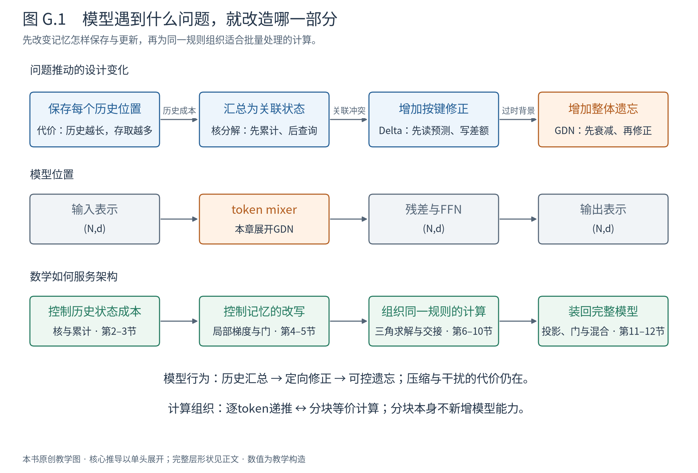
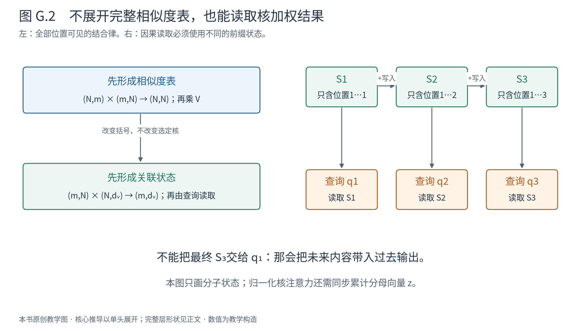
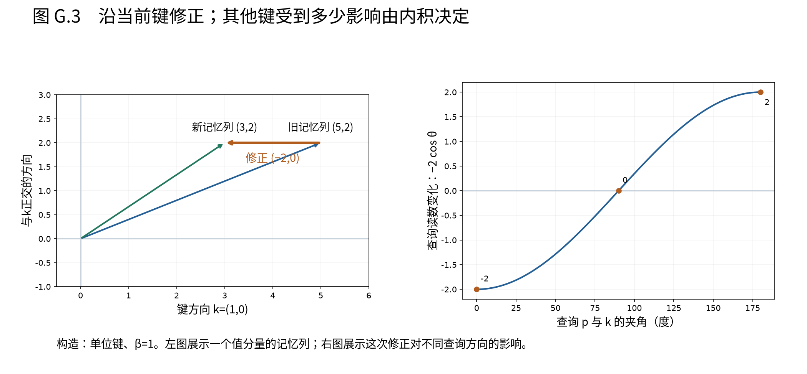
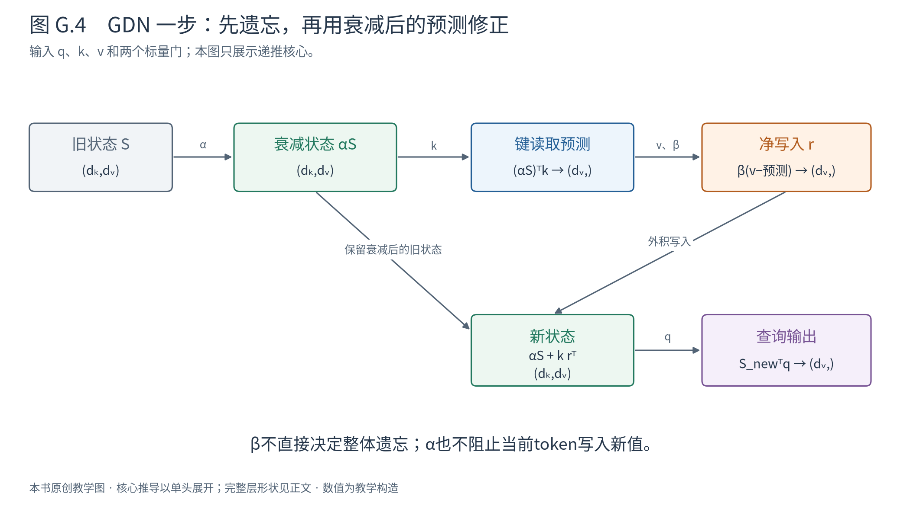
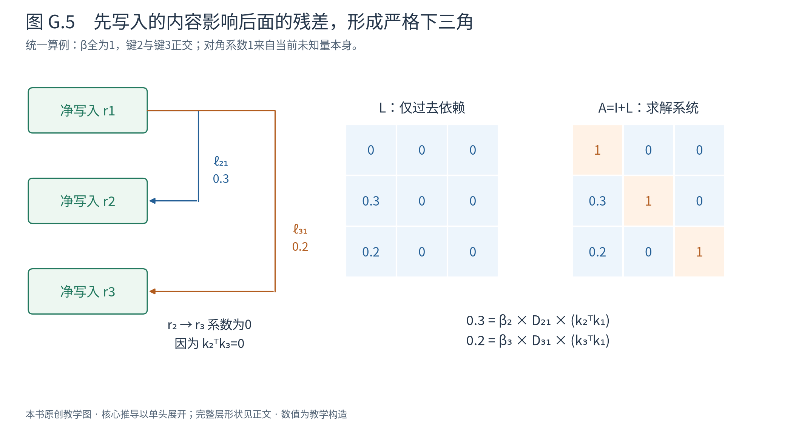
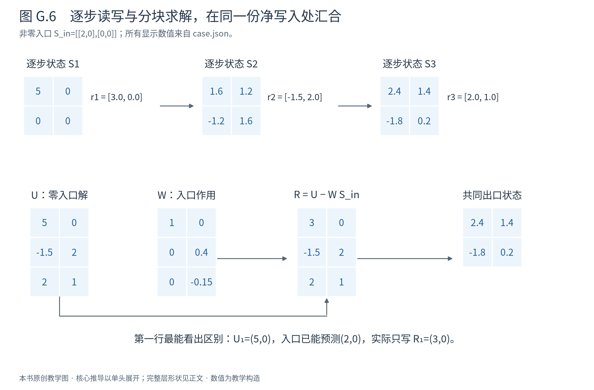
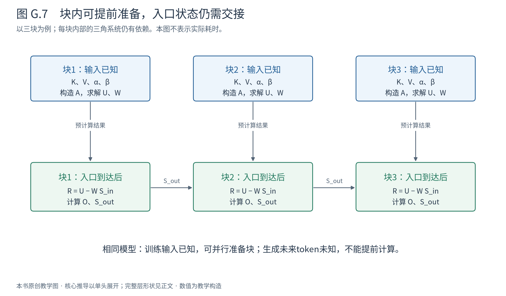
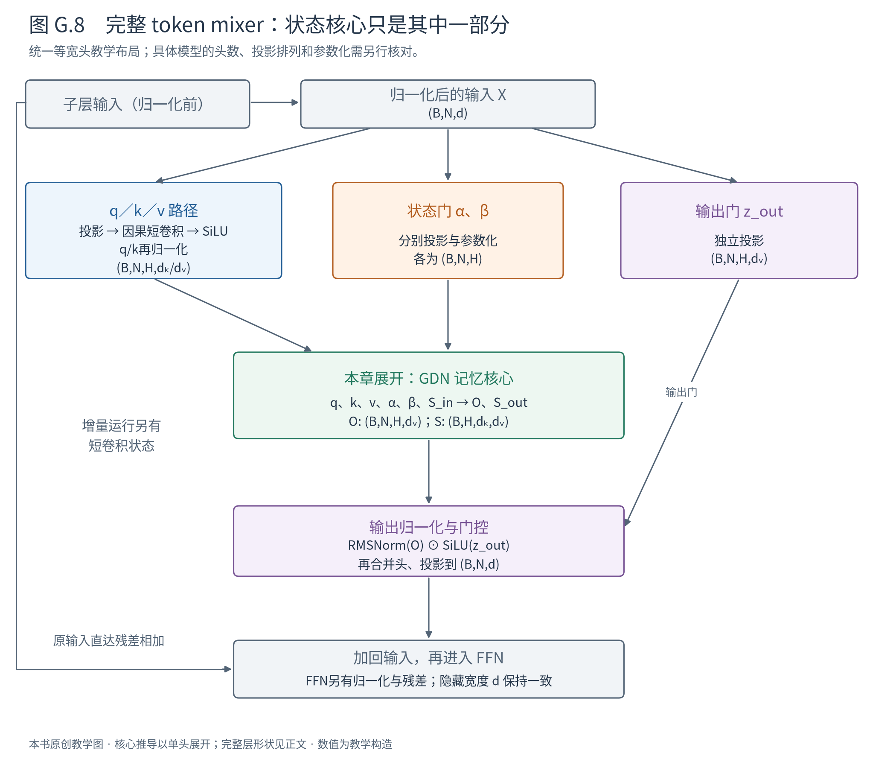
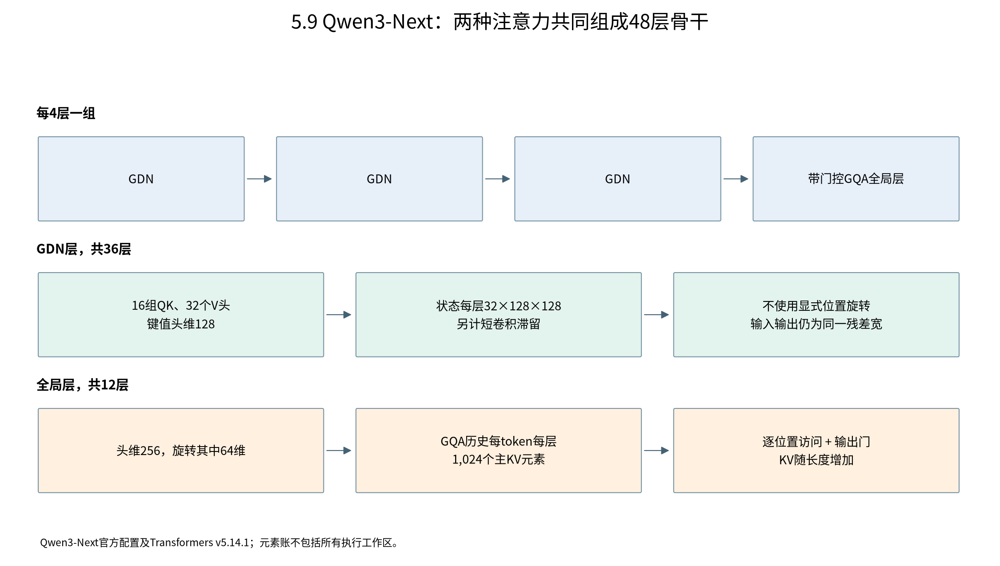
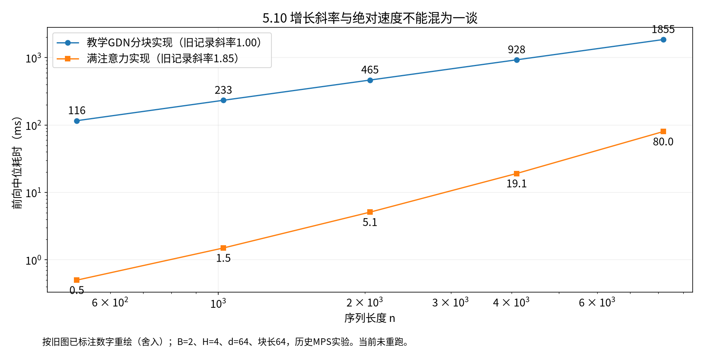

# 第5章 线性注意力与GDN：从逐项记忆到分块计算

可以先连读各节的第一段，掌握模型如何一步步改变；需要知道某一步为何成立时，再进入该节推导。第5.2—5.5节改变记忆机制，第5.6—5.10节为同一机制建立分块计算形式，第5.11节把它们装回完整模型。公式和手算都留在正文，便于随时向下追问。

## 5.1 我们要改变的是模型保存历史的方式

**本章要设计一种大小固定、又能随上下文改写的模型记忆，并使它适合训练和生成。** 设想模型先读到“甲的房间是5号”，后来又读到“甲搬到了3号”：回答当前住址，需要更新有效信息；追问曾住哪里，又可能需要保留旧记录。这两个要求揭示了设计的取舍。我们将从保存所有位置出发，逐步引入历史汇总、按键修正和可控遗忘，再组织等价的分块计算；最终得到一种可用于模型内容交互子层的记忆机制，同时看清它为何仍可能需要与注意力配合。

我们已经熟悉一种办法：每个位置留下自己的 key 和 value。新来的 query 与可见的 key 比较，再按权重取回 value。过去的记录各自保留，新的查询仍有机会分别访问它们。代价是历史越长，保存和查询的内容通常越多。

本章考察另一种办法：**不把每个位置单独存下来，而是让它们共同更新一张固定大小的矩阵。** 新来的 query 只读取这张矩阵。于是问题变了：不同记录写入同一张矩阵，会不会互相干扰？同一件事发生变化，能否修改原有记忆？这张矩阵按时间更新，训练时又怎样批量计算？

设计会沿着这些问题推进。为控制历史增长的成本，先寻找可以汇总的相似度计算；汇总带来关联之间的干扰，便让写入先检查旧预测、只修正差额；定向修正不足以让整个旧场景淡出，再增加独立的遗忘门。此时读写规则已经确定，新的问题是怎样高效训练它，于是才需要分块和三角系统。每一步数学都对应一个尚未解决的模型问题。



图 G.1 从上到下读。第一行把模型遇到的问题与改造放在一起：历史成本推动汇总，关联冲突推动修正，过时背景推动遗忘；箭头表示本章的设计问题链，不表示唯一历史来源。第二行把变化放回模型：我们主要打开的是 token 之间交换信息的子层，FFN、残差等先保持折叠。第三行区分记忆设计、计算组织和整机组合。图由本书依据P1–P4制作；各论文与实现出处见章末。

这三件事将依次解决：线性注意力说明如何把历史合并；DeltaNet 和 Gated DeltaNet 说明如何修改这份记忆；分块算法说明怎样重新组织同一套更新。前两步包含模型设计变化，最后一步则要求数学等价。把这两类事情分清，后面的推导才不会混乱。

在本文采用的论文脉络中，2020年的线性注意力工作给出了核表示与循环计算之间的联系；2021年的快权重工作从关联记忆角度讨论加法写入与Delta更新；2024年首次公开的DeltaNet并行化与GDN论文，进一步处理高效计算和可控遗忘。年份标记的是这些论文节点，不代表相应数学工具此前不存在。正文按理解依赖重新排列：先理解怎样更新，再理解怎样把更新算快。[P1–P4]

全章固定一个约定：单个 token 的向量都写成列向量，记忆矩阵 **S 的行对应键方向，列对应值分量**。推导先省略批量与头轴，最后再补回。符号第一次出现时会解释，不要求先背完一张大表。

## 5.2 从一份加权平均，走到一张固定矩阵

**用可分解的核来定义相似度，模型就能先把历史键值汇总，再让查询读取这份汇总。** 这样，当前子层不再为每次读取重新访问全部历史位置；在模型各维度固定时，解码记忆大小和每步核心成本都不随历史长度增长。因果性由“只读到当前位置的汇总”保留，归一化还需一份权重累计量。获得这些性质的代价是改变相似度与历史表示：过去的位置不再各自独立存放，不能把它当成原softmax注意力的无损替换。

### 5.2.1 先看分母，再讨论怎样减少计算

要让“先汇总、后查询”成立，查询与键的作用必须能够分开；有限特征内积提供了这种结构。我们先保留加权平均的分子与分母，再看选择这种结构究竟改变了哪里。

把序列长度记为 $N$，位置从1编号。对于第 $i$ 个查询，因果注意力只读取 $1\le j\le i\le N$ 的位置。令 $q_{i}$、$k_{j}$ 是 $d_{k}$ 维向量，$v_{j}$ 是 $d_{v}$ 维向量。用 $\kappa$ 表示非负的相似度函数，一般的归一化读取可以写成：

$$
 o_i=\frac{\sum_{j\le i}\kappa(q_i,k_j)v_j}{\sum_{j\le i}\kappa(q_i,k_j)}.
 \tag{G.1}
$$

分子形状为 $d_{v}$，分母是标量。只要分母为正，这就是把 value 按相似度混合：先计算带权总量，再除以权重总量。缩放点积 softmax 对应 $\kappa (q,k)=\operatorname{exp}(q^{\top}k/\sqrt{d_k})$。这里用 $\kappa$ 写的是未归一化相似度，softmax 的归一化仍由整个分式完成。

线性注意力选择一种特征映射 $\phi$，使相似度可以写成：

$$
 \kappa(q,k)=\phi(q)^\top\phi(k),\qquad
 \phi:\mathbb R^{d_k}\longrightarrow\mathbb R^m.
 \tag{G.2}
$$

m 是特征维度，不必等于原来的 $d_{k}$。P1 使用过逐元素的 ELU(x)+1；其各分量为正，因此任意两个这样的特征向量内积为正。这个例子同时提醒我们，“线性”不是指整个模型没有非线性，而是后面的计算能在固定特征维度下随序列长度线性增长。[P1，§3.2–3.3]

**选择 $\phi$ 是模型设计，不能凭结合律把原 softmax 原封不动地消掉。** 一旦选择了特定核，下面的重排才在这个核模型内部严格成立。若要近似原来的指数核，还需说明采用何种近似及其误差；本章不作这种额外承诺。

### 5.2.2 一个外积如何替代多次查询时的重复工作

关键结果是：每个历史位置对未来查询有用的贡献，可以先写成一个外积并累加；新查询只需读取累计矩阵。分母也能同样累计，因此一次完整读取需要矩阵和向量两份状态。下面展开一个值分量，说明这份可复用记忆为何与当前查询无关。

暂把 $\phi (q_{i})$、$\phi (k_{j})$ 写成 $a_{i}$、$b_{j}$，二者都是 m 维列向量。分子的第 $\ell$ 个值分量为：

$$
 \sum_{j\le i}(a_i^\top b_j)v_{j,\ell}
 =\sum_{j\le i}\sum_{r=1}^{m}a_{i,r}b_{j,r}v_{j,\ell}
 =\sum_{r=1}^{m}a_{i,r}\left(\sum_{j\le i}b_{j,r}v_{j,\ell}\right).
 \tag{G.3}
$$

最后一个等号只是交换两个有限求和的顺序。关键在括号内：它已经不含当前查询 $a_{i}$。只要保存所有 r、$\ell$ 的这些和，后续查询就能复用它们。

把括号内的数排成矩阵，再为分母保存一份向量：

$$
 S_i=\sum_{j\le i}b_jv_j^\top\in\mathbb R^{m\times d_v},
 \qquad z_i=\sum_{j\le i}b_j\in\mathbb R^m.
 \tag{G.4}
$$

其中 $b_{j}v_{j}^{\top}$ 是外积：第 r 行第 $\ell$ 列恰好是 $b_{j,r}v_{j,\ell}$。代回式(G.1)，我们得到：

$$
 o_i=\frac{S_i^\top a_i}{z_i^\top a_i},\qquad
 S_i=S_{i-1}+b_iv_i^\top,\quad z_i=z_{i-1}+b_i.
 \tag{G.5}
$$

这不是“把分母省掉了”。矩阵 S 保存带权值的累计量，向量 z 保存权重的累计量；二者一起才实现原先约定的加权平均。从空历史开始时，$S_0=0$、$z_0=0$，先写入第一个位置，再读取，因此不会用空历史的零分母做除法。一次写入的形状是 $(m,1)\times (1,d_{v})\to (m,d_{v})$，读取是 $(d_{v},m)\times (m,1)\to (d_{v},1)$。

若所有查询都允许读取全部 N 个位置，把特征按行堆成 $\Phi_Q$、$\Phi_K\in\mathbb R^{N\times m}$，$V\in \mathbb R^{N\times d_v}$，分子可以直接重排：

$$
 \underbrace{(\Phi_Q\Phi_K^\top)}_{N\times N}V
 =\Phi_Q\underbrace{(\Phi_K^\top V)}_{m\times d_v}.
 \tag{G.6}
$$

右侧先形成固定大小的状态，避免显式展开 $N\times N$ 的相似度表。**因果版本不能让每一行都读取这个最终状态**，否则第一行也会看到最后一个 token。它读取的是式(G.4)的前缀状态 $S_{i}$。相同的结合律在这里落实为递推或前缀计算，而不是让所有位置共用 $S_N$。



图 G.2 左侧展示全可见情形的矩阵形状，右侧展示因果前缀。沿右侧的箭头读，位置 i 只能用更新到 i 的状态。图中省略了分母向量 z；式(G.5)始终保留它。两种读取权限不同，不能把左侧的最终状态直接搬到右侧所有位置。

在 m、$d_{v}$ 固定时，每个 token 的外积与读取成本都是 $O(md_{v})$，整段为 $O(Nmd_{v})$，另有更新 z 的 O(Nm)。单头解码状态需要 $md_{v}+m$ 个数，与已读长度无关。这里说的是这一递推核心；特征映射、输入输出投影以及训练反向所需的存储，还要另外计算。

放回模型，这一步改动的是内容交互子层的历史表示：原先留下逐位置的KV，现在留下持续更新的累计状态。查询投影仍负责提出要读什么，键和值仍由输入表示生成，但旧记录已经合并。模型得到可复用的小状态，也必须面对新问题：同一关联出现新版本时，这份汇总会怎样回答？

## 5.3 矩阵保存了什么，又混在一起了什么

**固定矩阵控制了历史状态的大小，也让多条记录共享同一组存储方向。** 单纯相加时，同键新值会与旧值累计或平均；不同键之间也可能因方向重叠而互相影响。因而，若希望模型维护“当前有效关联”，仅仅压缩历史还不够，还要控制怎样改写已有预测。本节的内积计算将找出干扰发生在哪里，为下一步按键修正提供依据；它不意味着平均型记忆对所有任务都不合适。

### 5.3.1 先把“累计量”与“归一化读数”分开

同一个键先写5、再写3，单纯累计会读到8，归一化平均会读到4；二者都没有自动实现“以新值修正旧值”。先区分这两种读数，才能判断要改变的是哪一条模型更新规则。

为看清记忆结构，下面先研究未归一化的关联矩阵 S，暂不把它的读数当作式(G.5)的最终输出。令键维度和值维度均为 2，键 $k=(1,0)^{\top}$。先写值 $(5,0)^{\top}$，再用同一个键写值 $(3,0)^{\top}$。加法更新得到：

$$
 S_1=\begin{pmatrix}5&0\\0&0\end{pmatrix},\qquad
 S_2=\begin{pmatrix}8&0\\0&0\end{pmatrix},\qquad S_2^\top k=\begin{pmatrix}8\\0\end{pmatrix}.
 \tag{G.7}
$$

若同时按式(G.5)维护 z，第二次读取还要除以 2，得到 $(4,0)^{\top}$，而不是 $(8,0)^{\top}$。两者都不是“最新值 3”：一个是累计量，一个是平均量。这个例子提出的需求是**按键更新关联内容**，并不证明加权平均这个运算本身有错。

自此进入快权重／关联记忆的设计：用 $S^{\top}k$ 预测一个键对应的值，并让后续写入修改预测。这是输出与更新约定的变化。早期快权重论文还讨论了不同归一化方案；本章接下来采用现代 DeltaNet/GDN 常用的线性读出，最终层再使用输出归一化，而不是悄悄把式(G.5)的分母漏写。[P2，§4.2；P3，§3.3]

### 5.3.2 干扰来自键之间的内积

一次写入对另一查询的影响，由两个键方向的内积控制：正交方向不受影响，重叠方向会受到牵连。于是，选择和学习键空间本身就是记忆设计的一部分；下面的一行计算把这种设计约束明确写出来。

设我们向已有记忆加入 $kv^{\top}$，再用另一个键 p 查询。新旧读数的差为：

$$
 (S+kv^\top)^\top p-S^\top p
 =v(k^\top p).
 \tag{G.8}
$$

这是一个完整的几何解释：写入量由 v 决定，但它对另一查询的影响由 $k^{\top}p$ 决定。正交时影响为零；方向接近时会相互影响；内积为负时影响方向相反。我们无需先把“容量不足”当作口号，直接计算就能看见碰撞从哪里来。

在 $d_{k}$ 维空间，至多有 $d_{k}$ 个两两正交的非零方向。这限制了用这种正交地址实现无干扰存储的方式，却不等于模型只能记 $d_{k}$ 个 token，更不等于所有固定状态模型都无法正确回答任何检索问题。实际任务可能允许共享、压缩、近似，也可能只要求保存少数关联。

真正需要改进的是写入指令：当已有预测与新值冲突时，为什么还要把新值整个叠上去？我们已经能读取旧预测，接下来就利用它。

## 5.4 Delta rule：只写入当前预测还缺少的部分

**给写入增加一条“先读取旧预测”的支路，记忆就能按当前键修正已有内容。** 新增值不再整份累加，而是先减去旧预测、再写入差额；局部平方误差的梯度恰好给出这种定向修正规则。对单位键取完整修正步时，当前关联可以精确覆写，正交方向保持不变；非正交关联仍可能受影响。模型因此获得的是可控的关联修改方式，而不是一个无冲突的数据库。

### 5.4.1 从一个局部学习目标推导更新

平方损失在这里的作用，是把“让这个键读出的值更接近新内容”变成可计算的修改方向。它导出的梯度只沿当前键写入预测差额，正好对应我们希望增加的读后改写支路。

固定当前键 k 和目标值 v，把记忆矩阵当成一个线性预测器。我们希望 $S^{\top}k$ 接近 v，因此定义局部平方损失：

$$
 \mathcal L(S)=\frac12\lVert S^\top k-v\rVert_2^2.
 \tag{G.9}
$$

这一步是建模选择：用平方误差衡量当前关联是否已写好。并不是从 softmax 注意力的训练目标代数变形而来。为推导更新，令 $e=S^{\top}k-v\in \mathbb R^{d_v}$。对 S 的一个微小改变量 dS，

$$
 d\mathcal L=e^\top d(S^\top k)
 =e^\top(dS)^\top k
 =\sum_{r=1}^{d_k}\sum_{\ell=1}^{d_v}k_r e_\ell\,dS_{r\ell}.
 \tag{G.10}
$$

最后一行直接给出了每个矩阵元素的导数：$\partial\mathcal L/\partial S_{r\ell}=k_r e_\ell$，因此梯度矩阵是 $ke^{\top}$，形状为 $(d_{k},d_{v})$。学习率记为 $\beta$，做一步梯度下降：

$$
 S_{\mathrm{new}}=S-\beta k(S^\top k-v)^\top
 =S+\beta k(v-S^\top k)^\top.
 \tag{G.11}
$$

也就是说，**先问当前记忆已经能回答多少，再沿这个键写入剩下的误差**。$\beta$ 是修正强度；模型可以为每个 token、每个头产生不同的 $\beta$。局部梯度步改变的是快速记忆 S，训练整个网络仍需对产生 q、k、v、$\beta$ 的参数反向传播。[P2，Eq.20–25；P4，§3.1在线回归解释]

这与语言模型的训练有两层联系。网络参数决定怎样把隐藏表示变成键、值和修正强度；序列到来后，这些向量再决定当前记忆怎样变化。这里的值向量是网络产生的内部表示，并不是用户为每个位置提供的监督标签；这一步局部梯度是状态更新的数学解释，不要求推理时运行优化器修改整个模型的参数。开篇的“甲搬家”只是观察期望行为的情景：模型能否把两次提及映射到合适的键、把新住址编码到值中，仍要靠整机训练获得。

### 5.4.2 何时是真正的覆写

当前关联能否完全改写，取决于修正强度与键范数的共同作用。下面会看到，单位键配合完整修正步能精确达到新值；这也解释了为什么完整层要关心键的尺度，而不能把门的大小孤立理解。

把式(G.11)再次作用于同一个键 k：

$$
 S_{\mathrm{new}}^\top k
 =S^\top k+\beta\lVert k\rVert^2(v-S^\top k).
 \tag{G.12}
$$

于是新误差为：

$$
 v-S_{\mathrm{new}}^\top k
 =(1-\beta\lVert k\rVert^2)(v-S^\top k).
 \tag{G.13}
$$

这里把“覆写”的条件写清了。当 k 是单位向量、$\beta =1$ 时，当前键的预测恰好变为 v；当 $0<\beta <1$ 时，只修正相应比例。键未归一化时，有效步长是 $\beta \Vert k\Vert ^{2}$，不能只看 $\beta$。这个单样本局部误差要收缩，需 $|1-\beta \Vert k\Vert ^{2}|<1$，即 $0<\beta \Vert k\Vert ^{2}<2$；它不是整个深层网络训练稳定性的充分条件。

回到两次同键写入，第二次先读到 $(5,0)^{\top}$，残差是 $(-2,0)^{\top}$。取 $\beta =1$，新状态的第一行由 (5,0) 改成 (3,0)，第二行不变。

再换一个查询 p，它受到的影响是 $\beta (v-S^{\top}k)(k^{\top}p)$。因此“定向更新”不等于“只修改一个离散词条、绝不影响其他词条”：正交方向不受影响，非正交方向仍可能被改变。



图 G.3 画的是同键第二次写入。左图单独取一个记忆列为 $(5,2)^\top$，第二分量用于显示不受影响的正交成分；目标仍为3：沿 k 方向修正，垂直方向保持不变。右图把查询 p 旋转，显示其读数变化随 $k^{\top}p$ 改变。这里方向属于键空间，箭头长度属于相应记忆列，不把语义内容简单等同于向量长度。曲线数据由式(G.8)/(G.11)计算。

### 5.4.3 把更新拆成“保留算子＋写入”

从旧记忆的角度看，这一步只削弱当前键方向上的旧成分，再加入新关联。把更新拆成“怎样保留旧状态”和“怎样加入新值”，既能看清它保护了哪些方向，也会暴露下一项需求：与当前键无关的过时背景，还没有独立的遗忘控制。

展开式(G.11)并提出右侧的 S：

$$
 S_{\mathrm{new}}=(I-\beta kk^\top)S+\beta kv^\top.
 \tag{G.14}
$$

I 是 $d_{k}\times d_{k}$ 单位矩阵。对单位键，算子 $I-\beta kk^{\top}$ 在 k 方向的特征值为 $1-\beta$，在与 k 正交的方向为 1。因此它削弱旧记忆在当前键方向上的成分，再加入新关联。$\beta =1$ 时该方向的旧成分完全消失；只有 $\beta =2$ 且键为单位向量时，它才是把该方向翻转的 Householder 反射。一般的 Delta 更新不是正交反射。

这些方向结论可以直接验证：单位键满足 $(I-\beta kk^\top)k=(1-\beta)k$；若 $k^\top p=0$，则 $(I-\beta kk^\top)p=p$。把任意记忆列分解成平行于键和垂直于键的两部分，就能看见前一部分被缩放、后一部分保持不变。

现在我们能在相应条件下精确修改当前键对应的预测，却还没有一种独立的方法让所有过时记忆整体淡出。这正是下一步要增加的能力。

## 5.5 Gated DeltaNet：先决定保留多少，再决定怎样改写

**在定向修正之前增加一个由输入控制的整体衰减门，就得到GDN的记忆核心。** 当上下文切换场景时，模型可以先降低旧背景的影响，再依据衰减后的预测写入当前差额；遗忘程度与当前关联的修正强度由两个门分别控制。新增的是一条旧状态的缩放路径，数学上使用标量收缩与Delta更新的组合。它让模型可以选择不同的记忆寿命，但整体衰减也会影响仍有用的旧信息，合适的门值仍需训练学得。

### 5.5.1 两个门控制不同的操作

两个门分开了“旧背景保留多少”和“当前关联修正多少”。顺序也有意义：若先遗忘，旧预测已经变了，所需的新写入必须据此重算；因此我们从衰减后的状态求残差。

引入每步的标量衰减 $\alpha _{t}$。先把整个旧状态缩成 $\bar S_{t}=\alpha _{t}S_{t-1}$，再在 $\bar S_{t}$ 上执行刚才推得的梯度更新：

$$
 \bar S_t=\alpha_t S_{t-1},\qquad
 r_t=\beta_t(v_t-\bar S_t^\top k_t),\qquad
 S_t=\bar S_t+k_tr_t^\top,\qquad o_t=S_t^\top q_t.
 \tag{G.15}
$$

$r_{t}\in \mathbb R^{d_v}$ 是**实际净写入向量**，可以有正有负，并不是概率。状态 $S_{t}\in \mathbb R^{d_k\times d_v}$；读出 $o_{t}\in \mathbb R^{d_v}$。本章把读出放在当前 token 写入之后，所以当前位置允许读取自身。

把 $r_{t}$ 展开，就得到 GDN 的矩阵形式：

$$
 S_t=\alpha_t(I-\beta_t k_tk_t^\top)S_{t-1}
      +\beta_t k_tv_t^\top.
 \tag{G.16}
$$

P4 的 Eq.10 使用值行、键列的状态；对其转置便得到式(G.16)。我们全章继续使用键行、值列，不在分块部分再次换向。

$\alpha$ 管整个旧状态的存活比例；$\beta$ 管衰减后预测的修正强度。实际常用参数化使 $\alpha$、$\beta$ 落在开区间 (0,1)，纸面上取 0 或 1 有助于检查极限行为：

|条件|状态更新发生什么|
|---|---|
|$\alpha=1$|不整体遗忘，退回 DeltaNet|
|$\beta=0$|没有新写入，但旧状态仍乘 $\alpha$|
|$\alpha=0$|旧状态清空，仍能写入 $\beta kv^\top$|
|单位键、$\beta=1$|当前键的预测成为 v；其他方向保留的是衰减后的旧记忆|

这两种操作互补，但不能简单把它说成“旧损失加一项 L2 正则就完全一样”：本式的预测和残差是在 **$\alpha S_{t-1}$** 上计算的。在未衰减的 $S_{t-1}$ 上计算损失梯度再加常规权重衰减，会得到不同的系数。



图 G.4 按箭头从左往右读：先衰减，再预测和求残差，再写回，最后查询。它描述单头核心，不包含完整层的投影和短卷积。$\beta$ 的箭头进入残差，$\alpha$ 的箭头进入旧状态；交换“先衰减”和“先计算残差”的顺序会改变公式。

### 5.5.2 一段足够直观的实现

下面是同一运算的单头教学伪码，语句与式(G.15)逐项对应；可运行的批量版本在配套 gdn_math.py 的 recurrent 函数。

```python
# q、k: (N, d_k)，v: (N, d_v)，S: (d_k, d_v)
# alpha、beta: (N,)；输入已经是递推核心需要的有效向量。
for t in range(N):
    faded = alpha[t] * S           # 整体遗忘；(d_k, d_v)
    predicted = k[t] @ faded       # 当前键读取旧预测；(d_v,)
    r = beta[t] * (v[t] - predicted)  # 本步真正要写的差额；(d_v,)
    S = faded + k[t, :, None] * r[None, :]  # 外积写回；(d_k, d_v)
    o[t] = q[t] @ S                # 读更新后的记忆；(d_v,)
```

代码把存储中的向量视为一维数组，所以 k[t] @ S 对应数学中的 $S^{\top}k$，二者的分量相同。这里没有原核平均中的 z 分母；输出的尺度管理由后面的层结构完成。核心运算和完整层的归一化职责将在第5.11节重新接起来。

回到设计进程，现在这个子层已经能把历史压进固定状态、按键修正关联、控制旧状态的存活比例。接下来要解决的是它的计算方式：序列很长时，怎样在保持这些行为的同时，让训练前向避免逐个token执行许多小操作？

### 5.5.3 特征映射、门的参数化与论文实验

**完整模型还要选择地址空间与门的生成方式。**这些选择改变表达和训练行为，而非分块算法本身；因此应与上面的等价推导分开读。除ELU+1外，快权重论文讨论了DPFP特征：先令$u=\operatorname{ReLU}([k;-k])\in\mathbb R^{2d_k}$，再将若干循环位移后的逐元素积$u\odot\operatorname{roll}(u,r)$拼接。若使用ν种位移，特征维为$2νd_k$。这扩展了非负特征组合，同时增大状态；零特征和分母保护要由具体实现处理。[P2]

对于现代GDN，常见遗忘门在log域生成。以每头h的可学参数$A_{\log,h}$、偏置$\delta_h$和输入投影$a_{t,h}$为例：

$$g_{t,h}=-e^{A_{\log,h}}\operatorname{softplus}(a_{t,h}+\delta_h),\qquad
\alpha_{t,h}=e^{g_{t,h}},\quad\beta_{t,h}=\sigma(b_{t,h}).\tag{G.47}$$

因为softplus为正，g为负，α落入(0,1)。$A_{\log}$与δ按头学习，a、b随token变化。取g=−log2时，每步保留一半；连续m步同门时保留$2^{-m}$，半衰期为一步。门接近1可以延长记忆，接近0可以快速清除，但模型需要学习什么内容值得保留。[P4，§3.4脚注；I1]

原章引用的GDN论文实验保留如下。它们比较的是训练完成的完整模型，不是仅替换一个门的解析实验，因此不能从单格分数唯一反推失败原因。

|任务与长度|DeltaNet|Mamba2|GDN|
|---|---|---|---|
|单针8K|98.8|30.4|91.8|
|多针4K|18.6|56.2|92.2|
|值检索4K|22.4|4.6|27.6|

来源：P4 v3 Table 2，1.3B、100B token设置。GDN并非每格最优；表中双机制在多针任务上有明显优势。报告Table 4的真实检索均值为纯GDN 30.6、H1/H2混合39.0/40.1；这支持考察混合结构，却不证明某一比例是普适最优。

|机制|历史权重归一化|完整层的尺度控制|
|---|---|---|
|Katharopoulos线性注意力|维护z，读取时除$q^\top z$|另有外围层结构|
|现代GDN|递推核心不含同一分母|q/k归一化，逐token逐头输出RMSNorm与输出门|
|KDA|递推核心无softmax分母|第6章说明通道衰减与逐头归一化/输出门|

输出归一化不是把第5.2节的历史分母原封不动搬到后面；两者数学作用不同。块长变化也不应改变归一化的语义。

## 5.6 递推可以训练，为什么还要分块

**固定大小的记忆便于逐步生成，却不自动带来高效的长序列训练。** GDN递推可以反向传播，但逐token的小操作和状态依赖限制了批量计算的组织。分块方案利用更新的仿射与秩一结构，把本块已知输入的处理和跨块状态交接分开，让大量计算转成矩阵乘。这里希望获得的是同一模型的另一种计算形式：读写行为、因果关系和上下文记忆都保持一致，实际速度仍取决于实现。

具体看式(G.15)，每一步主要是矩阵—向量和外积，朴素反向还可能保存每一步的矩阵状态。若整段输入已知，我们希望把这些操作组织成更大、更规则的计算，但不能改变先前确定的更新次序所代表的含义。

用式(G.16)写，令 $E_{t}=I-\beta _{t}k_{t}k_{t}^{\top}$，$b_{t}=\beta _{t}k_{t}v_{t}^{\top}$，每步是 $S\mapsto \alpha _{t}E_{t}S+b_{t}$。仿射变换的复合仍满足结合律。两个变换的合成是：

$$
 (F_2,b_2)\circ(F_1,b_1)=(F_2F_1,\ F_2b_1+b_2).
 \tag{G.17}
$$

这里 $F_t=\alpha_tE_t$ 是状态转移算子，形状为 $(d_k,d_k)$。这个式子说明，原则上可以使用并行扫描；但若直接合成稠密算子，就引入 $d_{k}\times d_{k}$ 矩阵乘、更多中间量和访存，未必合算。

因此我们寻找更具体的组织：把序列切成块长 C 的小块，把**块内已知的 token 数据**尽可能预计算，把块入口状态作为独立输入。这样既利用秩一更新的结构，又不必为每个 token 保存完整状态。C 是算法参数，不是模型的数学常数。64 是某些实现的默认值，不是推导规定的值。[P3，§3.1–3.2；P4，§3.3]

接下来先不说 WY 或 UT。我们从三步递推亲手展开，等看到三角系统以后，再解释这些名字指向什么。

## 5.7 把一个三 token 块真正展开

**块内任意位置的记忆，都可以拆成“入口记忆留下的部分”和“本块截至当前位置的各次净写入留下的部分”。** 每一部分只经过它实际遇到的遗忘门，所以能够逐项追踪。这个拆分让我们把一段序列看成带入口记忆的计算单元，为后续批量求解准备接口；块长只划分计算，入口状态仍携带更早的历史，不是滑动窗口的截断边界。三步展开将建立这份记忆账目，写入之间的依赖还留待下一节处理。

### 5.7.1 先定义边界和衰减区间

入口带来的记忆经历块内从第一步起的门，而本块新写入只经历它写入之后的门。把这两类存活区间分清，才能在改变计算分块时保留模型原有的遗忘行为。

块内位置重新编号为 i=1,…,C，入口状态记为 $S_{\mathrm{in}}$，出口为 $S_{\mathrm{out}}$。块内的 $S_{0}$ 就是 $S_{\mathrm{in}}$；它不必为零，因为前一块已经写过内容。

定义两个“从哪里到哪里”的存活比例：

$$
 \gamma_i=\prod_{t=1}^{i}\alpha_t,\qquad
 D_{ij}=\begin{cases}
 \displaystyle\prod_{t=j+1}^{i}\alpha_t,&j\le i,\\
 0,&j>i.
 \end{cases}
 \tag{G.18}
$$

$\gamma _{i}$ 是块入口活到位置 i 的比例，$D_{ij}$ 是位置 j 写完后活到位置 i 的比例。**刚写入的内容不再乘本步 $\alpha _{j}$**，所以乘积从 j+1 开始。对角 $D_{ii}=1$，因为空乘积为 1；上三角为零，因为未来写入不能影响过去输出。$\gamma _{0}=1$。

若 $\alpha _{t}>0$，可以令 $g_t=\log\alpha_t$、$c_i=\sum_{t=1}^i g_t$，则 $\gamma _{i}=\operatorname{exp}(c_{i})$，下三角 $D_{ij}=\operatorname{exp}(c_{i}-c_{j})$。这只是把乘积改写成指数和。上三角仍必须明确置零。若某步 $\alpha =0$，乘积定义仍有效，而 log 或 $\gamma _{i}/\gamma _{j}$ 可能出现奇点；教学实现使用有限乘积以覆盖这一边界。

### 5.7.2 不消去净写入，先展开状态

展开后，所有旧状态与新写入都有明确的来处和存活比例。我们暂时把每次净写入当作一个整体保留，先解决“记忆从哪里来”，再解决“这些写入怎样相互影响”，避免同时处理两层依赖。

从式(G.15)的 $S_{i}=\alpha _{i}S_{i-1}+k_{i}r_{i}^{\top}$ 出发，连续写三行：

$$
 \begin{aligned}
 S_1&=\alpha_1S_{\mathrm{in}}+k_1r_1^\top,\\
 S_2&=\alpha_2(\alpha_1S_{\mathrm{in}}+k_1r_1^\top)+k_2r_2^\top\\
    &=\alpha_2\alpha_1S_{\mathrm{in}}+\alpha_2k_1r_1^\top+k_2r_2^\top,\\
 S_3&=\alpha_3\alpha_2\alpha_1S_{\mathrm{in}}
      +\alpha_3\alpha_2k_1r_1^\top+\alpha_3k_2r_2^\top+k_3r_3^\top.
 \end{aligned}
 \tag{G.19}
$$

每次代入都只做分配，并给已有项多乘本步 $\alpha$。把这个规律用式(G.18)记下，得到：

$$
 S_i=\gamma_iS_{\mathrm{in}}+\sum_{j\le i}D_{ij}k_jr_j^\top.
 \tag{G.20}
$$

可以直接归纳验证：对 $i-1$ 的式子乘 $\alpha _{i}$，会把 $\gamma _{i-1}$ 变成 $\gamma _{i}$，把旧的 $D_{i-1,j}$ 变成 $D_{ij}$；再加本步 $k_{i}r_{i}^{\top}$，正好补上 $D_{ii}=1$ 的项。

式(G.20)尚未解决依赖，因为 $r_{i}$ 还需要 $S_{i-1}$。它的价值是把每一笔写入的后续衰减单独显露出来。下一节会把这些 r 当作未知量，整理它们之间的方程。

### 5.7.3 同一份小数据，先按时间算一遍

这个算例的关键是块入口已经存有内容：第一步目标为5、旧预测为2，所以实际只需写入3。保留非零入口，才能检验后面的分块算法是否真的接上了上文，而不是把每块误当成一段新序列。

取 $d_{k}=d_{v}=2$，C=3。三个键均为单位向量，第二、第三个键正交；查询暂取与键相同。以下所有矩阵都是本书构造，数值可按有理数精确计算：

$$
 S_{\mathrm{in}}=\begin{pmatrix}2&0\\0&0\end{pmatrix},\quad
 Q=K=\begin{pmatrix}1&0\\3/5&4/5\\4/5&-3/5\end{pmatrix},\quad
 V=\begin{pmatrix}5&0\\0&2\\3&1\end{pmatrix},
 \quad \alpha=(1,1/2,1/2),\quad\beta=(1,1,1).
 \tag{G.21}
$$

Q、K、V 的第 i 行分别是 $q_{i}^{\top}$、$k_{i}^{\top}$、$v_{i}^{\top}$，因此形状分别为 (3,2)、(3,2)、(3,2)。这里为了便于手算取 $\beta =1$，是实际 sigmoid 门的边界构造。先按第5.5节的四个动作计算：

|位置|衰减后的状态 $\bar S_i$|旧预测 $\bar S_i^\top k_i$|净写入 $r_i$|更新后的状态 $S_i$|输出 $o_i$|
|---|---|---|---|---|---|
|1|[[2,0],[0,0]]|(2,0)|(3,0)|[[5,0],[0,0]]|(5,0)|
|2|[[2.5,0],[0,0]]|(1.5,0)|(−1.5,2)|[[1.6,1.2],[−1.2,1.6]]|(0,2)|
|3|[[0.8,0.6],[−0.6,0.8]]|(1,0)|(2,1)|[[2.4,1.4],[−1.8,0.2]]|(3,1)|

表 G.1 是纸面构造例的中间产物，数组以“先行后列”的存储格式展示，向量数对表示列向量的分量。小数都是相应有理数的有限表示；配套脚本另用符号有理数检查这三步。

以第二行为例，预测是 (3/5,4/5) 读取衰减后状态得到的 (1.5,0)。新值 (0,2) 减去预测，得到 $(-1.5,2)$。外积把它分别乘 3/5 和 4/5，加到两行，得到表中的 $S_{2}$。负分量不是异常，它正是在撤销当前键方向上不再需要的部分。

因为本例是单位键、$\beta =1$、q=k，每步输出正好等于本步 v；这只是式(G.12)的特例。真实查询不必等于当前键，一般输出也不等于当前 value。后面的随机检查使用不同查询、非方形状态和多组门，避免被这个方便的算例掩盖错误。

## 5.8 从三条相依方程，得到两个可预计算的量

**本块的净写入可以由一个下三角系统求出，并拆成两组不依赖入口记忆的预计算量。** 三角结构记录“只有过去写入影响当前修正”；方程的线性性则把“零入口时本块会写什么”和“入口记忆会怎样改变写入”分开。这样，各块可以先处理自己的输入，等入口到达后再合成真实写入，同时保留原有的因果和覆写行为。我们减少了必须等待入口的工作，但没有让写入之间的依赖消失。

### 5.8.1 把状态展开式代回残差

每次净写入要扣除两种已有预测：上一个块留下的预测，以及本块更早写入造成的预测。把这两种贡献列出来，就能将“读取一个尚未算出的状态”转成“求解一组净写入之间的方程”。

净写入的定义是 $r_{i}=\beta _{i}(v_{i}-\alpha _{i}S_{i-1}^{\top}k_{i})$。先把式(G.20)取到 $i-1$，再乘 $\alpha _{i}$：

$$
 \alpha_i S_{i-1}=\gamma_iS_{\mathrm{in}}
                +\sum_{j<i}D_{ij}k_jr_j^\top.
 \tag{G.22}
$$

转置并右乘 $k_{i}$，外积项变成 $r_{j}(k_{j}^{\top}k_{i})$。于是：

$$
 \begin{aligned}
 r_i
 &=\beta_i\left(v_i-\gamma_iS_{\mathrm{in}}^\top k_i
             -\sum_{j<i}D_{ij}(k_j^\top k_i)r_j\right),\\
 r_i+\sum_{j<i}\beta_iD_{ij}(k_i^\top k_j)r_j
 &=\beta_i v_i-\beta_i\gamma_iS_{\mathrm{in}}^\top k_i.
 \end{aligned}
 \tag{G.23}
$$

第一行来自代入，第二行把含未知净写入的项移到左边，并使用实向量内积的对称性。至此所有依赖都明确了：第 i 次净写入，需要扣掉旧块已经给出的预测，还要扣掉本块更早写入经衰减后对当前键的贡献。

定义系数 $\ell _{ij}=\beta _{i}D_{ij}(k_{i}^{\top}k_{j})$，只在 j<i 时使用。它的三个因子分别是**本次修正强度、早先写入的存活比例、两个键的重叠程度**。它可能为负，因此“冲销强度”只是方便的口头说法，不代表系数总非负。

### 5.8.2 三行方程怎样排成一个矩阵

按时间给方程排队，依赖系数自然只落在对角线下方；这个单位下三角矩阵就是块内因果关系的计算表示。它把一段状态更新组织成结构明确的求解问题，而不是把未来位置也混进当前预测。

令 $b_{i}=\beta _{i}(v_{i}-\gamma _{i}S_{\mathrm{in}}^{\top}k_{i})$。前三条方程逐条是：

$$
 r_1=b_1,\qquad
 \ell_{21}r_1+r_2=b_2,\qquad
 \ell_{31}r_1+\ell_{32}r_2+r_3=b_3.
 \tag{G.24}
$$

每条都是 $d_{v}$ 维向量方程。把它们转成行向量，按位置竖着堆叠：

$$
 \underbrace{\begin{pmatrix}
 1&0&0\\ \ell_{21}&1&0\\ \ell_{31}&\ell_{32}&1
 \end{pmatrix}}_{A\in\mathbb R^{3\times3}}
 \underbrace{\begin{pmatrix}r_1^\top\\r_2^\top\\r_3^\top\end{pmatrix}}_{R\in\mathbb R^{3\times d_v}}
 =\begin{pmatrix}b_1^\top\\b_2^\top\\b_3^\top\end{pmatrix}.
 \tag{G.25}
$$

A 的第 i 行正好装第 i 条方程的系数。对角为 1，是因为左边 $r_{i}$ 的系数为 1；上三角为零，是因为当前写入不依赖未来写入。对任意有限系数，这个单位下三角矩阵都可逆，因为行列式为对角乘积 1。不过可逆不等于数值上总是良态，误差仍可能随问题规模与系数积累。

推广到 C 个位置，L 是 A 去掉单位对角后的严格下三角部分：

$$
 L=\operatorname{tril}\!\left(\operatorname{diag}(\beta)
                  (D\odot KK^\top),-1\right),\qquad A=I_C+L.
 \tag{G.26}
$$

这里 $\odot$ 是逐元素乘，$\operatorname{tril}(\cdot,-1)$只保留对角线以下。$\operatorname{diag}(\beta )$左乘矩阵会按行缩放：第 i 行乘 $\beta _{i}$，不能误写成按列乘 $\beta _{j}$。



图 G.5 左边表示“早写入影响后预测”的方向，右边是式(G.21)算例的 L 和 A。系数 $0.3=1\times 0.5\times 0.6$，$0.2=1\times 0.25\times 0.8$；位置2、3的键正交，因此 $\ell _{32}=0$。A 保留单位对角，L 则没有对角。图中橙色突出单位对角；上三角的零对应被排除的未来依赖。

### 5.8.3 为什么要解两个右端

入口还没到达时，仍能分别算出“从空记忆开始的写入方案”和“已有记忆对这份方案的修正系数”。这是利用线性性拆分计算的直接收益：真实入口到达后只需组合两部分，不必从头重做块内求解。

式(G.23)右边包含两类东西：由本块值向量确定的部分，以及依赖入口状态的部分。将它们矩阵化：

$$
 AR=\operatorname{diag}(\beta)V
          -\operatorname{diag}(\beta\odot\gamma)K S_{\mathrm{in}}.
 \tag{G.27}
$$

形状逐项为：$(C,C)\times (C,d_{v})$；右边第一项 $(C,d_{v})$，第二项 $(C,d_{k})\times (d_{k},d_{v})$。这里 $\beta \odot \gamma$ 是两个长度 C 的向量逐元素相乘。

我们可以等入口状态到达后直接解式(G.27)。但如果希望先处理本块数据，就利用线性方程对右端的线性性，分别定义：

$$
 AU=\operatorname{diag}(\beta)V,\qquad
 AW=\operatorname{diag}(\beta\odot\gamma)K.
 \tag{G.28}
$$

$U\in \mathbb R^{C\times d_v}$，$W\in \mathbb R^{C\times d_k}$。二者只依赖本块的 K、V、$\alpha$、$\beta$，不依赖入口状态。因为

$$
 A(U-WS_{\mathrm{in}})=AU-(AW)S_{\mathrm{in}},
$$

代入式(G.28)恰好得到式(G.27)右端，而 A 的解唯一，所以：

$$
 \boxed{R=U-WS_{\mathrm{in}}.}\tag{G.29}
$$

**U 是入口状态为零时的净写入解；R 才是当前实际入口状态下的净写入。** W 说明旧状态经过当前块的内部修正关系后，会改变多少写入量。它不是一份新的模型参数，而是由当前块数据算出的中间量。

这就是两个右端的必要性：若只解 U，实际上偷偷假设每个块都从零状态开始。分块计算必须记得前一块，第二个右端正是这条联系。

### 5.8.4 把三角方程也算给自己看

三角求解应当回到第5.7节同一组实际净写入；第一行必须是3而不是零入口方案给出的5。下面把两组预计算量和入口修正都列出来，核对跨块历史究竟通过哪一项影响当前计算。

统一算例的衰减、系数和两个右端为：

$$
 D=\begin{pmatrix}1&0&0\\.5&1&0\\.25&.5&1\end{pmatrix},\quad
 \gamma=\begin{pmatrix}1\\.5\\.25\end{pmatrix},\quad
 A=\begin{pmatrix}1&0&0\\.3&1&0\\.2&0&1\end{pmatrix},
 \tag{G.30}
$$

$$
 \operatorname{diag}(\beta)V=\begin{pmatrix}5&0\\0&2\\3&1\end{pmatrix},\qquad
 \operatorname{diag}(\beta\odot\gamma)K=
 \begin{pmatrix}1&0\\.3&.4\\.2&-.15\end{pmatrix}.
 \tag{G.31}
$$

先解 U：第一行为 (5,0)；第二行从 (0,2) 扣掉 $0.3\times (5,0)$，得 $(-1.5,2)$；第三行从 (3,1) 扣掉 $0.2\times (5,0)$，得 (2,1)。

再解 W：第一行为 (1,0)；第二行为 $(.3,.4)-.3\times (1,0)=(0,.4)$；第三行为 $(.2,-.15)-.2\times (1,0)=(0,-.15)$。因此：

$$
 U=\begin{pmatrix}5&0\\-1.5&2\\2&1\end{pmatrix},\quad
 W=\begin{pmatrix}1&0\\0&.4\\0&-.15\end{pmatrix},\quad
 WS_{\mathrm{in}}=\begin{pmatrix}2&0\\0&0\\0&0\end{pmatrix},\quad
 R=\begin{pmatrix}3&0\\-1.5&2\\2&1\end{pmatrix}.
 \tag{G.32}
$$

R 的三行与表G.1中的 $r_{1}$、$r_{2}$、$r_{3}$逐项一致。第一行尤其值得看：U 给 5，实际只需要写 3，因为入口已经有 2。这个差异是非零入口算例的教学价值。



图 G.6 上方沿时间推进，下方从 A 解出 U、W；两路最终得到相同 R 和出口状态。图的数据由配套 case.json 生成；显示值作小数舍入，底层同时保留浮点数和有理数验证。这里还没有做性能比较，只有数学与数值一致性。

## 5.9 净写入已知后，怎样一次得到输出和出口状态

**一个块最终交付两种产物：每个位置的读出送往后续网络计算，一张块末记忆沿时间交给下一块。** 前者按各自的因果可见范围读取旧记忆和本块写入，后者汇总所有已发生更新。把这两个去向分开，既能成批计算当前位置的表示，又能继续处理后面的序列；不能让所有查询都读取块末记忆，否则早期位置会泄漏未来信息。至此，分块计算才完整实现了GDN子层的读出和状态交接。

### 5.9.1 每个输出拆成两个来源

每个位置的输出，都由“读取入口记忆”加上“读取本块可见的净写入”组成。这个分解把整块输出转成矩阵计算，同时要求每一行仍只看自己的过去和当前位置。

从式(G.20)读出 $o_{i}=S_{i}^{\top}q_{i}$，逐项转置：

$$
 o_i=\gamma_iS_{\mathrm{in}}^\top q_i
       +\sum_{j\le i}D_{ij}r_j(k_j^\top q_i).
 \tag{G.33}
$$

第一项读取旧块留下的状态；第二项读取本块已发生的净写入。外积变为 $r_{j}$乘一个标量 $k_{j}^{\top}q_{i}$，正是矩阵乘法结合律的直接应用。

令 $P=D\odot QK^{\top}$。它的第 i 行第 j 列是 $D_{ij}(q_{i}^{\top}k_{j})$，所以 P 的第 i 行乘 R，恰好等于式(G.33)中求和部分的转置。把输出按行堆成 $O\in \mathbb R^{C\times d_v}$：

$$
 \boxed{O=\operatorname{diag}(\gamma)Q S_{\mathrm{in}}
              +(D\odot QK^\top)R.}\tag{G.34}
$$

形状依次为 $(C,d_{k})\times (d_{k},d_{v})$ 与 $(C,C)\times (C,d_{v})$。P 是带衰减的因果内积矩阵，不是 softmax 概率表：元素可以为负，行和也不要求为1；它乘的是 R，不是原始 V。

### 5.9.2 块尾只需交接一张状态

下一块只需要继承更新完的矩阵记忆，不需要本块所有逐token中间状态。把各笔写入继续衰减到块尾并加总，就能保持这份固定大小的时间接口，使改变块长不等于改变模型可接续的历史。

把状态展开式(G.20)取到 i=C，定义 $\eta _{j}=D_{Cj}$，即第 j 次写入活到块尾的比例：

$$
 S_{\mathrm{out}}=\gamma_C S_{\mathrm{in}}
             +\sum_{j=1}^{C}\eta_jk_jr_j^\top.
 \tag{G.35}
$$

矩阵乘法 $K^{\top}\operatorname{diag}(\eta )R$ 的每一项恰好是 $k_{j}\eta _{j}r_{j}^{\top}$，因此：

$$
 \boxed{S_{\mathrm{out}}=\gamma_C S_{\mathrm{in}}
                        +K^\top\operatorname{diag}(\eta)R.}\tag{G.36}
$$

第二项形状为 $(d_{k},C)\times (C,d_{v})\to (d_{k},d_{v})$。注意 $\gamma _{i}$ 与 $\eta _{j}$的方向不同：前者从块入口走到当前位置，后者从当前写入走到块末。只有当前写入之后的门会衰减它，因此 $\eta _{C}=1$。

### 5.9.3 用同一组数验收最后两式

分块路径应同时给出与递推相同的三个输出和同一张末状态：仅仅输出正确而交接错误，下一块仍会改变模型行为。下面分别核对这两个产物，完成一次可继续运行的块计算。

本例 Q=K 且所有键都是单位向量，所以 P 恰好等于 A；一般情况下二者不同，不能在实现中互相替换。旧状态贡献和新写入贡献分别是：

$$
 \operatorname{diag}(\gamma)Q S_{\mathrm{in}}
 =\begin{pmatrix}2&0\\.6&0\\.4&0\end{pmatrix},\qquad
 PR=\begin{pmatrix}3&0\\-.6&2\\2.6&1\end{pmatrix}.
 \tag{G.37}
$$

两项相加，得到 O 的三行 (5,0)、(0,2)、(3,1)，与逐步读取完全一致。

出口状态中 $\eta =(.25,.5,1)^{\top}$，三笔写入分别为：

$$
 \begin{aligned}
 .25k_1r_1^\top&=\begin{pmatrix}.75&0\\0&0\end{pmatrix},\\
 .5k_2r_2^\top&=\begin{pmatrix}-.45&.6\\-.6&.8\end{pmatrix},\\
 k_3r_3^\top&=\begin{pmatrix}1.6&.8\\-1.2&-.6\end{pmatrix}.
 \end{aligned}
 \tag{G.38}
$$

再加 $\gamma _{3}S_{\mathrm{in}}=$[[.5,0],[0,0]]，得到：

$$
 S_{\mathrm{out}}=\begin{pmatrix}2.4&1.4\\-1.8&.2\end{pmatrix}.
 \tag{G.39}
$$

至此两条路径闭合：逐步版本在每个 token 后修改 S；分块版本先算 U、W，再由入口得到 R，最后计算整块 O 和一个 $S_{\mathrm{out}}$。它们改变的是运算的组织方式，模型定义和因果关系没有改变。

下面的单头教学伪码对应式(G.26)–(G.36)。D、$\gamma$、$\eta$按式(G.18)及块尾乘积构造；可运行代码使用相同运算，并支持批量维度。

```python
# Q、K: (C,d_k)，V: (C,d_v)，S_in: (d_k,d_v)
L = tril(beta[:, None] * D * (K @ K.T), diagonal=-1)
A = eye(C) + L                     # 单位下三角；(C,C)
U = solve_triangular(A, beta[:, None] * V, upper=False)
W = solve_triangular(A, (beta * gamma)[:, None] * K, upper=False)
R = U - W @ S_in                  # (C,d_v)，先扣入口能预测的部分
P = D * (Q @ K.T)                 # (C,C)，D已把未来位置清零
O = (gamma[:, None] * Q) @ S_in + P @ R
S_out = gamma[-1] * S_in + K.T @ (eta[:, None] * R)
```

写成 $A^{-1}$在数学上没有问题，但实现目标是求解 AX=B，并不要求先显式生成整个逆矩阵。上面的 solve_triangular 按三角结构求解。生产实现可以有不同的分块和融合策略，不能从这个短教学程序直接推出实际加速比。

## 5.10 现在再理解 UT、WY，以及“并行”的确切含义

**UT把块内依赖组织成三角求解，WY利用每次修正的秩一结构紧凑表示连续状态变换；两者服务于同一更新规则的计算组织。** 模型因此可以在输入已知的训练或prompt处理中采用分块计算，在逐token生成时采用递推计算，而不必更换记忆机制。收益来自可预计算部分和矩阵操作的增加；三角系统内部、跨块状态和未来token的依赖仍需处理。数学等价保证两种形式应有相同行为，并不单独保证实际加速。

### 5.10.1 三角系统不是一个神秘变换

UT在这里对应已经推得的三角结构：把顺序修正之间的依赖先算成可复用系数，再作用于值和入口记忆。它没有给模型新增一条信息通路；下面先用无遗忘门的情形看清这个对应。

P3 的 UT 表达将顺序关系整理成单位三角系统。我们已经通过逐行方程推到它：无门控时所有 $\gamma_i=1$，而 $D_{ij}$ 在 $j\le i$ 时为1、在上三角为0，令

$$
 A_0=I_C+\operatorname{tril}(\operatorname{diag}(\beta)KK^\top,-1),
 \qquad T=A_0^{-1}\operatorname{diag}(\beta).
 \tag{G.40}
$$

则 U=TV，$W_{0}=TK$。T 只把原来的 $\beta$ 加权写入，转换成考虑了前面修正关系后的系数。所谓 UT 在这里对应这一三角结构与重排，不是另一个修改模型行为的非线性层。[P3，§3.2及附录B.2]

门控时，A 的系数额外包含 D，W 的右端也包含 $\gamma$；只把无门控系统乘一个最终衰减因子，不能得到全部输出。第5.8节的推导正是为了把这些位置不同的衰减放对。

### 5.10.2 WY 表示如何从秩一乘积里出现

连续更新旧记忆，表面上需要连乘许多完整状态变换矩阵；利用每步只修改一个键方向的秩一结构，可以把这个乘积压成两个较窄矩阵与单位阵的组合。WY表示的作用在于保留原变换、减少对稠密中间算子的依赖；下面的归纳说明它为何与先前的三角系统对应。

再看无门控时旧状态受到的线性作用。第 i 步的保留算子是 $E_{i}=I-\beta _{i}k_{i}k_{i}^{\top}$。按照本章键行取向，两步合成顺序是 $E_{2}E_{1}$，不是 $E_{1}E_{2}$。

希望把前 i 步的乘积写成：

$$
 E_i\cdots E_1=I-\sum_{j=1}^{i}k_jw_j^\top.
 \tag{G.41}
$$

第一步取 $w_{1}=\beta _{1}k_{1}$便成立。假设前 $i-1$ 步成立，左乘 $E_{i}$并展开：

$$
 \begin{aligned}
 E_i\left(I-\sum_{j<i}k_jw_j^\top\right)
 &=I-\sum_{j<i}k_jw_j^\top-\beta_i k_ik_i^\top
      +\beta_i\sum_{j<i}k_i(k_i^\top k_j)w_j^\top\\
 &=I-\sum_{j<i}k_jw_j^\top
      -k_i\left[\beta_i k_i-\beta_i\sum_{j<i}(k_i^\top k_j)w_j\right]^\top.
 \end{aligned}
 \tag{G.42}
$$

因此只要令 $w_i=\beta_i k_i-\beta_i\sum_{j<i}(k_i^\top k_j)w_j$，归纳就成立。这个递推的系数与 $A_{0}$相同，按行堆叠后正是 $A_{0}W_{0}=\operatorname{diag}(\beta )K$。于是：

$$
 E_C\cdots E_1=I-K^\top W_0.
 \tag{G.43}
$$

原本的 C 个 $d_{k}\times d_{k}$ 矩阵连乘，被表示成两个窄矩阵的乘积与单位阵之差。这就是紧凑 WY 一类表示在这里的作用。我们使用了秩一结构，并未宣称它们全是正交反射；第5.4节已经说明反射的特殊条件。[P3，§3.1及附录B.1]

标量门 $\alpha$ 与这些矩阵可以交换次序，所以旧状态的总线性作用是 $\gamma _{C}E_{C}\cdots E_{1}$。若所有 $\alpha >0$，由 $D_{ij}=\gamma _{i}/\gamma _{j}$可得：

$$
 A=\operatorname{diag}(\gamma)A_0\operatorname{diag}(\gamma)^{-1},
 \qquad W=\operatorname{diag}(\gamma)W_0.
 \tag{G.44}
$$

第二个等式来自把第一个代入 $AW=\operatorname{diag}(\beta \odot \gamma )K$，再消去左侧的 $\operatorname{diag}(\gamma )$。将 $R=U-WS_{\mathrm{in}}$代回式(G.36)，旧状态的系数是 $\gamma _{C}I-K^{\top}\operatorname{diag}(\eta )W$；由于 $\eta _{j}\gamma _{j}=\gamma _{C}$，它恰好等于 $\gamma _{C}(I-K^{\top}W_{0})$，与直接连乘再次一致。这是分块结果与秩一乘积表示之间的连接，不是另一套独立假设。

### 5.10.3 哪些工作真的可以提前做

训练或prompt处理时，本层输入已知，各块能先准备局部系数；入口到达后再完成实际写入与交接。逐token生成时未来输入未知，仍要逐步推进。分块带来的是可利用的计算组织空间，速度和训练存储还需结合具体实现判断。

在一层的训练前向中，送入该层的整个序列已经可用，因此各块的 Q、K、V 和门可以先产生。每块的 D、A、U、W 只依赖本块输入，可以分别计算。实际入口 $S_{\mathrm{in}}$到达后，才得到 R，再形成 O 与下一块的状态。



图 G.7 横向是块编号，纵向是计算阶段。上层每块的三角准备互不依赖其他块的入口状态；下层的状态交接仍是有方向的链。本图展示本文采用的分块扫描版本，不代表所有更复杂算法都只能顺序交接。

三个界限必须说清：

- 小三角系统内部仍有依赖。一次调用批量求解接口，不代表 C 个未知量彼此独立。
- 分块后大量操作变成矩阵乘，并且不必物化每个 token 的完整记忆状态；这为高效实现创造条件，实际速度还受块长、维度、融合、设备等影响。
- 训练时输入序列已知，能并行准备当前层的数据；生成时未来 token 尚未知，不能靠分块公式提前算出它们。prompt 处理与逐 token 生成可以选用不同计算形态。

按本文直接三角求解的教学算法，计算 K $K^{\top}$、Q $K^{\top}$及两个右端的求解，需要每块 $O(C^{2}(d_{k}+d_{v}))$；与入口状态交互及块末更新需要 $O(Cd_{k}d_{v})$。整段有约 N/C 个块，因此核心前向为：

$$
 O\!\left(Nd_kd_v+NC(d_k+d_v)\right),
 \tag{G.45}
$$

多批、多头再乘 B H。只有在 C、$d_{k}$、$d_{v}$固定时，这才是关于 N 的线性复杂度。若让 C=N，第二项仍会出现 $N^{2}$。投影、短卷积、FFN不在这个核心算量中。

解码只需更新一份 $d_{k}\times d_{v}$状态，但训练反向通常要保存或重算中间产物。本文脚本为了教学还主动保留调试轨迹，所以不能拿它的内存占用代表优化实现。精确等价、渐近复杂度、训练存储和实际速度，是四项分别需要证据的结论。

## 5.11 把递推核心重新放回模型

**把这个记忆机制变成可训练的模型子层，还需要网络自己生成地址、内容和门，并把读出送回残差流。** 投影学习如何编码查询与写入，短卷积提供局部信息混合，状态门控制保留和修正，输出归一化与输出门调节传回网络的表示。固定记忆仍有压缩和干扰的代价，因此整机可以把它与保留位置访问路径的注意力组合。这样的组合提供不同的信息保存方式，是否优于其他配方仍由具体任务和实验检验。

### 5.11.1 从输入表示到输出表示，中间还缺哪些部件

到目前为止，q、k、v 和门都是给定输入。实际层必须从模型隐藏表示 $X\in \mathbb R^{B\times N\times d}$中生成它们。这里 $B$ 为批量大小，$N$ 为序列长度，$d$ 为模型隐藏宽度；下面用 $H$ 表示头数，$d_k$、$d_v$ 继续表示每头的键维和值维。图G.8把刚推导完的核心放回完整 token mixer。



图 G.8 展开单个 token mixer 的职责，外围画出残差和 FFN 的位置。q/k/v 路径包含投影、逐通道因果短卷积及激活；q/k 另做归一化。$\alpha$、$\beta$及输出门从输入表示的其他投影得到。具体头数、投影排列和参数化属于实现选择，本图采用各头等宽的教学布局，不充当某个模型的完整配置图。结构依据 P4 §3.4/Fig.1及 I1。

把图中的形状按一次前向列出来：

|阶段|输入→输出|作用|
|---|---|---|
|q/k 投影与因果短卷积|$(B,N,d)\to(B,N,H,d_k)$|构造内容地址，短卷积混合局部邻域|
|v 投影与因果短卷积|$(B,N,d)\to(B,N,H,d_v)$|构造写入内容|
|q/k 归一化|形状不变|控制地址向量的尺度，不等于核平均中的分母|
|两门投影|$(B,N,d)\to$ 各 $(B,N,H)$|每个位置、每个头产生 $\alpha$ 和 $\beta$|
|记忆核心|q/k/v、门及 $(B,H,d_k,d_v)$ 入口→ $(B,N,H,d_v)$ 输出及末状态|本文推导的读写规则|
|输出归一化与门控|$(B,N,H,d_v)\to$ 同形状|控制核心输出的尺度与通过量|
|合并头并输出投影|$(B,N,Hd_v)\to(B,N,d)$|回到残差流所需宽度|

逐通道短卷积在每个通道内对近邻位置做加权和；“因果”意味着当前位置只使用当前及更早的输入，不读取未来。增量运行时，除了矩阵记忆 S，还需保留短卷积所需的近期输入。因此“核心状态固定”不能直接写成“整个层只存一张矩阵”。若模型还混有注意力层，整机仍需为这些层保留相应的 KV。

输出门也不要与 $\alpha$、$\beta$混淆。$\alpha$决定旧记忆怎样变化，$\beta$决定怎样修正当前关联；输出门决定这次读出的哪些分量传回残差流。以一个头的输出 h 为例，常见形式是 $\operatorname{RMSNorm}(h)\odot \operatorname{SiLU}(z_{\mathrm{out}})$，其中 $z_{\mathrm{out}}$ 是另一条投影产生的同宽向量。此处 RMSNorm 除的是输出自身的均方根，不是式(G.5)中针对历史键求和得到的 $z_{i}^{\top}a_{i}$。这里用 $z_{\mathrm{out}}$ 区别于第5.2节的分母累计向量 $z_i$。

具体说，对 $h\in\mathbb R^{d_v}$，RMSNorm把它除以 $\sqrt{d_v^{-1}\sum_{a=1}^{d_v}h_a^2+\varepsilon}$，再逐分量乘可学习的缩放系数；$\varepsilon>0$ 用来避免零分母。SiLU则逐分量计算 $z\,\sigma(z)$，其中 $\sigma(z)=1/(1+e^{-z})$。因此这条“输出门”不是概率向量，也不要求各分量之和为1；它只是在读出之后调节哪些分量传出去，没有改变本步已经写入的记忆。

于是，前面各项数学性质终于有了明确的架构位置。键的归一化把第5.4节的有效修正步长与键尺度联系起来；从输入产生的两个门让第5.5节的保留与修正成为内容相关的选择；第5.7—5.10节的等价式让同一个核心适应批量处理和增量生成。投影、短卷积与输出路径则把这个核心接到整层的输入输出契约上。训练要学习的是怎样使用这些可用操作，推导负责说明操作本身具有什么性质。

### 5.11.2 论文递推与实现约定怎样对齐

实现对照I1采用 transformers 5.14.1 中 Qwen3-Next 的两个纯 PyTorch 参考函数。它们同样使用键行、值列状态，但接口还有几项约定：

- 输入是 (B,N,H,d)，核心内部转为 (B,H,N,d)，与教学脚本的输入轴次不同。
- q 额外乘 $1/\sqrt{d_k}$。本章公式中的 q 可以视为已经包含这一步的有效查询；对拍时显式适配，不能漏掉后再怀疑推导。
- q/k 的 L2 归一化可由参数选择启用；参考实现的分母含 ε。正文中“单位键”的精确结论用于数学单位向量，含 ε 的数值归一化通常只是近似单位长度。
- 这两个参考函数内部使用 float32。我们用 float64验证数学关系，再用 float32核对参考实现，不把两者误差混成一个指标。
- 参考分块函数通过行递推构造三角逆的作用；教学程序调用三角求解接口。计算路径不同，但应得到相同的核心输出和末状态。

这些差异都不需要改动主推导，但决定了代码对照是否公正。配套高精度数学练习验证核心算术函数，没有加载 Qwen 模型权重，没有验证完整模型质量，也没有运行生产融合核。

### 5.11.3 混合不是由一个口号推出的唯一答案

有限精度的固定状态不能无条件保留任意长序列的全部细节，因此，若任务同时需要压缩后的持续状态和对历史位置的直接访问，混合不同子层就是一种有理由考察的选择。这个边界不会否定固定状态对可压缩任务的价值，也不保证某种混合比例必然更好。下面的计数说明限制来自什么假设。

回到开篇的房间问题：维护当前住址和逐条复述搬家历史，对记忆的要求不同。GDN提供更新当前关联的工具，却没有因此消除所有干扰或获得无限容量。保留更多历史位置可以提供另一种读取路径，付出的仍是相应状态和查询成本。

一个简单的信息计数能说明其中一条边界。假设输入是来自大小为 D 的字母表、长度为 N 的任意字符串；读完以后，模型只能依靠最多 M 个比特的内部状态，不能再次访问原输入，却被要求对每个可能字符串都精确复写。输入共有 $D^{N}$ 种，而内部状态至多 $2^{M}$ 种。若两种不同输入进入同一个状态，之后无法仅靠该状态区分它们，所以精确区分全部输入至少要求：

$$
 2^M\ge D^N\quad\Longrightarrow\quad M\ge N\log_2D.
 \tag{G.46}
$$

这个计数解释了为什么**有限精度、固定容量、要求保留任意全部内容**时，长度增加会遇到限制。它并不说明有限状态不能保存当前房间号，也不说明现实语言完全不可压缩；如果外部仍保留可访问历史，模型也已经不属于上述设定。P5研究了更具体的复制任务和误差下界，不能把其结论直接外推成所有检索任务上的绝对判决。[P5，§2.1–2.3]

因此设计选择取决于任务：某些层用固定状态持续压缩、筛选和更新，另一些层保留更直接的位置访问路径。注意力层可能是全局的，也可能是窗口式的；P4的混合模型本身就包含滑动窗口组合，不能笼统说所有混合都靠全局层。比例、排列与质量收益仍需具体实验。数学解释了可用的能力与约束，不能替代整机消融。

本章到此交付的是一套完整的状态更新与计算组织。后续讨论状态空间模型时，我们会看到另一条从状态转移出发的路线；讨论混合整机时，再把不同记忆方式放进同一架构比较。二者都不需要把本章推导当成黑箱。

## 5.12 怎样确认自己已经理解这条链

从设计者的角度回看，我们先用可汇总的核控制历史成本，再用预测残差获得定向修正，用独立衰减门控制旧背景的寿命，最后借助三角系统和紧凑表示组织同一规则的计算。得到的核心能够压缩、修正和遗忘，但完整模型还要学习如何使用它，并为不能丢弃的历史细节安排合适的信息路径。下面的验证检查这些承诺有没有在公式和代码中兑现，读者也可以据此判断一种新架构究竟改进了什么。

### 5.12.1 验证既检查结果，也检查理由

配套验证使用 CPU，主体为 float64；主例另有 SymPy 有理数计算。下面列的是检查的含义，而不是用一长串“通过”代替解释：

|检查|能发现什么问题|
|---|---|
|递推、直接仿射原式、分块三路输出及状态对照|残差符号、矩阵取向或状态交接错误|
|零／非零入口，块长1／3／8，尾块|把 U 误当 R、块边界或截断错误|
|同键／正交键／非正交键|核对精确覆写、不干扰和按内积改变的解析期望|
|不同 q/k、$d_{k}\ne d_{v}$、多样本多头|主例 q=k 和方形矩阵掩盖的转置／广播错误|
|$\alpha=1$、$\beta=0$、包含 $\alpha=0$|错误的衰减区间，log或比值边界|
|改变未来输入，过去输出不变|缺失因果遮罩或读取最终状态|
|任意位置切开再续算|错误清空入口或重复写入|
|六组输入梯度对照及有限差分|前向对齐但训练图断裂或梯度方向错误|
|有理数主例、WY稠密乘积、参考实现|降低两个教学实现复制同一错误的风险|

配套练习运行时输出的`case.json` 中的逐步状态及 D、$\gamma$、$\eta$、L、A、U、W、R、P、O、S_out，而不只是一个最大误差。读者可以先核对式(G.32)中的 R，再追到式(G.39)的末状态。运行命令见本章末的配套实践；审校过程记录不属于阅读前提。

数值对照验证的是有限测试点上的实现一致性；真正解释为什么一般成立的是正文推导。反过来，推导也不能代替对程序轴次、边界和梯度的检查。两类证据各自承担不同责任。

### 5.12.2 把公式收回一幅能记住的图景

先回想最初的问题。线性核让历史贡献可以在查询之前汇总；关联矩阵则让一个键可以读取当前预测。只写新值会叠加，写预测残差才会修正。GDN把整体遗忘与定向修正分开，用两个门分别控制。

再回想分块。我们并没有让时间依赖凭空消失，而是把它写清楚：**块内依赖排进一个三角系统，入口状态的影响单独保留。** U和W可以先算，入口到达后得到真正的R，再统一读取输出并交接一张末状态。公式多，但它们围绕的是同一件事：哪些信息已知，哪些影响必须等到状态到达后才能确定。

如果合上这一章后还能回答以下问题，就已经抓住主干：

1. 为什么式(G.5)需要两份累计量，转向GDN后又为何没有同一个分母？
2. 单位键、$\beta =1$为什么能改写当前键的预测，却不保证其他查询都不受影响？
3. A的对角为什么是1、上三角为什么为零，$\beta$为何乘在行上？
4. 非零入口时为什么不能只用U？
5. 输出里的D与块尾的$\eta$分别经过哪些时间区间？
6. 哪些计算可以预先完成，哪些仍依赖前一块？

这些答案既能帮助你重新推导，也能帮助你判断一份新实现：先识别状态和读写契约，再找因果系数与边界，最后检查它改变了模型，还是只改变了同一模型的计算组织。看到下一种架构时，可以沿同样的路线追问：它面对的任务或资源瓶颈是什么，想增加什么性质，哪段数学真正支持这项性质，最终改了哪一条信息路径，又留下了什么代价？这样，公式才成为设计判断的依据。

## 5.13 上真机：Qwen3-Next 80B-A3B 的 config 逆向

机制在手，上一台把它装进 80B 的机器。Qwen3-Next（2025-09，Apache-2.0）的 README 用一句话交代整机：**"Hybrid Layout: 12 \* (3 \* (Gated DeltaNet -> MoE) -> 1 \* (Gated Attention -> MoE))"**【证据等级：厂商自报（官方 README 直引）】。config 里没有逐层数组，只有一个整数：`full_attention_interval: 4`——层类型由规则展开，$(i+1)\bmod 4=0$ 的层（0 起索引 3,7,…,47）为全局注意力，48 层由此分成 **36 层 GDN + 12 层全局**（图 5.9；本机断言与 README 的 12 组严格一致）。每格 MoE：512 选 10 加共享专家——2% 激活的超稀疏几何承 Book4 第 2 章，本章只算账。



图 5.9 先看重复的层序列，再分别计算固定状态和增长历史。两种层的输出接口兼容，但状态形状、位置机制与读取方式不同。

三个层级事实先明确。**其一，GDN 超参**：`linear_num_key_heads=16`/`linear_num_value_heads=32`——键头 16、值头 32，**V:K 头数比 2:1**（两个值头共享一组 QK，GDN 里的 GQA），$d_k=d_v=128$，每层固定状态 $32\times128\times128=524{,}288$ 元素；前置短卷积核宽 4。chunk 宽 64 不在 config 里——它是 kernel 的调度参数，不是架构参数。**其二，位置编码按层分型（两处易错，先明确）**：全局层**不是 NoPE**，是 partial RoPE（部分旋转位置编码）——`partial_rotary_factor: 0.25`，256 维头只旋前 64 维、$\theta=10^7$；GDN 层则根本不消费位置输入（源码里 linear_attention 分支不接收 `position_embeddings`）——**结构级 NoPE**。「Qwen3-Next 用 NoPE」的笼统说法两边都错：全局层旋得少、线性层压根不旋；这行事实是第 8 章「位置哲学」双档样本的预存【证据等级：config 逆向 + transformers 5.18.0 源码】。**其三，全局层带门控注意力**：`q_proj` 输出宽 $2\times$（查询+逐维 sigmoid 门），输出乘门后再投影——与 GDN 输出端的 $z$ 门两侧呼应，都承「输出乘性门」一脉。

参数账（表5.2）——config 公式逐位自算，meta device 双向 assert（全尺寸 80B 只建模块树、不分配巨大参数的数据存储，仍有模块元数据，Book4 第 10 章手艺）：

表5.2 Qwen3-Next 80B-A3B 参数账逐项（元素数；本机公式=meta 实测逐位相等，2026-10）

| 部件（×层数） | 逐项（元素数） | 小计/层 |
|---|---|---|
| 全局注意力层 ×12 | q_proj（含输出门，$2{\times}16{\times}256{\times}2048$）16,777,216 + k/v 各 1,048,576 + o_proj 8,388,608 + QK-Norm 512 | 27,263,488 |
| GDN 层 ×36 | in_proj_qkvz 25,165,824 + in_proj_ba 131,072 + conv1d 32,768 + $A_{\log}$/dt 64 + norm 128 + out_proj 8,388,608 | 33,718,464 |
| MoE 层 ×48 | router 1,048,576 + 512 专家×3,145,728 + 共享专家 3,145,728 + sigmoid 门 2,048 | 1,614,809,088 |
| 嵌入（untied 双份）/双 norm+final | $151{,}936{\times}2048{\times}2$ / $48{\times}2{\times}2048{+}2048$ | 622,329,856 / 198,656 |
| **合计（48 层）** | | **79,674,391,296 ≈ 79.67B** |
| checkpoint 的 MTP 模块（config 外） | fc+注意力+norm+MoE | 1,650,471,424 |
| （对账）48 层+MTP = 分片索引 total_size/2 | | **81,324,862,720，逐位闭合** |
| **激活·非嵌入**（每 token 动用） | 12×全局 + 36×GDN + 48×(router+10 专家+共享+门) | **3,252,400,896 ≈ 3.25B** |

【证据等级：本书复算（config 公式+meta device+官方分片索引三向对账）】三口径对平 README：总参 79.67B 对「80B」、非嵌入 79.05B 对「79B non-embedding」、激活 3.25B 对「A3B」（激活只报计算账、嵌入双份归容量账——Book4 第 1 章的单双份判定法再一次使用）。表里那行 MTP 值得多看一眼：HF 的 config 与建模类里**没有** MTP，但 checkpoint 分片索引里躺着整套 `mtp.*` 键——把它按公式补齐后，与索引总账**逐位闭合**到 81,324,862,720。「config 之外的 checkpoint 里还有什么」这门手艺（Book4 第 10 章分片头审计）在这里又一次兑现；MTP 机制指回 Book4 第 8 章，第 6 章会看到 K3 的镜像案例（那边是 config 有、checkpoint 无）。

最后记状态账（第 1 章式 (1.3) 的 Qwen3-Next 行）：GDN 36 层固定 $36\times524{,}288=18{,}874{,}368$ 元素、外加卷积状态 $36\times24{,}576=884{,}736$——两者都与 $n$ 无关；全局层 12 层每 token 增 $1{,}024$ 元素、无界。交叉点（式 (1.4)）：$n^*=36\times524{,}288/(1{,}024\times12)=1{,}536$——上下文一过 1.5K，36 层 GDN 的全部固定状态就开始比12层全局层KV的元素数少（不等于同dtype字节或同质量替代收益），且差距随 $n$ 线性拉大。效率宣称照例自报口径：对 Qwen3-32B "10 times inference throughput for context over 32K tokens"、训练成本 "10% of the total training cost"，README 自带 caveat "depends highly on the implementation"【证据等级：厂商自报】；原生 262,144 上下文、YaRN×4 外推到 1,010,000——外推机制归第 8 章主场（Book3 第 7 章已教）。


## 5.14 状态空间模型与Mamba：从状态转移看另一条路线

**状态空间模型同样把历史保存在递归状态中，但它从状态随时间怎样演化出发建立计算。**固定的线性系统可以同时写成递推和卷积；让参数由输入选择后，模型获得内容相关的保留与写入，固定卷积核的便利则消失。Mamba与Mamba-2分别改进了这种选择性计算与结构化矩阵组织。它们与GDN共享“固定状态、多种计算形态”的问题，却不采用相同的更新规则。

### 5.14.1 从连续动力学得到离散记忆

先用单通道输入$u(t)\in\mathbb R$、状态$x(t)\in\mathbb R^N$、输出$y(t)\in\mathbb R$建立背景。连续线性系统定义为$\dot x(t)=Ax(t)+Bu(t)$、$y(t)=Cx(t)+Du(t)$，其中A为N×N、B为N×1、C为1×N，D为直接通路标量。A控制旧状态如何变化，B决定新输入写入方向，C决定怎样读取；D让当前输入绕过记忆直接影响输出。

假设长度Δ的一小段内输入恒为u_t（零阶保持）。乘积分因子$e^{-At}$并积分，得到

$$x_t=e^{\Delta A}x_{t-1}+\left(\int_0^\Delta e^{sA}\,ds\right)Bu_t
=\bar A x_{t-1}+\bar B u_t.\tag{S.1}$$

积分形式即使A不可逆也成立。只有A可逆时才能改写$\bar B=A^{-1}(e^{\Delta A}-I)B$；实际实现可以使用稳定的离散化或近似，不能不检查条件就直接求逆。以A=−1、B=1、Δ=log2为例，$\bar A=1/2,\bar B=1/2$，更新为$x_t=(x_{t-1}+u_t)/2$。从0开始输入$(2,0,0)$，状态为$(1,1/2,1/4)$：第一项写入，随后按固定时间尺度淡出。

这条式子回答模型的一个具体需求：怎样用少量状态持续保存过去的影响。固定A中的不同衰减模式可表示不同时间尺度；但参数固定时，同样的动力学用于所有输入，不能单靠这条固定系统识别“这条记录特别值得记住”。

### 5.14.2 为什么同一系统又是一条卷积

在$\bar A,\bar B,C$不随位置变化、初态为0时，逐步展开$ x_1=\bar B u_1$、$x_2=\bar A\bar B u_1+\bar B u_2$，一般式为

$$y_t=\sum_{j=1}^t C\bar A^{t-j}\bar B u_j+Du_t.\tag{S.2}$$

系数只依赖距离t−j，因此令卷积核$K_r=C\bar A^r\bar B$，就得到一条因果卷积。递推适合逐步生成，卷积可批量处理已知序列；非零初态另加$C\bar A^t x_0$，不能丢弃。这与GDN分块的共同点是保存同一状态方程的行为，区别是这里依赖时间不变的系数。

S4的贡献不只是写下一个RNN：它利用结构化状态矩阵和高效核生成，使较大的状态空间与长序列卷积可实际训练。HiPPO相关构造以有限状态维护过去信号在一组基函数上的投影，提供有根据的长期记忆初始化；这是一种对历史的压缩表示，不是任意历史无损存档。[S4，§2–3]

### 5.14.3 选择性改变了什么

Mamba让Δ、B、C等量依赖当前输入，离散后的更新变成$x_t=\bar A_t x_{t-1}+\bar B_tu_t$、$y_t=C_tx_t$。将它展开，位置j对t的影响含$C_t(\prod_{r=j+1}^t\bar A_r)\bar B_j$，系数依赖沿途内容，不再只是t−j的函数。因此一般不能再使用一个固定卷积核完成所有输入的计算。

收益可以在标量例子里看见：$x_t=a_tx_{t-1}+b_tu_t$。遇到要记的输入2时取a=1,b=1，将它写成2；遇到无关输入100时取a=1,b=0，仍为2；遇到新场景取a=0,b=1，则改写为当前输入。实际Mamba用平滑可学习参数化，不是硬编码这些开关，但这个例子说明“选择性”的目标。它不保证自动学到正确选择。

输入已知后，每步仍是仿射映射。两个映射$(A_2,b_2)\circ(A_1,b_1)=(A_2A_1,A_2b_1+b_2)$满足结合律，所以可以做并行扫描；对角或结构化转移使组合比稠密矩阵便宜。Mamba利用这种结构组织硬件计算。选择性破坏的是固定卷积的时间不变性，不是结合律。[Mamba，§3]

### 5.14.4 Mamba-2的矩阵视角怎样接上注意力

Mamba-2的SSD核心用更受约束的转移展示状态空间与结构化矩阵的对偶。为便于与本章比较，写成$S_t=a_tS_{t-1}+b_tv_t^\top$，状态$S_t\in\mathbb R^{N\times P}$，$b_t,c_t\in\mathbb R^N$，$v_t\in\mathbb R^P$，读出$o_t=S_t^\top c_t$。这是单个标量a_t缩放状态的教学形式，完整模型还有投影、门与分组。

零初态展开后，

$$o_t=\sum_{j\le t}\left(\prod_{r=j+1}^t a_r\right)(c_t^\top b_j)v_j.
\tag{S.3}$$

把所有位置堆叠，输出矩阵为$O=(L\odot CB^\top)V$，其中$L_{tj}=\mathbb1_{j\le t}\prod_{r=j+1}^t a_r$，B、C的行分别为$b_j^\top,c_t^\top$。这是一张带结构的因果交互矩阵：局部块可以直接做矩阵乘，跨块信息经状态连接。所谓“半可分”不是新的记忆玄学，而是这类下三角矩阵的非对角子块具有受控低秩结构，可用紧凑因子组织计算。[Mamba-2，§3–6]

与GDN并排看，关键差别是GDN的状态转移含$I-\beta kk^\top$，不仅整体缩放，还按当前键方向修正旧预测。SSM并非没有显式写入，它的$\bar B_tu_t$就是输入注入；Mamba也不是与内容无关的固定系统。两族可以在混合模型中占据类似层位置，但替换后函数、状态和训练行为都改变了，不能把它们当成数值等价的接口实现。

### 5.14.5 混合案例应怎样读

Jamba、NVIDIA的Mamba-2混合研究、Falcon-H1和Kimi Linear分别探索了层间混合、配方对照、同层并联与KDA整机。原章引用的NVIDIA 8B研究在其12项评测中报告混合模型优于匹配的Transformer，平均差约2.65分；它是该研究的实验结果，不是独立证明所有3:1配方净胜。[2406.07887]

Kimi Linear是48B-A3B模型线，Kimi K3则把相关KDA机制扩展到另一套大型多模态架构；两份报告的规模、层表和训练成绩不能互换。混合的动机是同时提供压缩状态与显式历史读取路径，比例仍要由任务、状态预算和训练实验决定。数学边界给出设计问题，并不指定唯一答案。


## 5.15 历史实验与数学验证：两种计算形式怎样核对

公式写完不算数，上机。[`ch05/gdn.py`](code/ch05/gdn.py) 实现双形态算子（`gdn_recurrent`/`gdn_chunkwise`）与层模块（`GatedDeltaNet`，`forward(path=...)` 一键切形态），[`ch05/qwen3next_mini.py`](code/ch05/qwen3next_mini.py) 实现键位对齐 HF 的整机缩玩具。两件都遵循 Book4 期立的工序（noaux 符号教训）：**先静态互证、再跑数值**——写码前把五条口径与文献/HF 逐项核对（先忘后写的顺序、l2norm 的位置、$\beta$ 乘在 $k$ 与 $v$、UT 解的是 $(I+M)$、块衰减乘三处），落盘后才允许跑对拍。

「对拍驱动开发」不是口号，是被咬过的人才有的纪律。首版 chunkwise 把 UT 系统写成 $(I-M)^{-1}$——三角求解解的是 $(I+M)X=b$，一字之差整个块内冲销方向反了；这个错**可能逃过仅看形状和能否运行的检查**（形状全对、能跑、不炸），是被与 HF 内核的对拍当场按住的（连同状态更新 einsum 收缩轴的另处笔误，两处都是对拍抓的）。又一次工程课：显式求逆在 MPS 上比三角求解慢约 40 倍，正解是 `solve_triangular(unitriangular=True)`——不显式求逆，前代法直接解。两个教训合并成一句：**公式推导与独立实现对照相互补充，不能用对拍替代机制理解**（第 11 章方法论还会回收这句话）。

三方两两对拍（CPU fp32、种子 20261002、含非零初始状态与终态状态级对拍，[`gdn.py::parity_hf`](code/ch05/gdn.py#L221)）：

| 对拍项 | max\|Δ\|（输出/状态） |
|---|---|
| 自研 recurrent vs HF `torch_recurrent_gated_delta_rule` | **1.72e-08** / 5.96e-08 |
| 自研 chunkwise vs HF `torch_chunk_gated_delta_rule` | **2.24e-08** / 1.19e-07 |
| 双形态互拍（recurrent vs chunkwise） | **1.17e-07** / 4.47e-07 |
| 层模块 path=chunk vs path=recurrent | 4.84e-08 |

【证据等级：本书实验（CPU fp32，2026-10，`log/book5-ch05/gdn_run1.json`）】四行全绿的含义分层读：前两行是「与固定参考函数在浮点容差内对照」；第三行最有分量——**在同一组权重与输入下，两条计算路径在浮点容差内得到相同结果**，这就是本章双形态推导 与图 G.7 声称的「数学等价」的实测版（Book4 第 6 章 MLA 双路径互拍的 GDN 版）。scaling 实测（图5.10，MPS、$B{=}2/H{=}4/d{=}64/C{=}64$、10 次取中位）：双对数斜率 **chunkwise 1.00、满注意力 1.85**——线性对二次，肉眼证据（调研期探针档 1.02/1.86 复现同结论）。纪律如实报：这些历史脚本没有使用融合kernel，该教学实现的绝对耗时较高（116ms对0.5ms这一点的比值约232，而非25；各长度应逐点比较），**只看斜率、不下绝对速度结论**；复杂度需分别计入序列长度、状态头维和块长。



图5.10 根据旧图标注的五组舍入读数重绘，保留原MPS实验设置；当前缺少原始日志，不重新估计拟合精度。报告斜率为1.00与1.85，描述该区间的经验增长，不直接证明任意长度上的渐近复杂度。

整机这一级是「strict 直搬」考试：自研缩玩具（4 层 [3 GDN+1 全局]、MoE 8 选 2 加共享）与 `Qwen3NextForCausalLM` 同 config 随机权重互相 `load_state_dict(strict=True)`。键位六坑各一行（预研期逐个排掉，`qwen3next_mini.py` 头部有注释参考对象）：**K1** 交错头排布——HF 的 `in_proj_qkvz` 输出按 K 头交错切 $[q,k,v,z]$，不是连续四段；**K2** 两个 RMSNorm 不同构——层 norm 是 $(1{+}w)$ 缩放、GDN 输出 norm 是 $w{\cdot}\mathrm{silu}(z)$ 门，同文件两个类两种语义；**K3** partial RoPE 只旋前 `rotary_dim` 维、后段直通；**K4** 门控注意力 `q_proj` 宽 $2{\times}$；**K5** 因果短卷积 pad 后取前 $n$ 位；**K6** 门参数 $g$ 全程 fp32 防溢出。考试结果：

> **实物5.1（整机 strict 对拍终端输出，看什么：missing/unexpected 双空、logits 逐位）** [`qwen3next_mini.py`](code/ch05/qwen3next_mini.py) 运行读数（CPU fp32，`log/book5-ch05/qwen3next_mini_run1.json`）：
> ```text
> [层级 GDN strict] load strict ✓ | max|Δ|=6.11e-07
> [整机 strict] missing=[] unexpected=[] | max|Δlogits|=4.17e-07
> ```
> 层级含 $h_v{=}2h_k$ 的 GQA 比与 K1 交错排布；整机随机权重下 logits 在浮点容差内一致（调研期探针档 3.58e-07 同级复现——不同 build 的 RNG 路径差）。【证据等级：本书实验（CPU fp32，2026-10）】


## 5.16 从状态核心回到下一台整机

本章从有限状态的动机走到可覆写记忆，再推导保持同一行为的分块计算，并把它放回Qwen3-Next与状态空间谱系。下一章研究KDA如何把标量衰减推广为通道衰减，以及这种记忆与NoPE全局层、深度方向的残差读取怎样组合。比较时先问改了哪条信息路径，再问公式与实验分别支持了什么。

## 资料与实现入口

- **P1**：[Transformers are RNNs: Fast Autoregressive Transformers with Linear Attention](https://proceedings.mlr.press/v119/katharopoulos20a.html)，ICML 2020正式版，§3.2–3.3。用于核表示与因果递推。
- **P2**：[Linear Transformers Are Secretly Fast Weight Programmers](https://proceedings.mlr.press/v139/schlag21a.html)，ICML 2021正式版，§4.1–4.2。用于关联记忆、Delta更新与归一化区别。
- **P3**：[Parallelizing Linear Transformers with the Delta Rule over Sequence Length](https://arxiv.org/html/2406.06484v6)，v6，§3、附录B及D。用于紧凑表示与分块计算。
- **P4**：[Gated Delta Networks: Improving Mamba2 with Delta Rule](https://arxiv.org/html/2412.06464v3)，v3，§3.1、§3.3–3.4及附录A。用于门控递推、分块和完整层。
- **P5**：[Repeat After Me: Transformers are Better than State Space Models at Copying](https://arxiv.org/html/2402.01032v2)，v2，§2。用于有限状态与复制任务的限定性分析。
- **I1**：[transformers 的 Qwen3-Next 实现](https://github.com/huggingface/transformers/blob/v5.14.1/src/transformers/models/qwen3_next/modeling_qwen3_next.py)，本机安装版5.14.1文件已快照并记录SHA256。只对照纯PyTorch核心函数，未运行完整层或模型。
- [递推与分块数学练习](code/ch05/gdn-math/README.md)：CPU运行命令、核心实现和结果读法。

- [S4](https://arxiv.org/abs/2111.00396v3) · [Mamba](https://arxiv.org/abs/2312.00752v2) · [Mamba-2/SSD](https://arxiv.org/abs/2405.21060v1)
- [NVIDIA混合研究](https://arxiv.org/abs/2406.07887v1) · [Falcon-H1](https://arxiv.org/abs/2507.22448) · [Kimi Linear](https://arxiv.org/abs/2510.26692v2)
