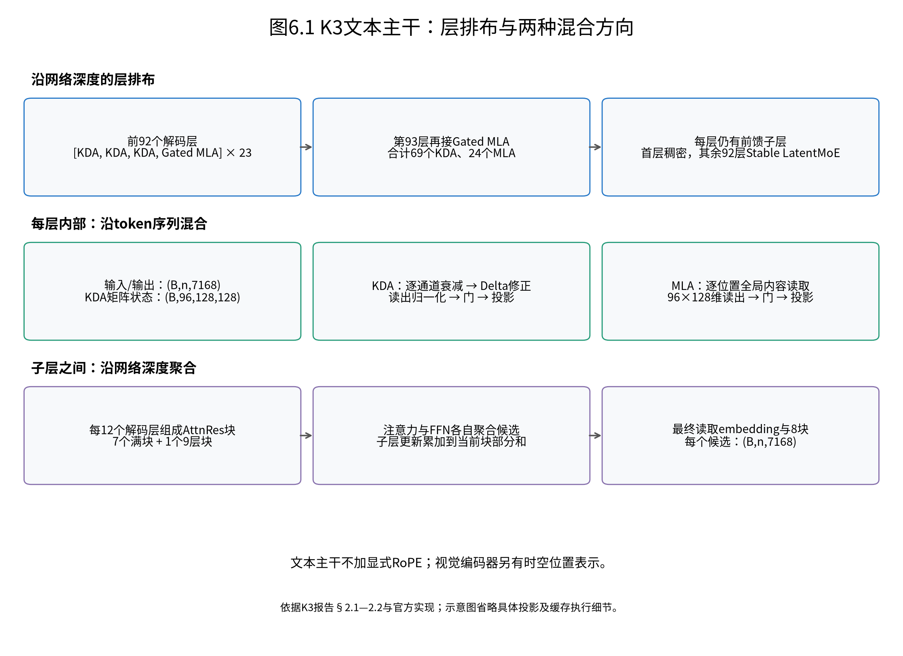
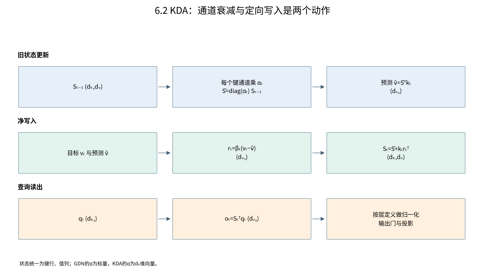
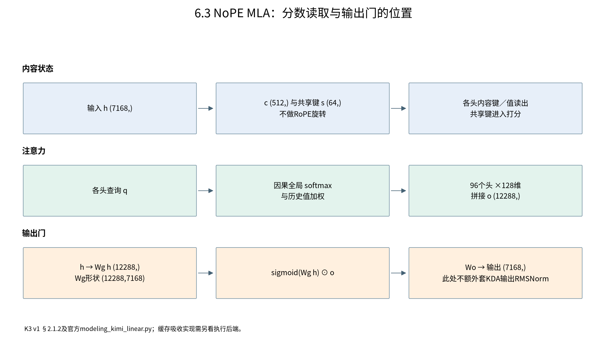
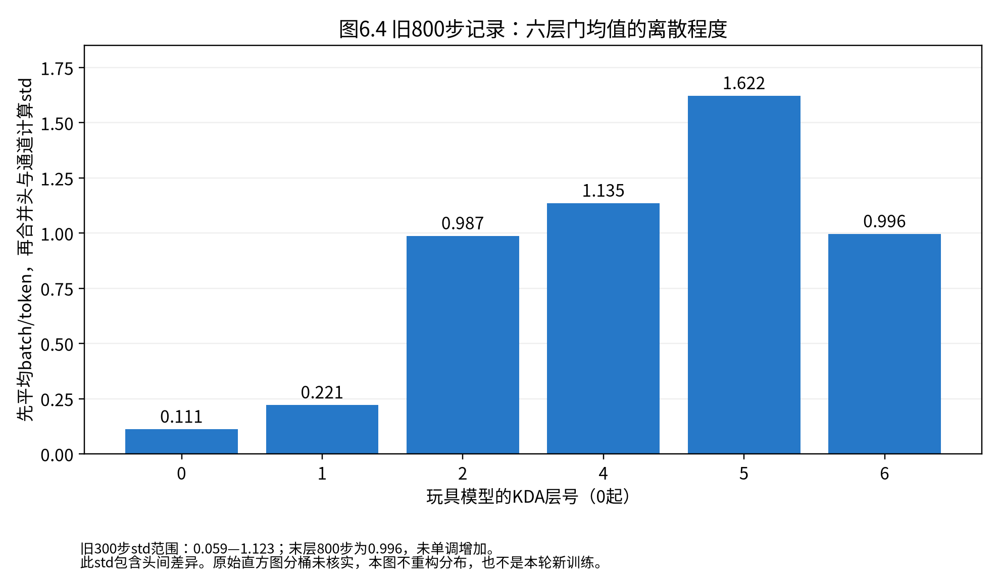

# 第 6 章 Kimi K3 报告精读·上：注意力侧

## 6.0 开篇：从全书到这里

上一章已经建立GDN的递推与分块两种计算形式，并用核心、完整层和微缩模型对拍检查了它们的衔接。旧MPS计时入口存在序列轴与头轴混用，原曲线的斜率不再作为复杂度证据；线性成本的条件由固定块长推导给出。现在进一步问：**将这种记忆机制放进大规模模型，需要怎样调整它，又怎样与全局读取配合？**

一份固定版本的官方报告给出了答案。Kimi K3——总参 2.8T、激活 104.2B、1M token 上下文【证据等级：官方技术报告 arXiv:2607.24653，摘要，本地 PDF p.1】——在 93 层中的 69 层使用 Kimi Delta Attention（KDA），24 层使用带门控的多头潜在注意力（Gated MLA，Gated Multi-head Latent Attention），文本主干不使用显式位置编码；视觉编码器的位置表示另在第7章讨论。它为第5章的固定状态机制提供了一个万亿规模的公开实例。本章与下一章是一对：本章读注意力侧（KDA、Gated MLA、NoPE、AttnRes），第 7 章读效率侧（896 选 16 的 MoE、MXFP4 量化感知训练、原生多模态）；两章合起来，读者可以沿公开材料看清其主要信息路径与资源取舍。

本章按“整体层表→时间方向的记忆→全局读取→深度方向的信息混合”展开。结构以K3报告与公开配置、参考实现交叉核对；报告中的训练效果属于作者实验，小模型实践只用于观察机制。公式统一沿用第5章的键行、值列状态约定，避免同一记忆矩阵在两章间悄悄转置。

> **最小背景栏**：本章直接使用四项已学知识，不重教——delta rule 与 GDN 的门控更新三式（第 5 章，$S_t$ 状态、$\beta_t$ 写强度、门控衰减）；MLA 的箱子、双形态与 576 元素缓存账（Book4 第 6 章）；MoE 的共享+路由结构（Book4 第 2-5 章）；MXFP4 格式（Book4 第 7 章）。分类型 KV/状态账本的公式在第 1 章 1.6 节立式，本章 6.6 节给出它迄今最重的一行数字。

## 6.1 报告结构与 config 对账：先看整机

拆机器先看整机图。图 6.1 是本章的自绘版——报告的 Figure 2 受到 NC-ND 条款限制，我们照读它的图注与正文（§2，p.3-4），把同一台机器自己画一遍：93 层的主干，注意力插槽按 3:1 交替——三层 KDA 配一层 Gated MLA，循环 23 次后在末尾额外加一层 Gated MLA；前馈侧首层为稠密FFN，其余92层采用Stable LatentMoE；AttnRes 在深度维上另按 12 层一块切分。注意力排布、AttnRes分块和前馈层类型是三项不同配置，共同决定同一主干的计算，训练中的作用会相互影响。



图 6.1 整机层序列先给出69/24分工，再展开两种注意力；底行是深度方向的AttnRes，与时间方向状态不同。

3:1 的官方定义句值得逐字读：*"Each block contains 3 KDA layers followed by 1 Gated MLA layer, giving a 3:1 mixing ratio… An additional Gated MLA layer is placed at the end of the backbone, ensuring that the final layer always performs global attention."*【官方技术报告（本地 PDF）§2.1，p.4，直引】——每块三层 KDA 加一层 Gated MLA，且**末层必须是全局注意力**。这句话在 config 中对应一份精确到层的清单，见实物 6.1。

> **实物 6.1（K3 config 的 `full_attn_layers` 原文）**。看什么：24 个全局层的层号一个不漏地写在数组里——「3:1」从比例变成逐层事实；注意清单里出现了 93，比 0 起索引的最大层号 92 大 1，这份数组用的是 **1 起层号**（参考对象口径）。
>
> ```
> "full_attn_layers": [4, 8, 12, 16, 20, 24, 28, 32, 36, 40, 44, 48, 52, 56,
>                      60, 64, 68, 72, 76, 80, 84, 88, 92, 93]
> "gate_lower_bound": -5.0        "use_full_rank_gate": true
> "mla_use_nope": true            "mla_use_output_gate": true
> "attn_res_block_size": 12       "head_dim": 128  "num_heads": 96
> ```
>
> 【证据等级：config 逆向（moonshotai/Kimi-K3 `config.json` 本地落盘摘录；后续字段为 6.2-6.5 节各机制的参考对象开关，先建立字段与后文机制的对应）】

把清单读成账：层 1-92 按 4 层一循环 $(\mathrm{KDA},\mathrm{KDA},\mathrm{KDA},\mathrm{MLA})$，MLA 落在 4, 8, …, 92 共 23 层；层 93 是额外的末位 MLA——23+1=24 个全局层、69 个线性层，与报告 Table 1 的「69 KDA + 24 MLA」自洽（$23\times4+1=93$ ✓）【证据等级：官方技术报告（本地 PDF）Table 1，p.11】。

层号口径在此明确：**主干层号按1起说明，实验图若采用0起则单独标注**（`full_attn_layers` 参考对象口径）；第 9 章三刀机沿用「人读 1 起、代码注释 0 起」的双口径换算句，两章同款。这份层表也是 K2 到 K3 的架构叙事本身：K2 是 61 层全 MLA，K3 把混合范式整机化——*"MLA was subsequently adopted by Kimi K2 and Kimi K2.5, and Kimi K3 retains it in the periodic global-attention layers."*（MLA 被 K2/K2.5 采用，K3 把它保留在周期性的全局注意力层里）【官方技术报告（本地 PDF）§2.1.2，p.5，直引】。

整机看完，做本书每拆一台新机的第一件事：**config 公式整数精确算，跟官方数字对账**。分为五个项目：词嵌入与输出层（词表 163,840、untied 两份）、69 个 KDA 层、24 个 Gated MLA 层、92 个 MoE 层加首层稠密 FFN；MTP 层与 ViT 另计（Table 1 自己也把 ViT 401M 单列——官方主数=主模型的口径佐证，承 Book4 的教训）。对账结果见实物 6.2 与表 6.1。

> **实物6.2（旧参数账的查错记录）**。下面保留当时终端节选：总参约2,776.07B、激活约101.95B。旧账把输出门误设为7168维方阵，且活跃账遗漏外围norm；表6.1另列本轮按公开分片头重算的结果。块内“…”省略组成明细及状态账，不把旧值当作最终统计。
>
> ```
> === 件目参数账（主模型，不含 MTP/ViT） ===
> embedding 1,174,405,120  lm_head(untied) 1,174,405,120
> KDA/layer = 407,064,672 (~0.4B)  [full-rank gate 51,380,224 vs low-rank 2,490,368]
> Gated-MLA/layer = 195,495,936 (~0.20B)
> MoE/layer: shared 132,120,576 + routed 29,595,009,024 + Wdn/Wup 51,380,224 + router 6,423,424 = 29,784,936,832 (~29.785B)
> 主模型总参 = 2,776,070,367,200 = 2776.0704B（约2.776T；原终端单位标签误写T）   官方 2.78T (Table 1: 2.78T / Δ167% vs K2 1.04T)
> …
> 激活参 = 101,948,568,544 = 101.95B   官方 104.2B (Table 1)
> …
> assert 层排布: layers 4,8,...,92 共 23 层 MLA + 末层 93 = 24
> 69 KDA + 24 MLA = 93 ✓ (与 Table 1 'Attention-Layer Composition' 一致)
> ```
>
> 【证据等级：本书复算（config 公式整数精确算 + 层排布 assert，2026-10，00-feasibility 探针档产物 `log/book5-feasibility/k3_account_out.txt`——调研期 ad-hoc 终端账、无独立脚本；同型「公式=实测逐位 assert」的脚本化参考对象见 6.9 `k3_toy.py`）】

表6.1 K3参数对账：旧手算与本轮checkpoint逻辑元素账（第11章继续解释统计方法）

| 项目 | 旧config手算 | 本轮checkpoint逻辑元素账 | 官方Table 1 |
|---|---|---|---|
| 总量（文本主干） | 2,776.07B | 2,779.484478B | 2.78T；文本账比舍入标签少约0.516B |
| 主干活跃账（单份词表） | 101.95B（旧值还漏外围norm） | 104.189615B | 104.2B；少约0.010B |
| 层数 / 全局层 | 93 = 69 KDA + 24 MLA | 层型签名 match=True | 同（逐位 ✓） |
| KDA 层 | 407,064,672/层 → 28.09B | 443,740,416/层 → 30.62B | — |
| Gated MLA 层 | 195,495,936/层 → 4.69B | 232,196,096/层 → 5.57B | — |
| MoE 层（92 层+稠密首层） | 2,740.21B + 0.73B | — | — |

约0.15%的总量差仍有数十亿个元素，不能因为百分比小就忽略。旧手算曾怀疑MTP、视觉模块或router/norm的统计范围，但这些猜测没有得到官方口径句支持。核对顺序应先回到自身公式：门在哪个空间作用、每个分支的输入输出多宽，再核对权重形状。官方2.78T／104.2B继续作为报告标签，与本书明确范围的精确账并列。

本轮重新读取官方固定版本的96个分片头，共497,220个张量，不下载权重数据段。按两个FP4权重占一字节还原路由专家，量化组尺度另计，得到全家族逻辑元素**2,779,931,837,184**；扣除视觉塔401,214,464与projector 46,144,512，文本主干为**2,779,484,478,208**。前者距2,780B约0.068B，后者距2,780B约0.516B，不能把两种范围的差值互换。逻辑元素账还含发布的路由校正量等张量，不能直接视为“全部可训练参数”的定义。

最主要的旧误差确在输出门：实际$W_g\in\mathbb R^{12288\times7168}$，每层比假设的方阵多36,700,160个参数，93层共多**3,413,114,880**。但这不是全部差额；扣除这项门宽差额之后，新旧总账仍相差996,128个其他元素；不能把所有差额都说成同一个门造成。按896选16计路由专家，文本主干含双词表的活跃元素为105,364,019,968；按单份输出词表口径，减输入表1,174,405,120，得**104,189,614,848**；非嵌入则为103,015,209,728。输入表和输出表等大，旧“去输出层”算法恰好给出同一个单表数，却不是同一种计算解释。这个数字接近104.2B，并不反向证明官方精确统计范围；第11章还会检查分类规则如何影响结果。【证据等级：本书按官方checkpoint头复算；未加载模型或复测质量】

## 6.2 KDA 参考对象：delta rule 装上通道级遗忘门

先打开69个KDA插槽中的一个。报告§2.1.1将其定义为带通道遗忘门的Delta递推：第5章的读取旧预测、写入差额仍然保留，变化发生在遗忘步骤。原先一个头的整张状态乘同一标量，现在状态的每个键通道可以乘不同系数。这里比较的是递推核心；完整层的投影、门参数化和输出归一化还需分别核对。

单头视角的递归式（报告 Eq.1）：

$$S_t=\big(I-\beta_t k_t k_t^{\top}\big)\,\mathrm{Diag}(\alpha_t)\,S_{t-1}+\beta_t k_t v_t^{\top},\qquad \tilde{o}_t=S_t^{\top}q_t \tag{6.1}$$

用人话说：先让旧记忆按通道衰减，再在「当前键」这里做一次 delta rule 写入，然后沿查询读出。它与第 5 章 GDN 更新式的区别全部体现在 $\alpha_t$ 的形状里——GDN 的 $\alpha_t$ 是每头每步一个标量，KDA 的 $\alpha_t\in(0,1)^{d_k}$ 是每头每步一条 **128 维通道向量**。符号与形状逐个明确（表内代入 K3 实维）：

| 符号 | 含义 | 批量存储形状（整段输入或单步状态） | K3 实维 |
|---|---|---|---|
| $X$ | 整段残差流输入 | $(B,n,7168)$ | — |
| $Q,K$ | 整段查询/键（L2归一后） | $(B,n,96,128)$ | $d_k{=}128$ |
| $V$ | 整段值 | $(B,n,96,128)$ | $d_v{=}128$ |
| $S_t$ | 递归状态 | $(B,96,128,128)$ | $128{\times}128$/头 |
| $\alpha$ | 整段**通道遗忘因子** $\exp(g)$ | $(B,n,96,128)$ | $\in(e^{-5},1)$ |
| $\beta$ | 整段写强度 | $(B,n,96)$ | $\in(0,1)$ |

按本章列向量约定，式(6.1)可以分为三步：先令$\bar S_t=\operatorname{Diag}(\alpha_t)S_{t-1}\in\mathbb R^{d_k\times d_v}$，再读出旧预测$\hat v_t=\bar S_t^\top k_t\in\mathbb R^{d_v}$，最后写入$S_t=\bar S_t+\beta_tk_t(v_t-\hat v_t)^\top$。展开后一式，就是$(I-\beta_tk_tk_t^\top)\operatorname{Diag}(\alpha_t)S_{t-1}+\beta_tk_tv_t^\top$，行列方向与式(6.1)一致。通道门通常不能与$I-\beta kk^\top$交换次序：若先按键修正再逐行衰减，既有预测和新写入都会受到不同处理。图6.2与例6.1沿“先衰减、再修正”的顺序展开。



图 6.2 第一行展示不同键通道怎样衰减，第二行只沿当前键方向写入预测残差。不要把逐通道衰减与Delta写入混成同一个门。

> **例 6.1（递归三步手算，构造例）**。取单头、$d_k{=}2$、$d_v{=}2$，初始 $S_0=\begin{bmatrix}1&0\\0&2\end{bmatrix}$，本步 $\alpha=[0.5,\,1.0]$（通道 1 遗忘一半、通道 2 全留），$k=[1,0]$（已单位范数），$v=[3,4]$，$\beta=1$。这里α第二分量与β取1，属于便于手算的边界构造，并非有限sigmoid参数必然精确达到的值。三步走：① 遗忘——逐行缩放，$S'=\begin{bmatrix}0.5&0\\0&2\end{bmatrix}$（只有第 1 行被 $\alpha_1{=}0.5$ 打折——**通道级**的含义在这一步直观呈现：门只动它该动的那行）；② 检索——$kv^{\mathrm{mem}}=S'^{\top}k=[0.5,0]$；③ 写差值——$\delta=v-kv^{\mathrm{mem}}=[2.5,4]$，$S_1=S'+k\otimes\delta=\begin{bmatrix}3&4\\0&2\end{bmatrix}$。读出：$q=[0,1]$ 时 $\tilde{o}=S_1^{\top}q=[0,2]$——通道 2 的旧记忆原样保留。这个例子让你看见：同键重写时新值**覆写**了旧值（$[1,0]\to[3,4]$ 行）、此例单位键恰沿坐标轴，正交的第二行不受定向修正牵连；一般非轴向键会混合多个通道、而每个通道各自决定「衰减多少」。若换 GDN 的 per-token 门（一个 $\alpha$ 管两行），第 ① 步两行同折——差异就这么大。

三步读法之外的全部输入都由式 (6.2) 的投影组生成（报告 Eq.2 摘要）：

$$q_t,k_t=\mathrm{L2Norm}\big(\mathrm{Swish}(\mathrm{ShortConv}(W_{q/k}x_t))\big),\quad v_t=\mathrm{Swish}(\mathrm{ShortConv}(W_vx_t)) \tag{6.2}$$

$$\beta_t=\mathrm{Sigmoid}(W_\beta x_t),\qquad z_t=W^{\uparrow}_\alpha W^{\downarrow}_\alpha x_t+b_\alpha$$

$(B,n,7168)$ 经三路投影到 $(B,n,96,128)$，拼接后过核宽 4 的因果短卷积（$\mathrm{ShortConv}$，形状 $(B,n,3{\times}96{\times}128)$）再 Swish，$q,k$ 追加 L2 归一——这套「短卷积+Swish+L2Norm」与 GDN 同族（第 5 章已教），KDA 全套照用【官方技术报告（本地 PDF）§2.1.1，p.4】。$z_t$ 用于生成遗忘门：**低秩投影**（$W^{\downarrow}_\alpha$ 把 7168 压到 128、$W^{\uparrow}_\alpha$ 再扩展回 $96{\times}128$，加逐通道偏置 $b_\alpha$），秩数的参考对象在 Kimi Linear 论文里写着 *"with rank equal to the head dimension"*（秩=头维=128）【证据等级：官方论文 arXiv:2510.26692 §4】。

**改动一：下界衰减（$g_{\min}{=}-5$）。** $z_t$ 怎么变成 $\alpha_t$，就是 K3 对 Kimi Linear 的第一处改动。Kimi Linear 沿用 GDN/Mamba-2 一线的负 Softplus 映射 $g=-e^{A}\mathrm{Softplus}(z)\in(-\infty,0)$——没有下界；K3 换成带下界的缩放 Sigmoid（报告 Eq.5）：

$$g^h_t=g_{\min}\,\mathrm{Sigmoid}\big(e^{A^h}z^h_t\big)\in(g_{\min},0)^{d_k},\qquad \alpha^h_t=\exp(g^h_t)\in(e^{g_{\min}},1)^{d_k} \tag{6.3}$$

按报告的参数化，$A^h$是每头可学习log尺度（报告称初始化为0），$g_{\min}=-5$ 是 config 里那行 `gate_lower_bound: -5.0`【证据等级：官方技术报告（本地 PDF）§2.1.1 p.5 + config 逆向】。用人话说：**每个键通道的「单步留存率」被钉在 $e^{-5}\approx6.7\times10^{-3}$ 以上——单步至少保留约0.67%；这并不限制多步累计衰减只能到此为止**。

为什么要额外引入一个超参数来限制下界？因为 chunkwise 并行形态要用衰减的倒数重标键（下文 chunkwise 段的 $\Gamma$ 除法），无下界时倒数可以无界增长、在有限精度里溢出——*"this reciprocal can grow without bound and overflow in finite precision"*【官方技术报告（本地 PDF）§2.1.1，p.4，直引】。

有了下界，数字链一步接一步：$\alpha>e^{-5}$ ⟹ 16-token 块的累积 log 衰减落在 $(-80,0)$ ⟹ 重标因子 $<e^{80}$，单就数值范围而言，$e^{80}\approx5.54\times10^{34}$低于BF16最大有限值约$3.39\times10^{38}$；与输入相乘、累加及更长块仍需数值设计——于是 *"both diagonal and off-diagonal tiles [can] use dense Tensor Core matrix multiplications, eliminating the position-pair diagonal path"*（对角与非对角块全部走稠密矩阵乘，逐位置对角路径整个删掉）【官方技术报告（本地 PDF）§2.1.1，p.5，直引】。

K3报告在这里回顾Kimi Linear的二级分块：非对角小块可用矩阵乘，对角小块仍需逐位置对计算；K3 用一个下界**省去了这条路径**。一个门参数化的改动，直接改写了 kernel 的形态——机制与系统在这里相互配合，这也是阅读旗舰报告比阅读论文更有意思的地方。谱系注：这类有下界的递归门与 HGRN2/Griffin/RWKV-7 同族，报告自己给了这句定位【官方技术报告（本地 PDF）§2.1.1，p.5】。

> **例6.2（两个通道的不同衰减过程，构造例）**。固定某头两个通道的$g$为−0.1与−2.3，只考察无新写入和定向修正的路径（取边界$\beta=0$）。每步留存分别为$e^{-0.1}\approx0.905$和$e^{-2.3}\approx0.1003$；10步后精确留存为$e^{-1}\approx0.368$与$e^{-23}\approx1.03\times10^{-10}$。若把每步先粗略舍入为0.9和0.1，会得到$0.9^{10}\approx0.349$和$10^{-10}$，二者不要当作同一精度的结果。相比之下，同一头的标量门若固定$g=-0.7$，两个通道10步后都剩$e^{-7}\approx0.0912\%$。通道门因此提供了区分记忆寿命的自由，但并不保证某个坐标天然对应语法或某个词。实际门还随输入变化，固定门例仅用于看清乘积的作用；可学习的通道差异是Kimi Linear §6.1讨论的设计动机。

**改动二：直接投影输出门。** 读出之后还有一道门（报告 Eq.6）：

$$y_t=W_o\big[\mathrm{Sigmoid}(W_gx_t)\odot\mathrm{RMSNorm}(\tilde{o}_t)\big] \tag{6.4}$$

先对递归输出做头维 RMSNorm，再与一个**输入依赖的 Sigmoid 门**逐通道相乘。用人话说：模型对「这次从记忆里读出的东西信多少、放行哪些通道」再作一次调节。K3 对 Kimi Linear 的改动是把 $W_g$ 从低秩换成**不设低秩瓶颈的直接投影**：*"Kimi K3 changes KDA's output gate from the low-rank parameterization used by Kimi Linear to an input-dependent full-rank projection."*【官方技术报告（本地 PDF）§2.1.1，p.5，直引】。按K3几何，直接投影门需要$7168\times12288=88{,}080{,}384$个参数；若保持同一输入输出宽度、改用秩128的两段投影，则为$7168\times128+128\times12288=2{,}490{,}368$。这是同几何下的参数对比，不能把后者当作48B Kimi Linear实际每层参数数目【证据等级：官方技术报告（本地 PDF）+ 本书复算（config 公式＋checkpoint 审计 C-107）】。

这里有一个不能弄反的细节：Kimi Linear 选低秩不是性能劣势，而是 *"to ensure a fair parameter comparison, while maintaining performance comparable to full-rank gating"*——满秩与低秩它自己比过、性能相当，48B 档为参数对齐公平选了低秩【证据等级：官方论文 arXiv:2510.26692 §4，直引】；K3采用直接投影；论文没有据此证明实际训练后矩阵数值秩达到最大。6.7 节的玩具会把这个门原样缩微进去。

**把差异与共同部分放在一起看，才能确定替换范围。**表6.2前三行分别比较门的粒度、衰减映射和输出路径，第四行列出共用的Delta更新基座。GDN侧以第5章为准，Kimi Linear与K3各自的配置分开列示，不把一个实现的外围选择当成整个机制家族的定义。

表6.2 GDN、Kimi Linear与K3的机制比较（依据报告与官方实现）

| # | 维度 | Gated DeltaNet | KDA（Kimi Linear→K3） | 证据 |
|---|---|---|---|---|
| D1 | 遗忘门粒度 | 每头每步 1 个标量 | 每头每步 $d_k{=}128$ 维通道向量 | 报告 §2.1.1 首句 + docstring |
| D2 | 衰减参数化 | 负 Softplus 族（承 Mamba-2 一线，每头标量） | Kimi Linear：负 Softplus 无下界；**K3：$g_{\min}\mathrm{Sigmoid}$ 下界 −5**（式 (6.3)） | 报告 §2.1.1 p.5 |
| D3 | 输出门 | 常见实现用直接投影产生z并用SiLU门；是否低秩需看具体实现，非GDN定义 | Kimi Linear 低秩；**K3 满秩 Sigmoid**（式 (6.4)） | 报告 §2.1.1 p.5 |
| D4 | 共同基座 | delta rule 递归 + 短卷积/Swish/L2Norm 前处理 | **同**（式 (6.1)(6.2) 与第 5 章 GDN 同族） | 报告 §2.1.1 Eq.1-2 |

> **实物 6.3（kimi_linear 官方 docstring 直引块）**。看什么：HF 生态自己写的差分句与 NoPE 句——一句话同时给 6.2 节的 D1 与 6.4 节的 NoPE 作证；拼写错误 `essentialy` 系原文如此，照录不改。
>
> ```text
> class KimiLinearDeltaAttention(nn.Module):
>     """Kimi Linear Attention: this is essentialy the same a gated delta net (GDN)
>     but decay is per-channel instead of per-token."""
>
> class KimiLinearAttention(nn.Module):
>     """Multi-headed Latent Attention (MLA) from Deepseek V2 with NoPE, but the
>     part of the keys where RoPE is applied is still shared."""
> ```
>
> 【证据等级：config/源码（官方transformers v5.18.0源码L569—571、L190—192；本轮已获取该tag快照，非当前5.14.1安装包）】

粒度之差还有一份**权重级证据**。Kimi Linear 48B（注意：它是 KDA 的首台整机，不是 K3——两机数字严禁互挪，见下页考据框）发布了 safetensors 分片，只读第一个分片的头部就能看到两种粒度各自占多少参数：

> **实物 6.4（Kimi-Linear-48B 分片头张量清单摘录）**。看什么：`A_log` 是 32 个数（每头一个 log 尺度）、`dt_bias` 是 4096 个数（$32\text{头}\times128$ 通道，每通道一个偏置）——**per-head 与 per-channel 两种粒度就体现在权重的形状里**；顺带看 `f_a/f_b_proj` 的 $2304\to128\to4096$ 低秩链与 `g_a/g_b_proj` 的低秩输出门（K3 换满秩的那个件的前身）。
>
> ```
> model.layers.0.self_attn.A_log           [1, 1, 32, 1]     # per-head（32 头各一个）
> model.layers.0.self_attn.dt_bias         [4096]            # per-channel（32×128）
> model.layers.0.self_attn.f_a_proj.weight [128, 2304]       # 遗忘门低秩 ↓（rank=head_dim）
> model.layers.0.self_attn.f_b_proj.weight [4096, 128]       # 遗忘门低秩 ↑
> model.layers.0.self_attn.g_a_proj.weight [128, 2304]       # 低秩输出门（K3 改满秩）
> model.layers.0.self_attn.g_b_proj.weight [4096, 128]
> ```
>
> 【证据等级：config/源码（MoonshotAI/Kimi-Linear-48B-A3B-Base `model-00001-of-00020.safetensors` 头部 HTTP Range 读取，877 张量清单之一；产物 `log/book5-ch07/kimi_linear_prefetch/kimi_linear_header.json`）】

> **【考据框】Kimi Linear ≠ K3——一条在二手文章中容易被混淆的模型线。**Kimi Linear（arXiv:2510.26692，2025-10/11）是 **KDA 的命名出处与首台整机**：48B 总参/3B 激活、27 层中 20 层 KDA+7 层满注意力，1.4T token 对照实验验证了 3:1 配方。K3（2026-07）把同一 KDA 模块装进 2.8T 整机，再加两处自家改动（式 (6.3) 下界、式 (6.4) 满秩门）与 AttnRes/Stable LatentMoE 等新件。两文互证但不等同：**Kimi Linear 的数字（48B/3B、RULER 84.3、§6.3文字所报1M解码约2.3倍等；同文Fig.7b约2.2倍，Fig.1b另列约6.3倍，协议与图文差异须分别核对）只属于 Kimi Linear，严禁安到 K3 头上**；反之 $g_{\min}{=}-5$ 与满秩门是 K3 的改动，严禁写成 Kimi Linear 已有。本章凡引 Kimi Linear 论文处均单独标版本锚。

**通道门的分块推导，需要把第5章的标量衰减改成逐通道乘积；不能把一个标量D直接照搬。**我们仍先求本块净写入，再读取输出和交接状态，模型定义不变。

令块内$\gamma_{i,c}=\prod_{t=1}^i\alpha_{t,c}$，$D_{ij,c}=\prod_{t=j+1}^i\alpha_{t,c}$（j≤i），未来j>i的项置0。每次更新写成$S_i=\operatorname{Diag}(\alpha_i)S_{i-1}+k_ir_i^\top$，其中$r_i=\beta_i(v_i-S_{i-1}^\top\operatorname{Diag}(\alpha_i)k_i)$。逐项代入得到

$$S_i=\operatorname{Diag}(\gamma_i)S_{in}+\sum_{j\le i}(D_{ij}\odot k_j)r_j^\top.\tag{6.8}$$

左乘的通道门缩放状态各行；一笔旧写入的键向量也因此逐通道衰减。把展开式读到当前键，再代回残差定义，得到

$$r_i+\sum_{j<i}\beta_i[k_i^\top(D_{ij}\odot k_j)]r_j
=\beta_i v_i-\beta_i S_{in}^\top(\gamma_i\odot k_i).\tag{6.9}$$

与GDN相比，三角系数从“一个衰减标量乘键内积”，变为“各通道先衰减再求内积”。定义单位下三角矩阵$A_{ii}=1$、$A_{ij}=\beta_i\sum_c k_{i,c}D_{ij,c}k_{j,c}$（j<i）；令Q、K、V按位置堆行，Γ的第i行为γ_i。仍可解两个右端

$$AU=\operatorname{Diag}(\beta)V,\quad
AW=\operatorname{Diag}(\beta)(\Gamma\odot K),\quad R=U-WS_{in}.\tag{6.10}$$

这里A为C×C，U/R为C×d_v，W为C×d_k，与第5章完全相同的形状接口。接下来令$P_{ij}=\mathbb1_{j\le i}\sum_cq_{i,c}D_{ij,c}k_{j,c}$，输出与块末状态为

$$O=(\Gamma\odot Q)S_{in}+PR,\qquad
S_{out}=\operatorname{Diag}(\gamma_C)S_{in}+(D_{C,:}\odot K)^\top R.\tag{6.11}$$

对角保留，因为每个输出读取已写入本token后的状态；P不是概率矩阵，不包含softmax分母。若所有通道门相等，D退化为标量广播，四式回到第5章GDN分块；这提供一个重要退化检查。这里的$D_{ij}$是长度$d_k$的向量，空乘积给出$D_{ii}=\mathbf1$；$S_{in}$可以非零，U只是零入口解，实际净写入必须减去$WS_{in}$。两组右端也可按列拼接一次求解，与第5章的预计算解释一致。

当所有γ为正，可将$D_{ij,c}=\gamma_{i,c}/\gamma_{j,c}$代入P，得到$P=\operatorname{tril}[(\Gamma\odot Q)(K/\Gamma)^\top]$。这正是报告因式计算的来处，也解释了倒数重标的数值风险：逐通道留存因子$D_{ij,c}$本身不大于1，拆开的两个因子却可能极大或极小。K3的下界服务于其16-token局部块计算范围；不能把单步g≥−5误当任意长序列的累积倒数也安全。

表 6.3 KDA 层形状流转表（recurrent 形态逐步 + chunkwise 两行；代入 K3 实维 $H{=}96,d_k{=}d_v{=}128$）

| 步骤 | 运算 | 输入形状 | 输出形状 | 说明 |
|---|---|---|---|---|
| 1 | $W_{q/k/v}$ 投影+拼接 | $(B,n,7168)$ | $(B,n,3{\cdot}96{\cdot}128)$ | 三路并一路 |
| 2 | ShortConv(4)+Swish | $(B,n,36864)$ | $(B,n,36864)$ | 因果短卷积 |
| 3 | 切头 + L2Norm($q,k$) | $(B,n,36864)$ | $(B,n,96,128)$×3 | 理想L2归一；带epsilon时近似单位范数 |
| 4 | 遗忘门 $g$（式 (6.3)） | $(B,n,7168)$ | $(B,n,96,128)$ | $z$ 低秩 $7168{\to}128{\to}12288$ |
| 5 | ①遗忘 $\mathrm{Diag}(\alpha)S$ | $(B,96,128,128)$ | $(B,96,128,128)$ | 逐键通道行缩放 |
| 6 | ②检索$\bar S_t^\top k_t$ | $\bar S_t:(B,96,128,128)$，$k_t:(B,96,128)$ | $(B,96,128)$ | 当前键的旧预测 |
| 7 | ③写差值$\bar S_t+k_t r_t^\top$ | 状态$(B,96,128,128)$；$k_t,r_t$各$(B,96,128)$ | $(B,96,128,128)$ | $r_t=\beta_t(v_t-\hat v_t)$ |
| 8 | 读出$S_t^\top q_t$，再逐头RMSNorm | 状态$(B,96,128,128)$；$q_t:(B,96,128)$ | 单步$(B,96,128)$；堆叠后$(B,n,96,128)$ | 区分单步与整段 |
| 9 | 输出门 $\odot\mathrm{Sigmoid}(W_gx)$，再投影 $W_o$ | $(B,n,96,128)\!\to\!(B,n,12288)$ | $(B,n,7168)$ | 式 (6.4)，先门后投 |
| 10 | chunkwise：$c{=}\sum g$ 与 $D{=}e^{c_i-c_j}$ | $(B,H,w,C,128)$ | $(B,H,w,C,C,128)$ | 块内逐对衰减 |
| 11 | chunkwise：UT 三角求解+块间递推 | $(B,H,w,C,\cdot)$ | $(B,n,96,128)$ | 与步骤 5-8 等价 |

机制讲完，一句系统侧事实收尾：KDA 用固定状态换掉了 softmax 注意力的增长 KV，*"in exchange for a fixed-size state that is cheap to transfer and reuse"*（换来一个便宜可搬运可复用的定长状态）【官方技术报告（本地 PDF）§5.1，p.17，直引】——而状态转移的仿射可组合性（每步更新都是 $S\mapsto M_tS+N_t$ 形式的仿射映射，映射可结合故可前缀扫描）是它跨设备并行化的数学根据【官方技术报告（本地 PDF）§5.1.2，p.18】。工程展开不出本册；账本侧的收益 6.6 节用数字说话。

## 6.3 Gated MLA：Book4 的箱子加两件新零件

69个KDA层负责持续状态更新，接下来打开24个Gated MLA层。它继承Book4的潜在KV表示，并增加NoPE与输出门：历史仍按位置可访问，读取的结果再由当前输入调节。这里要分开三个动作——怎样表示KV、怎样计算历史权重、怎样调节输出——否则容易把低秩压缩与改变注意力算子混为一谈。

骨架没动。报告原句：*"MLA, introduced in DeepSeek-V2 [28], compresses the key–value representation of each token into a low-dimensional latent vector $c_t=W_cx_t$. … MLA caches $c_t$ and reconstructs the content keys and values through learned up-projections."*【官方技术报告（本地 PDF）§2.1.2，p.5，直引】——低秩装箱、缓存潜向量、开箱上投影，与 Book4 第 6 章介绍的机制完全相同；K3 实维也同款：`kv_lora_rank 512`、`q_lora_rank 1536`、共享键槽 64 维，每 token 每层缓存 576 元素（6.6 节入账）。512+64的逻辑缓存宽度沿用DSV2/DSV3布局，旋转与输出门的运算则不同——骨架承 DeepSeek-V2 一线，config 与 transformers/vLLM 实现对照【证据等级：官方config、remote代码及vLLM v0.30.0源码；576为逻辑缓存布局，实际后端是否吸收另核】。

这两项新增设计才体现了 K3 的特点（图 6.3）。**第一件：NoPE（No Position Encoding，无位置编码）**——位置编码整个拆掉，细节归 6.4 节。**第二件：输出门**（报告 Eq.7）：

$$y_t=W_o\big[\mathrm{Sigmoid}(W_gx_t)\odot\tilde{o}_t\big] \tag{6.5}$$

与KDA式(6.4)共享逐通道输出门的思想，但MLA这条式子没有相同的额外输出RMSNorm（两者都引用门控注意力设计）——直接投影$W_g$（先前方阵假设为51.4M，实际需与96×128维读出匹配；checkpoint形状 $[12288,7168]$=88.1M，见本节考据框）、输入依赖、逐通道。动机句：*"This gate allows each token to modulate the channels read from global attention."*（这个门让每个 token 调制从全局注意力读出的通道）【官方技术报告（本地 PDF）§2.1.2，p.6，直引】。config 双开关参考对象：`mla_use_output_gate: true`、`use_full_rank_gate: true`【证据等级：config 逆向】。

教学上这是卷间契约的标准示范：**先把 Book4 的箱子原样搬来，再装两件新零件**——已知物加局部替换，便构成了一个「新」架构。

将两种层并排放回整机，就能看见共同的输出接口：KDA先逐头归一化读出，Gated MLA保留其注意力读出，两者都在投回残差宽度之前乘逐通道sigmoid门。门调节的是已经读出的表示，不是离散投票，也不负责选择历史位置。Kimi Linear在其规模下报告低秩门与直接投影效果相近；K3采用更大的直接投影，是否因此获得质量收益仍需对应消融，不能只由参数更多推出。



图 6.3 输出门在回到模型维度前作用于各头读出，因此门矩阵不是7168维方阵；NoPE不自动移除共享键分支。

> **【考据框】门宽与发布形状。** 式(6.4)(6.5)的门作用于96个头、每头128维的读出，所以输出宽度是12,288，$W_g$应为$[12288,7168]$；这由官方代码与分片头共同支持，旧方阵假设作废。KDA层与MLA层的完整新旧账差额还包含其他小项，不宜全部归到同一个门。另有一项范围区别：报告与remote构造器将$A_{\log}$写成96个头的尺度，发布分片却存128个元素；vLLM v0.30.0的专用加载器按实际头数分片截取，单卡取前96项。因而存储形状不等于计算中使用的形状；多出的32项为何发布，材料未说明。本章按报告讲每头参数化，按完整发布形状记checkpoint元素，二者分别标明。玩具输出门为$512\times512$，只是输入宽恰好等于合并头宽的特例。

还有一笔反直觉的参数账值得仔细看（checkpoint 参考对象口径）：Gated MLA 层 232.2M，KDA 层 443.7M——**按每层参数规模，全局层约为KDA层的52%**。原因不难找：MLA 靠压缩来节省缓存与投影的开销；KDA 状态虽小，但三路全宽投影（$3\times7168\times12288$）加双门（直接投影$W_g$ 88.1M+低秩遗忘门）占用了大量参数。省 KV 的路线不必然省参数——账要分开记。训练侧还有一句精度处理如实记：*"we keep the attention output in FP32 during training"*（训练期注意力输出保 FP32，修偏置舍入误差）【官方技术报告（本地 PDF）§2.1.2，p.6，直引】。

分工的总句报告写得极清楚，值得整句直引：*"The intervening KDA layers provide position-sensitive and recency-aware sequence mixing, while the MLA layers provide unrestricted global content interaction."*（间隔的 KDA 层提供位置敏感、近因感知的序列混合；MLA 层提供不受限的全局内容交互）【官方技术报告（本地 PDF）§2.1.2，p.5，直引】——69 层管「记忆与位置」，24 层管「检索与汇合」。第 5 章问过「为什么混合架构要留全局层」，K3 用具体机制作出了回答：固定状态对任意长、不可压缩细节有容量约束；保留逐位置读取提供另一种信息路径，但不保证任意任务都能精确检索。

## 6.4 NoPE：显式位置编码移除，顺序信息仍从多条路径进入

Book3讨论过部分旋转与无显式位置编码，这里把它们放回具体混合模型。第 5 章已确认 Qwen3-Next 的方案是**全局层 partial RoPE 0.25**（头维前 25% 旋转、其余不旋——不是 NoPE）；K3 给出另一个极端：**文本主干NoPE**。报告两句，一句在架构节、一句在训练节：

> *"Kimi K3 follows the hybrid design of Kimi Linear and applies No Position Encoding (NoPE) to all MLA layers. Consequently, no explicit positional encoding is applied to their queries or keys."*（K3 把 NoPE 用在全部 MLA 层——查询与键都不加任何显式位置编码）【官方技术报告（本地 PDF）§2.1.2，p.5，直引】
>
> *"Kimi K3 uses no explicit positional embedding (NoPE), and instead encodes positional information implicitly through the recurrent gating and decay mechanism of KDA. As a result, the model extrapolates directly to 1M-token contexts without any positional-encoding modification."*（不用显式位置嵌入，位置信息经 KDA 的门控与衰减隐式编码；因而不做任何位置编码改动即直推 1M）【官方技术报告（本地 PDF）§3.4，p.12，直引】

有三点需要准确区分。**其一，范围是文本主干**：config 里没有任何 RoPE 频率字段（无 `rope_theta`/`rope_scaling`），KDA 层同样无旋转——那句 `qk_rope_head_dim: 64` 只是维度槽位名，为每个token保留64维共享键分量、其上永不旋转（remote 代码 `rotary_emb=None` 且断言 NoPE-only）【证据等级：config 逆向+K3 remote 代码】。实物 6.3 的第二句 docstring 正是这件事：NoPE 之下「RoPE 作用的那段键仍然共享」。NoPE的理论与实验背景参见Kazemnejad等（arXiv:2305.19466）；具体长文表现仍需按模型设置判断。

**其二，位置没有消失：递归次序、因果可见性和短卷积仍让计算依赖顺序**：分工句（6.3 节）已经说明——KDA 的递归次序、短卷积的局部窗口、通道衰减的数据依赖，合起来把「位置感」搬进了线性层；MLA 变成纯内容注意力，NoPE是这一组合中的设计选择，不是递归层存在就必然推出的结论。

**其三，防断章**：直推 1M 不等于没练过长文——§3.4 的四阶段课程照走（8K→64K 预训练、256K→1M 冷却段）【官方技术报告（本地 PDF）§3.4，p.12】，不使用RoPE，省去的是对应的频率基数或缩放参数调整；长文训练、状态数值稳定性、检索质量与执行成本仍需处理。视觉编码器另有时空位置表示，不能把文本主干的NoPE结论移过去。

Kimi Linear的48B、1.4T token对照提供了一个具体观察：Table 5中NoPE版RULER为84.3，RoPE版为78.8，长文项目均值为54.5对51.8。但不是每项都领先，LongBench V2为35.0对35.4，Frames为58.8对59.9。作者用两类层的位置偏置差异讨论该结果；实验支持这套训练配置下的平均收益，不能唯一证明失败原因，更不能推成所有RoPE混合模型都退化。【证据等级：官方论文2510.26692v2 Table 5及§5讨论】

NoPE 还有一项架构收益，这里一并说明：共享键分支也不再随位置旋转后，MLA的内容投影更容易在位置无关的权重之间做吸收，形成共享潜在历史的Multi-Query计算形式（*"NoPE enables their conversion to the highly-efficient pure Multi-Query Attention during inference"*）【证据等级：官方论文 arXiv:2510.26692 §4-5.2，直引】——Book4 第 6 章的「权重吸收」在这里走到了尽头形态。位置表示与历史存储的对照、iRoPE层分工及部分旋转的数学是第 8 章的正题，本章先明确：文本主干移除了显式旋转，顺序仍经因果关系、递推与卷积进入表示。

## 6.5 AttnRes：深度维的注意力

注意力插槽之外，K3 还动了第三处——残差流本身。先避免一个望文生义的误解：Attention Residuals（AttnRes，注意力残差）**不是**「残差跨层直连」或「跳跃连接加密」，它把深度维的残差流**换成了一次注意力**。动机段值得直引，因为它重新审视了 Book1 介绍过的残差连接：

> *"Standard residual connections compress all prior information into a single state $h_l$ over depth — a bottleneck reminiscent of RNNs over time. … Attention Residuals applies the same methodology to depth: each layer selectively retrieves representations from all preceding layers rather than accumulating them uniformly."*（标准残差把全部前层信息压进单个状态 $h_l$——一个深度维的 RNN 瓶颈；AttnRes 把同一方法论搬到深度：每层**选择性检索**全部前层表示，而非无差别累加）【官方技术报告（本地 PDF）§2.2，p.6，直引】

将时间与深度分开看，AttnRes要解决的问题就清楚了。普通加法残差将已有更新合到同一个向量中，后续子层只能接收这个累计结果；AttnRes额外保留若干早先更新，允许当前子层重新选择它们的权重。这里是在同一token的网络深度上读取候选，不是让它再次注意全部时间位置，也不是在已有残差旁边随意增加跳线。

先用全形态说明机制（报告Eq.8—9）。下式的l表示一次子层输入聚合的位置；K3实现中，注意力和FFN各有自己的伪查询与归一化，因此一个解码层内有两次这样的聚合。**伪查询**：每层一个可学习向量 $q_l=w_l\in\mathbb{R}^{d}$——与输入数据无关，是「这一层想问什么」被直接学进参数；原始键和值来自已完成子层的更新$f_i(h_i)$，第0号候选是token embedding；键在打分时归一化，值保持原尺度。**核与权重**：

$$\phi(q,k)=\exp\big(q^{\top}\mathrm{RMSNorm}(k)\big),\qquad \alpha_{i\to l}=\frac{\phi(q_l,k_i)}{\sum_{j=0}^{l-1}\phi(q_l,k_j)} \tag{6.6}$$

$$h_l=\sum_{i=0}^{l-1}\alpha_{i\to l}\,v_i \tag{6.7}$$

用人话说：第 $l$ 层的输入不再是「上一层输出加本流」，而是拿自己学好的问句，对 {embedding, 第 1 层输出, …, 第 $l{-}1$ 层输出} 做一次 softmax 加权检索。两个细节：核里 **RMSNorm规范键的尺度**，减弱幅值差直接支配分数的倾向；它不保证权重一定均匀，也不限制由方向匹配形成的集中。报告式**没有 $1/\sqrt{d}$ 缩放因子**——这不是转录省略，AttnRes 专文（arXiv:2603.15031）的 Eq.2 同样无缩放，属原文设计【证据等级：官方论文 2603.15031 v1（批二 C-96 定谳）】。

**分块形态**控制需要长期保留的深度候选数。以L个更新节点、隐藏宽d计，全形态每token的聚合算量为$O(L^2d)$，候选存储为$O(Ld)$；批量B、序列n时再乘Bn。在保存全部激活的普通训练中，这些存储可能与反向所需激活重叠；采用重算或跨设备分段后，要求候选持续存活才会形成额外负担。分块将块内更新求和为一个表示，长期候选降为N块，存储为$O(Nd)$，但块内细粒度更新也先合并了。[AttnRes专文§3]

K3的具体块宽按**解码层**计，而非按上式的每次聚合计：93层分为7个12层块和1个9层块。每个解码层内的注意力、FFN分别先聚合再计算，其更新累加进当前块；最后汇合8个块表示与embedding，共9个候选。官方remote实现通过`layer_idx % attn_res_block_size`判断新块，并分别使用`self_attention_res_proj`与`mlp_res_proj`。这使“4层注意力排布”和“12层残差分块”各有明确计数单位，二者不能互换。【证据等级：K3报告§2.2与官方实现】

这里有两个容易混淆的抽象。第一，候选$v_i=f_i(h_i)$是各子层产生的更新，不应误用已经逐层累加后的完整残差状态，否则同一历史贡献可能被重复装入候选。第二，伪查询w_l虽然是固定参数，键随当前token的表示变化，因此各token的深度权重仍可不同。

取两个候选$v_0=(1,0)$、$v_1=(0,2)$，忽略epsilon与可学gain，对各自做RMSNorm得到$(\sqrt2,0)$与$(0,\sqrt2)$。令$w=(\log3/\sqrt2,0)$，则分数为$(\log3,0)$，softmax权重为$(3/4,1/4)$，新输入为$(3/4,1/2)$。若两分数都为0，得到的是平均$(1/2,1)$，不是普通残差求和$(1,2)$；AttnRes确实改变了模型计算，而非仅改变求和顺序。

分块版还要保留当前未完成块的部分和。若每块含两个子层，第一块已有输出a、b，第二块已有c，则第二块下一层的候选为$\{embedding,a+b,c\}$；第二块第一层尚无c时只看前两项。这样减少可长期保存的深度候选，却将块内多个更新先合并，块宽因此也是信息粒度与执行成本的折中。图6.1的4层注意力节律与12层残差分块是不同划分，配置可分别描述，但训练行为会相互作用，不能由配置项不同推出训练行为彼此独立。

两份材料承担不同用途：K3 的实例参数（93 层 8 块 12 尺寸、块结构）锚 K3 报告 §2.2；机制细节与「$N\approx8$ 已恢复大部分收益」的块宽消融锚 AttnRes 专文 2603.15031。最后一句工程事实不动机制：EAGLE 式加速的特征抽取恰好取第 1、4、末三个 AttnRes 块的输出——AttnRes 的块结构顺带成了深度维特征的天然取样板【官方技术报告（本地 PDF）§4.1.4，p.14，事实句】。

## 6.6 分类型账的容量示例：0.75% 从哪来

现在把机制放回第1章的分类型状态账：KDA为每个头保留矩阵和卷积历史，全局MLA保留逐token记录。下面的比值只比较这两类逻辑状态的大小，用来理解长度增加时谁占主要部分，不从存储账反推出最优层比例。

先列两类核心状态，再补卷积历史（元素口径；统一假设2字节只用于教学折算，实际状态可能FP32，短卷积另计；公式承第 1 章式 (1.3)-(1.4)）。**全局层栏**：24 个 Gated MLA 层，每 token 每层 576 元素（latent 512+共享键槽 64——6.4 节明确的口径），1M token 时 $24\times576\times1{,}048{,}576\approx14.50$G 元素 $\approx$ **29.0 GB**，随长度线性、无界。

**线性层栏**：69 个 KDA 层，状态 $d_k\times d_v\times H=128\times128\times96=1{,}572{,}864$ 元素/层，共 108.5M 元素 $\approx$ **217 MB**，大小与长度无关；数值内容仍随着每个token持续更新。

在$n=1{,}048{,}576$时，两栏精确元素数分别为108,527,616与14,495,514,624，相除为**0.7487%**；统一按两字节折算才可近似写成217MB／29.0GB。还须加上69层最小卷积历史$69\times3\times3\times96\times128=7{,}630{,}848$个元素；两类固定状态合计约为全局主KV的0.8013%。真实字节比较则分别乘各自dtype宽度，不能默认KDA状态也只有两字节。

若作为结构预算参考，假想93层都保留同几何MLA，主KV将是$n\times93\times576$，在该长度约112.34GB（两字节）。混合模型仅24层保留这种KV，主KV斜率为假想配置的$24/93\approx25.81\%$，另加固定状态。这个计算解释了配方的存储取舍；两种网络的参数、质量与训练过程也会改变，不能据此证明3:1最优。

只计矩阵，交叉点为$n^*=108{,}527{,}616/(576\times24)=7{,}850.67$，所以从整数长度7,851开始，全局主KV元素更多；将最小卷积历史纳入则为8,402.67，即从8,403开始。固定状态的大小不随n增长，状态的内容仍每步更新。交叉点不是质量或速度阈值，也不代表每个实际请求都会达到1M上下文。

这笔账报告自己从服务侧又算了一遍，两句事实陈述为 6.7 节提供背景：*"The MLA KV cache grows with sequence length and is paged per token, whereas the KDA recurrent state is fixed in size with a single copy per request."*（MLA 的 KV 随长度增长、逐 token 分页；KDA 状态定长、每请求一份），以及工程对策 *"we pack KDA states into the same paged block pool as MLA KV, unifying pages to the same byte size"*（把 KDA 状态与 MLA KV 打进同一个分页块池，页面统一到同一字节宽）【官方技术报告（本地 PDF）§5.4.1，p.23，直引】——同一个缓存池里两种生命周期的东西怎么联合管理，是推理系统的正题，本章按下不表（后续系统册展开）。

## 6.7 K3 玩具替身·注意力侧：四代组件一台机器

读完真机，造缩微样机——本册导览中的两种小模型：43.906M的GDN替身基线与44.278M的KDA版本。它的第一条设计原则写在 import 语句里（承 Book4 第 9 章「改装史写在 import 语句里」的手法）：

> **实物6.5（组件来源示意）**。下列摘录用省略路径说明依赖：底座、MLA和MoE复用Book4，本册新增GDN/KDA组件。具体可运行路径由随书bootstrap定位；此块不是完整可执行的import清单。
>
> ```text
> import moe_mla_slots as m4                    # Book4 00-feasibility：SlotLLaMA 底座 + MLAAttention + 训练环
> fp8 = _load("…/Book4-规模与效率/ch07/fp8_sim.py")   # Book4 ch07：MXFP4 量化模拟
> gdn = _load("…/ch05/gdn.py")     # 本册 ch05：GatedDeltaNet 双形态件
> kda = _load("…/ch06/kda.py")     # 本册 ch06：KimiDeltaAttention 教学组件
> ```
>
> 【证据等级：本书代码（`code/ch06/k3_toy.py::bootstrap`，依赖关系示意，具体代码以链接文件为准）】

两种模型采用同一8层排布：每组3个固定状态层后接1个MLA层，共重复两组。固定状态层为8头、每头64×64的矩阵；MLA的逻辑缓存为160元素/token/层，MoE为64选4加1个共享专家。这里复用的是**带RoPE、没有新增输出门的普通MLA**，不是K3真机的NoPE Gated MLA；模型也未加入AttnRes、潜在专家路径或原生视觉。它用于检查局部组件与原有骨架能否连接。

保留两套总参账：GDN替身43,905,888，KDA版本44,277,936。原“激活非嵌入”值11,662,176／12,034,224漏计了8层router的$8\times512\times64=262{,}144$，修正为**11,924,320／12,296,368**；加单份输出词表4,194,304后，为**16,118,624／16,490,672**。总参由实建模型与手算核对，活跃账按一次选中4个等宽专家的结构计算，不是实测FLOPs。

表 6.4 K3 玩具（toyA）config 定版表

| 插槽 | 几何（缩微口径） | 血统 |
|---|---|---|
| KDA | $h{=}8$，$d_k{=}d_v{=}64$，短卷积 4，chunk 16，低秩门 rank=64，$g_{\min}{=}-5$，满秩门 $512{\times}512$ | 本册 ch06 `kda.py`（K3 同构缩微） |
| 普通MLA（保留RoPE、无输出门） | $h{=}8$，kv_lora 128，qk_nope 64，键槽 32，v_head 64（缓存 160/token/层） | Book4 ch06 `mla.py` |
| MoE | E=64 选 4 + 共享 1，$w_e{=}32$（16:1 vs K3 56:1） | Book4 `moe_mla_slots` |
| 底座 | V=8192（sp-8k 语料），$d{=}512$，L=8，$[\mathrm{kda}\times3,\mathrm{mla}]\times2$ | Book4 SlotLLaMA |
| 总账 | gdn_sub：43,905,888／非嵌入活跃11,924,320；kda：44,277,936／非嵌入活跃12,296,368 | 另报含单输出表口径 |

从GDN替身到KDA版本，是固定状态层这一组件的整体替换：把 6 个注意力插槽从 ch05 的 GDN 替身件换成 ch06 的 KDA 教学组件，其余部分保持不变。替换的参数代价精确可算：kda 臂总参 44,277,936，比 gdn_sub 臂多 **+372,048 = 6 层 $\times$ 62,008/层**。逐层看这笔账（KDA 插槽 1,387,080 对 GDN 替身 1,325,072）：新增满秩门 $+262{,}144$、低秩遗忘门组 $+66{,}056$（$f\_a\ 32{,}768+f\_b\ 32{,}768+\mathrm{dt\_bias}\ 512+A\_log\ 8$），省回的是 GDN 的 qkvz 联合投影瘦身 $-262{,}144$（$1{,}048{,}576\to$ 三路分立 $786{,}432$——**更换门的大部分参数开销，由去掉 z 通道节省的参数抵消**）与 ba 投影 $-8{,}192$；$\beta$ 投影 $+4{,}096$、o_norm $+64$ 与两侧 A_log/dt_bias 的小差额 $-16$ 使合计达到 $+62{,}008$。这笔差值同时包含通道门投影、输出门和输出归一化的变化；后面的门粒度实验采用另一种控制方法，不能把这两套不同总参的模型当成仅有门粒度不同的两臂【证据等级：本书实验，逐项 assert】。

机制件先对拍再上机（Book4 noaux 教训的纪律）。`kda.py` 的对拍锚是 transformers 5.18.0 `kimi_linear` 的 torch 参考双 kernel，旧CPU FP32记录为：自研 recurrent 对 HF **2.98e-08**、chunkwise 对 HF **4.47e-08**、双形态互拍 **8.38e-08**、层模块双形态 5.96e-08——全部低于门槛（1e-4）至少三个数量级；同权重直搬下 per-token 与 per-channel 两读法输出差 7.91e-04（数值差非零=此次输入下粒度改变了输出，且参数逐位相同——单变量成立）【证据等级：本书实验，`log/book5-ch06/kda_run1.json`】。

对拍还发现过两个实现 bug，都值得记成「对拍驱动开发」的账：其一，**掩蔽顺序坑**——上三角掩蔽先 `masked_fill(0)` 再 `exp()`，把掩蔽位变成 $e^0=1$（GDN 版是填 $-\infty$ 再 exp），单块对拍 state 对、out 错 0.63，手工 4-token 逐位复现才定位到块内项；

其二，**漏 exp 坑**——状态更新处注释写 $e^{c_{\mathrm{last}}}$ 代码没 `.exp()`，现象是 **out 全对、state 错**：错误隐藏在状态中，直到跨块读取旧状态时才暴露——「输出对不等于实现对」的教学级案例。

本章的重点实验是**门粒度双臂**（判据与结果分支跑前预注册，承丛书纪律）。两臂同一 `KimiDeltaAttention`、同参数 44,277,936 逐位相同，唯一变量是门的读出粒度：kda 臂 per-channel（K3 参考对象），gdn 臂把 $z$ 沿 $d_k$ 取均值后广播（每头每步一个标量，GDN 粒度）。fast 300 步：loss 9.103→6.187（min 5.847）对 9.103→6.160（min 5.849）；full 800 步：9.103→**5.491**（min 5.014）对 9.103→**5.500**（min 5.012），旧记录为2.27 s/步（MPS bf16，sp-8k语料；本轮未重跑300/800步）——**预注册分支③命中：该单种子玩具实验未显示明确的loss收益**，如实写「门粒度的 loss 收益在 44M/数百步档不可分辨」，不做任何规模外推。

旧实验还记录了门分布。六个KDA层在800步后的std为$[0.111,0.221,0.987,1.135,1.622,0.996]$，300步记录范围为0.059至1.123。读取采集代码后，必须先澄清这个统计量：它先对batch和token求均值，得到$(H,d_k)$，再把头与通道一起计算标准差，因此同时包含**头间差异和头内通道差异**。即使每头都是标量门，只要不同头的均值不同，这个std也可非零，不能单凭它证明头内通道分化。

原图的直方图来自全部batch/token/head/channel门值，纵轴“channel share”并不准确；虚线−2.5也只是$z=0$时的参考值，随机投影让初始化门在其附近变化，并非全为同一点。深层较大的std可描述为该探针下的观察，不能说它随深度或步数单调增加：最后一层从约1.123降到0.996就是反例。修订后的采集器分别输出头内std、头间std及探针形状，便于后续以同一输入检查；旧日志和权重目前不齐，本轮不补造这两项训练后读数。



**图6.4 旧门统计的可核部分。** 保留原稿记录的800步六层std，以及300步已写明的范围。旧直方图未取得原始分桶日志，本轮不据图形补造数据；横轴层号为0起的0、1、2、4、5、6。旧std将头与通道合并，不能单独表示头内通道差异；新统计定义见随书采集函数。

玩具的6个固定状态层共有$6\times8\times64\times64=196{,}608$个矩阵元素，最小卷积历史另需$6\times4{,}608=27{,}648$。两个MLA层每token共增加320个逻辑元素，因此矩阵交叉点为614.4，含最小卷积时为700.8，对整数长度分别从615、701起超过固定部分。旧探针预算219采用了不同的全局层假设，不适用于此处。随书MLA教学实现会显式展开键值，这里的160元素/token是吸收后的逻辑布局，不能当作该程序已实现的实际缓存或峰值内存。

最后照例立边界：玩具外推声明（红线登记）——K3 报告的失效模式与收益绑定 2.8T/896 专家/低精度算术的规模，约44M玩具的结果只支持「机制件可组装、可训练、门行为可观测」，**不证明 K3 的行为**；机制与规模的分工，正是第 7 章要接着拆的故事。

本轮局部复核使用CPU与PyTorch 2.10.0。KDA递推对官方纯PyTorch参考输出误差为$2.98\times10^{-8}$，分块为$5.22\times10^{-8}$；六组输入的梯度、非零入口接续、尾块及标量门退化为GDN均通过。通道有限乘积推导另用float64验证，含精确零留存时的输出误差约$1.33\times10^{-15}$；这与要求有限log输入的随书快速教学核心是两种边界处理。

两种玩具的总参和修订活跃账核对通过。KDA玩具在CPU BF16 autocast下做一次前向/反向，loss为9.136、梯度有限；加入1,536个路由专家权重模拟钩子后，loss为9.137且参数总量不变。另用同一组随机权重与相同短输入观察门统计：每头标量臂的头内std为0，通道臂为非零，验证新统计能区分两种粒度。这些是接口与机制局部检查，没有重新进行300/800步训练，也没有验证K3真机吞吐。

## 6.8 本章小结

本章沿K3文本主干走过四条信息路径：KDA按键通道控制遗忘，再写入预测残差；Gated MLA保留逐位置的全局内容读取，并在输出投影前加门；NoPE移除显式旋转，顺序仍由因果关系、递推和卷积进入；AttnRes则让子层在网络深度上重新加权已有更新。通道门的分块推导保留了非零入口与当前token写后读取，16-token下界分析说明数值范围怎样约束实现。公开权重形状与状态账把这些机制落实为可检查的尺寸，而小模型仅验证其中部分组件的连接与运算。

**带走的心智**：固定状态与逐位置KV提供两种记忆方式，混合配方让它们共同承担任务，也共同接受质量、参数和执行成本的约束；0.75%只是指定长度下两类核心状态的比值，不能决定最优比例。读架构演进时，要分清改的是递推核心、门的参数化，还是层间信息组织：GDN到KDA先改变遗忘粒度，Kimi Linear到K3还改变下界、输出门及整机组件。读报告时，再用配置、代码和权重形状核对这些主张；接近舍入标签的总数，不足以替代逐项检查。

回到全书的路线：路线三的刀已经拆到旗舰真机里最深的一层。但 K3 还有另一半没读——注意力侧节省了随长度增长的状态，前馈侧仍有另一组规模问题：896 个专家里每次只激活 16 个的 Stable LatentMoE、从 SFT 起就全程在场的 MXFP4 量化感知训练、还有原生长在主干上的视觉。这些效率侧的极端设计是下一章的重点内容；注意力侧这台机器上每一处我们停手不表的工程账（两种生命周期怎么同池共管），也都留给后续册讨论。


## 6.9 动手验证

以下命令从本册目录运行；在本工作区使用已有环境时，先在工作区根目录激活`env.sh`。输出写到工作区`log/`，独立书仓则写到运行目录的`log/`；重跑使用新的`--out-name`。

- **KDA教学组件与对拍**（CPU局部检查；第6.7节核心与层模块验证入口）：
  ```bash
  python "code/ch06/kda.py" --out-name run1
  ```
  程序使用随书`kda_reference.py`中的官方transformers v5.18.0纯PyTorch函数快照，不要求安装版带kimi_linear，也不调用融合核。验收输出与末状态误差低于1e-4，具体舍入值以当次JSON为准；上面的数值保留为历史记录。
- **K3 玩具参数账与冒烟**（CPU/MPS局部检查；表 6.4 与 6.7 节两口径账）：
  ```bash
  python "code/ch06/k3_toy.py" --out-name run1
  ```
  预期：两种总参分别为43,905,888和44,277,936，非嵌入活跃账分别为11,924,320和12,296,368。冒烟实际为一次前向/反向、一次量化前向；初始loss应有限且接近均匀预测参照$\ln8192\approx9.01$。MXFP4权重模拟替换1,536个Linear，参数对象与总量保持不变；它没有复现K3整套原生低精度计算。
  ```bash
  python "code/ch06/train_k3toy.py" --arm kda --steps 300 --out-name fast
  python "code/ch06/train_k3toy.py" --arm gdn --steps 300 --out-name fast
  ```
  这些命令会启动新短训，不能把旧loss曲线当作必然预期。两臂应使用相同初始权重、数据顺序、总预算与日程，比较loss并分别报告头内/头间门统计；单种子接近不等于等效性证明。`--warm-start`（旧别名`--resume`）仅载入权重，优化器与数据步重新开始，明确不属于完整断点续跑。
  
- 验收点：能写出式 (6.1) 的三步读法并指出 KDA 对 GDN 的核心差异（decay per-channel 对 per-token）；能把 0.75% 从 576/1,572,864/69/24 四个数现推出来；能说出 Gated MLA 相对 Book4 MLA 的两处 diff 与它们的 config 开关；能对任意一句机制断言回手翻到报告的节号与页码。
