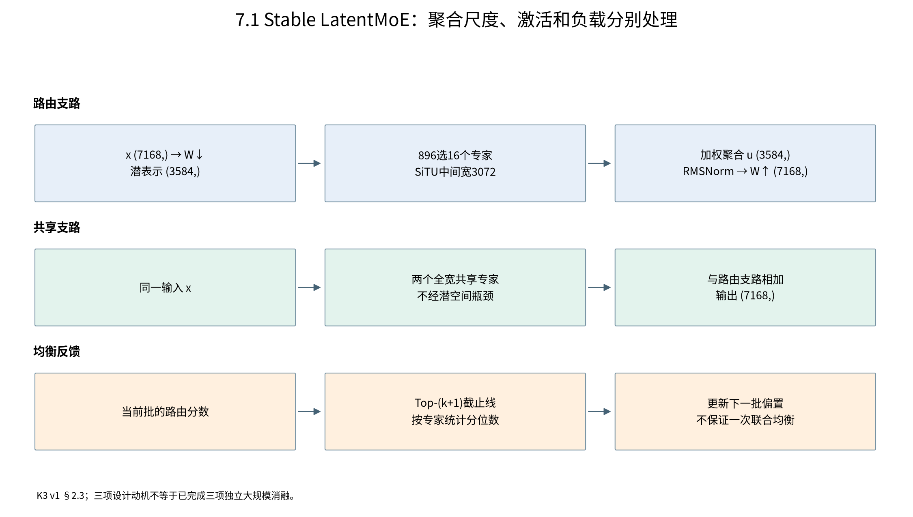
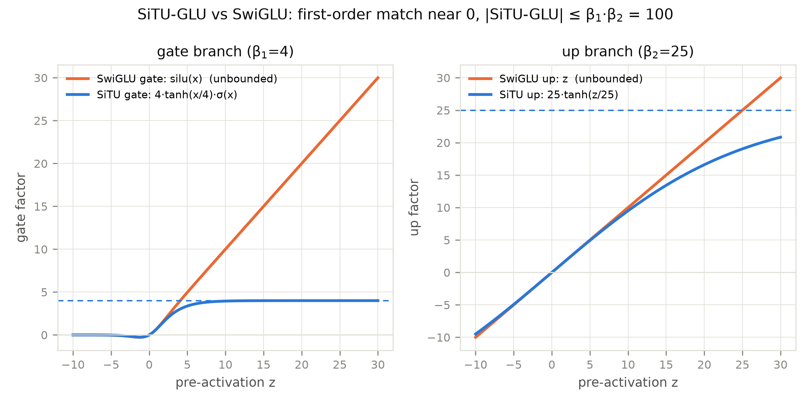
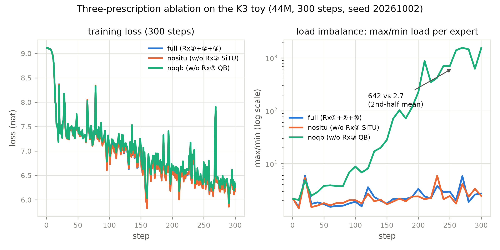

# 第 7 章 Kimi K3 报告精读·下：Stable LatentMoE、MXFP4 QAT 与原生多模态

## 7.0 开篇：从全书到这里

上一章解决了历史信息如何保存和读取：KDA 更新固定状态，Gated MLA 保留显式检索，AttnRes 改变层与层之间的聚合。本章转向每个 token 读完历史后怎样变换自身的表示。K3 在前馈层采用 Stable LatentMoE，把大量专家放进较窄的潜空间；这降低了派发宽度，却又带来激活尺度、负载和低精度训练之间的新矛盾。

我们沿同一个改造过程展开：先保留 Book4 的 LatentMoE 结构，指出极端稀疏下的限制，再加入聚合归一化、平滑限幅和分位数均衡；随后观察这些改动如何支持后训练中的量化。最后把视觉输入接回整机。需要分清两类判断：数学可以证明限幅范围、固定条件下的分位数最优性；这些性质在大模型上改善多少，则要看训练实验，不能由公式直接宣布三件组件“缺一不可”。

本章沿用 Book4 的 MoE、RMSNorm、MXFP4 和潜空间投影。涉及的新数学——软限幅的导数、路由的对偶坐标问题、量化的替代梯度——在使用处展开。K3 事实以报告 arXiv:2607.24653v1 及官方公开配置为依据；历史小模型实验用于说明机制与测量方法。

## 7.1 Stable LatentMoE：极端稀疏下的三项设计

先把部件放回整机。K3 共 93 层：第 1 层是 dense 前馈，其余 92 层每一层的前馈插槽都是一台 Stable LatentMoE——上一章图 6.1 里每个注意力层旁边配的那台 FFN 就是它。config 一侧的字段与报告 Table 1 逐位互证【证据等级：config 逆向 + 官方技术报告 arXiv:2607.24653（本地 PDF）§3.2 Table 1 p11】：隐维 $d{=}7168$ 不变，潜宽 $\ell{=}3584$（Table 1 原文标注 "(0.5×)"）、每专家中间宽 $m{=}3072$、路由专家 384→896、每 token 激活 8→16、共享专家 1→2、激活函数 SwiGLU→SiTU-GLU。报告总述句值得逐字看：LatentMoE "separating the full model width from the routed-expert width: shared experts retain a full-width path… whereas specialized routed experts operate in a compact latent space of width $\ell$"，由此 "scale channel mixing to 896 routed experts with 16 active experts per token, corresponding to a sparsity of 56"【证据等级：官方技术报告（本地 PDF）§2.3 p6】。机构承 Book4 第 11 章——门口下投影、专家住潜空间、出口上投影、共享专家不搬家——K3 的整机公式是（报告 Eq. 11，本章记作式 (7.1)）：

$$u=\sum_{i\in T_k(x)} p_i\, E_i^{\text{routed}}\big(W^{\downarrow}x\big),\qquad y=\sum_{j=1}^{N_s} E_j^{\text{shared}}(x)\;+\;W^{\uparrow}\,\mathrm{RMSNorm}(u) \tag{7.1}$$

用人话说：路由支路先把 token 压进 $\ell$ 宽的潜楼层、被选中的 16 个专家各自算一遍再按门控加权并成 $u$，然后**先归一、再升维**回全宽，与两个全宽共享专家的输出相加。与 Book4 式 (11.1) 逐项对照，diff 只有一处显式新件——聚合与上投影之间的那个 RMSNorm（处方一，马上讲）；符号表与形状流转如下（$N$ 为展平 token 数）。

| 符号 | 含义 | 形状 |
|---|---|---|
| $x$ | 进入该层的隐状态 | $(B,n,d)$，$d{=}7168$ |
| $W^{\downarrow}$ / $W^{\uparrow}$ | 潜下/上投影（该层路由专家共享，不跨层共享） | $(\ell,d)$ / $(d,\ell)$，$\ell{=}3584$ |
| $E_i^{\text{routed}}$ | 潜宽专家（SiTU-GLU，中间宽 $m$） | $(N_i,\ell)\to(N_i,m)\to(N_i,\ell)$，$m{=}3072$ |
| $p_i$ / $T_k(x)$ | 门控权重 / 选中专家集（QB 规则定，式 (7.3)） | 每 token $k{=}16$ 个 |
| $u$、$\mathrm{RMSNorm}(u)$ | 聚合量 / 处方一的归一化 | $(N,\ell)$ |
| $E_j^{\text{shared}}$ | 全宽共享专家 ×2 | $(N,d)\to(N,m_s)\to(N,d)$（公开实现将两个宽 $3072$ 的共享专家合并为宽 $6144$ 的前馈计算） |

单 token 走一遍：$(1,7168)$ 过 $W^{\downarrow}$ 压成 $(1,3584)$，寄往 16 个专家各算一遍 $(1,3584)\to(1,3072)\to(1,3584)$，加权并成 $(1,3584)$，归一后过 $W^{\uparrow}$ 回 $(1,7168)$，与共享支路相加写回残差流。

**几何账：派发元素数相同，激活中间单元数增加。** Book4 第 11 章的扩群配方 $E'=E\cdot d/\ell$ 在 K3 身上给出 $384\times2=768$，实配 896（$\times2.33$）——比配方更激进，如实登记、不硬凑。真正逐位闭合的是**每 token 激活潜预算**（$k\times$宽度）：K2 全宽 $8\times7168=57{,}344$，K3 潜宽 $16\times3584=57{,}344$——分毫不差【证据等级：config 逆向（自算，输入=Table 1）】。激活份数翻倍、专家宽度减半，逐 token 的理想派发元素数相同；而按「产能 $\propto k\times m$」的口径，非线性预算从 $8\times2048=16{,}384$ 涨到 $16\times3072=49{,}152$（3.0 倍）。这里的“三倍”只计算激活中间单元数，不是表达能力、吞吐或实际通信时间的三倍。相同 $k\ell$ 还要求传输精度和派发协议相同，才对应相同的有效载荷字节数。零钱两笔：单专家权重读取 $3\ell m=33.0\text{M}$（K2 全宽 $3dm=44.0\text{M}$ 的 0.75 倍——潜宽减半被 $m$ 增 1.5 倍吃回一部分）；路由专家群仓库 $896\times33.0\text{M}=29.6\text{B}$/层、92 层约 2.72T，占官方总参 2.78T 的绝对大头【证据等级：config 逆向（自算）】。

单专家读取量下降也不代表每 token 的读取量下降：激活专家数翻倍后，$16\times33.0\text{M}/(8\times44.0\text{M})=1.5$。这是三个不同的量：发送的表示宽度、计算的中间单元数、访问的专家权重。LatentMoE 的收益必须逐项核算。

机构讲完，问题来源登场。报告把设计针对的两种困难写得很明确，逐字照录：极端稀疏放大了原始设计的两种失效——路由支路把 $W^{\downarrow}$、门控多分支专家网络与 $W^{\uparrow}$ 串成「**近四次连续矩阵乘的链**」，这一病态结构叠加 2.8 万亿参数规模，「**produces exploding internal activations in the routed branch**」；而对近千个专家做负载均衡，「**exceeds the regime in which existing auxiliary-loss-free bias updates remain well behaved**」【证据等级：官方技术报告（本地 PDF）§2.3 p6-7】。一句话拆开：**病①是激活爆炸**（长乘法链在 2.8T 规模上失控），**病②是均衡失灵**（免损失偏置更新在近 $10^3$ 专家档位出格）。三项设计与两处问题来源一一对应（图 7.1、表 7.1）：处方一、二治病①，处方三治病②。



图 7.1 上两行是同一层前馈数据流，最后一行是跨批反馈。SiTU限制专家内部乘积，RMSNorm处理聚合尺度，QB处理派发负载。

**处方一：聚合后 RMSNorm（Normalized LatentMoE）。**$u$ 的尺度天生不安分——「which can vary with the selected experts and their routing weights」：这次选中哪 16 个专家、门控多大，$u$ 的整体幅度就漂一次。原始 LatentMoE 直接拿这个漂移的 $u$ 过 $W^{\uparrow}$；K3 在两者之间插一道 RMSNorm（式 (7.1) 已含），报告的机制句是这「**reduces the sensitivity of the routed branch to scale variation before it is combined with the full-width shared branch**」【证据等级：官方技术报告（本地 PDF）§2.3.1 p7】。用人话说：路由支路先把自己的尺度「忘掉」，再与全宽共享支路相加；共享支路本身并不因这一步获得稳定性保证。诚实条款：报告对处方一只有定性句「consistently improves validation loss and downstream benchmarks」，全报告**没有三处方的分项消融数字**——量化演示只能靠本册玩具实验补（7.6 节），引用时勿虚构精度。

把这个作用写成数学更清楚。对 $u\in\mathbb R^\ell$，记 $r(u)^2=\|u\|^2/\ell$，则 $\mathrm{RMSNorm}(cu)=w\odot cu/\sqrt{c^2r(u)^2+\epsilon}$。当 $c>0$ 且 $\epsilon=0$ 时，$c$ 完全约掉；有 $\epsilon$ 时只有近似尺度不变性。它抑制的是聚合量整体幅度的变化，保留方向与相对坐标；可学习增益 $w$ 和后面的 $W^\uparrow$ 仍能放大输出。因此不能从归一化推出整个支路必不爆炸。

**处方二：SiTU-GLU（Sigmoid Tanh Unit GLU，报告命名）——有界的 SwiGLU。**病①的另一半在专家内部。先把改造前的原样摆回来——专家里跑的正是 Book3 第 3 章式 (3.4) 的 SwiGLU；沿用本章记号写出，并把门支的 $\mathrm{SiLU}$ 按 $z\,\sigma(z)$ 展开（Book3 式 (3.5)），两个乘性因子便与式 (7.2) 站进同一副括号：

$$\mathrm{SwiGLU}(x)\;=\;\Big[\,W_g x\;\odot\;\mathrm{Sigmoid}(W_g x)\,\Big]\;\odot\;\Big[\,W_u x\,\Big]$$

（支内 $(N_i,\ell)\to(N_i,m)$，乘积再降回 $(N_i,\ell)$——降维那一步两式共有，不进对比。）两个线性因子 $W_g x$ 与 $W_u x$ 都无界，"coincident large coordinates can produce activation outliers and increase overflow risk in **low-precision arithmetic**"【§2.3.2 p7】——注意这句话直接与 7.2 节的 MXFP4 咬合：限幅是为低精度算术铺路的。SiTU-GLU 的做法是给两支各加一顶**软盖**（softcap）：

$$\mathrm{softcap}(x,\beta)=\beta\tanh\!\Big(\tfrac{x}{\beta}\Big),\qquad \mathrm{SiTU}\text{-}\mathrm{GLU}(x)=\Big[\beta_1\tanh\!\Big(\tfrac{W_g x}{\beta_1}\Big)\odot\mathrm{Sigmoid}(W_g x)\Big]\odot\Big[\beta_2\tanh\!\Big(\tfrac{W_u x}{\beta_2}\Big)\Big] \tag{7.2}$$

用人话说：与上面的原式逐位对照，diff 只有两处——gate 支与 up 支的线性因子各被 $\tanh$ 压进 $[-\beta_1,\beta_1]$ 与 $[-\beta_2,\beta_2]$（$\beta_1{=}4$、$\beta_2{=}25$【§2.3.2 p8；config `activation_situ_beta=4.0/linear 25.0` 互证】），于是整个乘积 $|f|\le\beta_1\beta_2=100$（报告 Eq. 19）。附录 B 给了三条数学性质【App B p43】：其一，$\beta\tanh(z/\beta)=z+\mathcal{O}(z^3/\beta^2)$，原点附近**一阶贴合 SwiGLU**，但高阶项仍会改变数值；

其二，$\beta_1,\beta_2\to\infty$ 时逐点回收 SwiGLU——它是对 SwiGLU 的有界变体；

其三，与硬裁剪不同，"the smooth cap preserves nonzero gradients away from saturation boundaries"；平滑不代表梯度总是足够大。

最后这条与 gpt-oss 形成对照：gpt-oss 对专家 SwiGLU 用的是 gate 7.0/up ±7.0 的**硬 clamp**（Book4 第 7 章表 7.3 已核），K3 用软盖换训练行为——同一问题来源、两种刀法（图 7.2）。

这里的“有界”首先约束降维投影前的逐坐标乘积。若该向量为 $h\in\mathbb R^m$，则 $\|h\|_2\le100\sqrt m$，但专家输出 $W_dh$ 还受 $\|W_d\|_2$ 影响；不能把 100 写成整个专家的输出上界。

进一步看训练为何选择平滑盖。令 $c_\beta(z)=\beta\tanh(z/\beta)$，由 $\tanh a=a-a^3/3+O(a^5)$ 得

$$c_\beta(z)=z-\frac{z^3}{3\beta^2}+O(z^5/\beta^4),\qquad c_\beta'(z)=\operatorname{sech}^2(z/\beta).\tag{7.5}$$

所以小信号下的主要计算保留下来，大信号下增量逐渐收缩。门支 $f(g)=c_{\beta_1}(g)\sigma(g)$ 的导数必须同时经过两条路径：

$$f'(g)=\operatorname{sech}^2(g/\beta_1)\sigma(g)+c_{\beta_1}(g)\sigma(g)[1-\sigma(g)].\tag{7.6}$$

硬 clamp 在阈值外的裁剪路径导数为零，软盖的裁剪路径在有限实数处连续且为正；但它可以极小，有限精度下也可能饱和，完整门支的两项还可能抵消。设计获得的是平滑的抑制方式，而不是“梯度永不消失”的保证。



图 7.2 SiTU-GLU vs SwiGLU 的标量响应（自产，CPU 秒级）：gate 支 $4\tanh(z/4)\cdot\sigma(z)$ 封顶 $\pm4$、up 支 $25\tanh(z/25)$ 封顶 $\pm25$，近原点与 SwiGLU 几乎重合（一阶贴合），远端封顶——$|{\rm SiTU}|\le\beta_1\beta_2=100$。

**例 7.1（构造例）** 取 gate 预激活 $z_g{=}8$、up 预激活 $z_u{=}50$——一组「恰好同大」的坐标，看限幅怎么夹住输出。三步走：

1. SwiGLU：$\mathrm{silu}(8)\times50\approx 8.00\times50\approx 400$——两支无界，乘积随坐标一起起飞。
2. SiTU gate 支：$4\tanh(8/4)\cdot\sigma(8)=3.856\times0.9997=3.855$（$\le\beta_1{=}4$）。
3. SiTU up 支：$25\tanh(50/25)=25\times0.964=24.10$（$\le\beta_2{=}25$）；乘积 $3.855\times24.10=92.9\le100$。

效果读法：同一组输入，SwiGLU 给 400、SiTU 给 93——盖子不在常规区间碍事（$|z|\le1$ 内偏差 $\le0.02$，Eq. 18 余项），只在乘积将要冲出百位时把它按住。低精度算术里最怕的就是这种偶发大坐标。

**处方三：Quantile Balancing（分位数均衡）——均衡问题变成求分位数。**病②要先看原方案为什么失灵。K3 承 DeepSeek-V3 一线的免损失路由（Book4 第 5 章 noaux 阀门）：router 打分 $s_i=\mathrm{Sigmoid}(W_r x_i)$，派发按加偏置的分、混合权重按裸分归一（报告 Eq. 13，本章式 (7.3)）：

$$T_i=\mathrm{argtopk}_k\big(s_i+b\big),\qquad p_{i,j}=\frac{s_{i,j}}{\sum_{r\in T_i}s_{i,r}},\ j\in T_i \tag{7.3}$$

用人话说：$b$ 只决定「派不派」，不直接加入混合权重，也不作为普通可微参数更新；不过它改变专家选择，因此会间接改变主损失的训练路径——"it regulates dispatch without altering the mixture weights or the gradient-based optimization of the router"【§2.3.3 p8】。原方案是固定步长的符号更新 $b^{(t+1)}_j=b^{(t)}_j+\gamma\,\mathrm{sign}(\bar\ell-\ell^{(t)}_j)$，报告点破它的两难：$\gamma$ 大了负载震荡、小了追不上——"trades off slow adaptation against load oscillation"；专家池扩到 896 个后，不均衡既拖慢训练又让部分专家欠训【§2.3.3 p8】。QB 的换法是把「调偏置」从梯度式的试探改成**固定 token 截止线后的坐标闭式解**：一批 $m$ 个 token、$n$ 个专家、每人选 $k$ 个，目标负载 $q:=mk/n$；单次前向顺带取每个 token 的第 $(k{+}1)$ 名作截止线 $\alpha_i$（Top-$(k{+}1)$ 路由白送，不必另算 token 侧分位数）；令专家 $j$ 的过线数恰等于 $q$，单调性给出闭合解（报告 Eq. 14）：

$$\hat b_j\;\leftarrow\;-\,\mathrm{quantile}_{1-k/n}\big(s_{:,j}-\alpha\big),\qquad b\;\leftarrow\;\hat b-\mathrm{mean}(\hat b)\,\mathbf 1 \tag{7.4}$$

用人话说：把专家 $j$ 全批打分减去各 token 的截止线，取 $(1-k/n)$ 分位数取负——在无平局、$q$ 为整数并采用相应次序统计量时，这个偏置可将第 $q{+}1$ 名放到截止线上，固定截止线的过线数量得到校准；第二行去公共偏移（不改 Top-k），且偏置只影响下一批——「a batch is never routed with a bias derived from itself」【§2.3.3 p8】。直觉例子里数字最小，先跑给你看。

为什么是分位数，而不是负载误差乘学习率？可以从一个明确的理想化分配问题推出来。让 $X_{ij}\in[0,1]$ 表示 token $i$ 分给专家 $j$ 的份额，要求每行和为 $k$、每列和为 $q=mk/n$，最大化 $\sum_{ij}s_{ij}X_{ij}$。这里先用连续分配理解优化，最后的 top-k 才产生离散选择。

为行、列约束分别引入价格 $a_i,c_j$。固定这些价格后，每一项 $X_{ij}$ 独立最大化 $(s_{ij}-a_i-c_j)X_{ij}$：系数为正选 1，为负选 0。因此对偶目标是

$$D(a,c)=k\sum_i a_i+q\sum_jc_j+\sum_{ij}\max(0,s_{ij}-a_i-c_j).\tag{7.7}$$

固定 $a$ 后，对专家 $j$ 令 $d_i=s_{ij}-a_i$。在不碰到折点时，

$$\frac{\partial D}{\partial c_j}=q-\#\{i:d_i>c_j\}.\tag{7.8}$$

价格过低，过线 token 多于 $q$，提高价格会降低目标；价格过高则相反。最小值位于排序后第 $q$ 与第 $q+1$ 大数之间，折点处用左右导数判断。派发偏置是价格的负数 $b_j=-c_j$，这便得到式 (7.4) 的分位数结构。不同程序的分位数插值约定并不相同，不能把任意 `quantile` 实现都直接说成“第 $q+1$ 大”。平局和非整数目标还需要次梯度及离散分配处理。

最重要的条件是“固定 $a$”。全部专家偏置更新后，每个 token 的竞争截止线也会改变；下一批数据的分数分布还可能变化。K3 用当前批的 Top-$(k+1)$ 信息产生下一批偏置，属于在线反馈，并不保证一次更新就解完联合问题。对偏置减去公共均值不改变 top-k，因为每个 token 的所有专家分数都减去同一个常数。它固定了无关的整体平移自由度。

**例 7.2（构造例）** $m{=}8$ 个 token、$n{=}4$ 个专家、$k{=}1$（每人只选 1 个），则 $q=mk/n=2$——每专家该接 2 单。打分矩阵自造（近缝翻转设计，与报告 Fig. 5 同构；本册 `latentmoe_parts.py::qb_small_example` 可逐步复算），无偏 top-1 负载是 $(4,3,1,0)$：专家 0 接 4 单爆仓、专家 3 颗粒无收。三步走：

1. **算截止**：对每行取 biased 分的第 2 大（$k{+}1{=}2$）作 $\alpha_i$——每个 token「差一点没进」的那条线。
2. **交替取分位数**：沿专家轴对 $s_{:,j}-\alpha$ 取 $(1-k/n){=}0.75$ 分位数（降序第 $q{+}1{=}3$ 大）、再沿 token 轴回代，本构造例的交替更新得到 $\beta=[+0.030,\,+0.020,\,-0.008,\,-0.006]$——派发分 $=s-\beta$：热门专家 0/1 被罚约 0.03/0.02，冷门专家 2/3 得约 0.006-0.008 的补贴。
3. **重派发**：按 $s-\beta$ 重新 top-1——两行从专家 0 翻到专家 3（缝只 0.02，一推就翻）、一行从专家 1 翻到专家 2，负载 $(2,2,2,2)$，本例达到均衡。

效果读法：偏置只有百分位的量级（缝宽 0.02-0.03），翻的恰恰是「本来就犹豫」的边缘 token——赢者通吃被三记轻推拆掉，而每个 token 的选择仍由打分说了算。

这套更新为什么「快而不需偏置学习率」？附录 C 给出深层结构：QB 是**最大分数均衡指派**线性规划的**对偶坐标最优解**——对偶变量 $\alpha_i$（token 侧）与 $\beta_j$（专家侧，$b=-\beta$）沿两个轴交替取同一种分位数闭合解，"the same quantile along the token and expert axes, which gives the method its name"【App C p43-44】。旧的符号更新在这个视角下只是同一对偶目标的一步 SignSGD——它只保留负载误差的方向，"whereas QB jumps directly to the exact coordinate minimizer of the same dual objective"——无学习率型超参、且 "equilibrates within a few update steps even for nearly $10^3$ experts" 两件事由此同时得解【App C p44】。规模化落地靠附录 D 的直方图：全训练步 gather $O(mn)$ 个 margin 不可行，改为对 required bias $r_{i,j}:=\alpha_i-s_{i,j}$ 做 per-expert 直方图累积（$B{=}1000$ 箱、每步一次整数 all-reduce），当所有样本落在直方图范围内且按对应分位数定位时，量化定位误差由箱宽控制、实测 "a few $10^{-3}$" 且 "no measurable residual load imbalance"，通信量低于逐 margin 交换的 1%，估的是池化全局分位数而非各 rank 分位数的平均【App D p44-45】。部署侧最干净：偏置冻结即可——"at deployment, routing is a fixed Top-k selection with a frozen bias, and no quantile computation is needed"【App C p44】。谱系一句：指派视角上承 BASE 与 BIP（BIP 只能压过热、不能扶过冷），出发点与苏剑林 2026 年 2 月的中文先行讨论同路【App C p44；报告引文 [68][118][113]】。

**实物 7.1**（按报告 Alg. 1 思想自写的 toy 版伪代码，$m{=}8,n{=}4,k{=}1$ 参数版；看什么——「报告给了完整可照写实现的算法」长什么样：两个分位数、一个 argtopk，再无其他；报告锚=App C p44 Alg. 1，此处为自写实现、非直译原文框——文字源纪律）

```text
输入: 打分矩阵 s ∈ (0,1)^{m×n}（本例 8×4，Sigmoid 打分）；k=1；q = m·k/n = 2
初始化: β = 0 ∈ R^n
重复 T 次（本例 T=8，两三步即收敛）:
    α_i ← s 第 i 行按 s_i − β 降序的第 (k+1)=2 大值      # token 侧截止线, ∀i ∈ [m]
    β_j ← s 第 j 列按 s_{:,j} − α 降序的第 (q+1)=3 大值    # 专家侧分位数, ∀j ∈ [n]
输出: 派发 = argtopk_k(s − β)（逐 token）；负载 (2,2,2,2) ✓   # 部署时 β 冻结，仅此一行
```

三项设计合起来控制不同的问题；报告没有给出证明三者在任意规模都必要的独立消融——表 7.1 收拢。

**表 7.1** 失效模式↔处方一一对应（报告锚均为 arXiv:2607.24653 本地 PDF）

| 问题来源 | 症状 | 处方 | 机制一句话 | 报告锚 |
|---|---|---|---|---|
| 病①a 尺度漂移 | $u$ 幅度随选中专家组漂移 | ①聚合后 RMSNorm | 升维前先归一，路由支路对尺度失忆 | §2.3.1 p7 |
| 病①b 激活尖峰 | 无界乘积偶发大坐标→低精度溢出 | ②SiTU-GLU（$\beta_1{=}4,\beta_2{=}25$，$\lvert f\rvert\le100$） | 软盖封顶、原点一阶贴合、平滑抑制梯度 | §2.3.2 p7-8＋App B p43 |
| 病② 均衡失灵 | 近 $10^3$ 专家下 sign 更新震荡/过慢 | ③Quantile Balancing | 分位数闭式解固定截止线时取对偶坐标最优 | §2.3.3 p8＋App C/D p43-45 |

## 7.2 MXFP4 QAT：量化感知训练伸进全后训练

Book4 已说明低位宽如何节省存储；这里进一步问：训练时如何让模型适应部署中必然出现的舍入误差？报告两处原句互证：SFT 侧（§4.1.1 p12）"we apply quantization-aware training (QAT) from the SFT stage onward, with MXFP4 weights and MXFP8 activations"；部署侧参考对象段（§4.1.4 p14）说得更全——MoE 专家权重（占参数内存大头）量化到 MXFP4、激活按 MXFP8 计算，"while all non-expert components (attention projections, **latent MoE projections**, shared experts, and MoE routers) remain in higher precision"，并且 "quantization-aware training throughout the entire post-training stage, covering both SFT and RL"；RL 期间 "rollout and training share the same quantization scheme — eliminating the train–inference mismatch"【证据等级：官方技术报告（本地 PDF）§4.1.1/§4.1.4 p12/p14】。三件事从原句立起来。**其一，边界**：QAT 起于 SFT、覆盖整个后训练——不是从头（预训练配方 §3.3 无任何量化字样，训练加速用的激活侧分块 FP8 是 Book4 已教的另一码事），也非仅预训练；因此不能称为从预训练开始的全程QAT。**其二，分区**：量化只落在路由专家内部的三矩阵上，而 $W^{\downarrow}/W^{\uparrow}$ 等**潜投影明确写进保精度名单**——7.1 节刚讲过那条「近四次矩阵乘」的病态链，这些投影不再叠加同等低位宽的量化误差，这正是处方①②与量化分区的互相咬合。**其三，负结论如实记**：QAT 前后的掉点数字报告**未披露**（模型卡也只有同一句口径），任何精度声明都无处对账。

config 与卡面双双落地：`quantization_config` 为 compressed-tensors 的 mxfp4、group 32【证据等级：config 逆向】，模型卡第 4 节原文 "Kimi K3 applies quantization-aware training from the SFT stage onward, using MXFP4 weights with MXFP8 activations for broad hardware compatibility"【证据等级：厂商自报】。放进谱系表（表 7.2）看更清楚——K3 **明确交代了 QAT 的阶段和精度分区**，与 gpt-oss 的「post-trained…quantization」（Book4 考据框核过：通篇无 QAT 字样）应按各自披露的训练阶段比较，不能仅凭术语差异判为两种互斥算法，DSV4 则居中（也压专家与索引器 QK 路径，预览版论文口径）。

**表 7.2** 训练侧低精度谱系：三家对照（格式课统一指回 Book4 第 7 章）

| 维度 | gpt-oss | Kimi K3 | DSV4（预览版） |
|---|---|---|---|
| 官方措辞 | "post-trained…quantization"（无 QAT 字样） | "quantization-aware training (QAT)" | MXFP4 QAT 打点=专家权重＋索引器 QK 路径 |
| 覆盖阶段 | 后训练阶段带量化（预训练循环未说） | **SFT 起、覆盖 SFT+RL，rollout 同方案** | 预览版论文（引用一律走本地 PDF） |
| 部署激活 | BF16 | **MXFP8** | FP8 |
| 保精度件 | embedding/attention/router/norm/头 | ＋**latent MoE 投影**、共享专家 | 索引器非 QK 路径等 |
| 掉点数字 | 未报 | **未报** | 未报 |

【证据等级：官方论文 2508.10925 §2.1；官方技术报告 arXiv:2607.24653 §4.1.4；官方论文·预览版 2606.19348】

量化感知训练的关键不是把梯度也压成 4 bit。以一个权重 $w$ 和量化—反量化映射 $Q(w)$ 为例，前向实际使用离散近似 $\tilde w=Q(w)$，但若严格求导，量化台阶内部导数几乎处处为零。一个常见教学实现用直通估计器（STE）：

$$\tilde w=w+\operatorname{stopgrad}[Q(w)-w],\qquad\frac{\partial\tilde w}{\partial w}\equiv1\quad\text{（人为指定的反向规则）}.\tag{7.9}$$

前向右边正好等于 $Q(w)$；反向第二项被截断，只留下恒等路径。它是有偏替代梯度，并非量化函数的真实导数。高精度主权重可以积累小更新，直到改变某个量化格点；若直接只存离散训练权重，小于格点间距的更新会丢失。完整层的反传仍有矩阵乘、激活函数和损失的链式法则，恒等只指这一个量化节点。本章的模拟脚本用它展示机制，不能据此断言官方训练器的所有内部实现细节。

## 7.3 原生多模态：MoonViT-V2 一瞥

第三件事只讲事实级——多模态的参考对象在下一站。先挂号术语：**原生多模态**（native multimodality，语言与视觉从头联合训练）对**后接式**（先训好语言模型、再缝合视觉编码器）。视觉塔 MoonViT-V2 是一座 27 层、约 0.4B 参数的 ViT 变体（Table 1：401M、patch 14、12 头；采用 RMSNorm 并去掉全部 bias 项），图像与视频**共享全部参数**，注意力按「帧内空间＋帧间时间」分解，时间池化再压 token；进投影器之前先做 $2\times2$ pixel-shuffle 下采样，把视觉 token 数砍到四分之一【证据等级：官方技术报告（本地 PDF）§2.4 p9-10】。这笔账可以自算：一张 $3584\times3584$ 的图按 patch $14^2$ 切出 $256\times256=65{,}536$ 个 patch，除以 4 得 **16,384 个视觉 token/图**——约占 1M 窗口的 1.6%【证据等级：config 逆向（自算）】。这是按该方形输入与下采样规则计算的例子，不是所有图像固定占用的 token 数，也不能把视觉 token 等同于自然语言词。实际图像预处理、裁块和分辨率会改变长度。

真正值得逐字的是训练范式。报告 §3.3 原句：K3 采用 "a native multimodal training strategy in which language and vision are jointly optimized **from the start of training**"，而非 "**grafting** a vision encoder onto a pre-trained language model through a **post-hoc alignment stage**"；图文 token 交错进同一个下一 token 预测目标【§3.3 p11】。这就是 LLaVA 式「后接」路线的官方否定句——但注意否定的是「预训练后再缝合」这个**阶段**，不是 projector 部件本身：MoonViT-V2 之后仍有一座轻量 MLP 投影器把视觉特征送进共享嵌入空间【§2.4 p10】。为什么敢从头联训？报告给了消融（Fig. 6）：从 SigLIP 对比预训练初始化的编码器在联合优化下梯度范数持续偏高且频繁尖峰，from-scratch 的 MoonViT-V2 全程稳定；且下一 token 目标直接塑造表征，而不被「偏全局语义」的对比损失带偏。结论句带反直觉：「MoonViT-V2 matches the SigLIP-initialized baseline across vision evaluations, indicating that **contrastive pre-training is unnecessary as an initialization** for multimodal language models at scale」【§2.4 p9，厂商自报】。这个结论限于报告的模型、数据和联合训练设置，不能推出所有规模、预算下的对比预训练都无益。原生与后接两条路线的完整对照留给第 10 章 10.3，此处只立事实。

## 7.4 推理范式与长上下文：1M 档位与一笔 nuance

效率侧读完，长上下文的档位归属在这里补最后一块事实（位置与状态两条设计线的收束归下一章）。K3 的窗口课程是四段渐进：预训练 8K→64K，cooldown 阶段 256K→1M——「Concentrating the costly long-sequence computation within a small fraction of the overall training budget keeps the curriculum economical」【§3.4 p12】；配合全模型无显式位置编码直推 1M（机制见6.4，设计比较见下一章）。1M 的实用性有一笔值得记录的 nuance：BrowseComp 评测采用 300K token 触发的上下文压缩策略时得 **91.2%**，而 "evaluated with the full 1M-token context window and no context management, Kimi K3 achieves **90.4%**"【§6.1.3 p26，§6.1 主表 p27——厂商自报】。压缩前后差 0.8 个点——「1M 窗口」与「1M 窗口的日常用法」是两个工程命题。评测口径一句：全部 K3 评测用 reasoning effort max、温度 1.0【§6.1.3 p26】；三域×三档共九个推理努力专家与预算课程是能力侧话题，第 10 章 10.4 展开。

部署侧还有两件与后训练咬合的事实，只登记不展开。其一，MTP 层的归宿：报告说 K3 预训练带一个镜像骨干块结构的 MTP 层、后训练中 "fine-tune the pre-trained MTP layer into an EAGLE-3-style draft model"（LK 损失直击接受率，Eq. 16），且草稿层微调沿用同一量化配置【§4.1.4 p14】；而发布权重的 config `num_nextn_predict_layers=0`——**不带 MTP 层**。config 与报告的这条差异按纪律作事实句记下（勿写「K3 无 MTP」）。其二，KDA 的循环状态在服务侧与验证回滚存在张力（"cannot be trivially rolled back"，解法=只缓存投影输入、片上重建状态）【§5.4.2 p24】。


## 7.5 训练组织与规模实验

组件能否在大模型中工作，还取决于训练组织。下面区分三类不同证据。

其一，**2.5× 是效率口径**：相对 K2 的整体缩放效率提升约 2.5 倍（同验证损失下 FLOPs 轴的差距，Fig. 7）【§3.2 p10-11，厂商自报】——而绝对算力账（训练 token 总量、集群规模、MFU）报告全部未披露，第 11 章「读厂商自报」章会拿它当「不披露也是信息」的案例。

其二，优化器延续 K2 线：Per-Head Muon（Newton–Schulz 正交化沿头维切分、逐头做——大梯度头不再主导共享更新方向）＋K2 的 weight-clipping 机制原样保留，cosine 学习率＋1% warmup、weight decay 0.1【§2.5 p10、§3.3 p11；Muon 承 Book4 第 7 章】。

其三，报告 §7 的三个案例是本书方法论的绝佳呼应：24 小时预算内自主优化 GPU kernel（AttnRes 路径时延 283.6→114.4 ms）、从零写出 MiniTriton 编译器、48 小时自主设计推理芯片原型——芯片规格是**同架构缩微**：hybrid KDA＋NoPE-MLA、Block AttnRes 块大小 2、sigmoid MoE 路由＋1 共享专家、group-wise INT4（组 128），4 mm² @ 100 MHz、仿真解码 8,700 token/s【§7 p33-34，厂商自报】。K3 在 48 小时里给自己造了个玩具替身——「把要造的机器缩微成自己能造的版本」，正是本册从 43.9M 玩具到三刀机一直在做的事。并行与内存侧的工程件（MoonEP 等）已开源，此处只挂名。

## 7.6 K3 玩具·效率侧：三处方换装与量化双臂

玩具底盘是上一章的 K3Toy（44,277,936 总参的 kda 臂）；本章把它的 8 层 MoE 插槽逐层换成三处方合一的 `StableLatentMoE`——几何取 K3 同构缩微：$d{=}512$、$\ell{=}256$（0.5×d）、$m{=}256$、$E{=}64$、top-4、全宽共享专家，三开关 `use_rmsnorm/use_situ/use_qb` 就是三项设计（code/ch07/latentmoe_parts.py，与 Book4 `moe_mla_slots` 训练环同配方）。先跑秒级单元件：QB 小例（例 7.2 的参考对象）无偏负载 $(4,3,1,0)$ 在本例的一轮交替更新后得到 $(2,2,2,2)$（$\beta$ 取值与手算一致）【本书实验，CPU fp32】；SiTU 四断言全过——$|{\rm softcap}|\le\beta_1$、$|z|\le1$ 区一阶贴合最大偏差 $2.03\times10^{-2}$、$\beta\to\infty$ 回收偏差 $9.5\times10^{-7}$、软盖梯度非零存活；部署一致性断言（冻结 $\beta$＋argtopk 与 QB 指派逐行集合相等）也写成单元测试过掉。

> **【考据框】QB 的适用域（玩具边界教训）。**「few steps equilibrate」对**训练态近均匀的 Sigmoid 打分**成立；缝宽任意的构造矩阵下，交替 QB 可停在**对偶不动点而非逐位配平**——实测一例停在 $(3,3,1,1)$，$\beta$ 已收敛不动，但 greedy argtopk 在近缝/平局处的取整残留不均。本册口径：固定另一组变量时，分位数是对应的对偶坐标最优解；有限次交替更新不等于联合对偶最优，联合最优也需要处理平局下的离散指派【本书实验；报告适用域声明见 App C p44】。

换档实验兑现「$k\times$宽度守恒」的玩具同构：主档 $E{=}64$/top-4/$\ell{=}256$ 与换档 $E{=}256$/top-8/$\ell{=}128$，激活潜预算 $4\times256=8\times128=1024$ 逐位相等；参数账另报（主档 MoE 插槽 13,271,296/层、换档 13,041,792/层；两种配置分别核算）。对照 K3 的 $16\times3584=8\times7168$：**扩专家数、减专家宽、激活潜预算不动**这行等式，在 43.9M 与 2.8T 两档都成立。

**三处方 ablation（比较条件在实验前确定）。**三臂同参（②是激活换装、③是路由规则换装，参数全同；①只差 $\ell$ 个 RMSNorm 权重，<0.002%）：full／去②（SwiGLU）／去③（偏置恒零的裸 sigmoid topk），各 300 步（seed 20261002）。结果对号入座【本书实验，MPS bf16 autocast】：

- **处方③强复现（分支 A）**：去③ 臂专家负载 max/min 后半程均值 **642**（轨迹 300→880 震荡上行）对 full 臂 **2.7**——差 238 倍；前两名专家负载份额 0.153 对 0.045（3.4 倍），无均衡的 sigmoid topk 向赢者通吃滑去，loss 同步最差（6.259 对 6.193）。「③治塌缩」在玩具档成立——图 7.3 右 panel 的 log 轴就是这条 642 对 2.7 的裂口。
- **处方②方向命中、幅度不足（分支 B，规模绑定声明）**：去② 臂激活峰值均值 15.6 对 full 12.8（比率 1.22，未达预注册的 2× 门槛），两臂都远离危险区（有界臂到 300 步也只长到 23<100）。按预注册如实写：**失效模式绑定 2.8T/896 专家/低精度算术的规模（报告原口径），玩具 44M/300 步/bf16 不复现爆炸≠处方无效**；本册演示的是机制件与测量口径本身。零钱一笔：SiTU 的 tanh 带来约 12% 前向开销（2.72 对 2.43 s/step）——限幅是为稳定性付费、不是为 loss。
- **处方①的对象存在**：聚合量 $u$ 的 rms 沿训练从 0.0017 漂到 0.69——尺度漂移是真的，处方①有的放矢；本批未排去①臂（报告只有定性句，预期最弱）。



图 7.3 三处方 ablation 三臂（自产，数据=实物 7.2 的 JSON）：左=loss 曲线（300 步，三臂几乎重合、去③ 最差）；右=专家负载 max/min 轨迹（log 轴）——去③ 臂 642 对 full 臂 2.7，「治塌缩」的肉眼证据。

**实物 7.2**（三臂 ablation 的 JSON 读数摘录；看什么——「去③=负载塌缩」的两个量级与「去②=方向对幅度不足」的原始数字）

```text
# log/book5-ch07/train_ablate_{arm}_fast.json（每 10 步 stats_trace 的后半程均值）
full   (①+②+③): act_max 12.82 | load_max/min 2.69 | top2_share 0.045 | loss 9.115→6.193
nositu (去②)   : act_max 15.63（峰值 36.0）         | load_max/min 2.58 | top2_share 0.045 | loss 9.114→6.173
noqb   (去③)   : act_max 11.63 | load_max/min 642.1 | top2_share 0.153 | loss 9.115→6.259
# 全程 u_rms（①症状）：full 0.0017 → 0.69（聚合尺度随训练漂移——处方①的对象存在）
```

**量化双臂（qat_sim.py）。**分区照抄 7.2 节清单：只压路由专家——权重 MXFP4（STE，块 32/E8M0，复用 Book4 `fp8_sim.mxfp4_rt`）＋专家输入激活 MXFP8（E4M3＋E8M0 块 32；报告未指名 E4M3/E5M2，本件选 E4M3 并在此声明），潜投影/router/共享专家/注意力全部高精度；口径承 Book4 第 7 章：本机无原生 FP4/FP8 计算，**模拟量化**=量化-反量化 round-trip 嵌入训练循环、反传恒等（STE）。两臂谱系对照——`qat` 臂从第 1 步起量化在场（「SFT 起量化感知」的玩具模拟），`ptq` 臂全程高精度、训完一次性套量化（教学用纯训练后量化对照；gpt-oss 的报告并不能被简化成这一臂）。读数见实物 7.3。

**实物 7.3**（量化双臂读数；看什么——两件事：量化噪声在场时的可训性，与训后直接量化的跳变对照；官方掉点数字未披露，玩具读数是「本册自产＋官方无数字」的诚实组合）

```text
# log/book5-ch07/qat_sim_{qat,ptq}_fast.json（300 步，seed 20261002；分区 1536 权重 Linear＋512 专家输入）
qat 臂：loss 9.10→6.24 | 2.75 s/step（量化钩子开销 ×1.18——探针06 实测 ×1.19 同档复现）
ptq 臂：loss 9.10→6.18 | 2.33 s/step；训后一次性套量化：eval 跳变 +0.0002 nat（clean 6.2906 → quantized 6.2908）
```

两行对照的读法：**训后套量化的跳变在玩具档不可分辨**——ptq 臂训完一次性换上量化马甲，eval 只挪 0.0002 nat（6.2906→6.2908）；qat 臂从第一步就带着噪声练，收敛慢半拍（loss 6.24 对 6.18、2.75 对 2.33 s/step），量化态 eval（6.33）也未见优势。按判据预注册的纪律如实写：这是处方②同款的**规模绑定声明**——44M/300 步/bf16 模拟量化档复现不出「训后量化掉点」的失效模式，不能据此估计 K3 在 2.8T 参数与原生低精度算术下的 QAT 收益；报告没有给出相应掉点消融；本册双臂演示的是分区与口径本身——量化钩子怎么嵌进训练循环（×1.18 开销）、「SFT 起量化」与「训后量化」两条谱系怎么落成两条 CLI。「发布格式即训练格式、mismatch 在源头消掉」是 K3 在那个规模上的动机，玩具档只立机制、不立数字；44M/bf16 模拟量化的读数不可外推到 2.8T/MXFP4 原生算术。

## 7.7 本章小结

开篇的问题逐一作答。「三处方分别解决什么问题」——它们分别控制聚合尺度、专家内部激活和派发负载：聚合后 RMSNorm 治尺度漂移（升维前先归一）、SiTU-GLU 治激活尖峰（软盖封顶 $\beta_1\beta_2{=}100$、原点一阶贴合、平滑抑制梯度）、Quantile Balancing 治负载塌缩（分位数闭式解固定截止线时取对偶坐标最优，不需偏置学习率、近千专家几步配平、部署时冻结偏置零开销）——表7.1将作用位置并列比较。QAT 的边界逐字核死：起于 SFT、覆盖 SFT＋RL、rollout 同方案；分区只压路由专家、潜投影保精度；掉点数字官方未披露。MoonViT-V2 立了原生联训的事实与在报告设置下不依赖对比预训练初始化也能达到基线的结果。玩具侧交付了 QB构造例的均衡结果、换档守恒、三臂 ablation（③强复现、②规模绑定、①对象存在）与量化双臂。

**带走的心智**：如果细节都还回去，留三句话。**其一，读到任何「稳定化组件」，先问它治哪种失效方式——极端稀疏不是免费的：896 选 16 把路由支路推成近四次矩阵乘的病态长链、把均衡问题推出旧算法的适用域，三项设计各堵一个洞，报告没有给出三项独立消融，因此不能断言任意设置少一项都会失败**。**其二，LatentMoE 的几何账记一行等式：$16\times3584=8\times7168$——扩专家数、减专家宽，理想派发元素数不变、激活中间单元数三倍；「作坊变窄、多开分店」的图像承 Book4，数字一律用 K3 自己的**。**其三，量化的下一站是后训练：QAT 从 SFT 起罩到 RL、发布格式即训练格式——mismatch 在源头消掉，减少这一项训练—部署差异，收益与成本仍需实验比较**。

镜头拉回全书：K3 的注意力侧（上一章）与效率侧（本章）合起来，就是 2026 旗舰配方的一次完整预演——3:1 混合注意力压上下文账、超稀疏 LatentMoE 压每 token 账、QAT 压部署账。但 K3 只是四种选法之一：位置信息「装进架构还是留给数据」这笔哲学账，GLM、Qwen、DeepSeek 各持一端——下一章把三条路线的机器放到同一张桌上，收束长上下文的位置与状态两条设计线。

## 7.8 动手验证

- **三处方单元件与 QB 小例**（CPU 秒级——例 7.1/7.2、SiTU 四断言、换档守恒账、部署一致性的数字源）：
  ```bash
  cd 工作区根目录 && source env.sh && \
    python "code/ch07/latentmoe_parts.py" --mode units --out-name run1
  ```
- **三臂 ablation**（MPS，300 步×3 臂约 25 min；图 7.3/实物 7.2 数据源；比较条件见本节与实验脚本
  ```bash
  python "code/ch07/latentmoe_parts.py" --mode ablate --arm full  --steps 300
  python "code/ch07/latentmoe_parts.py" --mode ablate --arm nositu --steps 300
  python "code/ch07/latentmoe_parts.py" --mode ablate --arm noqb  --steps 300
  ```
- **量化双臂**（MPS，各约 12-14 min；实物 7.3 数据源）：
  ```bash
  python "code/ch07/qat_sim.py" --arm qat --steps 300 --out-name fast
  python "code/ch07/qat_sim.py" --arm ptq --steps 300 --out-name fast
  ```
- 验收点：能说出三处方各治哪种失效方式并给出报告锚；能手算 QB小例在固定截止条件下的分位数计算与 SiTU 的限幅乘积；能复述 K3 QAT 的覆盖边界与官方未披露项；能写出一档自己的 $k\times$宽度守恒换档账。
