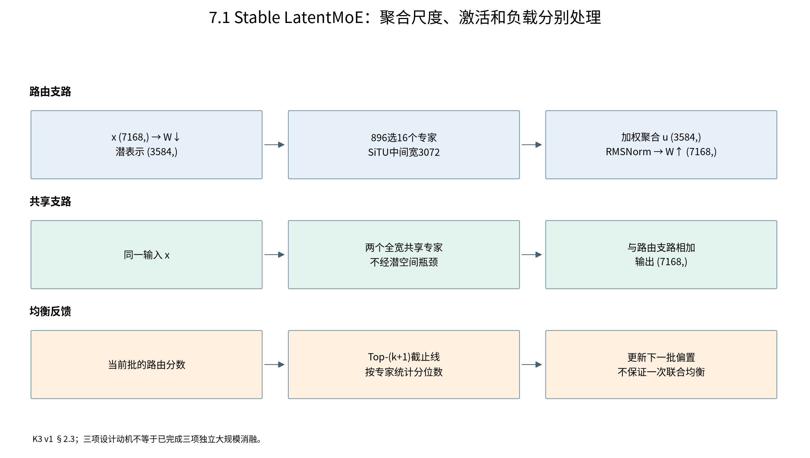
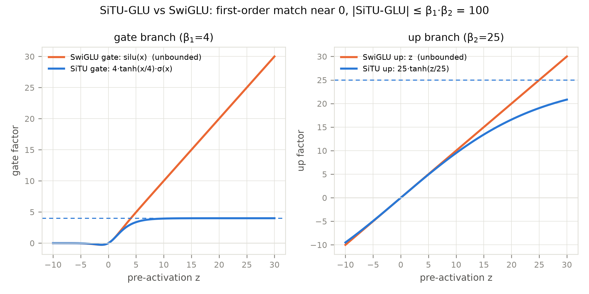
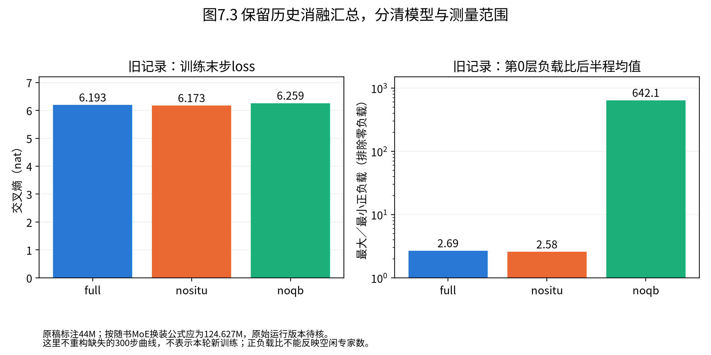

# 第 7 章 Kimi K3 报告精读·下：Stable LatentMoE、MXFP4 QAT 与原生多模态

## 7.0 开篇：从全书到这里

上一章解决了历史信息如何保存和读取：KDA 更新固定状态，Gated MLA 保留显式检索，AttnRes 改变层与层之间的聚合。本章转向每个 token 读完历史后怎样变换自身的表示。K3 在前馈层采用 Stable LatentMoE，把大量专家放进较窄的潜空间；这降低了派发宽度，却又带来激活尺度、负载和低精度训练之间的新矛盾。

我们沿同一个改造过程展开：先保留 Book4 的 LatentMoE 结构，指出极端稀疏下的限制，再加入聚合归一化、平滑限幅和分位数均衡；随后观察这些改动如何支持后训练中的量化。最后把视觉输入接回整机。需要分清两类判断：数学可以证明限幅范围、固定条件下的分位数最优性；这些性质在大模型上改善多少，则要看训练实验，不能由公式直接宣布三件组件“缺一不可”。

本章沿用 Book4 的 MoE、RMSNorm、MXFP4 和潜空间投影。涉及的新数学——软限幅的导数、路由的对偶坐标问题、量化的替代梯度——在使用处展开。K3 事实以报告 arXiv:2607.24653v1 及官方公开配置为依据；历史小模型实验用于说明机制与测量方法。

## 7.1 Stable LatentMoE：极端稀疏下的三项设计

先把部件放回整机。K3 共 93 层：第 1 层是 dense 前馈，其余 92 层每一层的前馈插槽都是一台 Stable LatentMoE——上一章图 6.1 里每个注意力层旁边配的那台 FFN 就是它。config 一侧的字段与报告 Table 1 逐位互证【证据等级：config 逆向 + 官方技术报告 arXiv:2607.24653（本地 PDF）§3.2 Table 1 p11】：隐维 $d{=}7168$ 不变，潜宽 $\ell{=}3584$（Table 1 原文标注 "(0.5×)"）、每专家中间宽 $m{=}3072$、路由专家 384→896、每 token 激活 8→16、共享专家 1→2、激活函数 SwiGLU→SiTU-GLU。报告总述句值得逐字看：LatentMoE "separating the full model width from the routed-expert width: shared experts retain a full-width path… whereas specialized routed experts operate in a compact latent space of width $\ell$"，由此 "scale channel mixing to 896 routed experts with 16 active experts per token, corresponding to a sparsity of 56"【证据等级：官方技术报告（本地 PDF）§2.3 p6】。

机制沿用 Book4 第 11 章——入口做下投影，路由专家在潜空间中计算，出口做上投影，共享专家仍在全宽空间计算——K3 的整机公式是（报告 Eq. 11，本章记作式 (7.1)）：

$$u=\sum_{i\in T_k(x)} p_i\, E_i^{\text{routed}}\big(W^{\downarrow}x\big),\qquad y=\sum_{j=1}^{N_s} E_j^{\text{shared}}(x)\;+\;W^{\uparrow}\,\mathrm{RMSNorm}(u) \tag{7.1}$$

用人话说：路由支路先把 token 压到宽度为 $\ell$ 的潜空间，再由选中的 16 个专家分别计算，按门控权重加权汇总为 $u$，然后**先归一、再升维**回全宽，与两个全宽共享专家的输出相加。与 Book4 式 (11.1) 逐项对照，在这一聚合公式中，显式增加的部件是聚合与上投影之间的那个 RMSNorm（处方一，马上讲）；符号表与形状流转如下（$N$ 为展平 token 数）。

| 符号 | 含义 | 形状 |
|---|---|---|
| $x$ | 进入该层的隐状态 | $(B,n,d)$，$d{=}7168$ |
| $W^{\downarrow}$ / $W^{\uparrow}$ | 潜下/上投影（该层路由专家共享，不跨层共享） | $(\ell,d)$ / $(d,\ell)$，$\ell{=}3584$ |
| $E_i^{\text{routed}}$ | 潜宽专家（SiTU-GLU，中间宽 $m$） | $(N_i,\ell)\to(N_i,m)\to(N_i,\ell)$，$m{=}3072$ |
| $p_i$ / $T_k(x)$ | 门控权重 / 选中专家集（QB 规则定，式 (7.3)） | 每 token $k{=}16$ 个 |
| $u$、$\mathrm{RMSNorm}(u)$ | 聚合量 / 处方一的归一化 | $(N,\ell)$ |
| $E_j^{\text{shared}}$ | 全宽共享专家 ×2 | $(N,d)\to(N,m_s)\to(N,d)$（公开实现将两个宽 $3072$ 的共享专家合并为宽 $6144$ 的前馈计算） |

单 token 走一遍：$(1,7168)$ 过 $W^{\downarrow}$ 压成 $(1,3584)$，送到 16 个专家分别计算 $(1,3584)\to(1,3072)\to(1,3584)$，加权并成 $(1,3584)$，归一后过 $W^{\uparrow}$ 回 $(1,7168)$，与共享支路相加写回残差流。

**几何账：派发元素数相同，激活中间单元数增加。** Book4 第 11 章中扩展专家数量的配方 $E'=E\cdot d/\ell$ 在 K3 身上给出 $384\times2=768$，实配 896（$\times2.33$）——比配方更激进，这一差别如实记录，不强行凑成相同的数。真正逐位闭合的是**每 token 激活潜预算**（$k\times$宽度）：K2 全宽 $8\times7168=57{,}344$，K3 潜宽 $16\times3584=57{,}344$——分毫不差【证据等级：config 逆向（自算，输入=Table 1）】。激活份数翻倍、专家宽度减半，逐 token 的理想派发元素数相同；而仅按激活中间单元数$k\times m$计，非线性预算从 $8\times2048=16{,}384$ 涨到 $16\times3072=49{,}152$（3.0 倍）。这里的“三倍”只计算激活中间单元数，不是表达能力、吞吐或实际通信时间的三倍。相同 $k\ell$ 还要求传输精度和派发协议相同，才对应相同的有效载荷字节数。

还有两笔账：单个被激活路由专家的权重元素数$3\times3584\times3072=33{,}030{,}144$（K2全宽$3\times7168\times2048=44{,}040{,}192$ 的 0.75 倍——潜宽减半省下的开销，被 $m$增至原来的1.5倍带来的开销抵消了一部分）；路由专家的全部权重 $896\times33.0\text{M}=29.6\text{B}$/层、92 层约 2.72T，占官方总参 2.78T 的绝对大头【证据等级：config 逆向（自算）】。

单专家读取量下降也不代表每 token 的读取量下降：激活专家数翻倍后，$16\times33.0\text{M}/(8\times44.0\text{M})=1.5$。这是三个不同的量：发送的表示宽度、计算的中间单元数、访问的专家权重。这些是结构上的元素账；批内专家复用、缓存与传输精度会改变实际内存流量，因此不能把元素比直接当作设备带宽收益。LatentMoE的取舍必须逐项核算。

这套结构也引入了新的尺度问题。沿任一路由专家分支，输入依次经过$W^\downarrow$、专家的门支或up支投影、专家下投影、$W^\uparrow$，最长路径上有四次矩阵乘；门支和up支是并行生成后相乘，并非两层串行投影。矩阵的尺度与乘性激活可能累积放大，但仅有“四次”并不能证明一定爆炸。K3报告§2.3记录了其2.8T训练中的两类困难：路由支路内部激活爆炸，以及近千专家时原固定步长免损失偏置更新难以兼顾适应速度与负载振荡。下面前两项设计处理激活尺度，第三项处理负载反馈；图7.1先标出它们分别作用的位置。



图 7.1 上两行是同一层前馈数据流，最后一行是跨批反馈。SiTU限制专家内部乘积，RMSNorm处理聚合尺度，QB处理派发负载。

**处方一：聚合后 RMSNorm（Normalized LatentMoE）。**$u$ 的尺度本来就会变化——「which can vary with the selected experts and their routing weights」：这次选中哪 16 个专家、门控多大，$u$ 的整体幅度就会变化。原始 LatentMoE 直接拿这个漂移的 $u$ 过 $W^{\uparrow}$；K3 在两者之间插一道 RMSNorm（式 (7.1) 已含），报告的机制句是这「**reduces the sensitivity of the routed branch to scale variation before it is combined with the full-width shared branch**」【证据等级：官方技术报告（本地 PDF）§2.3.1 p7】。用人话说：路由支路先降低聚合幅度变化的影响，再与全宽共享支路相加；共享支路本身并不因这一步获得稳定性保证。

报告§2.3.1称聚合后归一化改善验证损失和下游表现，但没有在该段给出三项设计各自的可比消融表。本书保留这一证据边界：第7.6节的小模型检查可以说明作用位置与测量方法，不能补成报告未提供的大规模收益数字。

把这个作用写成数学更清楚。对 $u\in\mathbb R^\ell$，记 $r(u)^2=\|u\|^2/\ell$，则 $\mathrm{RMSNorm}(cu)=w\odot cu/\sqrt{c^2r(u)^2+\epsilon}$。当 $c>0$ 且 $\epsilon=0$ 时，$c$ 完全约掉；有 $\epsilon$ 时只有近似尺度不变性。这里还要求$u\ne0$，否则$\epsilon=0$时本身就无定义。乘可学习增益之前，除以同一个正标量保留方向和相对坐标；逐坐标增益$w$则可能改变它们。它主要抑制的是整体幅度变化，可学习增益 $w$ 和后面的 $W^\uparrow$ 仍能放大输出。因此不能从归一化推出整个支路必不爆炸。

**处方二：SiTU-GLU（Sigmoid Tanh Unit GLU，报告命名）——有界的 SwiGLU。**激活幅度的另一个来源在专家内部。先回看改造前的形式——专家里跑的正是 Book3 第 3 章式 (3.4) 的 SwiGLU；沿用本章记号写出，并把门支的 $\mathrm{SiLU}$ 按 $z\,\sigma(z)$ 展开（Book3 式 (3.5)），两个乘性因子便与式 (7.2) 放在同一组括号中比较：

$$\mathrm{SwiGLU}(x)\;=\;\Big[\,W_g x\;\odot\;\mathrm{Sigmoid}(W_g x)\,\Big]\;\odot\;\Big[\,W_u x\,\Big]$$

（支内 $(N_i,\ell)\to(N_i,m)$，乘积再降回 $(N_i,\ell)$——降维那一步两式共有，不进对比。）两个线性因子 $W_g x$ 与 $W_u x$ 都无界，"coincident large coordinates can produce activation outliers and increase overflow risk in **low-precision arithmetic**"【§2.3.2 p7】——注意这句话直接关联到 7.2 节的 MXFP4：限幅是为低精度算术铺路的。SiTU-GLU 的做法是为两条分支分别做**平滑限幅**（softcap）：

$$\mathrm{softcap}(x,\beta)=\beta\tanh\!\Big(\tfrac{x}{\beta}\Big),\qquad \mathrm{SiTU}\text{-}\mathrm{GLU}(x)=\Big[\beta_1\tanh\!\Big(\tfrac{W_g x}{\beta_1}\Big)\odot\mathrm{Sigmoid}(W_g x)\Big]\odot\Big[\beta_2\tanh\!\Big(\tfrac{W_u x}{\beta_2}\Big)\Big] \tag{7.2}$$

这里要求$\beta_1,\beta_2>0$。与原式逐项对照，变化只有两处——gate 支与 up 支的线性因子各被 $\tanh$ 压进 $[-\beta_1,\beta_1]$ 与 $[-\beta_2,\beta_2]$（$\beta_1{=}4$、$\beta_2{=}25$【§2.3.2 p8；config `activation_situ_beta=4.0/linear 25.0` 互证】），于是整个乘积 $|f|\le\beta_1\beta_2=100$（报告 Eq. 19）。附录 B 给了三条数学性质【App B p43】：其一，$\beta\tanh(z/\beta)=z+\mathcal{O}(z^3/\beta^2)$，原点附近**一阶贴合 SwiGLU**，但高阶项仍会改变数值；

其二，$\beta_1,\beta_2\to\infty$ 时逐点退回 SwiGLU——它是对 SwiGLU 的有界变体；

其三，与硬裁剪不同，"the smooth cap preserves nonzero gradients away from saturation boundaries"；平滑不代表梯度总是足够大。

最后这条与 gpt-oss 形成对照：gpt-oss 对专家 SwiGLU 用的是 gate 7.0/up ±7.0 的**硬 clamp**（Book4 第 7 章表 7.3 已核），K3 用软盖换训练行为——问题来源相同，处理方式不同（图 7.2）。

这里的“有界”首先约束降维投影前的逐坐标乘积。若该向量为 $h\in\mathbb R^m$，则 $\|h\|_2\le100\sqrt m$，但专家输出 $W_dh$ 还受 $\|W_d\|_2$ 影响；不能把 100 写成整个专家的输出上界。

进一步看训练为何选择平滑盖。令 $c_\beta(z)=\beta\tanh(z/\beta)$，由 $\tanh a=a-a^3/3+O(a^5)$ 得

$$c_\beta(z)=z-\frac{z^3}{3\beta^2}+O(z^5/\beta^4),\qquad c_\beta'(z)=\operatorname{sech}^2(z/\beta).\tag{7.5}$$

所以小信号下的主要计算保留下来，大信号下增量逐渐收缩。门支 $f(g)=c_{\beta_1}(g)\sigma(g)$ 的导数必须同时经过两条路径：

$$f'(g)=\operatorname{sech}^2(g/\beta_1)\sigma(g)+c_{\beta_1}(g)\sigma(g)[1-\sigma(g)].\tag{7.6}$$

硬 clamp 在阈值外的裁剪路径导数为零，软盖的裁剪路径在有限实数处连续且为正；但它可以极小，有限精度下也可能饱和，完整门支的两项还可能抵消。设计获得的是平滑的抑制方式，而不是“梯度永不消失”的保证。



图7.2 分别画门支与up支的标量响应，未画专家下投影后的结果。门支$4\tanh(z/4)\sigma(z)$的绝对值不超过4，但其负尾趋近0，并非趋近−4；up支$25\tanh(z/25)$趋近±25。两支乘积的逐坐标绝对值不超过100，这个界不包括后面的$W_d$。

**例 7.1（构造例）** 取 gate 预激活 $z_g{=}8$、up 预激活 $z_u{=}50$——一组同时较大的坐标，来看限幅怎样控制输出。三步走：

1. SwiGLU：$\mathrm{silu}(8)\times50\approx 8.00\times50\approx 400$——两支无界，乘积会随坐标值增大而迅速增长。
2. SiTU gate 支：$4\tanh(8/4)\cdot\sigma(8)=3.856\times0.9997=3.855$（$\le\beta_1{=}4$）。
3. SiTU up 支：$25\tanh(50/25)=25\times0.964=24.10$（$\le\beta_2{=}25$）；乘积 $3.855\times24.10=92.9\le100$。

同一组输入下，SwiGLU约为399.87，SiTU约为92.90，说明两条大坐标的乘积受到控制。平滑限幅并不是等乘积超过100才启动：任何非零输入都会发生变化，只是原点附近变化较小。若两条预激活都满足$|z_g|,|z_u|\le1$，本例完整乘积的最大偏差小于0.02；单独的软盖$4\tanh(z/4)$在$z=1$处与z却相差约0.020325。比较误差前必须先说明比较的是哪一个函数。

**处方三：Quantile Balancing（分位数均衡）——均衡问题变成求分位数。**负载均衡问题要先看原方案的适应速度与振荡。K3 承 DeepSeek-V3 一线的免损失路由（Book4 第 5 章 noaux 阀门）：router 打分 $s_i=\mathrm{Sigmoid}(W_r x_i)$，派发按加偏置的分、混合权重按裸分归一（报告 Eq. 13，本章式 (7.3)）：

$$T_i=\mathrm{argtopk}_k\big(s_i+b\big),\qquad p_{i,j}=\frac{s_{i,j}}{\sum_{r\in T_i}s_{i,r}},\ j\in T_i \tag{7.3}$$

用人话说：$b$ 只决定「派不派」，不直接加入混合权重，也不作为普通可微参数更新；不过它改变专家选择，因此会间接改变主损失的训练路径——"it regulates dispatch without altering the mixture weights or the gradient-based optimization of the router"【§2.3.3 p8】。原方案是固定步长的符号更新 $b^{(t+1)}_j=b^{(t)}_j+\gamma\,\mathrm{sign}(\bar\ell-\ell^{(t)}_j)$，报告指出了它的两难：$\gamma$ 大了负载震荡、小了追不上——"trades off slow adaptation against load oscillation"；专家池扩到 896 个后，不均衡既拖慢训练又让部分专家欠训【§2.3.3 p8】。QB 的换法是把「调偏置」从固定步长的方向反馈改成**固定 token 截止线后的坐标闭式解**：以下推导单独用$m$表示一批token数、$n$表示专家数，区别于前面的专家中间宽度；每个token选$k$个专家，目标负载 $q:=mk/n$；单次前向顺带取每个 token 的第 $(k{+}1)$ 名作截止线 $\alpha_i$（Top-$(k{+}1)$ 路由顺带提供，不必另算 token 侧分位数）；令专家 $j$ 的过线数恰等于 $q$，单调性给出闭合解（报告 Eq. 14）：

$$\hat b_j\;\leftarrow\;-\,\mathrm{quantile}_{1-k/n}\big(s_{:,j}-\alpha\big),\qquad b\;\leftarrow\;\hat b-\mathrm{mean}(\hat b)\,\mathbf 1 \tag{7.4}$$

用人话说：把专家 $j$ 全批打分减去各 token 的截止线，取 $(1-k/n)$ 分位数取负——在无平局、$q$ 为整数并采用相应次序统计量时，这个偏置可将第 $q{+}1$ 名放到截止线上，固定截止线的过线数量得到校准；第二行去公共偏移（不改 Top-k），且偏置只影响下一批——「a batch is never routed with a bias derived from itself」【§2.3.3 p8】。先推清它为什么是一个坐标最优解，再用小数字检查这种最优性是否足以保证重新路由后均衡。

为什么是分位数，而不是负载误差乘学习率？可以从一个明确的理想化分配问题推出来。让 $X_{ij}\in[0,1]$ 表示 token $i$ 分给专家 $j$ 的份额，要求每行和为 $k$、每列和为 $q=mk/n$，最大化 $\sum_{ij}s_{ij}X_{ij}$。这里先用连续分配理解优化，最后的 top-k 才产生离散选择。

为行、列约束分别引入价格$a_i,c_j$：从总分中减去$a_i(\sum_jX_{ij}-k)$和$c_j(\sum_iX_{ij}-q)$。对合法分配，这些约束差都为零，分数没有改变；若暂时只保留$0\le X_{ij}\le1$，可选范围变大，得到的最优值就是合法分数的一个上界。固定这些价格后，每一项 $X_{ij}$ 独立最大化 $(s_{ij}-a_i-c_j)X_{ij}$：系数为正选 1，为负选 0。将这些独立最大值相加，再把上界对价格最小化，得到对偶目标

$$D(a,c)=k\sum_i a_i+q\sum_jc_j+\sum_{ij}\max(0,s_{ij}-a_i-c_j).\tag{7.7}$$

固定 $a$ 后，对专家 $j$ 令 $d_i=s_{ij}-a_i$。在不碰到折点时，

$$\frac{\partial D}{\partial c_j}=q-\#\{i:d_i>c_j\}.\tag{7.8}$$

价格过低，过线 token 多于 $q$，提高价格会降低目标；价格过高则相反。当$q$为整数且$0<q<m$时，最小值位于排序后第$q$与第$q+1$大数之间，折点处用左右导数判断。派发偏置是价格的负数 $b_j=-c_j$，这便得到式 (7.4) 的分位数结构。不同程序的分位数插值约定并不相同，不能把任意 `quantile` 实现都直接说成“第 $q+1$ 大”。非整数$q$时，连续坐标问题仍有折点最优解，却不存在所有专家都恰收$q$个token的整数分配。平局也需单独处理：即使原始分数没有平局，按次序统计量更新价格后也可能主动制造平局，不能假设它永远不会发生。

最重要的条件是“固定 $a$”。全部专家偏置更新后，每个 token 的竞争截止线也会改变；下一批数据的分数分布还可能变化。K3 用当前批的 Top-$(k+1)$ 信息产生下一批偏置，属于在线反馈，并不保证一次更新就解完联合问题。对偏置减去公共均值不改变 top-k，因为每个 token 的所有专家分数都减去同一个常数。它固定了无关的整体平移自由度。

**例7.2（构造例）** 取8个token、4个专家、top-1，目标$q=8/4=2$。随书函数生成的打分如下，表内保留6位小数，复算使用代码中的完整浮点值。行表示token，列表示专家；每行最大值的位置先给出无偏路由。

|token|专家0|专家1|专家2|专家3|
|---|---:|---:|---:|---:|
|1|0.800000|0.519709|0.497729|0.780000|
|2|0.780000|0.522720|0.531567|0.750000|
|3|0.850000|0.527367|0.519634|0.300000|
|4|0.840000|0.493020|0.473986|0.350000|
|5|0.535019|0.820000|0.800000|0.515778|
|6|0.530079|0.830000|0.400000|0.522612|
|7|0.512252|0.810000|0.450000|0.506518|
|8|0.465251|0.487657|0.790000|0.479922|

无偏时前4行选专家0，接着3行选专家1，最后1行选专家2，负载为$(4,3,1,0)$。下面用离线交替求解观察这张固定矩阵；训练中的在线更新只做当前批反馈，偏置用于下一批，二者不要混为同一种执行日程。

1. **算截止**：从零价格开始，每行取第2大，得到$\alpha\approx[0.78,0.75,0.527367,0.493020,0.80,0.530079,0.512252,0.487657]^\top$。以后迭代取$s-\beta$的第2大，它表示当前未入选的最高分。
2. **交替取分位数**：沿专家轴对 $s_{:,j}-\alpha$ 取 $(1-k/n){=}0.75$ 分位数（降序第 $q{+}1{=}3$ 大）、再沿 token 轴回代，按实物7.1执行8次完整交替，最终价格（此处$\beta$与SiTU限幅常数无关）约为$\beta=[+0.030,+0.020,-0.007732,-0.005734]$——派发分 $=s-\beta$：热门专家 0/1 被罚约 0.03/0.02，冷门专家 2/3 得约 0.006-0.008 的补贴。
3. **重派发**：按 $s-\beta$ 重新 top-1——两行从专家 0 翻到专家 3（缝只 0.02，一推就翻）、一行从专家 1 翻到专家 2，负载 $(2,2,2,2)$，本例在第一次完整交替后，负载和价格都已固定；继续到第8次仍得到相同结果。这是当前构造矩阵的结果，不是任意输入上的少步收敛保证。

效果读法：偏置只有百分位的量级（缝宽 0.02-0.03），改变选择的恰恰是原先分数接近的边缘 token——小幅偏置调整改变了这三个 token 的去向，打破了赢者通吃的结果，而每个 token 的选择仍由打分说了算。

附录C把QB与旧符号更新放在同一个固定截止线的对偶坐标问题中比较：符号步只利用负载误差的方向，QB直接取该坐标的最优折点，所以不需要为这一偏置更新另选步长。报告观察到其近千专家设置中只需少量更新便接近平衡；坐标最优的推导解释了更新方式，却没有证明任意打分矩阵上都能在几步内得到联合最优及整数均衡。更换批次、同时更新所有专家、以及平局取整，都是从该局部推导走向实际路由时需要继续处理的环节。【证据等级：K3报告App C】

全局训练步的token分散在不同设备和微批中，逐项收集$m\times n$个margin代价较高。附录D改为累计每个专家所需偏置$r_{i,j}=\alpha_i-s_{i,j}$的直方图。因$s_{i,j}\in(0,1)$、$\alpha_i$是某个$s_{i,j'}+b_{j'}$，可得$r_{i,j}\in[b_{\min}-1,b_{\max}+1]$；将此区间均分为B箱，箱宽为$w=(b_{\max}-b_{\min}+2)/B$。取负会反转排序，所以原margin的$1-k/n$分位数对应required bias的$k/n$分位数，不能在换符号后继续取同一侧尾部。

每个设备跨微批累计$(n,B)$整数计数，步末做一次all-reduce后，从合并直方图定位分位数。箱内插值只是近似；若范围覆盖全部样本、秩约定相符，位置误差不超过箱宽。报告取B=1000，在其偏置范围下误差为几千分之一，且未测出残留不均衡；其通信量低于逐微批交换raw margins基线的1%。这些比例取决于全局样本量和偏置跨度。可加计数保证得到池化分布，不能把各设备单独算出的分位数直接平均来替代。【证据等级：K3报告App D】

部署时的处理最简单：偏置冻结即可——"at deployment, routing is a fixed Top-k selection with a frozen bias, and no quantile computation is needed"【App C p44】。谱系一句：指派视角上承 BASE 与 BIP（BIP 只能压过热、不能扶过冷），出发点与苏剑林 2026 年 2 月的中文先行讨论同路【App C p44；报告引文 [68][118][113]】。

**实物 7.1**（按报告 Alg. 1 思想自写的 toy 版伪代码，$m{=}8,n{=}4,k{=}1$ 参数版；看什么——「报告给了完整可照写实现的算法」长什么样：两个分位数、一个 argtopk，再无其他；报告锚=App C p44 Alg. 1，此处为自写实现、非直译原文框——文字源纪律）

```text
输入: 打分矩阵 s ∈ (0,1)^{m×n}（本例 8×4，Sigmoid 打分）；k=1；q = m·k/n = 2
初始化: β = 0 ∈ R^n
重复 T 次（本例T=8；第一次交替后负载已均衡，价格另行记录）:
    α_i ← s 第 i 行按 s_i − β 降序的第 (k+1)=2 大值      # token 侧截止线, ∀i ∈ [m]
    β_j ← s 第 j 列按 s_{:,j} − α 降序的第 (q+1)=3 大值    # 专家侧分位数, ∀j ∈ [n]
输出: 派发 = argtopk_k(s − β)（逐 token）；负载 (2,2,2,2) ✓   # 部署时 β 冻结，仅此一行
```

三项设计合起来控制不同的问题；报告没有给出证明三者在任意规模都必要的独立消融——表 7.1 收拢。

**表 7.1** 失效模式↔处方一一对应（报告锚均为 arXiv:2607.24653 本地 PDF）

| 问题来源 | 症状 | 处方 | 机制一句话 | 报告锚 |
|---|---|---|---|---|
| 病①a 尺度漂移 | $u$ 幅度随选中专家组漂移 | ①聚合后 RMSNorm | 升维前先归一，降低对聚合整体尺度的敏感性 | §2.3.1 p7 |
| 病①b 激活尖峰 | 无界乘积偶发大坐标→低精度溢出 | ②SiTU-GLU（$\beta_1{=}4,\beta_2{=}25$，$\lvert f\rvert\le100$） | 软盖封顶、原点一阶贴合、平滑抑制梯度 | §2.3.2 p7-8＋App B p43 |
| 病② 均衡失灵 | 近 $10^3$ 专家下 sign 更新震荡/过慢 | ③Quantile Balancing | 分位数闭式解固定截止线时取对偶坐标最优 | §2.3.3 p8＋App C/D p43-45 |

## 7.2 MXFP4 QAT：量化感知训练伸进全后训练

Book4 已说明低位宽如何节省存储；这里进一步问：训练时如何让模型适应部署中必然出现的舍入误差？报告两处原句互证：SFT 侧（§4.1.1 p12）"we apply quantization-aware training (QAT) from the SFT stage onward, with MXFP4 weights and MXFP8 activations"；部署侧参考对象段（§4.1.4 p14）说得更全——MoE 专家权重（占参数内存大头）量化到 MXFP4、激活按 MXFP8 计算，"while all non-expert components (attention projections, **latent MoE projections**, shared experts, and MoE routers) remain in higher precision"，并且 "quantization-aware training throughout the entire post-training stage, covering both SFT and RL"；RL 期间 "rollout and training share the same quantization scheme — eliminating the train–inference mismatch"【证据等级：官方技术报告（本地 PDF）§4.1.1/§4.1.4 p12/p14】。

从原文可以明确三点。**其一，边界**：QAT 起于 SFT、覆盖整个后训练——不是从头（预训练配方 §3.3 无任何量化字样，训练加速用的激活侧分块 FP8 是 Book4 已教的另一码事），并非仅在训练结束后转换权重；因此不能称为从预训练开始的全程QAT。

**其二，分区**：量化只落在路由专家内部的三矩阵上，而 $W^{\downarrow}/W^{\uparrow}$ 等**潜投影明确写进保精度名单**——7.1 节刚讲过那条「近四次矩阵乘」的病态链，这些投影不再叠加同等低位宽的量化误差，这正是处方①②与量化分区的相互配合。

**其三，负结论如实记**：关于QAT前后的质量变化，本书未找到同设置下的公开消融值，因此不能据此给出质量增益或损失的数值。

config 与模型卡也都给出了相应信息：`quantization_config` 为 compressed-tensors 的 mxfp4、group 32【证据等级：config 逆向】，模型卡第 4 节原文 "Kimi K3 applies quantization-aware training from the SFT stage onward, using MXFP4 weights with MXFP8 activations for broad hardware compatibility"【证据等级：厂商自报】。放进谱系表（表 7.2）看更清楚——K3 **明确交代了 QAT 的阶段和精度分区**，与 gpt-oss 的「post-trained…quantization」（Book4 考据框核过：通篇无 QAT 字样）应按各自披露的训练阶段比较，不能仅凭术语差异判为两种互斥算法，DSV4则另列专家权重与CSA索引器QK两种低位宽路径，需分别看格式、训练和部署阶段（预览版口径）。

**表 7.2** 训练侧低精度谱系：三家对照（格式课统一指回 Book4 第 7 章）

| 维度 | gpt-oss | Kimi K3 | DSV4（预览版） |
|---|---|---|---|
| 官方措辞 | "post-trained…quantization"（无 QAT 字样） | "quantization-aware training (QAT)" | MXFP4 QAT 打点=专家权重＋索引器 QK 路径 |
| 覆盖阶段 | 后训练带量化；不由此确认预训练流程 | SFT起覆盖SFT+RL，rollout使用同方案 | 后训练QAT；推理/rollout使用原生FP4权重 |
| 低位宽计算范围 | 专家权重MXFP4，激活BF16 | 路由专家权重MXFP4、激活MXFP8 | 专家QAT中FP4权重反量化到FP8计算；CSA索引QK直接FP4 |
| 保精度件 | embedding/attention/router/norm/头 | ＋**latent MoE 投影**、共享专家 | 索引器非 QK 路径等 |
| 同设置QAT质量差值 | 未列出 | 未列出 | 未列出；索引器99.7%召回是另一指标 |

【证据等级：官方论文 2508.10925 §2.1；官方技术报告 arXiv:2607.24653 §4.1.4；官方论文·预览版 2606.19348】

量化感知训练的关键不是把梯度也压成 4 bit。以一个权重 $w$ 和量化—反量化映射 $Q(w)$ 为例，前向实际使用离散近似 $\tilde w=Q(w)$，在固定缩放格点，或缩放本身也按离散规则选取的区域内，量化—反量化值局部不随w的小变化而变化，真实导数通常为零；格点跳变处则不可微。若另用连续动态scale，导数还受该scale路径影响，不能一概省掉。一个常见教学实现用直通估计器（STE）：

$$\tilde w=w+\operatorname{stopgrad}[Q(w)-w],\qquad\frac{\partial\tilde w}{\partial w}\equiv1\quad\text{（人为指定的反向规则）}.\tag{7.9}$$

前向右边正好等于 $Q(w)$；反向第二项被截断，只留下恒等路径。它是有偏替代梯度，并非量化函数的真实导数。高精度主权重可以积累小更新，直到改变某个量化格点；若直接只存离散训练权重，小于格点间距的更新会丢失。完整层的反传仍有矩阵乘、激活函数和损失的链式法则，恒等只指这一个量化节点。本章的模拟脚本用它展示机制，不能据此断言官方训练器的所有内部实现细节。

## 7.3 原生多模态：MoonViT-V2 一瞥

第三件事只介绍事实——多模态的参考对象在下一站。先说明术语：本报告的**原生多模态**（native multimodality）指从模型预训练开始联合优化语言与视觉，对比这里的**后接式**（先训好语言模型、再接入视觉编码器）。视觉塔 MoonViT-V2 是一座 27 层、约 0.4B 参数的 ViT 变体（Table 1：401M、patch 14、12 头；采用RMSNorm，并去掉线性与注意力投影中的bias），图像与视频**共享全部参数**，注意力按「帧内空间＋帧间时间」分解，时间池化再压 token；进投影器之前先做 $2\times2$ pixel-shuffle 下采样，把视觉 token 数砍到四分之一【证据等级：官方技术报告（本地 PDF）§2.4 p9-10】。这笔账可以自算：一张 $3584\times3584$ 的图按 patch $14^2$ 切出 $256\times256=65{,}536$ 个 patch，除以 4 得 **16,384 个视觉 token/图**——若按$2^{20}=1{,}048{,}576$个位置计，约占1.5625%【证据等级：config 逆向（自算）】。

把形状接起来，投影器的作用就清楚了：单图patch网格为$(256,256)$，每格视觉特征宽1024；将相邻$2\times2$格合到通道轴后，得到$(128,128,4096)$，展平为$(16{,}384,4096)$。官方PatchMergerMLPV2用$4096\to4096\to7168$的MLP并做输出RMSNorm，将它接到语言主干的宽度。以上仅针对给定方形输入，预处理与裁块可改变长度；视觉token也不是自然语言词。视觉塔有可学习空间位置表示与时间位置分量，因此第6章的NoPE只指文本主干。

真正值得逐字阅读的是训练范式的说明。报告 §3.3 原句：K3 采用 "a native multimodal training strategy in which language and vision are jointly optimized **from the start of training**"，而非 "**grafting** a vision encoder onto a pre-trained language model through a **post-hoc alignment stage**"；视觉特征与文本嵌入交错送入同一主干，预测损失的梯度可以沿投影器回传到视觉塔；这种联合优化并不要求把每个连续视觉向量都当作词表分类标签【§3.3 p11】。这就是 LLaVA 式「后接」路线的官方否定句——但注意否定的是「预训练后再缝合」这个**阶段**，不是 projector 部件本身：MoonViT-V2 之后仍有一座轻量 MLP 投影器把视觉特征送进共享嵌入空间【§2.4 p10】。

为什么敢从头联训？报告给了消融（Fig. 6）：从 SigLIP 对比预训练初始化的编码器在联合优化下梯度范数持续偏高且频繁尖峰，from-scratch 的 MoonViT-V2 全程稳定；且下一 token 目标直接塑造表征，而不被「偏全局语义」的对比损失带偏。结论句带反直觉：「MoonViT-V2 matches the SigLIP-initialized baseline across vision evaluations, indicating that **contrastive pre-training is unnecessary as an initialization** for multimodal language models at scale」【§2.4 p9，厂商自报】。图中比较的是SigLIP初始化的MoonViT-3D与从头训练的MoonViT-V2，结构与初始化同时有所不同，不能把全部梯度差异唯一归于初始化。这一结论限于报告的模型、数据和联合训练设置，不能推出所有规模、预算下的对比预训练都无益。原生与后接两条路线的完整对照留给第 10 章 10.3，此处只立事实。

## 7.4 推理范式与长上下文：1M 档位与一个值得区分的细节

效率侧读完，长上下文的档位归属在这里补最后一块事实（位置与状态两条设计线的收束归下一章）。K3 的窗口课程是四段渐进：预训练 8K→64K，cooldown 阶段 256K→1M——「Concentrating the costly long-sequence computation within a small fraction of the overall training budget keeps the curriculum economical」【§3.4 p12】；配合文本主干不改RoPE参数地扩展到1M（机制见6.4，设计比较见下一章）。关于 1M 的实际使用，有一个值得记录的细节：BrowseComp 评测采用 300K token 触发的上下文压缩策略时得 **91.2%**，而 "evaluated with the full 1M-token context window and no context management, Kimi K3 achieves **90.4%**"【§6.1.3 p26，§6.1 主表 p27——厂商自报】。两种上下文管理协议的报告分数差0.8个百分点——「1M 窗口」与「1M 窗口的日常用法」是两个工程命题。评测口径一句：全部 K3 评测用 reasoning effort max、温度 1.0【§6.1.3 p26】；三域×三档共九个推理努力专家与预算课程是能力侧话题，第10章10.4展开；这里的九个专家是领域与推理档位的教师策略，不是MoE层中的896个路由专家。

部署侧还有两项与后训练相互关联的事实，只登记不展开。其一，MTP 层的归宿：报告说 K3 预训练带一个镜像骨干块结构的 MTP 层、后训练中 "fine-tune the pre-trained MTP layer into an EAGLE-3-style draft model"（LK 损失直击接受率，Eq. 16），且草稿层微调沿用同一量化配置【§4.1.4 p14】；而发布权重的 config `num_nextn_predict_layers=0`，本轮公开checkpoint索引与分片头中也未见额外MTP层；这只描述该发布包。config 与报告的这条差异按纪律作事实句记下（勿写「K3 无 MTP」）。其二，KDA 的循环状态在服务侧与验证回滚存在张力（"cannot be trivially rolled back"，解法=只缓存投影输入、片上重建状态）【§5.4.2 p24】。


## 7.5 训练组织与规模实验

组件能否在大模型中工作，还取决于训练组织。下面区分三类不同证据。

其一，**2.5× 是效率口径**：相对 K2 的整体缩放效率提升约 2.5 倍（同验证损失下 FLOPs 轴的差距，Fig. 7）【§3.2 p10-11，厂商自报】——图中是综合配方的拟合关系，不能唯一归因于某个组件，也不能据此反推出训练token总量、集群规模或MFU，第 11 章「读厂商自报」章会拿它当「不披露也是信息」的案例。

其二，优化器延续 K2 线：Per-Head Muon（将注意力投影的动量矩阵按头分块，再分别做Newton–Schulz迭代，以减轻不同头尺度对共同更新的干扰）＋K2 的 weight-clipping 机制原样保留，cosine 学习率＋1% warmup、weight decay 0.1【§2.5 p10、§3.3 p11；Muon 承 Book4 第 7 章】。

其三，报告 §7 的三个案例是本书方法论的绝佳呼应：24 小时预算内自主优化 GPU kernel（AttnRes 路径时延 283.6→114.4 ms）、从零写出 MiniTriton 编译器、48 小时自主设计推理芯片原型——芯片规格是**同架构缩微**：hybrid KDA＋NoPE-MLA、Block AttnRes 块大小 2、sigmoid MoE 路由＋1 共享专家、group-wise INT4（组 128），在4mm²分析面积预算下收敛到100MHz时序，RTL仿真解码超过8,700 token/s（非流片后硬件实测）【§7 p33-34，厂商自报】。K3 在 48 小时里为自己构造了一个微缩版本——「把要造的机器缩微成自己能造的版本」，正是本册从 43.9M 玩具到三刀机一直在做的事。并行与内存侧的工程件（MoonEP 等）已开源，这里仅列出名称。

## 7.6 K3 玩具·效率侧：三处方换装与量化双臂

本节包含两台不同的实验模型，先把结构分清。三项设计消融从第6章44,277,936参数的KDA版K3Toy出发，把8个普通MoE逐层换为StableLatentMoE。新槽几何为$d=512,\ell=256,m=m_s=256,E=64,k=4$，每层13,271,296参数；旧槽每层3,227,648，因而换装后的整机是

$$44{,}277{,}936+8(13{,}271{,}296-3{,}227{,}648)=124{,}627{,}120.$$

所以消融机应称约124.6M，不能继续沿用44M。它也保留了教学简化：8层全MoE，共享支路仍用SwiGLU；K3真机首层稠密、共享专家也采用SiTU。后面的量化双臂使用另一台未换装LatentMoE的44.278M模型，不能据它验证三项稳定化设计与QAT的联合效果。

组件检查先独立完成。例7.2在第一次完整交替后得到$(2,2,2,2)$，8次迭代的最终价格如正文所列。软盖在$|z|\le1$内的最大偏差约$2.03\times10^{-2}$，这与完整乘积误差不是同一个对象；大β时回到恒等函数的测试误差约$9.5\times10^{-7}$。新检查还分别核对完整SiTU乘积界、硬clamp阈值外的软盖导数、冻结偏置后无在线更新，以及QB不能保证离散配平的反例。

> **【考据框】坐标解不等于离散配平。** 报告的“少量更新接近平衡”属于其训练观察，近均匀Sigmoid分数也不是充分条件。取两token、两专家、top-1的分数$[[0.53125,0.5],[0.515625,0.484375]]$，每行原本都无平局。坐标更新却会得到价格差0.03125，使两行的两个候选同时打平；普通greedy top-k若两行都选同一专家，负载仍为$(2,0)$。联合分配本来可以各选一人，问题在于对偶折点之后还需一致的平局指派。旧玩具还记录过$(3,3,1,1)$的不均衡停止点；不把对偶变量不再变化当作已满足全部原约束。

换档只固定理想派发元素数：主档$E=64,k=4,\ell=256,m=m_s=256$，另一档$E=256,k=8,\ell=128,m=m_s=128$，均有$k\ell=1024$。这里不只是潜宽变化，专家中间宽和共享宽也减半；其单层参数分别为13,271,296与13,041,792，完整模型分别为124,627,120与122,791,088。它是有明确结构差异的预算比较，不是等参或等表达能力实验。K3的$16\times3584=8\times7168$同样只说明那一项理想派发账相等。

**三项设计的历史消融记录。**三臂都保留聚合RMSNorm，第二项只改路由专家激活，第三项只改偏置更新，因此三臂同参；若另做去第一项实验，每层才少$\ell$个norm参数，本次没有该臂。三臂为full／去②（SwiGLU）／去③（偏置恒零的裸 sigmoid topk），各 300 步（seed 20261002）。下列旧读数保留MPS BF16 autocast身份；原稿“44M”与随书换装结构不符，当前原始日志/运行版本未齐，不把这些数宣称为修订代码的新复现。采集器每10步只记录第0层，且旧max/min只在**正负载专家**中取比，空闲专家被排除。修订代码增记完整负载、空闲数和最大/均值比后，再看原记录：

- **负载反馈的旧观察（原预注册分支A）**：去③ 臂专家负载 max/min 后半程均值 **642**（轨迹 300→880 震荡上行）对 full 臂 **2.7**——差 238 倍；前两名专家负载份额 0.153 对 0.045（3.4 倍），无均衡的 sigmoid topk 逐渐趋向赢者通吃，loss 同步最差（6.259 对 6.193）。这支持该次实验中QB反馈比偏置恒零更均匀；没有sign noaux对照，不能据此宣称优于所有旧均衡算法。图7.3只保留可核的汇总读数。
- **处方②方向命中、幅度不足（分支 B，规模绑定声明）**：去② 臂激活峰值均值 15.6 对 full 12.8（比率 1.22，未达预注册的 2× 门槛），采样的第0层路由中间积未见爆炸（有界臂旧记录最大约23，小于100）；这不代表全模型所有张量都已检查。按预注册如实写：**失效模式绑定 2.8T/896 专家/低精度算术的规模（报告原口径），该短训没有观察到爆炸，不等于限幅无效；随书消融结构为124.6M，旧44M标签不再作为规模依据**；本册演示的是机制件与测量口径本身。还有一项开销：旧整步耗时2.72对2.43 s/step，差约12%；其中包括前向、反向、优化器和统计，不能把差额全归为tanh的纯前向开销。限幅的设计动机与这一次计时结果分开，额外成本是否值得仍需同设置的质量与稳定性对照。
- **处方①的对象存在**：聚合量 $u$ 的 rms 沿训练从 0.0017 漂到 0.69——该采样显示聚合幅度在变化；这说明测量对象存在，但尚未给出第一项设计的独立收益；本批未排去①臂（报告只有定性句，预期最弱）。



图7.3 重绘旧记录的最终训练loss与第0层正负载专家max/min均值。它不重构缺失的300步原始曲线，不把零负载专家隐去后仍称全体max/min；旧运行版本与44M规模标签待核，图中数字不是本轮新训练。

**实物 7.2**（三臂 ablation 的 JSON 读数摘录；看什么——「去③=负载塌缩」的两个量级与「去②=方向对幅度不足」的原始数字）

```text
# log/book5-ch07/train_ablate_{arm}_fast.json（每 10 步 stats_trace 的后半程均值）
full   (①+②+③): act_max 12.82 | load_max/min 2.69 | top2_share 0.045 | loss 9.115→6.193
nositu (去②)   : act_max 15.63（峰值 36.0）         | load_max/min 2.58 | top2_share 0.045 | loss 9.114→6.173
noqb   (去③)   : act_max 11.63 | load_max/min 642.1 | top2_share 0.153 | loss 9.115→6.259
# 全程 u_rms（①症状）：full 0.0017 → 0.69（聚合尺度随训练漂移——处方①的对象存在）
```

**量化双臂使用独立的44.278M普通MoE模型。** 它直接构造第6章KDA版K3Toy，8层共有512个路由专家；每个专家三张权重矩阵共1,536个Linear做MXFP4模拟，另在512个专家入口放MXFP8激活钩子。专家下投影前的中间激活没有相同钩子，也不模拟低位宽GEMM与累加；该模型没有LatentMoE升降投影，不能把“潜投影保持高精度”当作本实验实际验证的路径。router、共享专家、注意力和词表参数保留高精度。

模拟沿用高精度承载的量化—反量化与STE。MXFP8在这里选择E4M3元素、32元素一组、E8M0尺度；K3相关报告段未在E4M3/E5M2之间指明选择，本书不将此教学选项归给官方。修订代码限制E8M0指数到$[-127,127]$，保留入口激活的ceil-cover选scale规则；权重复用Book4已修正的OCP建议规则。旧模拟实现与新规则不同，历史loss不能自动转作新规则的精度结果。

`qat`臂从随机初始化的第一步就带量化噪声；`ptq`臂先走高精度训练，最后一次性套相同分区。它们演示的是量化进入训练的时间点，不是从已预训练模型开始的SFT，也不是gpt-oss官方流程的复现。旧读数见实物7.3。

**实物 7.3**（量化双臂读数；看什么——两件事：量化噪声在场时的可训性，与训后直接量化的跳变对照；官方掉点数字未披露，玩具读数是「本册自产＋官方无数字」的诚实组合）

```text
# log/book5-ch07/qat_sim_{qat,ptq}_fast.json（300 步，seed 20261002；分区 1536 权重 Linear＋512 专家输入）
qat 臂：loss 9.10→6.24 | 2.75 s/step（量化钩子开销 ×1.18——探针06 实测 ×1.19 同档复现）
ptq 臂：loss 9.10→6.18 | 2.33 s/step；训后一次性套量化：eval 跳变 +0.0002 nat（clean 6.2906 → quantized 6.2908）
```

两行对照的读法：**旧记录中的训后量化变化很小**——ptq 臂训练结束后一次性施加量化，eval 只变化了 0.0002 nat（6.2906→6.2908）；qat 臂从第一步就带着噪声练，该训练终点loss更高、整步更慢（6.24对6.18、2.75对2.33 s/step），量化态 eval（6.33）也未见优势。

这组44.278M随机初始化短训的适用范围有限：数据、训练阶段、模型规模与量化执行方式都不同于K3，不能把未见明显质量下降的原因只归于参数规模，也不能由+0.0002 nat宣布严格无损。历史记录没有给出多种子波动或置信区间。它说明的是两种量化时机怎样比较；K3报告中同方案训练与采样的动机，是减少量化配置造成的差异，实际收益还需对应消融。修订入口只做有限格式模拟，不能替代原生低位宽部署验证。

本轮CPU局部验证补上了这些界限的反例：原始分数均不相等且接近0.5的二维QB例，仍可在价格更新后因平局得到$(2,0)$；四个专家中仅一个有负载时，旧“非零max/min”仍为1，新增空闲计数却明确给出3。SiTU完整门支导数与自动微分一致；两输入都限制在$[-1,1]$时，完整乘积的网格最大误差约0.01524。三种消融臂在meta模块上都核为124,627,120参数，换档为122,791,088。

量化另用小模型检查权重对象、入口STE与前后向有限性：48张专家权重和16个入口钩子正确装入，重复调用不重复叠加；激活STE的节点梯度为1，零块和极小输入可处理，错误块宽和非有限值会拒绝。该小例loss约4.196，只用于检查接口，不是本章300步训练的新结果。

## 7.7 本章小结

开篇的问题至此得到逐一回答。「三处方分别解决什么问题」——它们分别控制聚合尺度、专家内部激活和派发负载：聚合后 RMSNorm 治尺度漂移（升维前先归一）、SiTU-GLU 治激活尖峰（软盖封顶 $\beta_1\beta_2{=}100$、原点一阶贴合、平滑抑制梯度）、Quantile Balancing 治负载塌缩（分位数闭式解固定截止线时取对偶坐标最优，不需偏置学习率、报告训练中少量更新接近平衡，部署冻结偏置并省去分位数更新；偏置相加和top-k本身仍有计算）——表7.1将作用位置并列比较。QAT 的边界已逐字核对：起于 SFT、覆盖 SFT＋RL、rollout 同方案；分区只压路由专家、潜投影保精度；掉点数字官方未披露。MoonViT-V2 立了原生联训的事实与在报告设置下不依赖对比预训练初始化也能达到基线的结果。玩具侧给出QB构造例与反例、124.6M消融结构的参数账，以及独立44.278M量化模型；旧训练结果与本轮局部验证分别报告。

**带走的心智**：如果忘记了细节，请记住三句话。**其一，读到任何「稳定化组件」，先问它治哪种失效方式——极端稀疏不是免费的：潜投影和专家形成较长乘性路径，896选16也加重均衡要求；报告在其训练条件下观察到相应困难，三项设计各自处理一个问题，报告没有给出三项独立消融，因此不能断言任意设置少一项都会失败**。**其二，LatentMoE 的几何账记一行等式：$16\times3584=8\times7168$——扩专家数、减专家宽，理想派发元素数不变、激活中间单元数三倍；「作坊变窄、多开分店」的图像承 Book4，数字一律用 K3 自己的**。**其三，量化的下一站是后训练：QAT 从 SFT 起覆盖到 RL、训练与采样使用同一量化方案，减少这一项训练—部署差异，收益与成本仍需实验比较**。

回到全书的路线：K3 的注意力侧（上一章）与效率侧（本章）合起来，就是 2026 旗舰配方的一次完整预演——3:1 混合注意力压上下文账、LatentMoE在派发宽度、活跃权重与专家容量之间重新分配预算、QAT 压部署账。但 K3 只是四种选法之一：位置信息「装进架构还是留给数据」这笔哲学账，GLM、Qwen、DeepSeek 各持一端——下一章把三条路线的机器放到同一张桌上，收束长上下文的位置与状态两条设计线。

## 7.8 动手验证

从本册目录运行；本工作区先激活根目录`env.sh`。单元检查默认不训练；消融与量化命令会启动训练，使用新的输出名保留已有产物，旧MPS时长仅作历史预算参考。

- **三处方单元件与 QB 小例**（CPU 秒级——例 7.1/7.2、SiTU 四断言、换档守恒账、部署一致性的数字源）：
  ```bash
  python "code/ch07/latentmoe_parts.py" --mode units --out-name run1
  ```
- **三臂 ablation**（旧MPS预算：三臂各300步；按2.4—2.7秒/步约36—41分钟；图 7.3/实物 7.2 数据源；比较条件见本节与实验脚本）：
  ```bash
  python "code/ch07/latentmoe_parts.py" --mode ablate --arm full  --steps 300
  python "code/ch07/latentmoe_parts.py" --mode ablate --arm nositu --steps 300
  python "code/ch07/latentmoe_parts.py" --mode ablate --arm noqb  --steps 300
  ```
- **量化双臂**（MPS，各约 12-14 min；实物 7.3 数据源）：
  ```bash
  python "code/ch07/qat_sim.py" --arm qat --steps 300 --out-name fast
  python "code/ch07/qat_sim.py" --arm ptq --steps 300 --out-name fast
  ```
- 验收点：能说出三处方各治哪种失效方式并给出报告锚；能手算 QB小例在固定截止条件下的分位数计算与 SiTU 的限幅乘积；能复述 K3 QAT 的覆盖边界与官方未披露项；能写出一档自己的 $k\times$宽度守恒换档账。
