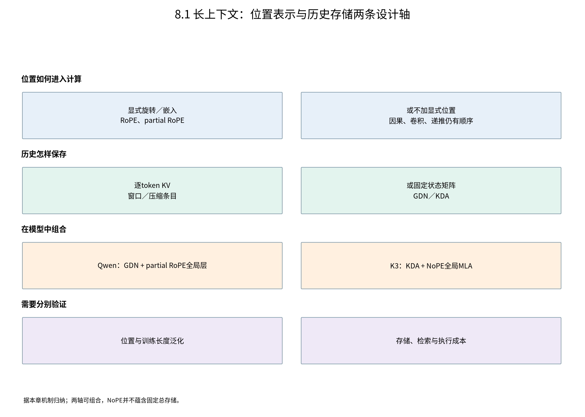
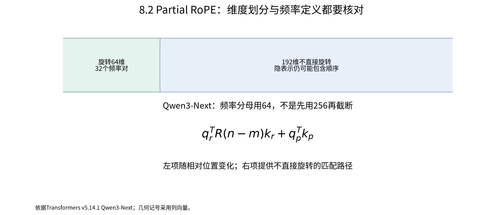

# 第 8 章 长上下文收束论：位置表示与历史状态

## 8.0 开篇：从全书到这里

前面七章不断改造两件东西：注意力保留哪些历史，以及模型怎样利用顺序。到了本章，需要把这两条线分开再合拢。一个模型可以显式使用 RoPE，同时把大部分历史压成固定状态；也可以不使用 RoPE，却仍然逐 token 保留整条 KV 缓存。**是否显式编码位置，与是否压缩历史，是两个设计维度。**它们在混合模型中合作，但不能互相代替。

本章沿用 Book3 的 RoPE、PI、NTK-aware 和 YaRN，以及本册的窗口、稀疏、GDN/KDA。我们先看位置参数如何支持扩窗，再看没有显式位置参数时顺序从哪里来，随后解释层间分工和部分旋转，最后重算各机型的状态容量。章节的目标不是给“外推派”和“压缩派”排胜负，而是让读者面对一个 1M 配置时能问清：它支持哪些位置，实际训练见过多长，历史如何保存，检索效果由什么实验支持。

## 8.1 两个相互关联、却不能合并的问题

2017 年 Transformer 论文选择正弦位置编码时，将超过训练长度的泛化列为一种可能性。这为后续研究提出了问题，却没有给出保证。固定的正弦函数可以在任意整数位置求值，不代表模型在这些位置上的预测仍然可靠。RoPE 也一样：可计算、保留相对位置形式、长文任务表现良好，是三个不同命题。

先把状态和位置放进一张二维表：

| 历史的保存方式 | 有显式位置变换 | 无显式位置变换 |
|---|---|---|
| 逐 token 保留历史 | 常见 RoPE 全注意力、MLA | NoPE 全注意力、K3 的全局 MLA |
| 固定或受限状态 | 可在输入投影中加入位置后再更新状态；须检查定义 | GDN/KDA 的递推、卷积和门控 |

因此，扩窗至少涉及两项独立工作。第一项是控制位置分布偏移：频率缩放、长文继续训练、改变位置机制。第二项是控制历史成本：窗口、压缩 KV、稀疏读取、固定递推状态。减少位置参数没有直接减少 KV 条目；减少 KV 条目也没有自动解决长距离检索。

从模型设计看，显式位置变换提供一个可检查的距离坐标，但扩窗后相位分布可能偏离训练。递推把先后次序写进状态更新，不需要扩充位置表，但仍会遇到记忆干扰、遗忘和训练长度分布的变化。原来的问题“外推还是压缩”应改成：**怎样表示顺序，同时怎样以可承受的成本保存相关历史？**



图 8.1 图的前两行是两个独立选择，第三行展示组合。顺序机制、状态形式、训练长度和检索表现必须分别检查。

## 8.2 外推派：把坐标系拉宽

对决先从人多势众的一派开始。外推派的家底 Book3 第 7 章已经教透，这里只用一句话回炉：**外推配方全是对同一张波长谱的不同调法**——快针管近邻、慢针管远方，训练窗的长度决定哪些针从未转完一圈；PI 全谱按比例压慢、NTK-aware 改变基座，使不同频率的缩放比例不同，最高频保持不变、YaRN 按快慢明文分工再乘温度。2026 年的新东西不在配方，而在**打到谁身上、打到多重**——按缩放的「档位」从轻到重排过去，恰好排出一条谱。

最轻的一档是 Gemma3：预训练 32K，之后用线性缩放（factor 8，PI 同族）扩到 128K，报告的原话只有一个数——"a scaling factor of 8"【证据等级：官方技术报告 2503.19786 §5.3】。关键是打的位置：**缩放只作用全局层**（10 个全局层，RoPE 基座 $10^6$），52 个滑窗层保持 $\theta=10^4$ 原样（第 2 章 2.4 节已引）——滑窗层只看 1,024 个近邻、相对位置极小，天然不需要外推。gpt-oss 同款思路换了配方：YaRN 32×，把稠密层从 4,096 拉到 131,072，原话是「extend the context length of dense layers to 131,072 tokens using YaRN」【证据等级：官方论文 2508.10925 §2.2，承 Book4 第 10 章直引】——滑窗层照样不外推；顺带还记得那个「部分缩放常数由实现计算」的坑：YaRN 的温度 $\approx1.3466$ 不在 config 字段里，在参考实现的代码里（Book4 第 10 章已核）。

重一档的是 Qwen3-Next：$\theta=10^7$ 原生扛到 262,144，README 写明 "Context Length: 262,144 natively and extensible up to 1,010,000 tokens"——扩展靠 YaRN factor 4.0，"validated ... up to 1 million tokens"【证据等级：厂商自报（README）】。注意这个 1.01M 的身份：config 里**没有** `rope_scaling` 字段，扩展是服务口径（部署时按说明启用，也可用于自托管），这与 8.6 节档位表里 Qwen3.5 的「托管」同款——**「原生」与「扩展部署」两个词在 Qwen 系必须分开说**。

DSV4 展示了位置方案与训练课程可以同时改变。第 4 章 4.2 节给过完整判决，本章只取哲学面的结论：单看论文会说「1M 全靠训练」（58 页全文检索 `YaRN` 零次），但三个 checkpoint 的 config 都带着 `rope_scaling={type:yarn, factor:16, original_max_position_embeddings:65536}`。调和的答案是**双 rope 组分工**：主 rope（$\theta=10^4$）无任何缩放，服务滑窗层与滑窗支路；压缩 rope（$\theta=1.6\times10^5$）+YaRN×16 只打 CSA/HCA 层，且 $65536\times16=1{,}048{,}576$ 分毫不差、65536 恰是稀疏注意力引入的训练档【依据：官方配置、参考实现与技术报告。65536 是缩放公式的参考长度；仅凭它不能确定 YaRN 在训练哪一阶段启用。】训练阶梯 4K→16K→64K→1M 真把数据练到了 1M——所以 DSV4 的正确读法是「**数据真练到 1M**」与「**压缩域采用参考长度为 64K 的缩放配置**」并用：它不是外推派的极端样本，也不是纯训练样本，「训练 vs 外推」的二分在它身上失效。与 Gemma3/gpt-oss/Qwen 放回同一条谱上看：四家都是「都练+都缩」，差别只在档位与落点——Gemma3 轻缩（×8）只打全局层，DSV4 重缩（×16）只打压缩组。

谱上还有第五种姿势：GLM-5(.2) 干脆**没有 scaling 字段，直道加大 $\theta$**——GLM-5 是 $\theta=10^6$ 配 198K，GLM-5.2 把 $\theta$ 提到 $8\times10^6$、`max_position_embeddings` 同步跳到 1M【证据等级：config 逆向】。这正是 Book3 第 7 章 7.8 节代际账的结论在 2026 的延续：Llama 3.1 用六阶段 800B token 换 128k，走到底也是「加大 base」这一个动作——外推派各家配方再花哨，最后都在改同一件事：**扩大低频波长，改变相同距离对应的相位；更慢的频率在同一长度内转的圈数反而更少**。

这些方法的共同点是把位置机制作为可修改的组件。它们并不承诺“仅改配置就无损扩窗”。Book3 的教学实验保留了这种边界：训练窗为 2K 的模型直测 16K，损失增量约 +1.14 nat；该实验的 PI、NTK-aware、YaRN-lite 分别约 +0.44/+0.28/+0.24，继续越界仍退化。这是特定小模型和配方的结果，不能当作所有模型必付的固定税。模型设计者还要同时检查原窗任务、长文检索、继续训练成本和缓存一致性。

## 8.3 无显式位置编码：顺序仍然进入架构

外推派的一切动作都发生在「位置参数」上；NoPE 设计首先移除显式的位置嵌入或旋转；是否压缩历史则要另看层类型。旗舰级的参考对象就是 K3：全模型没有任何显式位置编码，报告训练节的那句话是这一派的宣言：

> *"Kimi K3 uses no explicit positional embedding (NoPE), and instead encodes positional information implicitly through the recurrent gating and decay mechanism of KDA. As a result, the model extrapolates directly to 1M-token contexts without any positional-encoding modification …"*（不用显式位置嵌入，位置信息经 KDA 的门控与衰减隐式编码；因而不做任何位置编码改动即直推 1M。）【证据等级：官方技术报告（本地 PDF）§3.4，p.12，直引（截尾处省略 "such as RoPE rescaling or interpolation" 从句）】

第 6 章 6.4 节已经逐句精读过这两句话（连同架构节的姊妹句），本章不复读，收束三点。**其一，位置没有消失，是换了住址**：递归的次序（第 $t$ 步的状态只能由前 $t{-}1$ 步写成——因果序）、短卷积的窗口（核 4，只有最近邻先行——局部序）、通道衰减的数据依赖（越早写入留存越少——新近度），三件合起来把「位置感」搬进了线性层；24 层 Gated MLA 的打分不再直接旋转位置；但它读取的表示已经包含前层积累的顺序信息，NoPE 不是独立的赌博，是分工的自然结果。**其二，防断章**：直推 1M 不等于没练过长文——四阶段课程照走，"The window grows from 8K to 64K tokens during pre-training, and from 256K to 1M tokens during the cooldown phase"【证据等级：官方技术报告（本地 PDF）§3.4，p.12，直引】；省掉的是外推链（PI/NTK/YaRN 那套重签租约的手艺）的全部麻烦，不是省掉训练。**其三，只省掉位置参数的扩展，不省掉长度泛化问题**：8K 与 1M 用同一套递推参数，但更长的更新链会增加干扰和遗忘机会。NoPE 不等于任意长度都可靠，K3 的 1M 训练课程本身正说明数据仍然重要。

一个激进的设计要有证据阶梯才敢上旗舰，这一派的阶梯恰好三级。**第一级，论文级**：NoPE 的参考对象是 arXiv:2305.19466（Kazemnejad et al., 2023，《The Impact of Positional Encoding on Length Generalization in Transformers》，CC BY 4.0 可引）——它的定性结论是：去掉显式位置编码的因果模型**也能隐式学出位置表达**——softmax 注意力与因果掩码本身就携带次序信息；

但按本册证据纪律必须同时记住边界：这些证据来自当时的中小规模受控任务，「NoPE 能用」与「NoPE 在旗舰规模能用」之间隔着好几个数量级。**第二级，工程受控级**：Kimi Linear 论文 Table 5 在 48B 档做了同配置对照，NoPE 版短文持平、长文全面领先（RULER 84.3 对 RoPE 版 78.8）【证据等级：官方论文 arXiv:2510.26692 Table 5】——论文提出的解释是 RoPE 版全局层带强显式位置、线性层只余弱隐式偏置，**位置偏置跨层不均，长程检索被短程过重拖累**；这份对照是「混合架构里该不该显式编码位置」一项直接相关的受控证据。**第三级，旗舰全量级**：K3 以 2.8T 参数全 NoPE 直推 1M（声明为厂商自报口径）。三级递进的读法：论文级证明「能学」，受控级显示「该实验的混合模型在相关长文评测中更好」，旗舰报告给出「在大规模模型中采用并训练到 1M」的实例——每一级都比上一级多付了一层规模作抵押。

顺路两笔。其一，NoPE 还有一个第 6 章引过的架构红利：无 rope 维隔离后，MLA 可整体吸收成纯 Multi-Query 形态——Book4 第 6 章的「权重吸收」走到尽头形态。其二，谱系在冻结线后继续延伸：GLM-5.3-Flash 的 DSA 层 MLA 全 NoPE（`qk_rope_head_dim=0`）【证据等级：config 逆向；冻结线后，正文一句带过，谱系展开见第 9 章】——位置职责让给 KDA 线性层的配方，正在跨厂商复现。

红线再钉一次（第 5 章 5.13 节的教训）：**partial RoPE 不是 NoPE**。Qwen3-Next 的全局层是旋 25% 维度的 partial RoPE，GDN 层才是结构级 NoPE（不消费任何位置输入）——「Qwen3-Next 用 NoPE」的笼统说法禁用。头维上「旋多少」的完整谱系，正是下一节的主角。

## 8.4 iRoPE 的调和：按层分工，并不只有一种方向

Llama 4 提供了一个尤其值得仔细读实现的例子。Scout 的 `no_rope_layers=[1,1,1,0]` 重复十二次，但字段名容易误导：在 Book3 核对的 Transformers v4.52.4 实现中，值 1 对应 **使用 RoPE 且采用分块注意力**，值 0 对应 **不使用 RoPE 且采用全局注意力**。因此 48 层中有 36 个 RoPE 分块层、12 个 NoPE 全局层。应由条件分支确定字段语义，而不是把名字翻译后直接数层。

这套分工让局部层有明确的相对位置结构，全局层减少显式位置旋转对远处内容匹配的影响。它与 Gemma3、gpt-oss 的做法并不相同：后两者的局部层仍使用位置机制，只是局部可见距离有限，不必以同样幅度扩展频率。不能概括成“局部无需位置、全局必须位置”；选择取决于其他层已经提供哪些信息，以及任务需要怎样的检索偏置。

Scout 配置声明的最大长度为 10,485,760。另有缩放参数 factor 16 和参考长度 8192，但 $8192\times16=131072$ **不是 RoPE 的硬覆盖半径**。旋转函数在更大位置仍然有定义，缩放系数也不是模型有效上下文的严格上界。不能把 10M 与这个乘积相除，再断言中间 80 倍的长度“由 NoPE 层填补”。有效长度要看训练与评测，配置只说明计算规则和声明限制。

`iRoPE` 常用于描述交错的 RoPE／NoPE 设计；本书更重视可核验的层序列与注意力范围。分块、滑动窗口、块稀疏也不是同一个对象：分块层按固定边界隔开区域，滑窗随查询位置移动，块稀疏则根据选择规则访问若干区域。它们产生不同的跨层信息路径。

DSV4 进一步把分工细化到同层内的 RoPE 组：局部支路与压缩支路采用不同频率和缩放。Qwen3-Next 则在 GDN 层保留递推的顺序机制，在全局层保留 partial RoPE；K3 在 KDA 和 NoPE MLA 之间分配状态更新与显式历史检索。共同原则是让不同部件承担互补职责，具体分工不应由一个口号预先决定。

## 8.5 为什么旋得少反而好：头维净土的谱系

按层分工之外，还可以在同一注意力头内分工：一部分坐标接受位置旋转，另一部分直接用于内容匹配。Qwen3-Next 的全局层头维为 256，旋转其中 64 维；K3 的 MLA 不做旋转，但公开实现仍保留独立共享键分支。它们是具体设计选项，并不组成“旋得越少就必然越好”的定律。

先把机制写精确，再回答为什么。partial RoPE（部分旋转位置编码）的频率表是这样定义的（旋转对的记号承 Book3 第 4 章）：

$$
d_{\rm rot}=2r,\qquad\omega_j=\theta^{-2(j-1)/d_{\rm rot}},\qquad
\Theta_\rho(m)=\big(m\omega_1,\ \dots,\ m\omega_r,\ \underbrace{0,\ \dots,\ 0}_{\frac{d_k}{2}-r\ \text{个}}\big),\qquad r=\Big\lfloor \rho\cdot\frac{d_k}{2}\Big\rfloor
\tag{8.1}
$$

| 符号 | 含义 | 取值示例（Qwen3-Next） |
|---|---|---|
| $d_k$ | 头维 | 256（全局层 `head_dim`） |
| $\rho$ | partial 比例（`partial_rotary_factor`） | 0.25 |
| $r$ | 实际旋转的频率对数 | $\lfloor0.25\times128\rfloor=32$ 对（64 维） |
| $\omega_j$ | 第 $j$ 对维度的角频率 | $\theta=10^7$ 的频率阶梯前 32 档 |
| $m$ | token 位置 | $0,\dots,n-1$ |

用人话说：**位置 $m$ 在头维里逐对转角——前 $r$ 对按真实频率转，后面各对的频率被置成零，于是永远转 0 弧度**；0 弧度的旋转是恒等变换，这些维度上 $q\cdot k$ 只剩纯内容相似度，位置进不来。

**例 8.1（构造例：8 维头只旋前 2 维）** 取 $d_k=8$（4 个共轭对）、$\rho=0.25\Rightarrow r=1$，构造 $\omega_1=\pi/6$，位置 $m=2$。四个步骤：
① 频率表（式 (8.1) 的零频率补齐形态）：输入 $d_k{=}8,\rho{=}0.25,\omega_1$，输出 4 个频率 $[\omega_1,0,0,0]=[\pi/6,0,0,0]$；
② 逐对转角：输入 4 个频率与位置 $m{=}2$，输出 4 个角度 $[2\cdot\pi/6,0,0,0]=[\pi/3,0,0,0]$；
③ 查三角函数：$\cos=[1/2,1,1,1]$，$\sin=[\sqrt{3}/2,0,0,0]$；
④ 旋转：输入 $q=[1,0,\ 3,-2,\ 5,1,\ 0,-4]\in\mathbb{R}^{8}$，第 1 对 $(1,0)$ 按二维旋转阵转 $\pi/3$ 得 $(1/2,\sqrt{3}/2)$，第 2-4 对转 0 弧度、原样通过——输出 $q'=[0.5,0.87,\ 3,-2,\ 5,1,\ 0,-4]$。
效果读法：**同一个头里，2 维同时参与内容与位置计算，另 6 维没有直接位置旋转**；这就是 Qwen3-Next「256 维旋 64 维」的心算同构版（$\rho$ 同为 0.25，只是维数缩小 32 倍）。「不旋」与「旋 0」在数学上是同一件事——而这句话在工程里是真的有源码参考对象的。

这里有一个不能跳过的实现差别。Qwen3-Next 的频率以 `dim=int(head_dim*partial_rotary_factor)` 为分母计算，而不是先建立 256 维频率表再截取前 64 维。对 $\rho=0.25$，前者最慢频率约为 $\theta^{-62/64}$，后者则为 $\theta^{-62/256}$，差别很大。式 (8.1) 采用前者；零频率补齐只是把未旋转坐标表示成恒等变换，不自动规定旋转部分如何选频率。

```python
# Qwen3-Next 的 partial RoPE 核心计算；省略批次和设备设置。
# 输入：完整头维 head_dim，旋转比例 partial_rotary_factor。
rotary_dim = int(head_dim * partial_rotary_factor)  # 256 * 0.25 = 64
inv_freq = 1.0 / (theta ** (torch.arange(0, rotary_dim, 2).float() / rotary_dim))
# 只对前 64 维生成 cos/sin；剩余 192 维原样传递。
q_rot, q_pass = q[..., :rotary_dim], q[..., rotary_dim:]
```

这段简化代码对应 Transformers v5.14.1 的 Qwen3-Next 实现。不同位置编码类型可能采用不同的频率比例规则；比较模型时必须同时检查旋转维数与频率分母，不能只比较 `partial_rotary_factor`。



图 8.2 上部给出256维头的切分，下部展开最终内积。不旋转部分提供位置不直接作用的分数项，但不保证所有任务减少旋转都会更好。

为什么这种划分可能改善检索？把查询与键写成旋转部分和保留部分：$q=(q_r,q_p)$、$k=(k_r,k_p)$。位置分别为 $m,n$，则

$$[R(m)q_r;q_p]^\top[R(n)k_r;k_p]
=q_r^\top R(n-m)k_r+q_p^\top k_p.\tag{8.2}$$

第一项同时依赖内容和相对位移，第二项不显式依赖位移。若远处内容确实相关，第二项给模型一条不受旋转相位直接改变的匹配路径。它不是把“内容”和“位置”彻底切成两个互不相关的世界：两部分的向量都由隐状态投影而来，隐状态可以早已编码顺序，旋转部分也始终携带内容。

用一个小例子看收益与代价：令 $q_r=k_r=(1,0)$，$q_p=k_p=(1,0)$，则分数为 $\cos(n-m)+1$。旋转部分随距离变化，不旋转部分持续贡献 1。若任务是“无论多远找同一名字”，稳定项可能有用；若任务是“只找紧邻前项”，位置敏感性又是所需能力。给定总头维时，增加不旋转部分也缩小了可用于显式位置变化的子空间，效果需要训练决定。

Kimi Linear 的 NoPE 对照支持这种分工在该实验中的长文收益，但不能从单项对照推出所有任务均应减少旋转。另一项收益是实现代数：没有位置相关的旋转阻碍时，MLA 的投影可以按 Book4 的方法吸收；是否实际采用吸收式缓存，还要看执行后端，不能由 NoPE 配置直接宣布真实缓存布局。

因此本节的结论是提供设计自由度：顺序可以由局部结构、递推、显式位置等共同表达；模型架构师应为任务保留所需的区分能力，并用对照实验判断分工是否有效。

## 8.6 分类型账本统一回看：交叉点、档位横表与 1M 的日常

哲学收束完，回到本册的叙事主线——那本账。第 1 章 1.6 节立式、第 6 章 6.7 节定过玩具参考对象的**交叉点** $n^*$（式 (1.4)：全局层无界 KV 追平线性层固定状态所需的 token 数），现在把三档机器放进同一张表（表 8.1）。

表 8.1 交叉点 $n^*$ 三档对照（元素口径；$\dfrac{\text{工作区间}}{n^*}$ 为倍数）

| 机器（层配比） | 线性层固定状态 | 全局层每 token 增量 | $n^*$ | 工作区间 vs $n^*$ |
|---|---|---|---|---|
| K3 玩具 toyA（L=8：6 KDA+2 MLA） | $6\times32{,}768=196{,}608$（+卷积 $27{,}648$） | $2\times160=320$ | **614**（含卷积 701） | 训练窗 512——**尚未过 $n^*$** |
| Qwen3-Next（36 GDN+12 全局） | $36\times524{,}288=18{,}874{,}368$ | $12\times1{,}024=12{,}288$ | **1,536** | 262,144 $\approx$ **171×** |
| Kimi K3（69 KDA+24 MLA） | $69\times1{,}572{,}864=108{,}527{,}616$ | $24\times576=13{,}824$ | **7,851** | 1,048,576 $\approx$ **134×** |

【证据等级：本书复算（config 公式整数精确；玩具档承第 6 章 6.7 节参考对象——第 1 章预存句里的 219 是调研期预算值，toyA 定版 MLA 插槽后作废）】

表 8.1 的读法有两层。第一层顺着第 1 章的判词：$n^*$ 不是「要不要用线性」的判据，是**度量尺**——真机的工作区间是 $n^*$ 的百倍以上，全局 KV 部分在该元素口径下大于固定状态部分；过了 $n^*$，固定状态一次付清、无界账继续涨，差距随 $n$ 线性拉大（K3 的 0.75% 就是拉到 1M 时的读数，第 6 章 6.6 节）。第二层是诚实边界：玩具 toyA 的训练窗 512 还没过自己的 $n^*$（614/701）——它在固定状态占比较大的长度范围训练，真机在全局 KV 占主导的长度范围工作；同表对照正好把玩具外推声明（红线登记）变成看得见的数字：**43.9M 玩具的账本结构与 K3 同构，账本的读数不可外推**。顺路把第 4 章 4.5 节的 1M 横表也回收一眼：全速涨（GLM-5.2 的 MLA 账）、斜率降低（DSV4 压缩域 1/4 与 1/128，须按层求和）、纹丝不动（K3/Qwen3.5 的线性状态）——三条增长形态与位置哲学在同一批机器上正交叠加，第 9 章 9.4 节会把它们收进「账本三档递减」的总口。

第二张表是本章的正主：**各家上下文档位与位置方案横表**（表 8.2）——F10/N7 接力棒的 1M 终局落在这里。先看原料（实物 8.2），再看归纳。

> **实物 8.2（config 原样摘录，看什么：有没有 rope 字段、缩放打在谁身上）**
> ```text
> Kimi K3        max_position_embeddings=1048576   （无 rope_theta、无 rope_scaling——位置字段整个缺席）
> DSV4-Flash     max_position_embeddings=1048576   rope_theta=10000（无 scaling）
>                compress_rope_theta=160000  rope_scaling={type:yarn, factor:16, original_max_position_embeddings:65536}
> Qwen3-Next     max_position_embeddings=262144    rope_theta=10000000  partial_rotary_factor=0.25（无 rope_scaling）
> Qwen3.5-4B     max_position_embeddings=262144    rope_parameters={rope_type:default, rope_theta:10000000,
>                                                 partial_rotary_factor:0.25, mrope_interleaved:true}
> GLM-5          max_position_embeddings=202752    rope_theta=1000000（无 scaling）
> GLM-5.2        max_position_embeddings=1048576   rope_theta=8000000（无 scaling）
> Llama-4-Scout  max_position_embeddings=10485760  rope_scaling={type:llama3, factor:16, original_max_position_embeddings:8192}
>                                                 no_rope_layers=[1,1,1,0]×12
> ```
> 指名看什么：三台 1M 机器的位置字段长得毫无相似之处——K3 空白、DSV4 双组带 YaRN16、GLM-5.2 只有一个大 $\theta$；「1M」三个字背后是三种完全不同的承诺。【证据等级：config 逆向（各家官方 config/checkpoint 亲核；Qwen3.5-4B 为本地 dump `log/book5-ch09/qwen35_4b_config_dump.json`）】

表 8.2 各家上下文档位与位置方案横表（按声明档位升序）

| 机型（年） | 声明档位 | 位置方案 | 哲学归类 | 证据等级 |
|---|---|---|---|---|
| Gemma3-27B（2025-03） | 128K | 预训练 32K；全局层线性缩放×8（$\theta=10^6$）、滑窗层 $\theta=10^4$ 原样 | 外推（按层分工） | 官方报告 §5.3+config |
| gpt-oss-20b（2025-08） | 131K | 稠密层 YaRN 32×（4096→131072）、滑窗层不外推 | 外推（按层分工） | 官方论文+config（Book4 ch10） |
| Llama 4 Scout（2025） | 10M | 36 层 RoPE 分块（8192）+12 层 NoPE 全局；缩放乘积不是有效长度上限 | 调和（按层分工） | config 逆向（Book3 ch9） |
| Qwen3-Next（2025-09） | 262K 原生 / 1.01M 扩展 | 全局层 partial RoPE 0.25+YaRN×4（README 口径）；GDN 层无位置 | 外推为主+头维净土 | config/源码+README 自报 |
| Qwen3.5（2026） | 262K 原生 / 1.01M 扩展 | 同族 partial 0.25+θ=10⁷+mrope；部署扩展=静态 YaRN×4（卡面披露，同 Qwen3-Next） | 原生+扩展 | config 亲核+卡面 |
| GLM-5（2026-02） | 198K | $\theta=10^6$ 无 scaling | 外推（直道加 θ） | config 逆向 |
| GLM-5.2（2026） | 1M | $\theta=8\times10^6$ 无 scaling | 外推（直道加 θ） | config+卡面（1M 实效厂商自报） |
| DSV4（2026-06 预览） | 1M | 数据真练到 1M+压缩 rope 组 YaRN16（64K 参考长度）并用 | 外推+真练并用（按 rope 组分工） | 预览版论文+config+源码注释 |
| Kimi K3（2026） | 1M | 全机 NoPE，四阶段课程直推 | 状态压缩（位置零缩放） | 官方技术报告+config |

表 8.2 横读的是声明长度、位置规则与证据来源。声明支持不等于所有任务都在该长度有效；扩展部署也不专指某一家托管服务。GLM-5 的 202,752 与 GLM-5.2 的 1,048,576 是不同配置，Qwen 的原生长度与启用扩展后的长度也必须分开。

把它与表 8.1 合读时，仍要守住两个维度：K3 有 69/93、约四分之三的层维护固定 KDA 状态，其余层的历史继续增长；这来自层类型，不是来自 NoPE 这个名字。交叉点只比较同一模型的两类状态项，不是相对全注意力基线的质量或速度“回本点”。实际字节数还取决于各项数据类型、卷积状态、索引和执行缓存。

最后是 1M 的日常——一笔必须摘要级引用的 nuance。K3 在 BrowseComp 上采用 300K token 触发的上下文压缩策略时得 **91.2%**，而 "evaluated with the full 1M-token context window and no context management, Kimi K3 achieves **90.4%**"【证据等级：官方技术报告（本地 PDF）§6.1.3 p26+§6.1 主表 p27；厂商自报】。压缩前后差 0.8 个点——**「1M 窗口」与「1M 窗口的日常用法」是两个工程命题**：旗舰把窗做到 1M，日常用法却可能是「300K 一压」；1M 的意义或许主要在于给压缩与检索策略留余量，而不是每条请求都真灌满。而这扇 1M 的窗一旦真开起来，服务侧自有一本新账——那已经是推理系统的正题了。

## 8.7 本章小结

长上下文要同时解决位置泛化与历史成本。PI、NTK-aware、YaRN 修改显式位置变换；NoPE 移除直接的位置旋转，但因果掩码、递推、卷积与前层表示仍可携带顺序。两类设计都可能需要长文训练，两类设计也都可能维护随长度增长的历史。

层间和头内分工让这些选择可以组合。Llama 4 的 RoPE 分块层与 NoPE 全局层、DSV4 的位置组、Qwen 的部分旋转、K3 的 KDA 与 MLA，具体实现不同，不能压成同一条“局部不需要位置”的经验法则。式 (8.2) 则给出了 partial RoPE 最重要的心智：同一打分中同时存在随相对位置变化的匹配项，以及不直接旋转的内容项。

判断一个长上下文模型，可以沿四个问题读配置和实验：位置怎样进入计算，历史保存在哪些张量，训练实际覆盖哪些长度，相关任务在这些长度上表现怎样。表 8.1 回答容量，表 8.2 回答配置与声明；两者都不能替代质量评测。下一章将这些选择放回统一的模型插槽，继续完成从稠密骨架到混合模型的改造。

## 8.8 动手验证

- **交叉点与五机型账本速算**（CPU 秒级；表 8.1 真机两行与表 8.2 档位数字的参考对象来源，第 1 章脚本参数化复用）：
  ```bash
  cd 工作区根目录 && source env.sh && \
    python "code/ch01/context_account.py" --out-name run1
  ```
  预期：五机型速算表含 Qwen3-Next $n^*=1{,}536$、K3 $n^*\approx7{,}851$ 与 K3 行 0.75% 读数；产物 JSON 落 `log/book5-ch01/`（`--out-name` 防覆写）。
  
- 验收点：能说出位置与状态两条设计线各自的代表机型与证据形态（外推派的租约图像、状态压缩派的三级证据阶梯）；能用 `no_rope_layers` 与「双 rope 组」两个 config 事实讲清 iRoPE 的调和与 DSV4 的更细粒度；能把式 (8.1) 代入 $d_k=8$ 手算例 8.1，并指出「不旋=旋 0」的源码参考对象在哪两行。
