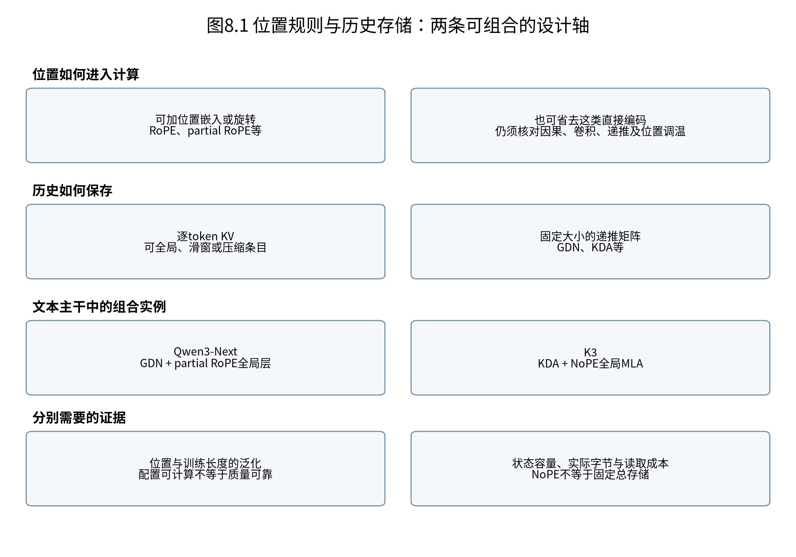
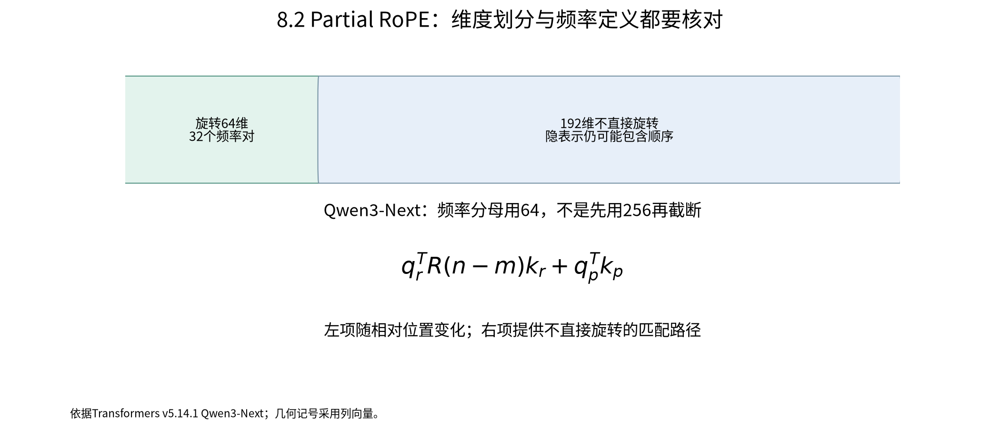

# 第 8 章 长上下文收束论：位置表示与历史状态

## 8.0 开篇：从全书到这里

前面七章不断改造两件东西：注意力保留哪些历史，以及模型怎样利用顺序。到了本章，需要把这两条线分开再合拢。一个模型可以显式使用 RoPE，同时把大部分历史压成固定状态；也可以不使用 RoPE，却仍然逐 token 保留整条 KV 缓存。**是否显式编码位置，与是否压缩历史，是两个设计维度。**它们在混合模型中合作，但不能互相代替。

本章沿用 Book3 的 RoPE、PI、NTK-aware 和 YaRN，以及本册的窗口、稀疏、GDN/KDA。我们先看位置参数如何支持扩窗，再看没有显式位置参数时顺序从哪里来，随后解释层间分工和部分旋转，最后重算各机型的状态容量。章节的目标不是给“外推派”和“压缩派”排胜负，而是让读者面对一个 1M 配置时能问清：它支持哪些位置，实际训练见过多长，历史如何保存，检索效果由什么实验支持。

## 8.1 两个相互关联、却不能合并的问题

2017 年 Transformer 论文选择正弦位置编码时，将超过训练长度的泛化列为一种可能性。这为后续研究提出了问题，却没有给出保证。固定的正弦函数可以在任意整数位置求值，不代表模型在这些位置上的预测仍然可靠。RoPE 也一样：可计算、保留相对位置形式、长文任务表现良好，是三个不同命题。

先把状态和位置放进一张二维表：

| 历史的保存方式 | 加入位置嵌入或旋转 | 不加入这类位置编码 |
|---|---|---|
| 逐 token 保留历史 | 常见 RoPE 全注意力、MLA | NoPE 全注意力、K3 的全局 MLA |
| 固定或受限状态 | 可在输入投影中加入位置后再更新状态；须检查定义 | GDN/KDA 的递推、卷积和门控 |

因此，扩窗至少涉及两项独立工作。第一项是控制位置分布偏移：频率缩放、长文继续训练、改变位置机制。第二项是控制历史成本：窗口、压缩 KV、稀疏读取、固定递推状态。减少位置参数没有直接减少 KV 条目；减少 KV 条目也没有自动解决长距离检索。

从模型设计看，显式位置变换提供一个可检查的距离坐标，但扩窗后相位分布可能偏离训练。递推把先后次序写进状态更新，不需要扩充位置表，但仍会遇到记忆干扰、遗忘和训练长度分布的变化。原来的问题“外推还是压缩”应改成：**怎样表示顺序，同时怎样以可承受的成本保存相关历史？**



图8.1的前两行是两个独立选择，第三行展示组合。顺序机制、状态形式、训练长度和检索表现必须分别检查。【来源：依据本章已核配置与实现绘制的教学示意】

## 8.2 调整位置变换：频率、作用范围与训练课程

先回到Book3第7章的位置变换。PI将频率整体按比例缩小；静态NTK-aware调整基数，使各频段变化不同、最高频保持不变；YaRN按波长区间混合频率，并调整打分尺度。它们都改变位置进入计算的方式，但不是把同一个基数统一调大。比较新模型时，还要说明变换作用于哪些层、哪些维度、以多长为参考，以及模型实际经历了什么训练课程；不能只按factor大小排列“轻重”。

Gemma3报告先用32K序列预训练，再在末段将4B、12B和27B扩到128K，所选RoPE线性缩放factor为8。**训练长度的4倍增长与频率缩放8倍是两项不同的设置**，不能用$32K\times8$替代报告的最终窗口。以27B为例，10个全局层使用$\theta=10^6$及该缩放，52个滑窗层保留$\theta=10^4$。窗宽1024使其直接可见的相对距离受限，这解释了保留局部频率的设计动机，却不意味着所有滑窗层天然不应缩放。【证据等级：Gemma3报告§5.3、官方配置及实现；参见第2章】

gpt-oss报告用YaRN将上下文参考长度4096扩到131,072，factor为32。这里不能直接套用Gemma3的“只缩放全局层”：本轮核对的transformers 5.14.1中，模型先生成一套RoPE的cos/sin，再传给滑窗与全局层，两种层共用YaRN，区别在可见性掩码。默认幅度因子为$1+0.1\ln32\approx1.3466$；它乘在cos/sin上，Q、K两侧都使用时，旋转后点积相应约乘其平方1.8133。将它简称“温度”容易混淆幅度因子与softmax分母温度，需按实现位置理解。【证据等级：gpt-oss报告§2.2与当前参考实现；参见第2章】

Qwen3-Next的全局层以$\theta=10^7$和partial RoPE支持发布配置中的262,144；模型卡另列通过YaRN factor 4扩到1,010,000的部署方法。原生配置并未默认启用这一扩展，需要按说明修改配置或传入覆盖项，可用于自托管，也可由服务方启用。扩大可接受长度是配置事实，特定长文任务是否可靠仍需相应评测；不能把“扩展部署”限定成某一家托管服务。【证据等级：官方config与模型卡自报】

DSV4同时采用长文训练课程与位置缩放。报告描述4K→16K→64K→1M的训练扩展；发布配置又给出YaRN factor16、参考长度65,536。源码表明，频率选择是**按层类型**进行的：纯SWA层用主基数$10^4$且不做该YaRN缩放；CSA/HCA层用压缩基数$1.6\times10^5$及YaRN16，**包括压缩层内部的局部原始KV支路**。不能把同一CSA/HCA层的两条支路误写成各用一套RoPE。

$65{,}536\times16=1{,}048{,}576$说明缩放配置的目标关系，但仅凭该参考长度，不能确定YaRN是在训练哪一步启用。论文正文未点名YaRN，也不能据此断定实现没有它。正确读法是把报告课程、配置与源码拼在一起：数据扩到1M，压缩层采用以64K为参考的缩放参数，两者可以同时成立。【证据等级：DSV4预览版报告、官方配置与参考源码；第4章已核】

将这几种设置并排看，差异落在参考长度、频段、层类型和训练课程。Gemma3只在全局层启用所列线性缩放，gpt-oss参考实现让两类层共用YaRN，Qwen将扩展列为额外部署选项，DSV4在压缩层启用YaRN；这些记录不能合成“每家都用同一训练加缩放流程”的结论。

GLM-5与GLM-5.2的发布配置则未启用rope scaling字段，分别给出$\theta=10^6$、最大位置202,752，以及$\theta=8\times10^6$、最大位置1,048,576。固定旋转宽度时，增大$\theta$使除最高频外的频率变慢，但配置本身不交代全部训练过程，不能由此说“只改基数就获得1M质量”。Book3的代际比较也不是所有模型最终只加base：Llama 3采用$5\times10^5$，其报告的405B长上下文训练有六阶段、约800B token投入；其他模型还使用分段缩放。共同点是调整相位分布与训练覆盖，具体手段不能互换。

这些位置组件都不承诺“改配置即可无损扩窗”。Book3表7.3的历史小模型训练窗为2048：直接评8192时，loss从4.254到5.397，增量约1.14 nat；同一8192评测下，PI、NTK-aware、YaRN-lite分别为4.689、4.531、4.491，相对未干预同窗基线约+0.44/+0.28/+0.24。要特别区分评测长度：到16K时，未干预loss为5.694，增量约1.44，三种干预的排序也改变。这是特定checkpoint、相同目标集、不同上下文分段的观察，不能当作所有模型必付的固定代价，也不能把YaRN-lite当成完整YaRN的所有细节。

## 8.3 无显式位置编码：顺序仍然进入架构

位置缩放改变显式的坐标变换，相关训练课程还会改变模型参数；NoPE 设计首先移除显式的位置嵌入或旋转；是否压缩历史则要另看层类型。旗舰级的参考对象就是 K3：文本主干不加显式位置嵌入或旋转，视觉塔另有位置表示，报告训练节的那句话是这一派的宣言：

> *"Kimi K3 uses no explicit positional embedding (NoPE), and instead encodes positional information implicitly through the recurrent gating and decay mechanism of KDA. As a result, the model extrapolates directly to 1M-token contexts without any positional-encoding modification …"*（不用显式位置嵌入，位置信息经 KDA 的门控与衰减隐式编码；因而不做任何位置编码改动即直推 1M。）【证据等级：官方技术报告（本地 PDF）§3.4，p.12，直引（截尾处省略 "such as RoPE rescaling or interpolation" 从句）】

第6章已说明K3的层分工，这里进一步分清顺序信号的来源。旧状态来自前面的位置，当前状态还会写入本token；短卷积沿有序邻域混合；只看遗忘路径，越早的写入经过更多留存因子，但最终贡献还受键方向、Delta修正和查询影响，不能简单按年龄排序。全局MLA不再旋转Q/K，却可以读取前层已包含顺序信息的表示。这使NoPE成为一种可训练的设计选择，并非递推层存在就必然推出的结果。

不修改位置编码而支持1M，不等于没练过长文——四阶段课程照走，"The window grows from 8K to 64K tokens during pre-training, and from 256K to 1M tokens during the cooldown phase"【证据等级：官方技术报告（本地 PDF）§3.4，p.12，直引】；省去的是对应的位置嵌入或RoPE缩放参数调整，长文训练、数值稳定性与检索泛化仍须处理。

相同参数仍要经受长度泛化的检验：8K 与 1M 用同一套递推参数，但更长的更新链会增加干扰和遗忘机会。NoPE 不等于任意长度都可靠，K3 的 1M 训练课程本身正说明数据仍然重要。

NoPE的理论与实验依据可以分开看。Kazemnejad等的2023年论文在§5.1讨论带起始符号BOS的decoder-only模型：存在某种参数化，能在第一层恢复位置信号；若该信息在后层保留，后续注意力也能实现相对位置形式。这里的关键词是“存在”，不是任何随机网络或训练过程都必然学到。

一个注意力核心的构造能说明信息从哪里来。令所有可见分数为0，BOS的value为1，其他token的value为0；因果位置t（0起）平均前$t+1$个值，读出$1/(t+1)$。位置0、1、2分别得到1、1/2、1/3，为后续网络提供可区分的信号。若所有value都为1，同样的因果掩码却在每处都输出1。可见，边界符号与表示结构很重要，掩码不是无条件的“位置生成器”。【证据等级：NoPE论文§5.1存在性结果；此处均匀注意力算例为本书构造】

但按本册证据纪律必须同时记住边界：这些证据来自当时的中小规模受控任务，「NoPE 能用」与「NoPE 在旗舰规模能用」之间隔着好几个数量级。

进一步的模型对照来自Kimi Linear的48B、1.4T token设置：Table 5中NoPE的RULER为84.3对78.8，长文均值54.5对51.8，但LongBench V2与Frames两项低于RoPE版（见第6章）。作者以跨层位置偏置差异解释结果；该表支持此配置下的平均收益，不能唯一证明原因，也不支持“全部长文任务都更好”。

K3则提供了大规模采用实例：报告在2.8T模型的文本主干使用NoPE，并按课程训练到1M。理论构造、受控模型对照和旗舰报告各自回答不同问题，数据、架构与训练预算并不相同；它们不是保持其余变量不变的三级规模实验。【证据等级：K3报告自报】

实现代数上，NoPE让MLA中的投影更便于按Book4第6章吸收，但不自动删除共享键分支，也不保证执行后端采用吸收式缓存。冻结线后的GLM-5.3-Flash配置也将标为KDA的线性层与主注意力旋转宽度为0的DSA层交错排列；这里只把它作为另一项配置采用记录，不据此宣布性能收益已经跨厂商复现。

这里再次明确一条边界（第 5 章 5.13 节的教训）：**partial RoPE 不是 NoPE**。Qwen3-Next 的全局层是旋 25% 维度的 partial RoPE，GDN 层才是结构级 NoPE（不消费任何位置输入）——「Qwen3-Next 用 NoPE」的笼统说法禁用。接下来先看第8.4节的层间分工，再到第8.5节讨论头内旋转比例。

## 8.4 iRoPE 的调和：按层分工，并不只有一种方向

Llama 4 提供了一个尤其值得仔细读实现的例子。Scout 的 `no_rope_layers=[1,1,1,0]` 重复十二次，但字段名容易误导：在 Book3 核对的 Transformers v4.52.4 实现中，值 1 对应 **使用 RoPE 且采用分块注意力**，值 0 对应 **不使用 RoPE 且采用全局注意力**。因此 48 层中有 36 个 RoPE 分块层、12 个 NoPE 全局层。应由条件分支确定字段语义，而不是把名字翻译后直接数层。

这套配置让分块层保留显式旋转，全局层省去RoPE，但还不能把全局层称作“完全没有位置相关计算”。同一v4.52.4实现对NoRoPE层启用查询温度调节：在0起查询位置m，将Q乘$s(m)=1+0.1\ln(\lfloor(m+1)/8192\rfloor+1)$。位置0时为1，位置8191时约1.0693；这是随查询位置变化的打分幅度，虽然没有旋转Q/K，仍显式用到了位置。

因此，RoPE有无、注意力可见范围、以及其他位置相关缩放要分别核对。Gemma3的局部层保留自己的频率，gpt-oss两类层共用YaRN；不能从它们概括出“局部不需要位置、全局必须有位置”的普遍规则。

Scout 配置声明的最大长度为 10,485,760。另有缩放参数 factor 16 和参考长度 8192，但 $8192\times16=131072$ **不是 RoPE 的硬覆盖半径**。旋转函数在更大位置仍然有定义，缩放系数也不是模型有效上下文的严格上界。不能把 10M 与这个乘积相除，再断言中间 80 倍的长度“由 NoPE 层填补”。有效长度要看训练与评测，配置只说明计算规则和声明限制。

`iRoPE` 常用于描述交错的 RoPE／NoPE 设计；本书更重视可核验的层序列与注意力范围。分块、滑动窗口、块稀疏也不是同一个对象：分块层按固定边界隔开区域，滑窗随查询位置移动，块稀疏则根据选择规则访问若干区域。它们产生不同的跨层信息路径。

DSV4按纯SWA层与CSA/HCA层选择不同频率；同一个CSA/HCA层中的局部与压缩条目共用该层的压缩RoPE参数。Qwen3-Next 则在 GDN 层保留递推的顺序机制，在全局层保留 partial RoPE；K3 在 KDA 和 NoPE MLA 之间分配状态更新与显式历史检索。共同原则是让不同部件承担互补职责，具体分工不应由一个口号预先决定。

## 8.5 部分旋转：在同一头内保留两种匹配路径

按层分工之外，还可以在同一注意力头内分工：一部分坐标接受位置旋转，另一部分直接用于内容匹配。Qwen3-Next 的全局层头维为 256，旋转其中 64 维；K3 的 MLA 不做旋转，但公开实现仍保留独立共享键分支。它们是具体设计选项，并不组成“旋得越少就必然越好”的定律。

先把这种分工写成可检查的变换，再讨论它在什么任务中可能有用。partial RoPE（部分旋转位置编码）的频率表是这样定义的（旋转对的记号承 Book3 第 4 章）：

$$
d_{\rm rot}=2r,\qquad\omega_j=\theta^{-2(j-1)/d_{\rm rot}},\qquad
\Theta_\rho(m)=\big(m\omega_1,\ \dots,\ m\omega_r,\ \underbrace{0,\ \dots,\ 0}_{\frac{d_k}{2}-r\ \text{个}}\big),\qquad r=\Big\lfloor \rho\cdot\frac{d_k}{2}\Big\rfloor
\tag{8.1}
$$

| 符号（本式中均为标量） | 含义 | 取值示例（Qwen3-Next） |
|---|---|---|
| $d_k$ | 头维 | 256（全局层 `head_dim`） |
| $\rho$ | partial 比例（`partial_rotary_factor`） | 0.25 |
| $r$ | 实际旋转的频率对数 | $\lfloor0.25\times128\rfloor=32$ 对（64 维） |
| $\omega_j$ | 第$j$对的角频率，$j=1,\ldots,r$ | 以旋转宽64为分母的32档，不是全256维表的前32档 |
| $m$ | token 位置 | $0,\dots,n-1$ |

用人话说：**位置 $m$ 在头维里逐对转角——前 $r$ 对按真实频率转，后面各对的频率被置成零，于是永远转 0 弧度**；0 弧度的旋转是恒等变换，这些坐标不再被这一步旋转直接改变；它们的输入表示仍可能含有前层产生的顺序信息。

式(8.1)还需要两个边界约定：头维为偶数，且$0\le\rho\le1$；$r=0$时直接使用恒等变换，不构造分母为0的频率。这里数学上按频率对取整，实际Qwen配置则令`int(head_dim*partial_rotary_factor)`为偶数，两者在本例64维时一致，不能把任意奇数旋转宽度直接送入实现。

**例 8.1（构造例：8 维头只旋前 2 维）** 取 $d_k=8$（4 个二维坐标对）、$\rho=0.25\Rightarrow r=1$，构造 $\omega_1=\pi/6$，位置 $m=2$。四个步骤：
① 频率表（式 (8.1) 的零频率补齐形态）：输入 $d_k{=}8,\rho{=}0.25,\omega_1$，输出 4 个频率 $[\omega_1,0,0,0]=[\pi/6,0,0,0]$；
② 逐对转角：输入 4 个频率与位置 $m{=}2$，输出 4 个角度 $[2\cdot\pi/6,0,0,0]=[\pi/3,0,0,0]$；
③ 查三角函数：$\cos=[1/2,1,1,1]$，$\sin=[\sqrt{3}/2,0,0,0]$；
④ 旋转：输入 $q=[1,0,\ 3,-2,\ 5,1,\ 0,-4]\in\mathbb{R}^{8}$，第 1 对 $(1,0)$ 按二维旋转阵转 $\pi/3$ 得 $(1/2,\sqrt{3}/2)$，第 2-4 对转 0 弧度、原样通过——输出$q'=[1/2,\sqrt3/2,3,-2,5,1,0,-4]\approx[0.5,0.8660,3,-2,5,1,0,-4]$。
效果读法：**同一个头里，2 维同时参与内容与位置计算，另 6 维没有直接位置旋转**；这就是 Qwen3-Next「256 维旋 64 维」的心算同构版（$\rho$ 同为 0.25，只是维数缩小 32 倍）。本例刻意取$\omega_1=\pi/6$方便手算；真实式(8.1)的首频率为1，所以它演示的是相同分块旋转结构，不是该频率表的数值缩小版。「不旋」与「旋0」在数学上是同一件事——而这句话在工程实现中也有对应的源码。

这里有一个不能跳过的实现差别。Qwen3-Next 的频率以 `dim=int(head_dim*partial_rotary_factor)` 为分母计算，而不是先建立 256 维频率表再截取前 64 维。对 $\rho=0.25$，前者最慢频率约为 $\theta^{-62/64}$，后者则为 $\theta^{-62/256}$，差别很大。式 (8.1) 采用前者；零频率补齐只是把未旋转坐标表示成恒等变换，不自动规定旋转部分如何选频率。

```python
# Qwen3-Next 的 partial RoPE 核心计算；省略批次和设备设置。
# 输入：完整头维 head_dim，旋转比例 partial_rotary_factor。
rotary_dim = int(head_dim * partial_rotary_factor)  # 256 * 0.25 = 64
inv_freq = 1.0 / (theta ** (torch.arange(0, rotary_dim, 2).float() / rotary_dim))
# 只对前 64 维生成 cos/sin；剩余 192 维原样传递。
q_rot, q_pass = q[..., :rotary_dim], q[..., rotary_dim:]
```

这段简化代码对应 Transformers v5.14.1 的 Qwen3-Next 实现。不同位置编码类型可能采用不同的频率比例规则；比较模型时必须同时检查旋转维数与频率分母，不能只比较 `partial_rotary_factor`。



图 8.2 上部给出256维头的切分，下部展开最终内积。不旋转部分提供位置不直接作用的分数项，但不保证所有任务减少旋转都会更好。

为什么这种划分可能改善检索？把查询与键写成旋转部分和保留部分：$q=(q_r,q_p)$、$k=(k_r,k_p)$。其中$q_r,k_r\in\mathbb R^{d_{\rm rot}}$，$q_p,k_p\in\mathbb R^{d_k-d_{\rm rot}}$。位置分别为$m,n$，先用同一频率表构造$R(m),R(n)\in\mathbb R^{d_{\rm rot}\times d_{\rm rot}}$的各二维旋转块，才有$R(m)^\top R(n)=R(n-m)$；将两组坐标的内积分别展开，得到

$$[R(m)q_r;q_p]^\top[R(n)k_r;k_p]
=q_r^\top R(n-m)k_r+q_p^\top k_p.\tag{8.2}$$

第一项同时依赖内容和相对位移，第二项不显式依赖位移。若远处内容确实相关，第二项给模型一条不受旋转相位直接改变的匹配路径。它不是把“内容”和“位置”彻底切成两个互不相关的世界：两部分的向量都由隐状态投影而来，隐状态可以早已编码顺序，旋转部分也始终携带内容。

用一个小例子看收益与代价：令 $q_r=k_r=(1,0)$，$q_p=k_p=(1,0)$，则分数为 $\cos(n-m)+1$。旋转部分随距离变化，不旋转部分持续贡献 1。若任务是“无论多远找同一名字”，稳定项可能有用；若任务是“只找紧邻前项”，位置敏感性又是所需能力。给定总头维时，增加不旋转部分也缩小了可用于显式位置变化的子空间，效果需要训练决定。

Kimi Linear 的 NoPE 对照支持这种分工在该实验中的长文收益，但不能从单项对照推出所有任务均应减少旋转。另一项收益是实现代数：没有位置相关的旋转阻碍时，MLA 的投影可以按 Book4 的方法吸收；是否实际采用吸收式缓存，还要看执行后端，不能由 NoPE 配置直接宣布真实缓存布局。

因此本节的结论是提供设计自由度：顺序可以由局部结构、递推、显式位置等共同表达；模型架构师应为任务保留所需的区分能力，并用对照实验判断分工是否有效。

## 8.6 分类型账本统一回看：交叉点、档位横表与 1M 的日常

讨论完设计思路，再回到贯穿本册的账本。第 1 章 1.6 节立式、第 6 章 6.7 节定过玩具参考对象的**交叉点** $n^*$（式 (1.4)：全局层无界 KV 追平线性层固定状态所需的 token 数），现在把三档机器放进同一张表（表 8.1）。

表8.1 两种固定状态口径的交叉点。右列只取发布配置的最大长度作比较，不代表每条请求都工作在该长度。

|模型/层配比|矩阵状态元素|最小卷积历史元素|全局每token元素|矩阵$n^*$／含最小卷积$n^*$|指定长度对照|
|---|---:|---:|---:|---|---|
|KDA玩具（6固定状态+2普通MLA）|196,608|27,648|320|614.4／700.8|历史训练窗512，低于二者|
|Qwen3-Next（36 GDN+12全局）|18,874,368|884,736|12,288|1,536／1,608|262,144约为矩阵交叉点170.67倍|
|Kimi K3（69 KDA+24 MLA）|108,527,616|7,630,848|13,824|7,850.67／8,402.67|1,048,576约为矩阵交叉点133.57倍|

【证据等级：本书复算（config 公式整数精确；玩具档承第 6 章 6.7 节参考对象——第 1 章预存句里的 219 是调研期预算值，toyA 定版 MLA 插槽后作废）】

表8.1先比较同一模型内部两类状态的元素数。Qwen与K3若取表列最大长度，全局主KV都已超过固定状态；随着n增加，前者继续线性增长，后者的大小保持固定，但其中的数值仍每步更新。K3约0.75%只是在1,048,576长度时矩阵状态与全局主KV的比值；它不是采用3:1后相对某个基线的总内存降幅。

玩具的历史训练窗512还没有跨过614.4／700.8的交点；这与真机在长上下文端的状态占比不同。KDA玩具总参为44.278M，43.906M另指GDN替身分支，二者都使用普通MLA且有未复现的真机组件。状态账可以帮助看清这些差异，不能据其外推K3的质量或速度。

再回看第 4 章 4.5 节的 1M 横表：全速涨（GLM-5.2 的 MLA 账）、斜率降低（DSV4 压缩域 1/4 与 1/128，须按层求和）、大小固定（K3/Qwen3.5的递推状态）——三条增长形态与位置哲学在同一批机器上正交叠加，第 9 章 9.4 节会在「账本三档递减」中把它们统一起来。

第二张表是本章的重点：**各家上下文档位与位置方案横表**（表 8.2）——F10/N7 留下的问题，在这里以 1M 档位作最后收束。先看材料（实物 8.2），再看归纳。

> **实物8.2（关键配置字段并排整理，含解释注记，不是可直接解析的JSON）**。看原生位置上限、缩放参数与层型之间的关系。
> ```text
> Kimi K3        max_position_embeddings=1048576   （文本主干无RoPE频率字段；视觉位置表示另计）
> DSV4-Flash     max_position_embeddings=1048576   rope_theta=10000（纯SWA层使用；CSA/HCA整层另用compress参数）
>                compress_rope_theta=160000  rope_scaling={type:yarn, factor:16, original_max_position_embeddings:65536}
> Qwen3-Next     max_position_embeddings=262144    rope_theta=10000000  partial_rotary_factor=0.25（无 rope_scaling）
> Qwen3.5-4B     max_position_embeddings=262144    rope_parameters={rope_type:default, rope_theta:10000000,
>                                                 partial_rotary_factor:0.25, mrope_interleaved:true}
> GLM-5          max_position_embeddings=202752    rope_theta=1000000（无 scaling）
> GLM-5.2        max_position_embeddings=1048576   rope_theta=8000000（无 scaling）
> Llama-4-Scout  max_position_embeddings=10485760  rope_scaling={type:llama3, factor:16, original_max_position_embeddings:8192}
>                                                 no_rope_layers=[1,1,1,0]×12
> ```
> 重点看三台 1M 机器的位置字段，它们的形式毫无相似之处——K3 空白、DSV4 双组带 YaRN16、GLM-5.2 只有一个大 $\theta$；同样的1M配置上限，可以配合不同的位置规则；这些字段并不是三份任务质量保证。【证据等级：config 逆向（各家官方 config/checkpoint 亲核；Qwen3.5-4B 为本地 dump `log/book5-ch09/qwen35_4b_config_dump.json`）】

表8.2 位置规则与声明长度（按发布配置最大位置数排序；额外部署扩展另列）

|机型|发布配置最大位置数／额外扩展|位置规则及作用范围|与状态层的组合|证据|
|---|---|---|---|---|
|Gemma3-27B|131,072|全局$\theta=10^6$、线性缩放8；局部$\theta=10^4$|10全局+52滑窗|官方报告§5.3、config/实现|
|gpt-oss-20b|131,072|YaRN32、参考4096；当前HF两类层共用|12全局+12滑窗|报告、config/实现|
|GLM-5|202,752|$\theta=10^6$，配置未启用scaling|DSA稀疏读取，主KV仍逐token保留|config/实现|
|Qwen3-Next|262,144／模型卡扩展1,010,000|全局partial .25；扩展部署YaRN4|36 GDN+12全局|config与模型卡自报|
|Qwen3.5-4B示例|262,144／同族模型卡列扩展1,010,000|partial .25、$\theta=10^7$、多轴mRoPE；扩展YaRN4|24 GDN+8全局|4B config、同族部署说明|
|GLM-5.2|1,048,576|$\theta=8\times10^6$，配置未启用scaling|DSA与跨层索引共享，主KV继续增长|config、官方服务自报|
|DSV4预览版|1,048,576|纯SWA用主RoPE；CSA/HCA整层用compress RoPE+YaRN16|局部原始历史+压缩历史，按层求和|报告、config、源码|
|Kimi K3|1,048,576|文本主干NoPE；四阶段长文课程|69 KDA+24全局MLA；视觉另有位置|官方报告、config/源码|
|Llama 4 Scout|10,485,760|36 RoPE分块+12 NoRoPE全局；后者仍有位置相关温度|固定分块与全局历史组合|config、HF v4.52.4|

表 8.2 横读的是声明长度、位置规则与证据来源。声明支持不等于所有任务都在该长度有效；扩展部署也不专指某一家托管服务。GLM-5 的 202,752 与 GLM-5.2 的 1,048,576 是不同配置，Qwen的原生长度与启用扩展后的长度也必须分开。Qwen3.5的mRoPE分配时间/高度/宽度等坐标，partial比例决定旋转多少维，两者是不同参数；纯文本时各位置轴可使用相同序列位置，多模态时还依赖输入的位置组织。

把它与表 8.1 合读时，仍要守住两个维度：K3 有 69/93、约四分之三的层维护固定 KDA 状态，其余层的历史继续增长；这来自层类型，不是来自 NoPE 这个名字。交叉点只比较同一模型的两类状态项，不是相对全注意力基线的质量或速度“回本点”。实际字节数还取决于各项数据类型、卷积状态、索引和执行缓存。

再看一个实际使用协议的例子：K3报告在BrowseComp中采用300K token触发的上下文压缩，得91.2%；不做上下文管理、使用完整1M窗口时为90.4%。这是两种协议的报告结果，差0.8个百分点，不能据此推出1M窗口主要只用于给压缩留余量，或所有请求都应在300K压缩。可支持的长度、上下文如何组织和任务效果仍是不同问题。【证据等级：K3报告§6.1.3与主表，厂商自报】实际服务的缓存、调度和延迟，接Book6及Book8讨论。

## 8.7 本章小结

长上下文要同时解决位置泛化与历史成本。PI、NTK-aware、YaRN 修改显式位置变换；NoPE 移除直接的位置旋转，但因果掩码、递推、卷积与前层表示仍可携带顺序。两类设计都可能需要长文训练，两类设计也都可能维护随长度增长的历史。

层间和头内分工让这些选择可以组合。Llama 4 的 RoPE 分块层与 NoPE 全局层、DSV4的层型频率选择、Qwen 的部分旋转、K3 的 KDA 与 MLA，具体实现不同，不能压成同一条“局部不需要位置”的经验法则。式(8.2)给出partial RoPE的核心结构：同一打分中同时存在随相对位置变化的匹配项，以及不直接旋转的内容项。

判断一个长上下文模型，可以沿四个问题读配置和实验：位置怎样进入计算，历史保存在哪些张量，训练实际覆盖哪些长度，相关任务在这些长度上表现怎样。表 8.1 回答容量，表 8.2 回答配置与声明；两者都不能替代质量评测。下一章将这些选择放回统一的模型插槽，继续完成从稠密骨架到混合模型的改造。

## 8.8 动手验证

从本册目录运行；在本工作区先激活根目录`env.sh`，重复运行请使用新的输出名。账本脚本只覆盖其内置机型，不生成表8.2全部配置声明，也不验证任何长文质量。

- **交叉点与五机型账本速算**（CPU 秒级；表 8.1 真机两行与表 8.2 档位数字的参考对象来源，第 1 章脚本参数化复用）：
  ```bash
  python "code/ch01/context_account.py" --out-name run1
  ```
  预期：五机型速算表含 Qwen3-Next $n^*=1{,}536$、K3 $n^*\approx7{,}851$ 与 K3 行 0.75% 读数；产物 JSON 落 `log/book5-ch01/`（`--out-name` 防覆写）。
  
- **位置数学与边界小例**（CPU）：
  ```bash
  python code/ch08/position_checks.py --out-name run1
  ```
  检查构造旋转、式(8.2)、rho=0恒等、频率分母差、BOS与恒定值反例、NoRoPE查询调温、三档交叉点。输出到`log/book5-ch08/`；不训练模型，也不把这些算术检查当成长文质量验证。

- 验收点：分别说明位置规则与状态形式；指出Llama 4 NoRoPE层仍有什么位置相关计算；解释DSV4为什么按层选RoPE；区分式(8.1)的真实首频率与例8.1的构造频率；由同一频率表的旋转矩阵推出式(8.2)，并说明它不保证长文质量。
