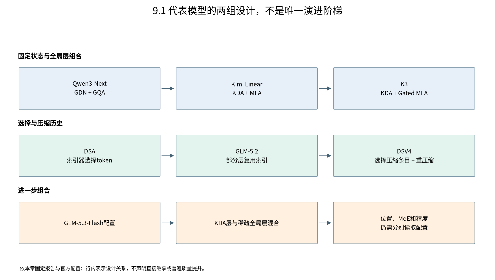
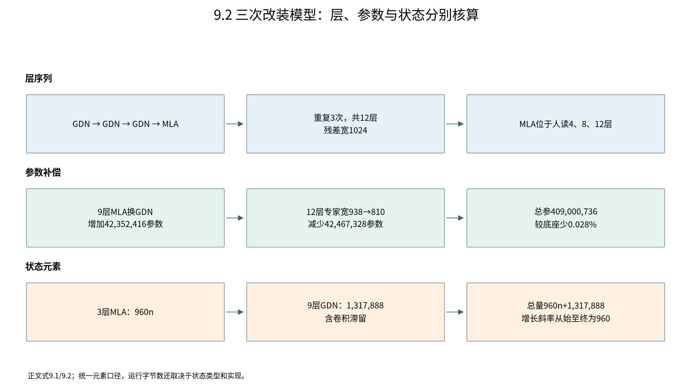
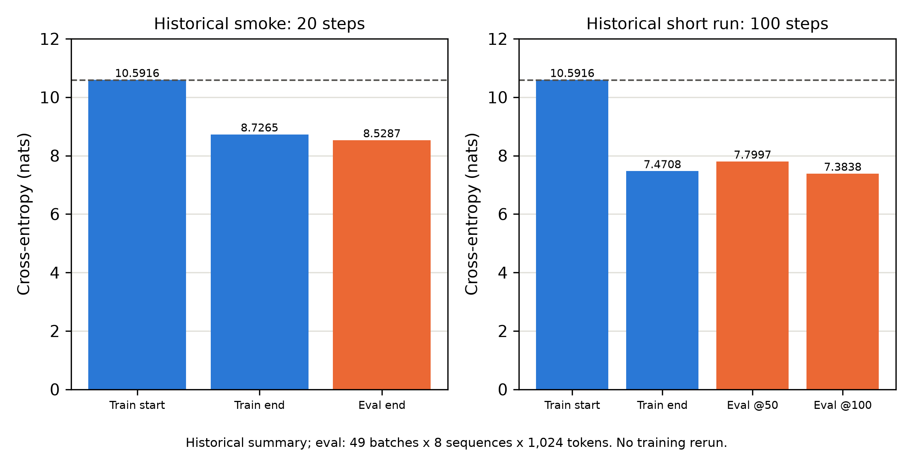
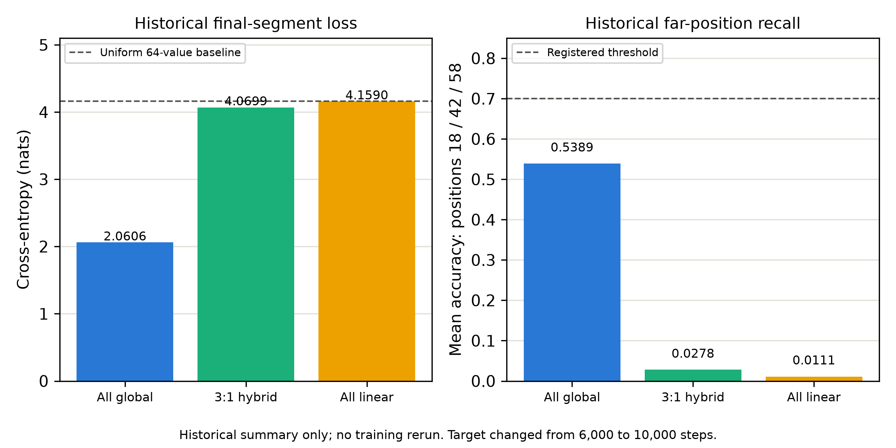

# 第 9 章 2026 混合配方谱系与三刀机

## 9.0 开篇：从全书到这里

三条路线走完了：第 2 章裁视野、第 3-4 章改参与集合、第 5 章换算子；四台真机读完了：K3 拆了两章（KDA/Gated MLA 与三处方/QAT）、DSV4 与 GLM-5(.2) 各拆一节；上一章又把位置表示与历史存储这两个相互关联的设计维度——收拢成一张对表。至此，你已经掌握了本书所选代表模型的组件清单，只是它们散在七章里。

本章第一件事，是把这张清单拼成**一张谱系总表**：哪些机器同属「线性:全局 3:1」路线、哪些同属「稀疏索引」路线，把它们并排放好、逐行标证据等级、再用第 1 章的分类型账本分别读出两条路线的缓存特征——共性是什么、分歧在哪、谱系正往哪里收敛。

第二个问题关乎我们自己：单轨代码主线在本册还剩最后一站。Book3 造了 207M 稠密四插槽、Book4 动两刀得到 409M 两刀机，本册教完第三把刀（第 5 章的 GDN）却还没有把它装上整机——本章的选做部分将完成这一步：把两刀机的 9 层注意力插槽换成 GDN，做一台与它**近似等总参**的三刀机，交付四件套（整合代码、冒烟、整合短训、设计文档）。

先看一个值得单独关注的信号：2026 年 9 月，GLM-5.3-Flash 发布，45 层里 34 层 KDA 线性层、11 层稀疏索引层——**两条突围路线装进了同一台机器；不据此宣称历史首创**[^glm53]。这说明两种改造可以组合，本章末尾还会用它来收束讨论。

[^glm53]: GLM-5.3-Flash（`glm5_next` 家族）：`layer_types` 字面写着 34 层 KDA + 11 层 `deepseek_sparse_attention`（3:1 排班，第 4/8/…/44 层全局，1 起口径）、DSA 层 MLA 全 NoPE、1M 上下文、原生 FP8；其 `swiglu_limit=10` 与 DSV4 的激活限幅同款、MHC 超连接（hc_mult 4、Sinkhorn 20 迭代）与 DSV4 的 mHC 同族——9.3 次级共性两处「冻结线后一家」的佐证即此【证据等级：config 逆向】。它在本册冻结线（2026 旗舰世代）之后，只入脚注与悬案登记、不进正文主线——细节见第 4 章悬案框。

按旅程地图，本章是「哲学与谱系」一段的第二站、也是全书的倒数第四章。要回答的问题有两个：**2026 年的混合配方收敛了吗？**（9.1-9.4：谱系表、正面对照、共性三件、账本三档递减）；**我们的三刀机造得出来吗？**（9.5-9.6：四件套与混合比例消融）。本章将给出五项结果：一张谱系总表（表 9.1）、一张共性证据表（表 9.2）、一本账本三档的收口账（9.4 节）、一台 409,000,736 参的三刀机（四件套）、一组近似等参三臂的召回消融读数（负结论照报）。到章末，架构侧与代码主线的本册段同时完成——接下来两章换个方向：看这些机器能做什么（第 10 章能力扩展）、以及厂商的数字该怎么读（第 11 章方法论）。

> **最小背景栏**（已学指回，本章不重教）：分类型 KV/状态账本三栏与交叉点 $n^*$＝第 1 章式 (1.3)/(1.4)；GDN 双形态与固定状态＝第 5 章（本章整机直接 `import` 该件）；KDA/Gated MLA/3:1 层带＝第 6 章；DSA/CSA/IndexShare＝第 3-4 章；GLM-5 参数三口径案卷＝第 4 章 4.3（第 11 章主案卷）；两刀机 cand2 与四件套先例＝Book4 第 9 章；MoE 激活参数口径＝Book4 第 1 章。MQAR式needle召回（多查询关联召回，multi-query associative recall）与第2章同属关联任务，但此处保留历史生成器及其限制。

## 9.1 两路线谱系表：2026 年的家谱

整理总表之前，先说明整理方法。谱系表要能回答三个问题才算合格：每台机器**采用哪条主要改造路线**（路线归属）、**搭配哪些配置**（MoE/上下文/精度）、**依据什么证据**（证据等级）——第三列最容易漏也最要紧：这一代的机器有的有正式论文（GLM-5、Kimi Linear、K3 报告）、有的只有预览版（DSV4）、有的连论文都没有只有 config 与模型卡（Qwen3.5），它们能支持的结论范围并不相同。表 9.1 按这个思路整理，图9.1按设计关系整理这些型号。

**表 9.1** 2026 混合配方谱系总表（注意力路线 × 配置组合 × 证据等级；上下文以发布配置为主，额外扩展另标，预训练/评测数字见第 4 章 4.5 横表）

| 机型（年月） | 注意力配方 | 层排班 | MoE（稀疏度） | 上下文 | 权重精度 | 证据等级 |
|---|---|---|---|---|---|---|
| **路线一：线性 : 全局混合** | | | | | | |
| Qwen3-Next-80B-A3B（2025-09） | GDN + GQA 满注意力 | 3:1（36:12/48 层） | 512 选 10（51.2:1） | 262K | BF16 | config/源码+README |
| Kimi-Linear-48B-A3B（2025-10） | KDA + MLA | 每4层全局、末层另保留：20 KDA+7 MLA/27层 | 256选8（32:1）+1共享，首层稠密 | 1,048,576 | BF16 | 论文2510.26692+config |
| Qwen3.5-35B-A3B示例（2026） | GDN（32V/16QK）+GQA | 30:10/40层 | 256选8（32:1）+共享专家 | 262,144原生／1,010,000扩展 | BF16发布权重 | 官方config/checkpoint+模型卡 |
| Kimi K3（2026） | KDA+Gated MLA（文本NoPE、AttnRes） | 69:24/93层，末层另保留 | 896选16（56:1）+2共享，首层稠密 | 1,048,576 | 路由专家MXFP4；其余另计 | 官方报告2607.24653+config/分片头 |
| **路线二：稀疏索引与压缩** | | | | | | |
| DeepSeek-V3.2（2025；与Exp版本区分） | MLA+DSA（topk 2048） | 61层主注意力均采用DSA | 256选8+1共享，首3层稠密 | 163,840 | FP8权重与BF16等未量化项 | 论文2512.02556、[官方config](https://huggingface.co/deepseek-ai/DeepSeek-V3.2/blob/main/config.json) |
| GLM-5（2026-02） | MLA + DSA | 全层 DSA（78 层） | 256 选 8（32:1） | 198K | BF16（+官方 FP8 档） | 论文 2602.15763+config |
| GLM-5.2（2026-06） | MLA + DSA + IndexShare | 全层 DSA（索引器 1:4 复用） | 同上 | 1M | BF16 | config+博客+论文 2603.12201 |
| DSV4-Flash/Pro（2026-06预览） | CSA(m=4)+HCA(m=128)，各层含SWA128 | Flash前2层纯SWA；Pro前2层HCA；随后CSA/HCA交错 | 256/384选6（42.67:1／64:1） | 1,048,576 | 专家FP4、其余含FP8及高精度项 | 预览版报告2606.19348+config/源码 |

有三点需要说明。其一，GLM-5 引用时主数用论文口径 **744B 总/40B 激活**；HF 页面自动统计为 754B（全量 753.864B）、GLM-5.2 同口径 753B（753.330B）——三数并存是「论文口径句字面算不出自家 744B」那桩复算案的入口，第 4 章 4.3 已立案、第 11 章收为主案卷，此处不重述【证据等级：config 逆向·checkpoint 亲算】。

其二，Qwen3.5 的「262K 原生／1.01M 扩展」必须并排写：config 的 `max_position_embeddings=262,144` 且**无任何 rope_scaling 字段**，1.01M 是启用扩展配置的部署口径、扩展配方已由卡面披露——静态 YaRN×4（`original_max_position_embeddings=262,144`，与 Qwen3-Next 同款；config 不预置、由部署端 override），托管服务端是否同款未单独说明——「原生 1M」四个字在本书禁写。

其三，DSV4仍按预览版引用。Jamba（2024）是更早的混合架构案例，本文只作历史衔接，不在缺乏逐项优先权核验时称其为“商用首例”。表中的3:1也应与层数合读：Kimi Linear与K3额外保留末层全局，因此总层数比并非恰好3。



图 9.1 上两行分别比较状态更新与显式历史的组织；第三行展示可以组合。日期、预算、质量证据见正文，图不将型号连线当作性能排序。

这些模型改变了“选择”的对象和频率。NSA依据压缩分支分数选择原始块；DSA用索引器选token；CSA在m=4的压缩条目中选512或1024项；GLM-5.2又让57个主层复用当前查询的跨层索引，只保留21个索引器。其参数差$57\times9{,}371{,}904=534{,}198{,}528$已在第4章核算。它们减少的是不同成本：候选数量、每项宽度、索引器重复计算，不能只比较topk数值就断言后者总是更便宜。压缩条目还包含多个原token的信息，512个压缩项与2048个原token并非同一集合。

状态路线则逐步增加可控的更新方式：最简单的加法线性记忆累加外积，Delta规则按当前键纠正已有预测，GDN再加入遗忘，KDA细化到键通道。这里说的是操作自由度变多；遗忘门也能抹掉有用信息，较复杂的更新并不保证每个数据集更好。第5—7章的对照与反例，正是判断这些自由度是否用好的依据。

谱系表还需要实现层面的对照。历史实践曾加载Qwen3.5-4B本地权重（原记录8.69 GiB、Apache-2.0），逐层核对模块类型、按配置计算状态账，并生成文字。原稿记录MPS BF16、缓存热时约6.2秒；该时间依赖权重是否在盘和缓存状态，本轮未重新加载权重。类名核对能确认所构造的层与配置一致，状态公式和生成样例则分别回答容量与可运行性问题。

**实物 9.1**（Qwen3.5-4B config `layer_types` 原样摘录（32 项取前 4 项+省略）与真权重加载终端读数原文；【证据等级：config 逆向 + 历史真权重实测】，产物 `log/book5-ch09/qwen35_consume_run1.json`；2026-10-09 脚本 interval 打印修复后 `--out-name run2` 复跑，账本/层对账/贪心样例与 run1 逐位一致——终端行照 run2 原文，`qwen35_consume_run2_console.log`）：

```text
"layer_types": ["linear_attention", "linear_attention", "linear_attention",
                "full_attention", …]        # 共 24 linear + 8 full（config.json 原文为 32 项数组）
[config] layer_types：{'full_attention': 8, 'linear_attention': 24}（full_attention_interval=4）
         | 全局层每 token 16,384 元素（无界）| 线性层固定 13,172,736（每层 548,864，与 n 无关）| 交叉 n* = 804
[对账] 32 层 isinstance 与 config layer_types 逐层一致 | 全局层（人读 1 起）=[4, 8, 12, 16, 20, 24, 28, 32]
[样例] 问：为什么混合架构要在大部分层用线性注意力、少量层保留全局注意力？
       答：「混合架构在大部分层使用线性注意力以显著降低计算复杂度并提升训练效率，
            同时保留少量层的全局注意力以维持模型对长距离依赖的捕捉能力……」（真权重贪心解码）
```

重点看三处。第一，32 层的逐层对账全部一致：第 4/8/12/…/32 层（人读 1 起）是 `Qwen3_5Attention` 满注意力，其余 24 层是 `Qwen3_5GatedDeltaNet`——config里一行字符串数组，在加载后的模型里对应两类模块，谱系表第一列至此有了实物。

第二，状态账来自配置推算，未测量实际缓存分配。以B=1计，8个全局层每token增加$8\times2\times4\times256=16{,}384$元素。24个GDN层各有$32\times128\times128=524{,}288$个矩阵元素；卷积输入宽为$2\times16\times128+32\times128=8192$，最小历史取$k-1=3$格，因此总固定项为$24(524{,}288+3\times8192)=13{,}172{,}736$，交点恰为804。若实现按4格分配卷积缓冲，固定项改为13,369,344、交点为816。FP32递推状态、KV精度和额外缓冲还会改变字节账。

第三，样例是这台 3:1 机器在**解释自己为什么是 3:1**——第 5-6 章的全部论证（固定状态省、全局层兜检索）被它概括了一遍；生成的自我解释不是架构机制的独立证据，能力侧的观察留待第 10 章，这里只当一份能生成文字的展示样例。

注意力混合也不要求搭配MoE。Qwen3.5-4B本身就是稠密前馈；27B官方配置同样是稠密前馈，64层中48个GDN、16个全局层，线性头数为48V/16QK。它与表中的35B-A3B在前馈形式、头数和层数上都不同。配置证明这些组合确实被采用，不能单凭采用记录证明某种组合在同预算下更优。【证据等级：[Qwen3.5-27B官方配置](https://huggingface.co/Qwen/Qwen3.5-27B/blob/main/config.json)】

## 9.2 正面对照：稀疏还是线性

GLM-5 报告给出了一组有价值的适配实验，但要把两个不同底座、不同表格分开读。Table 5 以 GLM-9B 满注意力为基线，对SWA交错、SWA搜索式选层、GDN、SimpleGDN分别继续训练190B token，训练窗64K、效率层与满注意力层为1:1；RULER@128K 相对基线的差值分别为 −30.35、−5.69、−11.28、−8.25。**这张表没有 DSA 行，不能补出一个“DSA 差值为 0”。**

DSA 的独立实验在 Table 6，基座换成 GLM-4.7-Flash。128K 的 RULER 是基线 79.21、只预热索引器 71.35、再联合训练 150B token 后 78.86；最后一项比基线低 0.35，而在 16K、32K、64K 又分别高 0.86、0.49、1.72。它说明该适配流程恢复了大部分长文表现，并不建立所有任务、所有输入上的严格等价。【来源：GLM-5，arXiv:2602.15763v2，Table 5/6。】

两组实验留下三个可用判断。第一，SWA 固定交错与搜索式选层相差约 25 分，提示保留哪些全局层是重要变量。第二，SimpleGDN 在该适配设置下好于 GDN，说明更复杂的更新机制不自动带来更好的继续训练结果。第三，DSA 的检索质量依赖索引器及联合训练；报告中的“lossless by construction”应理解为作者对设计的概括，不能当作截断 softmax 与全量 softmax 恒等的数学证明。第 3 章的遗漏注意力质量分析已经说明：被丢弃条目只要有非零权重，输出一般就会变化。

同一研究组采用同一评测协议有助于比较，但跨表更换了底座、训练量与改造流程，无法把它当作单一变量的完整路线排名。需要同时保留数字和这些条件。

GLM报告选择DSA，可以结合训练成本和状态账理解。GLM-5的78个主层继续逐token保存潜在KV，每token主账为$78\times576=44{,}928$元素，另有索引器状态；被选集合内部仍按softmax加权，但集合外的概率质量被删去并重新归一化。报告自报长序列注意力计算约减少1.5—2倍，旗舰转换在索引器预热后又适配20B token；这不是Table 6中GLM-4.7-Flash的150B协议。CSA则已改变历史条目的内容，不能把GLM“保留逐条原历史”的描述扩展到整条稀疏路线。

线性混合模型先减少逐token保存历史的层数：约四分之三的层维护固定递推状态，其余层保留显式历史。有限精度、有限容量给某些关联检索任务带来限制（第5章的信息容量讨论），保留全局层是这些模型补充检索通路的选择，不是所有任务的数学必需。Kimi Linear §7.1也将稀疏读取与固定状态更新视为可结合的方向：前者保留细粒度条目、仍付存储和选取成本，后者将历史压入可更新状态，在特定状态追踪任务中表现出优势；两者处理的问题不同。

GLM-5.3-Flash的配置给出了KDA与DSA组合的实例。它说明论文提出的方向已有采用案例；是否继承了某项研究、是否提升同预算质量，仍须额外证据，不能将“可以组合”写成“必然收敛”。

混合比例也应按实验条件读。Kimi Linear 的 Table 1 使用首档缩放模型（16 头、16 层），各变体以相同 FLOPs 预算和超参数训练；不是 48B 生产模型逐一完成的等参实验。表里的两个量是**训练／验证困惑度 PPL**，而不是交叉熵：3:1 为 9.23/5.65，0:1 为 9.45/5.77，1:1 为 9.29/5.66，7:1 为 9.23/5.70，15:1 为 9.34/5.82。按验证列，3:1 最低，15:1 最高；不能把纯满注意力说成所有候选中最差。【来源：arXiv:2510.26692v2 §5.2，Table 1。】

这组结果支持在该预算和模型族中保留一定数量全局层，并说明 3:1 是有实验依据的选择。此前 DeltaNet、GDN、Mamba 混合实验以及 Qwen 的公开配置提供了其他条件下的证据，但这些条件并不完全相同，不能合起来证明 3:1 是通用最优比例。真正值得继承的是方法：让固定状态承担多数计算，再通过比例、位置和容量的联合消融，寻找当前任务需要的显式历史通路。

## 9.3 共性三件逐项核：什么敢说「都有」

谱系表区分了路线，但 2026 旗舰显然共享着一些东西。候选有三件，每一件都必须逐机型核过才敢说「共性」——防以偏概全是本册立过的纪律（共性三件最容易以两个极端代表整条谱系）。

**表 9.2** 共性三件证据表（逐机型核验；证据等级逐格标）

| 共性件 | 核验结果 | 谱带读法 | 证据等级 |
|---|---|---|---|
| 所列MoE型号的专家稀疏比 | K3 56:1、DSV4-Pro/V4.1 64:1、Flash约42.67:1、GLM-5(.2)与Qwen3.5-35B-A3B 32:1 | 此表范围约32—64；2025的DSV3已32、QwenNext已51.2；4B/27B稠密型号不适用 | 对应config |
| 原生长上下文 | DSV4 全系 1M、GLM-5.2 1M、K3 1M；**GLM-5 只有 198K**；**Qwen3.5 原生 262K**、1.01M 扩展 | 多个所列型号声明1M；Qwen另列262K原生与部署扩展，不能将所有型号统称原生1M | config+卡面（各家分标） |
| FP4级权重 | 所列型号中K3路由专家用MXFP4、DSV4专家用FP4；GLM/Qwen所选发布档为BF16，另有量化档 | 专家与其余权重、存储与计算精度、训练阶段须分别说 | config/分片头与报告 |

这里的专家比$E/k$仅数路由专家：K3的$896/16=56$不含两个共享专家，也不含注意力、嵌入等始终参与的部分，不能拿它当整机总参/活跃参或计算加速比。精度列同样只概括指定权重。第7章已分清K3从SFT开始的专家量化训练与DSV4后训练中的FP4主权重、FP8计算，以及压缩索引器的另一条低精度路径；两家的阶段和张量对象并不相同。

表外组件也应逐项看。所选GLM、DSV4、Qwen3.5配置各列一个MTP层，K3发布权重未含MTP层，但报告另述训练用途。GLM/DSV4/K3采用带均衡反馈的路由方法；“noaux”不能自动读成整个训练目标没有辅助项。DSV4的激活限制参数10与K3 SiTU乘积界100也不是同一个对象：前者需看具体支路的裁剪，后者是在下投影前、两个正限幅参数为4和25时的乘积界。mHC在DSV4与冻结线后GLM配置中出现。它们的覆盖范围不同，没必要把所有现象都称作全体共性。

## 9.4 三种成本控制：减少计算、压缩条目、固定状态

第 1 章的账本现在可以变成一套设计检查。下面三种改造控制不同成本，没有天然的高低等级，也没有哪一种自动在质量上支配其他方案。

**控制当步计算。**MoE 限制参与前馈计算的专家；DSA 限制主注意力读取的条目。前者的总参数／激活参数可以说明稀疏程度，但不是实际 FLOPs 的直接比值；后者仍要支付索引器扫描和选取成本，不能说整个注意力随历史长度完全有界。GLM-5 的主潜在 KV 仍按 $78\times576$ 元素/token 增长，此外还需考虑索引器相关状态。

**降低每条历史的大小或密度。**MLA 用潜在表示改变每 token 缓存宽度；CSA/HCA 用压缩条目替代原始条目；低位宽改变每元素的字节数。这些都会降低增长斜率，但只要保留的全局条目数随 $n$ 增加，总存储仍然增长。例如宣称“890 bytes/token”约束的是每 token 的成本，不是总缓存固定为 890 bytes。窗口又不同：它将该层保留条目数封顶为 $W$，代价是直接可见范围受限。

**固定递推状态容量。**GDN/KDA 不逐条保留该层的全部历史，而把它们更新进固定矩阵。我们的九个 GDN 层合计 1,317,888 个状态元素（含卷积滞留），与长度无关；三个 MLA 层仍增加 $960n$。因此整机是“增长项加常数项”，并非整机存储与长度无关。

统一写成 $M(n)=a n+c$ 后，压缩缓存主要改变 $a$，引入固定状态会同时改变 $a,c$，窗口则增加分段的 $\min(n,W)$ 项。这些变化须与质量实验一起判断：同样的存储预算可以换来不同的检索细节、更新能力和计算形态。下一节把这个账本直接落到一台可运行模型上。

## 9.5 我们的三刀机：四件套

现在以 Book4 的两次改装模型为底座：总参数 409,115,648，12 层 MLA 与 MoE。保留其中三层 MLA，其余九层改用第 5 章的 GDN，并调整专家中间宽度，使新旧模型总参数近似相等。整机接口保持残差宽度 1024，所以组件能够接入；但参数、计算和状态布局都必须重新核算，接口兼容不等于训练效果不变。

配套实践保留整合代码、参数自检、20 步冒烟、100 步短训和设计文档。这些证明模型能够组装并训练，不代表完整语言建模质量已经验证。下面先解决层序列，再解决等参数补偿，最后解释历史实验支持到哪里。

动手之前，先手动完成一道层排布题，它就是本章的玩具例子。

**例 9.1（构造例）**：给 12 个空层格排 3:1。输入：12 格空位；两条约束——周期约束「每 4 层一层全局」（interval=4）与惯例约束「末层必全局」（K3 在 92 层循环之外**再额外**压第 93 层 MLA、Qwen3.5 的第 32 层恰落在周期位上——两家殊途同归于「末层全局」，第 6 章 6.1 已核）。步骤：① 按周期约束，0 起索引 $3,7,11$ 三格放 MLA（换算句：config 与代码注释一律 0 起，行文与例题固定人读 1 起——第 4/8/12 层）；② 检查惯例约束：0 起索引 11 既是末层又是周期层，两条约束在这**一点会合**、不额外占格（与 Qwen3.5 的 32 层同款会合；K3 则是循环走完再补一层——两种实现、同一条惯例）；③ 其余 9 格填 GDN；④ 输出：$[\mathrm{gdn},\mathrm{gdn},\mathrm{gdn},\mathrm{mla}]\times3$，逐格即 `ThreeKnifeConfig.layer_types`。再看排布的调整空间：若把周期改 3，全局层变 4 层（33%），参数账立刻不守恒、需要重新调整 $w$——「3:1」不是孤立超参，等总参补偿也随它改变。GLM-5.2的索引器头部加周期排布属于另一项决策：它的所有主层仍有DSA，复用的是选择结果，不能与“哪些层保留全局注意力”混为一谈。本例把末层全局作为设计要求；它不是所有模型的通用约束。这个例子让你看见：一个「3:1」数字背后是两条约束的合成，层排布是离散的小自由度、不是连续大空间。

排布定了，参数账要重新配平——换 9 层注意力必然改变总参，等总参要靠前馈插槽补偿：

$$\Delta_{\mathrm{attn}} = 9\times(7{,}393{,}312 - 2{,}687{,}488) = 42{,}352{,}416,\qquad \Delta_{\mathrm{MoE}} = 12\times(E{+}N_s)\cdot 3d\,(938-810) = 42{,}467{,}328$$

$$\text{三刀总参} = 409{,}115{,}648 - (\Delta_{\mathrm{MoE}} - \Delta_{\mathrm{attn}}) = 409{,}115{,}648 - 114{,}912 = 409{,}000{,}736 \tag{9.1}$$

用人话说：9 层注意力从 MLA（每层 2,687,488）换成更宽的 GDN（每层 7,393,312），增加 4,235 万参数；这部分从 12 层 MoE 中扣除——专家宽 $w$ 从 938 调整到 810，省回 4,247 万；两项相抵后还多省 114,912 个（0.028%），三刀机以 409,000,736 与两刀机「≈等总参」【证据等级：本书实验，`hybrid409.py` assert 逐位】。式 (9.1) 的符号表如下（$E{=}8$ 路由专家、$N_s{=}1$ 共享专家、$d{=}1024$）：

| 符号 | 含义 | 数值/形状 |
|---|---|---|
| $7{,}393{,}312$ | GDN 插槽层参（$d{=}1024$，$h_k{=}h_v{=}16$、$d_k{=}128$、$d_v{=}64$、conv 4） | in_qkvz 6,291,456 + in_ba 32,768 + conv 20,480 + 门 32 + out_proj 1,048,576 |
| $2{,}687{,}488$ | MLA_LITE 插槽层参（含 $q_a$/$kv_a$ 两枚潜向量 RMSNorm 各 256） | Book4 第 6 章件原样 |
| $\Delta_{\mathrm{MoE}}$ | 专家宽 938→810 的每层省额 $9\times 3dw$ 之差 | $3{,}538{,}944\times 12$ |

参数计算不能漏掉两枚潜向量RMSNorm：其中一枚的256个参数若遗漏，会改变每层及整机合计。式(9.1)采用2,687,488。另有一处偏离如实声明：Qwen3-Next与此处Qwen3.5-4B/35B的GDN采用$h_v=2h_k$（32V/16QK）；这里是多组value头共享Q/K，方向不同于常规GQA共享K/V，三刀机取 $h_k{=}h_v{=}16$ 的教学简化——两种几何 GDN 件都支持（第 5 章 5.15 的对拍臂验过 $h_v\ne h_k$ 分支），选对称几何是为了让「第三刀」的参数账一眼可比。

**表 9.3** 三刀机 config 定版表（参考对象＝`hybrid409.py::ThreeKnifeConfig`；底座字段全承 Book4 cand2）

| 字段 | 值 | 依据 |
|---|---|---|
| $d$/$L$/$V$/$h$ | 1024/12/32000（untied）/16 | Book3 207M 骨架不动（残差流恒宽） |
| `layer_types` | $[\mathrm{gdn}\times3,\mathrm{mla}]\times3$（0 起；MLA@3/7/11＝人读 4/8/12） | 例 9.1 双约束合成；末层全局承 K3 惯例 |
| GDN 插槽 | $h_k{=}h_v{=}16$、$d_k{=}128$、$d_v{=}64$、conv 4、chunk 64 | 第 5 章教学组件原样（教学几何，偏离已声明） |
| MLA 插槽 | MLA_LITE（$d_c{=}256$、$d_c'{=}256$、nope/rope/v=64/64/64） | Book4 cand2 原样 |
| MoE | $E{=}8$ top-2 + 1 共享、$w{=}810$ | 式 (9.1) 等总参补偿 |
| 其余 | theta 1e4、eps 1e-5、init 0.02、`first_k_dense_replace`=0 | 承 cand2 定版 |

整机长什么样、每个插槽的组件来自哪里，图 9.2 都作了说明——「三刀改装史写在 import 语句里」：归一化/位置/稠密件来自 Book3（经由 llama409），MoE 与 MLA 两刀来自 Book4 第 5/6 章，第三刀 GDN 来自本册第 5 章。这也决定了对拍口径：三刀机**没有整机参考对象可 strict 直搬**（不存在「ThreeKnifeForCausalLM」这种机器），正确性由三层证据拼成——GDN核心、完整层与微缩整机已按第5章不同测试分别对拍，CPU FP32误差约在$10^{-8}$至$10^{-6}$以内（第 5 章 5.15）、线性层机制与 Qwen3-Next/Kimi Linear 文献互证、MLA/MoE 件承 Book4 的 DeepseekV2 strict 对拍资产；整机另有 mini 复核臂（4 层小几何，枚举=手算逐位）检查层循环与账本函数本身。



图 9.2 第一行定位换件，第二行说明近似等总参如何实现，第三行分开增长项和固定项。交叉点不改变增长斜率。

三刀机的分类型状态账，列出了这台机器的状态需求，也把第 1 章式 (1.3) 落到自家机器上：

$$\mathrm{KV}_{3:1}(n) = \underbrace{3\,(d_c + d_h^R)\cdot n}_{\text{MLA 无界}} \;+\; \underbrace{9\,\big(h_v d_k d_v + (k_{\mathrm{conv}}-1)\cdot \mathrm{conv\_dim}\big)}_{\text{GDN 固定}} = 960\,n + 1{,}317{,}888 \tag{9.2}$$

用人话说：按B=1的吸收式MLA逻辑账，3层每来一个token增加960个元素、一直涨；9 层 GDN 的记忆本加起来 1,317,888 格（每层递归状态 $16\times128\times64=131{,}072$ + 卷积滞留 $3\times5{,}120=15{,}360$），从初始化起就分配固定形状，每步按Delta规则更新其数值。式 (9.2) 的符号与形状：$d_c{=}256$/$d_h^R{=}64$＝MLA 潜向量与解耦键宽（Book4 第 6 章记号）；递归状态 $S\in\mathbb{R}^{(B,h_v,d_k,d_v)}$（每层 $(16,128,64)$）；$\mathrm{conv\_dim}=2h_kd_k+h_vd_v=5{,}120$＝因果短卷积的通道数（$q/k/v$ 三段同卷，第 5 章同款）。交叉点$n^*=1{,}317{,}888/960=1372.8$（首次超过为整数1373）：该式从任意长度起的增长斜率都是 960；约 1.4K 后增长项超过固定项——与真机 Qwen3.5-4B 的 $n^*=804$ 同构，两者的全局层占比同为 1/4，但每层缓存宽度和层数不同、无界斜率更缓。

若仅把$n=262{,}144$代入账本，MLA项为251,658,240、固定项为1,317,888；后者占两项总和约0.521%。这是假想长度下的代数比较，不表示教学模型已经支持或训练到262K。K3的0.75%另指矩阵状态/全局主KV，未含卷积，分子分母不同，不能据两个百分比相近便判断质量或实现相近。

还要区分两种交点。1372.8比较三刀机内部的增长项与固定项；若问三刀机何时比两刀机省状态，应解$960n+1{,}317{,}888<3840n$，得到$n>457.6$。这是相同逻辑元素口径下的存储比较，仍不是运行速度或质量的“回本点”。当前教学前向按序列计算，并未实现完整的逐token混合缓存接口，式(9.2)描述的是相应状态设计的需求。

以下是原稿保存的四件套历史记录。当前环境未重跑这些MPS训练；新的局部验证与这些历史质量/速度读数分别记录。

**件一**：自测 8.2 s（CPU fp32），双口径 assert 三方一致——枚举=手算=定版常数；

**件二**：冒烟20步。初始化近似依赖输出logit近似零均值及方差估计，并非每个随机网络严格相等；原记录如下：20步（MPS bf16），初始 loss 10.5916 对预测值 $\ln V + d\sigma^2/2 = 10.5783$（$\ln 32000=10.3735$，untied 无自泄漏，承 Book3/4 判据），训练损失降至 8.7265、eval@20 8.5287（49批×8条×1024＝401,408 token，FP32）、无 NaN；

**件三**：整合短训——这里有一笔必须如实登记的降档：大纲按 2-3 s/step 推算的「600-900 步」**作废**，冒烟实测稳态 11.715 s/step（一次性诊断 `chunk_bench`：单个 GDN 层前向+反向 0.677 s，9 层共 6.1 s——chunkwise 块循环在 MPS 无融合 kernel，第5章另有轴错误的旧scaling记录，已撤回复杂度结论；这里的整机计时同样只说明当时实现；块循环之外 MoE+MLA+嵌入头+优化器本体约 5.6 s；chunk 加宽到 128/256 收益不足 20%，且排程等价性 $5.4\times10^{-6}$，不动教学组件的默认 chunk=64）。一窗 30 分钟定版 **100 步**：训练损失10.5916→7.4708（前100步仍为线性warmup，非收敛档），eval@50 7.7997→@100 **7.3838**，步时漂移 10.1→15.3 s（持续运行中的步时增加；没有温度和功耗记录，不能确定是否由热节流造成），wall 28.6 min、历史报告MPS峰值7.77 GB（脚本为逐步采样的张量当前分配最大值，非驱动总占用峰值），判定 PASS——**该设置下端到端训练可运行的证据**（管道验收口径，非效果训练；100步仅819,200个训练token；不能据此验收完整语言质量，重启预算表见 DESIGN）。

**件四**：配套保存了`DESIGN-3TO1.md`，涵盖原始配置、数据、预算、风险与重启安排。按作者要求，本轮不复核项目设计文档正文；实际重启应先核对当前脚本入口、依赖与本章修订后的口径，不能把历史手册的存在视为当前环境已经重验通过。



图9.3展示历史稿保存的训练起点、终点和评估读数。左为20步冒烟，右为100步短训；评估均为49批、每批8条1024-token序列。原始逐步CSV当前未重新核验，因此图中不补画中间曲线。【来源：本节历史摘要；原记录路径为`log/book5-ch09/curve_{smoke_s1,integrated_run1}.csv`】

最后把三台机器并排放好——这是单轨主线在本册的最终汇总。**实物 9.2**（三代自测 assert 读数行并列；三行分别出自三章自测正档的终端读数，格式归并、数值照录；【证据等级：本书实验】）：

```text
Book3 ch10 稠密四插槽   总参 207,119,360（手算=实测=探针锁定数，逐位）           # GQA + 稠密 FFN
Book4 ch09 两刀机 cand2 总参 409,115,648（手算=实测=探针 F 锁定数，逐位）         # + MoE(E8 t2 s1 w938) + MLA_LITE
Book5 ch09 三刀机       总参 409,000,736（枚举=手算=定版，逐位一致；vs cand2 差 -114,912，-0.028%）
```

**表 9.4** 三形态对照链（后两代近似等总参——单轨主线的架构侧总决算）

| 形态 | 注意力 | 前馈 | 总参 | KV/状态总账（元素；B=1） | 章号 |
|---|---|---|---|---|---|
| Book3 稠密 | GQA 满注意力一色 | 稠密 FFN | 207,119,360 | 无界：12,288·$n$ | Book3 第 10 章 |
| Book4 两刀 | MLA 满注意力一色（KV 压箱） | MoE | 409,115,648 | 无界：3,840·$n$（−68.75%） | Book4 第 9 章 |
| Book5 三刀 | 9 GDN + 3 MLA | MoE（$w$ 810） | 409,000,736 | 无界 960·$n$ ＋ 固定 1,317,888（$n^*\approx1{,}373$） | 本章 |

三行并排，本丛书「架构修改=对已知物的局部替换」这条主线走完了它在架构侧的全部三步：同一副残差骨架；后两代总参数近似一致，第一代参数较少，注意力插槽从满注意力一色，到压箱（MLA），再到 3:1 混装。207M 那一代的无界斜率是 12,288；两刀砍到 3,840；三刀砍到 960、外加一份与 $n$ 无关的固定记忆——账本三档递减（9.4 节）在我们自己的三代机器上同样成立。

## 9.6 混合比例消融：近似等参对照与任务边界

整机能运行之后，还要看不同层配比能否学会具体任务。这里保留历史MQAR式needle实验：T=96、B=32，尾部8个查询位参与训练损失，最后一个固定needle键用于位置召回评估；needle有50%落在[16,60)、50%落在[62,78)，评估位置为18、42、58、62、74。三臂分别是4层全局、3个GDN加末层全局、4层GDN，均使用稠密FFN。这与第2章当前修订后的任务细节不同，不能互换读数。

原生成器还会对8个干扰键有放回采样，同一个键可能配到不同值；前7个干扰查询便可能存在监督歧义。固定needle键与干扰键集合分离，最后needle目标唯一，但训练损失仍混合两类查询。本节据此只讨论原任务的历史现象，不把它当作无歧义标准MQAR或固定状态理论下界的直接验证。

等参对齐要先计算模块成本，再决定补偿方向：本几何下满注意力插槽（393,216 参）比 GDN 插槽（332,808 参）**更贵**，全全局臂其实是**减** FFN（704→645）对齐；全线性臂加 FFN（704→724）。三臂总参 7,750,912 / 7,750,936（锚，调研期消融管道探针臂原封不动）/ 7,751,968，最大互差 1,056 参（0.0136%，assert 上限）；三臂均无 MoE，但不同注意力算法的计算量和实际时延仍可能不同；等参数不能替代等算力比较。

旧实验预注册三项阈值：J1全局臂五位置均不低于0.7；J2混合臂远端三位置均不低于0.7；J3全线性远端均值比混合低至少0.3。另登记混合垫底、全线性远端达标、全局未达标等分支。阈值可以保留，但解释不能随阈值自动成立：混合垫底不证明全局层无用，全线性达标不推翻任意容量下界，全局失败也不唯一证明预算不足；J2即便通过，也只证明当前玩具设置学会此任务。

这些区分还能指导下一次实验：先排除任务歧义、实现和优化问题，再控制层位置、容量、训练量，才有资格比较架构机制。

结果是一个具有教学意义的负结论。6000 步正档触发 B3（全全局远端均值仅 0.17），随后将目标总步数改到10000（从6001至10000共追加4000步）。cosine按新总步数重新计算，因此这不是从第1步就采用10000步日程的等价实验，历史字段`resumed_from_step=6001`保留：

**实物 9.3**（recall 三臂终值 JSON 摘录（键值照录、行序归并），@10000 步；【证据等级：本书实验】，`log/book5-ch09/recall3_run1.json`）：

```json
"all_global": {"d_ff": 645, "params": 7750912, "far_mean_18_42_58": 0.5389, "train": {"loss_last_20_mean": 2.0606}},
"hybrid31":   {"d_ff": 704, "params": 7750936, "far_mean_18_42_58": 0.0278, "train": {"loss_last_20_mean": 4.0699}},
"all_linear": {"d_ff": 724, "params": 7751968, "far_mean_18_42_58": 0.0111, "train": {"loss_last_20_mean": 4.1590}},
"prereg_verdict": {"J1_all_global_all_positions": false, "J2_hybrid31_far_positions": false,
                   "J3_all_linear_far_gap": false, "B1_hybrid31_bottom": false,
                   "B2_all_linear_far_learned": false, "B3_budget_short": true}
```



图9.4汇总原稿记录的末段平均训练损失与远端三位置平均召回率；阈值线仅用于对照。图中保留历史数字，原曲线与checkpoint未在本轮重新运行，未补画缺失的逐步数据。【来源：实物9.3的历史汇总】

这些读数首先描述现象。只在64个值token上均匀预测时，交叉熵为$\ln64\approx4.159$。两个含GDN臂的损失接近这一参考线，其中混合臂4.0699略低；它不是模型学习后不可突破的下界。仅凭平均损失还不能证明模型完全没有利用查询信息，需要检查分位置准确率和预测分布。

为什么混合臂表现差？一种待验证的解释是，进入末层全局注意力前，前面几层没有学好对查询和键身份的保持。但残差路径仍允许身份信息通过，组件数值对拍也只验证局部实现，不能排除整机掩码、优化、任务接口或梯度尺度问题。要判断原因，可以把全局层前移、加直接输入到全局层的跳接、比较键身份的线性探针，并分别观察训练与验证任务。这些是后续实验方向，不是当前曲线已经证明的机制。

全局臂从 6000 步约 0.17 提升到 10000 步约 0.54，说明继续训练仍在改善，尚未满足预设的 0.7 阈值；因此这组实验也不足以建立三条路线的最终能力排序。按五位置平均，混合臂约0.033、全线性约0.013；这与实物9.3远端三位置的0.0278/0.0111不是同一分母。混合臂的五位置均值较高，因此没有触发预设的“混合垫底”分支；没有多种子置信区间，不能把这点差异判为显著优势或确定的纯噪声。

这组数据支持的结论是：原任务、单种子、6000步后改日程继续到10000步的预算内，两个含GDN的臂召回较低，平均损失接近均匀值参考线。混合臂4.0699已略低于$\ln64\approx4.159$，因此“不破平台”不能读成严格下界。Qwen3-Next单层矩阵为$32\times128\times128=524{,}288$元素，玩具为$4\times64\times64=16{,}384$，相差32倍；容量、数据与优化差异均不允许把玩具失败推广到真机。

旧ruler-mini在$T\in\{96,128,160,224\}$、三个相对needle位置上只评最后查询：全局臂网格约0.38—0.65，两个含GDN臂均不超过0.07。它既不是完整RULER，也没有证明随长度单调下降；训练窗内尚未学好时，低外推准确率不能单独归因于长度泛化。

## 9.7 本章小结

本章将代表模型放回两组可组合的设计：固定状态与全局层混合，以及索引选择与历史压缩。GLM的两张适配表分别使用不同底座与预算，Kimi Linear的比例表控制FLOPs；它们提供局部证据，共同提醒我们先固定比较条件，再谈取舍。专家稀疏比、上下文上限与精度也只对所列型号和张量范围成立，不能把少数旗舰配置写成整个世代的统一答案。

代码主线完成了第三次替换：409,000,736个总参数，相对两刀机少114,912；其单输出表活跃参数为197,073,696，相比两刀机168,877,056更多，说明近似等总参仍会改变每token参与的参数量。历史冒烟和100步短训记录说明当时的端到端训练可运行；本轮局部自检检查组装、数学和接口，不重报历史质量。召回消融则留下一个尚需解释的低准确率现象，下一步应先控制任务与优化变量，再判断层配比。

**带走的心智**：如果忘记了细节，请记住三句话。**其一，读任何 2026 旗舰，先查配置与实现中的层型安排，再翻账本（未必都使用同名`layer_types`字段）——层类型数组是这台机器的配方指纹，分类型账本列出它的状态需求；指纹告诉你它选了哪条主刀，账单告诉你它的缓存会不会随长度失控**（960·$n$+1,317,888 与 44,928·$n$ 是两本构成截然不同的状态账）。**其二，2026 配方没有收敛到唯一解，但这些模型从计算、条目大小和状态形式等不同方向控制成本，收益和代价不能排成单一阶梯**。**其三，比较架构要先明确固定了哪一种预算**——三代机器（207M 稠密/409M 两刀/409M 三刀，只有后两代近似等总参）的无界斜率 12,288→3,840→960，直接描述了逻辑状态增长斜率的变化，但不能替代质量与时延评测；而三刀机的改装史写在 import 语句里，零件的来历就是知识的来历。

回到全书的路线：模型已经组装完成。本册的架构主线（三条路线→真机→哲学→谱系→整机）与单轨代码主线（Book3 四插槽→Book4 两刀→本册三刀）同时完成。但一台机器的价值不止于架构——它能看图吗？它会「思考」吗？那些能力是怎么长上去的？下一章浅尝能力扩展的边界；再下一章回头补一门更急需的方法：这一整册我们反复被迫面对厂商自报、预览版论文与 config 三档证据，需要系统梳理读这些数字的方法了。

## 9.8 动手验证

以下按本册相对路径给出命令。在本工作区先激活根目录`env.sh`；从工作区执行时，将脚本路径补为本册所在路径，数据仍使用工作区`log/`。独立书仓从本册运行。全部使用新的输出名，历史权重与旧checkpoint不自动混入新运行。

- **三刀机自测**（CPU FP32；历史约8秒，当前设备时延另计——实物 9.2 第三行与表 9.3/式 (9.2) 的数字源）：
  ```bash
  python "code/ch09/hybrid409.py" --out-name run1
  ```
- **冒烟**（MPS bf16，20 步约 11 min）：`python "code/ch09/train_hybrid.py" --task smoke --out-name s1`
- **整合短训**（MPS，100 步约 29 min 一窗；超窗同命令自动续跑补齐）：`python "code/ch09/train_hybrid.py" --task integrated --out-name run1`
- **recall 等参三臂**（MPS，6000 步三臂串行约 55 min；新协议补档须`--steps 10000 --resume`显式续接同一输出名；会记录日程变化；判据预注册全文＝`hybrid_recall.py` 文件头）：
  ```bash
  python "code/ch09/hybrid_recall.py" --out-name run1
  python "code/ch09/hybrid_recall.py" --eval ruler-mini --out-name run1   # 从 ckpt 只评估
  ```
- **Qwen3.5-4B 真权重消费点**（MPS，权重在盘分钟级；实物 9.1 数据源）：`python "code/ch09/qwen35_consume.py" --out-name run1`
- 训练CLI的100步均属warmup；延长到100步以上才进入cosine段。整机续跑要求目标日程不变；召回脚本允许明确延长目标，但不是等价原长日程。新报告带步数后缀，checkpoint带输出名，避免旧运行互相覆盖。
- **设计文档**：`code/ch09/DESIGN-3TO1.md`（重启手册+消费线衔接声明+B5-8 文档锚）
- 验收点：三刀机 assert 三方一致且能说出 MLA 保留层的人读/config 双口径；能对任一 2026 旗舰归入路线并报证据等级；能复述三类成本控制与三形态链（仅后两代近似等总参）的无界斜率序列；能说出 recall 三臂负结论的正确表述边界（规模/预算绑定声明）。
