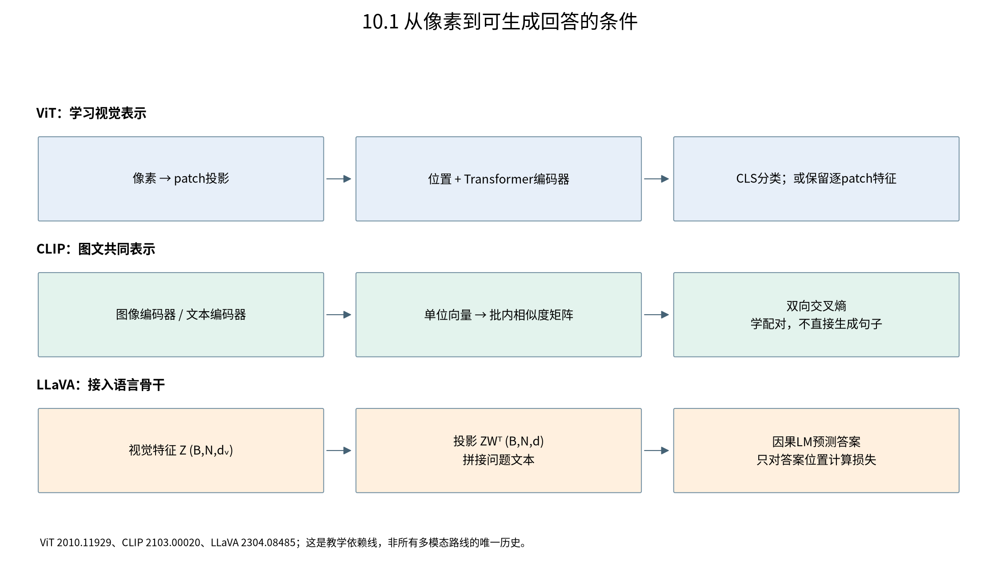
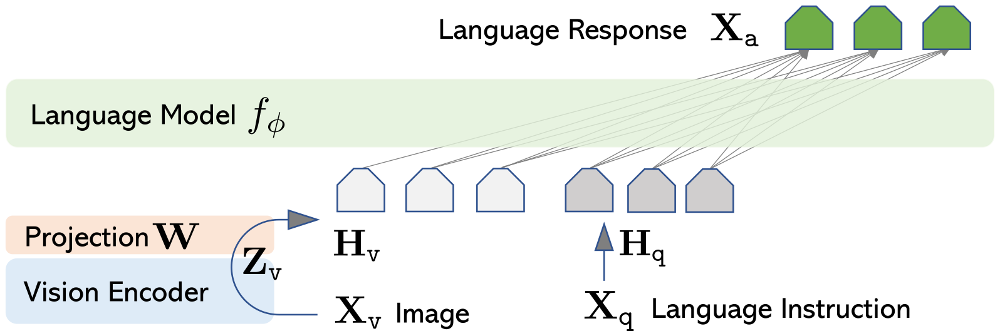
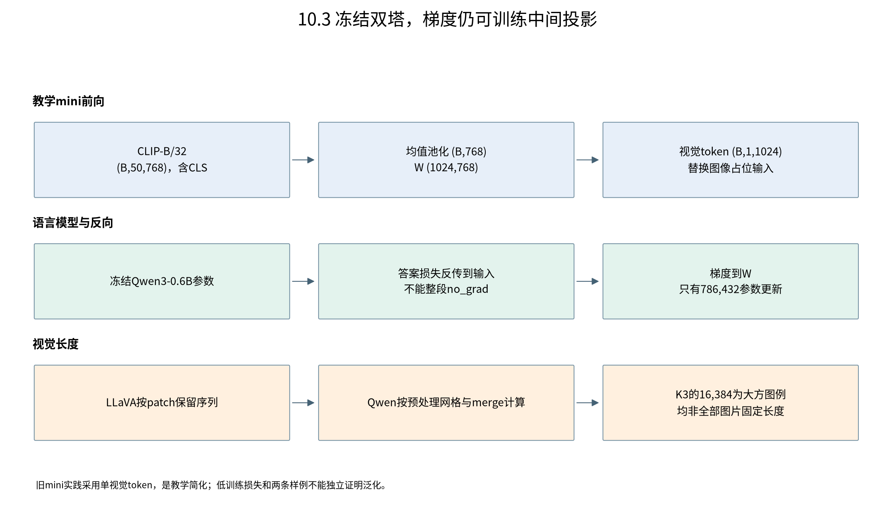
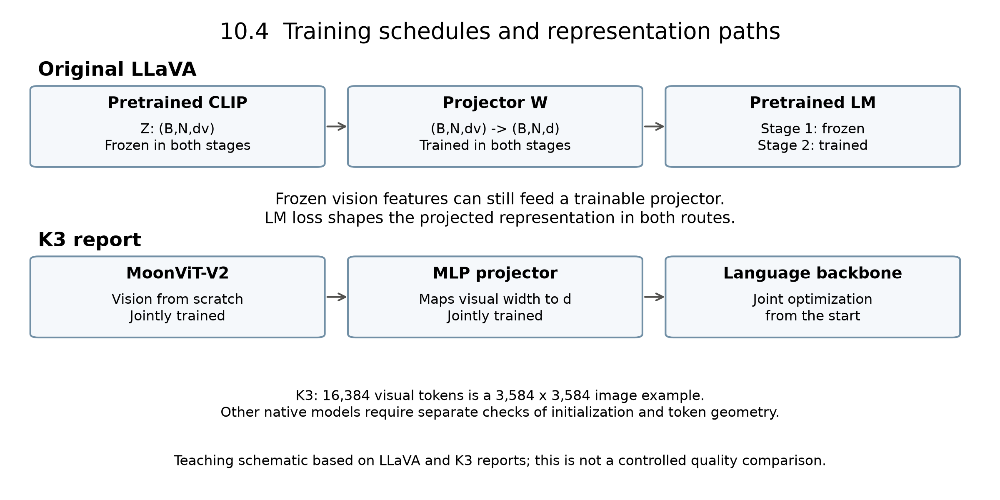

# 第 10 章 能力扩展专题：多模态与推理范式

## 10.0 开篇：从全书到这里

上一章完成了注意力、状态和前馈层的组合。现在保留这副语言模型骨架，改变输入接口与学习目标：图像怎样变成模型可处理的表示？预训练已经会续写文本，为何还要监督微调、偏好优化和强化学习？这些改造是否需要替换 Transformer 核心结构？

本章沿两条增量改造线展开。输入侧从 ViT 的图像块、CLIP 的图文共同表示，到 LLaVA 的投影器和 K3 的联合训练；训练侧从回答示范、偏好对，到采样回答并按奖励更新。每一步都说明保留什么、改变什么、获得什么，以及观察到的能力有哪些限制。多模态 mini 实验继续使用冻结的视觉与语言模型，仅训练中间投影。

## 10.1 能力地图如何连接架构

“架构决定天花板、后训练决定够到几分”过于简单。架构提供表示、信息流和计算成本约束；数据决定模型见过什么；目标函数与优化决定哪些行为被强化；推理时的提示、采样、工具又改变可用信息。它们共同影响能力，不能用一条固定高度的比喻替代分析。

本章把必要数学讲到能追踪梯度和对象：多模态计算的形状、对比学习的概率、带 KL 约束的偏好优化、组内相对优势。完整视觉检测、视频编解码和大规模 RL 系统留给专门课程；但正文使用的结论不依赖读者自行补齐这些关键连接。

## 10.2 多模态三步曲：从「图像怎么进机」到「缝合两个世界」

先从最早的一步看起。让语言模型看见图，这里选三项有教学递进关系的设计（图 10.1）——每一步都在回答同一个问题：**拿什么跟什么对齐**。



图 10.1 三行分别改变输入表示、训练目标和系统接口。LLaVA还需按训练阶段决定哪些参数冻结。

**第一步：ViT（2020）——把图像切块，再变成词元。**这一步解决「图像怎么进 Transformer」：把 $224\times224$ 的图切成 $16\times16$ 像素的方块（patch），每个 patch 线性投影成一个向量，整张图就成了一条词元序列，输入标准的 Transformer 编码器【官方论文 2010.11929 v2】。原论文标题就是这个机制——*"An Image is Worth 16x16 Words"*；摘要的机制句是 "a pure transformer applied directly to sequences of image patches can perform very well on image classification tasks"，其结论限定在大数据预训练再迁移的实验设置中；在该设置下与所比较的强卷积网络相比 "requiring substantially fewer computational resources"【证据等级：官方论文 2010.11929 v2 摘要，直引】。

注意 ViT 对齐的是什么：图像与**离散类别**（类别编号不必作为自然语言词输入模型）——它是一个分类器，监督信号是离散类别，输出端没有句子。ViT-22B 曾在 Book4 的训练稳定性讨论中出现，但完整 patch 接口在这里补齐，此处只记一句：**patch 化之后，图像在本册的账本里就正式成了「一串词元」**——此后所有多模态问题都部分地变回了已知的序列问题。

先补全 patch 的计算，避免把“图像成了词”误解成分词。设图像 $X\in\mathbb R^{B\times3\times H\times W}$，边长为 $P$ 的互不重叠块展平为 $X_p\in\mathbb R^{B\times N\times3P^2}$，$N=HW/P^2$，此处假定H、W均可被P整除；否则先裁剪或补齐。用同一个可训练矩阵 $E\in\mathbb R^{3P^2\times d_v}$ 投影，再加位置表示：

$$Z_0=[z_{\rm cls};X_pE]+E_{\rm pos}\in\mathbb R^{B\times(N+1)\times d_v}.\tag{10.1}$$

这里$z_{\rm cls}\in\mathbb R^{1\times1\times d_v}$和$E_{\rm pos}\in\mathbb R^{1\times(N+1)\times d_v}$沿批维广播，分类头将最终$(B,d_v)$的CLS表示变为$(B,C)$类别logit。这与文本嵌入的接口相同，但来源不同：文本通常查词表，图像这里对像素块做线性变换。分类头读取最终的 CLS 表示并预测类别；若接语言模型，则通常保留逐 patch 特征，以免过早丢失空间细节。以 $P=16,H=W=224$ 为例，块数为 196，展平宽度 $3P^2=768$；它与某些模型的隐藏宽 768 恰好相等，是数值巧合而不是一般规定。

**第二步：CLIP（2021）——两个编码器，一个共享空间。**分类器只认识训练见过的标签，OpenAI 的 CLIP 把监督信号换成自然语言本身：用互联网上的 "400 million (image, text) pairs"，做 "the simple pre-training task of predicting which caption goes with which image"【证据等级：官方论文 2103.00020 v1 摘要，直引】。结构是双塔：一座图像编码器（原研究比较了 ResNet 和 ViT）、一座文本编码器，各自把输入映射进同一个嵌入空间；训练目标是对比式的——配对的图与文在这个空间里互相靠近，错配的互相推开。用人话说：给「这张图配哪句话」做四亿道选择题，做完之后两个世界共享了同一套坐标系。收益是零样本迁移（"enabling zero-shot transfer of the model to downstream tasks"【同上】）——面对没见过的分类任务，把类别名写成一句提示就能直接分类。

但 CLIP 也只到「配对」为止：对比损失塑造的是**全局语义**的对应，它不会生成一句话——这正是第 7 章 7.3 引过的 K3 报告对 SigLIP 初始化的批评原话（对比损失 "favors global semantics over fine-grained textual and structural cues"），这里暂不展开，10.3 会再讨论。

CLIP 如何把“配对更近”变成可训练的目标？一个批次有 $B$ 对图文。图像与文本编码器可先输出不同宽度$(B,d_I)$、$(B,d_T)$，各经可学习线性投影变为$(B,d)$，再按行归一化为$u_i,v_j\in\mathbb R^d$。相似度矩阵$A\in\mathbb R^{B\times B}$满足 $A_{ij}=u_i^\top v_j/\tau$，其中 $\tau>0$ 是温度。把每行当成图找文的分类，每列当成文找图的分类：

$$\mathcal L_{\rm CLIP}=-\frac1{2B}\sum_{i=1}^B\left[
\log\frac{e^{A_{ii}}}{\sum_j e^{A_{ij}}}
+\log\frac{e^{A_{ii}}}{\sum_j e^{A_{ji}}}\right].\tag{10.2}$$

对尚未乘平均系数的单行交叉熵，$\partial\mathcal L_i/\partial A_{ij}=p_{ij}-\mathbf1[j=i]$：正确配对得分不足时梯度推动它上升，其他候选按当前概率受到抑制。总损失还要汇入列方向并乘$1/(2B)$。两塔及投影同时接受梯度，因此不是先规定一套语义坐标再强迫图像进入，而是共同学习可匹配的表示。批内可能有语义相近的“负例”，这也说明目标只近似反映真实语义关系。

一个两对样例：$u_1=v_1=(1,0)$、$u_2=v_2=(0,1)$，$\tau=1$，相似度矩阵对角为 1、非对角为 0。正确匹配概率为 $e/(e+1)\approx0.731$，每方向损失约 0.313。它会做图文配对，但没有逐词生成概率；要说出一段回答，还需要语言模型。这便引出下一步的接口改造。

**第三步：LLaVA（2023）——用一层投影缝合两个已训世界。**前两步留下了两类现成模型：一座会看图但不会说话的 CLIP、一群会说话但没见过图的语言模型。LLaVA（论文正名 *Visual Instruction Tuning*）的方案出乎意料地简单：取来两个预训练模型，中间只放一个可训练的投影矩阵 $W$，把视觉特征译成语言模型的词嵌入（论文原图即本章图 10.2；两座塔何时解冻，两阶段训练里马上讲）：

$$H_v = Z_v W^\top \tag{10.3}$$

| 符号 | 含义 | 形状 |
|---|---|---|
| $X_v$ | 输入图像 | $(B,3,224,224)$ |
| $Z_v = g(X_v)$ | 冻结视觉塔（CLIP ViT-L/14）输出的视觉特征 | $(B,256,1024)$ |
| $W$ | 唯一新部件：一层线性投影（无更多结构） | $(5120,1024)$ |
| $H_v$ | 视觉词元——与 LM 词嵌入同维，直接拼进输入序列 | $(B,256,5120)$ |

用人话说：把一张图译成 256 个「词」，语言模型照常做下一词预测——这些是连续输入向量，不要求对应词表中某个词；模型仍可学会区分其来源。论文对这个设计的定位值得逐字读一遍（实物 10.1）。

按表中的“每行一个 token”约定，式 (10.3) 必须右乘 $W^\top$；论文若采用每列一个 token，则会写 $WZ_v$，两者只是转置约定不同。视觉前缀 $H_v$ 与文本嵌入拼接后，仍由因果语言模型计算答案序列的条件概率：

$$\mathcal L_{\rm answer}=-\sum_{t\in\mathcal A}\log p_\phi(a_t\mid H_v,q,a_{<t}),\tag{10.4}$$

$\mathcal A$ 是答案中参与监督的位置。图像块和问题作为条件，不要求模型把连续视觉特征预测成词表 token。冻结语言模型不等于截断其输入梯度：若$G=\partial\mathcal L/\partial H_v\in\mathbb R^{B\times N\times d}$，将批次与token展平为$G_f\in\mathbb R^{BN\times d}$、$Z_f\in\mathbb R^{BN\times d_v}$，则$\partial\mathcal L/\partial W=G_f^\top Z_f\in\mathbb R^{d\times d_v}$。语言模型参数不更新，但它的反向计算仍告诉投影器哪些视觉表示有助于回答；若在语言模型前向外包一层 `no_grad`，这条训练路径反而会断掉。阶段二再让语言模型与投影器共同调整，视觉编码器在原版 LLaVA 中仍冻结。



图 10.2 LLaVA 网络结构（**原图引用**：arXiv:2304.08485 v2 Figure 1，许可 CC BY 4.0；仅作 SVG→PNG 格式转换，内容未改动）。$X_v$ 经视觉编码器 $g(\cdot)$ 得 $Z_v$，投影 $W$ 译成 $H_v$ 与问题词元 $H_q$ 拼接，语言模型 $f_\phi(\cdot)$ 生成答案 $X_a$（两塔的冻结策略见两阶段训练）。

**实物 10.1**（LLaVA 论文 §4.1/§4.2 原句直引；看什么——两件事：投影被明确限定为「一层线性」，以及作者把「为冻结 LM 训一个兼容的视觉 token 化器」当作阶段一的自我定义）

```text
§4.1 "We consider a simple linear layer to connect image features into the word
      embedding space. Specifically, we apply a trainable projection matrix W to
      convert Z_v into language embedding tokens H_v, which have the same
      dimensionality as the word embedding space in the language model"
§4.1 "Note that our simple projection scheme is lightweight, which allows us to
      iterate data centric experiments quickly. More sophisticated schemes…can
      also be considered, such as gated cross-attention in Flamingo and Q-former
      in BLIP-2." (更复杂连接件点名后留作 future work——一层线性是刻意选简)
§4.2 "… we keep both the visual encoder and LLM weights frozen" (阶段一：只训 W；原句起于 "In training,"，节录自后半句)
§4.2 "This stage can be understood as training a compatible visual tokenizer
      for the frozen LLM." (阶段一的自我定义句)
```

【证据等级：官方论文 2304.08485 v2 §4.1/§4.2，直引（省略号处省略从句，节选不全文）】

训练只有两个阶段：阶段一「特征对齐」用 595K 图文对、只训 $W$（双塔冻结）；阶段二的聊天模型用GPT-4生成的158K条多模态指令数据，视觉塔恒冻、$W$ 与语言模型一起更新【证据等级：官方论文 2304.08485 v2 §3/§4.2】。

数据生成还有一个必要前提：文本版GPT-4没有直接看像素，作者给它已有的图像描述和带坐标的物体框，以文字表示图中内容，再生成问答。因此才可能“用language-only GPT-4生成图文指令数据”——摘要自称 "the first attempt to use language-only GPT-4 to generate multimodal language-image instruction-following data"【v2 摘要，直引】；效果侧两个数：自建多模态指令基准上取得对 GPT-4 的 **85.1%**相对评分（由GPT-4评审，不是答对85.1%的准确率）；另经ScienceQA任务数据微调后，与GPT-4协同达 **92.53%** 的当时最高准确率【证据等级：官方论文 2304.08485 v2 摘要】。VQA（视觉问答）速览到此：一条「看图答题」的评测线在 2023 年被一层线性投影接通——这就是「用一层投影缝合两个已训世界」的全部含义。K3提供了从开始就联合优化的另一种训练组织（10.3）；两者都保留了连接视觉特征与语言隐状态的部件。

**例 10.1（projector 形状流转——CLIP-base 标准几何，非构造例）**取 CLIP-base 家族的标准几何（patch 16），跟一张图走完全程：

| 步骤 | 运算 | 输入形状 | 输出形状 | 说明 |
|---|---|---|---|---|
| 1 | 切16×16像素块并展平 | $(B,3,224,224)$ | $(B,196,768)$ | 768来自3×16²，尚未投影 |
| 2 | 线性patch嵌入、加入CLS与位置 | $(B,196,768)$ | $(B,197,768)$ | 本例投影前后宽恰好相同 |
| 3 | 12层视觉编码器、选取逐patch特征 | $(B,197,768)$ | $(B,196,768)$ | 去掉CLS；本例取指定层的patch输出 |
| 4 | 投影矩阵$W\in\mathbb R^{d\times768}$ | $(B,196,768)$ | $(B,196,d)$ | 无偏置公式；实现若有偏置另计 |
| 5 | 拼接问题文本嵌入 | $(B,196,d)$与$(B,L_{\rm txt},d)$ | $(B,196+L_{\rm txt},d)$ | 后接答案，按因果位置监督 |

效果读法：本例保留196个视觉位置，语言骨干的Block可以复用，输入系统却增加了视觉塔、投影与预处理。换成LLaVA原版13B设置的ViT-L/14、224输入，得到$(B,256,1024)\to(B,256,5120)$；后续336输入则有576个patch。仅$W$矩阵有$1024\times5120=5{,}242{,}880$个参数，不能不查实现就称这是整个连接层总参：例如官方项目当前linear分支默认还带5120个bias，而本章mini明确无bias。【证据等级：论文组件几何、[官方连接层实现](https://github.com/haotian-liu/LLaVA/blob/main/llava/model/multimodal_projector/builder.py)】



图 10.3 第一行给出实际mini形状，第二行强调冻结参数与保留输入梯度的区别；底行防止把位置表格数误认成图像token上限。

**mini 实操：连接视觉与语言模型。**下面用实验验证这个过程：code/ch10/llava_mini.py 把 LLaVA 阶段一（特征对齐——双塔恒冻、只训投影）复刻到本机。先声明两处**选型偏离**：其一，粗纲原写「小 CLIP＋Book2 小 LM」，实际配置改为 **CLIP ViT-B/32＋冻结 Qwen3-0.6B**（Apache-2.0）——projector 微调的验收需要可读的生成样例，本实验选择现成的Qwen指令模型提供较强的语言先验，未用Book2模型完成同条件对照，不能据此断言GPT-2无法生成可读英文；

其二，视觉词元的几何还作了一处简化：patch 32 视觉塔只出 49 个 patch 隐状态，本件进一步**均值池化成单 token**（图 10.3 主轨）——原版LLaVA的224输入是256个patch，后续336输入版本为576个，单 token 是「把图像特征推进语言空间」的最小形态，偏离已登记；其效果仍需受控对照，不能由两条样例单独归因。参数账：冻结 CLIP 87,456,000＋冻结 Qwen3-0.6B 596,049,920＋可学 projector **786,432**（$768\times1024$，无 bias）——可学件占全系统约0.115%，与 LLaVA「轻量缝合」的精神同构【本书实验，MPS bf16 语言塔，seed 20261002】。

数据用 Visual Genome（VG）子集 340 图（train 320／holdout 20，29.0 MB，下载失败 0、小图跳过 27）——标注源是 region_descriptions 的 108,077 图区域描述，指令三模板轮换、应答取最长区域描述（答案来自既有区域描述，问句使用模板；不是LLaVA的GPT-4指令数据）。实验读数如下（比较条件在实验前确定）：smoke 20 步 loss 6.60→4.06、projector 梯度有限；formal 800步（约0.37 s/step，wall 5.0 min）的历史训练批损失总体下降——见实物10.2。原脚本在创建投影器后才设种子，旧SEED记录不能保证投影初始化相同；当前脚本已把设种子前移，新运行仍需单独记录，不能冒充历史重现。

**实物10.2**（本书mini实验的历史记录摘录；不是新构造数，也不是原论文结果）。重点看训练目标和样例边界：冻结语言模型已具备先验，训练损失可以下降；这两条输出尚不足以验证模型如何利用图像。

```text
# log/book5-ch10/llava_mini_formal_run1.json（800 步，seed 20261002，MPS）
loss 6.5696 → 0.7620（last10 均值 0.7629；320图有放回采样；800×16/320=平均40次曝光，非严格40个epoch；仅作训练记录，未证明泛化）
params: 冻结 CLIP 87,456,000 + 冻结 Qwen3-0.6B 596,049,920 + 可学 projector 786,432（768→1024，无 bias）
样例 348.jpg：VG 参考 "Wood paneling around patterned wall covering." → 生成 "Table with dishes and chairs."
样例 349.jpg：VG 参考 "Conference room with horse shape table."  → 生成 "Pots on each side of table."
```

三个读法。第一，初始loss 6.57低于$\ln151936\approx11.93$，与已有语言先验相容：监督只覆盖参考答案，前缀还含问题和先前正确答案token。$\ln V$只对应词表均匀预测的基线，本来就不是预训练LM的应有损失。低初值本身既不能量化“消除了多少不确定性”，也不能证明尚未训练的投影已经传入有效视觉信息。

第二，800步×16条共抽样12,800次，除以320图得到平均40次曝光；生成器有放回抽样，不能说每图恰好完整训练40遍。损失来自训练批，下降说明该优化过程能拟合这些配对数据，却没有留出集损失来判断泛化或精确测定过拟合。20张留出图中只选了2张作生成展示，不能把展示数量当作整个留出集大小。

第三，保留的两条输出与参考中的木饰面、马蹄形桌等细节不符；没有当前原图与图像打乱、移除等对照，就不能据可读句子判定“场景级对齐已现”。均值池化减少独立空间条目，但还存在其他变量：CLIP预处理会缩放并中心裁剪，最长区域描述所指对象未必位于保留视野；全图输入与局部区域答案也不一定匹配。训练量、冻结策略和数据处理都需单独核查，不能把细节错误全归因于单token。

另有一条教训（判据预注册与事故登记里的原话）：**多模态生成的对照样例必须与参考应答严格隔离**——smoke 首版曾把 VG 参考应答误拼进生成前缀，样例看似高度贴合、实为误导性结果；正式跑的样例走 prompt-only 独立路径。

**实物 10.3**（VG 子集配对的文本形态实物；本实践不随书发布VG图片，图像只落 `log/book5-ch10/vg/` 不入书仓、不印书稿，此处以 JSON 摘录替代；看什么——指令配对的三字段齐全与来源说明字段（该字段是旧脚本填入，不代表逐图独立核证））

```json
{"image_id": 1, "file": "1.jpg", "url": "cs.stanford.edu/VG_100K*/1.jpg",
 "instruction": "Describe this image.", "response": "A brown building opposite were the men are standing.",
 "license": "Visual Genome image, CC BY 4.0 (http://visualgenome.org/license)", "split": "train"}
{"image_id": 2, "file": "2.jpg", "url": "cs.stanford.edu/VG_100K*/2.jpg",
 "instruction": "What is in this image?", "response": "Part of the road is red marked with white stripes.",
 "license": "Visual Genome image, CC BY 4.0 (http://visualgenome.org/license)", "split": "train"}
```

【证据等级：本书实验产物（`log/book5-ch10/vg/manifest.json` 原样摘录前两行）；复现：`python "code/ch10/llava_mini.py" --task prep`——下载样例图落 log/】

三步曲走完，后接路线的核心就在式 (10.3) 里：**语言骨干的 Block 可以复用，但系统新增视觉编码器、投影器及相应输入处理**。但「先各自预训练、再缝合」并不是唯一的路——第 7 章读 K3 时已经见过另一条。下一节比较这两条路线。

## 10.3 原生多模态一瞥：缝合与联训的两条路线

上一节复用两塔预训练结果，再训练连接与任务行为；联合训练路线则更早让语言目标参与塑造视觉表示。需分别核对初始化、数据混合、冻结策略和训练时机，不能只凭“原生”（native multimodality）一词认定所有参数都从随机初始化开始。两条路线的事实依据已在第 7 章 7.3 逐句说明，此处只列要点、不重教：K3 报告 §3.3 的官方否定句——语言与视觉 "jointly optimized **from the start of training**"，而非 "**grafting** a vision encoder onto a pre-trained language model through a **post-hoc alignment stage**"，图文输入交错送入同一骨干，并以语言预测目标联合优化；这里的连续视觉特征不等于Chameleon可直接预测的离散图像码【证据等级：官方技术报告（本地 PDF）§3.3 p11，直引承 7.3】；

视觉塔MoonViT-V2是27层、约401M参数的ViT变体。以patch14和单张$3584\times3584$图为例，$(3584/14)^2=65{,}536$个patch，经$2\times2$空间合并得到**16,384个视觉词元**（约占 1M 窗口的 1.6%）【§2.4 p9-10；token 账=config 逆向（自算）】；

以及那个反直觉消融——SigLIP（对比预训练）初始化的编码器在联合优化下梯度尖峰频发，从头训练的MoonViT-V2在该报告中梯度更稳定，视觉评测相当；两组还存在编码器结构差异，不能将结果全部归因于初始化。作者据其规模和配方总结 "contrastive pre-training is unnecessary as an initialization"【§2.4 p9，厂商自报】。

两项2024年的工作有助于分清表示选择。[Chameleon](https://arxiv.org/abs/2405.09818)将图像与文字纳入离散词元序列，可理解也可生成图像；本章mini输入的是连续视觉特征，第9章三刀机则仍是纯文本模型，三者不能混称同一种已实现接口。[Janus](https://arxiv.org/abs/2410.13848)为视觉理解和图像生成使用不同编码路径，再接统一Transformer。联合骨干不要求所有模态共用同一种编码器。

到 2026 年，K3报告给出从训练开始共同优化的描述，[Qwen3.5模型卡](https://huggingface.co/Qwen/Qwen3.5-4B)则声明多模态词元的early-fusion训练；后者的config只证明结构，不能单独证明完整训练历史。值得一提的是：本册四台主角机里 K3 与 Qwen3.5 出厂带视觉塔，GLM-5 与 DSV4 是纯文本——多模态不是旗舰标配，是各家按产品形态选装（Book4 第 10 章表注里那句「视觉侧与能力扩展是 Book5 第 10 章的地界」，指的正是 Gemma3 视觉塔那行 config——同一现象）。

以Qwen3.5-4B为例，其视觉塔可由config具体展开（第9章保留了历史加载记录，本轮另核官方config）：`vision_config` 给出 depth 24／hidden 1024／patch 16／`spatial_merge_size` 2／`out_hidden_size` 2560，位置表 `num_position_embeddings`=2,304，另有 `image_token_id` 248056 等 4 枚视觉词元 id（`Qwen3_5ForConditionalGeneration`，原生 VLM）【证据等级：config 逆向（checkpoint config dump）】。两个读法。

其一，`num_position_embeddings=2304` 给的是视觉位置表基准网格，**不是每图输出 token 的上限**。参考实现会对位置表作二维插值。实际输出数要先由预处理得到的网格 $(T_g,H_g,W_g)$ 计算，再除以空间合并面积：$N_v=T_gH_gW_g/2^2$。静态图像取相应的时间网格；例如视觉 patch 网格为 $48\times48$ 且 $T_g=1$，合并后是 576 个 token，而不是 2304 个。若预处理选择其他分辨率，结果随之改变，还要遵守图像处理器设置的像素预算。

其二，合并还要交代维数。该4B视觉塔将相邻2×2、各1024维的patch按预处理排列拼接为4096维，参考实现再经过4096→4096→2560的两层MLP与GELU，输出$(B,N_v,2560)$供语言骨干读取；并非凭空把4个token删掉。K3则有自己的视觉几何与MLP，不能共用4B数字。

视觉塔的二维位置表示与语言侧mRoPE也要分开。4B语言注意力头宽256、partial比例0.25，旋转64维即32个频率对；mRoPE的11/11/10设置按时间/高/宽分配这些频率，并采用交错布局，不是简单三段连续切开。纯文本各轴可以沿同一序列位置递增，视觉输入则依网格组织坐标。初始化方式、连接件、位置规则和训练目标分别核对后，才能比较两条训练路线。【证据等级：4B官方config与transformers 5.14.1对应实现】



图10.4对照LLaVA原版的两阶段训练与K3报告的联合训练。两者都使用连接件；冻结视觉塔只固定投影前的视觉特征，投影后的表示仍受语言损失塑造。下轨的从头训练限定于K3所述设置，不泛化到所有标为原生的模型。【来源：依据两份报告重绘的教学示意】

表10.1把可观察的取舍并排列出。已有两塔和有限适配预算时，后接便于复用；能够联合设计数据与优化时，可以让语言目标更早塑造视觉表示。两者都可能追求细粒度能力，实际效果取决于训练数据、视觉分辨率、冻结策略和算力，不能由“原生”或“后接”直接判定优劣。mini五分钟只是其历史小实验时长，不是通用对齐成本。

| 维度 | 后接式（LLaVA原版） | 联合训练（以K3报告为主） |
|---|---|---|
| 对齐发生在哪 | 预训练后的一个（或两个）阶段 | 训练全程（from the start） |
| projector | 一层线性／轻量 MLP——**在** | 轻量 MLP／merge 投影——**同样在** |
| 视觉表征由谁塑造 | 原版视觉塔先经CLIP训练、之后冻结；投影和LM仍受答案目标塑造 | 视觉塔与语言骨干共同受语言目标优化；不保证所有细粒度任务更好 |
| 视觉 token 量级 | 256-576/图（LLaVA-1→1.5） | 随输入网格和预处理变化；K3 的 16,384 是前述大方形图示例 |
| 成本 | 复用现成两塔，但仍需数据整理、连接训练和阶段二LM微调 | 联合优化需相应数据配方、稳定性与算力预算；初始化按模型核对 |
| 代表 | LLaVA原版；后续1.5另有MLP与分辨率改动 | K3；Qwen3.5另由模型卡声明early-fusion，结构可查config |

表 10.1 后接与原生两路线对照（自排；证据等级=官方论文／官方技术报告／config 逆向，逐行见上文标注）

再看容量：按第7章所用的大方形图示例，16,384个视觉词元意味着什么？对 1M 窗口是 1.6%，对服务却是「一张图要先付一万六千词元的预填充账」——这本账谁付、怎么付，是服务侧的正题，具体请求和缓存路径见Book8第22章。

## 10.4 推理范式与后训练链：把思考搬到推理期

多模态改变输入表示，后训练则主要改变同一语言骨干被鼓励产生哪些输出。下面四个概念不是依次淘汰的四代架构：RLHF 是利用人类反馈的训练范式，DPO 是直接偏好优化方法，GRPO 是策略优化方法，RLVR 描述奖励可由规则验证。GRPO 可以配可验证奖励，也可以配其他奖励；偏好优化也不一定修改模型结构。

**RLHF（2022）——奖励模型＋强化学习两步走。**InstructGPT 立的范式：SFT 起步，然后用人偏好数据（哪个回答更好）训一个**奖励模型**，再用强化学习（PPO）让语言模型最大化这个奖励——摘要定位句 "fine-tuning with human feedback is a promising direction for aligning language models with human intent"【证据等级：官方论文 2203.02155 v1 摘要，直引】。痛点也从此定型：奖励模型要单独训、RL 阶段要从模型里采样（成本高）、策略也可能利用奖励模型与真实目标之间的偏差，得到高奖励却没有完成期望任务（reward hacking，奖励投机）。

**DPO（2023）——以成对偏好损失直接训练策略。**关键观察：在给定奖励与 KL 正则目标下，在概率分布集合上、尚不受神经网络参数化限制的最优策略有可重参数化的形式，于是可以跳过奖励模型与 RL 采样，"solve the standard RLHF problem with only a simple classification loss"【证据等级：官方论文 2305.18290 v3 摘要，直引】。用人话说：拿「回答 A 好于回答 B」的偏好对直接当监督信号训练，省去标准离线流程中的显式奖励模型训练与在线RL采样；训练是否稳定仍取决于数据、超参数和实现。Llama 3 用的就是它（Book3 已见）。

**GRPO（2024）——组内相对，免 critic。**DeepSeekMath 提出的 "a variant of Proximal Policy Optimization (PPO)"，一边提升数学推理、一边 "optimizing the memory usage of PPO"【证据等级：官方论文 2402.03300 v3 摘要，直引】。机制到流程图级一句话：同一道题采样一组回答、**组内互为基线**算相对优势——不用再训练一个价值网络（critic），采样开销换掉了 critic 的显存与训练开销。这一步为推理范式提供了训练方法。

**RLVR（2024-2025）——奖励换成可验证的规则。**数学答案对不对、代码过不过测试，规则就能判分——在相应任务上，“可验证奖励”（RLVR）可用规则反馈代替学习式奖励；若还优化其他目标，也可混合其他奖励，让 RL 直接在可判分任务上开展大规模训练。它与 GRPO 的组合就是下一站的主角。

| 方法或范式 | 反馈从哪来 | 直接优化什么 | 省了什么 | 锚 |
|---|---|---|---|---|
| RLHF | 人工偏好训出的奖励模型 | 奖励模型＋RL（PPO）两步走 | ——（基准范式） | 2203.02155 |
| DPO | 静态偏好对；策略概率构造隐式奖励差 | 成对偏好负对数似然，仍需梯度优化网络 | 标准离线流程中的显式奖励模型、在线RL采样 | 2305.18290 |
| GRPO | 环境奖励（组内相对优势） | PPO 变体、免 critic | 价值网络的显存与训练 | 2402.03300 |
| RLVR | 可验证规则，可与其他奖励混合 | 策略目标；GRPO只是可选优化方法之一 | 相应任务可省学习式奖励，验证器仍可能有漏洞 | R1 2501.12948 |

表10.2 四类后训练方法与范式（自排；流程图级——训练细节仅引用，每行锚给 arXiv ID；「省了什么」一列读法=这些方法控制不同环节的成本，可以组合，不能简单排成替代链）

**从偏好到策略：DPO 的推理桥梁。**它改变的是训练损失，目标是提高偏好回答相对于参考策略的概率，而不在标准离线训练环中反复做在线 RL 采样。先固定问题$x$，并在有限回答集合上讨论（例如限定词表和最大回答长度）。令回答$y$的奖励为 $r(x,y)$，参考策略 $\pi_0(y\mid x)>0$，正则系数 $\beta>0$。考虑

$$J(\pi)=\sum_y\pi(y\mid x)r(x,y)-\beta\sum_y\pi(y\mid x)\log\frac{\pi(y\mid x)}{\pi_0(y\mid x)}.\tag{10.5}$$

用乘子 $\lambda$ 约束 $\sum_y\pi(y\mid x)=1$，对每个概率求导：$r-\beta[\log(\pi/\pi_0)+1]+\lambda=0$。整理得到$\pi\propto\pi_0e^{r/\beta}$。以$Z(x)=\sum_y\pi_0(y\mid x)e^{r(x,y)/\beta}$归一化，便得$\pi^*=\pi_0e^{r/\beta}/Z(x)$；有限实值奖励保证本例Z有限。若扩展到无限回答集合，还须另证Z收敛。等价地，

$$r(x,y)=\beta\log\frac{\pi^*(y\mid x)}{\pi_0(y\mid x)}+\beta\log Z(x).\tag{10.6}$$

还需证明求到的驻点确为最优，而不只是满足导数为零。把该策略代回任意$\pi$，可整理为

$$J(\pi)=\beta\log Z(x)-\beta D_{\rm KL}(\pi\|\pi^*).$$

KL非负，且仅在两分布相同时为0，所以$\pi^*$达到全局最大值。用人话说：任意偏离这份归一化奖励加权分布的策略，都会损失一项非负量。这一步是给定奖励下的数学最优解，不是说有限偏好样本能直接给出神经网络最优权重。再假设偏好服从 Bradley–Terry 模型：$P(y_w\succ y_l\mid x)=\sigma[r(x,y_w)-r(x,y_l)]$。两个回答共享的 $\beta\log Z(x)$ 相消，换成待训练的 $\pi_\theta$，对观察到的偏好取负对数似然：

$$\mathcal L_{\rm DPO}=-\mathbb E_{(x,y_w,y_l)}\log\sigma\!\left(\beta\left[\log\frac{\pi_\theta(y_w\mid x)}{\pi_0(y_w\mid x)}-\log\frac{\pi_\theta(y_l\mid x)}{\pi_0(y_l\mid x)}\right]\right).\tag{10.7}$$

每个回答的对数概率仍是自回归 token 对数概率之和。若当前策略与参考相同，括号为零，单对损失为 $\log2$；若赢家／输家相对参考的概率比分别是1.5和0.5（例如参考二选一各0.5，当前改成0.75/0.25），取 $\beta=1$，括号为 $\log3$，预测偏好概率为 $3/4$，损失约 0.288。模型没有新建“偏好模块”，而是通过这条损失调整原有概率分布。偏好假设、数据覆盖与参数化限制仍影响结果；省去显式奖励模型不等于摆脱偏好偏差。【依据：DPO，arXiv:2305.18290，§4 与附录推导。】

**从绝对奖励到组内比较：GRPO 的更新对象。**对同题由旧策略采样$G\ge2$个非空回答，奖励为 $r_1,\ldots,r_G$，用组均值 $\bar r$ 与标准差 $s_r$ 形成优势$A_i=(r_i-\bar r)/(s_r+\epsilon)$，其中$\epsilon>0$避免同分组除零，本例取总体标准差。例如奖励 $(0,0,1,1)$，用总体标准差在忽略很小的$\epsilon$时得到$A\approx(-1,-1,1,1)$；保留$\epsilon$则各非零项的绝对值为$0.5/(0.5+\epsilon)$：比较同题中的相对好坏，不需要另外训练价值网络。全组同分时该奖励项无法提供区分信号；容易题与难题的组内方差也会影响归一化，不能把标准化当作无代价处理。

对回答 $i$ 的 token $t$，令概率比 $\rho_{it}=\pi_\theta(y_{it}\mid x,y_{i,<t})/\pi_{\rm old}(y_{it}\mid x,y_{i,<t})$。对采样得到的回答固定优势及旧策略后，训练要**最大化**下式（若用最小化损失则取其负号）：

$$\frac1G\sum_i\frac1{|y_i|}\sum_t\min\{\rho_{it}A_i,\operatorname{clip}(\rho_{it},1-\delta,1+\delta)A_i\}-\beta\mathcal K.\tag{10.8}$$

$0<\delta<1$设置目标函数的裁剪区间，$\beta\ge0$控制KL惩罚强度，$\mathcal K$表示对参考策略的KL惩罚；它不是把新策略概率硬性投影回该区间。令$\delta=0.2$：正优势$A=1$、$\rho=1.4$时取$\min(1.4,1.2)=1.2$，继续增大比值不再提高该项；负优势$A=-1$、$\rho=0.6$时取$\min(-0.6,-0.8)=-0.8$，继续降低也不再提高该项。共享网络参数、其他token和KL项仍可能推动这个比值，所以最终$\rho$并不保证留在[0.8,1.2]。

参考策略与旧策略承担不同角色：旧策略生成本轮样本、作为概率比的分母；参考策略提供行为偏离的约束。原GRPO给出逐token惩罚估计$u-\log u-1$，其中$u=\pi_{\rm ref}(y_t\mid h)/\pi_\theta(y_t\mid h)>0$，$h$是当前前缀。由$\log u\le u-1$可知该项非负；对当前策略分布取期望才得到相应KL，使用旧策略样本时还涉及分布偏差和具体估计实现。式(10.8)只概括这部分惩罚，不把任意采样平均都称为精确KL。它仍需采样、评分、反向传播，节约的是价值网络，并非整套RL成本。【依据：DeepSeekMath §4.1】

RLVR 改的是奖励来源：测试是否通过、最终答案能否验证等。它与式 (10.8) 可以组合，但“可验证”不等于覆盖真实目标：测试集不完整、格式漏洞、答案泄漏都可能被策略利用。因而需要独立评测和检查验证器，不能宣称奖励投机风险已被消除。

**o1与R1：通过训练分配作答前的计算。**2024年9月，OpenAI在o1发布说明中强调作答前进行更多推理：作答前先生成一长串推理——思考长度本身成了可以分配的预算（test-time compute，测试时算力；o1 无论文，官方发布口径）。分水岭在 DeepSeek-R1（2025-01）：其R1-Zero实验展示在既有预训练模型上，以该阶段的强化学习增强推理行为——R1-Zero的这段RL不依赖额外人工标注推理轨迹，"the reasoning abilities of LLMs can be incentivized through pure reinforcement learning (RL), obviating the need for human-labeled reasoning trajectories"，且推理模式随之涌现（"the emergent development of advanced reasoning patterns, such as self-reflection, verification, and dynamic strategy adaptation"）【证据等级：官方论文 2501.12948 v2 摘要，直引】。

范式转折点读法：推理行为既可以被提示和示范引出，也可以被监督训练、蒸馏和 RL 强化；R1-Zero 展示的是在已有预训练模型上不依赖人工推理轨迹做该阶段 RL 的路线，不能说推理能力唯一来自 RL。（R1 完整版加回了 SFT 冷启动与多阶段管线，细节超出本章地图。）

**K3 的 2026 形态：推理努力是被训出来的档位。**这条链在本册主角机上的体现，报告 §4.1 写得非常具体——全部按报告事实句引（§6 评测数字则守住摘要级纪律）：三域专家（通用／通用 agent／编码 agent）×三档推理努力 {low, high, max} 交叉，"yields a total of nine expert models"——**九个领域与努力组合的教师模型**是被分别训出来的模型，不是同一模型的九个采样开关【证据等级：官方技术报告（本地 PDF）§4.1.2 p12，直引】。

预算怎么控：每题先冷启动估一个 token 预算 $b_0(x)$，累计思考超过 $\tau\cdot b_0(x)$ 则该题奖励直接置 $-1$；课程先放大 $\tau$ 把 max 档训出来（仍封顶防 overthinking）、再退火 $\tau$ 得到 high/low 档，agentic 任务按累计输出 token（含推理与工具调用）计账【§4.1.2-4.1.3 p12-13】。用人话说：先给每题估个「合理思考长度」，生成长度超过预算的$\tau$倍时判负（这里计token而非墙钟时间）——奖励鼓励模型在较短预算内完成任务；这是训练激励，不是每次生成都必然守预算的硬约束。

评测口径一句（承 7.4 已引）：全部 K3 评测用 reasoning effort max、温度 1.0【§6.1.3 p26，摘要级】。谱系池挂名不展开：MOPD（九专家当 teacher 的逐 token 蒸馏）、GRM（锦标赛式生成奖励＋强制 rubric 协议）、XTML 聊天模板（think/response/tools 三通道、低对齐税）——这里给出名称与出处，机制留待专门课程【§4.1.3/§5/App F】。

## 10.5 能力侧给架构册的回望

现在把这些能力改造接回前面的模型。上下文学习允许模型利用示范而不更新参数；监督微调与偏好优化则更新参数以改善任务行为；RL还可以强化按奖励完成任务的策略。它们不是同一种学习过程，也不是一条必然逐级升级的链，但都依赖表示、计算预算和可访问的信息。K3的三域×三努力教师展示同一骨干上的不同后训练方向，之后经多教师蒸馏汇入统一模型；它们不是MoE层中的路由专家，也不是九个发布开关。

再看外部信息如何进入语言模型。Book1翻译模型的decoder通过cross-attention读取encoder输出；Book2讨论的GPT以decoder-only结构处理同一序列条件，但BERT、T5等分支并非都采用这一结构。LLaVA可复用因果语言骨干，把连续视觉特征投影后拼入输入，不必额外给语言Block新增cross-attention；整个系统仍新增了视觉塔和连接件。固定状态、稀疏读取解决骨干内部的信息处理，多模态接口则决定哪些外部信息能够进入。两种设计选择彼此配合，不能用“没有动架构”概括整个系统。

能力与成本在这里相接。一次请求的上下文预算通常由图像/文本输入、保留历史和输出共同占用；1M发布配置不是任意思考过程的普遍物理上限，也不保证输出上限就是1M。混合状态和压缩缓存能降低某些成本，但总时延还取决于计算、实现与生成长度，不能由3:1直接断言长思考已具经济优势。本章止于模型输入和学习目标，完整多模态、后训练研究留给专门课程；本书后续从推理系统角度处理这些需求。

## 10.6 本章小结

本章从输入与目标两侧扩展了既有语言骨干。ViT把像素块变成连续序列，CLIP学习图文配对表示，LLaVA再将视觉特征投影到语言输入宽度。式(10.3)的$H_v=Z_vW^\top$只描述接口，真正学得可用还依赖答案监督及穿过冻结LM的输入梯度。mini保留了这条路径和786,432参数投影；历史训练损失6.57→0.76说明能够拟合该数据，不能单独证明视觉泛化或细节理解。

后接与联合训练都可以保留连接件，但初始化、冻结策略、视觉特征和训练数据并不必然相同。选择时先核现成模型和适配预算，再比较训练目标与任务证据；不能把两者差异压缩为“只在何时对齐”，也不能承诺联训必然更细致。

后训练侧，DPO将偏好假设与KL正则最优策略联系起来，GRPO用同题奖励构造优势，RLVR改变奖励来源。这些方法可组合，仍受数据覆盖、优化和奖励质量约束。o1、R1与K3展示了不同训练和计算预算安排，未建立推理能力只来自某一种方法的定律。

**带走的心智**：先追踪信息怎样进入模型，再追踪哪个目标改变了哪些参数。视觉token数由输入几何、特征选择与合并决定，是容量账的起点；冻结参数仍可保留输入梯度，是训练连接件的关键；更多生成token、较低训练损失或较高奖励，都需要相应任务与对照才能解释为能力收益。架构、数据、训练目标和推理协议共同形成最终表现。

回到全书的路线：机器（三刀机）与能力地图（本章）都齐了。下一章是全书最后一种方法——厂商报的数字怎么读：config 逆向五步法在 Book3 立过、无论文模型在 Book4 拆过，2026 年的新局面（预览版论文、SPA 博客、托管口径、双数字冲突）需要一套更严的读法。读完那一章，这套书的「造机器」与「读机器」两种方法就都交付了——收束在即。


## 10.7 动手验证

以下路径相对于本册。工作区中先激活根目录`env.sh`；首次模型准备须显式`--download-models`，默认仅用本地缓存。本轮未重新下载图像或权重、未重跑历史800步；原耗时为MPS历史记录。训练只保存投影终态，不提供完整优化器断点续训。

- **VG 子集准备**（网络约 5 min；实物 10.3 的数据源；图像一律落 `log/book5-ch10/vg/`，零图像入书仓）：
  ```bash
  python "code/ch10/llava_mini.py" --task prep --out-name run1
  ```
- **冒烟与正式微调**（MPS：smoke 20 步秒级；formal 800 步 ≈5 min——实物 10.2 数据源；判据预注册=脚本文件头）：
  ```bash
  python "code/ch10/llava_mini.py" --task smoke  --out-name s3
  python "code/ch10/llava_mini.py" --task formal --steps 800 --out-name run1
  ```
- 验收点：能画出 LLaVA 结构并写出 projector 的形状账（例 10.1）；能说出后接与原生各自「对齐发生在哪、projector 在不在」，并给一个选型判断；能说明四类后训练方法各改变哪一项，以及GRPO裁剪为何不是概率硬约束；能解释为什么 llava_mini 的初始 loss 远低于 $\ln V$。
