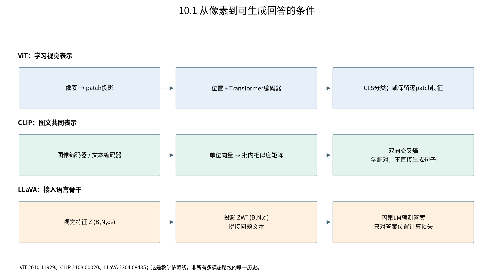
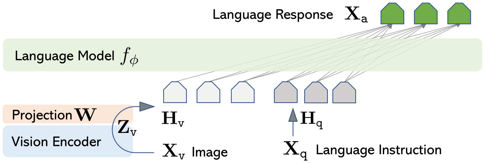
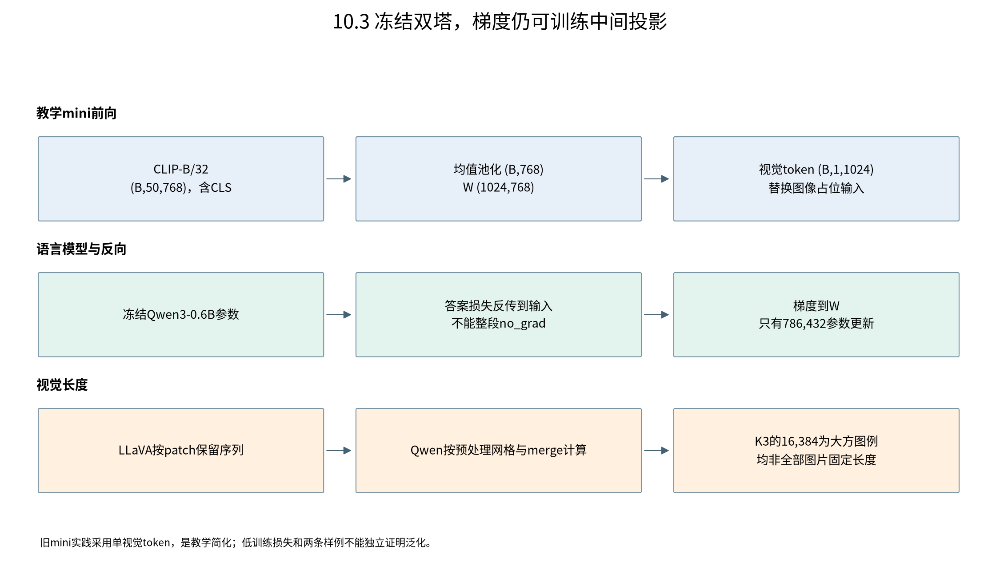
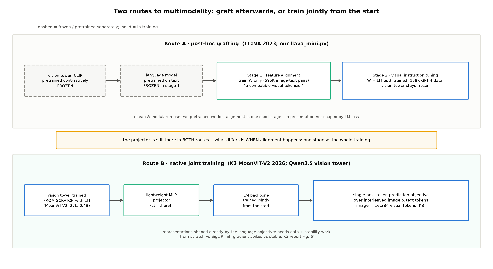

# 第 10 章 能力扩展专题：多模态与推理范式

## 10.0 开篇：从全书到这里

上一章完成了注意力、状态和前馈层的组合。现在保留这副语言模型骨架，改变输入接口与学习目标：图像怎样变成模型可处理的表示？预训练已经会续写文本，为何还要监督微调、偏好优化和强化学习？这些改造是否需要替换 Transformer 核心结构？

本章沿两条增量改造线展开。输入侧从 ViT 的图像块、CLIP 的图文共同表示，到 LLaVA 的投影器和 K3 的联合训练；训练侧从回答示范、偏好对，到采样回答并按奖励更新。每一步都说明保留什么、改变什么、获得什么，以及观察到的能力有哪些限制。多模态 mini 实验继续使用冻结的视觉与语言模型，仅训练中间投影。

## 10.1 能力地图如何连接架构

“架构决定天花板、后训练决定够到几分”过于简单。架构提供表示、信息流和计算成本约束；数据决定模型见过什么；目标函数与优化决定哪些行为被强化；推理时的提示、采样、工具又改变可用信息。它们共同影响能力，不能用一条固定高度的比喻替代分析。

本章把必要数学讲到能追踪梯度和对象：多模态计算的形状、对比学习的概率、带 KL 约束的偏好优化、组内相对优势。完整视觉检测、视频编解码和大规模 RL 系统留给专门课程；但正文使用的结论不依赖读者自行补齐这些关键连接。

## 10.2 多模态三步曲：从「图像怎么进机」到「缝合两个世界」

地图从最早的一步走起。让语言模型看见图，历史上要跨三道坎，恰好对应三篇论文的一小步一小步（图 10.1）——每一步都在回答同一个问题：**拿什么跟什么对齐**。



图 10.1 三行分别改变输入表示、训练目标和系统接口。LLaVA还需按训练阶段决定哪些参数冻结。

**第一步：ViT（2020）——把图切成词。**这一步解决「图像怎么进 Transformer」：把 $224\times224$ 的图切成 $16\times16$ 像素的方块（patch），每个 patch 线性投影成一个向量，整张图就成了一条词元序列，喂给标准的 Transformer 编码器【官方论文 2010.11929 v2】。原论文标题就是这个机制——*"An Image is Worth 16x16 Words"*；摘要的机制句是 "a pure transformer applied directly to sequences of image patches can perform very well on image classification tasks"，且与最强的卷积网络相比 "requiring substantially fewer computational resources"【证据等级：官方论文 2010.11929 v2 摘要，直引】。注意 ViT 对齐的是什么：图像与**离散类别**（类别编号不必作为自然语言词输入模型）——它是一个分类器，监督信号是离散类别，输出端没有句子。ViT-22B 曾在 Book4 的训练稳定性讨论中出现，但完整 patch 接口在这里补齐，此处只记一句：**patch 化之后，图像在本册的账本里就正式成了「一串词元」**——此后所有多模态问题都部分地变回了已知的序列问题。

先补全 patch 的计算，避免把“图像成了词”误解成分词。设图像 $X\in\mathbb R^{B\times3\times H\times W}$，边长为 $P$ 的互不重叠块展平为 $X_p\in\mathbb R^{B\times N\times3P^2}$，$N=HW/P^2$。用同一个可训练矩阵 $E\in\mathbb R^{3P^2\times d_v}$ 投影，再加位置表示：

$$Z_0=[z_{\rm cls};X_pE]+E_{\rm pos}\in\mathbb R^{B\times(N+1)\times d_v}.\tag{10.2}$$

这与文本嵌入的接口相同，但来源不同：文本通常查词表，图像这里对像素块做线性变换。分类头读取最终的 CLS 表示并预测类别；若接语言模型，则通常保留逐 patch 特征，以免过早丢失空间细节。以 $P=16,H=W=224$ 为例，块数为 196，展平宽度 $3P^2=768$；它与某些模型的隐藏宽 768 恰好相等，是数值巧合而不是一般规定。

**第二步：CLIP（2021）——两个编码器，一个共享空间。**分类器只认识训练见过的标签，OpenAI 的 CLIP 把监督信号换成自然语言本身：用互联网上的 "400 million (image, text) pairs"，做 "the simple pre-training task of predicting which caption goes with which image"【证据等级：官方论文 2103.00020 v1 摘要，直引】。结构是双塔：一座图像编码器（原研究比较了 ResNet 和 ViT）、一座文本编码器，各自把输入映射进同一个嵌入空间；训练目标是对比式的——配对的图与文在这个空间里互相靠近，错配的互相推开。用人话说：给「这张图配哪句话」做四亿道选择题，做完之后两个世界共享了同一套坐标系。收益是零样本迁移（"enabling zero-shot transfer of the model to downstream tasks"【同上】）——没见过的分类任务，把类别名写成一句提示就能直接判。

但 CLIP 也只到「配对」为止：对比损失塑造的是**全局语义**的对应，它不会生成一句话——这正是第 7 章 7.3 引过的 K3 报告对 SigLIP 初始化的批评原话（对比损失 "favors global semantics over fine-grained textual and structural cues"），此处先按下，10.3 会回来。

CLIP 如何把“配对更近”变成可训练的目标？一个批次有 $B$ 对图文。两个编码器输出经归一化的 $u_i,v_j\in\mathbb R^d$，相似度矩阵 $A_{ij}=u_i^\top v_j/\tau$，其中 $\tau>0$ 是温度。把每行当成图找文的分类，每列当成文找图的分类：

$$\mathcal L_{\rm CLIP}=-\frac1{2B}\sum_{i=1}^B\left[
\log\frac{e^{A_{ii}}}{\sum_j e^{A_{ij}}}
+\log\frac{e^{A_{ii}}}{\sum_j e^{A_{ji}}}\right].\tag{10.3}$$

对行方向的一项交叉熵，$\partial\mathcal L_i/\partial A_{ij}=p_{ij}-\mathbf1[j=i]$：正确配对得分不足时梯度推动它上升，其他候选按当前概率受到抑制。两塔同时接受梯度，因此不是先规定一套语义坐标再强迫图像进入，而是共同学习可匹配的表示。批内可能有语义相近的“负例”，这也说明目标只近似反映真实语义关系。

一个两对样例：$u_1=v_1=(1,0)$、$u_2=v_2=(0,1)$，$\tau=1$，相似度矩阵对角为 1、非对角为 0。正确匹配概率为 $e/(e+1)\approx0.731$，每方向损失约 0.313。它会做图文配对，但没有逐词生成概率；要说出一段回答，还需要语言模型。这便引出下一步的接口改造。

**第三步：LLaVA（2023）——用一层投影缝合两个已训世界。**前两步攒下了两件现成的资产：一座会看图但不会说话的 CLIP、一群会说话但没见过图的语言模型。LLaVA（论文正名 *Visual Instruction Tuning*）的方案直白到令人怀疑：两座预训练的塔搬来，中间只放一个可训练的投影矩阵 $W$，把视觉特征译成语言模型的词嵌入（论文原图即本章图 10.2；两座塔何时解冻，两阶段训练里马上讲）：

$$H_v = Z_v W^\top \tag{10.1}$$

| 符号 | 含义 | 形状 |
|---|---|---|
| $X_v$ | 输入图像 | $(B,3,224,224)$ |
| $Z_v = g(X_v)$ | 冻结视觉塔（CLIP ViT-L/14）输出的视觉特征 | $(B,256,1024)$ |
| $W$ | 唯一新部件：一层线性投影（无更多结构） | $(5120,1024)$ |
| $H_v$ | 视觉词元——与 LM 词嵌入同维，直接拼进输入序列 | $(B,256,5120)$ |

用人话说：把一张图译成 256 个「词」，语言模型照常做下一词预测——它甚至不需要知道自己读到的词来自图片。论文对这个设计的自我定位值得逐字（实物 10.1）。

按表中的“每行一个 token”约定，式 (10.1) 必须右乘 $W^\top$；论文若采用每列一个 token，则会写 $WZ_v$，两者只是转置约定不同。视觉前缀 $H_v$ 与文本嵌入拼接后，仍由因果语言模型计算答案序列的条件概率：

$$\mathcal L_{\rm answer}=-\sum_{t\in\mathcal A}\log p_\phi(a_t\mid H_v,q,a_{<t}),\tag{10.4}$$

$\mathcal A$ 是答案中参与监督的位置。图像块和问题作为条件，不要求模型把连续视觉特征预测成词表 token。冻结语言模型不等于截断其输入梯度：若 $G=\partial\mathcal L/\partial H_v$，则 $\partial\mathcal L/\partial W=G^\top Z_v$（对批次和 token 求和）。语言模型参数不更新，但它的反向计算仍告诉投影器哪些视觉表示有助于回答；若在语言模型前向外包一层 `no_grad`，这条训练路径反而会断掉。阶段二再让语言模型与投影器共同调整，视觉编码器在原版 LLaVA 中仍冻结。



图 10.2 LLaVA 网络结构（**原图引用**：arXiv:2304.08485 v2 Figure 1，许可 CC BY 4.0；仅作 SVG→PNG 格式转换，内容未改动）。$X_v$ 经视觉编码器 $g(\cdot)$ 得 $Z_v$，投影 $W$ 译成 $H_v$ 与问题词元 $H_q$ 拼接，语言模型 $f_\phi(\cdot)$ 生成答案 $X_a$（两塔的冻结策略见两阶段训练）。

**实物 10.1**（LLaVA 论文 §4.1/§4.2 原句直引；看什么——两件事：投影被明确压到「一层线性」，以及作者把「为冻结 LM 训一个兼容的视觉 token 化器」当作阶段一的自我定义）

```text
§4.1 "We consider a simple linear layer to connect image features into the word
      embedding space. Specifically, we apply a trainable projection matrix W to
      convert Z_v into language embedding tokens H_v, which have the same
      dimensionality as the word embedding space in the language model"
§4.1 "Note that our simple projection scheme is lightweight, which allows us to
      iterate data centric experiments quickly. More sophisticated schemes…can
      also be considered, such as gated cross-attention in Flamingo and Q-former
      in BLIP-2." (更复杂连接件点名后留作 future work——一层线性是刻意选简)
§4.2 "… we keep both the visual encoder and LLM weights frozen" (阶段一：只训 W；原句起于 "In training,"，节录自后半句)
§4.2 "This stage can be understood as training a compatible visual tokenizer
      for the frozen LLM." (阶段一的自我定义句)
```

【证据等级：官方论文 2304.08485 v2 §4.1/§4.2，直引（省略号处省略从句，节选不全文）】

训练只有两个阶段：阶段一「特征对齐」用 595K 图文对、只训 $W$（双塔冻结）；阶段二「视觉指令微调」用 GPT-4 生成的 158K 条多模态指令数据，视觉塔恒冻、$W$ 与语言模型一起更新【证据等级：官方论文 2304.08485 v2 §3/§4.2】。数据侧的巧劲在「用语言-only 的 GPT-4 生成图文指令数据」——摘要自称 "the first attempt to use language-only GPT-4 to generate multimodal language-image instruction-following data"【v2 摘要，直引】；效果侧两个数：自建多模态指令基准上取得对 GPT-4 的 **85.1%** 相对得分；Science QA 上与 GPT-4 协同达 **92.53%** 的当时最高准确率【证据等级：官方论文 2304.08485 v2 摘要】。VQA（视觉问答）速览到此：一条「看图答题」的评测线在 2023 年被一层线性投影接通——这就是「用一层投影缝合两个已训世界」的全部含义。K3 会在 2026 年反驳其中的「阶段」二字（10.3），但**projector 这个部件谁也没扔掉**。

**例 10.1（projector 形状流转——CLIP-base 标准几何，非构造例）**取 CLIP-base 家族的标准几何（patch 16），跟一张图走完全程：

| 步骤 | 运算 | 输入形状 | 输出形状 | 说明 |
|---|---|---|---|---|
| 1 | 切 patch（$16\times16$ 像素/块） | $(B,3,224,224)$ | $(196,768)$ | $(224/16)^2=196$ 个 patch，每块线性嵌入成 768 维 |
| 2 | 视觉塔前向（冻结） | $(196,768)$ | $(196,768)$ | 12 层 Transformer 编码器，逐 patch 上下文混合 |
| 3 | 投影 $W$（一层线性，唯一可学件） | $(196,768)$ | $(196,d)$ | $W$ 形状 $(d,768)$；LLaVA-1 真机 $d{=}5120$ |
| 4 | 拼进输入序列 | $(196,d)$ + 文本 $(L_{txt},d)$ | $(196{+}L_{txt},d)$ | 语言模型照常下一词预测 |

效果读法：**一张图=196 个「词」**——projector 一动不动架构，只改「词从哪来」。换 patch 14（LLaVA-1 的 ViT-L/14）同式得 $(256,1024)\to(256,5120)$；这一层 $W$ 在 LLaVA-1 上是 $1024\times5120=5{,}242{,}880$ 参【证据等级：config 逆向（自算，输入=§4.1 组件几何）】。



图 10.3 第一行给出实际mini形状，第二行强调冻结参数与保留输入梯度的区别；底行防止把位置表格数误认成图像token上限。

**mini 实操：我们自己缝一次。**教学自证照例动手：code/ch10/llava_mini.py 把 LLaVA 阶段一（特征对齐——双塔恒冻、只训投影）复刻到本机。先声明两处**选型偏离**：其一，粗纲原写「小 CLIP＋Book2 小 LM」，实配改为 **CLIP ViT-B/32＋冻结 Qwen3-0.6B**（Apache-2.0）——projector 微调的验收需要可读的生成样例，Book2 的 GPT-2 124M 出不了可读英文；其二，几何再退半步：patch 32 视觉塔只出 49 个 patch 隐状态，本件进一步**均值池化成单 token**（图 10.3 主轨）——真实 LLaVA 是 256-576 token 序列，单 token 是「把图像特征推进语言空间」的最小形态，偏离预登记、代价在样例里直读。参数账：冻结 CLIP 87,456,000＋冻结 Qwen3-0.6B 596,049,920＋可学 projector **786,432**（$768\times1024$，无 bias）——可学件仅占全系统约 0.1%，与 LLaVA「轻量缝合」的精神同构【本书实验，MPS bf16 语言塔，seed 20261002】。

数据用 Visual Genome（VG）子集 340 图（train 320／holdout 20，29.0 MB，下载失败 0、小图跳过 27）——标注源是 region_descriptions 的 108,077 图区域描述，指令三模板轮换、应答取最长区域描述（caption 自造，不复刻 LLaVA 的 GPT-4 指令数据——合规裁定，articles/01）。跑读数（比较条件在实验前确定）：smoke 20 步 loss 6.60→4.06、projector 梯度有限；formal 800 步（约 0.37 s/step，wall 5.0 min）loss 曲线持续下降——见实物 10.2。

**实物 10.2**（llava_mini formal 读数与生成样例；**toy 实物（schema 同真实）**——真实 LLaVA 的对应产物在论文附录与本机体量不可比；看什么——两件事：初始 loss 为什么不是 $\ln V$，以及样例里「场景级对齐已现、细粒度未到」）

```text
# log/book5-ch10/llava_mini_formal_run1.json（800 步，seed 20261002，MPS）
loss 6.5696 → 0.7620（last10 均值 0.7629；320 图×40 epoch——过拟合口径：读数意义在「投影学得动」，数百图小样本谈不了泛化）
params: 冻结 CLIP 87,456,000 + 冻结 Qwen3-0.6B 596,049,920 + 可学 projector 786,432（768→1024，无 bias）
样例 348.jpg：VG 参考 "Wood paneling around patterned wall covering." → 生成 "Table with dishes and chairs."
样例 349.jpg：VG 参考 "Conference room with horse shape table."  → 生成 "Pots on each side of table."
```

三个读法。第一，初始 loss 6.57 远低于 $\ln V=\ln 151{,}936\approx11.93$——语言塔本来就会说话，它只是看不见；监督的只是应答段，指令文本＋语言先验扛掉了大半不确定性，留给投影的活是「把图变得可读」而不是「教模型说话」。这与 Book2 教过的 $\ln V$ 预言是两种口径：那个预言假设模型对输出一无所知，这里输出侧先验早就在场。第二，loss 降到 0.76 是 320 张图过 40 遍的**过拟合口径**——数百图反复训练有明显过拟合风险，判据预注册写明读数意义在「投影学得动」不在泛化；LLaVA 原论文的独立评测属于另一套模型、数据和协议，不能替本 mini 的泛化作保证。第三，两条样例是**细节尚未正确生成的观察**：两图的场景级内容（桌、椅、餐具）命中了，但 "wood paneling" 与 "horse shape" 这类细粒度全丢——均值池化减少了可独立访问的空间条目，可能是原因之一，但训练量、数据和冻结策略也可能影响结果；两条样例不能完成因果归因；真实 LLaVA 用 256-576 token 序列装下细粒度，正是本件预登记偏离所对照的参考对象。零钱一笔教训（判据预注册与事故登记里的原话）：**多模态生成的对照样例必须与参考应答严格隔离**——smoke 首版曾把 VG 参考应答误拼进生成前缀，样例看似高度贴合、实为误导性结果；正式跑的样例走 prompt-only 独立路径。

**实物 10.3**（VG 子集配对的文本形态实物；零图像红线——VG 图像只落 `log/book5-ch10/vg/` 不入书仓、不印书稿，此处以 JSON 摘录替代；看什么——指令配对的三字段齐全与逐图许可行）

```json
{"image_id": 1, "file": "1.jpg", "url": "cs.stanford.edu/VG_100K*/1.jpg",
 "instruction": "Describe this image.", "response": "A brown building opposite were the men are standing.",
 "license": "Visual Genome image, CC BY 4.0 (http://visualgenome.org/license)", "split": "train"}
{"image_id": 2, "file": "2.jpg", "url": "cs.stanford.edu/VG_100K*/2.jpg",
 "instruction": "What is in this image?", "response": "Part of the road is red marked with white stripes.",
 "license": "Visual Genome image, CC BY 4.0 (http://visualgenome.org/license)", "split": "train"}
```

【证据等级：本书实验产物（`log/book5-ch10/vg/manifest.json` 原样摘录前两行）；复现：`python "code/ch10/llava_mini.py" --task prep`——下载样例图落 log/】

三步曲走完，后接路线的全部秘密就在式 (10.1) 里：**语言骨干的 Block 可以复用，但系统新增视觉编码器、投影器及相应输入处理**。但「先各自预训练、再缝合」并不是唯一的路——第 7 章读 K3 时已经见过另一条。下一节把两条路线摆上同一张桌。

## 10.3 原生多模态一瞥：缝合与联训的两条路线

上一节的后接路线把「对齐」压成一个便宜的阶段；原生路线（native multimodality）问的是：为什么不从头一起训？两条路线的事实基础第 7 章 7.3 已经逐句立过，此处只摆要点、不重教：K3 报告 §3.3 的官方否定句——语言与视觉 "jointly optimized **from the start of training**"，而非 "**grafting** a vision encoder onto a pre-trained language model through a **post-hoc alignment stage**"，图文词元交错进同一个下一词预测目标【证据等级：官方技术报告（本地 PDF）§3.3 p11，直引承 7.3】；视觉塔 MoonViT-V2 是 27 层、401M 参数的 ViT 变体，$2\times2$ pixel-shuffle 把视觉 token 砍到四分之一，一张 $3584^2$ 的图=**16,384 个视觉词元**（约占 1M 窗口的 1.6%）【§2.4 p9-10；token 账=config 逆向（自算）】；以及那个反直觉消融——SigLIP（对比预训练）初始化的编码器在联合优化下梯度尖峰频发，from-scratch 的 MoonViT-V2 全程稳定，且视觉评测打平，结论是 "contrastive pre-training is unnecessary as an initialization"【§2.4 p9，厂商自报】。

谱系上给这条路线补两个 2024 年的先声（各一句、不引数字）：Meta 的 **Chameleon**（arXiv:2405.09818）把图与文都离散化成统一词元序列、单一 Transformer 从头联训——早期原生多模态的代表，即本册玩具与三刀机都在用的「图文同序列」思想的放大版；DeepSeek 的 **Janus**（arXiv:2410.13848）则把理解与生成两条视觉编码路径**解耦**、下接统一 Transformer【两文 ID 已三查，研究记录】。到 2026 年，K3 与 Qwen3.5 的联训已是这条路线的成熟形态。值得一提的是：本册四台主角机里 K3 与 Qwen3.5 出厂带视觉塔，GLM-5 与 DSV4 是纯文本——多模态不是旗舰标配，是各家按产品形态选装（Book4 第 10 章表注里那句「视觉侧与能力扩展是 Book5 第 10 章的地界」，指的正是 Gemma3 视觉塔那行 config——同一现象）。

Qwen3.5 的视觉塔正好拿 config 说话（第 9 章 9.1 已真权重实测、config dump 落盘）：`vision_config` 给出 depth 24／hidden 1024／patch 16／`spatial_merge_size` 2／`out_hidden_size` 2560，位置表 `num_position_embeddings`=2,304，另有 `image_token_id` 248056 等 4 枚视觉词元 id（`Qwen3_5ForConditionalGeneration`，原生 VLM）【证据等级：config 逆向（checkpoint config dump）】。两个读法。

其一，`num_position_embeddings=2304` 给的是视觉位置表基准网格，**不是每图输出 token 的上限**。参考实现会对位置表作二维插值。实际输出数要先由预处理得到的网格 $(T_g,H_g,W_g)$ 计算，再除以空间合并面积：$N_v=T_gH_gW_g/2^2$。静态图像取相应的时间网格；例如视觉 patch 网格为 $48\times48$ 且 $T_g=1$，合并后是 576 个 token，而不是 2304 个。若预处理选择其他分辨率，结果随之改变，还要遵守图像处理器设置的像素预算。

其二，`spatial_merge` 的机制一句话：相邻 $2\times2$ patch 拼接后投影进语言维——**又是一次投影缝合**。原生路线的 projector（K3 的轻量 MLP、Qwen3.5 的 merge 投影）一个都没少；被否定的是「预训练之后再对齐」的**阶段**，不是这个**部件**。位置侧补一句 config 事实：Qwen3.5 用分节的多模态 RoPE（mrope 三节 11-11-10，对应时间／高／宽三个坐标轴）——视觉位置这样进 RoPE，机制承 Book3 第 4 章，此处点到为止。



图 10.4 后接与原生两路线对照（自绘）：上轨=LLaVA 式——两座预训练世界＋两阶段对齐（先只训 $W$、再连语言模型一起微调）；下轨=原生联训——视觉塔从头与语言骨干一起训、图文词元同一目标；中条判词=**projector 两条路线都在，差别在对齐发生在「一个阶段」还是「训练全程」**。

两条路线各自的账记进表 10.1，全景对照见图 10.4。「何时选谁」的判断力一句话版：资源与迭代速度优先、或要把现成 LM 快速上身→后接（对齐是一个便宜的阶段，我们的 mini 用 5 分钟就跑完了它的玩具版）；数据与算力充裕、且要细粒度视觉能力与联训自由度→原生（表征直接被语言目标塑造，但要付从头联训的数据配方与稳定性工程——K3 的梯度尖峰消融就是那张账单）。

| 维度 | 后接式（LLaVA 系） | 原生联训（K3／Qwen3.5） |
|---|---|---|
| 对齐发生在哪 | 预训练后的一个（或两个）阶段 | 训练全程（from the start） |
| projector | 一层线性／轻量 MLP——**在** | 轻量 MLP／merge 投影——**同样在** |
| 视觉表征由谁塑造 | 对比预训练（CLIP 系）；阶段二微调 LM | 语言建模目标直接塑造（细粒度友好） |
| 视觉 token 量级 | 256-576/图（LLaVA-1→1.5） | 随输入网格和预处理变化；K3 的 16,384 是前述大方形图示例 |
| 成本 | 双塔可复用现成权重；对齐阶段便宜 | 从头联训：数据配方＋稳定性工程＋全程算力 |
| 代表 | LLaVA-1/1.5（2304.08485） | K3 MoonViT-V2（2607.24653）、Qwen3.5 视觉塔 |

表 10.1 后接与原生两路线对照（自排；证据等级=官方论文／官方技术报告／config 逆向，逐行见上文标注）

再看容量：按第7章所用的大方形图示例，16,384个视觉词元意味着什么？对 1M 窗口是 1.6%，对服务却是「一张图要先付一万六千词元的预填充账」——这本账谁付、怎么付，是服务侧的正题，具体请求和缓存路径见Book8多模态章节。

## 10.4 推理范式与后训练链：把思考搬到推理期

多模态改变输入表示，后训练则主要改变同一语言骨干被鼓励产生哪些输出。下面四个概念不是依次淘汰的四代架构：RLHF 是利用人类反馈的训练范式，DPO 是直接偏好优化方法，GRPO 是策略优化方法，RLVR 描述奖励可由规则验证。GRPO 可以配可验证奖励，也可以配其他奖励；偏好优化也不一定修改模型结构。

**RLHF（2022）——奖励模型＋强化学习两步走。**InstructGPT 立的范式：SFT 起步，然后用人偏好数据（哪个回答更好）训一个**奖励模型**，再用强化学习（PPO）让语言模型最大化这个奖励——摘要定位句 "fine-tuning with human feedback is a promising direction for aligning language models with human intent"【证据等级：官方论文 2203.02155 v1 摘要，直引】。痛点也从此定型：奖励模型要单独训、RL 阶段要从模型里采样（贵）、学歪了会被钻空（reward hacking）。

**DPO（2023）——把 RLHF 变成一次分类。**关键观察：在给定奖励与 KL 正则目标下，无约束最优策略有可重参数化的形式，于是可以跳过奖励模型与 RL 采样，"solve the standard RLHF problem with only a simple classification loss"【证据等级：官方论文 2305.18290 v3 摘要，直引】。用人话说：拿「回答 A 好于回答 B」的偏好对直接当监督信号训——稳定、轻量、省一整条 RL 流水线。Llama 3 用的就是它（Book3 已见）。

**GRPO（2024）——组内相对，免 critic。**DeepSeekMath 提出的 "a variant of Proximal Policy Optimization (PPO)"，一边提升数学推理、一边 "optimizing the memory usage of PPO"【证据等级：官方论文 2402.03300 v3 摘要，直引】。机制到流程图级一句话：同一道题采样一组回答、**组内互为基线**算相对优势——不用再养一个价值网络（critic），采样开销换掉了 critic 的显存与训练开销。这一步为推理范式备好了引擎。

**RLVR（2024-2025）——奖励换成可验证的规则。**数学答案对不对、代码过不过测试，规则就能判分——「可验证奖励」（RLVR）把奖励模型整个换掉，让 RL 直接在可判分任务上大规模跑。它与 GRPO 的组合就是下一站的主角。

| 代 | 奖励从哪来 | 直接优化什么 | 省了什么 | 锚 |
|---|---|---|---|---|
| RLHF | 人工偏好训出的奖励模型 | 奖励模型＋RL（PPO）两步走 | ——（基准范式） | 2203.02155 |
| DPO | 偏好对本身（闭式解） | 一次分类损失 | 奖励模型、RL 采样 | 2305.18290 |
| GRPO | 环境奖励（组内相对优势） | PPO 变体、免 critic | 价值网络的显存与训练 | 2402.03300 |
| RLVR | 可验证规则（对错自动判分） | GRPO 系 RL 直接上大规模 | 相应任务的学习式奖励模型；验证器仍可能有漏洞 | R1 2501.12948 |

表 10.2 后训练链四代速览（自排；流程图级——训练细节仅引用，每行锚给 arXiv ID；「省了什么」一列读法=这些方法控制不同环节的成本，可以组合，不能简单排成替代链）

**从偏好到策略：DPO 的推理桥梁。**它改变的是训练损失，目标是提高偏好回答相对于参考策略的概率，而不在标准离线训练环中反复做在线 RL 采样。先固定问题 $x$，令回答 $y$ 的奖励为 $r(x,y)$，参考策略 $\pi_0(y\mid x)>0$，正则系数 $\beta>0$。考虑

$$J(\pi)=\sum_y\pi(y\mid x)r(x,y)-\beta\sum_y\pi(y\mid x)\log\frac{\pi(y\mid x)}{\pi_0(y\mid x)}.\tag{10.5}$$

用乘子 $\lambda$ 约束 $\sum_y\pi(y\mid x)=1$，对每个概率求导：$r-\beta[\log(\pi/\pi_0)+1]+\lambda=0$。整理并归一化得到 $\pi^*=\pi_0e^{r/\beta}/Z(x)$，等价于

$$r(x,y)=\beta\log\frac{\pi^*(y\mid x)}{\pi_0(y\mid x)}+\beta\log Z(x).\tag{10.6}$$

这一步是给定奖励下的数学最优解，不是说有限偏好样本能直接给出神经网络最优权重。再假设偏好服从 Bradley–Terry 模型：$P(y_w\succ y_l\mid x)=\sigma[r(x,y_w)-r(x,y_l)]$。两个回答共享的 $\beta\log Z(x)$ 相消，换成待训练的 $\pi_\theta$，对观察到的偏好取负对数似然：

$$\mathcal L_{\rm DPO}=-\mathbb E_{(x,y_w,y_l)}\log\sigma\!\left(\beta\left[\log\frac{\pi_\theta(y_w\mid x)}{\pi_0(y_w\mid x)}-\log\frac{\pi_\theta(y_l\mid x)}{\pi_0(y_l\mid x)}\right]\right).\tag{10.7}$$

每个回答的对数概率仍是自回归 token 对数概率之和。若当前策略与参考相同，括号为零，单对损失为 $\log2$；若赢家／输家相对参考的概率比分别是 $1.5$ 和 $0.5$，取 $\beta=1$，括号为 $\log3$，预测偏好概率为 $3/4$，损失约 0.288。模型没有新建“偏好模块”，而是通过这条损失调整原有概率分布。偏好假设、数据覆盖与参数化限制仍影响结果；省去显式奖励模型不等于摆脱偏好偏差。【依据：DPO，arXiv:2305.18290，§4 与附录推导。】

**从绝对奖励到组内比较：GRPO 的更新对象。**对同题由旧策略采样 $G$ 个回答，奖励为 $r_1,\ldots,r_G$，用组均值 $\bar r$ 与标准差 $s_r$ 形成优势 $A_i=(r_i-\bar r)/(s_r+\epsilon)$。例如奖励 $(0,0,1,1)$，用总体标准差得到 $A=(-1,-1,1,1)$：比较同题中的相对好坏，不需要另外训练价值网络。全组同分时该奖励项无法提供区分信号；容易题与难题的组内方差也会影响归一化，不能把标准化当作无代价处理。

对回答 $i$ 的 token $t$，令概率比 $\rho_{it}=\pi_\theta(y_{it}\mid x,y_{i,<t})/\pi_{\rm old}(y_{it}\mid x,y_{i,<t})$。一种典型的 GRPO 目标包含

$$\frac1G\sum_i\frac1{|y_i|}\sum_t\min\{\rho_{it}A_i,\operatorname{clip}(\rho_{it},1-\delta,1+\delta)A_i\}-\beta\mathcal K.\tag{10.8}$$

$\delta$ 限制一次更新中有利方向的概率比变化，$\mathcal K$ 表示对参考策略的 KL 正则项；不同后续实现可能改变归一化和 KL 处理。对正优势，概率比超过 $1+\delta$ 后，这一项不再鼓励继续增加；对负优势则抑制过度降低概率。它仍需采样、评分、反向传播，节约的是价值网络，不是整套 RL 成本。【依据：DeepSeekMath，arXiv:2402.03300v3，§4。】

RLVR 改的是奖励来源：测试是否通过、最终答案能否验证等。它与式 (10.8) 可以组合，但“可验证”不等于覆盖真实目标：测试集不完整、格式漏洞、答案泄漏都可能被策略利用。因而需要独立评测和检查验证器，不能宣称奖励投机风险已被消除。

**o1→R1：思考链是被 RL 激发的。**2024 年 9 月 OpenAI 的 o1 把「先思考再作答」搬进推理期：答前生成一长串推理、再落笔——思考长度本身成了可花的预算（test-time compute，测试时算力；o1 无论文，官方发布口径）。分水岭在 DeepSeek-R1（2025-01）：它证明**纯强化学习**即可激发这种能力——R1-Zero 不用任何人工标注的推理轨迹，"the reasoning abilities of LLMs can be incentivized through pure reinforcement learning (RL), obviating the need for human-labeled reasoning trajectories"，且推理模式随之涌现（"the emergent development of advanced reasoning patterns, such as self-reflection, verification, and dynamic strategy adaptation"）【证据等级：官方论文 2501.12948 v2 摘要，直引】。范式转折点读法：推理行为既可以被提示和示范引出，也可以被监督训练、蒸馏和 RL 强化；R1-Zero 展示的是在已有预训练模型上不依赖人工推理轨迹做该阶段 RL 的路线，不能说推理能力唯一来自 RL。（R1 完整版加回了 SFT 冷启动与多阶段管线，细节超出本章地图。）

**K3 的 2026 形态：推理努力是被训出来的档位。**这条链走到本册主角机上的样子，报告 §4.1 写得非常具体——全部按报告事实句引（§6 评测数字则守住摘要级纪律）：三域专家（通用／通用 agent／编码 agent）×三档推理努力 {low, high, max} 交叉，"yields a total of nine expert models"——**九个推理努力专家**是被分别训出来的模型，不是同一模型的九个采样开关【证据等级：官方技术报告（本地 PDF）§4.1.2 p12，直引】。预算怎么控：每题先冷启动估一个 token 预算 $b_0(x)$，累计思考超过 $\tau\cdot b_0(x)$ 则该题奖励直接置 $-1$；课程先放大 $\tau$ 把 max 档训出来（仍封顶防 overthinking）、再退火 $\tau$ 得到 high/low 档，agentic 任务按累计输出 token（含推理与工具调用）计账【§4.1.2-4.1.3 p12-13】。用人话说：先给每题估个「合理思考长度」，超时 $\tau$ 倍判负——模型学会在预算内把话想完。评测口径一句（承 7.4 已引）：全部 K3 评测用 reasoning effort max、温度 1.0【§6.1.3 p26，摘要级】。谱系池挂名不展开：MOPD（九专家当 teacher 的逐 token 蒸馏）、GRM（锦标赛式生成奖励＋强制 rubric 协议）、XTML 聊天模板（think/response/tools 三通道、低对齐税）——名字与地址在此，机制留待专门赛道【§4.1.3/§5/App F】。

## 10.5 能力侧给架构册的回望

现在把这些能力改造接回前面的模型。上下文学习允许模型利用示范而不更新参数；监督微调与偏好优化则更新参数以改善任务行为；RL还可以强化按奖励完成任务的策略。它们不是同一种学习过程，也不是一条必然逐级升级的链，但都依赖表示、计算预算和可访问的信息。K3的九类专门策略展示同一骨干上的不同后训练方向，不能与MoE的九个路由专家混淆。

再看外部信息如何进入语言模型。Book1 的翻译机里，decoder 看 encoder 靠的是一座 cross-attention 桥；Book2 把桥拆了——GPT 单塔把「读外部世界」折叠进自注意力。LLaVA 是这座桥的**和平版回归**：第二个世界（视觉）的信息重新要流进来，但没有人加一层注意力、没有人动机身——projector 把视觉特征**译成词**，从输入嵌入这道门走进来。信息还是从另一个模态流到语言模型，走的却是「变成词」而不是「加一层桥」的路。本册的三条路线改的都是文本世界**内部**的注意力；多模态提醒我们还有第二个设计自由度——**世界怎么进机器**。2026 年的答案分两派：门开在输入侧（后接），或从第一块砖就一起砌（原生）——10.3 的表 10.1。

两句收束，也是本章真正要留下的判断力。**架构、数据、训练目标与推理协议共同影响能力和成本**：1M 窗口（第 8 章）是思考链能展开的物理上限，3:1 混合与固定状态（第 5-7、9 章）把每 token 与每缓存词元的成本压下来，长思考在经济上才成立；反过来，能力侧的需求——一张图 16,384 词元、一道题几万 token 的推理——把账单推回架构侧，本册账本三档递减的动机一半来自这里。最后一句声明：本专题是这套丛书**唯一**的能力侧参考对象——多模态与后训练的深水区各留给专门的赛道，本书从下一章起回到主线（读数字的方法论），之后各册只在「服务」的意义上与能力侧重逢。

## 10.6 本章小结

开篇的问题逐一作答。「模型怎么看见图」——三步曲：ViT 把图切成词（图像进入词元序列的账本）、CLIP 用四亿图文对把两个世界拉进同一坐标系、LLaVA 用一层可训练投影把视觉特征译成词嵌入——式 (10.1) 的 $H_v=Z_vW^\top$ 就是「缝合两个已训世界」的全部数学；我们的 mini 用冻结双塔＋786,432 参数的投影复刻了它的对齐阶段，loss 6.57→0.76、样例场景级对齐。「两条接法怎么选」——后接把对齐压成一个便宜阶段、原生把对齐摊进训练全程，projector 两边都在，分歧只在「何时对齐」；判断力是资源与迭代速度对细粒度与联训自由度的权衡。「推理范式是什么形状」——后训练方法分别改变偏好目标、优势估计和奖励来源（奖励模型→RL 采样→critic→奖励模型本身），o1 把思考搬进推理期、R1 证明纯 RL 就能激发思考链，K3 把「推理努力」训成了九个专家档位。这些改动把新的输入与行为目标接回了同一个自回归骨干。

**带走的心智**：忘掉细节，留三句话。**其一，多模态的枢纽是一个 translator 而非一座桥——projector 是最小的那根针，「缝合或联训」的分歧不在有没有针、在什么时候缝：一个便宜的阶段，还是训练全程本身。其二，一张图=多少个词（196／576／随预处理变化／16,384（示例））是多模态的第一本账——细粒度与窗口预算的选点问题，与本册的 KV 账本是同一种思维。其三，思考链是被 RL 训出来的策略、推理努力是被训出来的档位——而「想多久」要有地方想：架构定天花板，后训练定够到几分，能力侧的需求最终变成架构侧的账单。**

镜头拉回全书：机器（三刀机）与能力地图（本章）都齐了。下一章是全书最后一门手艺——厂商报的数字怎么读：config 逆向五步法在 Book3 立过、无论文模型在 Book4 拆过，2026 年的新局面（预览版论文、SPA 博客、托管口径、双数字打架）需要一套更严的读法。读完那一章，这套书的「造机器」与「读机器」两门手艺就都交付了——收束在即。


## 10.7 动手验证

- **VG 子集准备**（网络约 5 min；实物 10.3 的数据源；图像一律落 `log/book5-ch10/vg/`，零图像入书仓）：
  ```bash
  cd 工作区根目录 && source env.sh && \
    python "code/ch10/llava_mini.py" --task prep --out-name run1
  ```
- **冒烟与正式微调**（MPS：smoke 20 步秒级；formal 800 步 ≈5 min——实物 10.2 数据源；判据预注册=脚本文件头）：
  ```bash
  python "code/ch10/llava_mini.py" --task smoke  --out-name s3
  python "code/ch10/llava_mini.py" --task formal --out-name run1
  ```
- 验收点：能画出 LLaVA 结构并写出 projector 的形状账（例 10.1）；能说出后接与原生各自「对齐发生在哪、projector 在不在」，并给一个选型判断；能复述后训练链四代各省了什么；能解释为什么 llava_mini 的初始 loss 远低于 $\ln V$。
