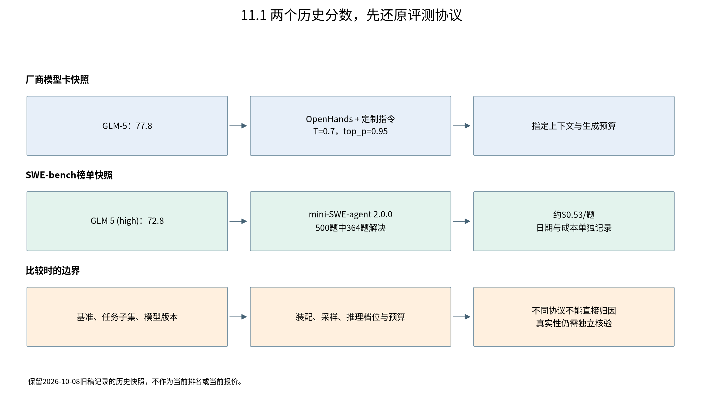
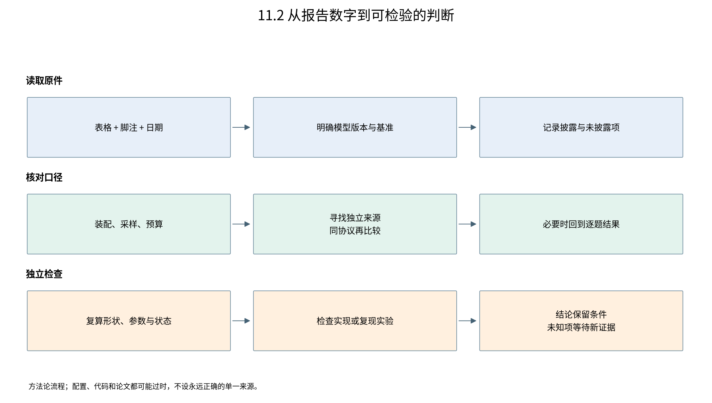

# 第 11 章 方法论：如何读厂商自报与预览版时代的模型

## 11.0 开篇：从全书到这里

前面已经学会从模型结构计算参数、状态与计算量，也见到了论文实验、历史教学实验、配置字段和厂商评测。这些材料各自回答不同问题：一个配置能说明层数，却不能证明检索准确率；一次参数复算能发现口径差异，却不能替代端到端评测。

本章以 GLM-5 的两组 SWE-bench Verified 成绩为例，练习把一个数字拆回模型、数据、评测装配和预算。随后比较披露完整、信息缺失、参数口径不一致和版本滚动四种情形，再把方法接回张量形状与实现对照。案例中的榜单数字保留原文 2026-10-08 的历史快照含义，不作为当前排名。

方法的目的既不是替厂商辩护，也不是预先怀疑所有数字，而是确定：已经知道什么，哪些差异能够解释，哪些解释还需要实验。配置、代码、论文和评测记录互相核对；不存在一种来源天然不会出错。

## 11.1 主案卷：同一基准名下，两个分数

SWE-bench将真实仓库的issue与代码版本交给系统，由系统生成补丁，再按固定评测环境运行指定测试。完整解决通常要求应修复的测试通过，并保持原有通过项；这不等于运行仓库里所有可能的测试。Verified是人工筛选的500题子集。模型还需要agent提供命令执行、文件访问和循环控制；提示、工具、采样、预算与测试环境共同构成评测协议。本文把生成补丁一侧的agent装配与最终判分harness分开记录，避免同一个“harness”掩盖两层差异。【依据：[SWE-bench官方文档](https://www.swebench.com/SWE-bench/)、[判分实现](https://github.com/SWE-bench/SWE-bench/blob/main/swebench/harness/grading.py)】

案情一句话：同一个 GLM-5，同一基准名下，历史材料记录了两组数字——模型卡写 77.8，SWE-bench 官方榜写 72.8，整整差 5 分。两处原文见实物 11.1。

> **实物 11.1（SWE-V 双数字的三处原始记录）**。看什么：块 A 是厂商自己写下的口径（表行＋脚注原文，注意 "tailored instruction prompt" 就在脚注里）；块B是官方榜该行的部分字段（成本与日期都在）；块 C 是进一步的发现——同一张 HF 卡的 eval-results 元数据层里，双数字并存、各带出处，两组出处不同的机器可读记录。
>
> 块 A（GLM-5 模型卡基准表行与脚注，原文）：
> ```
> SWE-bench Verified | 77.8 | 73.8 | 73.1 | 76.8 | 80.9 | 76.2 | 80.0
> *We run the SWE-bench suite with OpenHands using a tailored instruction
>  prompt. Settings: temperature=0.7, top_p=0.95, max_new_tokens=16384,
>  with a 200K context window.
> ```
> 块 B（swebench.com Verified 榜 GLM 5 (high) 行，一手存档解析）：
> ```
> name=GLM 5 (high) | agent=mini-SWE-agent | resolved=72.8 | instance_cost=$0.53438913622
> date=2026-02-17 | mini-swe-agent_version=2.0.0 | model_org=Z-AI | os_model=True | os_system=True
> ```
> 块 C（HF eval-results 元数据层，两条并存；「…」=省略 dataset／url／filename 等字段）：
> ```
> {"value": 72.8, "source_name": "SWE-Bench official evaluation", "isExternal": true, …
>  "notes": "high reasoning, official"}
> {"value": 77.8, "source_name": "Model card", "isExternal": false, …
>  "notes": "Z.ai reported number"}
> ```
> 【来源：块A/C保留原稿2026-10-08摘录身份；本轮另核当前模型卡仍列77.8及相同OpenHands脚注。块B本轮从已存2026-10-25榜单快照重算500条中364解决，得到72.8；该条目tags含Org:Z-AI、checked=null，所以只能确认官方榜单收录，不能据站点身份称为独立第三方复跑。】

块C说明页面记录了两个不同来源，并不额外完成一次评测。还需检查运行者与复核状态：本轮可读的10月25日榜单快照里，该72.8条目标记Org:Z-AI，checked为空。它与“由SWE-bench团队运行或直接检查”的标记不同。**第三方网站、第三方收录、独立第三方复跑是三件事**；不能把页面重复展示的数字当成新增独立证据。接着再比较五个维度。

**第一维，考卷。**两处都声明SWE-bench Verified，榜单条目确有500条逐题记录；本例尚未拿到自报77.8的逐题ID来一一核对，因此只能确认目标基准相同，不能仅凭名称排除题集版本、跳过项和环境差异。GLM-5.2的62.1另属SWE-bench Pro，与Verified的77.8更不能直接比较；Verified、Pro、Multilingual必须写全后缀。

**第二维，装配。**77.8来自OpenHands及定制指令；72.8条目采用mini-SWE-agent 2.0.0的bash-only设置。所谓“裸档”仍有agent循环、prompt和bash工具，只是装配简约，并非没有工具或系统逻辑。它们的装配差异可能影响成绩，但当前两次运行没有只改变这一项，无法将5个百分点全部归给工具链。

**第三维，采样与上下文。**官方跑分自设 temperature 0.7、top_p 0.95、最多 16,384 个新 token、200K 上下文窗；榜单侧用榜单统一设定（该榜单2.x配置不显式设置温度；这不等于温度为0，实际行为还取决于提供方默认值）。这些设置各自定义一次评测，仍需分别核验结果；未列出的提供方默认值应继续追查。

**第四维，档位与版本。**进榜的是 "GLM 5 (high)"——推理档位写进榜名；agent 版本 2.0.0，方法说明则提示1.x与2.x不一定可直接比较（2.x 走工具调用，1.x 从输出串解析动作）【来源：SWE-bench榜单方法说明，不是额外复跑】。比对任何两个 benchmark 数字，模型版本与 agent 版本两个号都要抄。

**第五维，钱与算力。**该榜行的总费用为267.19456811美元，除以500题得每题约0.5344美元；这是API计价下的费用，并非GPU算力或能耗实测。自报行未在同一位置给出相同口径的费用与重复采样详情，缺项只能逐项登记。同样的分数可以来自不同开销，必须同时保存计价时间、输入输出预算、是否缓存以及失败任务是否计入费用。

现在能作出的判断是：两个协议不同，仅凭分差不足以断定结果矛盾；反过来，协议不同也不能自动证明两项结果都正确。72.8描述指定mini-SWE-agent配置下的提交记录，77.8描述厂商所报OpenHands设置；真实性、独立性和可比性仍要分别核对。

另外两组历史记录说明为什么不能只抄一个模型名。原稿的对照列分别保留Claude Opus 4.5的80.9对76.8、Kimi K2.5的76.8对70.8、DeepSeek-V3.2的73.1对70.0；差值为4.1、6.0、3.1个百分点。这三个例子只能说明所列协议下读数不同，不能估计“行业常态差5分”，也不能证明差异均由装配造成。

其二，原稿另记vals.ai的GLM-5读数71.40，与榜单72.8差1.4个百分点。这里保留为当时来源记录；未拿到两边完全匹配的逐题轨迹与采样协议，不能断言差异已经由日期或采样解释。共同使用mini-SWE-agent也不足以证明配置、提供方默认参数和运行预算完全一致。

历史排名还需带类别和时间。原稿将72.8列为当时mini-SWE-agent档内的并列前列，与另一条GPT-5.2 high同分而费用不同；带其他agent装配的系统行可有更高分。本文不刷新这份历史排名，也不将任何一行称为当前全榜第一。



图11.1保留两个历史读数的装配与预算。榜单收录不是独立复跑证明；第三行列出比较条件，不能从5个百分点差直接推算工具链贡献。【来源：原稿历史摘要、本章重新核对的榜单快照与模型卡】

还应把统计不确定性与协议差异分开。若粗略把 500 道题视为独立同分布的二元观测，$\hat p=364/500=0.728$ 的二项标准误约为 $\sqrt{\hat p(1-\hat p)/500}\approx0.020$，即约 2 个百分点。这只是一个简化估计：固定基准题目并非从目标任务分布随机抽样，题目间也可能相关。比较两个系统最好保留逐题成败，做配对分析并重复采样；两个汇总百分比既无法识别哪类题改变，也无法分离随机性与协议影响。

可以构造两张有相同汇总分数的配对表：A解决389题、B解决364题。若两者共同解决364题，分歧只有A独有的25题；若共同解决253题，则A独有136题、B独有111题，分歧共247题。两种情况都相差5个百分点，却反映很不同的逐题稳定性。仅凭单个系统约2个百分点的标准误，不能直接给这个分差下显著性结论。

## 11.2 五步法：把读数变成操作手册

主案例中的做法可以整理成操作程序了。Book3 第 9 章给「拆机器」立过五步：认家族→重建图纸→算账对拍→读外围→证据分级＋悬案登记。本章给出与之配套的方法——**读自报数字五步法**（图 11.2），每一步在主案卷里都已经用过一遍：

**第一步，找到 raw 数字。**到 config、README、论文表的原件里把数字连同脚注一起抄回来，不接受转述。理由主案卷已经给过：口径写在脚注里——“tailored instruction prompt”这项条件写在脚注中，只抄表行的转述永远看不到它。转述丢的不只是精度，是口径。

**第二步，核口径。**benchmark 名与版本（Verified 不是 Pro 不是 Multilingual）、harness 与 prompt（OpenHands 还是裸 agent）、采样与上下文（温度、次数、窗口）、推理档位（high/max/xhigh）、agent 与模型版本。11.1 的五维清单在这一步逐项过——第一维也要核具体任务ID和版本；名称相同只是起点。

**第三步，找独立来源交叉。**先确认谁运行、谁复核，结果是否来自同一次提交。官方榜单可以收录厂商结果，HF元数据也可能只转载模型卡；两个网址不必意味着两份独立证据。若拿到独立复跑，再比较任务集合、版本、采样和预算，而不是仅看分数是否接近。

**第四步，复算可算的。**参数账、KV/状态账本——本书从 Book3 起反复使用的方法。能力数字大多复算不了，但「这台机器有多少参数、多少层、什么排布」在配置、权重结构与计数约定足够公开时可以复算，而且复算常能反过来裁决书面数字（11.3 案 C 全程演示）。能力数字复算不了时，退而求其次的是代理指标，而代理指标与端到端质量的裂缝要如实标注——IndexCache 附录 C 的负结果（注意力输出的余弦相似度不预测端到端效果，第 4 章 4.4 借过一次）与第 2 章「PPL 不塌≠长程任务不塌」是同一条纪律的两处落地。

**第五步，悬案登记。**读不出来的东西列成清单，不猜。「不披露也是信息」——但信息只能登记到事实为止，11.3 案 B 给出边界。



图 11.2 沿行内箭头读操作顺序。独立来源的不同分数需要先检查条件，复算也只能证明可计算的那部分主张。

表11.1 评测发布与交叉核对来源（读法：数字与局限必须一起抄回）

| 源 | 性质 | 局限 |
|---|---|---|
| swebench.com官方榜 | 收录不同系统及bash-only记录；可含逐题明细、成本和版本 | 收录不等独立复跑；须查运行组织、checked标记、日期与版本 |
| vals.ai | 独立评测机构；mini-SWE-agent；带成本列 | 跑批日期与采样自成一套——同模型与官方榜可差 1 分级 |
| Artificial Analysis | 商业评测站（质量指数、Terminal-Bench 等） | 商业口径自定，部分内容需订阅（K3 卡面自己引它的数） |
| DeepSWE 榜／FrontierSWE／SWE-Marathon | 社区与企业专项榜 | 专项域窄；复测也有再加工（K3 脚注：FrontierSWE 分数用官方脚本重算） |
| 人评对战平台（如LMArena） | 对采样问题和对战结果拟合评分 | 模型别名、题目分布、展示方式、评分模型和区间会影响结果，不能当成固定能力常数 |

【证据等级：各源页面性质为公开事实；局限列=调研期逐源一手核验】

五步之外，再给一项随时可用的工具：**五问**。遇到任何一个自报数字，先问这五个问题——谁跑的？哪张卷？装配到哪层？怎么采的样？跟谁比、对手的数是谁跑的？例 11.1 拿一个构造的数字演示一遍。

> **例 11.1（构造例：五问拆一个虚构的自报数字）** 设想某模型卡写着「XX-Bench 89.1」，脚注一行小字：「v2-revised，自家 agent 框架，temperature 0.7；对照组数字取自各家官方发布」。
> 1. 谁跑的：落款与脚注只说明厂商自跑，登记为厂商自报；尚无独立复测信息。
> 2. 哪张卷：v2-revised说明修订版；修了什么、由谁修、是否公开以及与v2差异，均需查说明，不能直接判为非公开自建卷。
> 3. 装配到哪层：使用自家agent；具体工具、策略和预算未知，不能仅凭“自家”断言满装或最佳设置。
> 4. 怎么采样：只知道temperature=0.7；次数、种子和汇总方式未说明，不能补成单次或多次取优，也不能跨模型统称“高温”。
> 5. 跟谁比：竞品数转引自各自官方发布；需要再核每个竞品的配置，不能假定所有列用了同一套协议。
>
> 效果读法：记录变成{厂商自跑；修订卷差异待查；自家agent细节待查；温度已知而采样次数未知；竞品为转引}。数字不变，但已知条件与未知条件分开；真实材料中的修订数据集、装配差异与竞品转引，分别见下列例子。

再逐一看看五家真实材料中的口径差异：GLM-5 的 Terminal-Bench 2.0 报「56.2 / 60.7†」双数，† 脚注明示修订版是 zai 自建并发布的 terminal-bench-2-verified 数据集（修「歧义指令」）——厂商改考卷再报分的边界案例【证据等级：厂商自报（模型卡）】；K3 卡面对照列声明对竞品取 "best score across harnesses"（跨 harness 取各家最高），自家 DeepSWE 双数并报 67.5（自家 harness）与 67.3（mini-SWE-agent 榜）【证据等级：厂商自报（模型卡脚注）】；DSV4 全表按 Non-Think／High／Max 三档报分，推理档位成了表格的主要列【证据等级：厂商自报（预览版材料）】；Qwen3.5的MathVision脚注声明对竞品比较带与不带`\boxed{}`格式要求的运行，并报告较高分；不能由此确定每种设置只跑一次【证据等级：厂商自报（模型卡脚注，调研期转录）】；这些案例还存在跨卡转引——GLM-5.2 表内的 DSV4-Pro 列引 DeepSeek 自报、K3 表内的 GLM-5.2 列引 z.ai 博客，表里每个竞品数字都要单独问一句是谁跑的。

这些已披露的例子都能从表格或脚注找回重要条件。但没有披露的内容不会因仔细阅读而自动出现；查完正文、附录和运行记录仍找不到，就应写“未找到”，不能把所有缺项都归为读者漏看。

## 11.3 四个小案：披露、缺项、计数与版本

主案卷说明不同协议的数字可以并列记录，但仍须分别验证。四小案补齐另外四种厂商与读者的关系——检验这套方法是否有效，要看四种关系能否用同一套程序分析，而不只看能否剖析对手。

**案A·披露对自己不利的对照：一张与235B并排的表。**Qwen3-Next 的 README 宣传句只说："not only surpassing Qwen3-30B-A3B-Thinking-2507 and Qwen3-32B-Thinking, but also outperforming the proprietary model Gemini-2.5-Flash-Thinking across multiple benchmarks"【证据等级：厂商自报（官方 README，2026-10-08 抓取直引；快照一手存档 `log/book5-ch11/qwen3next_readme/`，2026-10-09 补档）】。对照组名单里没有自家旗舰 Qwen3-235B-A22B-Thinking-2507——但紧挨着的基准表诚实地把它摆进了对比列（实物 11.2）。本书逐行清点的结果：23 个数据行里，Qwen3-Next 对 235B 列 18 行落败、5 行小胜（最大分差 +3.0），表内加粗（行最优）只拿了 2 行【证据等级：本书清点（README 原表逐行，抓取 2026-10-08）】。这说明表格保留了多项不利对照。宣传句中的“多个基准”也不能改写成“所有基准”：即使对较小模型，个别行仍可能落后。清点的是表内关系，不是重新运行这些评测。这张表还有一处口径透明值得点名：Arena-Hard v2 的脚注声明胜率由 GPT-4.1 评审（评审模型披露）【证据等级：厂商自报（模型卡脚注）】。方法论不是教人怀疑一切——**五步法也能确认哪些对照得到了披露**，但这种透明度不能替代对数据质量与评测实现的验证。

> **实物 11.2（Qwen3-Next 自报表原样三行）**。看什么：第 4 列就是 235B——宣传句没提的名字在表格里全程在场；两行 TAU 一胜一败，胜差 +1.8、败差 −4.1，胜的恰好是宣传句主打的 agent 类任务。
> ```
> |  | Qwen3-30B-A3B | Qwen3-32B | Qwen3-235B-A22B | Gemini-2.5-Flash | Qwen3-Next-80B |
> | TAU1-Retail | 67.8 | 52.8 | 67.8 | 65.2 | **69.6** |
> | TAU2-Retail | 58.8 | 49.7 | **71.9** | 66.7 | 67.8 |
> ```
> 【证据等级：厂商自报（Qwen/Qwen3-Next-80B-A3B-Thinking README 原表，2026-10-08 抓取；列名截短，数值未动）】

**案 B·沉默不披露：K3 的未披露清单。**第 7 章读 K3 报告时登记过：所核版本中的预训练token总量、预训练集群规模、整体MFU没有给出足以复算总训练成本的完整数值；披露的 "2.5×" 是同验证损失下 FLOPs 轴相对 K2 的效率口径（第 7 章 7.5 已读），缺少可复算完整预训练成本的绝对账；MXFP4 QAT 的掉点数字同样未披露（第 7 章 7.2 如实记）【证据等级：负结果——官方技术报告（arXiv:2607.24653）与模型卡全文检索，缺席项逐条回查过】。

读法分两层：事实层，缺项列清单、登记为悬案；判断层，**不披露也是信息**——一家把架构细节写到逐式逐页的厂商唯独不给绝对账，不能据此判断原因是竞争策略、统计口径未统一还是其他因素。动机没有证据就不归因；2.5倍应保留为该拟合曲线与验证设置下的相对效率自报，不能换成总训练算力节省或墙钟加速。「不披露也是信息」的正确用法是指导你下一步去哪找（第三步交叉、第四步复算），不是替你脑补数字。

**案C·计数范围不匹配：GLM-5三本账与K3审计中的两类错误。**这是第④步「复算可算的」的典型案例，4.3 立过事实，这里收进手册。GLM-5 的参数量有三处官方级写法：论文 Table 10 写 744B、HF 页面写 754B、GLM-5.2 写 753B。第4章结合官方聚合元数据、主干meta模型和MTP分片头得到全量753,864,139,008个逻辑元素。它包含19,456个校正buffer，不能把每个元素都叫可训练参数。以同一全量元素口径作两种拆分：

$$N_{\rm all}
=743{,}911{,}218{,}432+9{,}952{,}920{,}576
=751{,}960{,}973{,}568+1{,}903{,}165{,}440.
\tag{11.1}$$

| 符号 | 含义 | 单位／形状 |
|---|---|---|
| $N_{\rm all}$ | checkpoint全量逻辑元素753,864,139,008，含buffer | 标量，单位为元素 |
| MTP项 | 额外层layers.78，共9,952,920,576元素，其中256为校正buffer | 标量 |
| 两表项 | 输入嵌入与未绑定输出表各951,582,720元素，合计1,903,165,440 | 标量 |
| 主干／去两表项 | 去MTP后743,911,218,432；去两表后751,960,973,568 | 两种不同范围，均为标量 |

按十进制B=10⁹，去MTP得到约743.911B，整数舍入接近744B；去输入嵌入与输出表则约751.961B。论文Table 10明写计入MTP、不计词嵌入和输出层，按发布工件字面复算却不匹配744B。因此可以登记“公开定义与发布工件不匹配”，但不能因为另一种拆法恰好更近，就宣布作者真正采用了去MTP口径。模型版本差异或未披露定义仍待作者解释。主干可训练参数743,911,199,232与主干state元素又差19,200个buffer，进一步说明统计对象必须写清。【证据等级：GLM-5报告Table 10；第4章元数据/meta/MTP头闭合核验】

K3还给出了更直接的审计反例。第6章旧公式曾报总参2,776,070,367,200、活跃101,948,568,544，与报告约104.2B不同。本轮固定revision复算96个分片头、497,220个张量，得到全家族逻辑元素2,779,931,837,184、文本部分2,779,484,478,208。与2780B相差0.068B的是全家族，文本部分相差0.516B；两者都可在报告粗精度下接近2.78T，但不能互换分母。

$$101{,}948{,}568{,}544
+3{,}413{,}114{,}880
+2{,}336{,}544
-1{,}174{,}405{,}120
=104{,}189{,}614{,}848.
\tag{11.2}$$

式(11.2)先纠正最主要的门形状：旧公式按7168×7168计51,380,224，实际93层g_proj均为[12288,7168]、每层88,080,384，合计增3,413,114,880。门在输出投影前的头空间工作，12288=96×128，不能拿残差宽直接当门宽。其余仍须补2,336,544才能与新结构账相等；这部分可分为总账剩余996,128和旧活跃账漏掉的外围norm 1,340,416。未保存旧公式程序的逐项映射时，不能用“另有零头”掩盖差异，再宣称两笔已完全配平。

最后减去一张1,174,405,120元素的表，得到104,189,614,848。若把全部非嵌入模块按选中路由专家计入、再加输出表，这是本书的单输出表活跃口径；两表全计则为105,364,019,968，非嵌入则103,015,209,728。旧程序减的是输出表、留下输入表，因两表等大才数值相同；数值接近官方104.2B并不能证明官方采用了哪一种定义。这些是结构计数，包含始终执行模块和部分buffer，不等于测量一次请求实际读取了多少权重。

进一步用同一份头重跑旧审计，精确重现104,189,615,872，比新值多1024。原因是旧分类器先匹配名称中的layernorm，再判断vision_tower前缀，误把视觉末层norm的1024元素计入文本。总逻辑元素和1,560,860,324,864存储字节仍完全闭合，却没有阻止分桶错。这直接说明：**总账相等是必要交叉检查，不能保证范围分类正确。**修订脚本先判顶层归属，再核层型与专家范围；packed U8展开两倍、scale另计、全部键与index一一对应后，才报告逻辑元素。

> **实物11.3（本轮复算摘要，字段为教学整理）**。GLM复用第4章元数据/meta/MTP证据；K3逐头离线复算，不将“最接近”当定义证明。
> ```text
> GLM5 all_elements                 753864139008
> GLM5 excluding_MTP                743911218432
> GLM5 excluding_input_output       751960973568
> K3 all_logical_elements          2779931837184
> K3 text_logical_elements         2779484478208
> K3 active_non_embedding           103015209728
> K3 active_with_output_table       104189614848
> K3 vision_final_norm_miscount            1024  # 旧分类器误入文本
> K3 storage_bytes                1560860324864
> ```
> 【来源：本书CPU分片头/配置复算；K3 revision=f831ab66814297da540d832a5235f8e904f29d06。逻辑元素与可训练参数、储存字节与活跃结构计数分别报告。】

**案 D·预览版读法：C-60 定谳全程。**预览版应记录版本并预设修订；可验证的公式与实现仍按具体证据检查，不能机械地将每条主张都降一档，第 4 章的 C-60 悬案走到定谳的全过程就是一个具体案例。

案情：DSV4 预览版论文讲「训练阶梯 4K→1M 真练」，行文里读不出任何外推组件；checkpoint 的 config 却白纸黑字写着 `rope_scaling` 的 YaRN 因子 16——两说并立，一度登记为悬案。

这个案例也按五步推进：先并置报告训练课程与配置的主基数10000、压缩基数160000、YaRN16及参考65536；再区分“训练见过多长”和“运行使用什么位置规则”；随后读同一版本实际分支。第4章核对得到：纯SWA层使用主RoPE，CSA/HCA整层使用compress RoPE与YaRN16，包括其内部局部原始KV支路。65536×16=1,048,576与目标长度相符，但不独自证明YaRN何时启用；V4.1材料也不能替代V4具体分支的证据。于是“只有训练、完全无缩放”被排除，未知的启用时点继续保留。

教学点是将已解决与仍未知的部分分开：当前发布实现的位置规则已核，训练启用时点未定；后续版本改变实现时，再用固定版本证据复查。“定谳”只能针对已核主张，不能意味着整份预览报告从此无需再检验。

资料的完整性也要准确描述。GLM-5 有技术论文，gpt-oss 有公开模型卡论文；“没有独立的详尽架构论文”与“完全没有论文”不是一回事。预览版可以包含可验证的公式与配置，正式论文也可能有口径错误。应按具体主张检查版本、实现和证据，而不是仅按材料名字机械升降可信度。

模型权重、实现代码、论文图示的许可还可能分别制定；如需再分发，应核对相应文件的实际许可与版本。本书采用教学图讲机制，保留必要出处。许可类别本身不能用来判断架构结论的真假。

四案分别检查披露范围、缺失信息、计数差异与版本变化，使用同一套程序。五步法不是怀疑论，是把「信什么、信到哪」写成可复现的动作。

## 11.4 键位对撞六坑：用对拍检验阅读结论

这套方法主要从数字入手，也可以从工程角度使用：读无论文或论文不齐的模型，除了读 config 还要读键位——state_dict 的张量名与形状是可以独立核对的**另一类材料**（权重要能被加载器读起来，键位须与加载逻辑匹配，但仍可能存在过时文件、别名、共享张量或版本错配——「config 原理」的键位版）。第 5 章整机 strict 直搬时逐个排掉六个坑，表 11.2 汇总这些问题；本章的 checkpoint 审计把排查这些问题的经验转化成了审计能力。

表 11.2 键位对撞六坑（实测版；参考对象=[`ch05/qwen3next_mini.py`](code/ch05/qwen3next_mini.py) 头部注释，strict 直搬逐位对拍验证）

| 坑 | 内容 | 抓法 |
|---|---|---|
| K1 交错头排布 | `in_proj_qkvz` 输出按 K 头交错切 $[q,k,v,z]$，不是连续四段 | strict 直搬：键名对上、数值全错 |
| K2 双 RMSNorm 不同构 | 层 norm 是 $(1{+}w)$ 缩放，GDN 输出 norm 是 $w{\cdot}\mathrm{silu}(z)$ 门——同文件两个类两种语义 | 逐位对拍抓出 |
| K3 partial RoPE 只旋前段 | 只旋前 `rotary_dim` 维、后段直通（第 8 章式 (8.1) 的实现真相） | 位置敏感性对拍 |
| K4 门控注意力 q_proj 宽 $2{\times}$ | query gate 与 q 同投影输出，宽度即证据 | 键位形状对账 |
| K5 因果短卷积取前段 | pad 后取前 $n$ 位，不是取中段 | 逐位对拍抓出 |
| K6 门与累计衰减的精度 | g用FP32降低低精度误差，指数/累计和仍可能溢出；dtype不直接写在state_dict键名里 | 检查实际cast与有限值，并做数值对照 |

六类差异要结合代码分支和数值测试检查。strict加载只核键与形状等接口，两个不同运算也可能成功加载；同输入、同权重的输出对照才进一步检验计算语义。第5章旧chunkwise还曾把严格下三角$M$定义下的系统误写为$(I-M)^{-1}$，而对应Delta更新应求$(I+M)X=b$；仅看正负号也不够，必须先核M的定义。形状正确、能运行不排除这个错误。本书据此采用的原则是：用独立推导与参考实现共同检验阅读结论，并分别说明键位检查、数值对照和理论推导支持到哪里。

数字审计同样要分层验证。K3的block_sparse_moe、res_proj及GLM额外MTP层号给出分类线索；index映射与字节闭合检查有没有漏读、重复读或错解数据类型；顶层范围和逐组件计数再检查分桶语义。视觉norm的1024误差表明第三层不能省。对拍也不是绝对裁决：两份实现可能共享同一个错误，随机小例也未覆盖所有边界，所以还要检查原始推导、非方形输入、非零初态和因果反例。

## 11.5 本章小结

开篇的欠账清了。Book3 第 9 章许下的「读厂商自报数字的操作手册」，本章将它落实为可参照的案例与方法：主案卷把 GLM-5 的 77.8 对 72.8 拆到五维（考卷／装配／采样／档位版本／成本算力），判词「先区分协议，再核查结果」；五步法（raw→口径→交叉→复算→登记）与五问把分析整理成操作程序；四个小案覆盖披露范围（Qwen3-Next的18项较低对照）、沉默（K3 未披露清单）、计数边界（GLM-5三本账与K3门形状、视觉norm分桶错误）、预览版四种关系；工程侧键位六坑与 UT 实录把「读」的验证交给对拍；[`params_audit.py`](code/ch11/params_audit.py) 提供固定revision的分片头审计；本轮K3复读96头，GLM复用第4章元数据/meta/MTP核验，不冒称再读全部分片。

**带走的心智**：忘掉案例后，请记住三句话。**其一，benchmark 数字既要核验真实性，也要核验口径——它测的是「模型×装配×采样」这台整机组，不是模型本身；问口径永远先于问大小，77.8 与 72.8 有不同的历史来源与协议，仅凭差值不能判定谁错。其二，证据要按主张交叉——将配置、实际执行分支、权重形状和原始报告交叉核对；config 与 checkpoint 能直接检验许多结构结论，但它们也有版本、打包、共享和运行时覆盖的边界，宣传句只是口径的广告位。其三，复算与对拍是成本较低、可独立进行的检查——差值先查自家账（K3的大项来自旧门形状，小项还包括旧分类器误入文本的1024元素），悬案登记不是认输，是把「不知道」记录为可以回查的事实。**

回到全书的路线：本册的三样东西至此齐了——机器（第 2-9 章：三条路线、两台精读、一台三刀机）、能力（第 10 章的能力地图）、读数的方法（本章）。下一章收束全书：三条路线的判决、十一钩的总决算、新账本的移交。这套读数方法还有一处原样适用：给推理引擎选型时读厂商吞吐曲线与自报服务指标，是同一个「口径先行、复算可算的、交叉第三方」的程序——那是Book8第27章可观测与诊断的应用方向。

## 11.6 动手验证

以下路径相对于本册，工作区运行先激活根目录`env.sh`。新输出名隔离报告；缓存固定到首次取得的commit，变更revision请另用缓存目录。

- **参数口径审计**（只读公开配置、索引及分片头，不读权重数据区）：
  ```bash
  python code/ch11/params_audit.py --repo zai-org/GLM-5 --repo zai-org/GLM-5.2 \
      --out log/book5-ch11/params_audit --out-name run1
  python code/ch11/params_audit.py --repo moonshotai/Kimi-K3 \
      --out log/book5-ch11/params_audit --out-name run1
  ```
  首次K3约需77 MB分片头，另有索引；已有本工具缓存可加`--offline`，新报告换输出名。预期按范围得到实物11.3的数；GLM-5.2全量753,329,940,480。若固定版本不同，先记录版本差异，不把旧数硬编码成新版本真值。
- **SWE历史记录与新页面分开保存**：
  ```bash
  mkdir -p log/book5-ch11
  swe_recheck_dir=$(mktemp -d log/book5-ch11/recheck-XXXXXX)
  curl -fL https://www.swebench.com/index.html -o "$swe_recheck_dir/index.html"
  ```
  页面中是否出现模型名只证明字符串存在。需要继续解析leaderboard-data或其数据源，核对基准、提交组织、checked状态、版本、逐题成败与费用，再求解决率；HTML结构变动时保留原页并调整解析，不预设“命中1次”就复验成功。
- 验收点：能对任一自报数字独立走完五步法并写出口径标签与证据等级；能复述 SWE-V 双数字的五维差异与判词「先区分协议，再核查结果」；能说出键位六坑中至少三坑与 UT 实录里「对拍抓错」的原理；能在脚本支持的命名和数据类型范围内复算逻辑元素，并说明迁移到陌生型号还须核哪些分类、打包和共享规则。
