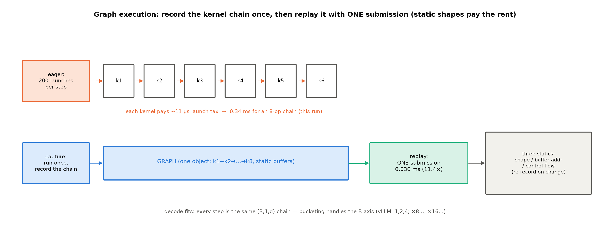

> 历史实验档案：保留旧稿以查阅命令、过程、原读数与失败记录。这里的章号、环境及理论措辞保持历史身份；当前理论请读新版正文，勘误见实践附录。不是v0.30复测。

# 第 12 章 图模式：减少重复提交的开销

上一章讨论量化如何减少权重的存储与搬运。本章继续沿单卡执行路径，考察小算子的发射开销，以及图的捕获与重放如何减少重复准备工作。核心内容与历史实测沿用原稿；实验硬件与版本标签保留当时口径，不代表当前设备状态。

原来与本章合写的并行拓扑，现独立为[第13章](ch13-并行拓扑.md)。Book4等历史章节指向“Book6第12章”的多卡切分内容，请沿此链接继续阅读。

## 12.1 从逐次提交到捕获与重放

本章依次观察发射开销的实测、CUDA Graph原理、NPU侧等价接口，以及计算与传输的重叠。图模式处理的是一条执行链如何提交；下一章再讨论模型怎样分布到多张卡上。

## 12.2 launch 开销的收口实测

第 1 章发现的 launch bound（25 ms/token 与 dtype、n0 几乎无关）在本章拿到三笔直接读数（`launch_probe.py::main`——`code/ch12/launch_probe.py`，Atlas 910B3，卡 1 空闲档；注：第三行的「8 算子链」是 8 条**语句**，profiler 实证每条语句拆成 2 个设备算子（Muls+Adds 各 8）——共 16 个 kernel，下文每算子账按 16 计）：

**实物 12.1**（发射与图执行读数；看什么——三行递进：单算子税、层内缩影、整链一次提交）

```text
裸发射（1 元素加法）：10.62 µs/kernel（前次实测 11.29——两次 10.6-11.3 µs 稳定）
RMSNorm 拆 4 小算子 0.186 ms vs 融合单算子 0.140 ms（拆分税 1.3×）
同一条 8 算子链：eager 逐发 0.342 ms vs NPUGraph 录一次 replay 0.030 ms（11.4×）
```

【证据等级：本机实测，`log/book6-ch12/launch_probe_base.json`】三行各讲一层：每发射一个 kernel 有约 11 微秒的固定成本（指令构造、下发、同步边界）——207M 一步 decode 的 kernel 数要分两种口径数：**融合理想化手数**约 210（每层 RMSNorm×2 计融合后 2、QKV 3、RoPE 2、注意力 3、$W_o$ 1、SwiGLU 4、残差 2——约 17/层×12+首尾 10）；而**教学实现的真身**（消费线 207M 的 RMSNorm 是手写分解版——float 上抛/pow/mean/rsqrt/乘回约 8 kernel 一枚）经 profiler 实测约 **600 个**——两数并排本身就是一课：**未融合的教学实现里，一枚 RMSNorm 就是 8 个 kernel**，融合与图执行要对付的正是这 600；每个 11 µs 的发射税，600 个就是约 6.4 毫秒的地板（发射与框架分发合计约 46 µs 是 host 侧税——发射税只是其中**可消除**的那部分，见下文三段分解）；层内例子更直观——同一段数学，拆成 4 个小算子逐个发射 0.186 ms、融合成一个算子 0.140 ms（拆分税 1.3×，融合是编译期的消除）。顺带把两笔税分干净：拆分档每条语句均摊 0.186/4≈46.5 µs（每设备算子约 23 µs——4 条语句拆 8 kernel），比裸发射的 10.6 µs 高一倍多——多出的部分是 **Python/torch 的每语句框架分发**（构造算子对象、查派发表、组织参数）；第 1 章反推的 125 µs/语句由此三段分解：裸发射约 11 µs + 框架分发约 12-35 µs（按算子/语句口径）+ 算子真实执行与同步（其余）；而第三行是本章主角——**同一条算子链，录一次、之后一次提交，0.342 ms 变 0.030 ms**。把 11.4× 摊到每个设备算子读一遍更清楚（profiler 实证链实为 16 kernel）：eager 链每算子 0.342/16≈21 µs，replay 链每算子 0.030/16≈1.9 µs——**图执行把每算子的 host 侧成本从「二十微秒级」压到「两微秒级」**，11.4× 不是魔法，是 46 µs 的分发税被一次性预付掉之后的除法。第 1 章那笔 96% 的未解释差额，原理层的第一笔偿还读数在此。消灭发射税的两条路就此分家：**融合**（fusion，编译期把多个算子合成一个）与**图执行**（运行期把整串 kernel 录制一次、之后一次提交）——后者正是 12.3 的正题。

## 12.3 CUDA Graph 原理：录一次、放一次

图执行是什么？NVIDIA 官方定义一句话（直引）："CUDA Graphs present another model for work submission in CUDA."——与流的逐 kernel 提交并列的**另一种工作提交模型**；它为什么快（直引）："first, CPU launch costs are reduced compared to streams, because much of the setup is done in advance"——大部分准备在实例化时一次付清【证据等级：官方文档，CUDA Programming Guide v13.4.2 ch.4.2，2026-10-10 取用；URL 有勘误——NVIDIA 已拆章，旧单页锚失效，正身 URL 见动手验证】。

机制朴素得像录音（图 12.1）：**capture**（捕获）阶段跑一遍 kernel 序列，整串操作被录成一个「计算图」对象——"work launched into the stream is not enqueued for execution. It is instead appended to an internal..."（捕获模式下发射的 kernel 不进执行队列、而是被记进图）【同上，直引】；**replay**（重放）阶段一次调用执行整串——两百次发射并成一次。约束也随之而来，三条静态换一条收益。三条约束各自有明确的机制根源，值得逐条看穿而不只是背清单。**形状静态**：kernel 发射时要拿到形状去选 tile 切法、算 grid 维度——形状就烧在发射参数里；录制时形状写死，变了就得重录（录制成本是毫秒级的前向一遍，decode 每秒几十步、每步 replay 同一张图，摊销一秒内回本）。**内存静态**：发射的指令里写的是缓冲区**地址**（立即数）——不是「某名字的张量」；replay 的新数据必须写进录制时那几块缓冲，引擎因此维护静态输入池、每步把新 batch 拷进固定位置再放图。**控制流静态**：图是发射序列本身，而序列里没有「如果」——分支意味着「这次发射还是不发射」，录制时必须二选一；动态控制流只能留在图外，由外层的普通代码判断后选择放哪张图。三条合起来读：**图执行用「世界不再变化」换「决定不再重做」**——decode 恰好住在一个形状、地址、控制流都日复一日不变的世界里，这正是它是图执行最佳客户的原因。decode 恰好天生长着静态形状——每步都是 $(B,1,d)$ 的同款小 kernel 链，只有 B 轴会变；解法是**凑桶**（bucketing）：把 B 归到固定档位、每桶录一张图——常见引擎取小档 1/2/4、再按 8/16 的步进设大档（vLLM 的默认桶表正是「1、2、4；8 的倍数；16 的倍数」，读数入 12.4 的实证锚）。录制的成本要付一次摊销账：录一张图≈跑一遍前向（毫秒级）——decode 每秒 30-40 步、每步都 replay 同一张图，**毫秒级的录制成本在第一秒就摊清**，这就是「形状档位有限才划算」的算术面。prefill 的变长输入则交给 **piecewise**（分段图）：静态的段录图、动态的段（变长 attention）留在图外——「能录的录、不能录的分段」，dispatch 按 FULL > PIECEWISE > 无图 的顺序找桶，找不到回 eager。



图 12.1 图执行机制（自绘示意级）：eager 逐算子发射（每 kernel ~11 µs 税）对 capture/replay 一次提交；读数锚为本机 NPUGraph 实测（8 算子链 11.4×）；右侧三静态约束与 decode 的桶表。

实操口径（写作要求 12 的显式标注）：**CUDA Graph 的 capture/replay 在本机无 CUDA 环境不可直接复现**——但图执行不是 CUDA 专属概念，NPU 侧的等价物下一节就用本机读数兑现（实物 12.1 第三行就是它）。

## 12.4 NPU 等价物：ACLGraph 实证锚

昇腾侧的图执行叫 **ACLGraph**（`torch.npu` 的 NPUGraph capture/replay 接口——实物 12.1 的第三行读数正出自它：`launch_probe.py` 里录制的 8 算子链，eager 0.342 ms 对 replay 0.030 ms）。**接口同构性**一手可验：`torch.npu.NPUGraph` 与 `torch.cuda.CUDAGraph` 是同一套 capture/replay 语义在两家的镜像（capture 上下文管理器、graph_pool、replay 方法）【证据等级：本机源码一手（torch_npu 2.10.0）】。引擎侧三事实以**实现对照框**口径给出（版本框注：运行栈 0.27.1rc1/阅读锚 v0.30.0；允许清单：默认值读数+开关对拍+一句事实句；机制展开是 Book7 第 8 章的地界）：**其一**，vllm-ascend 运行栈的图模式默认 **FULL_AND_PIECEWISE**——默认值由上游 vllm 继承（vllm-ascend 不自设默认、只做平台归一化；正身=官方设计文档 graph_mode.md L35/L132-139+上游 cuda_graphs.md L48，sources/01 三级锚），；**其二**，`VLLM_USE_BREAKABLE_CUDAGRAPH` 为 NPU 侧 opt-in 开关（导入即打印「Breakable CUDAGraph on Ascend is opt-in; using VLLM_USE_BREAKABLE_CUDAGRAPH=0.」——版本守卫日志，读者在环境里自己能看见；源码正身见实物 12.2）；**其三**，torch.compile 在昇腾后端被禁（inductor 不可用）——编译优化的等价物是 npugraph_ex 的 FX 层（一句事实句，机制地界 Book7）；NPU 还有一笔 CUDA 主线没有的细节：ACLGraph 对变长的处理用「attention 参数更新」机制（名词级点名，机制细节是 Book7 第 8 章的地界）——等价性核对时值得单独记的一格。三行实证锚立在原理与实现之间——「NPU 也有图执行、且默认开启」，12.2 的发射税答案在引擎里已经装好。源码位三级锚（sources/01 一手核验）摘录如下：

**实物 12.2**（vllm-ascend 图模式开关——源码行原样摘录；看什么——opt-in 的默认值与守卫断言的原文身份）

```python
# repos/vllm-ascend/vllm_ascend/platform.py#L67-72（opt-in 开关与导入期日志）
# Keep Breakable CUDAGraph opt-in on Ascend. Upstream may auto-enable it
# for selected architectures when the environment variable is absent.
value = os.environ.setdefault("VLLM_USE_BREAKABLE_CUDAGRAPH", "0")
logger.info_once(
    "Breakable CUDAGraph on Ascend is opt-in; using VLLM_USE_BREAKABLE_CUDAGRAPH=%s.",
    value,

# platform.py#L1209-1212（piecewise 模式的守卫断言——未开 opt-in 且非编译模式即拒绝）
    elif compilation_config.cudagraph_mode.requires_piecewise_compilation():
        # Our is_cuda_alike is False so we cannot reuse the assertion of upstream
        if compilation_config.mode != CompilationMode.VLLM_COMPILE and not envs_vllm.VLLM_USE_BREAKABLE_CUDAGRAPH:
            raise AssertionError(
```

【证据等级：本机源码一手（repos/vllm-ascend 0.27.1rc1 工作树，2026-10-10 摘录）；cudagraph_mode 默认档 FULL_AND_PIECEWISE 的正身=官方设计文档 graph_mode.md L35/L132-139 与上游 cuda_graphs.md L48（sources/01 三级锚）；机制展开 → Book7 第 8 章】

## 12.5 重叠执行：三流并行一句带过

图执行压缩「发射的串行」，**重叠**（overlap）压缩「等待的串行」。换一个镜头看同一支执行链：任一时刻，三条流各自在忙什么——CPU 在为第 $t{+}1$ 步构造指令（发射、采样准备、调度决策），NPU 在算第 $t$ 步，传输通道可能在搬第 $t{-}1$ 步的结果（输出 token 上主机、下一批输入下设备）。理想的引擎让三条流像流水线一样错峰推进、互不等待；现实的差距叫**重叠缺口**：CPU 侧每步几十毫秒的 Python 调度若慢于 NPU 侧的计算，NPU 就会算完一步后空转等指令——第 1 章 25 ms 的大头正是这种「单流视角」的串行（发射、决策、搬运排队走一条队）。工程形态首推 **dual-batch overlap**：把服务的 batch 一分为二，当一半在算前向时，另一半正好走 CPU 调度与准备——两半交替，三条流都被填满（ubatching 是它在 decode 段的同族变体）。这些微批重叠技术**本机不可实测**（标注：源码阅读+原理推演口径）；一句心智带走：**引擎的每一毫秒都在三个流上同时记账——单流视角的账本永远高估成本**。

## 12.6 本章小结

图执行通过预先记录执行链，减少重复构造与提交工作的成本。上一章减少数据量，本章减少提交开销；二者都没有改变模型计算的数学目标。捕获约束、输入缓冲和形状分桶决定哪些工作适合重放，融合与重叠则从另外的方向减少成本。

**需要带走的心智是：先区分设备真正计算的时间与主机组织、提交工作的时间，再判断图执行能消除哪一部分。** 历史微基准的加速比只属于其测试链，不应直接当成完整模型的提速倍数。

下一章把视野扩展到多卡：当权重、激活或KV分散到不同设备，通信和依赖会如何改变一次前向的代价？

> **【欠账】** capture/replay的源码、分段图与NPU实现对照 → Book7第8章。

## 动手验证

沿用原配套代码与历史读数。先运行`npu-smi info`选择空闲卡，在工作区执行：

```bash
export ASCEND_RT_VISIBLE_DEVICES=0  # 替换为当前空闲卡
source ./env.sh
python code/ch12/launch_probe.py
```

书仓代码位于[launch_probe.py](../../code/ch12/launch_probe.py)。历史实测包括裸发射、拆分与融合、NPUGraph捕获/重放；新运行结果应另存并注明当前设备，不能覆盖历史事实。原图脚本[fig_ch12.py](../../code/ch12/fig_ch12.py)继续保留，其中旧并行图不再作为新第13章的论证依据。
