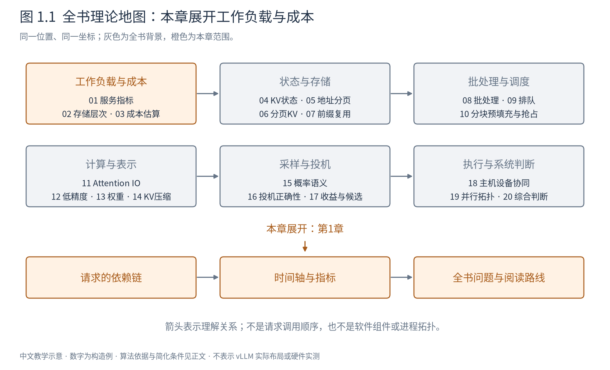
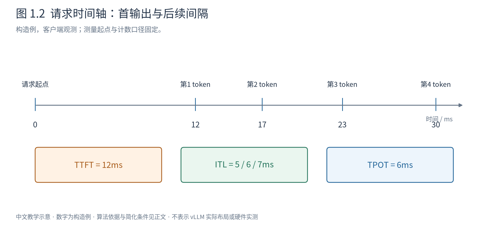

# 第 1 章 从模型前向到推理服务

前五册已经让我们认识了模型：token经过嵌入、注意力和前馈层，最后得到下一token的分数。但如果现在有两位用户同时提交问题，一位输入很长、只要短答案，另一位输入很短、要生成很多内容，仅知道模型前向还不能决定机器下一步该做什么。

我们需要知道已有状态占多少空间，哪段计算更容易拖慢其他人，能否把多个请求放在一起，怎样衡量“更快”，以及一次优化是否改变了生成结果。Book6研究这些问题背后的理论。Book7再把理论放进vLLM架构，Book8再阅读具体对象和执行路径。本书不以任何引擎的类名作为理解前提。

图1.1把全书放在六个固定区域：工作负载、状态、调度、计算表示、生成和执行。后面每章保持这些坐标，只展开当前位置。箭头表示理解关系，不是源码调用。本章先建立时间轴，后面所有FLOPs、缓存和调度收益都要回到这条时间轴上解释。

## 1.1 一次前向与一次生成不是同一个工作量

设请求A的提示词已转为六个token `[a,b,c,d,e,f]`。它们在调用模型前就全部已知，因此可以一起经过因果Transformer：每个位置只看自己和之前的位置，但多个位置的矩阵运算可以组织在同一次前向中。处理这段已知输入通常称为预填充（prefill）。最后位置的输出分数用于选择第一个新token x。

现在x才刚刚确定。若想得到再下一个token y，需要把x作为新输入继续计算；y确定后才知道下一次的输入。这种逐步生成阶段称为解码（decode）。这里的“解码”是生成阶段名称，不仅指把token ID转换成字符串。

因果依赖限制的是未知输出之间的先后，不禁止已知提示词位置并行。六个提示token并不要求像六个新token那样等待六轮采样。反过来，prefill结束采出x，也不意味着x自己的KV已经算出：x需在后续前向中成为输入。第4章会沿这个差别建立缓存进度。

假设A要输出四个token。在忽略额外特殊处理的标准路径中，prefill产生第一份输出分布，随后三次decode产生其余三份输出分布。若第一个token已经触发结束，可能根本没有后续decode。故“输出m个token”等于“做m次完整decode前向”的说法通常错一轮，还忽略了prefill。

## 1.2 用户等待的时间分成哪些部分

请求在0ms到达，不代表设备立即执行它。它可能先等待接入与输入处理，再等待调度与资源。即使设备计算结束，token还可能需要转换和传输才被用户看到。

图1.2的构造请求在12、17、23、30ms收到四个输出token。这里明确采用**客户端收到token的时刻**，并把0ms设为发送请求的测量起点；若测量起点改为服务端登记，数字就不能直接比较。

首token延迟（time to first token，TTFT）是首个输出时刻减起点，本例12ms。相邻token延迟（inter-token latency，ITL）依次为5、6、7ms。平均每输出token时间（time per output token，TPOT）在本书定义为首token之后的平均间隔：

$$
\mathrm{TPOT}=\frac{t_m-t_1}{m-1},\qquad m>1. \tag{1.1}
$$

本例是 $(30-12)/3=6$ ms，而非30/4。后者把等待和prefill也摊入了输出token；它可以作为另一种端到端平均量，但不能换个名字就与TPOT混比。只输出一个token时，式1.1无定义，应单列或记为不适用，而不是赋零再混进均值。

端到端延迟为 $t_m-t_0$，本例30ms。若每个传输块包含多个token，客户端仅观察到块到达，不能无条件还原块内每个token的真实ITL。必须说明测的是token还是流式块，以及是否含网络时间。

## 1.3 快的请求与高的吞吐会冲突吗

吞吐率是单位时间完成的工作。输入token/s、输出token/s、请求/s分别数不同东西；输入长短和输出长短变化时，它们可能同时朝不同方向变化。

例如10秒完成100个请求，共生成2000个token，请求吞吐10请求/s，输出吞吐200token/s。若另一个配置完成120个请求、每条只输出5个token，则请求吞吐12请求/s，输出吞吐60token/s。没有工作负载口径，就无法断言第二个系统更快或更慢。

批量计算常使设备更高效，却可能让单请求等待凑批，或者让一次计算持续更久。设备每秒完成更多token，并不保证A更早看到下一个token。第8章将从权重复用解释批量收益，第9章解释为什么等待会随资源压力放大。

服务目标（service-level objective，SLO）把“快”写成可检验约束。例如要求95%的请求TTFT不超过某个阈值，同时95%的后续间隔满足另一阈值。这是示例目标，不是行业统一常数。给定目标后，可以进一步数满足要求的请求或token，避免只靠接受无限队列来提高名义负载。

平均值也不能代表尾部。若九个请求10ms、一个请求100ms，平均19ms，最慢用户却等了100ms。分位数定义和计算方法会在第20章展开；现在先记住：评价交互服务时，需要看分布，不只是一个平均数。

## 1.4 用A、B、C贯穿全书

我们采用少量请求身份，避免每章重新发明复杂场景。A通常有六个输入位置，B有三个；C可以晚到，也可以与A共享前缀。输出长度按具体问题注明，不把所有教学分支拼成一段实际运行。

|身份|基础输入|用于观察什么|
|---|---|---|
|A|`[a,b,c,d,e,f]`|较长输入、状态增长、持续生成|
|B|`[u,v,w]`|不同长度、较早结束、让出批位置|
|C|专题中明确指定|途中到达、共享前缀或分歧续写|

分页专题使用很小的固定块，采样专题使用小词表，成本专题使用小矩阵。这些参数有意小到可以手算，不代表真实模型规模；发生改变时会明确重置。共同主线是请求、计算和状态之间的因果关系，而不是让所有算法硬套同一组数字。

在任何时刻，系统面对的工作至少有三种状态：尚未开始或暂缓的请求；已获得资源、能够参与下一轮的请求；已结束、需要回收资源的请求。结束、取消与错误可能走不同交付路径，但都不能留下无人管理的状态。后续章节将分别解释排队、容量与安全回收。

## 1.5 为何不能直接说prefill算力受限、decode带宽受限

这句话描述了常见趋势，却不是阶段名称的定义。长提示词把许多已知位置放进矩阵运算，权重更容易复用；小批decode每次只有少量新位置，却仍需访问大量权重和历史KV，搬运往往更突出。[Efficiently Scaling Transformer Inference，§2](https://arxiv.org/abs/2211.05102)

但短prefill也可能没有足够工作填满设备，大批decode可能充分利用算力，超长上下文又可能让Attention和KV流量成为主要成本。CPU提交、跨卡通信和资源等待还可能掩盖这两种设备侧瓶颈。

因此本书先问：算了多少、搬了多少、哪些工作能够并行、哪些工作必须等待，再判断限制来自哪里。第2章建立存储层次，第3章从形状算成本。只有先说明负载和边界，优化结论才有意义。

## 1.6 本书要建立的判断方式

读完本书，面对一个技术方案，读者应能说明它改变了哪一项：减少重复计算、减少存储容量或数据流量、改变批组成与等待、提高执行效率，还是改变生成分布。还应能指出它没有解决什么，以及新增成本在哪里。

学习路线从时间轴出发，经计算与状态，走到调度、IO算法、低精度和投机，再由主机设备协同与多卡拓扑收束。理论不是源码前面的一串术语，而是阅读实现时用于判断边界和因果的工具。

本章的所有时间与请求数字均为构造例。下一章先回答最基础的问题：当我们说模型“读一次权重”时，权重究竟从哪里读到哪里？

|符号|含义与单位|
|---|---|
|$t_0,t_i$|请求起点、第i个输出观察时刻，ms或s|
|$m$|实际输出token数，整数|
|TTFT、ITL、TPOT|三类不同时间指标，必须注明测量端点|
