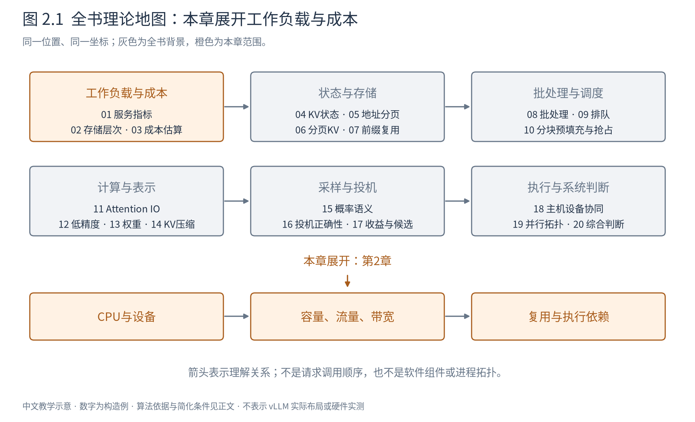
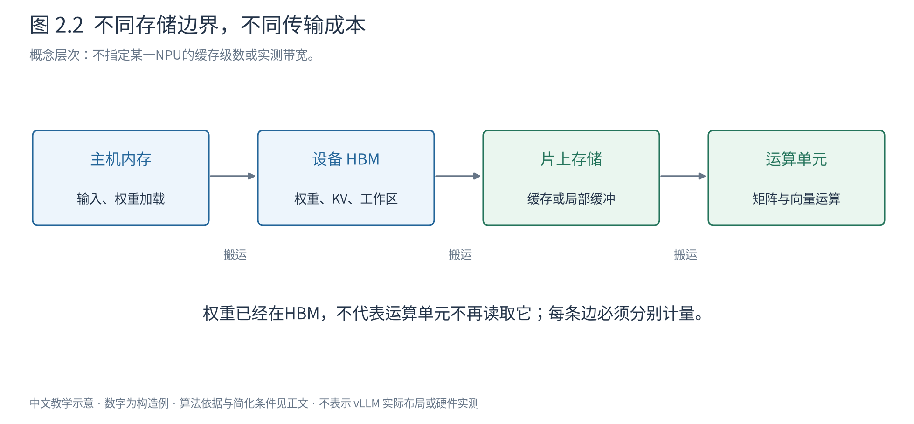

# 第 2 章 计算发生在哪里，数据怎样到达那里

上一章把一次生成放到了时间轴上，但“模型计算用了多久”仍像一个整体。现在把机器打开：运算单元需要的数据不全在手边，CPU发出任务也不意味着设备已经完成。很多推理优化并没有减少模型的数学运算，而是减少等待数据、重复搬运和反复提交。

图2.1展开存储与执行的基础。本章只建立硬件无关的层次模型；实际设备的缓存、显式缓冲和搬运机制并不完全相同。全书的新硬件讨论以昇腾NPU为运行背景，引用其他架构资料时只采用明确适用的原理。

## 2.1 CPU与加速器分别擅长什么

服务首先要解析输入、管理队列、决定计算哪些请求、组织结果。这些控制流多、对象多、规模不规则的工作通常由CPU承担。大矩阵乘及大量同类数值运算则交给加速器。它们合作完成一次请求，而不是CPU把模型“打开”以后就再也不参与。

CPU侧程序把设备操作提交到执行队列。队列是一组尚未完成的工作记录，不等于CPU逐条等待设备执行完再发下一条；可以先提交后继续做别的事。只有要读取尚未完成的结果或复用仍在使用的资源时，才必须建立相应完成依赖。第18章会专门画出这条时间线。

在这里先区分两个事件：**提交完成**表示工作已交给执行系统；**计算完成**表示结果真的可使用。用只测CPU函数返回的计时去估计设备运行时间，可能只测到了前一个事件。

## 2.2 “内存”不是一块统一速度的空间

图2.2从左到右画主机内存、设备HBM、片上存储与运算单元。箭头表示需要传输的数据，不表示它们使用同一种总线或拥有同样带宽。真实设备可能有更多缓存层；图只保留后面推导需要的边界。

主机内存通常容量较大，用于CPU数据、权重加载和系统对象。设备HBM保存当前模型权重、KV和较大的中间张量。片上寄存器、缓存或显式管理的局部缓冲更接近运算单元，容量有限，但可提供更高效的数据访问。

“权重已经在显存里”只免去了每轮从主机重新加载整套权重，并不代表运算单元不需要从HBM把权重搬进片上。模型大于片上容量时，后续轮次仍可能再次读取这些数据。这是小批decode需要关注权重流量的原因。

也不能把HBM到片上的流量与主机到设备的流量加在一起，再除以任意一个“带宽”。每条边有自己的容量、吞吐和竞争；某段计算可能受其中一条边约束，另一条边已经空闲。

## 2.3 容量、流量、带宽和延迟分别回答什么

容量回答“能存多少”，单位字节；流量回答“这段工作总共搬了多少”，也是字节，但与时间范围有关。带宽回答“每秒能搬多少”，单位字节/秒；延迟回答“开始一次操作到看到它完成要等多久”，单位秒。

假设一个张量大小1MB，读十次且没有缓存复用，容量需求仍可为1MB，读取流量却是10MB。反过来，一个很大的缓存池即使当前不被访问，占用很多容量也可能几乎不产生本轮读取流量。降低容量与降低带宽需求是两种优化。

一个粗略传输模型是：

$$
T_{\mathrm{move}}\approx\ell+\frac{D}{W}. \tag{2.1}
$$

D为本次字节数，W为该路径的有效带宽，$\ell$ 为固定启动与延迟项。取纯构造参数：$\ell=5\,\mu s$，$W=100$ GB/s，并统一使用十进制单位。搬1KB的理想数据项为0.01微秒，总约5.01微秒；搬1MB的数据项为10微秒，总约15微秒。小传输主要受固定项影响，大传输才更接近带宽决定的时间。

把1000次独立1KB传输合成一次1MB传输，数学载荷相同，但若每次都付5微秒启动成本，总时间会很不同。是否能够合并还取决于数据连续性、依赖与接口，这就是“小操作太多”会拖慢系统的一个原因。上述数字只解释模型，不是任何NPU的实测带宽。

## 2.4 局部性就是让搬来的数据多做一点工作

时间局部性指刚用过的数据很快还会再用；空间局部性指一次访问附近的数据也将被使用。缓存和分块算法都试图利用它们，但具体可否命中取决于容量、访问顺序与其他任务的干扰。

设权重矩阵 $W\in\mathbb R^{4\times4}$，元素2字节，共32字节。单个输入行 $x\in\mathbb R^{1\times4}$ 与它相乘，输出 $y\in\mathbb R^{1\times4}$。若两个输入分别计算、两次权重读取均来自HBM，权重流量64字节。若把它们堆成 $X\in\mathbb R^{2\times4}$，一次矩阵乘得到 $(2,4)$ 输出，同一权重块在片上可服务两行，理想权重读取仍为32字节。

这里并没有少算两个输入所需的乘加，只减少了重复搬权重的机会。第8章会把这个原理扩展到批处理。与此同时，多行输入也需要更多激活和输出空间，太大的块放不进片上又会产生额外读写。因此“尽量复用”必须服从容量约束。

矩阵分块（tiling）把大运算拆成能放入局部存储的小块。对 $X_{m\times k}W_{k\times n}$，一次取X的一小段行和W的一小段列，累加到输出块；块内复用越充分，HBM流量越少。它与第6章用于容量分配的KV物理块是不同概念，一个计算tile可跨多个物理块，一个物理块也可能被多个tile读取。

## 2.5 复用也可能改变应当保留的中间产物

连续两步为 $U=XW$、$Y=f(U)$。若分别执行并把U完整写回HBM，再读出来应用f，就多了一次U的写和读。若融合到同一执行路径，U可能短暂留在片上，直接得到Y；数学上仍执行同一运算，但少了中间流量。

融合不是无限延伸的优势。保留太多中间状态会增加局部存储压力，减少同时可运行的工作，甚至使数据溢出回较慢存储。某些运算需要全局归约或不同数据布局，也不适合简单拼成一个大算子。第11章的Attention正是在“保留什么、重算什么、怎样分块”之间作系统选择。

缓存则跨越更长时间保存可复用结果。KV缓存避免重新计算历史位置，前缀缓存进一步跨请求复用。它们用容量换计算；若未来没有重用，保存这些状态只会占用可用于其他请求的空间。不能把“有缓存”自动等同“更快”。

## 2.6 哪些时间能重叠，哪些不能

若一段计算必须等数据搬入，就不能让它在对应数据到达前完成。可以提前搬下一块，同时计算当前块；这需要双缓冲或其他资源安排，还要求搬运与计算有足够独立的执行能力。

例如三块数据各搬2ms、算3ms。完全串行为15ms；理想流水下第一块先搬2ms，再连续计算三块共9ms，后续搬运隐藏在计算后面，总11ms。这个11ms依赖下一块能及时搬好、缓冲不冲突、带宽不被别的任务抢占等条件；它不是把全部搬运时间直接删掉。

层与层的输出依赖、同一请求token之间的采样依赖仍然存在。并行优化通常是在这些依赖之间寻找独立工作，而不是宣称“全部异步以后没有等待”。第3章会用关键路径把这一点写成成本估计，第18章再细化执行机制。

本章建立了后续所有性能论证的第一条纪律：**每个字节数都要问它是占用还是流量，每个流量都要问它经过哪条边，每个时间都要问它是否在关键路径上。** 下一章将这些问题与模型的矩阵形状连接起来。

|符号|含义与单位或形状|
|---|---|
|$D,W,\ell$|传输量byte、有效带宽byte/s、固定延迟s|
|$X,W_{\mathrm{matrix}},Y$|矩阵乘输入$(m,k)$、权重$(k,n)$、输出$(m,n)$；带宽W与权重按上下文区分|

存储边界与复用的理论依据见[Roofline原作者报告](https://www2.eecs.berkeley.edu/Pubs/TechRpts/2008/EECS-2008-134.pdf)和[Pope等推理成本分析](https://arxiv.org/abs/2211.05102)。本章所有硬件速率均为构造参数。
