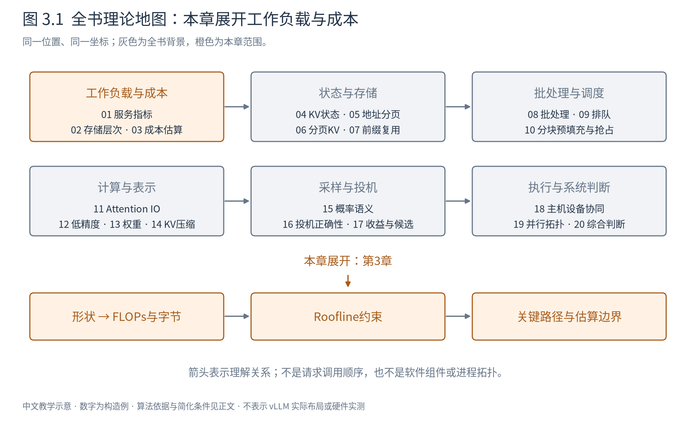
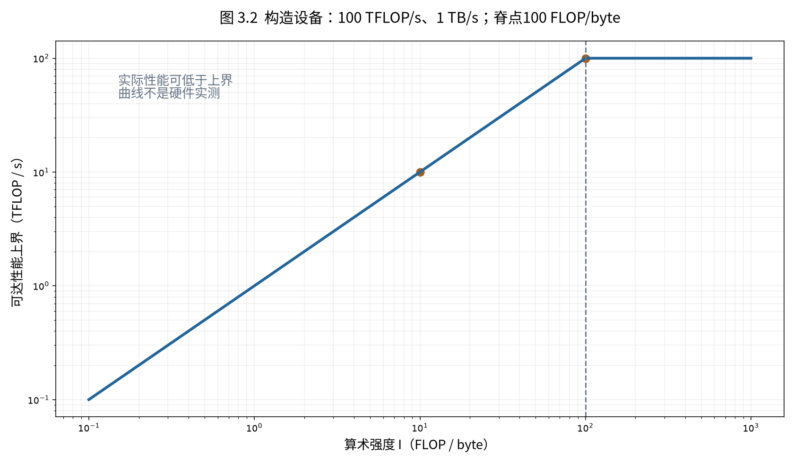

# 第 3 章 怎样估算一次推理的成本

同一份模型可以在短提示、大批量或超长上下文下表现完全不同。上一章解释了数据在哪些层次移动，本章把问题进一步量化：一次前向究竟包含多少运算，至少要经过多少字节，哪一项可能限制速度？

图3.1展开从形状到成本的推导。这里建立的是可复算的估计模型，不是给任意设备预测精确毫秒数。每一步先说统计边界，再给公式；不把“参数量乘某个常数”当作所有模型的统一答案。

## 3.1 从一个输出元素数起

矩阵乘 $Y=XW$ 的形状是 $(m,k)(k,n)\to(m,n)$。输出中的一个元素为 $Y_{ij}=\sum_{r=1}^kX_{ir}W_{rj}$，需要k次乘法和k−1次加法。本书按常用性能口径，把一次乘加计为2次浮点运算，因此近似为：

$$
F_{\mathrm{matmul}}\approx2mkn\quad\text{FLOPs}. \tag{3.1}
$$

FLOPs表示运算总量，FLOP/s表示每秒速率，二者不能混用。若只数乘加对（MAC），数值会少一半；比较前必须先统一口径。

对 $m=1,k=n=4$，共有16次乘法，按乘加口径计32FLOPs；m=8时为256FLOPs。批量扩大8倍，没有减少每个输入所需的运算，却可能复用权重。若元素均为2字节，理想情况下各张量只读写一次，则HBM流量估计为：

$$
D=2(mk+kn+mn)\quad\text{byte}. \tag{3.2}
$$

m=1时为48字节，m=8时为160字节。运算扩大8倍，流量只扩大约3.33倍。这是同一模型不同batch会呈现不同性能画像的最小例子。真实实现若重读权重、缓存输入或产生额外中间量，D应随之调整。

## 3.2 把线性层与Attention分别列出来

设隐藏宽度d，query头数 $h_q$，KV头数 $h_{kv}$，每头维度 $d_h$，且 $d=h_qd_h$。对本轮n个输入位置，投影形状如下：

|运算|输入→权重→输出|乘加口径FLOPs|
|---|---|---:|
|Q投影|$(n,d)(d,h_qd_h)\to(n,h_qd_h)$|$2ndh_qd_h$|
|K或V投影|$(n,d)(d,h_{kv}d_h)\to(n,h_{kv}d_h)$|各$2ndh_{kv}d_h$|
|输出投影|$(n,h_qd_h)(h_qd_h,d)\to(n,d)$|$2nh_qd_hd$|
|SwiGLU的两路升维|$(n,d)(d,f)\to(n,f)$|各$2ndf$|
|SwiGLU降维|$(n,f)(f,d)\to(n,d)$|$2nfd$|

SwiGLU还包括激活和逐元素乘法，不能说它们不存在，只是在大矩阵主导的近似中暂列为次项。普通两层FFN则只有两次矩阵乘，不能套三路的系数。GQA减少K/V投影和状态头数，query与输出投影不因此同比缩小。

Attention不在这些参数矩阵里。单层一次decode中，每个query头把 $(1,d_h)$ 的q与历史 $K^T\in\mathbb R^{d_h\times S}$ 相乘，得到 $(1,S)$ 分数；权重再乘 $V\in\mathbb R^{S\times d_h}$ 得到 $(1,d_h)$ 输出。两次矩阵运算合计约 $4h_qSd_h=4Sd$ FLOPs。B条等长序列则再乘B。

prefill若有S个位置，按完整方阵计算约 $4S^2d$ FLOPs；理想地只计算因果允许的三角配对，则为 $2dS(S+1)$。二者对应不同执行统计，不能用三角有效量估计后又拿方阵算子实测宣称低利用率。softmax的指数、归约、除法也需另考虑。

## 3.3 什么时候可以说每token约2N

如果N表示每个token实际经过的稠密线性层权重总数，那么每个权重参与一次乘加，线性部分每token约2N FLOPs。这个近似略去Attention随上下文增长的项、归一化、激活和部分输出处理，也可能不恰当地把嵌入表全部参数算成每token读取。

对历史等长、每条请求本轮只处理一个位置的普通decode，更透明的表达是：

$$
F_{\mathrm{step}}\approx2BN_{\mathrm{active}}+4BL Sd+F_{\mathrm{other}}. \tag{3.3}
$$

L为层数，S为此例中相同的历史长度，第一项仅含约定的活跃线性权重。若长度不同，Attention项应改为 $4Ld\sum_rS_r$。输出词表投影若未计入N，应单独加入；它可能很大。

MoE不能直接把全部专家参数都作为单token活跃参数，但也不能只看单token激活参数就推断整批权重流量：不同token可能路由到不同专家。MLA还改变投影与注意力执行方式，需按实际计算形式重列。混合模型则逐层相加，全局Attention、滑窗和递归层的S依赖并不相同。[Pope等，推理成本与分区分析](https://arxiv.org/abs/2211.05102)

## 3.4 容量表与流量表要分别写

权重容量在简化同精度模型中为 $N e_w$ 字节。全局KV缓存容量为：

$$
M_{KV}=2Lh_{kv}d_h e_{kv}\sum_{r=1}^{B}S_r. \tag{3.4}
$$

2代表K和V，$e_{kv}$ 为每元素字节数。这里没有计入页尾余量、量化尺度、共享、临时状态或并行复制。第4、6、14、19章会分别补这些修正。

一次decode的KV读取量，在每层所需K/V各从HBM读取一次的理想模型下，约与当前有效KV容量同量级；新KV写入量则只有本轮新增位置。GQA若能复用共享KV读取，带宽收益更充分；若实现为各query头重复读取，就要另计实际流量。权重也不一定恰好只读一次：执行分块、缓存命中、专家路由都会改变它。

激活容量是某一时刻仍需保留的中间张量总量，而激活流量包括它们多次读写的字节。推理无需像训练一样为反向传播保留所有层激活，但临时工作区、Attention统计量、图执行缓冲仍然存在。把“权重+KV”恰好塞满设备，通常没有给执行留够空间。

## 3.5 Roofline把两种约束放到同一张图

定义算术强度 $I=F/D$，单位FLOP/byte；本章D专指HBM与片上之间的流量。若可持续计算速率上界为C、对应带宽为W，那么完成F次运算至少需要F/C，搬D字节至少需要D/W。即使能充分重叠，也不能快于较大的一个：

$$
T\ge\max(F/C,D/W),\qquad P=F/T\le\min(C,WI). \tag{3.5}
$$

右边是一条先倾斜后水平的上界，因形似屋顶称为Roofline。斜线表示数据供应限制，横线表示算力限制；交点 $I_*=C/W$ 称为脊点。[Williams等原始报告，§3](https://www2.eecs.berkeley.edu/Pubs/TechRpts/2008/EECS-2008-134.pdf)

图3.2使用虚构设备C=100TFLOP/s、W=1TB/s，脊点为100FLOP/byte。I=10时带宽上界只有10TFLOP/s；即使峰值算力翻倍，这个上界也不变。把同一份数据用于更多运算、提高复用使I增大，才可能把点向右推。

以F=1TFLOP、D=20GB为例，算力下界10ms，搬运下界20ms，理想重叠下至少20ms。若二者完全串行，则可能接近30ms再加其他成本。不能既使用max假设充分重叠，又在结论里把通信或提交时间视为完全免费。

实际点可以远低于屋顶：矩阵太小、数据不对齐、并行不足、同步、算子启动或低效访存都会形成更低的限制。原论文区分缓存后的实际内存流量，正是为了避免把源码中“读了几次变量”直接当成DRAM流量。本书也要求每次注明统计边界。

## 3.6 局部变快，为什么整机只改善一点

假设原端到端时间10ms，其中Attention占3ms，其他工作7ms。将Attention加速3倍后，Attention为1ms，总时间8ms，整机只加速1.25倍，而不是3倍。

设原时间占比f的部分加速s倍，则：

$$
S_{\mathrm{total}}=\frac{1}{(1-f)+f/s}. \tag{3.6}
$$

这是Amdahl型分解：先把原时间归一为1，再分别写未改部分和加速部分。前提是其余工作量、相互作用和重叠关系不变；优化若改变批量或瓶颈，应重新建模，不能死套旧占比。

若任务是依赖图，整体时间由最长依赖路径决定。CPU准备、数据搬运、设备计算可能部分重叠，简单相加会重复计算；但删除所有“异步”部分又会漏掉必须等待的依赖。把测量事件画成时间线，往往比先追求精确公式更有效。

MFU（模型FLOPs利用率）可定义为“约定的模型有效FLOPs/实际时间/对应精度设备峰值”。它不是设备忙碌比例，也不是所有算术指令利用率；若分子遗漏Attention或分母采用不同精度峰值，比较会失真。低MFU在带宽受限的小批decode中未必意味着实现糟糕。

## 3.7 用估算排除错误方向，再用测量细化

可靠的成本估算至少列四项：模型结构和形状、字节精度、工作负载、设备边界。先根据容量判断能否容纳，再根据流量和运算判断可能瓶颈，最后纳入CPU、通信、同步与队列等待。估算与实测差很多时，先查遗漏的流量和依赖，而不是立刻认定硬件异常。

本章故意使用构造速率，避免用未核验的峰值给当前NPU制造毫秒承诺。后续每项优化都可以放回三张表：有效运算、实际流量、关键路径。下一章聚焦其中增长最快的一类状态：KV为什么存在，哪些历史真正必须保留。

|符号|含义与单位或形状|
|---|---|
|$m,k,n$|矩阵乘行、归约、列维度；输出$(m,n)$|
|$B,S,L,d,h_q,h_{kv},d_h$|批量、序列长、层数、隐藏维、query/KV头数、头维|
|$F,D,I$|FLOPs、byte、FLOP/byte|
|$C,W,T$|FLOP/s、byte/s、s|
|$e_w,e_{kv}$|权重与KV每元素字节数|
