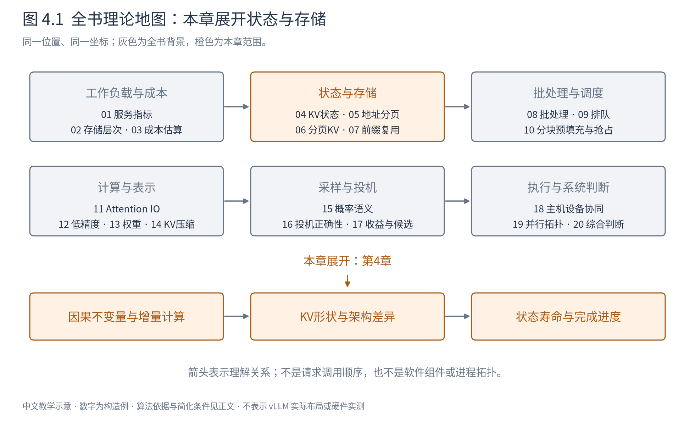
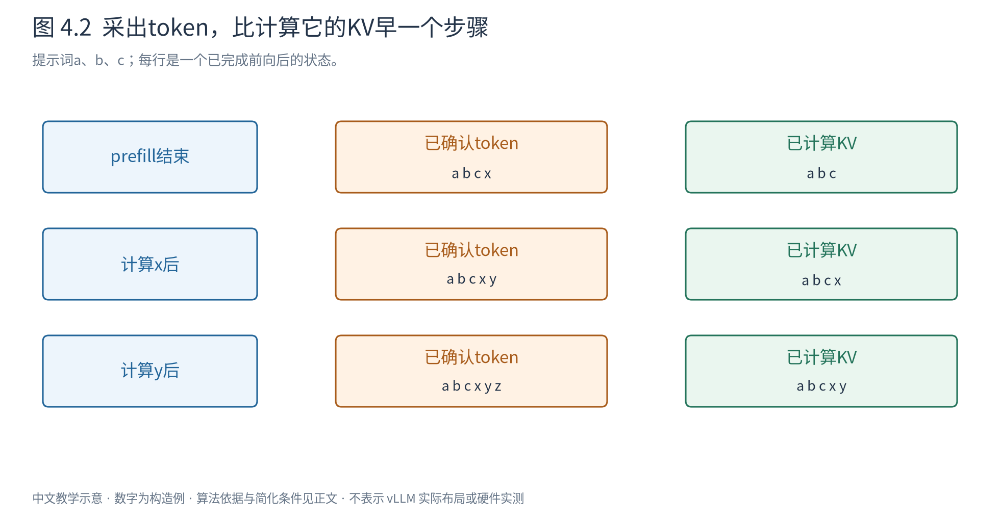

# 第 4 章 KV cache：用状态避免重复计算

第3章把KV列成了容量和流量项。但为什么偏偏保存K与V，而不是保存全部中间结果？这些状态随着请求怎样变化？要回答这些问题，需要重新观察因果模型中哪些计算会变，哪些不会变。

图4.1把本章放在“状态是什么”的位置。先理解状态的数学含义，下一章才讨论怎样分配空间。缓存不是凭空增加一种模型能力，而是在满足条件时保存已经算过、未来仍有用的结果。

## 4.1 不缓存时，我们重复做了什么

提示词为 `[a,b,c]`。模型前向处理三个位置，最后一位置输出下一token的分布，采出x。若不保存任何层的状态，为预测y，就可以重新把 `[a,b,c,x]` 全部送入模型。

在固定权重、确定的位置编号、相同因果mask和推理计算规则下，a、b、c不能看见未来的x，因此它们在各层的隐藏表示不应因为追加x而改变。重新算一遍这些位置，是在重复取得同样的历史结果。若只需计算新位置x，可以复用历史每一层产生的K/V。

为什么必须每层都保存？第2层的键和值由第2层输入表示产生，并不等于第1层KV的简单复制；新位置走到哪一层，就需要该层历史位置的键和值。只保存最后一层不足以跳过前面各层的历史计算。

这里的“不改变”指数学上的因果关系。训练模式的随机失活、改变的位置映射、不同mask、修改模型参数或某些依赖全序列统计的算子，会破坏复用前提。浮点执行路径变化也可能产生舍入差异，不能将数学等价夸大为逐位一致。

## 4.2 增量Attention具体保存和读取什么

对一层、一个请求，设有 $h_q$ 个query头、$h_{kv}$ 个KV头、每头维 $d_h$，此前S个位置已经计算。历史缓存的教学形状为：

$$
K_{\mathrm{old}},V_{\mathrm{old}}\in\mathbb R^{h_{kv}\times S\times d_h}. \tag{4.1}
$$

新输入位置产生 $q\in\mathbb R^{h_q\times1\times d_h}$，以及 $k,v\in\mathbb R^{h_{kv}\times1\times d_h}$。把新k/v追加到历史后，缓存长度变为S+1；每个query头选择其所属KV头，计算形状 $(1,d_h)(d_h,S+1)\to(1,S+1)$ 的分数，再对值作加权和得到 $(1,d_h)$。

历史q通常无需持久保存，因为下一位置使用的是新的query；历史键和值则继续作为被查询的对象。历史输出和FFN激活也没有必要为普通前向逐层全部保留，除非其他功能另有需求。

图4.2用提示长度3展示三个时刻：prefill完成时KV包含a、b、c，并采出x；计算x后，KV再包含x，并采出y；计算y后才有y的KV。最右边刚交付的token可以暂时尚无KV。停止时不必为了给最后一个输出补KV而再做一次无用前向。

|完成的计算|确认的token序列|有效KV位置数|下一次可能输入|
|---|---|---:|---|
|提示词前向|a b c x|3|x|
|x的前向|a b c x y|4|y|
|y的前向|a b c x y z|5|z或结束|

缓存省掉的是历史重复投影和层计算，并没有省掉新query对所需历史KV的读取。全局Attention的单步历史读取仍随上下文增长，这是长上下文decode仍会变贵的原因。

## 4.3 从形状算容量，再比较头共享

缓存的有效载荷字节数为：

$$
M_{KV}=2BLSh_{kv}d_h e. \tag{4.2}
$$

B为等长序列数量，L为层数，e为每元素字节。长度不同则把BS换为各请求长度之和。先不计分配余量和共享。

取与分页章节一致的微型例：B=1、L=2、S=6、$h_q=4$、$d_h=2$、e=2字节。若MHA让四个query头各自拥有K/V头，$h_{kv}=4$，容量384字节；GQA取两个KV头为192字节；MQA取一个KV头为96字节。头数改变的是K/V存量，不是所有query头的数量都变少。

GQA（grouped-query attention）让多个query头共享一个KV头，MQA（multi-query attention）是只保留一个KV头的极端。它们属于模型结构与训练选择，不能在任意已训练MHA模型上直接丢掉几个KV头而宣称输出完全不变。对给定结构，具体执行是否充分利用共享，还决定实际读取流量能否得到对应节省。

## 4.4 MLA为什么保存另一种东西

MLA不只是进一步减少KV头。其思路是用一个较低维的潜在向量同时表示多个头的键和值。在一个省略位置分量的列向量教学形式中：

$$
c_t=W_Dh_t,\qquad k_t=W_Kc_t,\qquad v_t=W_Vc_t. \tag{4.3}
$$

形状分别是 $h_t:(d,)$，$W_D:(r,d)$，$c_t:(r,)$；$W_K,W_V:(h_qd_h,r)$，展开的k/v各为 $(h_qd_h,)$。r是压缩维度。若每步都保存展开k/v，缓存并没有兑现低维表示的优势。

上述k/v是所有头的拼接表示，Attention仍然按头分别归一化。对第j个头，取权重切片 $W_{K,j}\in\mathbb R^{d_h\times r}$ 和 $q_j\in\mathbb R^{d_h}$，其内容打分可改写为 $q_j^TW_{K,j}c_t=(W_{K,j}^Tq_j)^Tc_t$。历史端只需保存c，与query有关的变换移到当前端；该头的值加权和也可先用自己的Attention权重在潜在空间汇总，再经 $W_{V,j}$ 展开。不同头的权重不能合成一次共同归一化。这里改变的是运算次序，而不是读缓存时无条件重建所有历史K/V。

RoPE带来位置相关变换，不能一般地把它与固定权重任意交换。DeepSeek-V2的MLA将承载RoPE的分量独立出来，因此实际缓存还要保存相应位置键。若潜在维为r、独立位置键维为 $d_R$，单层每token的简化存储为 $(r+d_R)e$ 字节，而不是简单套 $2h_{kv}d_he$。[DeepSeek-V2，§2.1.2–2.1.3](https://arxiv.org/abs/2405.04434)

这些式子说明模型架构会改变状态接口。不能把MLA收益称为“把原KV无损压缩到r维”的通用后处理；结构、训练和执行变换共同定义了它。

## 4.5 历史增长并非所有层的共同规律

全局Attention允许新位置访问全部合法历史，因此KV通常随长度线性增长。滑窗Attention只允许访问最近w个位置，若没有额外保留位置，理论有效历史最多约w个；具体块回收仍受边界与共享影响。稀疏Attention选择某些历史位置时，状态需求还依赖选择机制是否需要访问被淘汰数据。

递归或线性状态模型可以把此前信息汇总到固定尺寸状态。例如每步更新一个 $d_k\times d_v$ 矩阵，存量不随S增长，但更新后的状态通常不再对应一个可独立索引的历史token槽位。它用改变模型计算形式的方式压缩历史，不是普通KV表的另一种分配方式。

混合模型可以同时包含全局层、滑窗层和递归层。其容量应逐类相加：全局部分按S，窗口部分按窗口，递归部分按固定状态尺寸。若统一为每层都按最长S留空间，会浪费；若统一按窗口裁剪，又会破坏全局层语义。Book5认识的架构差异，在这里变成了不同的状态生命周期。

## 4.6 什么时候允许释放一份状态

最简单的情况是请求结束，所有层的状态都不再用于后续计算。但如果另一条序列正在共享相同前缀，原请求结束不等于物理数据无人使用。还可能有设备上已提交的计算尚未读完，或者服务决定保留状态等待未来相同前缀。

因此必须区分三种事情：某条请求是否还需要状态，是否还有任何执行访问需要状态，是否希望把它作为可复用缓存保留。前两项影响正确性，第三项影响缓存策略。第6、7章将分别展开安全回收与跨请求保留。

空间不足时，保存全部历史不是唯一选择。可以暂时停止某请求并保留token，之后重算KV；也可把KV搬到较慢存储；还可采用改变数值表示或选择历史的压缩方法。这三种选择分别付出计算、传输或质量与管理代价，不应统称“清理缓存”。

本章建立了状态的含义：**KV是固定计算条件下，可供未来query复用的逐层历史表示。** 它既有逻辑位置，也有计算完成进度和使用寿命。下一章暂时离开模型，学习操作系统怎样管理不断增长且不必物理连续的数据；理解了映射，才能让这些状态真正住进有限空间。

|符号|含义与形状或单位|
|---|---|
|$K,V$|普通缓存单层单请求形状$(h_{kv},S,d_h)$|
|$q,k,v$|新位置query/K/V；位置维为1|
|$B,L,S,e$|序列数、层数、有效长度、字节/元素|
|$c_t,r,d_R$|MLA潜在向量$(r,)$、潜在维、独立位置键维|

容量为构造推导，不含分配器和量化元数据。物理张量布局由实现选择，本章形状用于解释数学内容，不代表固定引擎内存格式。
