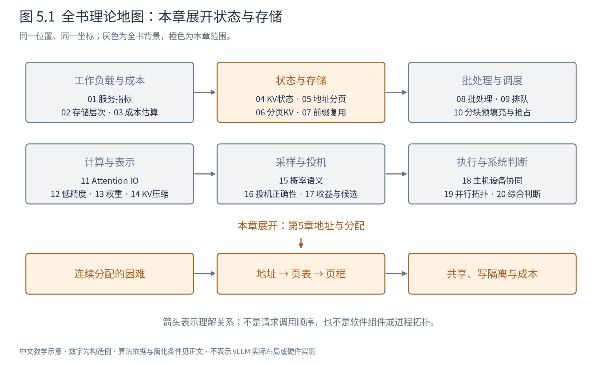
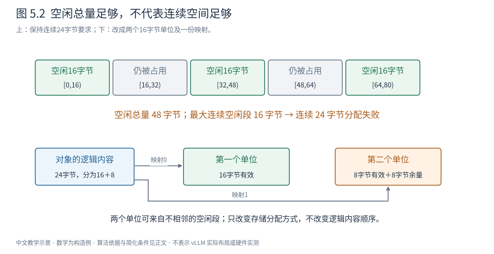
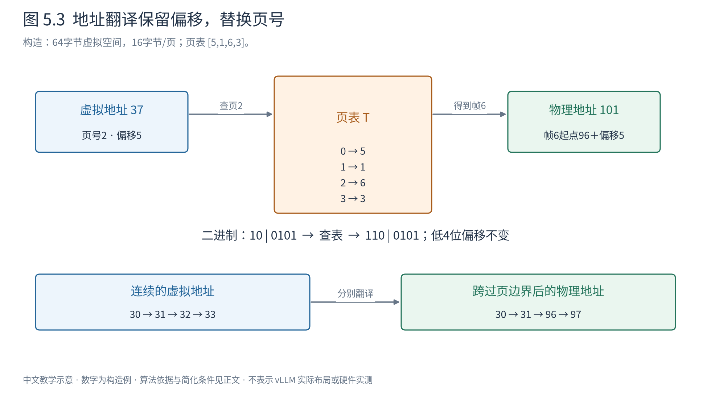
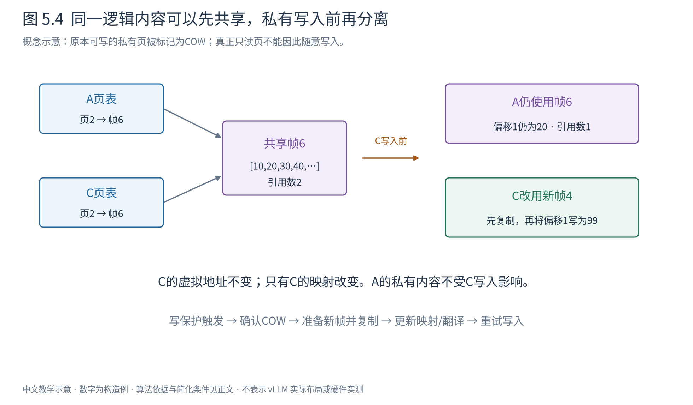

# 第 5 章 分页之前：地址、分配与虚拟内存

一条生成中的请求需要不断保存新的 KV。我们知道怎样计算这些状态，也知道它们大致占多少空间，但还有一个没有解决的问题：新状态应该放在哪里？如果先给每条请求留足最大长度，大量空间会暂时闲置；如果只给眼下需要的空间，下一次增长时，旁边可能已经住进别的数据。

这个问题首先属于存储管理。它和模型有多少层、采用哪种注意力没有直接关系：我们需要为一个长度不断变化的对象提供空间，并保证使用它的人仍能找到原来的数据。本章先离开模型，理解操作系统怎样把“程序认为数据在哪里”和“数据实际住在哪里”分开。下一章再把这套思想移到 KV。

图5.1是全书共用的理论地图。灰色框保持全书位置，橙色框展开本章的“地址与分配”。箭头表示理解依赖，不是软件调用。本章只要求读者会读数组下标、做整数除法；虚拟地址、页表、缺页和写时复制都会从这里开始解释。

## 5.1 空闲空间足够，为什么仍然放不下

先给分配器一个明确的任务：在一片存储中，为一个对象找出连续的24字节。假设当前有三个空闲区域，分别是地址区间 $[0,16)$、$[32,48)$ 和 $[64,80)$，每个16字节。区间右端不包含在内，因此第一段恰好覆盖地址0到15。

空闲总量是48字节，超过24字节。然而，没有任何一个空闲区域能容纳整个对象。中间的16字节仍属于其他对象，分配器不能为了凑长度把它们覆盖。这就是**外部碎片（external fragmentation）**：空闲空间存在于已分配对象之间，但它的分布无法满足一次连续分配。[OSTEP，第17章](https://pages.cs.wisc.edu/~remzi/OSTEP/vm-freespace.pdf)

图5.2上半部分保留了三个洞的原位置；下半部分改变分配要求，允许一个对象使用两个不相邻的16字节单位。请先看需求的变化：从“给我连续24字节”变成“给我两个16字节单位，并记录它们的顺序”。图为独立构造例，数字不代表真实内存页大小。

有没有不改变要求的办法？有，但每种办法都有条件。

**合并空闲区域**能解决相邻的洞。例如释放地址16到31后，前两段就能合并成连续48字节。但只要中间对象仍然存在，合并便无能为力。first-fit选择第一个足够大的洞，best-fit选择足够大的洞中较小的一个；它们改变空闲空间未来怎样碎裂，却不能让眼前三个16字节的洞凭空变成一个24字节的洞。

**搬移仍在使用的对象**，可以把空闲区域集中起来，称为压实（compaction）。问题随之转移：谁来搬、搬多少、搬动期间谁还能访问？更关键的是，使用者手里已经拿到了地址。若地址直接指向原来的位置，搬移后必须处理所有旧引用；普通内存分配库不能随意修改程序保存的每一个指针。受管理运行时或具有地址重映射能力的系统可以采用不同策略，但同样需要付出搬运和协调成本。

也可以**预先分配更大的一段**，减少增长时重新分配的次数。一个实际只用24字节的对象若拿到32字节，余下8字节落在分配单元内部，其他对象暂时不能使用。这叫内部碎片（internal fragmentation）。对于还会增长的对象，当前未使用的空间可能以后用上；“当前空着”和“最终浪费”应分开统计。

至此，问题已经比“找块空地”具体得多：我们既想让对象按自己的逻辑顺序增长，又不想要求物理空间也按同样的顺序相邻。要做到这一点，需要增加一层可修改的对应关系。

## 5.2 程序使用的地址，为什么不必是物理位置

把内存暂时想成按字节编号的数组。“读取地址37”，就是读取某个地址空间中编号37的字节。这里真正需要解释的是：**编号属于哪个空间？**

一个进程是一个正在执行的程序实例。程序中的指令通常使用自己的虚拟地址（virtual address）；这些地址组成它的虚拟地址空间。设备中的物理存储则有另一套位置编号。访问发生时，系统把前者翻译为后者。不同进程可以都使用虚拟地址37，却映射到不同的物理位置，因此不会仅因写了相同的数字就写到彼此的数据。

这个分离提供了一种有用的自由：程序可以把一个数组当成逻辑上连续的区间，系统却把它的不同部分放到不同物理位置。程序使用的编号可以保持不变，底层位置通过映射决定。

先考虑一种较简单的映射：整个区间使用一个起始物理地址，访问时做“起始地址加偏移”。如果整段要连续存放，增长和外部碎片的问题仍然存在。把代码、堆、栈等逻辑区域分别作为变长的段，可以避免把中间未使用的地址范围也作为一个连续整体处理，但每个段仍然是一个变长分配问题。

分页（paging）进一步改变分配单位：将虚拟空间分成固定大小的**页（page）**，将相应物理空间分成同样大小的**页框（page frame）**。每个虚拟页可以放到一个可用页框中。记录“虚拟页号对应哪个物理页框号”的数据结构，就是**页表（page table）**。[OSTEP，第18章](https://pages.cs.wisc.edu/~remzi/OSTEP/vm-paging.pdf)

页与页框不是同一个对象的两个随意称呼。页属于程序的逻辑地址空间；页框属于物理资源。页表把二者联系起来。分配算法可以选一个空闲页框，而不必寻找与上一页相邻的位置。

回到24字节的对象。若按16字节一页组织，它需要两页。两个物理页框共提供32字节，其中24字节有效，8字节位于尾页内部。三个空闲页框中任选两个即可，原来的“必须有一个24字节连续洞”不再是条件。分页消除了这一层对连续大段的要求，但并没有让8字节的尾部余量消失。

这里讲的是方案如何从问题中构造出来，不是严格的发明时间线。实际操作系统可以同时采用分段、分页、多种页大小及其他分配层。我们先理解最小模型，再讨论它的代价。

## 5.3 一次地址翻译，究竟改了什么

现在把映射完整算一遍。设一个程序的虚拟空间为64字节，页大小为16字节；物理空间为128字节，因此有8个页框。为便于观察，给四个虚拟页安排如下页表。所有页均已驻留，允许读取。

|虚拟页号|虚拟地址范围|物理页框号|物理地址范围|
|---:|---|---:|---|
|0|0–15|5|80–95|
|1|16–31|1|16–31|
|2|32–47|6|96–111|
|3|48–63|3|48–63|

**构造例5.1：读取虚拟地址37。** 37落在虚拟页2内，因为前两页已经覆盖32字节；它在页内的偏移为5。查表得知页2放在页框6，页框6从物理地址96开始。因此最终读取的物理地址是101。

把这三步写成通用形式。设虚拟字节地址为 $v$，页大小为 $P$ 字节，页表为 $T$：

$$
j=\left\lfloor\frac{v}{P}\right\rfloor,\qquad o=v\bmod P. \tag{5.1}
$$

$$
f=T[j],\qquad a=fP+o. \tag{5.2}
$$

|符号|含义|单位或范围|
|---|---|---|
|$v,a$|虚拟、物理字节地址|字节编号，标量|
|$P$|页与页框的大小|字节/页|
|$j,f$|虚拟页号、物理页框号|整数编号|
|$o$|页内偏移|字节，$0\leq o<P$|
|$T$|本地址空间的映射表|本例4项，演示时只列帧号|

式(5.1)问的是“落在第几页、页内第几格”；式(5.2)只替换“哪一页”，保留“页内第几格”。地址本身仍是整数，只是我们可以把它解释为商与余数。

图5.3先跟随37得到101，再沿底部观察跨页访问。虚拟地址30、31、32、33逻辑上连续，翻译后分别是物理地址30、31、96、97。**顺序由虚拟地址定义，相邻性不必由物理位置提供。** 这是下一章逻辑 token 序列与物理 KV 块分离的关键。

页大小若是2的幂，商与余数还可以从二进制位直接读出。本例 $P=16=2^4$，低4位表示偏移。37的六位二进制为 `10 0101`：前两位`10`是页号2，后四位`0101`是偏移5。查得帧号6，即`110`，物理地址变成`110 0101`，十进制101。物理地址用了7位，是因为本例物理空间有128字节；两类地址的位宽不必相同。

如果一次操作跨过页边界，就必须遵守每一页自己的映射和访问权限。不能只翻译第一个地址，然后假定后面的物理地址连续。图中的四字节读取正说明了这一点。

实际页表项（page-table entry，PTE）还需要帮助判断“这个访问是否允许、数据是否驻留”。帧号只有在相应状态下才有可用含义。下一节把这些状态加进来，翻译过程才真正闭合。

## 5.4 页表也占内存，翻译也需要时间

从页表得出物理位置，看起来只多了一次数组查询。但页表本身往往也在内存中。如果每次取数据之前都先去读取映射，地址翻译就会占用额外的访存时间。

解决思路是把近期常用的翻译放进更快的小缓存：**TLB（translation lookaside buffer，地址转换缓存）**。它缓存的是某个地址空间中页号到帧号的映射及有关属性，不是该页的数据内容。访问一个页内相邻的许多字节，通常可以复用同一条翻译。[OSTEP，第19章](https://pages.cs.wisc.edu/~remzi/OSTEP/vm-tlbs.pdf)

**构造例5.2：映射的复用。** 按顺序读取地址32、33、34。第一次访问时，TLB可能没有页2的条目，需要从页表取得“2→6”。后两次仍在页2，只是偏移从0变成1和2，已有条目仍能完成转换。是否真的命中还取决于缓存容量、替换和并发访问；这个例子说明复用机会，不承诺每台机器的具体命中率。

两件事必须分开：TLB未命中表示小缓存里暂时没有翻译；数据页不驻留表示数据还不在可直接访问的物理页框中。前者可能通过页表查询解决，后者可能需要操作系统准备数据。**TLB miss不等于需要从磁盘读数据。**

页表的空间开销也可以算。假设完整虚拟地址空间有 $A$ 字节，用单级数组为每个页预留一项，每项 $e$ 字节，则：

$$
M_{\mathrm{table}}=\left\lceil\frac{A}{P}\right\rceil e. \tag{5.3}
$$

这里 $A$ 是地址范围大小，而非实际已经使用的内存；$e$ 为字节/表项，因此结果是字节。式子表达的是最直接的单级表模型，不是所有操作系统的实际开销。

**构造例5.3：表比数据还容易被忽略。** $A=2^{32}$ 字节、$P=2^{12}$ 字节、$e=4$ 字节时，表有 $2^{20}$ 项，占 $2^{22}$ 字节，即4 MiB。即便程序只用了少数区域，一张完整单级表仍有这个规模。

多级页表把映射也分块：先由上层表定位下层表，只为确实需要的地址范围建立相应下层结构。未用的大片虚拟范围便不必拥有完整的下层表。但一次未被TLB缓存的翻译可能需要走过多个层级。这里又出现了相同的取舍：节省常驻结构，可能增加访问结构的步骤。[OSTEP，第20章](https://pages.cs.wisc.edu/~remzi/OSTEP/vm-smalltables.pdf)

本书不需要继续枚举具体处理器的页表级数。需要带走的是：**间接映射有空间和时间成本；缓存映射、压缩映射结构，是对这些成本的进一步处理。** 引入页表并没有免费消除复杂性，而是把复杂性移动到了可管理的位置。

## 5.5 分配地址、准备物理页和允许访问，是三件事

程序拥有一段合法虚拟地址范围，并不意味着其中每一页此刻都占用物理内存。系统可以先记录这段范围的用途和权限，在真正需要访问时才准备物理页。这种延迟准备，使暂时没有使用的地址范围不必立即消耗相同大小的物理空间。

先不要把所有异常都叫作“内存不够”。考虑一次读取，可能出现以下情况：

|逻辑状态|数据现状|应怎样理解|
|---|---|---|
|地址合法，允许访问|物理页驻留，翻译在TLB中|可使用已有翻译访问|
|地址合法，允许访问|物理页驻留，TLB无条目|补齐翻译，不需要因此搬入数据|
|地址合法，允许访问|尚未准备或已经换出|需要操作系统准备页，然后重试|
|地址不属于合法映射|不存在应当访问的对象|不能靠随意分配一页让错误访问合法化|
|地址合法，但操作不被允许|例如真正的只读数据被写入|需要按权限处理；不等于普通的按需补页|

这是一张概念状态表。不同体系结构可能用不同的标志位和异常编码表达它们；操作系统还会结合自己的映射记录判断原因，不能把表中每一列机械对应到某个处理器的单一PTE位。

当合法页不驻留时，一条典型路径是：访问触发异常，控制权进入内核；内核检查映射；找到或准备可用页框；将所需内容放入；更新映射及相关翻译缓存；重试原来的访问。[OSTEP，第21章](https://pages.cs.wisc.edu/~remzi/OSTEP/vm-beyondphys.pdf)

“放入内容”可能是初始化一页新内存，也可能是读取文件内容，或把之前换出的数据取回。不是每次缺页都读磁盘；也不是每次缺页都能成功。若物理资源不足，系统仍须等待、回收、换出或报告失败。

现在也能解释为什么分页不等于无限内存。映射可以让虚拟地址不依赖连续物理空间，却不能凭空创造页框。把不常用的页移到更慢的存储层，是额外的策略；数据再次被使用时要付出传输与等待成本。分页提供了可移动的单位，移动是否划算是下一层问题。

## 5.6 同一份数据怎样共享，又怎样独立修改

页表还有一个直接后果：不同地址空间的表项可以指向同一个物理页框。只要读取语义相同，两边无需各存一份数据。

但是，共享读取和共享写入是两个不同的契约。某些映射就是为了让多个进程协作修改同一份数据；另一些场景却要求进程看起来各有一份私有副本。后一种情形不能让一个进程的写入悄悄改变另一个进程的内容。

Linux的 `fork` 创建子进程时，可以通过写时复制（copy-on-write，COW）延后私有页面的复制。这并不意味着创建进程没有成本：页表和任务管理等工作仍然存在。它延后的主要是数据页复制，而非整个进程创建操作。[Linux fork(2)](https://man7.org/linux/man-pages/man2/fork.2.html)

**构造例5.4：共享页中的一个字节要被修改。** 假设父进程A和子进程C各有自己的页表，但某一私有页最初都映射到帧6，内容为`[10,20,30,40,…]`。系统暂时撤去这些映射的写权限，并另外记录这是可由COW恢复写入的私有页，而不是本来就禁止写入的只读页。

图5.4左侧两张表共同指向帧6；右侧C准备写入后，C改指向新帧4，A仍指向帧6。图中“引用2→1”指这个简化模型的映射引用数。请沿C的箭头看变化：改变的是C的物理去向，C使用的虚拟地址不变。

全过程如下：

|阶段|A的映射|C的映射|物理数据与允许的操作|
|---|---|---|---|
|共同读取|页2→帧6|页2→帧6|共享原数据，两边读取得到同样内容|
|C尝试写页内偏移1|仍指向6|仍指向6，写入尚未生效|写保护触发处理，先判断确实属于COW|
|准备私有副本|仍指向6|准备改指向帧4|复制帧6的内容到帧4，更新C映射并允许写入|
|重试C的写入|偏移1仍为20|偏移1写成99|两边私有语义成立，后续读取各自副本|

为什么不能只复制那个被修改的字节？因为当前映射单位是一页。只改一个字节的去向，却让其余字节仍指向旧帧，需要另一种更细的映射机制。按页复制使实现和页表粒度一致，代价是一次小写入可能引起整页复制。

共享还要求明确资源何时可回收。在仅考虑页表映射的简化模型中，可以给帧记录引用数：新增共享映射就加一，删除映射就减一，最后一个引用消失后才归还页框。真实系统还可能有固定页、设备访问等其他持有关系；简单的引用计数图不能替代全部生命周期规则。[MIT xv6 COW教学实验](https://pdos.csail.mit.edu/6.1810/2024/labs/cow.html)提供了可追踪的最小实现背景。

如果C写入时没有空闲页框，不能先改映射再假装复制已经成功。系统必须有明确的失败处理。COW节省的是可能不发生的复制，并没有保证真正写入时一定有空间。

## 5.7 页为什么不能越小越好，也不能越大越好

到这里，小页似乎很有吸引力：尾部余量小，COW复制粒度也小。但每个页都需要被映射和管理，页越小，同一数据范围中的页越多。式(5.3)已经给出最直接的一项代价。

**构造例5.5：同样存放三个私有对象。** 为隔离页大小的影响，假设每个对象分别从页边界开始、独占自己的页，长度为5、9、17字节。它们不能互相利用尾页余量，也没有共享。

|页大小|三个对象各需页数|共分配字节|有效字节|内部余量|
|---:|---|---:|---:|---:|
|4字节|2、3、5|40|31|9|
|8字节|1、2、3|48|31|17|
|16字节|1、1、2|64|31|33|

本例页越大，尾部余量越大，而管理的页数从10降到4。但这不是任意真实程序都会呈现的增长曲线：同一页里可以存放多个小对象，应用分配器和OS分页是不同层；本例特意禁止了这种复用，只考察页作为独占分配单位时的影响。

对一个从页边界开始、长度为正整数 $N$ 字节的独占区间，分配空间和尾部余量分别为：

$$
C(N,P)=P\left\lceil\frac{N}{P}\right\rceil,\qquad
W(N,P)=C(N,P)-N. \tag{5.4}
$$

这里 $C$、$W$、$N$ 的单位都是字节。把对象放进足够多的完整页后，最后一页之前均已填满，所以：

$$
0\leq W(N,P)\leq P-1. \tag{5.5}
$$

常见的“平均浪费半页”还需要概率假设。若 $(N-1)\bmod P$ 均匀分布在 $0,1,\ldots,P-1$ 上，那么空余字节数也均匀取这些值，其平均为：

$$
E[W]=\frac{0+1+\cdots+(P-1)}{P}=\frac{P-1}{2}. \tag{5.6}
$$

这才是“约半页”的来由。若全部对象长度恰好是页大小的倍数，尾部余量为零；若多数对象只有一字节，则几乎整页都空着。不能在没有长度分布的情况下，把半页当作测量结果。

大页还可能让一条TLB映射覆盖更多数据，减少某些负载的翻译压力；但它也可能扩大复制、分配或传输单位。小页降低某些浪费，又增加映射条目和管理频率。**选择页大小，是在数据分布、访问模式和管理成本之间取舍。** 单看一项数字不能决定最佳值。

最后再收紧“消除外部碎片”的含义：在一个由同尺寸、可互换空闲页框组成的池中，只要允许一个对象映射多个离散页框，就不需要为该对象寻找连续大段。若请求另有物理连续性要求，或者空闲资源分属不能互借的池，这个结论的前提已经改变。系统中还有其他分配层，也可能继续存在碎片。

## 5.8 带着哪一部分思想回到 KV

回顾本章，不妨重新看图5.3：程序给出逻辑编号，页表确定物理去向，偏移保留页内位置。这一层间接映射，使“逻辑相邻”和“物理相邻”不再绑定。固定单位又让许多分配决定变成数空闲单位，而不是寻找合适形状的连续区域。

但间接映射不是全部答案。映射有开销，尾页有余量，共享写入需要隔离，合法地址可能暂时没有物理空间。**一种设计的价值，来自它消除了哪些约束，以及新引入的代价是否更容易控制。** 理解分页，要同时看这两面。

下一章把页换成能装若干 token 的 KV 块，把进程的页表换成序列的块表。可以迁移的，是固定粒度、逻辑与物理分离、按需分配和共享隔离的思想。不能直接迁移的，是硬件自动地址翻译、缺页异常、磁盘换页等整套OS机制。KV由推理系统的软件明确管理，读取它的Attention也必须理解这些映射。

阅读前可以先自查三个问题：给定图5.3的页表，虚拟地址31和32分别到哪里；COW写入时为什么只改写方的映射；为什么“总共还有48字节空闲”不足以保证连续24字节分配成功。能逐步回答这三个问题，就具备了下一章需要的存储心智。

## 资料与核验说明

本章以OSTEP第17–21章、Linux fork(2)和MIT xv6 COW教学资料为概念依据，链接已置于相应论述旁。所有地址、布局和数值为独立构造例；图片不是硬件拓扑实测。算例核验与限制统一见[第一组样稿说明](阅读说明.md)，跳过核验脚本不影响正文理解。
