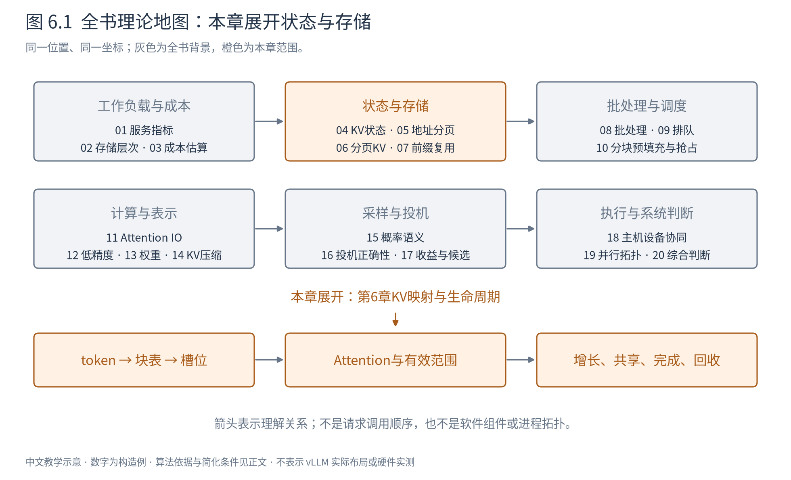
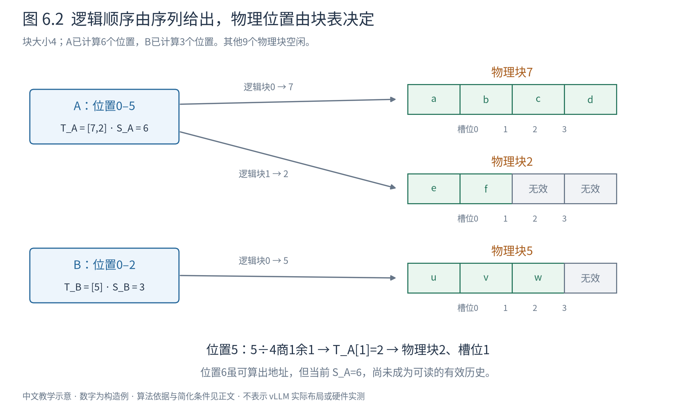
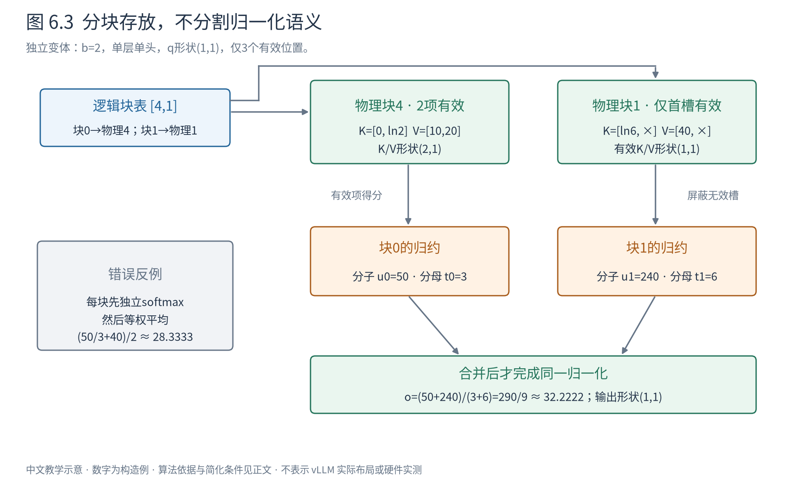
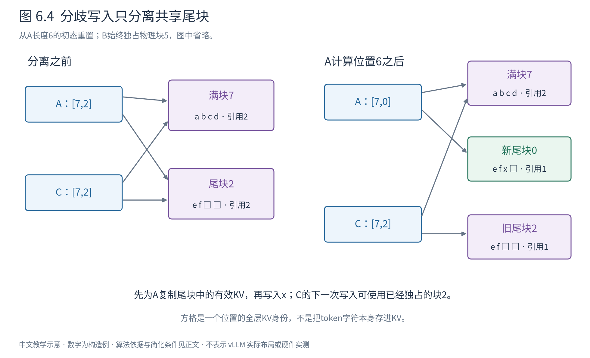
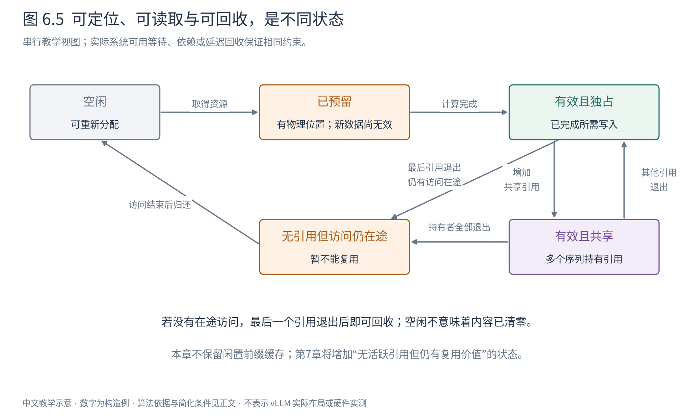

# 第 6 章 分页 KV：让增长的序列住进固定块

上一章解决了一个一般问题：对象需要逻辑上连续，存储位置却不必物理上连续。页表把两者联系起来，固定大小的页框让分配器不再为每次增长寻找一整段连续空间。

现在回到模型。一条请求已经处理了六个 token，另一条处理了三个；它们还会继续增长，也会在不同时间结束。我们希望新状态能找到位置，旧状态能被Attention正确读取，结束的请求又能及时让出资源。本章要把这三件事放到同一个过程中，而不只画一张静态块表。



图6.1沿用上一章地图的坐标，本章展开“KV映射与生命周期”。前缀缓存将研究怎样认出可复用的状态，调度将研究容量不足时先推进谁；本章先建立它们共同依赖的存储机制。

> 本章讨论一般的分页KV算法，依据PagedAttention原论文，并使用独立构造的微型模型。这里的块编号、张量布局和伪码不是某个版本vLLM的内部对象，也不要求当前引擎提供论文中每一种解码模式。具体实现由Book7、Book8承接。

## 6.1 先确定我们究竟在存什么

在因果自注意力中，当前查询需要读取允许范围内各位置的键和值。对于标准Transformer，已经计算完成的历史位置不会因为追加一个未来 token 而改变。KV cache保存这些键和值，避免每一步重新计算历史。

这一性质有条件：模型与计算条件一致，位置解释一致，且新增的未来位置不反向影响历史位置。相同的token字面值放在不同前缀或不同位置，通常不能直接共享KV。我们稍后使用的A、C共享例，要求它们确实具有完全相同的前缀和相关计算条件。

还要先区分两个进度。前向计算处理一个 token，产生该位置各层的KV，并得到用于预测后续 token 的输出；采样才选择下一个token ID。**刚选出的token，不一定已经有自己的KV。** 它通常在下一次前向中被处理，才成为新的已计算位置。最后一个输出如果已经结束请求，也不必再进入一次前向。

因此，本章用 $S$ 表示“已经算好、允许被读取的KV位置数”，而不直接用“已经输出多少token”代替它。讨论增长时，会明确说“再计算位置6”，不是把生成ID与写入KV合成一个动作。

为了把存储量也算清楚，设一个微型模型有 $L=2$ 层，每层 $h=1$ 个KV头，头维 $d=2$，K和V每个元素占 $e=2$ 字节。每个token在所有层合计占用：

$$
c=L\times2\times h\times d\times e=16\ \mathrm{bytes/token}. \tag{6.1}
$$

其中乘数2表示K、V各一份；$L,h,d$分别是层数、KV头数和每头元素数。这里只选等头维、各层同型的示范模型，不把式(6.1)原样套到MLA或混合状态模型。

令块大小 $b=4$ token，每块便代表64字节的全层KV。设备预先准备12个这样的物理块，编号0到11，整个池为768字节。这些数字都很小，是为了让每个分配和回收动作能在纸上核对。

## 6.2 块表把 token 顺序与存放位置分开

一条序列的逻辑位置从0开始编号，每四个位置组成一个逻辑块。序列A已计算6个位置，逻辑块0覆盖位置0–3，逻辑块1覆盖位置4–5，最后两格尚未有效。

为A分配物理块7和2，记为 $T_A=[7,2]$。这个数组的下标是逻辑块号，值是物理块号。第二条序列B已计算3个位置，分配物理块5，记为 $T_B=[5]$。块号的大小不表示时间先后，也不表示token顺序。



图6.2从左向右读：A的前四个位置通过表项0映射到物理块7，接下来的位置通过表项1映射到物理块2；B映射到物理块5。块内灰格表示尚未有效，不表示其中的物理字节必然为零。图只画一个位置的KV记录身份，记录本身仍包含模型各层的键和值。

对序列 $r$ 的逻辑位置 $i$，映射分三步：

$$
j=\left\lfloor\frac{i}{b}\right\rfloor,\qquad s=i\bmod b,\qquad p=T_r[j]. \tag{6.2}
$$

读法与上一章完全对应：先确定第几个逻辑块，再确定块内槽位，最后查出物理块。这里 $i$ 是token位置，$j,p$ 是块编号，$s$ 是槽位，$b$ 的单位是token/块；它们不是OS的字节地址。

**构造例6.1：读取A的位置5。** $5\div4=1$、余数1，所以查 $T_A[1]=2$，读取物理块2的槽位1。位置3则在块7的槽位3。A的位置6虽然也能算出“块2、槽位2”，但目前 $S_A=6$，有效位置只有0–5，因而不能将位置6当作已经算好的历史读取。**映射存在与数据有效是两个条件。**

一个教学布局可以把第 $\ell$ 层的K、V分别组织成：

$$
K_\ell,V_\ell:\ (M,h,b,d),\qquad
K_\ell[p,u,s,:],V_\ell[p,u,s,:]:\ (d,). \tag{6.3}
$$

$M$ 是物理块数，$u$ 是当前KV头编号；选定物理块、头和槽位后，得到一个长度为 $d$ 的向量。本例每层两张池张量各有形状 $(12,1,4,2)$，两层合起来768字节。真实算子可能把维度重排、把K/V分开采用不同布局，或将不同层放入不同池；块表表达的逻辑关系不依赖这一种排列。

也正是在这里，OS类比应该止于正确边界：

|上一章的概念|本章迁移的思想|不能直接等同的部分|
|---|---|---|
|虚拟页与页框|逻辑块与物理块|KV块是软件组织单位，不必等于硬件页|
|页表翻译|token位置通过块表找到槽位|并非CPU自动为每次KV访问执行该块表查询|
|按需准备页框|按增长需要分配新块|分配失败不自动触发OS式缺页与磁盘换页|
|共享私有页与COW|共享已算前缀，分歧写入前分离|推理算法显式组织复制，不依赖写保护异常|

PagedAttention的核心配合是：存储管理允许块分散，Attention读取过程也认识这种分散表示。只把连续数组拆开，而仍调用只接受原连续布局的读取算法，机制并不完整。[PagedAttention，§4.1–4.2](https://arxiv.org/abs/2309.06180)

## 6.3 一条序列增长时，什么发生了变化

先沿A、B的初态继续，不引入共享。A的表为`[7,2]`，有效长度6；B的表为`[5]`，有效长度3。12块中占用3块，还有9块空闲。

**构造例6.2：A从6个有效位置增长到9个。** 每一行都表示相应前向写入已经完成，表中的有效长度才更新到该值。

|事件|A块表|A有效长度|新增物理块|全池空闲块数|
|---|---|---:|---:|---:|
|初态|`[7,2]`|6|—|9|
|计算位置6|`[7,2]`|7|0|9|
|计算位置7|`[7,2]`|8|0|9|
|准备并计算位置8|`[7,2,0]`|9|1（编号0）|8|

前两次增长只占用尾块的剩余槽位，旧数据不移动。第三次需要一个新块，但新块无需排在物理块2后面，只需在逻辑表末尾增加条目0。已有映射`[7,2]`保持不变。

对没有共享、没有预留额外块的简单序列，当前长度 $S$ 所需块数为：

$$
n(S)=\left\lceil\frac{S}{b}\right\rceil. \tag{6.4}
$$

若准备一次计算 $\Delta$ 个新位置，额外块数为：

$$
\Delta n=n(S+\Delta)-n(S). \tag{6.5}
$$

式(6.5)先数目标长度需要多少块，再减当前已有块数。例如 $S=6,b=4,\Delta=3$，目标需要3块、当前2块，因此新增1块。这里的 $\Delta$ 是要实际计算的位置数，不是承诺此次一定产生三个被接受的输出token。

把这个过程写成伪码，重点不是函数名字，而是哪些动作可以在数据有效之前完成：

```text
输入：序列的有效长度S、块表T、本轮要计算的位置数Δ
前提：本分支没有共享；没有尚未结束的旧读写

need = ceil((S + Δ) / b) - ceil(S / b)
if 空闲块数 < need:
    返回“当前不能推进”          # 块表和有效长度都不改变

new_blocks = 预留need个块       # 只取得资源，不代表新KV已算好
planned_table = T接上new_blocks
按planned_table计算并写入位置[S, S + Δ)

if 本轮计算成功完成:
    提交块表planned_table和新有效长度S + Δ
else:
    在确认设备不再使用这些资源后撤销本轮预留
```

前半段解决“是否有地方可写”，后半段解决“写出的数据何时可信”。这是串行教学模型中的一种清楚的提交方式，不规定实际引擎一定在完成时才发布整张表。真实系统可以提前发布带状态的元数据，但必须维持同一条约束：消费者不能把尚未完成的区域当作有效历史。

如果调度器本轮希望同时推进多条序列，就要把它们的需求一起核对；共享写入还会增加复制所需块。算出单条序列能前进，不等于整批都能前进。第10章会从这里继续讨论如何选择本轮的工作。

## 6.4 数据不连续，Attention为什么还能算出同一个结果

块表回答了“在哪里”，下一步需要证明“这样读取仍然在算原来的Attention”。

先看单层、单头、一个查询，且暂时采用普通稠密因果注意力。设当前允许读取的有效位置共有 $S$ 个，查询为行向量 $q\in\mathbb R^{1\times d}$，历史键和值分别为 $K,V\in\mathbb R^{S\times d}$。计算形状如下：

|步骤|输入|输出|
|---|---|---|
|点积并缩放|$q:(1,d)$，$K^\top:(d,S)$|得分$z:(1,S)$|
|有效范围掩码与softmax|$z:(1,S)$|权重$w:(1,S)$|
|按权重组合值|$w:(1,S)$，$V:(S,d)$|输出$o:(1,d)$|

对每个有效位置 $i$，得分与输出为：

$$
z_i=\frac{qk_i^\top}{\sqrt{d}},\qquad
o=\frac{\sum_{i=0}^{S-1}\exp(z_i)v_i}{\sum_{i=0}^{S-1}\exp(z_i)}. \tag{6.6}
$$

$z_i$ 与分母是标量；$v_i$ 和 $o$ 为 $(1,d)$ 向量。分子是“每个值乘以对应未归一化权重后求和”，分母是这些权重的总和。这一表达把softmax与后续加权求和放在了一起。

物理块只是把有效位置分成若干组 $I_j$，每个位置恰好属于一组。于是分别在每块算：

$$
u_j=\sum_{i\in I_j}\exp(z_i)v_i,\qquad
t_j=\sum_{i\in I_j}\exp(z_i). \tag{6.7}
$$

再合并：

$$
o=\frac{\sum_j u_j}{\sum_j t_j}. \tag{6.8}
$$

式(6.8)没有引入近似，只是把有限求和按块分组。查表取得对应K、V后，物理块是否相邻不会改变数学上参与求和的项。有限精度下，不同求和顺序可能产生舍入差异，因此数学等价不等于所有实现逐位相同。



图6.3使用独立的单层单头算例，块大小改为2，并在图上标明这一变体。上方的块表只负责找到数据；下方每块输出分子与分母，最后共同合并。图中尾块的无效槽被划去，不参与任何归约。

**构造例6.3：三项数据分放在两块。** 取 $d=1,q=[1]$，逻辑顺序上的K为 $[0,\ln2,\ln6]$，V为 $[10,20,40]$。相应未归一化权重为 $[1,2,6]$。前两项在物理块4，最后一项在物理块1：

|逻辑块|有效位置|未归一化权重|分子$u_j$|分母$t_j$|
|---|---|---|---:|---:|
|0→物理4|0、1|1、2|$1\times10+2\times20=50$|3|
|1→物理1|2|6|$6\times40=240$|6|
|合并|0、1、2|—|290|9|

输出是 $290/9\approx32.2222$。直接对逻辑连续的三项做softmax加权，也得到相同结果。

容易犯的错误是：每块先独立归一化，再把块输出等权平均。两块的局部输出分别为 $50/3$ 与40，等权平均为 $85/3\approx28.3333$，已经不同。原因是两个块拥有的概率质量不同，分母分别为3与6。若先形成局部输出，至少也必须按这两个分母的比例加权，而不是给两个块相同权重。

另一个错误是把尾块空槽当作普通数据。物理块1还有一格，但 $S=3$ 已经告诉我们它不属于有效上下文。即使那格恰好残留很大的K或V，也必须屏蔽。将它的值简单设成零通常不够，因为零得分仍会通过指数产生正权重，改变归一化分母。

上面的指数写法是数学解释，不能直接当作适用于任意大得分的数值实现。真正稳定的分块softmax需要共同处理最大值、缩放后的分母和分子；第11章将从防止指数溢出开始推导它。此处已经建立最重要的不变量：**所有允许的位置参与同一个逻辑Attention，分块不能改变归一化范围。** 对多query预填充，每行还有各自的因果可见范围，不能仅用整条序列长度替代逐行mask。

实现可以先把数据收集成连续缓冲再调用算子，也可以让算子按块表直接访问。前者容易复用现有计算路径，却可能引入额外搬运与缓冲；后者要求读取过程适配块布局。本文解释的是后一类设计的算法基础，并不强制一种特定kernel代码。[PagedAttention，§4.1](https://arxiv.org/abs/2309.06180)

## 6.5 两条路径共享前缀，什么时候必须复制

现在回到块大小4的A、B初态，**重新从A长度6、表`[7,2]`开始**，不接着上一条增长到9的分支。B仍占块5。

假设我们从A的同一个六token前缀派生出续写C。这里已经知道前缀及计算条件完全相同，不讨论怎样在陌生请求之间自动发现匹配。只需为C建立一张同样的块表`[7,2]`，而不立即复制KV。物理块7和2各有两个序列引用；B的块5仍只有一个。

**构造例6.4：A和C开始分歧。** 前六个token记为`[a,b,c,d,e,f]`。A选择的新token为x，C选择的新token为y。选择token ID之后，存储问题仍未发生；当各自把x或y送入前向、需要写入位置6的KV时，才必须考虑尾块的独立写入。

若A直接写物理块2的槽位2，C随后也把自己的位置6写入同一槽，两个不同状态会冲突。因此A准备写入前，需要获得一个私有尾块。



图6.4先画A/C共同指向满块7和部分尾块2，再画A取得新块0后的映射。满块7中的前四个位置不变；只复制尾块2中的有效前缀位置4、5，随后把A的新位置6写进块0。图中复制的是KV内容，不是只复制token ID。

|事件|A块表|C块表|块7引用|块2引用|块0引用|全池空闲块数|
|---|---|---|---:|---:|---:|---:|
|A/C建立共享|`[7,2]`|`[7,2]`|2|2|0|9|
|A取得私有尾块，计算x|`[7,0]`|`[7,2]`|2|1|1|8|
|C在自己的尾块计算y|`[7,0]`|`[7,2]`|2|1|1|8|
|A结束且旧读写完成|—|`[7,2]`|1|1|0|9|
|C也结束且旧读写完成|—|—|0|0|0|11|

最后还有一个块没有空闲，因为B始终持有块5。每一行都把B计入全池总数，但没有重复列出其不变的映射。

A分离尾块后，块2只剩C一个引用，C不必再复制一次。块7则仍可共享，直到两条路径都不需要它。这个过程中，“序列数增加”没有要求把全部历史数据乘以序列数；新增成本集中在真正出现差异的部分。

在我们的微型模型中，尾块中两个有效位置占32字节。理论上复制这32字节即可保留有效内容，实际实现也可能为了传输布局简单而复制整个64字节块。**有效载荷大小与实际复制流量要分开。** 最终采用哪一种方式，属于实现与硬件效率的选择。

共享满块也有边界。这里假定历史KV只追加，不回写已有内容，所以满块可以保持只读。若机制会原位更新已存在的状态，或者一个位置不再满足同一计算条件，就不能沿用“满块永远可共享”的结论。

并行采样和beam search会产生共享前缀的不同分支；跨请求也可能共享相同前缀。PagedAttention论文讨论了这些应用，但共享机制与“自动找到可共享前缀”是不同工作。下一章再讲后者。[PagedAttention，§4.4](https://arxiv.org/abs/2309.06180)

## 6.6 引用归零，为什么还不总能立即回收

上表特意把结束条件写成“请求结束且旧读写完成”。这是因为软件知道不再生成，与设备已经不再访问某个块，并不一定发生在同一时刻。

暂时只需掌握最小的异步背景：CPU可以先提交一份计算任务，设备稍后执行；提交返回不代表任务已经完成。如果在这段时间内把KV块归还池中并分配给另一条序列，旧任务可能读到新主人写入的数据。即便CPU侧的引用已经移除，数据访问仍然可能在途中。第18章将系统展开这些执行依赖。



图6.5区分预留、有效、共享和可回收。箭头是允许的状态变化，不是固定类的方法调用。回到空闲池需要“无持有引用、无在途访问”；本章暂不保留空闲前缀缓存，第7章会在这个边界上增加可复用缓存状态。

因此，一个最小正确的释放过程至少需要回答：还有哪些序列持有这个块；是否还有已提交的操作可能访问它；谁能确认这些操作结束；满足条件后怎样让块重新可分配。可以通过等待完成、安排依赖或延迟回收实现，不要求每次释放都阻塞整个设备。

“回收”也不一定将内容清零。对于预先分配的池，回收通常表示该块可以重新分配，旧字节可能仍在。下一位使用者必须先建立自己的有效范围、完成必要写入，再允许读取；不能依赖刚分配的块碰巧为零。前面屏蔽无效尾槽的要求在这里有了直接原因。

这也解释了为什么“请求释放了3块”不意味着操作系统或设备驱动立刻看到显存占用减少192字节。整个768字节池仍可能保持分配；变化的是池内资源的可用性。池内已用块、框架分配内存和整卡占用是不同指标。

回收成本也要按正确单位计数。把一个空闲块号放回栈可以是常数时间操作，但一条序列持有 $k$ 个块时，逐项释放就要处理 $k$ 个引用；不能由“单块操作简单”推断“任意长请求的整体回收都是常数时间”。批量处理能减少实现开销，不会消除必须处理的所有权关系。

再看容量不足。假设本轮A/C等序列合计需要两个额外块，其中一个用于COW，但池中只剩一个。正确性要求不能因为已经取得第一个块，就把尚未完成准备的所有序列都标记为可执行。可以先计算整批需要，失败则保持原状态；也可以允许部分准备，但必须有明确的撤销或部分执行协议。

本章选择前一种教学模型：需求不足时，块表、引用和有效长度都不变化。随后策略层可以减少本轮工作、暂缓某条序列，或者释放其他序列占用的资源。**分页让资源需求可以按块表达，却不替调度器决定谁该等待。**

## 6.7 块大小决定哪些收益，又引入哪些成本

将请求从固定大段改为按需块分配，最直接的收益是减少不必要的提前占用，并允许空闲块在不同序列之间周转。它没有改变模型本身每个有效位置应保存多少KV。

先限定在“每条序列独占、块大小相同、按当前有效长度分配、没有额外预留”的模型中。序列 $r$ 长度为 $S_r$，每token占 $c$ 字节，则：

$$
M_r=bc\left\lceil\frac{S_r}{b}\right\rceil,\qquad
W_r=c\left(b\left\lceil\frac{S_r}{b}\right\rceil-S_r\right). \tag{6.9}
$$

$M_r$ 为已分配字节，$W_r$ 为尾块未使用字节。非空序列只有最后一块可能不满，因此每条序列的尾部余量最多为 $(b-1)c$ 字节。若有共享、滑窗、分组池或推测执行预留，需要重新数物理块，不能简单把各序列的 $M_r$ 相加。

**构造例6.5：同一负载，三种块大小。** 仍取A长度6、B长度3，每token16字节；下面只比较布局需求，保持可用字节预算不变，不保持物理块个数不变。

|块大小|A/B所需块数|总分配槽位|有效槽位|尾部空槽|分配字节|块表条目数|
|---:|---|---:|---:|---:|---:|---:|
|2|3/2|10|9|1|160|5|
|4|2/1|12|9|3|192|3|
|8|1/1|16|9|7|256|2|

块小，尾部余量更少；块大，块表更短。块大小还影响COW复制粒度、一次读取要处理多少块、缓存能以多细的前缀粒度共享，以及设备读取是否容易组织。计算用的tile与存储块是不同概念，不能认为一个块天然对应一个线程组或一次完整算子调用。

对于本例768字节的池，若给每条序列都预留最大24个位置，每条占384字节，只能同时放两条；按 $b=4$ 管理当前长度，A/B合计只占192字节。这说明更多空间可以供后续增长或其他序列使用，但**不能仅从这个静态快照宣布吞吐提高四倍**。新请求需要计算，现有请求还会增长，调度和延迟要求也会约束批量。

要从存储收益推到系统收益，至少要逐步建立以下因果关系：减少无效占用，使更多序列有机会驻留；驻留序列提供可同时计算的工作；适当批量可能提高权重复用和硬件利用率；最后才表现为某种负载下的吞吐或延迟改善。任何一步成为瓶颈，前面的容量收益都可能无法按比例兑现。

读取块表、管理映射和分散访问还会产生额外开销。PagedAttention原论文在其特定对照中报告，Attention kernel延迟比比较对象高20–26%，整机却能通过存储效率和批量组织取得收益。这是历史实验的条件性证据，不是当前版本或NPU的固定开销。[PagedAttention，§7.1；块大小消融见§7.2](https://arxiv.org/abs/2309.06180)

因此，分页直接改善的是**分配与共享约束**。容量不足与读取带宽不足应分别讨论：同样一批有效KV，换成分页存储不自动减少Attention必须读取的全部历史信息。只有将它与工作负载和执行组织放在一起，才能判断性能。

## 6.8 所有状态都能按同样方式管理吗

前面的长度公式以普通全局注意力为基础：有效上下文增长时，历史KV持续保留。Book5中的滑窗与递归模型改变了这个前提，因此块的生命周期也会改变。

|状态类型|后续计算需要什么|哪些状态可以退出使用|
|---|---|---|
|全局注意力KV|允许上下文中的全部历史键和值|请求结束、上下文明确截断，或采用有额外语义代价的淘汰策略时|
|滑窗注意力KV|当前窗口覆盖的位置，可能另含特定保留位置|完全离开后续所需范围、且无其他引用和在途访问的块|
|递归定长状态|由此前输入更新得到的一份汇总状态|旧状态在新状态生效后可能被替代，但未必有可独立删除的历史槽|

**构造例6.6：窗口移过块边界。** 取 $b=4$，有效窗口宽度5，已计算位置0–8；若当前只需位置4–8，则覆盖位置0–3的块已完全落在窗口外，可以在满足生命周期条件后回收。若下一步窗口变成5–9，覆盖位置4–7的块中仍有位置5、6、7需要使用，不能因为位置4过期就把整块回收。固定粒度会让窗口边界附近继续占用一些当前无效槽。

这里假设纯滑窗、无额外sink位置、无其他层或请求继续引用该块。混合模型中，一个逻辑token在不同类型层的状态寿命可能不同；将不同需求强行塞进同一个回收规则，可能过早释放，也可能保留太多。第4、14章从状态和压缩角度分析这个问题，Book7/8再讨论引擎如何组织异构状态。

递归状态更不能机械套用“删掉最后几个KV位置”的回滚方法。若一次更新把旧状态原位覆盖，想回到更早前缀，可能需要检查点、保留中间状态或重算；单靠一张token块表无法恢复已经丢失的信息。第17章会在投机验证失败时重新遇到它。

若全局KV仍然太多，分页本身不会把它们压小。可以把状态搬到更慢的存储层，之后再搬回；也可以暂时丢弃某条序列的KV，保留其token历史，将来重新前向构建。前者付出传输与等待，后者付出计算。哪个更合算取决于数据量、计算成本与当前资源竞争，第10章再将二者放进调度情景比较。[PagedAttention，§4.5、§7.3](https://arxiv.org/abs/2309.06180)

## 6.9 从一张块表，回到完整的请求

沿A再走一次：前缀前向产生六个位置的KV，表`[7,2]`记录它们的去向；后续计算先利用尾块余量，跨过边界时再申请块；Attention根据表读取正确的有效位置，在同一个逻辑归一化范围内合并；若产生共享续写，分歧写入前分离尾块；请求结束后，等持有者与执行访问都退出，再归还资源。

这条过程里有三种不同的事实：**逻辑顺序由token位置定义，物理位置由块表决定，数据能否读取和资源能否回收由生命周期决定。** 它们需要协调，但不能互相替代。知道块号，不代表数据已经有效；知道请求结束，不代表设备已经读完；知道空闲总量，也不代表每种状态池都能满足下一轮需求。

分页的设计思想可以浓缩为一个可操作的判断：先把使用者需要的逻辑顺序与资源的物理摆放分开，再为映射、共享和回收建立明确规则。这样增长不必搬移全部历史，共享也不必立即复制全部数据；代价是管理元数据，并让计算正确地消费这种间接表示。

还有一个问题没有回答：刚才C能共享A，是因为我们已经知道它们的前缀相同。真实服务收到一条新请求时，怎样判断已经计算过哪些部分？只比较文本是否够，部分匹配怎么办，没有请求引用的KV是否还值得留下？下一章从这里进入前缀缓存。

## 资料与核验说明

本章核心算法依据Kwon等人的PagedAttention论文（SOSP 2023，arXiv:2309.06180v1），引用定位已列在对应段落。A/B/C、微型模型、物理块号和Attention数值均为教学构造；分配提交与延迟回收是明确标注的教学模型，不是固定版本源码摘录。

第一组的CPU算例、图文与引用检查见[样稿阅读说明](阅读说明.md)。这些检查能发现映射、归一化和状态表中的错误，不构成真实引擎并发正确性或性能测试。
