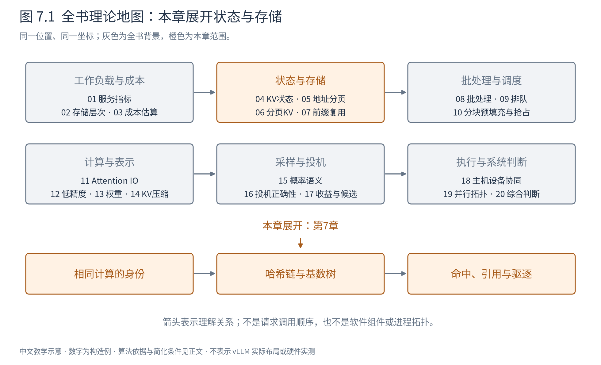
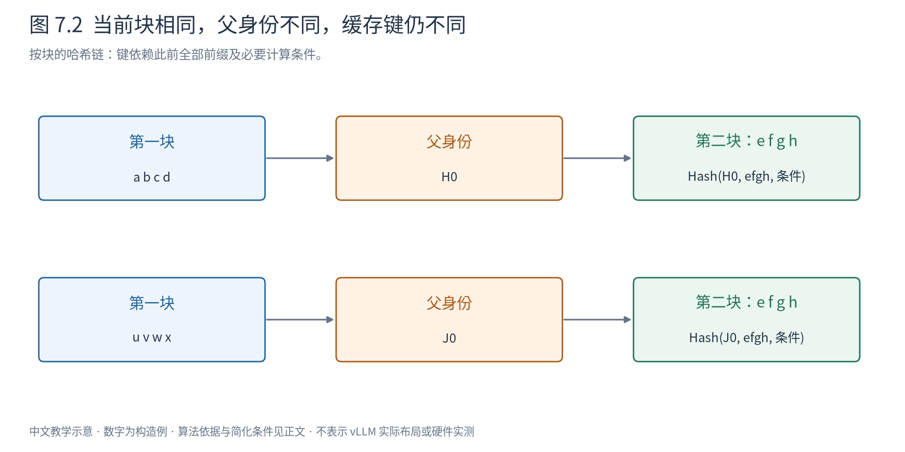
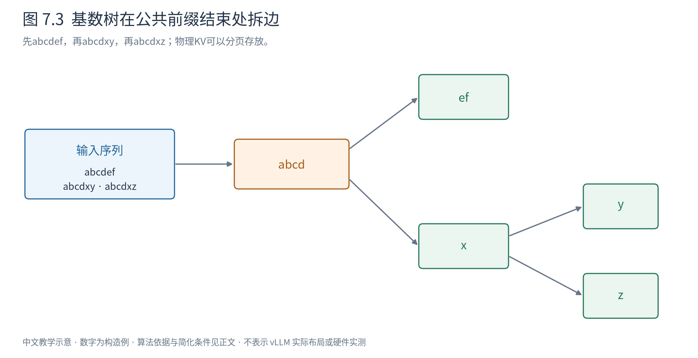

# 第 7 章 前缀缓存：什么时候可以复用计算

第6章从同一前缀派生A和C，因此一开始就知道它们能共享哪些KV。真实服务却往往收到彼此独立的请求：相同系统提示、相同few-shot示例、同一段长文档，或者多轮对话中反复出现的历史。系统能否自己发现已经算过的部分？

前缀缓存（prefix caching）把一次请求中的计算结果保留下来，供未来请求复用。它不是把完整答案缓存起来；命中历史KV后，仍要计算新后缀、生成新结果。最重要的前提是：复用的状态必须与新请求本来会算出的状态相容。

图7.1展开身份、索引和生命周期。它接在分页之后，因为“怎样识别相同状态”和“怎样把共享状态放进块里”是两项相互配合但不同的工作。

## 7.1 相同token片段为什么还不够

考虑两条序列 `[a,b,c,d,e,f]` 与 `[u,v,c,d,e,f]`。末四个token相同，但在全局因果Attention下，c看见的前缀不同，后续层的表示也可能不同。因此不能只用当前块内 `[c,d,e,f]` 作为KV身份。

相反，若A为 `[a,b,c,d,e,f]`，C为 `[a,b,c,d,x,y]`，前四个位置在固定模型、位置和mask条件下看见相同前缀，可以共享对应KV。第一个分歧位置以后则不能沿用A的结果，即使后续偶然又出现相同token。

计算身份还包括模型及其修订、适配权重、位置编号与位置缩放、输入嵌入、注意力规则和状态表示。同一段可见文本可能因为聊天模板或分词不同而变成不同token；同一图像占位token可能对应不同图像嵌入。跨租户缓存若有隔离要求，还需把可共享范围纳入键。

这不意味着每个实现都把所有信息逐项塞进同一个哈希。某些条件在整个缓存实例内固定，天然由缓存命名空间保证；可变条件才需进入请求身份。设计时要回答“哪一层保证它不会被混用”，不能仅看一个键包含几个字段。[vLLM v0.30.0前缀缓存设计](https://docs.vllm.ai/en/v0.30.0/design/prefix_caching/)

## 7.2 哈希链怎样把整个前缀带进当前块

第6章使用b=4的块。令第j个满块的token序列为 $t_j$，父块的哈希为 $H_{j-1}$，必要计算条件为c，可定义：

$$
H_j=\operatorname{Hash}(H_{j-1},t_j,c). \tag{7.1}
$$

初始父身份由固定起点和命名空间确定。当前键包含父键，因此相同当前块、不同先前历史会得到不同身份。计算新块键不必每次重新遍历全部token；前一个键已经概括了此前前缀。

图7.2的两条链具有不同第一块，即使第二块内容相同，第二块键也因父键不同而分开。箭头表示身份依赖，不是KV数据从一个块复制到另一个块。

哈希表把身份映射到可复用物理块。查找后还要确认该块有效、没有被驱逐重用，并在实际使用前取得持有引用。否则“刚查到”的块可能已被另一请求回收。哈希不是数学上绝不碰撞的证明；算法、序列化和必要的附加验证共同决定风险边界。

整块缓存让身份稳定：未满尾块还可能继续写入，而满块在只追加模型下可以保持只读。v0.30.0官方设计采用满块缓存；这是具体管理选择，不意味着语义上少于一块的相同前缀完全无法复用。按token组织或带COW的方案可以有其他粒度。

## 7.3 另一种索引：让公共前缀直接成为树

前缀树把公共开头共享为一条路径。最朴素的形式每条边只放一个token；基数树（radix tree）把没有分叉的连续边压成一条，边上可存多个token，减少节点数量。

假设先插入A的 `[a,b,c,d,e,f]`，形成一条标记为abcdef的边。后来插入C的abcdxy，比较到第4个位置发现分歧，就在abcd后拆分：公共边abcd，下接ef和xy两个分支。再来abcdxz，则在xy边的x后再分叉为y和z。

图7.3先读左边两条字符串，再读右边压缩后的树。树边代表token片段及其对应的状态范围，不要求物理KV连续；索引结构与分页存储可以组合。查找新请求时沿边逐token比较，到首个分歧或输入结束，得到最长已知公共前缀。[SGLang，RadixAttention](https://arxiv.org/abs/2312.07104)

哈希链适合按固定单元快速定位，基数树直接表达共享路径与分叉。二者都在回答“这个前缀对应哪份状态”，不意味着一种天然精确、另一种天然近似。粒度、索引开销、驱逐组织和并发维护方式需要共同考虑。

## 7.4 从命中到释放，两个计数不能混为一个

继续第6章的12块池。A已计算六个位置，块表[7,2]，B占块5。假设缓存只保留满块，A的块7对应abcd，尾块2只有ef两个有效位置。

当A结束且设备读写完成时，块2可直接成为普通空闲块；块7可以保留abcd并登记缓存身份，同时其活跃请求引用数变为0。它现在既是潜在可复用内容，也是压力下可回收的资源。

|事件|块7活跃引用|缓存身份是否有效|是否可驱逐|
|---|---:|---|---|
|A使用abcd|1|有效|否|
|A结束，访问已静止|0|保留|是|
|C命中并取得引用|1|有效|否|
|C结束且无在途访问|0|保留|是|
|被选择给别的内容覆盖|0|旧身份失效|已回收，须建立新身份|

“引用0”因此不等于“内容必须清除”；“缓存命中”也不等于“不占空间”。命中C把可驱逐块重新固定为活跃资源，新后缀还要申请其他块。若只统计活跃请求的私有KV，会漏掉保留缓存；若把所有缓存都当不可回收，又会低估可用空间。

叶优先驱逐在树结构中有自然理由：末端分支可能只服务少数请求，公共祖先有更多重用机会。LRU（least recently used，最近最少使用）选择最久未访问的可驱逐内容，但不是预测未来的最优算法。活跃引用及在途访问应先过滤，不能为了满足LRU顺序破坏正在计算的请求。

## 7.5 命中了多少，究竟省了多少

三个常见指标回答不同问题。请求命中率统计有任何命中的请求比例；token命中率统计复用token占可缓存输入的比例；命中长度分布说明到底复用了短模板还是长文档。

例如100个请求都复用1个token，请求命中率100%；另一个负载只有10个请求命中，但每个复用1000token，整体可能省更多计算。反过来，很多短请求的1token命中也可能因为索引开销而几乎没有延迟收益。

若新请求总输入长度S、复用前缀H、需要计算后缀 $U=S-H$，线性层大致省去H个位置的前向。但U个新query仍需看见允许的H个历史位置。只计因果有效配对时，新Attention的配对数为：

$$
UH+\frac{U(U+1)}2. \tag{7.2}
$$

完整输入原有 $S(S+1)/2$ 个配对，二者之差是 $H(H+1)/2$：省去的是前缀内部旧query的工作，**不是让新query忘掉前缀**。取S=6、H=4、U=2，完整21对，新计算为8+3=11对，省10对。token命中2/3，不等于Attention成本也省2/3。

完整命中也可能需要重新计算最后一个位置来取得首个输出的logits，因为普通KV缓存不一定保存隐藏输出或完整词表分布。能复用的状态与当前操作需要的产物不同，不能宣称全命中就零前向、零TTFT。排队、token化、查找、结果交付也仍存在。

## 7.6 缓存局部性与公平性会发生冲突

多轮对话、few-shot与agent分支常有强局部性：一段前缀刚用过，很快又被使用。如果相似请求接近执行，公共状态更可能仍在缓存，容量效率可能提高。缓存感知调度据此把匹配程度作为选择信号。

但永远优先长命中的请求，会让冷请求等得更久，甚至饥饿。服务也不能为了命中率而无限拖延新请求。可以将等待年龄、优先级和资源约束同时考虑，在复用收益与公平之间作选择；第9章会解释为什么平均吞吐不能替代这类约束。

缓存还可能因版本切换而整体失去兼容性，因工作负载突然变化而保留了无用内容，或因共享范围设置不当造成跨请求误用。它的核心不是“保存越多越好”，而是维护一份可解释的计算身份，在有限容量中保留预计值得重用的结果。

本章补全了第6章留下的问题：相同前缀可共享只是数学起点，自动复用还需要身份、索引、持有引用和驱逐协议。下一章开始讨论怎样让这些已经就绪的请求共同参与计算；状态能放得下之后，还要把硬件算得有效率。

|符号|含义|
|---|---|
|$H_j,t_j,c$|块身份、本块token、计算条件；不是物理地址|
|$S,H,U$|总输入、复用前缀、新后缀长度，token数|

本章构造例没有测量真实命中率。官方实现与SGLang论文用于验证身份和索引原则，具体类和消息交互留给Book7/8。
