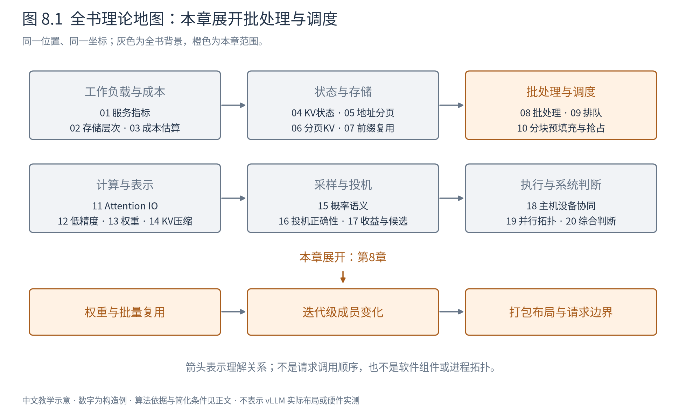
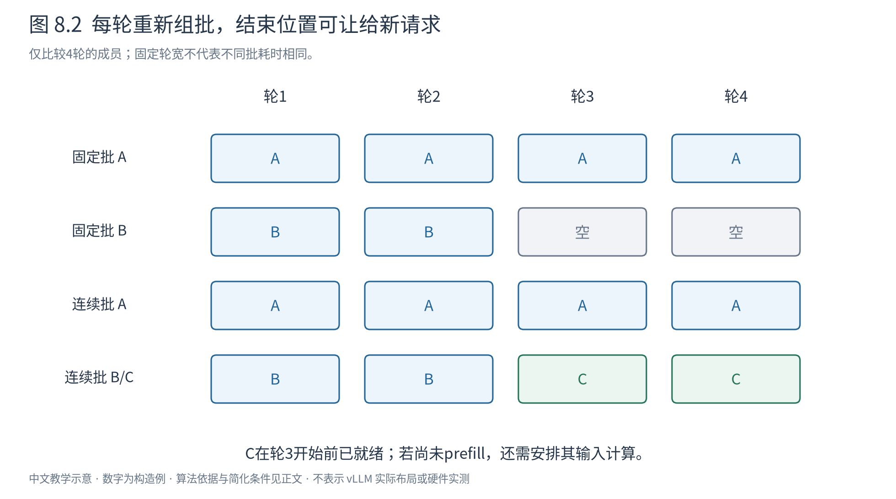

# 第 8 章 批处理：把多条请求放进同一次计算

现在我们知道怎样保存状态、怎样共享前缀。但如果每次只让A计算一个token，再让B计算一个token，相同权重可能被反复读取，设备仍有很多空闲计算能力。批处理的第一动机，就是让一次取来的权重服务更多输入。

图8.1从状态转向工作组织。本章讨论“哪些工作可以放在同一轮”，下一章讨论“哪些请求应当先得到机会”。这两种决定相关，但批格式能容纳一个请求，不等于调度策略必须立即选择它。

## 8.1 同一权重怎样服务多个请求

A和B各有一个新输入隐藏向量，形状分别为 $(1,d)$。它们都乘同一个权重 $W\in\mathbb R^{d\times f}$。把两行堆成 $(2,d)$，一次矩阵乘得到 $(2,f)$，与分别算两次在数学上等价，因为矩阵乘每个输出行仅依赖自己的输入行。

理想权重读取从两份降为一份，运算总量仍为 $4df$ FLOPs。批量越大，权重流量越能摊薄；但激活、KV及结果都继续随请求增加，算力和带宽最终会出现其他瓶颈。批处理是复用机会，不是免费加入任意多请求。

Attention需要更细的边界。A的query只能读取A允许的历史，B也只能读B的历史。即使两者在同一次设备调用中处理，也不能让它们互相注意。共享权重不是共享对话上下文。

## 8.2 静态批到底浪费在哪里

设已经完成prefill的A还需4轮decode，B只需2轮。一个固定大小2、直到整批结束才重新组批的实现有8个“请求×轮”位置，其中有效工作只有6个；B结束后的两个位置空着，C即使已到达也不能加入。

图8.2固定每轮时长仅用于比较位置使用，不声称真实大小不同的批有相同时间。上排B结束后位置空置，下排C在下一轮补入。迭代级组织减少的是空位与新请求等待整批结束的限制。

另外还有输入长度padding。A提示长度6、B长度3，若简单凑成 $(2,6,d)$，有3个填充位置；线性层可能仍对填充行做运算。mask能阻止无效数据影响结果，却不保证底层跳过了所有无效算术。后续变长布局正是为此服务。

固定批并不必然禁止流式交付，某些实现仍可提前返回B的结果；它的关键限制是批成员不能及时替换。不要把一种历史实现的交付策略，当作所有静态批的数学定义。

## 8.3 动态凑批与连续批处理差在哪里

动态凑批可以在请求开始前，等待一个短窗口收集若干请求。它改善低到达密度下的批量，但窗口本身增加等待；如果进入批后仍一直运行到整批完成，长短输出之间的空位问题依旧存在。

连续批处理（continuous batching）在迭代边界重新决定成员：完成的退出，新到的可进入，未完成的携带自己的KV继续。一个教学过程为：

|轮次|执行成员|轮末事件|
|---|---|---|
|1|A、B|A剩3步，B剩1步|
|2|A、B|B结束，C已就绪|
|3|A、C|A剩1步，C剩1步|
|4|A、C|两者结束|

本表假定C加入时已具备下一步所需状态；若C尚未prefill，就必须先安排其输入计算，不能凭“加入批”瞬间获得KV。第10章将处理新prefill与旧decode共存。

Orca将控制粒度从整个请求改为一次模型迭代，并提出配套的selective batching，使不同进度的请求能够共同推进。[Orca，OSDI 2022](https://www.usenix.org/conference/osdi22/presentation/yu)

每轮重新组批也引入元数据维护、位置映射与CPU开销。假如单轮计算很短，这些开销可能显著，因此第18章还要讨论增量组织和执行复用。

## 8.4 批里有多少请求，与有多少token，是两个数字

假设本轮A计算2个新位置，B计算1个，C计算3个。请求数是3，输入token数却是6。把输入隐藏表示紧密打包，可得 $X\in\mathbb R^{6\times d}$，并保存累计偏移 `[0,2,3,6]`：A占行0–1，B占行2，C占行3–5。

线性层可以一次处理六行。Attention还需要每条请求的query范围、历史KV长度、物理块映射、绝对位置与可见规则。例如A本次两个query对应不同逻辑位置，后一个可以看前一个，前一个不能看后一个；二者都不能看B和C。

padding布局用规则的外形换简单索引，打包布局减少无效位置却增加描述边界的元数据。是否更快取决于算子对变长布局的支持、数据准备成本和形状规模，不是删除padding字符就自动省掉同等比例时间。

“每轮最多多少token”限制总计算位置数；“最多多少序列”限制并发请求及相关管理资源；KV容量又限制持久状态。三种预算相互独立：三个长上下文decode只新增三个位置，却可能读取大量KV。

## 8.5 selective batching选择的是哪些运算

Orca的selective batching观察到，不同请求虽然历史长度不同，线性层等逐token运算仍共享权重、可沿token维合并；Attention却与各自的历史状态和形状相关。因此它将可合并的运算批量执行，并对需要各自历史的部分分别组织。

例如A历史6、B历史3，二者的新query可共同完成QKV投影，但Attention打分长度分别为7与4，不能直接假定是同一个矩形。将它们各自计算后，再把输出行合回后续线性层，保持了请求独立性。

这是一种解决异形状批处理的设计思想，不表示现代Attention必须逐请求启动单独kernel。变长Attention、分页Attention和分组算子可以在一个调用里处理多个不同长度的子问题；它们仍须保存每条请求的可见边界。应继承的是“按运算依赖选择合并方式”，不是把历史实现方式写成永久限制。

## 8.6 怎样区分各项优化的贡献

KV缓存使每次decode不重算全部历史，连续批改变成员替换时机，分页改善状态分配，前缀缓存跨请求复用历史。这些优化可以组合，但不能把它们的全部收益归到“连续批处理”一个名字下。

比较两版教学引擎时，先列哪些变量同时变了：是否已有KV，是否padding，是否同一模型与输出长度，是否更改采样，是否预热，是否包含输入处理。旧mini引擎的四版本保留在实践附录；若多项同时变化，只能报告整体演化，不作为单因素因果证明。

批量还会改变延迟：A原本1ms完成的一步可能进入更大批后需要2ms，但整批每秒完成更多token。若服务目标要求很小的ITL，就不能只追求最大批。另一方面，为了小ITL让大量请求长期排队，也可能造成TTFT恶化。

本章带走的判断是：**请求的状态可以独立，某些计算却可以共同执行；批处理的边界应由依赖和资源决定。** 下一章进一步研究等待本身：即使单步计算已经很快，为什么用户仍可能排很久，调度又应当优化谁的体验？

|符号|含义|
|---|---|
|$B,N_{\mathrm{token}}$|本轮请求数、总输入位置数；二者一般不相等|
|$X,W$|打包输入$(N_{\mathrm{token}},d)$，共享线性权重$(d,f)$|
|累计偏移|长度$B+1$的整数数组，标记每条请求的输入切片|
