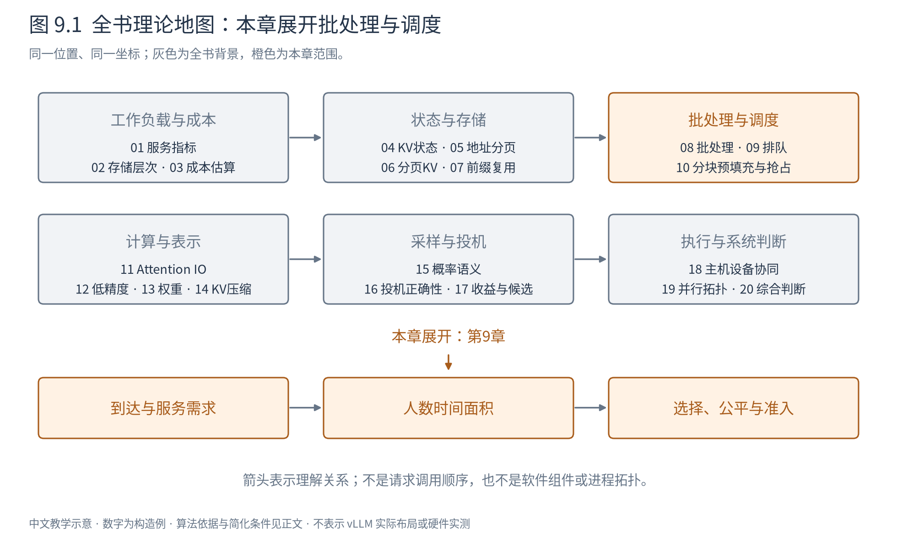
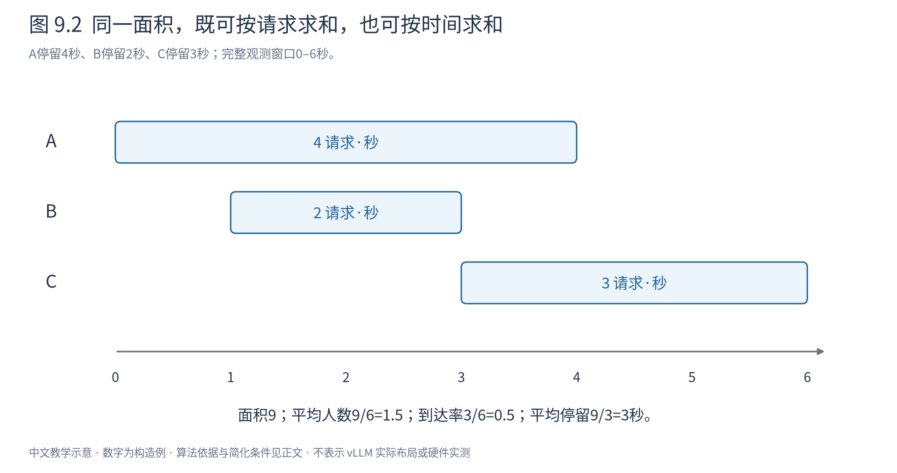

# 第 9 章 排队与调度：快的请求为什么仍然要等

第8章解决了怎样把多条请求共同计算。但请求到达的时刻由外部决定，设备每一刻能处理的工作有限；一次很快的前向，仍可能排在许多其他工作后面。服务延迟因此既有计算部分，也有等待部分。

图9.1展开到达、积压与选择。这里补齐必要排队背景，不要求先学随机过程，也不将推理引擎强行等同某个简单队列模型。

## 9.1 平均到达速度相同，也可能产生不同等待

假设每个任务独占一个简化服务器1秒。十个任务每隔1秒到达，恰好可以依次执行，几乎不排队；十个任务同时到达，则最后一个要等9秒才开始。若都放在足够长的观测窗口里，它们的平均到达率可以相同，但等待完全不同。

到达率 $\lambda$ 用请求/秒表示；服务时间S表示任务实际占用服务资源的时间。随机变量的期望就是按发生概率加权的平均值，例如服务时间以一半概率为1秒、一半为3秒，则 $E[S]=2$ 秒；它不意味着每个请求都恰好2秒。

对于单服务器、服务时间不随其他请求改变的简单模型，负载率可写为：

$$
\rho=\lambda E[S]. \tag{9.1}
$$

单位相消。若每秒来0.4个、平均服务2秒，则平均每秒需要0.8秒服务能力。若长期需求超过每秒1秒，且不拒绝请求、没有其他服务器，积压就无法稳定。

LLM批处理的每请求成本会随批组成变化，不能把某次单请求延迟直接当固定S，再用式9.1预测整个服务。这个简单模型用于理解需求与容量，不是忽略共享计算的借口。即便平均负载低于容量，突发和长任务也能造成很长等待。

## 9.2 Little定律从一张面积图得到

令 $N(t)$ 表示时刻t系统中的请求数，包括等待和正在处理。每个请求从进入到离开都贡献一条高度1的横条：在系统里待了 $W_i$ 秒，就贡献 $W_i$ 个“请求·秒”的面积。

图9.2的独立构造例中，A在0–4秒、B在1–3秒、C在3–6秒处于系统，总面积4+2+3=9请求·秒。观测0–6秒，平均人数为9/6=1.5；三个请求平均停留3秒，窗口到达率3/6=0.5请求/秒，二者相乘也是1.5。

对一个开始和结束都没有遗留请求的完整窗口T，设有n个请求，则可直接写：

$$
\bar N=\frac{\sum_iW_i}{T}
=\frac{n}{T}\frac{\sum_iW_i}{n}
=\lambda\bar W. \tag{9.2}
$$

第一个等号是同一面积按时间或按请求分别求和，第二个只是在中间乘除n。Little定律的长期形式写作 $L=\lambda W$，其中L是时间平均人数，W是每个进入请求的平均停留时间。

若窗口开始已有请求、结束仍有未完成请求，就有边缘面积，不能随便拿“窗口内完成者的全程延迟”与“窗口到达数”拼出严格等号。长期稳定且边缘影响相对消失时，才得到相应极限关系；有丢弃或取消时也要统一系统边界和离开定义。[Whitt的Little定律讲义，§2](https://www.columbia.edu/~ww2040/4615S15/LittlesLawNotes012715.pdf)

这条守恒关系不要求泊松到达，也不要求特定服务时间分布。但它只约束平均量：不能从平均人数推出P99延迟，更不能由式9.2推出“并发翻倍，吞吐一定翻倍”。W也会随负载改变。

## 9.3 长任务怎样阻塞短任务

把所有任务都视为不可中断的工作。A需要8秒，B和C各1秒，三者同时到达。按A、B、C执行，完成时间为8、9、10秒，平均9秒；按B、C、A执行，完成时间为1、2、10秒，平均约4.33秒。

总工作仍为10秒，最后完成时刻也相同，但平均完成时间差很多。这说明吞吐相同的调度也可能有很不同的体验。FCFS（先到先服务）简单、顺序容易解释；短作业优先在特定已知长度条件下能改善平均完成时间，却可能让长作业长期得不到机会。[OSTEP，第7章](https://pages.cs.wisc.edu/~remzi/OSTEP/cpu-sched.pdf)

在LLM中，提示长度已知，输出长度却往往未知；不同上下文的单token成本也不同。直接把“提示短”当“总工作短”，可能错误估计一个会生成很长答案的请求。预测可以帮助排序，但预测误差必须作为策略成本考虑。

队头阻塞还可能来自资源条件：队首请求需要两个空闲KV块，当前只有一个；后面请求只需一个。如果坚持严格顺序，后者也等待。允许绕过可以提高利用率，但持续绕过队首又可能造成饥饿。需要明确决定何时保留顺序、何时允许旁路，而不是把“能运行谁就运行谁”当作完整策略。

## 9.4 公平并不等于每轮分同样多token

A有很长历史、B很短，即使每轮各给一个新token，A的Attention工作可能更多。相同token数不等于相同设备时间；相同时间也不等于相同完成比例。公平首先需要选择对象：按请求、用户、租户、服务等级，还是资源占用进行衡量。

轮转让各任务周期性获得机会，可缓解长任务一直占用资源；但在一轮内部不能任意安全打断的设备计算，仍决定最小抢占粒度。优先级可以保护交互请求，却可能让低优先级任务饥饿。老化（aging）随等待增加优先权，是一种防止无限等待的思路，但实际等待上界还取决于准入负载和规则。

缓存感知调度可能倾向共享前缀，减少重算；公平调度可能要求先服务一个完全冷的请求。两者不是谁必然正确，而是目标不同。策略应显示这项取舍，例如在不超过等待预算的范围内利用局部性。

## 9.5 资源不够时，排队也需要边界

服务不能无限保存尚未开始的请求。等待对象本身占主机资源，客户端也有超时；过载期间继续接受所有请求，可能只是在扩大失败之前的等待。

准入控制在进入受管系统前决定是否接受工作；背压向上游传达暂时无能力继续接收；队列上限限制积压。它们并不创造算力，而是避免服务用无法兑现的承诺消耗更多资源。被拒绝的请求必须计入服务结果，不能从延迟统计中悄悄删除，再宣称系统一直很快。

容量判断应考虑持久KV、未来增长、当轮token预算和执行空间。只按“当前能装下输入”接纳，可能在后续生成阶段集体耗尽KV；反过来，为每个请求保留最坏输出长度又可能过度保守。第10章会讨论不足时如何抢占与恢复。

## 9.6 调度指标必须对应用户目标

TTFT关心新请求什么时候第一次得到结果，ITL关心已开始的请求是否持续推进。prefill优先可能让新请求尽快启动，却拖长旧请求间隔；decode优先可能保持旧请求流畅，却把新请求挡在门外。只优化一个均值会掩盖另一类等待。

还要区分“系统中并发请求数”和“本轮参与计算的请求数”。Little定律的L包含在边界内的等待者，不等于batch size。把两者混同，会错误地认为增加正在排队的请求就提高了计算复用。

本章的核心工具不是某个万能策略，而是三个问题：**需求怎样到达，资源怎样被占用，谁承担等待代价？** 下一章将这些问题落到prefill与decode的具体冲突上，看看把大任务切成小段之后，哪些等待得以缓解，又新增哪些成本。

|符号|含义与单位|
|---|---|
|$\lambda,E[S],\rho$|有效到达率请求/s、平均服务时间s、负载率|
|$N(t),L,W$|瞬时人数、时间平均人数、平均系统停留时间s|
|$T,W_i$|观测窗口、单请求在所选系统边界内停留时间|
