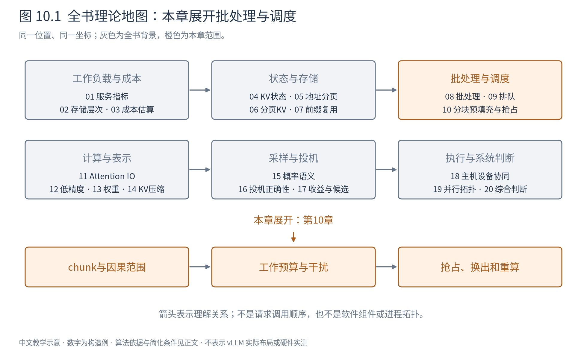
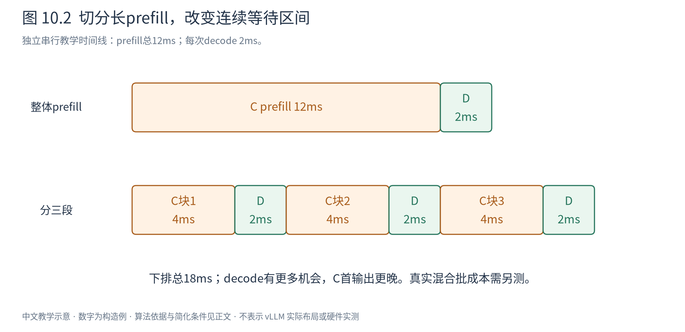

# 第 10 章 分块预填充、抢占与恢复

A、B已经开始生成，每轮只需推进一个位置。此时C带着一段很长的提示词到达。如果立即把C全部prefill放进下一轮，A、B可能长时间收不到新token；如果一直优先A、B，C的首token又可能迟迟不来。上一章的公平问题，在这里变成两类不同形状的工作争用同一设备。

图10.1展开工作粒度与恢复。我们先把长prefill拆成可以穿插的片段，再看当KV容量不够时，哪些请求需要暂时退出，以及怎样恢复它们。

## 10.1 连续批并没有自动限制一轮有多长

连续批允许每轮替换成员，但如果单轮本身很长，新请求仍须等到边界，旧decode也要等这轮完成。迭代级调度解决的是“多久有一次决策机会”，轮次内部包含多少工作则是另一个控制量。

考虑一个纯构造时间线：A/B的一轮decode需2ms，C整体prefill需12ms。若先执行C再推进A/B，旧请求下一次输出间隔会包含这12ms。如果把C分成三段、每段单独4ms，并在段间插入2ms的decode，则旧请求不必连续等完12ms，但C的首输出也会更晚。

这只是将调度粒度改变的示意。真正将prefill片段与decode放进同一批时，权重复用和算子效率会改变时间，不应把单独测得的4+2简单当作混合批的实测。

图10.2上排长prefill独占一段，下排让decode在片段之间推进。箭头和宽度表示上述构造时间，不宣称某个策略总是更快。观察重点是最大连续等待及首token完成位置如何变化。

## 10.2 切分输入，不能切断注意力历史

C有六个已知输入位置，按2个位置一块处理。第一块计算0、1；第二块计算2、3时，位置2必须看见0、1、2，位置3看见0、1、2、3；第三块同理。若第二块只在自己的2、3之间做因果Attention，就把模型变成了另一个有限上下文模型。

在第j块之前已有H个有效位置，本块有u个query，则本块query形状 $(h_q,u,d_h)$，对应历史及当前键形状 $(h_{kv},H+u,d_h)$。每个query行的可见上界不同，不能仅使用一个整块长度把本块未来位置全部放开。

前三块完成后的KV长度分别为2、4、6；只有处理到提示词末位置时，才得到用于首个新token的最后位置输出。前面片段结束可以成为调度边界，却不代表可以提前把中间位置预测当成对整条提示词的回答。

在固定计算条件下，分块prefill与整体因果前向在数学上等价。有限精度归约路径可能不同，因此实际结果容差需要验证；分块不是近似裁剪历史。

## 10.3 token预算为什么不是时间预算

假设每轮最多处理4个输入位置。若A/B各需一个decode位置，剩余两个位置可以给C的prefill块。前三轮安排可为：

|轮次|A|B|C|总新位置|
|---|---|---|---|---:|
|1|decode 1|decode 1|prefill位置0–1|4|
|2|decode 1|decode 1|prefill位置2–3|4|
|3|decode 1|decode 1|prefill位置4–5，产生首输出|4|

这是一种decode先占预算、剩余填prefill的教学策略，不规定所有服务必须使用它。若B提前结束，空出的预算可用于更大C片段或新请求。

三轮都是4个新位置，成本仍可能不同：A/B的历史持续增长，C的后续query也访问更长前缀。若有不同模型、LoRA或多模态预处理，差异更大。因此token预算是易于管理的工作量近似，若服务有严格ITL目标，还需结合长度、算子形态和历史测量校准时间。

## 10.4 SARATHI与Sarathi-Serve改变了什么

SARATHI提出用分块prefill与decode结合，让prefill提供较大的矩阵工作，同时让decode搭配参与，摊薄部分权重读取。Sarathi-Serve进一步围绕在线服务的延迟与吞吐组织近均匀的批，避免新prefill使正在进行的decode完全停止，并分析多卡流水线中的迭代不均衡。[SARATHI](https://arxiv.org/abs/2308.16369)、[Sarathi-Serve](https://www.usenix.org/conference/osdi24/presentation/agrawal)

“stall-free”应按论文调度语境理解：持续decode有机会在混合批中推进，不被整段prefill排除。它不表示decode间隔与无prefill时完全一样，更不表示没有队列或资源等待。每轮变大仍可能增加执行时间。

块小提供更频繁的调度机会，却可能增加CPU组织、重复启动、低效率小矩阵和历史KV读取成本；块大更容易发挥批量效率，却延长不可插入工作的区间。prefill越长、已有decode越多、上下文越长，合适的折中就越可能变化。不存在不依赖硬件和服务目标的统一最佳chunk大小。

## 10.5 KV不足时，暂停计算还不等于腾出容量

假设A/B/C都已驻留，但下一轮总共需要两个新块，池中只有一个。少算一条请求本轮可以暂时避开新增分配，却没有自动释放它已持有的历史。要给其他请求腾空间，需要改变持有状态：结束、驱逐可复用缓存，或抢占活跃请求。

抢占（preemption）是暂停某条尚未完成请求，把资源让给其他工作。对KV而言有几种选择：保留状态只暂停执行；换出到更慢层；丢弃KV但保留token历史以后重算。第一种不释放主要KV容量，后两种才真正降低设备驻留需求。

选择受害者时需要知道释放多少、恢复成本多高、它已经等了多久、是否共享状态。抢占A若只减少公共块引用而C仍持有这些块，就不一定释放预想的字节。不能用请求的逻辑KV大小直接当可回收物理容量。

## 10.6 重算与换出怎样比较

重算保存离散token历史，未来重新执行前向构建状态。它付出设备计算、权重与KV构建流量，但可能把长段历史组织为高效prefill。换出保存现成KV，之后搬回来，避免这些计算，却消耗双向传输、主机存储与同步。

用简化公式写：

$$
T_{\mathrm{swap}}\approx \ell_{out}+\frac{M}{W_{out}}+
\ell_{in}+\frac{M}{W_{in}},\qquad
T_{\mathrm{recompute}}\approx T_{\mathrm{prefill}}(S). \tag{10.1}
$$

M为需搬移的实际状态字节，S为需重算的有效前缀长度。若M=64MB，两方向有效带宽均为8GB/s，忽略固定项，则单程8ms、往返16ms。若重算该历史需要12ms，在这组独立构造参数下重算直接成本更低；若重算变成40ms，判断反转。

然而系统目标不仅是该请求自己的恢复时间。设备算力繁忙而搬运通道空闲时，16ms可重叠传输可能比12ms独占计算更合算；主机通道繁忙时又相反。还要计入容量占用多久、共享数据是否需要重复搬、前缀缓存能否减少重算，以及被抢占请求的等待。[PagedAttention，§4.5、§7.3](https://arxiv.org/abs/2309.06180)

## 10.7 恢复必须回到同一个逻辑前缀

设A已确认token序列长度9，其中只有前8个位置具有KV。若重算恢复，应记录哪个前缀已经计算、最新输出是否还待输入；不能为了简单把计数都设为9，然后跳过尚未计算的位置。

换回状态时，物理块号可以变化，逻辑位置必须保持；完成搬运前不能让计算读取新映射。恢复后某些缓存块可能已被别人驱逐，不能继续持有旧物理号。需要重新取得可用资源和有效引用，再推进请求。

重复抢占还会形成浪费循环：A刚重算好又被挤出，其他请求也迟迟不能完成。策略可以限制反复抢占、提高等待者优先级、降低准入或为恢复保留机会，但具体选择取决于服务目标。单纯不断重试分配，不构成公平和前进性保证。

本章把调度从“挑一个请求”扩展成“选择工作粒度并维护可恢复状态”。分块控制干扰，抢占应对容量，恢复保证计算从正确前缀继续。它们改变执行安排，不能悄悄改变模型的可见历史。接下来转向一次Attention内部：同样保持数学语义，能否少把大中间矩阵写回HBM？

|符号|含义与单位或形状|
|---|---|
|$H,u$|块前历史长度、本块新query数，token数|
|$M,W_{out},W_{in}$|待换出状态byte、两方向有效带宽byte/s|
|$\ell_{out},\ell_{in}$|传输固定成本s；与CPU调度时间另计|
