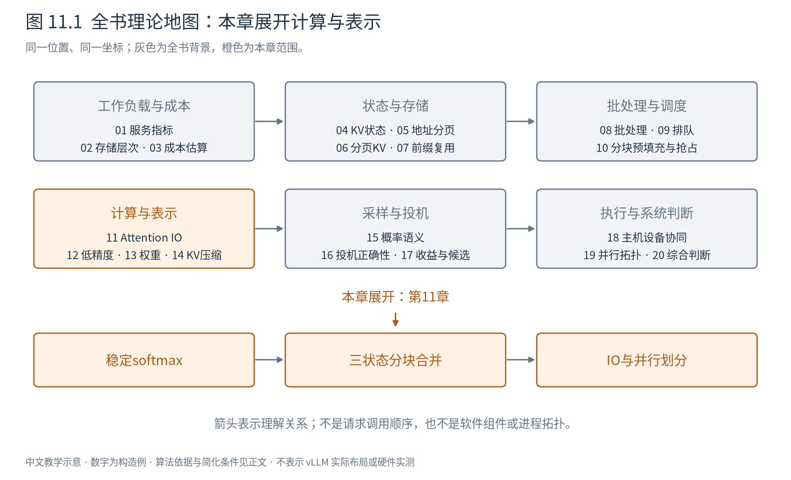
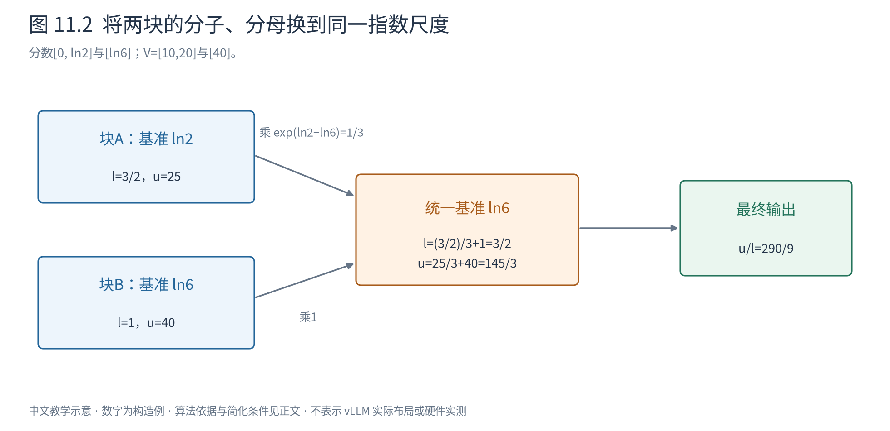
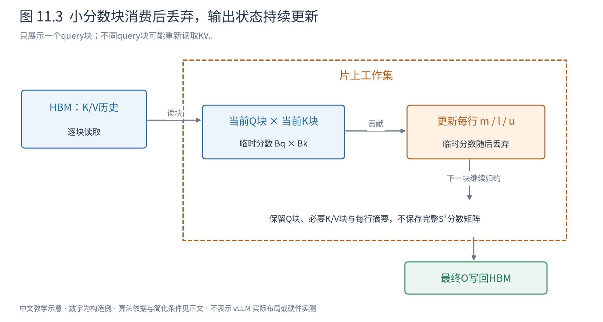

# 第 11 章 Attention 的 IO 算法：从完整矩阵到分块归约

第10章把长输入切成调度单位，却没有回答一个更靠近计算的问题：一个输入块内部的Attention，是否一定要先造出完整的分数矩阵，再做softmax？如果矩阵写进HBM后马上又被读走，算力再高也可能被搬运拖住。



本章展开“计算与表示”中的IO算法。IO在这里指存储层之间的数据读写。我们先保留相同的Attention数学定义，只改变数据何时产生、存在哪里、怎样合并。第6章解决KV住在哪里，本章解决读到这些KV以后怎样计算；二者可以结合，却不是同一种技术。

## 11.1 为什么不想把中间矩阵存下来

单头Attention中，$Q\in\mathbb R^{S_q\times d}$，$K,V\in\mathbb R^{S_k\times d}$。先计算分数 $Z=QK^T/\sqrt d$，形状为 $(S_q,S_k)$；再逐行softmax得到P，最后 $O=PV$，形状为 $(S_q,d)$。

prefill时通常 $S_q=S_k=S$，Z和P各有 $S^2$ 个元素，而输出只有Sd个。当S远大于d时，最大的中间量不是最终需要的结果。以S=4096、d=128、每元素2字节的构造例计算，一个完整中间矩阵约32MiB，输出仅1MiB。具体实现可能用不同精度，但平方增长与线性增长的区别不变。

一种直接实现会把Z写回HBM，softmax再读Z、写P，下一次矩阵乘再读P。即使能够复用某些缓冲，这些往返仍然昂贵。我们真正需要的是每一行的加权和，不一定需要保存每个权重。

困难在于归一化：前半块算完时，还不知道后半块的指数之和。若分别对每块做softmax，再平均各块输出，归一化分母就错了。第6章已经见过这个反例，本章将它变成一个可以持续更新的算法。

## 11.2 先把softmax写成稳定的比值

考虑一行分数 $z_1,\ldots,z_n$，对应值向量 $v_i\in\mathbb R^{d_v}$。输出是：

$$
o=\frac{\sum_i e^{z_i}v_i}{\sum_i e^{z_i}}. \tag{11.1}
$$

若z中有1000，直接求指数可能溢出。取 $m=\max_i z_i$，分子分母同时除以 $e^m$，比值不变：

$$
l=\sum_i e^{z_i-m},\qquad u=\sum_i e^{z_i-m}v_i,\qquad o=u/l. \tag{11.2}
$$

现在指数的输入不大于0，至少一个指数为1。m是标量，l是无量纲标量，u是长度 $d_v$ 的向量。对分数[1000,1001]，无需计算巨大的指数，只计算 $[e^{-1},1]$ 即可得到相同比例。

这一步不是近似，也不是把小分数人为删掉；在实数数学中等价。浮点数仍会有舍入或很小值的下溢，因此不同计算顺序未必逐位相同。

## 11.3 只保留三个状态，便能合并两块

设两块分别得到 $(m_a,l_a,u_a)$ 与 $(m_b,l_b,u_b)$。它们的指数以不同m为基准，不能直接相加。先选统一基准 $m=\max(m_a,m_b)$。

第一块原来的 $e^{z-m_a}$ 应变成 $e^{z-m}=e^{m_a-m}e^{z-m_a}$，所以它的l和u都乘同一个重标定系数。第二块同理，得到：

$$
\begin{aligned}
m&=\max(m_a,m_b),\\
l&=e^{m_a-m}l_a+e^{m_b-m}l_b,\\
u&=e^{m_a-m}u_a+e^{m_b-m}u_b.
\end{aligned} \tag{11.3}
$$

合并后仍满足式11.2的定义，这就是算法的不变量：无论已经看过多少块，三个状态始终表示那些位置的共同最大值、同一基准下的分母和分子。归一化可以推迟到所有块处理完之后。

沿用第6章的算例，分数为 $[0,\ln2,\ln6]$，V为[10,20,40]。前两项是一块，最后一项另一块：

|阶段|m|l|u|
|---|---|---:|---:|
|第一块|$\ln2$|$1/2+1=3/2$|$10/2+20=25$|
|第二块|$\ln6$|1|40|
|合并|$\ln6$|$(1/3)(3/2)+1=3/2$|$25/3+40=145/3$|

最终 $o=(145/3)/(3/2)=290/9$，与直接计算 $(10+40+240)/(1+2+6)$ 一致。第一块局部输出是50/3，第二块是40；等权平均85/3不会得到这个答案，因为两块在全局分母中贡献的质量是3和6。



图11.2应先看两块各自的最大值，再看第一块乘1/3的箭头。改变的是数值表达的共同尺度，两个块的相对贡献没有改变。依据为[FlashAttention论文的分块softmax与Algorithm1](https://arxiv.org/abs/2205.14135)，数字为本书构造。

下面是单query的教学伪码。输入为按块送入的分数和值，输出为一个值向量；它不限定KV连续还是分页。

```text
state = empty
for block in blocks:
    valid = 按因果、长度和窗口规则选出本块有效位置
    if valid为空: continue       # 无贡献，避免计算负无穷减负无穷
    mb = max(scores[valid])
    weights = exp(scores[valid] - mb)
    lb = sum(weights)
    ub = sum(weights[i] * values[i] for i in valid)
    if state为空:
        state = (mb, lb, ub)      # 第一块直接建立不变量
    else:
        state = merge(state, (mb, lb, ub))  # 使用式11.3同时缩放l和u
if state为空: 按调用约定处理无有效key情形
else: return state.u / state.l   # 只有最后才需要归一化
```

通常因果Attention至少允许当前位置，整行并不为空；但不能把这个常见条件偷偷写进通用归约公式。全掩码行的输出约定应由算法接口明确规定。

## 11.4 从一行推广到一个片上计算块

现在一次保留 $B_q$ 个query，逐块读入 $B_k$ 个K/V。临时分数只有 $(B_q,B_k)$；每个query各保留一套m、l、u。分数块用于更新状态后就可以丢弃，不必将完整Z或P写回HBM。



图11.3中虚线框是片上工作集。读入一个K/V块，算局部分数，再把贡献归约进输出状态；箭头回到下一块。每个query块做完才写出O。片上容量有限，$B_q,B_k$不能任意增大；块变大可能提高复用，也可能挤占寄存器或局部存储，减少可并行执行的工作。

若还要做训练反向传播，不保存完整P就需要在反向阶段依据输入和少量统计量重新计算局部分数与概率。FlashAttention利用“多做一些相对便宜的运算，少搬大中间量”的交换降低存储压力。纯推理没有这条反向路径，但仍可能因不同query块复用同一历史而重新读取或计算部分内容。重算与存储的选择必须按所处阶段分别计量，不能把训练中的激活节省直接当成推理KV已经消失。

这说明“没有完整S²中间矩阵”不等于“只读一次全部输入”。不同query块可能重新读取K/V，实际流量取决于片上容量和分块安排。FlashAttention的核心是在具体存储模型下减少昂贵层次的读写，而不是宣称Attention本身从二次计算变成线性计算。

因果掩码也必须落实到块内。一个块全部位于query未来时可以跳过；穿过对角线的块仍需逐位置屏蔽。分页KV则先通过块表获得物理位置，再向上述计算提供逻辑顺序和有效范围。物理块大小与计算tile大小可以不同，不能把两个参数当成一个。

## 11.5 少搬数据之后，还要解决谁来做这些工作

分块公式确定了可以怎样算，设备仍需决定由哪些执行单元承担哪些query、如何交换部分结果，以及如何安排矩阵运算与指数归约。

FlashAttention-2沿这个方向减少非矩阵运算、增加沿序列的并行，并调整工作划分以降低线程组间的共享存储通信。直觉是让不同执行小组负责不同query输出，各自完成归约；若切在key维，多个小组往往还要合并同一输出。切分并没有一种永远最优的答案：decode的query很少，沿key拆分后再合并反而可能提供必要并行度。[FA2原论文](https://arxiv.org/abs/2307.08691)

FlashAttention-3进一步面向Hopper的异步硬件，让数据搬运、矩阵乘和softmax尽量重叠，并讨论低精度路径。FlashAttention-4面向后续硬件的不均衡增长，继续重排流水线、减少指数与重标定开销。它们都保留具体硬件前提，不能据此断言昇腾NPU具有相同指令或相同速度。[FA3](https://arxiv.org/abs/2407.08608)、[FA4](https://arxiv.org/abs/2603.05451)

从这条演进线应记住的是瓶颈会迁移：省去HBM往返后，指数计算、归约、同步或并行不足可能变得显眼。只比较FLOPs总数，会漏掉这些工作具有不同执行成本这一事实。

## 11.6 同一数学接口，可以有不同算法路径

SDPA（缩放点积Attention）首先是一个运算定义与接口概念，不是某个固定kernel；具体库可能根据设备、形状、精度与mask选不同实现。FlashInfer等库还围绕服务中的decode、变长序列、分页与拆分归约安排执行。判断它们时应分别问：数学语义是否一致，存储布局支持什么，工作如何划分，以及适用形状是什么。[PyTorch SDPA说明](https://docs.pytorch.org/docs/stable/generated/torch.nn.functional.scaled_dot_product_attention.html)、[FlashInfer论文](https://arxiv.org/abs/2501.01005)

Book5介绍过递归状态模型的分块思想。共同的系统方法是寻找能跨块合并的摘要，让计算适配存储和并行；但Attention的 $(m,l,u)$ 是针对某个query的归约摘要，不能因此把所有历史KV永久压成一套固定状态供任意未来query使用。不同数学依赖决定不同的可压缩边界。

读到这里，应能从公式重新构造分块Attention，并解释它为什么省IO、为什么仍需历史K/V、为什么两块局部输出不能直接平均。下一章改变另一个维度：如果每个数只用更少位表示，存储还能省多少，又会引入什么误差？
