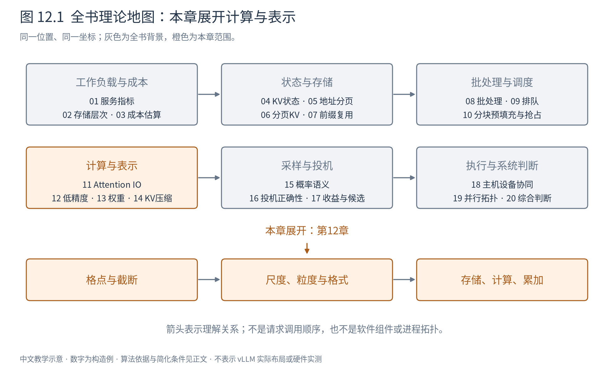
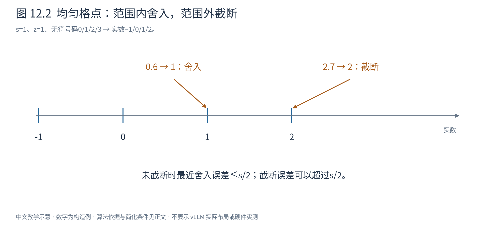
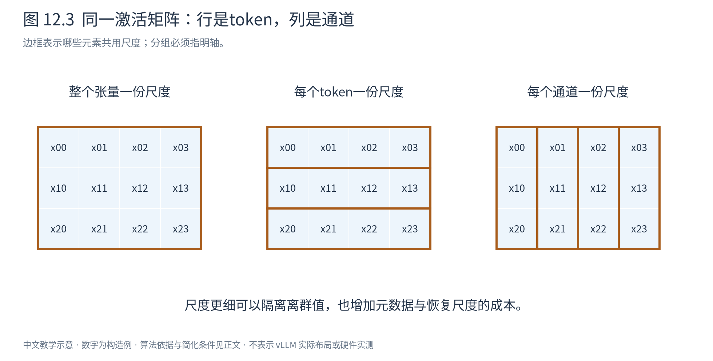

# 第 12 章 低精度计算的基础：表示、误差与成本

上一章通过少保存中间量减少搬运。本章换一种办法：同样数量的数，能否用更少的位存储？答案通常是可以，但“少一半字节”与“结果几乎不变”之间，需要一套明确的数值规则。

本章提供第13、14章共用的基础。先理解有限格点怎样表示连续数值，再讨论一群数如何共享尺度。所有例子都是数值构造，不意味着某种设备一定原生支持这些格式。

## 12.1 量化是把数放到有限的格点上

假设只能存2位无符号整数，码值q只能取0、1、2、3。若希望它代表−1、0、1、2，可以定义反量化规则 $\hat x=s(q-z)$，取尺度s=1、零点z=1。于是整数1代表实数0，整数0代表−1。

一般的仿射量化写成：

$$
q=\operatorname{clip}\bigl(\operatorname{round}(x/s)+z,q_{\min},q_{\max}\bigr),\qquad
\hat x=s(q-z). \tag{12.1}
$$

s是每一级代表的实数间距，z是表示实数零的整数码。round将数舍入到格点，clip将越界码截到允许范围。这两个步骤的误差来源不同。

本例x=0.6时，先舍入0.6得到1，再加零点得到q=2，恢复为1；误差 $\hat x-x=0.4$。x=2.7时，理想码为4却越过上界，只能截成3，恢复为2，误差−0.7。对范围内的最近舍入，误差绝对值至多s/2；发生截断后就没有这个保证。恰好落在半格的舍入规则也需要统一，不能假定所有格式都相同。

图12.2中的刻度是可表示值。0.6落到1是舍入，2.7落到2是截断。图中的零点只是整数编码的偏移，不是把输入所有值都加1后送入模型。

如果指定区间 $[a,b]$，可先取 $s=(b-a)/(q_{\max}-q_{\min})$，再求近似零点 $z\approx q_{\min}-a/s$ 并舍入、限制到合法码域。因为z必须是整数，实际可表示端点未必恰好等于a、b。对称量化通常令z=0，让正负范围围绕0，减少零点处理，但对明显偏斜的分布可能浪费一部分码域。

## 12.2 为什么一个离群值会影响其他数

设四个权重为[−0.2,0.1,0.3,7]，用整数码−7到7做对称量化。为容纳7，尺度必须取1；前三个数都舍入成0。范围虽覆盖全部值，小数却没有足够分辨率。

如果只为前三个数设尺度0.3/7，最大误差不超过约0.0214；但第四个7若也用这个尺度，就会被严重截断。这解释了两类不同选择：一种让离群值占用整个范围，接受多数小值的粗糙表示；另一种限制范围，接受少量大值被截断。哪种更好，取决于这些值怎样影响最终输出。

常见校准因此不会只记录最大值，还可能搜索截断阈值、使用分位数或最小化重构误差。校准数据是用来估计模型运行时的分布；若部署输入与校准数据差异很大，原来的范围可能失效。不能把某组校准结果当成任意领域输入的保证。

## 12.3 “每通道”必须说明是哪一维

考虑激活 $X\in\mathbb R^{T\times d}$：行是token，列是隐藏通道。整个矩阵共用一个s是per-tensor；每一行独立选s是per-token；每一列独立选s是per-channel。分组量化则把某一维切成若干组，在组内共享尺度。权重矩阵的输入通道与输出通道又是两条轴，不能只说“按通道”而不写形状。

图12.3用同一份 $(T,d)$ 数据对比三个划分。若离群值固定在某一列，整矩阵或每行尺度会被该列拉大；每列尺度可以隔离影响。如果离群值只出现在某一行，按行可能更合适。这是数据分布与分组方式的匹配问题。

尺度越细，通常越能适应局部范围，但要保存更多元数据，也可能使矩阵乘的反量化更复杂。若每g个元素共用一个16位尺度，数据本身b位，则忽略对齐和零点时，平均每元素成本是：

$$
b_{\mathrm{eff}}=b+16/g\quad\text{bit/element}. \tag{12.2}
$$

4位数据、g=32时为4.5位；g=128时为4.125位。若还存16位零点，则元数据再加16/g。小组并非免费，实际压缩率应根据整份表示计算。

还要区分静态与动态尺度。静态尺度在部署前校准，运行时开销小；动态尺度由当前激活计算，能适应变化，却增加归约和同步。权重离线已知，激活和KV随请求产生，因此同一种规则在三者上的成本不同。

## 12.4 浮点数用另一种方式分配格点

整数仿射量化在一个组内使用均匀间距。浮点数则将位分给符号、指数和尾数，正规数可写成：

$$
x=(-1)^\sigma(1+f)2^e. \tag{12.3}
$$

指数决定量级，尾数决定该量级内的精细程度；因此越大的数，绝对间隔通常越大。零、次正规数、无穷和NaN还有专门规则，不都符合式12.3。

|格式|符号位|指数位|显式尾数位|需要记住的取舍|
|---|---:|---:|---:|---|
|FP32|1|8|23|范围较宽，尾数较细，存储4字节|
|FP16|1|5|10|2字节，指数范围较窄|
|BF16|1|8|7|2字节，指数范围接近FP32，精细度低于FP16|
|FP8 E4M3类|1|4|3|有限位更多分给尾数，特殊值规则依具体变体|
|FP8 E5M2类|1|5|2|更多指数位换取更宽范围，尾数更粗|

在1附近，FP16相邻正规数间距为 $2^{-10}$，BF16为 $2^{-7}$；同为16位，不代表同样精度。FP8还常配外部尺度，让一组数据落入更合适的表示范围。E4M3FN、E4M3FNUZ等变体在指数偏置、特殊值或负零上可能不同，文件中只写“FP8”并不足以完整说明表示。[ONNX官方FP8格式说明](https://onnx.ai/onnx/technical/float8.html)

本书不根据格式名字推断910B2的指令支持。格式能够存储、软件能够解码、硬件能够高效计算，是三个分别需要核验的条件。

## 12.5 存储、乘法与累加可以使用不同精度

W4A16通常表示权重以4位、激活以16位参与所讨论的执行方案；它不意味着矩阵乘一定直接使用4位浮点指令。有的路径先将压缩权重解码到16位片上值，再与16位激活相乘。W8A8则同时压缩权重与激活，仍需说明整数还是浮点、累加使用什么格式。

考虑整数点积。若 $x_i\approx s_x(q_i-z_x)$、$w_i\approx s_w(r_i-z_w)$，且这组乘积共用尺度，则：

$$
\sum_i x_iw_i\approx s_xs_w\sum_i(q_i-z_x)(r_i-z_w). \tag{12.4}
$$

内部整数乘加可以使用更宽累加器，最后恢复尺度。非零零点还会产生修正项，或需要在计算前处理；分组尺度不同则必须分组累加后各自恢复。不能把所有量化简单理解为“矩阵变小了，原算子原样运行”。

即使每次乘法误差不大，长点积累加仍可能放大误差或溢出。FP16/BF16乘法配FP32累加是一类常见选择，但每个kernel的具体约定应单独确认。提高累加精度不能恢复在量化时已经丢失的信息。

## 12.6 误差要沿着模型计算解释

记重构误差 $E=\hat W-W$。单看 $\|E\|_F^2$ 衡量权重数值偏离，却未考虑真实输入。对列向量输入x，输出误差为Ex：如果x在某个通道总是很大，该通道的相同权重误差可能更重要；如果两个输入通道高度相关，两个权重的误差还可能互相补偿。

这就是下一章层重构目标的来源。更远处还有非线性、残差、Attention与采样，因此较小的局部误差不等于生成任务质量绝不下降。常见评估至少分三层：数值重构误差、模型概率指标如困惑度、实际任务质量。困惑度为平均负对数似然的指数，只衡量给定数据上的预测概率；它不能替代长文检索或遵循指令等具体能力测试。

性能也有对应的三层：压缩后的真实字节、算子执行时间、端到端服务收益。把权重从16位变成4位，理想数据部分缩小4倍，但尺度、对齐、解码和非权重工作都不会自动消失。第3章的Roofline与Amdahl仍适用：低bit的价值取决于它是否改善当前瓶颈。

本章建立了表示的语言。第13章将用这些语言解释如何选择权重量化误差；第14章处理持续增长的KV，那里还必须考虑新数据到达和历史信息丢弃。
