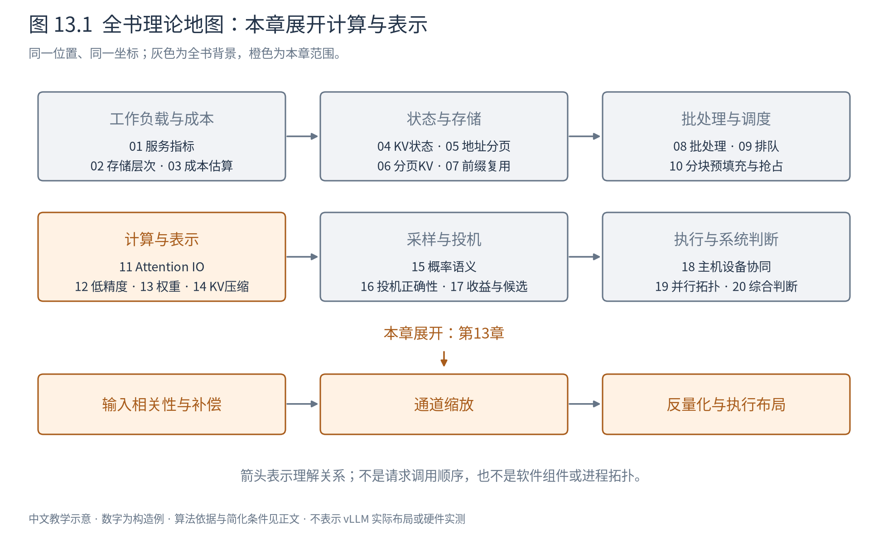
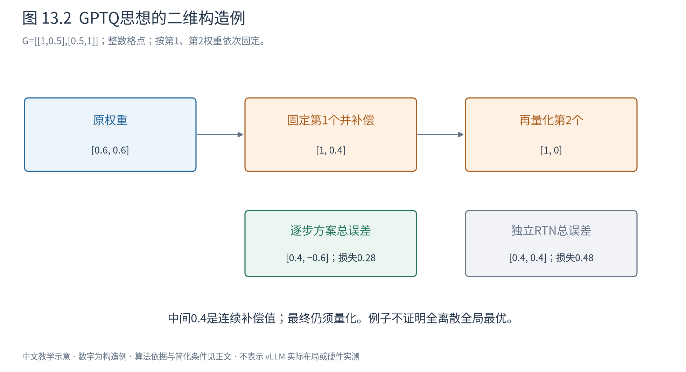

# 第 13 章 权重量化：如何分配有限的误差预算

知道4位格点怎样编码一个权重，还不能决定几亿个权重应如何一起量化。逐个取最近值很自然，但模型需要保持的是输出，而不是每个参数各自最近。本章从这个差别展开GPTQ、AWQ与SmoothQuant。

沿用上一章的数值概念，本章先看离线量化决策，再看运行期怎样消费压缩权重。方法的校准成本、数值质量和执行速度分开讨论。

## 13.1 最近舍入是基线，却没有看见输入

RTN（round-to-nearest）在选定尺度、范围和分组后，对每个权重独立舍入。它简单、无需反复运行模型，并且在固定格点下使每个权重的绝对误差最小。但两组权重误差可能在真实输入上相互抵消，也可能叠加；RTN不知道这些相关性。

取线性层 $Y=WX$，这里采用列输入约定：$W\in\mathbb R^{d_o\times d_i}$，校准输入 $X\in\mathbb R^{d_i\times n}$，n列为不同样本或token。希望量化后输出仍接近原输出，可构造：

$$
\mathcal L(\hat W)=\|WX-\hat WX\|_F^2. \tag{13.1}
$$

这不是重新训练整模型，而是在选定校准X上做层输出重构。不同输出行可分开处理。对一行权重w，令改变量 $\delta=\hat w-w$（作为列向量记），则该行损失为：

$$
\mathcal L=\delta^TG\delta,\qquad G=XX^T. \tag{13.2}
$$

G的对角元素刻画输入各通道的能量，非对角元素刻画相关性。它把“输入怎样出现”变成误差的权重；若G近似单位阵，独立舍入的理由更充分，若通道相关，就有补偿空间。[GPTQ的层重构目标](https://arxiv.org/abs/2210.17323)

## 13.2 固定一个权重后，怎样补偿其余权重

暂不要求其余权重立刻落在格点上，只把第j个权重固定到一个量化值，因而 $\delta_j=c$。我们要在这个约束下最小化式13.2。

设 $e_j$ 是只有第j项为1的单位向量，约束为 $e_j^T\delta=c$。引入拉格朗日乘子λ，将目标写为 $\delta^TG\delta+\lambda(e_j^T\delta-c)$。对δ求导并令其为0：

$$
2G\delta+\lambda e_j=0
\quad\Longrightarrow\quad
\delta=-\frac{\lambda}{2}G^{-1}e_j.
$$

再代回约束，得到：

$$
\delta=\frac{c}{(G^{-1})_{jj}}G^{-1}e_j. \tag{13.3}
$$

这列向量的第j项恰好是c，其余项给出连续空间里的最优补偿。若用H=2G表示Hessian，比例中的2会相消，得到相同更新。公式依赖可逆性；有限校准数据可能使G奇异或病态，实际方法通过阻尼等措施稳定求解，而不是无条件求逆。

这里的“二阶”来自二次损失的曲率。它不意味着知道整个语言模型最终任务损失的精确Hessian，也不意味着得到了全部离散格点组合的全局最优解。

## 13.3 用两个权重走完一次补偿

取 $w=[0.6,0.6]$，整数格点，$G=\begin{pmatrix}1&0.5\\0.5&1\end{pmatrix}$。先将第一个权重舍入为1，固定 $\delta_1=0.4$。把损失展开为：

$$
\mathcal L=0.16+0.4\delta_2+\delta_2^2.
$$

对 $\delta_2$ 求导得 $0.4+2\delta_2=0$，所以 $\delta_2=-0.2$。第二个权重先由0.6改为0.4，第一阶段损失0.12；若完全不补偿，损失为0.16。

接下来第二个权重也必须落在格点上。0.4舍入为0，最终权重为[1,0]，相对原值的总误差[0.4,−0.6]，损失为0.28。RTN直接得到[1,1]，误差[0.4,0.4]，损失为0.48。

图13.2中0.4是暂时的连续补偿值，不能当成最终整数表示。最终质量还会受量化顺序、格点与分组影响；例子证明相关性可能让补偿有价值，不证明每次更新都让最终离散方案最优。

GPTQ将这种思路扩展到层：用校准统计建立曲率信息，逐步固定量化值，向尚未固定的权重传播误差，再利用分块更新等方法降低大矩阵处理成本。校准样本、阻尼、分组和顺序都属于方案的一部分。所谓“一次性量化”是部署前处理的类别，不意味着没有显著离线计算成本。[GPTQ原论文§3](https://arxiv.org/abs/2210.17323)

## 13.4 AWQ：同一实数计算，换一种格点分配

另一条路线不显式求上述二阶补偿，而是先改变通道尺度。仍用列输入约定，取正对角矩阵D，有：

$$
Wx=(WD)(D^{-1}x). \tag{13.4}
$$

在精确实数中，放大某个权重输入通道、同时缩小对应激活，不改变输出。但量化不是线性运算，通常 $Q(WD)D^{-1}\ne Q(W)$。因此可以利用缩放改变误差的分配。

例如x=[10,1]，W=[0.1,1]，输出为2。取D=diag(10,1)，变换后权重[1,1]、激活[1,1]，输出仍为2。如果原先较小的0.1在粗格点中容易丢失，这种变换就可能保护它的重要贡献。

但不能据此断言尺度越大越好。组内尺度由最大值决定时，放大一列可能增大整个组的步长，令其他权重更难表示。AWQ利用激活统计识别重要通道，并搜索合适的缩放，让保护重要贡献与保持其他值精度之间取得平衡。它并不是把所有重要权重长期保留为FP16，也不等同于GPTQ的二阶逐项误差传播。[AWQ原论文§3](https://arxiv.org/abs/2306.00978)

这个例子也揭示校准的角色：x中的10并非权重文件本身告诉我们的，而来自运行数据。重要性判断只有在校准与部署输入关系合理时才可靠。

## 13.5 SmoothQuant：把激活的难度移到权重一侧

对W8A8，激活也要量化。如果激活某些通道长期有很大的离群值，按token选尺度仍可能让其他通道变粗。SmoothQuant使用相同的等价变换思想，但着重降低激活的量化难度。

本节采用常见行输入约定 $Y=XW$，$X\in\mathbb R^{T\times d_i}$、$W\in\mathbb R^{d_i\times d_o}$。定义 $D=\operatorname{diag}(s)$，则：

$$
Y=(XD^{-1})(DW),\qquad
s_j=\frac{(\max_t|X_{tj}|)^\alpha}{(\max_o|W_{jo}|)^{1-\alpha}}. \tag{13.5}
$$

分子估计激活第j通道的范围，分母考虑放大该权重行的代价；α控制困难向权重迁移多少。零范围需加保护规则，不能直接除零。变换在量化之前保持等价，量化之后的误差仍取决于范围和粒度。

当α接近1，更多缩小激活大通道，权重可能更难量化；α较小时相反。缩放可在满足计算图约束时折叠进前后层参数，减少运行期额外运算，但残差分支、共享张量或其他消费者必须一致处理。不能局部缩放一条边，却忘记另一条分支仍使用原尺度。[SmoothQuant原论文§4](https://arxiv.org/abs/2211.10438)

GPTQ、AWQ、SmoothQuant所强调的问题于是不同：第一个根据输入相关性补偿舍入误差；第二个用激活信息调整权重通道的误差预算；第三个平衡激活与权重两侧的量化难度。它们的标签不直接决定某设备上的最佳速度。

## 13.6 压缩权重怎样成为一次矩阵乘

设N个权重原为FP16。W4数据部分从2N字节减为N/2字节，但还需读尺度、零点或分组信息。若先将整层解码成FP16写入HBM，再运行普通矩阵乘，就会重新产生大容量中间权重和额外读写，可能抵消部分收益。

融合反量化则把压缩块读入片上，解码后立即参与矩阵乘，不把完整FP16权重再写回HBM。这样把HBM流量节省与额外片上运算交换。Marlin展示了面向特定GPU的FP16×INT4执行设计，包括布局、流水线与复用安排；其价值不只是“支持4位文件”。[Marlin作者仓库](https://github.com/IST-DASLab/marlin)

小batch、权重读取主导时，少读字节可能很有价值；大batch下权重被更多token复用，矩阵算力、反量化指令、数据布局或其他算子可能成为新限制。W4A16与W8A8因此不能只按4小于8排序，后者可能获得不同的原生计算路径，前者则可能更省权重容量。实际选择必须同时核验质量、算子支持和目标负载。

## 13.7 文件格式、量化算法与执行格式分别负责什么

GGUF是模型容器格式：它记录张量、类型和相关元数据，使文件可以被工具读取；其中可存多种量化类型。GPTQ和AWQ主要指量化决策与方法家族；某个运行后端则可能要求专门重排的权重布局。三者不是互斥的同一级选项。[GGUF官方规范](https://github.com/ggml-org/ggml/blob/master/docs/gguf.md)

从文件到运行，至少要确认模型结构能否解释、数值编码是否支持、尺度与分组是否一致、权重布局是否需要转换，以及对应算子是否适合当前设备。一个格式能被加载，不等于它已经进入高效执行路径。

本章讨论的权重主要在部署前固定。下一章面对的KV却逐步到达、随请求增长，并且直接参与未来的注意力。除了改变位宽，我们还要问更强的问题：能不能不再保留某些历史？
