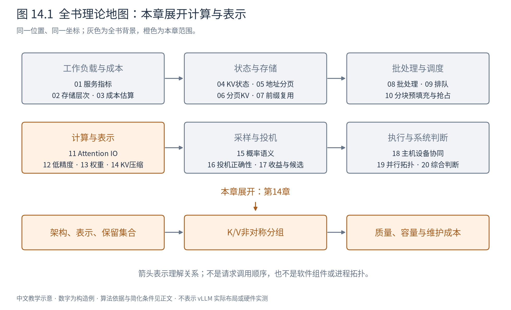
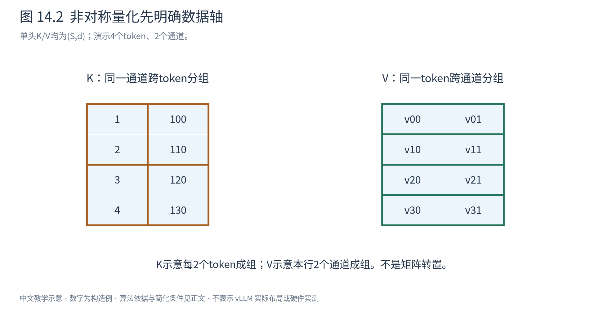
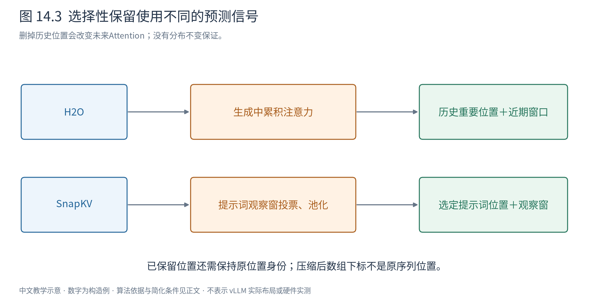

# 第 14 章 KV 压缩：改变表示，还是舍弃历史

第4章算过KV容量，它随并发请求和上下文长度增长。第6章的分页减少分配浪费，第7章的前缀缓存让相同计算共享状态，但对于必须独占保存的长历史，每个有效位置仍要付出存储成本。本章讨论怎样进一步改变这笔成本。

需要先区分三条路线：模型架构本来就使用较小状态；把同一状态存成更低精度；只保留部分历史位置。三者改变的对象不同，正确性与质量代价也不同。

## 14.1 先写清究竟减少了哪一项

对普通全局Attention，单层单请求的K/V形状各为 $(S,h_{kv},d)$，数据容量为 $2Sh_{kv}de$ 字节。减少KV头数或使用潜在表示，改变每位置状态维度；量化减少每元素字节e；选择性保留减少实际保存的位置数S。

MHA到GQA/MQA、MLA等属于模型计算定义的一部分，通常需要相应训练或转换适配。不能在任意已经训练好的MHA模型上直接删头，宣称输出保持原样。分页则主要改变分配与地址映射，本来就不要求删掉有效历史。

数值量化和选择性保留可以在既有模型上研究，但往往是近似计算。模型任务质量保持到什么程度，需要在规定模型、上下文与任务上评估。“近似无损”是经验结果，不能当成任意query下严格相同的数学定理。

## 14.2 K与V承担不同角色，误差也走不同路径

单query输出为 $o=\operatorname{softmax}(qK^T/\sqrt d)V$。K误差先改变分数，再通过softmax改变整行权重；V误差则在给定权重下改变加权结果。两者共同量化时，这两条误差路径还会相互作用。

用一阶变化作解释，设分数z、概率p，微小分数扰动满足：

$$
\delta p_i\approx p_i\left(\delta z_i-\sum_jp_j\delta z_j\right). \tag{14.1}
$$

它来自softmax导数 $\partial p_i/\partial z_j=p_i(\mathbf1_{i=j}-p_j)$。所以只改变一个key，也可能改变所有位置的归一化权重。若暂时固定p，V扰动对输出的影响则为 $\delta o=\sum_i p_i\delta v_i$：权重大位置的值误差直接贡献更多。

这并不证明K一定比V更敏感，而是说明它们不能只按相同元素数量选择相同规则。数据分布、权重稀疏性与误差传播都需要考虑。

## 14.3 KIVI：先选合适的轴，再处理流式到达

KIVI观察到所研究模型的K存在持续的通道离群值，因而采用K按通道、V按token的非对称量化。这里把单头矩阵写成 $(S,d)$：K在固定列、跨一组token统计尺度；V在固定行、跨一组通道统计尺度。[KIVI原论文§3](https://arxiv.org/abs/2402.02750)

例如K为：

$$
K=\begin{pmatrix}1&100\\2&110\\3&120\\4&130\end{pmatrix}.
$$

若每行共用范围，第一列的小数值始终与百量级值争用格点；分别为两列设置范围，可以隔离这种差异。这个矩阵说明选择轴的理由，不代表所有模型、所有层都会出现相同分布。

图14.2中纵向括号对应K同一通道的多个token，横向括号对应V同一token的多个通道。不要把“per-channel”误读成“一行里面各通道共用尺度”：必须先看形状与哪一轴共享参数。

流式生成又带来新问题。V新来一行就有可量化的通道组；K却需要攒出一组token才能确定跨token尺度。如果每到一个token都重新量化全部历史，维护成本会很大。KIVI因此保留一段高精度残差区，并将较旧部分压缩。

用教学参数G=2、K残差阈值R=4说明：K陆续到达第1、2、3行时留在高精度残差中；第4行到达后，按每2行一组、每列分别量化，把4行追加到压缩区，残差清空；第5行开始新的残差。G必须与刷新块大小相容，本例R可被G整除。

V也保留近期高精度数据，但原算法采用近期队列：随着新行到达，将超过保留范围的最旧行按token量化并移入压缩区。它不是必须与K同时把整个残差区冲刷。两者最后都由“较旧压缩部分+近期高精度部分”提供Attention输入，但维护节奏可以不同。

读取时可在tile内解码旧数据，与近期高精度数据共同计算。前者节省字节，后者避免近期数据过早受到量化影响，也为流式分组提供缓冲。代价是尺度、残差区、量化维护和混合精度执行；序列很短时，残差区可能占大部分容量，名义2位并不意味着整份KV已经压成原来的1/8。

## 14.4 离群值与残差还可以分别编码

KVQuant进一步研究键的量化位置与表示，包括在RoPE之前量化key、按通道处理、面向数据分布的非均匀码本，以及把少量离群值以稀疏形式单独保留。前RoPE表示与后RoPE表示不能直接混用；计算时仍必须恢复正确的位置旋转语义。[KVQuant原论文](https://arxiv.org/abs/2401.18079)

非均匀码本让格点集中到更常出现的范围，改善某些分布的误差，但编码、查表与尺度都有成本。单独存离群值还要保存索引和值，稀疏比例过大时未必划算。

GEAR把低bit量化后的残差再分解为低秩与稀疏部分。可以用概念式表示为 $X\approx\hat X_{\mathrm{lowbit}}+AB+E_{\mathrm{sparse}}$。若 $X\in\mathbb R^{S\times d}$，秩r残差用 $A\in\mathbb R^{S\times r}$、$B\in\mathbb R^{r\times d}$ 表示，需要约r(S+d)个数；只有r足够小并且确实捕捉了重要误差时才有意义。运行时还需计算修正项，而不是只存下来便免费生效。[GEAR原论文](https://arxiv.org/abs/2403.05527)

这几类方法提供的是不同的误差预算方式：每个数都粗一些，少数异常值精确一些，或用结构化残差补偿。它们仍保留历史信息的近似表示，与接下来直接删除位置不同。

## 14.5 H2O：过去被关注的位置，未来是否值得保留

如果Attention经常只把较大权重分给少数历史位置，可以考虑在容量预算内选择保留集合。H2O利用累计注意力分数识别heavy hitters，同时保留近期位置，平衡长期重要信息与局部依赖。[H2O原论文§4](https://arxiv.org/abs/2306.14048)

用简化单头例子：四个较早位置累计得分[0.1,0.7,0.2,0.6]，历史预算2、近期预算2。保留历史位置1和3，以及两个最近位置；新token到达后更新注意力统计、移动近期窗口，必要时从候选中驱逐得分较低位置。真实策略还需规定统计更新范围、每层/头预算以及并列处理。

这与一般缓存淘汰有个关键差别。普通缓存丢掉对象，下一次可从低层存储取回；删掉KV后，若没有保存副本或重算路径，未来query不能直接把它当作仍然存在。重新归一化后的Attention本身已经改变，之后的分数统计也来自改变后的上下文。

反例很简单：下一个query恰好只需要原位置0的事实。尽管它历史得分低，一旦丢弃，就可能失去回答所需的信息。累计重要性是一种预测信号，不是未来重要性的保证。论文在特定目标与假设下讨论的选择性质，不能扩展成任意语言任务输出分布不变的证明。

## 14.6 SnapKV：用提示词末尾的观察窗预测后续需求

SnapKV在prefill阶段用提示词末尾的一段query作为观察窗。先计算这些query对较早位置的注意力，将观察窗中的贡献按位置汇总；再做一维池化，让相邻位置也有机会组成保留区域；按预算选top-k历史位置，并与整个观察窗的KV拼接。[SnapKV原论文§4与Listing1](https://arxiv.org/abs/2404.14469)

图14.3上路是生成过程中持续积累重要性，下路是提示词结束时观察窗投票。二者都选择保留位置，但使用的信息时间点不同。为了理解池化，可以把历史投票看成[0.1,0.7,0.2,0.6]；宽3的最大池化会把高票影响扩展到邻近位置。实际边界填充、并列顺序和预算会决定最后保留谁，不能只画一颗最高分星号就略过选择过程。

保留的不是原文token字符串，而是对应层与头的K/V。实现还必须维护正确的位置语义：压缩后数组下标0不代表它在原序列的位置就是0。若重新施加位置编码或构造mask时混淆这两个坐标，即使选择本身合理，计算仍会错误。

SnapKV对提示词KV做选择，不意味着之后无限生成也只占固定总容量；新生成状态如何增长仍需另行说明。它还依赖观察窗能够预测未来所需信息。在任务改变、很久以后才需要早期细节或观察窗缺乏代表性时，应专门检查质量。

## 14.7 组合优化要重新算字节，不能相乘宣传数字

回到统一容量式。实际预算更接近：

$$
M= M_{\mathrm{compressed\ history}}+M_{\mathrm{recent}}+M_{\mathrm{scales}}+
M_{\mathrm{indices}}+M_{\mathrm{residual}}+M_{\mathrm{padding}}. \tag{14.2}
$$

各项是否存在取决于所用方案。量化与选择性保留即使在理想数据项上近似相乘，元数据和近期区也未必同比缩小；共享前缀还会改变不同请求间的重复计数。与此同时，选择得分可能受到量化误差影响，压缩后的状态也可能不适合原有复用身份。

例如原始100个元素各2字节共200字节；保留50个、其中10个仍为2字节、40个量化到4位，数据是20+20=40字节，而不是简单按“保留一半、位宽四分之一”得到25字节。还没加尺度和索引，真实压缩率已不同。

容量节省只有转化为更长上下文、更大有效批量或更少搬运时才产生相应系统收益。若新增解码和选择成本主导，延迟可能上升；若质量下降，吞吐数字也不再对应同一任务。第20章将把这些约束放回同一次服务评估。

下一章从存储回到生成语义：即使所有前向结果已经算出，logits仍不是最终token。先把采样的概率过程讲清楚，才能理解后续投机解码为何需要严格验证，而不是简单相信较快模型的猜测。
