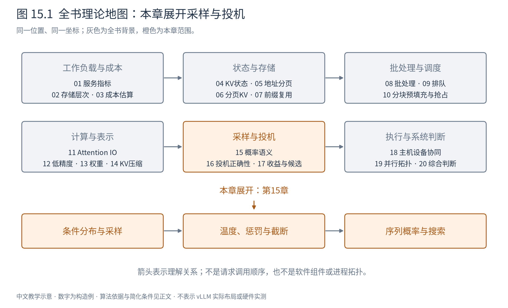
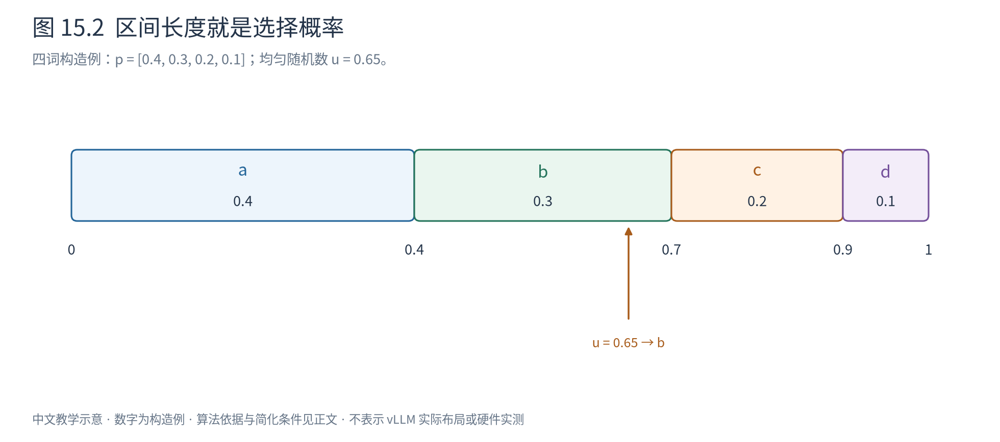
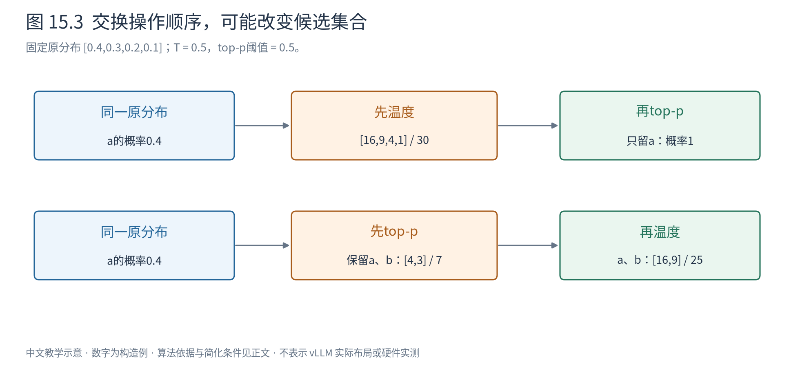

# 第 15 章 从 logits 到 token：生成的概率语义

前面讨论了怎样存储和计算模型。现在把注意力放到每轮前向的末端：模型交出一排分数，系统必须从中选出一个token。这个选择看起来很小，却决定了输出是什么，也决定了下一章所说的“投机解码保持正确”究竟要保持什么。



图15.1展开生成部分。我们先从一次选择建立概率语义，再把选择放回完整序列。这里的词表刻意缩成四个符号，符号不是自然语言单词；所有数字都是构造例。上一章的压缩可能改变分数，本章则暂时固定分数，单独研究怎样使用它。

## 15.1 模型给出的是条件分布

假设当前已确认的前缀为 $h$，下一token属于词表 $\mathcal V$，词表大小为 $V$。模型输出一个形状为 $(V,)$ 的logits向量 $z$。logit可以是任意实数，还不是概率：它可能为负，所有元素也不必加起来等于1。

softmax把相对分数变成概率：

$$
p(v\mid h)=\frac{\exp(z_v-m)}{\sum_{u\in\mathcal V}\exp(z_u-m)},\qquad m=\max_u z_u. \tag{15.1}
$$

减去共同最大值不改变比值，却避免直接对大正数求指数。输入和输出形状都是 $(V,)$；对 $B$ 条序列独立处理时，两者均为 $(B,V)$，分母沿词表维求和，不能沿请求维归一化。

取四词 $a,b,c,d$，令logits为 $[\ln4,\ln3,\ln2,0]$。指数相对权重为4、3、2、1，所以概率为 $[0.4,0.3,0.2,0.1]$。这里说a的概率为0.4，是指**在这个确定前缀下重复进行随机选择，长期约四成选择a**；它不意味着a有四成概率“在事实意义上正确”。

前缀一变，整个分布可能变化。若先选a，再在前缀 $ha$ 下选b，则两步序列概率是：

$$
P(ab\mid h)=p(a\mid h)p(b\mid ha). \tag{15.2}
$$

例如 $p(a\mid h)=0.4$、$p(b\mid ha)=0.8$，则ab的概率为0.32。这是条件概率的乘法规则，不要求两次选择独立。一般序列的概率是各步**沿实际前缀**条件概率的乘积。不能把第一轮分布连乘多次，除非模型恰好在所有前缀下给出相同分布。

## 15.2 一次随机数怎样变成一个token

分类采样（categorical sampling）只需要把总长度1分给各个token。按a、b、c、d顺序，累计边界为0、0.4、0.7、0.9、1。取均匀随机数 $u\in[0,1)$：落在 $[0,0.4)$ 选a，落在 $[0.4,0.7)$ 选b，依次类推。区间长度恰好等于所需概率，因此选择频率也服从该分布。



图15.2中的0.65落在b的区间，得到b；0.95则得到d。区间只是教学实现，工程实现可能采用其他等价算法。概率为零的token没有区间，永远不会被选到。

贪心解码（greedy decoding）则直接取最大分数。本例每次选a。它可以看成把目标分布改为a处概率1、其他处0；这已经是另一种生成规则。逐步贪心也不等于找到整条序列概率最大的结果：若a之后最佳后续的条件概率只有0.4，而b之后最佳后续为0.9，那么两步最佳路径可能来自b，因为 $0.3\times0.9>0.4\times0.4$。

概率语义因此必须包含“如何选择”，不能只看模型权重。下面每个处理器，都是在定义实际交给采样器的分布。

## 15.3 温度改变集中程度，截断改变候选集合

温度 $T>0$ 先缩放logits，再做softmax：

$$
p_T(v)=\frac{\exp(z_v/T)}{\sum_u\exp(z_u/T)}
       =\frac{p(v)^{1/T}}{\sum_u p(u)^{1/T}}. \tag{15.3}
$$

第二个等号来自把原softmax的公共分母消去。$T<1$ 会放大概率比，$T>1$ 会压平概率比，但不会改变有限logits的排序。对四词例取 $T=0.5$，相对权重由4、3、2、1变成16、9、4、1，概率为 $[16,9,4,1]/30$。最大项从0.4变成约0.533，而不是直接变成1。常用接口中的temperature=0通常选择贪心分支，不能把0直接代入式15.3。

top-k保留概率最高的k个token，其他置零，再重新归一化。原四词例取k=2，得到 $[4/7,3/7,0,0]$。它规定的是候选数量，不保证保留多少原概率质量。

top-p又叫核采样（nucleus sampling）：按概率降序排列，取累计概率达到阈值 $\rho$ 的最小前缀集合，再归一化。用 $\rho$ 表示阈值，避免与分布p混淆。取 $\rho=0.6$ 时，a只有0.4不够，加入b后达到0.7，最终仍为 $[4/7,3/7,0,0]$；取 $\rho=0.85$ 时需要a、b、c，结果为 $[4/9,3/9,2/9,0]$。实际实现还需约定并列排序及至少保留多少项。[核采样原论文](https://arxiv.org/abs/1904.09751)

动态候选集合的理由是：同样k，在模型非常确定时可能保留太多尾部，在模型不确定时又可能删掉大量合理候选。top-p用概率质量调节集合规模，但它也不证明被删掉的词一定错误；这是生成策略的取舍。

## 15.4 惩罚重复时，到底惩罚了什么

假设历史中a出现两次，b出现一次。**频次惩罚（frequency penalty）**按出现次数减分；**出现惩罚（presence penalty）**只关心是否出现过。一种常见定义是：

$$
z'_v=z_v-\lambda_f n_v-\lambda_p\mathbf{1}[n_v>0]. \tag{15.4}
$$

这里 $n_v$ 是纳入统计的历史中token v的出现次数，$\lambda_f,\lambda_p$ 是logit单位的系数。取 $\lambda_f=0.2,\lambda_p=0.5$，a减0.9，b减0.7，未出现的c、d不减。必须先规定历史包含提示词还是仅生成部分，不同约定会产生不同分布。

**重复惩罚（repetition penalty）**还有另一种常见定义。对出现过的token，惩罚系数 $r>1$ 时：

$$
z'_v=\begin{cases}z_v/r,&z_v\ge0,\\r z_v,&z_v<0.\end{cases} \tag{15.5}
$$

为什么分正负？因为把负数也除以r会让它靠近零，反而提高相对分数。取出现过的两个logit为2和−2，r=2后成为1和−4，都下降；若统一除以2，−2却会变成−1。这类惩罚依赖logit本身，甚至不具备原softmax对共同平移的不变性，所以不能随意在惩罚之前“减个常数”，再假定生成语义不变。[Transformers官方处理器实现](https://github.com/huggingface/transformers/blob/v5.14.1/src/transformers/generation/logits_process.py)

惩罚并不理解语言的重复是否必要。代码中的变量名、诗歌的节奏、必须原样引用的文本都可能被误伤；系数增大不能简单等价为质量提高。

## 15.5 处理顺序是算法的一部分

再用原四词例，取 $T=0.5$、top-p阈值0.6。若先温度、再top-p，概率成为 $[16,9,4,1]/30$；第一项约0.533仍不够，需要a和b，最后为 $[16/25,9/25,0,0]$。

将阈值改为0.5，顺序差别就显现：先温度时a已经超过0.5，只保留a；先在原分布上截断时需要a和b，之后再降温仍保留两者，得到16/25与9/25。**同一组参数没有唯一含义，除非同时确定处理次序。**



图15.3固定阈值0.5，两条路线只交换两个操作，保留集合已经不同。与之相比，温度保持排序，在无并列及相同规则下可与固定top-k选集合相容；不能从一个不交换的例子推断所有处理器都不交换。

若先施加式15.4的频次惩罚，再除以温度，惩罚幅度也被除以温度；先降温再减相同数值，则没有。这是另一个不交换的来源。语法约束通常把当前不允许的token置为负无穷，但若集合为空，系统必须有明确处理，不能对全负无穷直接softmax。

一个教学采样管线可以写成：

```text
输入：当前前缀 h、模型分数 z[V]、一套明确排序的策略
z1 = 根据 h 计算重复相关惩罚(z)   # 历史范围与惩罚定义属于契约
z2 = 应用合法token掩码(z1)       # 排除当前语法不允许的选择
z3 = z2 / T                    # T>0；贪心走单独分支
p  = softmax(z3)                # 沿词表维归一化
S  = 按规定顺序执行截断(p)       # 每步使用哪一个分布必须说清
p_final = normalize(p on S)     # 归一化后才是实际目标分布
token = categorical(p_final)    # 抽到ID不等于该位置KV已计算
```

这是一种指定语义的教学管线，不声明所有引擎都采用该顺序。最后几步可能融合，top-p排序也可能用专门选择算法降低成本。词表越大，排序、概率归约与数据搬运越不可忽略；在很小的模型上，采样端甚至可能占明显时间。优化实现时仍需保留所承诺的分布。

## 15.6 其他截断方法，各自度量什么

min-p使用相对最高概率阈值：保留 $p(v)\ge\mu\max_u p(u)$。原四词例取 $\mu=0.6$，阈值0.24，保留a和b；它不是“保留累计概率0.6”。epsilon采样使用绝对阈值 $p(v)\ge\epsilon$，同样不计算累计和。二者都要避免空集合，通常至少保留一个最大项。

要理解typical采样，先认识信息量。概率p的事件发生时，其信息量定义为 $-\log p$：越罕见，数值越大。对整个分布取平均得到熵：

$$
H(p)=-\sum_v p(v)\log p(v). \tag{15.6}
$$

熵衡量当前选择的不确定程度，单位取决于对数底数；本书用自然对数，单位为nat。typical采样按 $| -\log p(v)-H(p)|$ 从小到大排序，优先保留信息量接近平均的token，再累计到指定质量。它可能排除过于确定的最大项，所以不等于“另一种top-p”。[Locally Typical Sampling](https://arxiv.org/abs/2202.00666)

eta采样则让绝对阈值随熵变化，一种原论文及常用实现的形式为：

$$
\eta=\min\left(\epsilon,\sqrt{\epsilon}\exp[-H(p)]\right). \tag{15.7}
$$

保留概率高于该阈值的项。熵较高时，很多合理项的概率都较小，阈值随之降低；熵低时则不会无限升高，受epsilon限制。这里的参数、平方根和熵底数必须作为一个整体理解，不能仅凭“自适应采样”四字互换公式。[Truncation Sampling as Language Model Desmoothing，§4](https://arxiv.org/abs/2210.15191)

这些方法改变的是“愿意让哪些候选参与下一次抽样”。它们是质量、多样性与错误风险之间的策略，不存在对所有任务统一占优的阈值。

## 15.7 束搜索处理的是另一种问题

束搜索（beam search）保留多个未完成前缀，并按累计分数筛选。宽度2时，第一轮可以保留a和b；第二轮分别展开两条前缀，再从所有扩展中保留两条，而不是各自保留一条。它近似搜索高分序列，不是从目标分布独立抽取两个样本。

累计概率通常转为对数和：$\log P(y)=\sum_t\log p(y_t\mid y_{<t})$，避免很小概率连乘下溢。每个对数项不大于零，长度变长会继续降低总分，搜索容易偏向短结果。一种GNMT长度修正是：

$$
\operatorname{score}(y)=\frac{\log P(y)}{((5+|y|)/6)^\alpha}. \tag{15.8}
$$

分母随长度增大；对负的对数分数而言，除以更大的正数使分数更靠近零，从而相对补偿长结果。它不是从概率公理推出的唯一选择，也不是把模型概率原样保留。GNMT还讨论覆盖惩罚；这里保留长度项以说明搜索目标如何改变。[GNMT，Beam Search](https://arxiv.org/abs/1609.08144)

不同beam持有不同前缀状态，部分共享、分歧时独立写入，因此又回到第6章的COW。输出EOS后，该分支应按结束规则进入完成集合，不能把EOS之后的任意扩展混入同一序列评分。

生成策略也有成本。对大小为V的词表，softmax和惩罚至少涉及相应元素的读写或归约；top-k可以用选择算法，不一定完整排序，top-p则需要按概率质量决定截断集合。把整份logits搬回CPU后再处理，可能产生额外传输与同步；在设备上融合部分操作则可能减少中间量。这里没有统一的毫秒常数，词表大小、batch、截断算法和数据所在位置都会影响成本。比较采样方案时应先保证目标分布相同，再比较执行，而不能把少处理几个候选造成的语义变化算作纯工程加速。

## 15.8 为下一章固定“正确”的含义

同一种子只有在随机数调用次序、实现、数值和执行路径足够一致时，才可能重现同一串token。改变批组成、采样算法或并行归约顺序都可能改变逐token结果；概率分布相同仍允许样本不同。温度、截断、惩罚和语法掩码改变的是分布本身，问题更进一步。

下一章约定：$p(\cdot\mid h)$ 是**目标模型经过完整生成策略后**的实际条件分布；$q(\cdot\mid h)$ 是实际产生草稿的提议分布。投机要保持的是p定义的序列分布，而不是裸logits，也不是某次普通解码碰巧得到的文本。

至此，采样不再是一个模糊的“随机选词”动作。它由条件前缀、概率变换、合法集合和随机选择共同定义。只有这个契约明确，才有可能证明先猜后验没有改变我们想生成的东西。

|符号|含义与形状|
|---|---|
|$z,p$|词表分数与概率，单请求均为$(V,)$|
|$h$|当前已确认token前缀，变长离散序列|
|$T,\rho,k$|温度、累计质量阈值、保留数量，标量|
|$n_v,H(p)$|出现计数、分布熵，标量；熵采用nat|

本章四词案例为独立构造；来源用于定义与机制，未复用论文性能数字。其他处理顺序须重新计算目标分布，不能套用本章数值结果。
