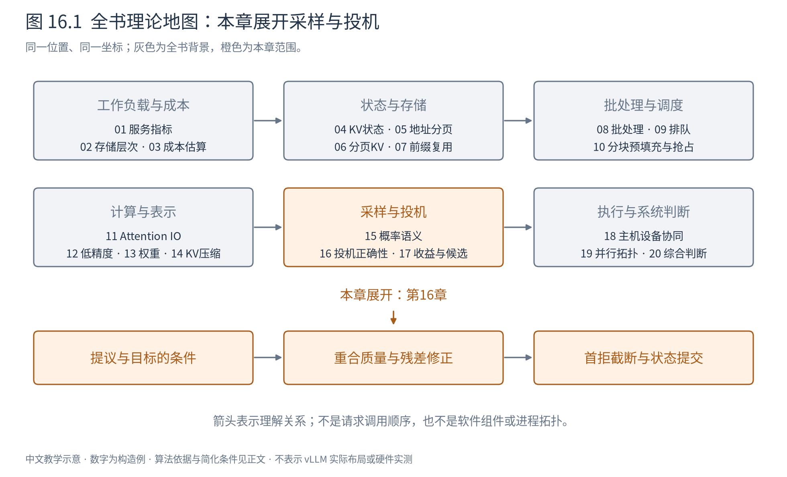
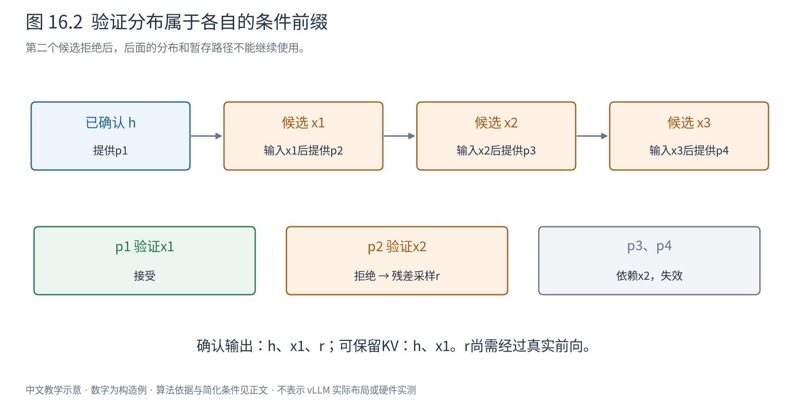
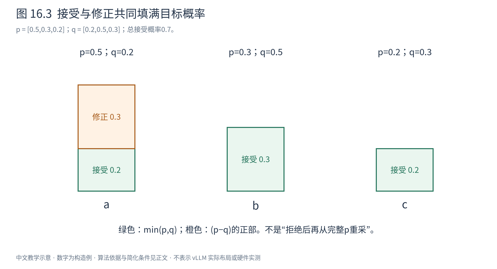

# 第 16 章 投机解码：为什么先猜后验仍然正确

普通自回归生成有一条无法绕开的语义依赖：先确定下一个token，才能知道再下一个token所处的前缀。但“前缀尚未确定”不等于“完全不能提前计算”。我们可以先猜一个前缀，让目标模型提前计算这条路径上的条件分布，然后只保留通过验证的部分。

这种方法叫投机解码（speculative decoding）。真正困难的不只是猜得准，而是：猜错后如何修正，才能让最终输出仍服从上一章定义的目标分布？本章先证明正确性，下一章再讨论这些额外工作是否划算。



图16.1将“候选来自哪里”“怎样验证”“是否值得”分开。本章只需要一个能产生候选及其概率的提议器，不要求它一定是小语言模型。默认目标是分类采样，数学证明使用精确概率；浮点与实现误差在章末讨论。

## 16.1 已知候选以后，串行依赖发生了什么变化

把已确认前缀记为 $h$。提议器先自回归地产生三个候选 $x_1,x_2,x_3$，并保存实际使用的条件分布：

$$
q_1=q(\cdot\mid h),\quad q_2=q(\cdot\mid hx_1),\quad
q_3=q(\cdot\mid hx_1x_2). \tag{16.1}
$$

在生成草稿时，这三次选择仍然有前后依赖。但是，草稿一旦确定，目标模型需要计算的输入路径就已知了。与prefill类似，因果mask允许同一次前向计算多个位置，而每个位置仍然只能看见自己的前缀。目标模型给出：

|用于哪次决定|目标分布的条件前缀|验证对象|
|---|---|---|
|第1个候选|$h$|$x_1$|
|第2个候选|$hx_1$|$x_2$|
|第3个候选|$hx_1x_2$|$x_3$|
|候选全部接受后的额外一步|$hx_1x_2x_3$|尚未采样的额外token|

这里最容易出现下标错误：**输入 $x_i$ 所在位置的输出预测的是它后面的token，不是预测 $x_i$ 自己。** $p_1$ 来自h的末位置；它可能已经保存，也可能把h末尾尚未计算的token与候选一起送入验证。实现可不同，条件对应不能错。



图16.2先读上方的草稿链，再读下方各分布的条件。若第二个候选被拒绝，就不能拿 $p_3$ 继续生成，因为它以被拒绝的 $x_2$ 为前提。一次计算许多分布，并没有让它们在所有路径上都有效。

“并行验证”也不表示模型深度消失：层与层仍依赖，Attention仍有因果范围。我们只是把若干已知输入位置组成一次计算，减少目标模型在时间上的逐token调用。

## 16.2 两种看似合理的捷径为什么有偏

先固定一个前缀，只研究一次选择。词表为a、b、c，目标分布与提议分布为：

|token|a|b|c|
|---|---:|---:|---:|
|目标 $p$|0.5|0.3|0.2|
|提议 $q$|0.2|0.5|0.3|

如果提议器选出什么就直接接受，结果当然是q，a会少生成0.3，b、c会多生成。只要求“目标模型认为这个词也不太离谱”同样不足：除非给出严格的接受与补偿规则，否则结果分布没有理由恰好等于p。

稍聪明的做法是：q过量的部分随机拒绝，拒绝后从p重新采一次。接受概率先暂取 $\min(1,p(x)/q(x))$，稍后解释来源。则a总被接受，b以0.6接受，c以2/3接受。接受分支贡献的无条件质量是 $[0.2,0.3,0.2]$，合计0.7；拒绝概率0.3。

若拒绝后直接从p重采，补入质量为 $0.3p=[0.15,0.09,0.06]$，最终得到 $[0.35,0.39,0.26]$。它仍不是 $[0.5,0.3,0.2]$：b和c已经由接受分支填满，再给它们分配额外质量，就会再次过量。**重采应该补缺口，而不是重新照抄完整目标。**

## 16.3 从概率质量守恒推导算法

先看token v。它被提议的概率是q(v)。最终希望它占p(v)，因此能从提议分支直接保留的质量不能超过两者中较小的一个。取尽可能多的重合部分：

$$
q(v)a(v)=\min(p(v),q(v)). \tag{16.2}
$$

当q(v)>0，两边除以q(v)，得到接受概率：

$$
a(v)=\min\left(1,\frac{p(v)}{q(v)}\right). \tag{16.3}
$$

这不是“置信度超过阈值”规则，而是把每项保留下来的概率质量精确限制在允许范围。q(v)=0的token不会被提议，因此无需在该事件上计算除法；它仍可能通过下面的修正分支出现。

所有接受质量相加，得到单步总接受概率 $\beta$：

$$
\beta=\sum_v\min(p(v),q(v)). \tag{16.4}
$$

目标尚未填满的部分为 $d(v)=p(v)-\min(p(v),q(v))=\max(p(v)-q(v),0)$。求和得 $\sum_vd(v)=1-\beta$，恰好等于拒绝事件的概率。所以，在发生拒绝的条件下，应从残差分布采样：

$$
r(v)=\frac{\max(p(v)-q(v),0)}{1-\beta},\qquad \beta<1. \tag{16.5}
$$

把两条分支合起来，最终输出v的无条件概率为：

$$
P(Y=v)=q(v)a(v)+(1-\beta)r(v)
=\min(p(v),q(v))+\max(p(v)-q(v),0)=p(v). \tag{16.6}
$$

每个token都成立，因此整个输出分布就是p。若 $\beta=1$，没有拒绝事件，不应构造一个分母为零的残差分布。[Leviathan等，§2.3及附录A.1](https://proceedings.mlr.press/v202/leviathan23a.html)



图16.3的三列分别对应a、b、c。接受分支已经填入0.2、0.3、0.2，只有a还缺0.3，所以本例残差为 $[1,0,0]$。发生任何拒绝都修正为a，而不是强制修正成“与被拒token不同的随机词”；它来自分布缺口，而非字符串排除规则。

还可以把接受率写成分布距离。利用 $\min(p,q)=(p+q-|p-q|)/2$，逐项求和得到：

$$
\beta=1-\frac12\sum_v|p(v)-q(v)|. \tag{16.7}
$$

两分布越接近，重合质量越大。这里比较的是完整分布，不只是两个模型的最大概率token是否一致；最大项相同也可能有很低的整体重合。

## 16.4 一次具体随机过程

回到三词例。设提议用的均匀随机数为0.4。q的区间为a占[0,0.2)、b占[0.2,0.7)、c占[0.7,1)，因此得到b。再取独立验收随机数0.8；b的接受概率为0.6，0.8大于0.6，拒绝。残差只有a，最终输出a。

若第二个随机数为0.4，则接受b。两次运行结果不同，但所有随机事件综合后的概率满足式16.6。不能只挑一个拒绝路径，看它“把b改成a”，就声称输出有偏；必须计算全部路径的质量。

极端情况也提供检查：p=q时总接受，无需修正；p与q支撑完全不重叠时总拒绝，残差恰为p；若q只会提出一个确定token x，则接受概率为p(x)，拒绝后在其余目标质量上采样。最后一种情况说明，确定性的查表候选也能嵌入严格框架，但必须使用真实的点质量q，不能伪造一套softmax概率。

## 16.5 从单位置走到完整序列

现在每个位置的p、q都依赖前缀。对第一个候选应用上面的算法，输出分布是 $p(\cdot\mid h)$。如果它被接受，确认前缀变成 $hx_1$，下一组 $p_2,q_2$ 恰好都以这个前缀为条件，再次应用同样证明。

如果在第j位置拒绝，就从对应残差生成修正token y，确认前缀变为 $hx_1\cdots x_{j-1}y$。已有后续验证分布以 $x_j$ 为条件，不能再使用；本轮在这里结束，下一轮从新前缀重新起草。

由此逐步归纳：在每个已经形成的真实前缀下，下一次确认的token都服从目标条件分布。再用第15章的条件概率乘法规则，整条输出序列的分布等于目标模型按相同策略自回归采样的分布。算法有时一轮确认多个位置，有时只确认一个位置，改变的是工作组织，不是每个条件概率。

若所有 $\gamma$ 个草稿都接受，已经计算出的 $p_{\gamma+1}$ 以正确的完整草稿为条件，直接从中再采一个额外token。因此没有提前停止时，每轮产出是“接受的草稿数+1”；这个1可能是首拒位置的修正token，也可能是全接受后的额外token。不能把“每轮都有1”误读成拒绝后还要额外再加一个。

```text
输入：确认前缀 h；候选 x[1..gamma]；实际提议分布 q[1..gamma]
      目标按草稿路径给出的 p[1..gamma+1]
输出：本轮确认的token；哪些暂存状态可以保留
for i = 1..gamma:
    if uniform_in_[0,1)() < min(1, p[i][x[i]] / q[i][x[i]]):
        确认 x[i]                  # 现在前缀真的包含它
        若已达到停止条件：结束请求  # 不再强求产出额外token
    else:
        r = normalize(max(p[i] - q[i], 0))
        y = sample(r)              # 只补目标尚未获得的质量
        确认 y；丢弃 x[i..gamma] 的暂存后缀
        返回                       # 后面的p以错误前缀为条件
确认 sample(p[gamma+1])             # 仅全接受且未停止时执行
```

这是串行语义伪码。实现可以提前生成随机数、向量化计算接受标记，但必须取连续接受前缀，不能把拒绝点之后单独“看起来接受”的位置拼回来。

## 16.6 确认token与提交状态是两张不同的表

设h已有6个已计算位置，候选为x、y、z。验证可暂时计算这三个候选位置的KV。如果x接受、y拒绝并修正为r，则新的确认token前缀是h、x、r，但可保留的目标KV仅为h和x：r还没有经过目标前向，原来y的KV不能改个token ID就变成r的KV。

|时刻|确认token前缀|可视为已提交的KV|暂存后缀|
|---|---|---|---|
|验证之前|h|h|无|
|验证完成，尚未验收|h|h|x、y、z的路径状态|
|x接受、y拒绝|h、x、r|h、x|y、z应失效|
|后续真正计算r之后|h、x、r|h、x、r|依下一轮决定|

如果x、y、z全接受，再采出额外token w，那么h、x、y、z的KV可保留，w仍等待下一次前向。这与普通decode的“最新输出尚未具有KV”是同一件事。

状态回滚不一定立即清除字节。对仅追加的全局KV，可以收缩有效长度、释放不再需要的块或让后续写入覆盖无效槽；但不能破坏共享块，也不能在设备仍访问时回收。draft模型自己的状态也要与最终确认前缀对齐，不能只修目标模型。

若模型还有原位更新的递归状态，旧状态可能已经被覆盖，简单缩短长度不够。需要检查点、逐步中间状态或重算。第17章会用一个递推例说明为什么这一点不能省略。

## 16.7 停止与数值边界也是正确性的一部分

遇到EOS时，先按接受或修正规则确定它是否成为真实输出；一旦真实输出触发停止，就不能继续输出后面的草稿或额外token。最大输出长度同理：即使验证了许多候选，提交数量也要服从剩余长度。对跨token停止字符串，还需按相同解码与截断规则判断；“计算过”不意味着“应交付”。

温度、top-p、重复惩罚与语法约束必须在各自正确的候选前缀上计算。若惩罚只更新到轮首h，就会把所有 $p_i$ 都按错误历史处理；此时公式仍能拼成某个p，却不是原来承诺的目标分布。q也必须是**真正采出候选时使用的分布**，不能用处理前logits替代。

贪心是点质量目标分布的特例。在固定并列规则下，候选等于目标最大项才接受；拒绝后改成目标最大项。这样保持的是贪心序列。把一个非贪心目标改成“只要候选够典型就接受”，则属于近似生成，需另行评价分布与质量变化。

证明基于精确数学。有限精度下的归一化、相减截断、验收随机数和不同前向路径的数值误差都需要实现处理；p=q时不能因数值噪声产生非法残差。CPU小例只能检查某份实现的边界，不能代替式16.6的证明，也不能保证同一种子逐token相同。

本章得到的关键判断是：**接受的部分保存重合质量，拒绝的部分补齐缺失质量；每次只沿已确认前缀继续。** 下一章可以据此安全地改变草稿来源和计算组织，但必须重新计算成本，不能由正确性推导出必然加速。

|符号|含义与形状|
|---|---|
|$p_i,q_i,r_i$|第i个条件位置的目标、提议与残差分布，各为$(V,)$|
|$a(v),\beta$|某候选的接受概率、单位置总接受概率，标量|
|$\gamma$|草稿长度，非负整数；本章主体取正整数|
|$h,x_i$|确认前缀、候选token；不是已提交KV数量|

主要依据为[Leviathan等的正式论文](https://proceedings.mlr.press/v202/leviathan23a.html)。三词概率和状态表为教学构造，不是某个模型的测量输出。
