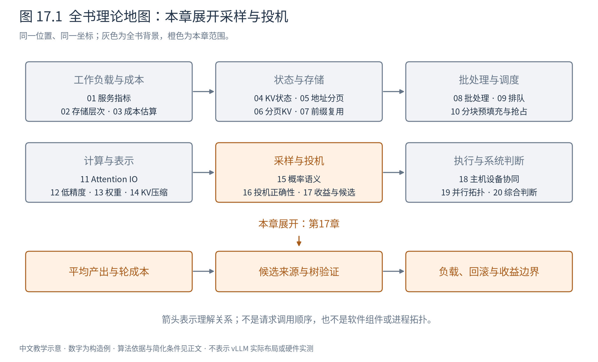
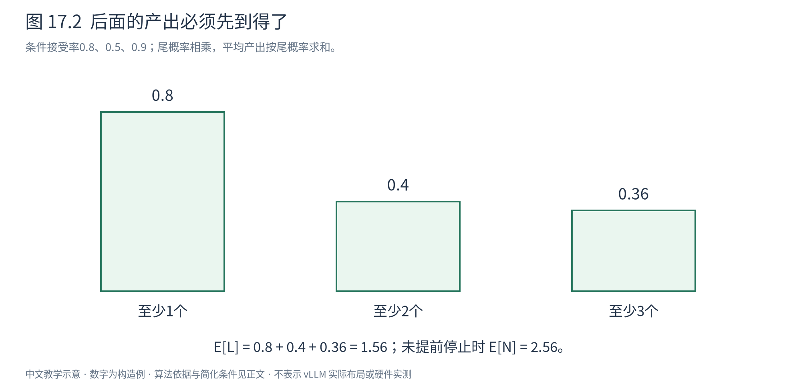
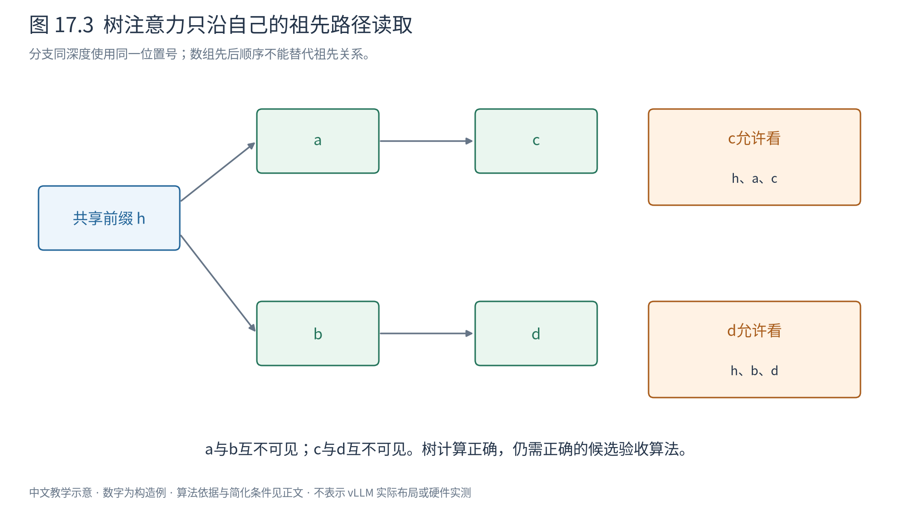

# 第 17 章 投机解码：什么时候划算，候选怎样产生

上一章说明了怎样在不改变目标分布的条件下，一轮确认多个token。现在的问题是：为了这些token，系统额外做了多少工作？小模型起草需要时间，多位置验证需要计算，暂存状态和回滚也不是免费的。只有节省的目标串行轮次足够多，这笔额外投入才可能带来收益。

图17.1展开“产出、成本、候选来源”三件事。我们先建立一套能容纳各种方法的判断框架，再看独立draft、查表、多头、特征预测与MTP分别改变框架中的哪一项。不按某次论文加速排名组织方法。

## 17.1 不能用平均接受率直接乘草稿长度

设草稿长度为 $\gamma$，连续接受的草稿数为 $L\in\{0,1,\ldots,\gamma\}$。如果第一处拒绝就停止，后面的候选即使单独看有很高接受概率，也不会成为这轮产出。

定义 $a_i=P(\text{第i项接受}\mid\text{前i-1项均接受})$。它已经对到达该位置时的前缀和随机性求了条件平均，不要求各项独立。到达并接受第i项的概率是：

$$
P(L\ge i)=\prod_{j=1}^{i}a_j. \tag{17.1}
$$

这是条件概率链式法则。要计算平均接受长度，可把每次接受数拆成指示量：接受至少一个贡献1，接受至少两个再贡献1，依次累加。于是：

$$
E[L]=\sum_{i=1}^{\gamma}P(L\ge i)
=\sum_{i=1}^{\gamma}\prod_{j=1}^{i}a_j. \tag{17.2}
$$

若尚未遇到EOS或长度上限，每轮还会有一个修正或额外token，故平均产出 $E[N]=1+E[L]$。停止条件截断时应直接统计真实产出，不能硬加这个1。

取三位置条件接受率0.8、0.5、0.9，尾概率依次为0.8、0.4、0.36。于是平均接受草稿1.56，平均产出2.56。将三项接受率简单平均后乘3得到2.2，与1.56不同；它忽略了后面位置可能根本到不了。

图17.2柱高对应“至少接受到这里”的概率。三个柱高相加是1.56，再加一次最终选择得到2.56。必须区分“被提出的token中多少最终接受”“到达某位置后的接受率”“每轮接受草稿数”“每轮实际产出”；不同日志名称可能混用，比较前要先写清分母。

只有在所有条件率都可近似为同一常数 $\alpha$ 时，才得到常见几何级数：

$$
E[N]=1+\alpha+\cdots+\alpha^{\gamma}
=\frac{1-\alpha^{\gamma+1}}{1-\alpha},\qquad \alpha\ne1. \tag{17.3}
$$

$\alpha=1$时直接取 $\gamma+1$；$\alpha=0$时为1。论文用iid接受率假设得到这一简式，但实际前缀难度、位置和任务都会改变接受情况。[Leviathan等，§3.1](https://proceedings.mlr.press/v202/leviathan23a.html)

## 17.2 一轮的时间，不能只数目标模型调用

令一轮成本由起草 $D(\gamma)$、目标验证 $V(\gamma)$、状态维护 $M(\gamma)$ 和不能隐藏的组织开销 $H(\gamma)$ 组成。若这些部分串行，轮耗时为其和；能重叠时，应按依赖图的关键路径算，而非把全部时间机械相加。

对于稳定重复的轮次，长期平均每输出token耗时应从总量求比：

$$
\bar T_{\mathrm{spec}}=\frac{\sum_r T_r}{\sum_r N_r}
\longrightarrow\frac{E[T_r]}{E[N_r]}. \tag{17.4}
$$

这一般不等于 $E[T_r/N_r]$：后一式给每轮相同权重，前者按总产出计服务效率。收敛需要负载稳定等条件；请求结束附近、动态批变化或调度竞争下，应直接看完整运行数据。

设普通decode平均每token为10ms。教学轮成本为draft 3ms、验证12ms、维护1ms，共16ms，使用上一节2.56产出，得到6.25ms/token，理想对比加速1.6倍。现在只把验证时间改为25ms，总成本29ms，每token约11.33ms，反而慢于基线。接受行为完全相同，结论却反转了。

论文常见的简式把一次普通目标前向耗时归一为1，假定验证仍约为1、每个draft步耗时c、其他开销忽略，得到 $E[N]/(1+\gamma c)$。这个式子有助于理解，但验证多个位置不总等价于一个普通decode，尤其在大批量、长上下文和不同算子形态下。[Leviathan等，§3.3–3.4](https://proceedings.mlr.press/v202/leviathan23a.html)

投机可能增加总FLOPs：被拒绝的候选仍已计算，draft也消耗算力。小批decode若主要受权重读取限制，多位置验证可以摊薄权重流量并使用闲置计算能力；大批量已经充分利用算力时，额外验证位置可能挤占原本能服务其他请求的资源。MoE的多个候选还可能触发更多专家权重，不能照搬稠密模型的流量估计。

因此低并发单请求延迟改善与高并发总吞吐改善是两种结论。TTFT、后续token延迟、队列等待、峰值KV和输出质量都应分别记录。

## 17.3 草稿为什么不是越长越好

延长一位带来的期望新增产出，是到达并接受这个位置的概率。若前面已多次衰减，新增位置即使自身很容易接受，边际收益仍然很小；其draft、验证和缓存成本却仍会发生。

设原轮期望成本C、产出N，增加候选带来成本 $\Delta C$、产出 $\Delta N$。新的单位成本更低，要求：

$$
\frac{C+\Delta C}{N+\Delta N}<\frac{C}{N}
\quad\Longleftrightarrow\quad
\frac{\Delta C}{\Delta N}<\frac{C}{N},\qquad \Delta N>0. \tag{17.5}
$$

也就是说，新加的候选必须比当前平均产出更“划算”。若旧轮C=16ms、N=2.56，再加一位带来0.18期望产出，却增加2ms，则边际成本约11.11ms/token，高于6.25，整体会变差。

实际曲线可能不平滑：多一个位置使计算跨过图执行形状档位、需要多一个块或改变批布局，成本会跳变。动态决定草稿长度应同时观察置信度和资源状态；仅把长度固定为某篇论文的最优值，缺乏跨负载依据。

## 17.4 独立draft与查表：先看最直接的候选来源

独立draft模型吃同一前缀，自回归输出候选及q。它可以专门蒸馏以贴近目标分布，代价是多一套权重、KV和执行路径。小并不充分：如果模型很便宜却与目标差异大，接受长度很低；如果模型很准但耗时接近目标，省下的轮次又被起草吃掉。还必须解决token词表对齐；本章基本证明假定双方在同一个离散词表上定义p和q，异构词表不能直接把ID代入比值。

n-gram或prompt lookup不必运行模型。例如历史token为 `[a,b,c,a,b]`，当前后缀 `[a,b]` 在更早位置出现过，后面跟着c，就可提出c；若历史更长，可以继续复制后缀。这里“相同”是token序列匹配，不是字符串近似相似。这在重复模板、引用和编辑任务中可能有效，在没有重复片段时则没有候选。

若查表确定地产生c，真实提议q就是c处概率1。严格随机验证接受c的概率为p(c)，拒绝后的残差在其余目标质量上归一化；贪心目标则要求它与目标最大项一致。某些实现也可先从目标采样再匹配候选，但仍需给出相应语义，不能凭“无模型候选”推断必然保分布。

后缀结构还可聚合多处历史，用计数构造候选分布或候选树。它减少神经网络起草成本，却增加检索、更新和内存；遇到高并发时是否合算仍要回到式17.4。

## 17.5 多头与树：并行提出多个未来位置

Medusa在目标模型的隐状态上增加多个预测头。若当前隐藏向量形状为 $(d,)$，每个头输出未来某个相对位置的 $(V,)$ 分数，K个头合起来为 $(K,V)$。它们能够同时提出多步候选，省去独立小模型逐步生成的串行路径。[Medusa，§2](https://arxiv.org/abs/2401.10774)

但第2个头并没有真正看到第1个头最终采出的token；它根据当前信息预测更远位置，和“已经条件化于前一个候选的标准自回归q”不是一回事。可以组合多个高分项形成候选路径，交给目标验证；如何从这些路径中验收，必须另行定义。

图17.3以共享前缀h为根，两条路径为h→a→c与h→b→d。处理节点c时，只能看h、a和c，不能看兄弟b、d；d同理。树mask是“祖先加自身可见”，节点位置编码按路径深度确定，所以a和b的位置相同，c和d的位置也相同。把节点按数组顺序放进普通下三角mask，会让后面的分支错误看见前面的兄弟。

一次树前向可计算很多候选路径的条件分布，但“多路径可同时计算”不等于“任选一条最长的高分路径就保持原分布”。严格的多候选验收需处理提议和拒绝后的剩余质量；本章的链式证明不能不加修改地套到任意树筛选。

Medusa讨论标准拒绝采样与typical acceptance等选择。后者依据目标概率及阈值接受合理候选，追求质量和速度，但不能自动继承第16章的严格分布证明；它也不是第15章的locally typical sampling。Medusa-1冻结主干，Medusa-2联合训练主干与新头；即便后者采用严格验收，保留的也是训练后的目标分布，而不是冻结前的旧模型。

## 17.6 EAGLE：利用目标特征预测草稿

目标模型已经花费成本产生隐藏特征，起草能否复用这些信息？EAGLE第一代在特征层进行自回归：用前面的目标特征和已经选出的下一token，预测后续特征，再经输出头得到候选。[EAGLE，§2–3](https://arxiv.org/abs/2401.15077)

为什么要把token提前一位输入？设特征 $f_t$ 对应前缀到t，目标从它采出 $x_{t+1}$。若下一步可能选a或b，两条续写的 $f_{t+1}$ 不会相同；只知道 $f_t$ 无法知道实际走哪条分支。加入已经选定的 $x_{t+1}$，就给特征预测补上这项条件。

用形状表示一个教学步骤：$f_t\in\mathbb R^d$ 与token嵌入 $e(x_{t+1})\in\mathbb R^d$ 组合，投影到草稿隐藏维，再经小解码模块预测 $\hat f_{t+1}\in\mathbb R^d$，通过输出头得到 $q_{t+2}\in\mathbb R^V$。这里描述接口思想；真实训练还处理序列历史和特征误差。无论特征猜得好坏，最终都要由目标分布验证。

EAGLE-2主要改变候选树的资源分配：根据上下文与草稿置信度扩展、重排候选，而不是总填同一棵静态树。某条路径累计概率很低时，继续给它分配深度可能浪费验证位置；动态树把有限节点放到更有希望的路径上。置信度只是资源分配信号，最终正确性仍由验收规则保证。[EAGLE-2，§4](https://arxiv.org/abs/2406.16858)

EAGLE-3进一步改变训练目标和特征输入：取消必须回归到目标单层特征的约束，融合目标多层信息，并在训练时展开draft自己的预测，以缩小训练时总见真实特征、推理时却使用自身预测的差距。它仍可利用隐藏表示，但不应再被简化为“把EAGLE-1的特征回归做大”。[EAGLE-3，§3](https://arxiv.org/abs/2503.01840)

三代分别回答特征条件、候选预算、训练分布三个问题。理解这些改变，比记住几代加速倍数更能指导读者判断后续方法。

## 17.7 MTP提供训练资产，不自动免除验证

多token预测（multi-token prediction，MTP）在训练时增加预测更远未来token的目标。DeepSeek-V3的MTP模块逐深度结合前层表示与后续token嵌入，保留预测依赖；模型训练后，这些模块可作为投机候选来源，也可以在普通推理时不用。[DeepSeek-V3，§2.2](https://arxiv.org/abs/2412.19437)

若一层MTP已经学习了“给定主干特征和下一token，预测后续”的映射，它可能是不错的draft初始化。但训练目标存在不表示运行时可以直接把每个预测都输出：多步预测仍会错，目标采样的正确性仍需验证与修正。

Kimi K3报告给出了更具体的复用实例：把预训练MTP层微调为EAGLE-3式draft，冻结目标模型，更新draft层和特征融合投影，并在训练中展开自身预测。该报告还用接受质量的负对数作为训练目标。这说明MTP与EAGLE可以通过训练过程连接，而不是两个互斥标签；也不能反过来声称所有MTP都天然等于EAGLE-3。这一关联依据[Kimi K3官方技术报告](https://arxiv.org/abs/2607.24653)的Draft Model Fine-Tuning部分，属于该模型的具体训练事实。

在同一任务上比较候选法，应分别列出：训练或蒸馏代价、运行时权重与KV、候选计算、目标验证、状态恢复、验收是否严格。将方法名字放在一个“快慢排行榜”里，会掩盖这些不同来源的成本。

## 17.8 混合状态回滚为什么需要额外设计

对全局Attention，候选KV通常是追加的，拒绝后可以让相应后缀失效。但考虑一个最简单的递归状态：$s_{t+1}=2s_t+x_{t+1}$。初始 $s_0=1$，候选2、3、4会依次产生4、11、26。若只接受第一个候选，再把第二个改成5，正确状态应为 $2\times4+5=13$，不是在26后面接着更新。

这个例子中递推恰好容易代数反解，但真实更新可能包含非线性、舍入、门控和信息压缩，并不保证可逆。因此实现需要保存s0以及必要中间状态，或者从检查点重算到接受位置。若每个候选都保存一份很大的状态，额外存储又会降低投机收益。

同时含KV和递归层的模型，要让两类状态提交到同一个确认前缀。只回滚KV而保留被拒路径的递归状态，会在下一步产生错误条件分布。这里的成本必须计入M，而不能因为只测了draft和验证算子就省略。

## 17.9 怎样判断一个加速结果是否可信

先固定目标模型与生成策略，再比较相同输入和输出长度分布。严格采样不要求每条输出逐token相同，但质量目标、停止规则和采样参数必须相同；近似验收还需单独测质量变化。不能拿贪心基线与高接受率的宽松阈值方案直接宣称无损加速。

测量同时报告候选数、实际连续接受数、轮产出与轮耗时，区分冷启动、预热和稳定运行。低负载延迟实验与高负载吞吐实验分别进行；失败或变慢的场景同样是收益边界的证据。旧实验若同时改了引擎、批处理和投机设置，就不能把差异全部归给投机。

本章将方法统一到一个问题：**用多少额外资源，换来了多少可提交的正确输出？** 下一章进一步拆开这些时间：CPU提交、设备执行、搬运与同步哪些能重叠，哪些依赖无法隐藏。只有明确执行关系，成本模型才不会把并行时间重复相加，也不会把必须等待的时间凭空抹去。

|符号|含义与单位|
|---|---|
|$L,N,\gamma$|接受草稿数、轮产出、草稿长度，token数|
|$a_i$|已到达位置i后的条件接受概率，标量|
|$D,V,M,H$|起草、验证、维护、组织时间，统一用ms或s|
|$f_t,q_t$|隐藏特征$(d,)$、词表分布$(V,)$|

所有时间与三位置接受率均为构造例，无NPU加速测量。源码中的提议器和状态对象放到Book8学习，本章先建立能审视它们的正确性与成本标准。
