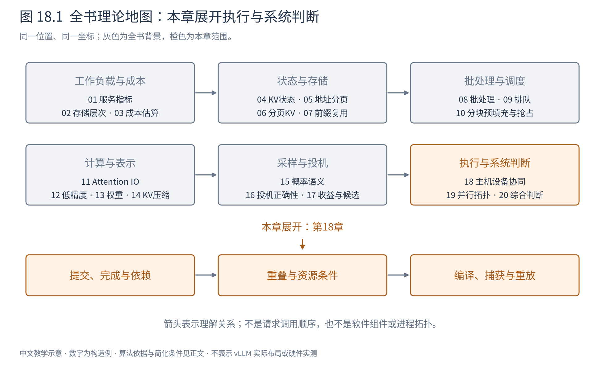
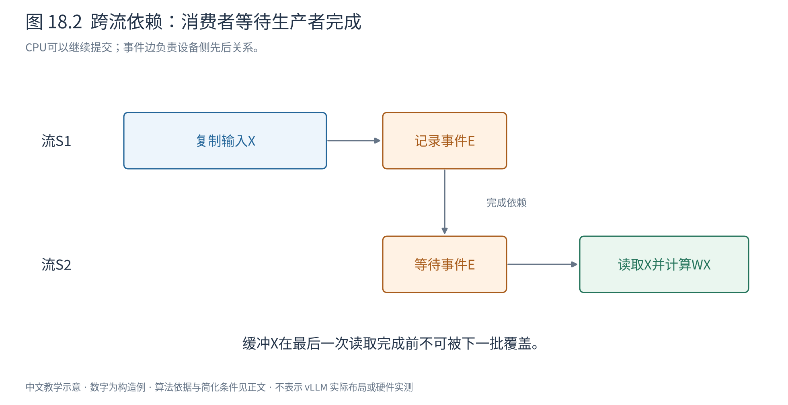
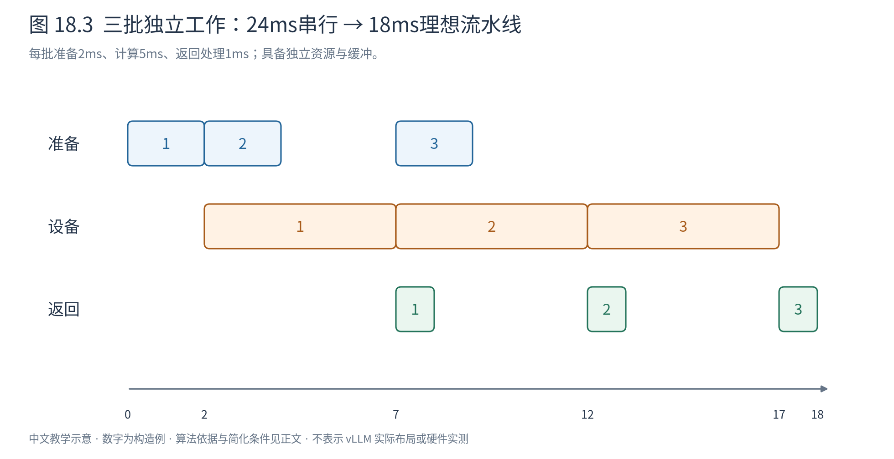
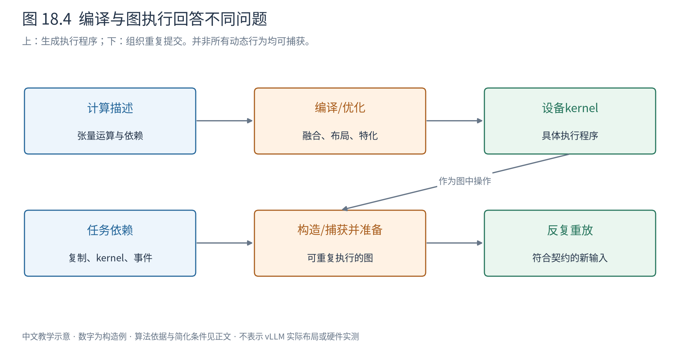

# 第 18 章 主机与设备怎样协同执行

第17章把投机解码的时间拆成起草、验证和状态维护。即使模型算得很快，CPU若迟迟没有准备下一批输入，设备仍会空等；相反，CPU早已返回也不代表模型已经算完。本章把这些工作放到一张依赖图上，解释异步、同步、编译与图执行究竟各自改变什么。

这里讨论执行理论，不要求掌握某个运行时的API。昇腾NPU是后续实践背景，CUDA相关资料用于解释已有图执行模型；两者的接口与具体限制不混写。

## 18.1 提交一项工作，不等于完成这项工作

CPU调用一个设备算子时，通常先构造参数、检查依赖并将任务提交给运行时。异步接口允许调用在设备完成前返回，CPU继续做别的工作。函数返回表达的是提交进度，设备输出表达的是完成进度。

一个stream（流）可以理解为有顺序约束的任务队列。同一流中的后续任务遵守该流规定的先后关系；不同流之间若没有建立依赖，不能仅凭CPU先写了哪一行就假定设备按相同顺序消费数据。流也不是一块专属物理计算单元，创建更多流不等于创造更多算力。[Ascend C官方异步执行说明](https://asc.gitcode.com/guide/programming_guide/compilation_and_execution/async_execution.html)

假设流S1把输入复制到设备缓冲X，流S2随后计算WX。若只是在CPU上先调用复制、再调用计算，两个异步队列可能让计算在复制完成前开始。正确性需要的是“复制完成先于读取X”，不是“复制提交先于计算提交”。

## 18.2 用事件表达恰好需要的依赖

event（事件）可以标记某条执行序列到达了一个位置。生产者在完成输入复制的位置记录事件E，消费者在读取X之前等待E。这样可以让设备维护两条流之间的顺序，而不必让CPU停下来等待所有设备任务结束。

图18.2中实线表示各流内的顺序，跨流箭头表示“完成后才可使用”。CPU已经提交后面的任务，并不破坏依赖，因为等待是在设备执行关系中表达的。

需要区分三种动作：在流中记录一个事件、让另一流等待事件、让主机线程等待事件或流完成。它们分别建立标记、建立设备侧依赖、让主机安全读取结果。全设备同步则更宽，会等待当前同步范围内所有相关工作；若只需要一个结果，这种同步可能阻止其他可独立推进的任务。

内存寿命也服从完成关系。CPU提交后立即覆盖输入缓冲，设备可能读到下一批内容；请求取消后立即复用其KV块，仍在执行的任务也可能访问已经转交别人的块。安全回收需要确认最后一个使用者已经完成，或建立等价的运行时寿命保证。第6章的引用计数回答“谁仍拥有状态”，这里的完成依赖回答“谁还可能正在访问它”。

## 18.3 重叠必须同时满足依赖和资源条件

设每批主机准备2ms、设备计算5ms、结果处理1ms。三批完全串行需 $3(2+5+1)=24$ ms。如果准备、计算、结果处理能由合适资源并发执行，且有独立缓冲，理想流水线时间为：

$$
T_n\approx t_{\mathrm{prepare}}+t_{\mathrm{device}}+t_{\mathrm{return}}
 +(n-1)\max(t_{\mathrm{prepare}},t_{\mathrm{device}},t_{\mathrm{return}}). \tag{18.1}
$$

n=3时为18ms。第一批仍需8ms，改善主要来自稳定阶段每5ms完成一批；流水线吞吐改善不等于首批时延同样缩短。

图18.3中的重叠区域只有在资源足够时成立。若结果处理和下一批准备共用忙碌CPU线程，需重新排时间；若复制与计算争用同一带宽，也不能直接取两者较大值。双缓冲可让一份缓冲供设备读取、另一份供CPU填充，但会增加容量，并要求角色切换前检查完成事件。

更关键的是数据依赖。同一条自回归请求的下一个输入token通常依赖本轮采样结果，不能在不知道token时完成下一轮所有工作。可以提前准备不依赖结果的元数据，或同时处理其他请求；投机也可以主动猜测，但随后必须验证。异步调度并没有消除数学上的因果边。

所以判断重叠机会有三个步骤：画出真正的生产消费关系，列出各任务占用的资源，再检查缓冲和状态寿命。只看到两段时间就取max，会系统性高估速度。

把一个大批分成两个微批，并让一批计算时另一批准备或通信，是dual-batch overlap等方案的基本出发点。切分提供了可交错的工作单元，却也可能让每次矩阵乘变小、增加启动次数，并要求分别保存两批状态。因此应先比较“重叠省下的等待”与“切小造成的效率损失”，不能从两条时间线交错就推断必然更快。

## 18.4 融合与编译改变的是执行工作

假设先做逐元素加法得到临时张量T，再做激活得到Y。两个独立算子可能读X、写T、再读T、写Y；融合算子可在片上得到T后立即计算Y，省去临时张量的HBM往返，也减少一次启动。

融合不是越大越好。一个复杂kernel可能需要更多寄存器，降低并行度，或无法使用原来高效的矩阵乘路径；某些中间量还被其他分支使用，不能随意丢弃。它是存储、指令与并行资源之间的交换。

编译进一步把较高层计算描述转换为执行程序，可能包含常量传播、算子融合、布局选择和形状特化。特化利用“这一批形状符合某条件”生成更合适的程序；条件不成立时，需要另一版本或回退路径。编译成本发生在执行前或首次遇到新形状时，因此应区分冷启动与稳定运行。

动态形状不是一个单一问题：batch token数、上下文长度、头维、数据类型都可能影响不同部分。有的维度可作为运行参数，有的影响内存布局或循环展开。不能一概说“动态就不能编译”，也不能认为编译器会自动把所有变化免费处理好。

## 18.5 图执行改变的是怎样提交工作

即使每个kernel已经优化好，CPU每轮仍可能反复提交同样的几十个操作。图执行把操作及依赖关系先记录或构造出来，准备成可执行对象，再多次启动，从而减少重复提交和设置成本。

capture/replay是其中一种组织方式：capture捕获符合规则的一段工作及依赖，replay重复执行这段结构。它与编译可以配合，但不是同义词。编译主要回答“设备运行什么程序”，图执行主要回答“这些操作怎样被组织和提交”。图也可以通过显式API建立，不一定必须通过捕获。[CUDA Graphs官方指南](https://docs.nvidia.com/cuda/cuda-programming-guide/04-special-topics/cuda-graphs.html)

读图18.4时，先沿上路看计算描述如何变成kernel，再沿下路看这些kernel如何形成可重复执行的依赖结构。新一轮输入数据可以变化，但必须符合所用图实例的契约。

一种常见方案保留固定地址的输入输出缓冲，每轮把新内容填入，再重放图。形状、地址、控制流及资源寿命可能受捕获方式与运行时能力约束；某些图支持参数或节点更新，但更新也有规则，不能推断任意变化都能原地重放。[PyTorch图执行语义](https://docs.pytorch.org/docs/stable/notes/cuda.html#cuda-graphs)

若CPU控制流读取设备标量来决定下一分支，或者捕获区内发生不允许的动态操作，就可能无法按原样捕获。常见办法是分段：稳定的主干使用图，动态部分保留普通执行。这减少覆盖范围，却避免为少数动态行为放弃所有提交优化。

昇腾生态也提供这一层机制。vLLM Ascend v0.30.0设计文档将ACLGraph描述为通过`torch.npu.NPUGraph`进行运行期捕获与重放，将Npugraph_ex描述为此前的FX图优化层。这正好对应上图的两种职责；可用模式、动态参数更新和资源上限仍需按具体版本核对，不能据名称相似推断与CUDA完全等价。[v0.30.0图模式说明](https://github.com/vllm-project/vllm-ascend/blob/v0.30.0/docs/source/user_guide/feature_guide/graph_mode.md)

图实例和相关缓冲也有生命周期：准备时占用资源，重放时仍引用输入输出地址，形状桶被淘汰或模型释放时必须等在途使用结束。缓存更多图可以减少重新准备，却可能挤占KV空间；缓存键还应区分影响执行的形状、精度、布局及模式。旧图不能仅因为输入token数量相同就无条件复用。

## 18.6 形状桶把变化变少，也把部分工作变多

若图只为token数4、8、16准备，实际本轮有6个token，可以选择容量8的桶，并用有效长度或mask屏蔽2个占位位置。这样减少图实例数量，但引入额外计算和缓冲；还必须保证占位位置不会写入真实请求的KV或影响采样。

桶越细，padding越少，图准备与内存占用越多；桶越粗，复用更多，浪费更大。prefill/decode混合、投机候选数变化和不同Attention路径还可能需要不同契约。图模式不是覆盖所有请求后就自然获得最大收益。

设准备某图需12ms，每次重放比普通执行净省0.2ms，忽略其他变化，则n次运行收益为 $0.2n-12$ ms，超过60次才摊销准备成本。若padding额外花0.15ms，每次净节省只剩0.05ms，需要超过240次。若净节省为负，重复多少次都不能靠摊销变快。

这是构造模型，真实评估还需包含启动、缓存、不同桶命中频率和并发内存。预热不仅是“随便跑几次”，而是明确要把哪些一次性成本从稳态测量中分开；启动时间本身仍应单独报告。

## 18.7 从执行轨迹辨认真正的等待

当设备时间线上出现空隙，可能是CPU没有及时提交，也可能是等待输入、跨流事件、通信或资源。图重放能减少提交间隙，却不能消除必要的模型依赖；融合能减少某些IO，却未必减少网络等待。

测量时，主机计时包围异步调用只得到提交耗时。若要测完整设备工作，应在正确边界等待完成，或用设备事件计量；若要测用户端到端延迟，则必须保留队列、输入处理和结果交付。同步改变执行行为，插入过密的同步还会破坏原本可实现的重叠。因此“用于准确计时的等待”与“正常执行中的等待”也要分开记录。

本章给出了理解时间线所需的语言。下一章把同样的依赖分析扩展到多卡：数据生产者和消费者分处不同设备后，还要穿过通信链路。那时，哪些通信能隐藏、哪些处于关键路径，仍由依赖而不是缩写决定。
