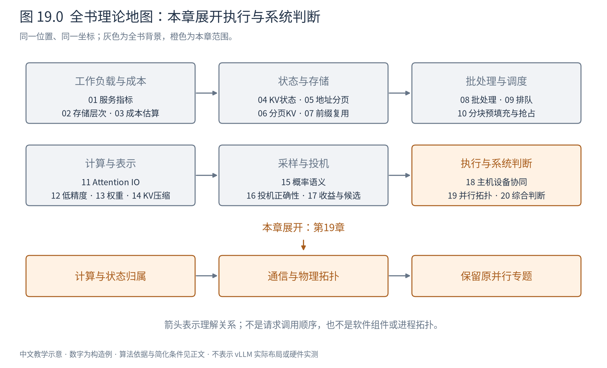
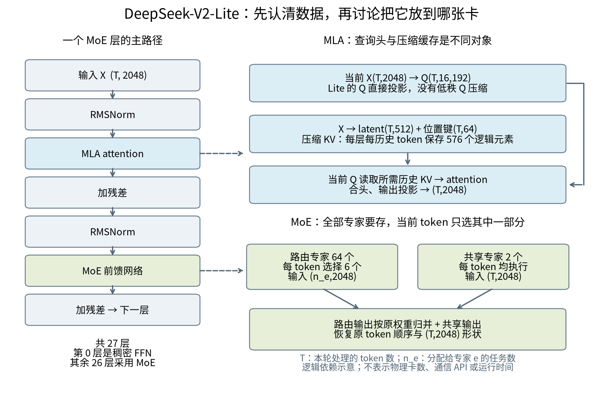
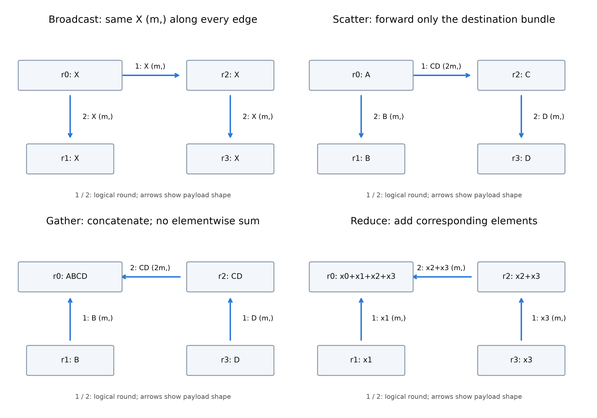
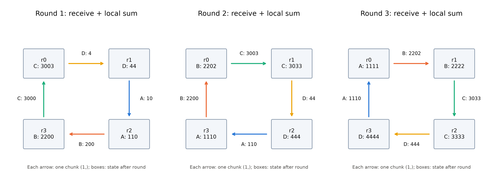
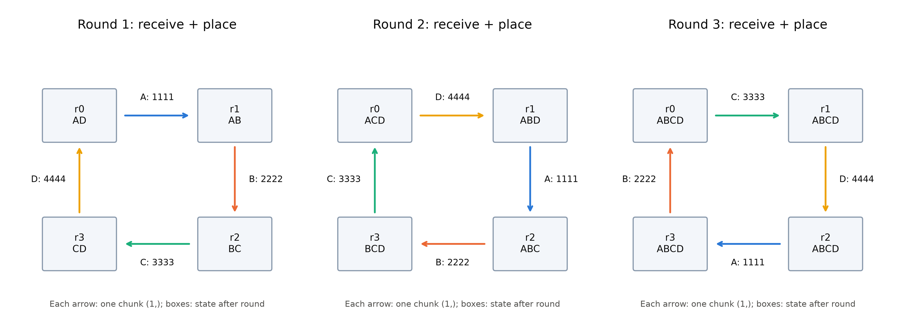
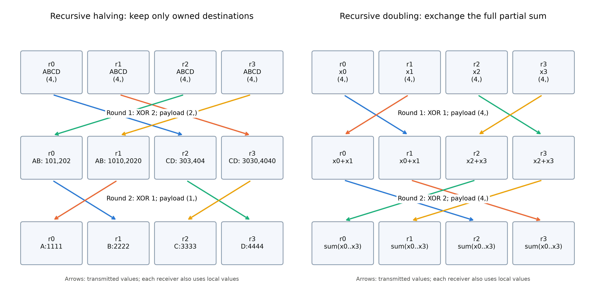
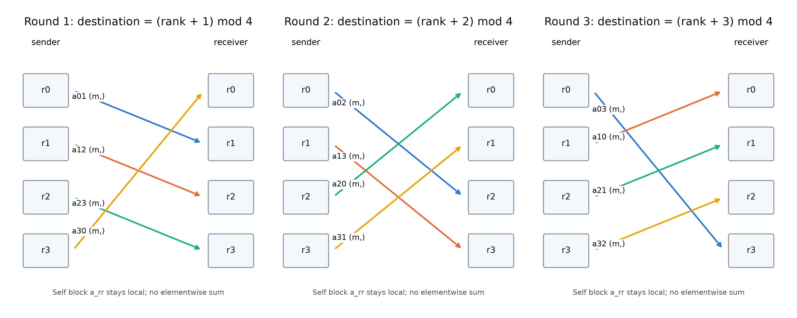
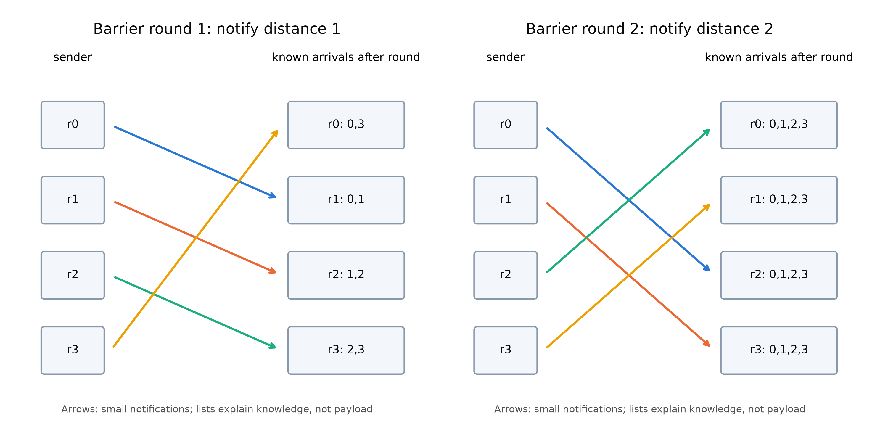
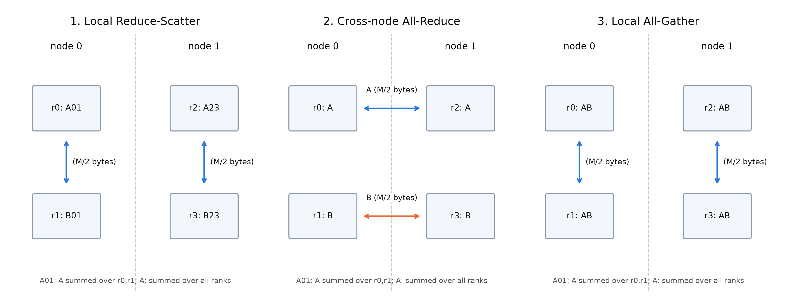
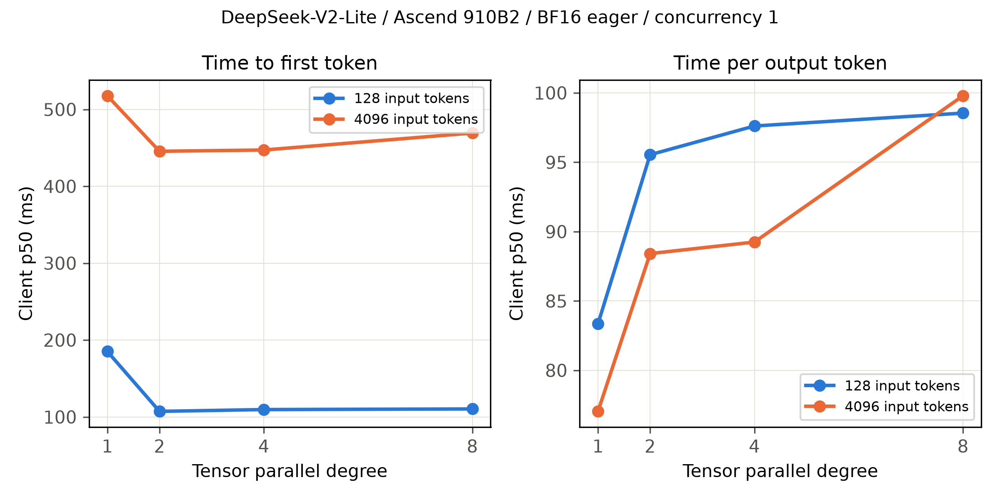

# 第 19 章 并行拓扑：从模型计算到多卡推理



图19.0展开执行与系统判断中的多卡专题。下文保留作者认可的原第13章正文与完整实践，仅更新章号及前后引用。**实验为历史v0.27运行栈记录，不是当前v0.30环境复测**；正文中的“本机运行栈”及设备读数均指原实验当时。理论阅读不要求执行实践命令，当前环境请另行核验。图与代码资产继续使用原13章文件名，以保护可追溯性。


上一章把一张卡内部的执行链组织得更紧凑：计算不变，减少反复提交工作的开销。这一章要改变的是计算的归属。权重放到不同卡上、请求交给不同副本、历史 KV 分散保存之后，一次原本完整的前向计算会出现许多边界。边界两侧必须交换什么，决定了这种切分有没有价值。

本章不从一串缩写开始。我们先认清模型里有哪些数据，再跟随这些数据经过卡间链路，从数学依赖判断切分边界，最后才把不同的分工方式命名为 TP、PP、EP、SP 或 DCP。全篇使用 **DeepSeek-V2-Lite**：它有真实的多头潜在注意力（MLA）、共享专家和路由专家，又足够小，允许在一台机器上建立从单卡到多卡的完整对照。选它是为了让每个理论结论都有可检查的落点，不把它当作今天模型能力的排名代表。

> 阅读前置：矩阵乘法、Transformer 残差块、自回归生成与 KV cache。MLA 和 MoE 的架构背景分别见 Book4 对应章节；这里会补齐理解分布式执行必需的最小结构。第11章的 online softmax 将在分片注意力合并时再次出现。
>
> 证据口径：模型结构取官方论文与固定 revision 的 config；机制算例均标为构造例；设备读数来自本章实际实验。源码阅读锚为 vLLM v0.30.0（`ced6857`），本机运行栈为 vLLM 0.27.1＋vllm-ascend 0.27.1rc1，二者不互相替代。

## 19.1 多一张卡，究竟想换来什么

设一份模型权重需要 100 GiB，一张卡只有 64 GiB。它首先遇到的是容量问题：即使我们愿意等一小时生成一个 token，模型仍然装不进去。把权重分到两张卡上，解决的是“能运行”。通信使它比一台假想的 128 GiB 单卡慢一些，也可能完全值得。

换一个问题：模型只占 30 GiB，但单个用户觉得生成太慢。我们希望让两张卡共同完成**同一次前向**，使这个用户更快得到下一个 token。这需要拆开计算，还要在结果再次被使用之前把必要的信息拼起来。省下的计算时间若少于新增通信和等待，第二张卡反而使用户更慢。

再换一个问题：单请求速度已足够，但同时来了两百个请求。这时复制模型、让两张卡各服务一部分请求，也许比把一次前向拆成两半更有效。它未必缩短任何一个请求在空载时的计算时间，却能缩短高负载下的排队时间。

最后，权重装得下、短请求也足够快，却放不下大量长对话的 KV。此时增加模型副本可能浪费权重内存；把历史 KV 分片到协作的设备上，才直接触及瓶颈。

这四种目标不能混写成“加速”。本章始终分别考察：**模型容量、单请求时延、服务吞吐、上下文容量**。同一种策略对它们可能给出相反的答案。

把一次迭代沿依赖关系展开，墙钟时间是其中最长依赖路径的长度。粗略说，它由计算、无法隐藏的通信、调度以及等待共同决定；有重叠的两段不能重复相加。并行的收益不是“原时间除以卡数”，而是原依赖图经过切分后，新最长路径究竟缩短了多少。

我们也需要一个不自欺的容量式：

$$
M_r=M_{W,r}+M_{KV,r}+M_{A,r}+M_{workspace,r}+M_{comm,r}+M_{runtime,r}. \tag{19.1}
$$

这里 $r$ 表示一张卡，六项分别是权重、KV、激活、算子工作区、通信缓冲和运行时占用，单位均为字节。它的意思是：**每张卡都要分别算账，不能把整个模型的总量除以卡数就宣布能放下。** 某些权重仍会复制；通信还会引入新的缓冲；最先耗尽内存的是最拥挤的那张卡。

## 19.2 先看模型，再给设备编号

### 19.2.1 一批 token 会经过哪些地方

DeepSeek-V2 把两件事放在同一个 Transformer 块里：MLA 负责从历史上下文取信息，MoE 负责选择性调用前馈网络。官方总体架构见论文 Fig.2；下面依据论文机制与 Lite 的实际配置自绘数据流，左侧给出层的顺序，右侧展开缓存和专家的归属。它只表达逻辑依赖，不预先指定几张卡。[S1]、[S2]



图19.1为依据[S1]、[S2]独立绘制的机制示意，[绘图脚本](code/ch13/fig_architecture.py#L13)。特别注意Lite与论文主型号的区别：Lite的查询投影不采用低秩Q压缩（`q_lora_rank=null`）；第一层为稠密FFN，其余26层为MoE。下面用实际config消除型号差异。

**表 19.1 本章模型的结构事实**（官方 config，revision `604d5664dddd88a0433dbae533b7fe9472482de0`）[S2]

| 部件 | 配置 | 对并行的意义 |
|---|---:|---|
| 隐藏宽度 $d$ / 层数 $L$ | 2048 / 27 | 激活搬运按隐藏宽度计；PP按层切但须考虑层成本 |
| 查询头数 $h_q$ | 16 | TP的头切分须匹配头数与实现约束 |
| MLA潜在维度 $d_c$ / 位置键维度 $d_R$ | 512 / 64 | 压缩缓存每层每token逻辑上为576个元素 |
| 每头内容Q/K维度 / V维度 | 128 / 128 | 完整注意力头不是简单的 $d/h_q$ 统一模型 |
| 路由专家数 $E$ / 每token选择数 $k$ | 64 / 6 | 权重存64份专家，只计算选中的6份 |
| 共享专家数 / 单专家中间宽度 $f_e$ | 2 / 1408 | 共享路径每token都执行，不能当作路由概率的一部分 |
| 稠密层 | 第0层，FFN宽度10944 | 和后续MoE层的内存、算力不完全相同 |
| 词表 $V$ / embedding与输出头 | 102400 / 不共享 | 两端也有大矩阵，PP不能只平均分27个层 |

推理引擎常把一次调度中的 token 打包为 $X\in\mathbb R^{T\times d}$。这里 $T$ 是**本次参与前向的token数**，不一定等于请求数 $B$：纯 decode 时通常每条请求贡献一个 token，$T\approx B$；prefill 时一条请求可贡献几百或几千个。讲历史注意力时另用 $S$ 表示已经缓存的上下文长度，不把它与本次的 $T$ 混用。

以一个 MoE 层为例，路径是：

```text
本次token X (T,2048)
  → RMSNorm (T,2048)
  → MLA：当前Q + 历史压缩KV → attention输出 (T,2048)
  → 加残差 (T,2048)
  → RMSNorm (T,2048)
  → 路由器得分 (T,64) → 选专家及权重 (T,6)
      ├→ 路由专家：每份接收 (n_e,2048)，返回同形输出
      └→ 共享专家：所有T个token，返回 (T,2048)
  → 路由输出加权归并＋共享输出＋残差 (T,2048)
```

这是图 19.2 的形状示意。$n_e$ 是这一批分配给专家 $e$ 的 token 副本数，各专家通常不同；全部路由分配数为 $Tk$。专家内部采用 SwiGLU：两条上投影各做 $(n_e,d)(d,f_e)\to(n_e,f_e)$，一条经过 SiLU 后与另一条逐元素相乘，再做 $(n_e,f_e)(f_e,d)\to(n_e,d)$。共享专家也有自己的前馈计算，并不是一份免费加法。

MLA内部也需要一张形状地图，避免后面把“切头”和“切缓存”混为一谈。对Lite的单层，查询直接由hidden投影得到，不经过低秩Q压缩；K/V先经过低秩联合压缩。按概念上的展开计算，其流转如下（省略不改变形状的归一化）：

| 运算 | 输入与权重 | 输出 |
|---|---|---|
| 查询投影 | $(T,2048)(2048,16\times192)$ | $(T,16,192)$，分成内容128维与位置64维 |
| KV下投影 | $(T,2048)(2048,576)$ | latent $(T,512)$与位置键$(T,64)$；位置部分做RoPE |
| KV内容展开 | $(T,512)(512,16\times256)$ | 每头内容K与V各128维，即两个$(T,16,128)$ |
| 注意力读历史 | Q$(B,16,n,192)$与拼接后的K$(B,16,S,192)$；V$(B,16,S,128)$ | 每头输出$(B,16,n,128)$ |
| 合头与输出投影 | $(Bn,2048)(2048,2048)$ | $(Bn,2048)$ |

实际高效MLA推理不必把全部历史latent展开为每头K/V长期存下。利用线性变换的结合律，可把内容K的上投影吸收到查询计算中，在512维latent上计算相应得分；值侧也可先对latent加权，再作每头上投影。RoPE的64维位置项单独参与得分。因此“概念上有哪些头”和“HBM里存了什么”必须分开理解。后面的KV容量式计算的是压缩路径，而不是表中为了理解attention临时展开的K/V。[S1]、[S2]

接下来每一种并行，都是改变这幅图中某些框的归属，或改变框之间张量的布局。

### 19.2.2 rank不是物理卡号

一个典型部署让每个执行进程管理一张加速卡。**rank** 是进程在某个通信域中的逻辑编号；**world size** 是这个域里参与者的数量。物理设备号由驱动给出，进程可见设备的逻辑号又可能被环境变量重新编号。例如只暴露物理卡 `2,3`，进程看到的本地设备通常是 `0,1`，不能拿 local rank 0 就断言它占用物理卡0。

一组进程可以同时属于多个**通信组**。四个rank中，`{0,1}`可以一起做第一个流水阶段的TP，`{0,2}`又可以负责两个流水阶段间的对应分片传递。一次All-Reduce只对指定组求和，不会自动把整台服务器的卡都拉进来。

这建立了两张不同的图：逻辑图回答“谁需要与谁交换什么”；物理图回答“这些进程被放到哪些设备上，中间经过什么链路”。部署就是把前一张图放到后一张图上。只知道有八张卡，还不足以完成这件事。

## 19.3 数据怎样从一张卡到另一张卡

### 19.3.1 同在服务器里，也可能走不同的路

这里的“设备”通常就是一张GPU或NPU卡；本章按一个执行进程管理一张卡来画图。每张卡有自己的本地HBM。另一张卡不会因为插在同一台服务器上，就能把这块HBM当成本地内存，以相同带宽随意读取。软件需要安排传输，硬件需要提供可达路径。昇腾算子编程中的GM（Global Memory，全局内存）在本章910B平台上对应设备侧HBM；“全局”相对于卡内计算核的局部存储而言，不是全服务器所有卡共同拥有一块HBM。[S22]

**主机内存（Host Memory）则是CPU一侧的系统内存，本章服务器上为DDR内存，与各卡的HBM分开。** 数据经过主机内存中转，是先进入CPU侧缓冲区，再进入另一张卡；它不表示所有卡天然共用一个GM。NUMA又会让不同位置的主机内存具有不同访问成本，稍后再说明。

同机常见路径可抽象成图 19.3：

```text
路径A：卡A的HBM → 设备互连（HCCS / NVLink等） → 卡B的HBM
路径B：卡A的HBM → PCIe交换/根复合体 → 卡B的HBM（需P2P支持）
路径C：卡A的HBM → CPU侧DDR内存缓冲 → 卡B的HBM
```

图 19.3 数据路径示意；箭头搬运的都是同一逻辑报文 $M$ 字节，路径C包含两次设备—主机传输。它不是本机全部链路的电气连接图。

PCIe是一种I/O互连，并不自动意味着必须由CPU逐字节复制；支持条件满足时，设备可通过DMA和P2P路径交换数据。反过来，有PCIe设备也不保证任意两卡之间的P2P均可用。主板连接、PCIe桥、IOMMU和驱动支持都可能改变实际路径。

HCCS是昇腾互连体系中的链路；NVLink是NVIDIA设备互连，NVSwitch承担相应交换功能。它们与**HBM带宽**是不同指标：HBM带宽约束本地读写，互连带宽约束远端搬运。把“显存每秒能读多少”填进All-Reduce通信式，会把两个瓶颈混为一谈。[S10]、[S11]

主机也不一定是均匀的。NUMA意味着不同CPU节点拥有各自更近的内存和I/O设备。工作线程、内存页、加速卡和网卡的亲和位置不匹配时，主机侧准备或中转可能跨CPU互连。因而“卡到卡”的性能，有时还受到线程绑在哪里影响。

### 19.3.2 跨服务器多出哪些步骤

跨机需要网络接口与交换网络。采用设备内存直接访问的路径时，可以抽象为：

```text
A的HBM → A侧可用的设备/网卡通路 → NIC → 交换网络 → NIC → B的HBM
```

若直接路径不可用，则可能退回主机内存中转。**RDMA（远程直接内存访问）**使网卡在建立必要的连接与内存访问授权后搬运数据，减少数据路径中的CPU参与及额外复制；它不等于“没有CPU”，也不等于“网络没有延迟”。控制面仍要建立连接、注册缓冲、处理完成通知，应用仍要遵守生产和消费数据的同步关系。

InfiniBand提供专门的网络体系；RoCE在以太网上承载RDMA，部署还需要考虑拥塞控制、交换配置和可用带宽。RDMA能访问主机内存，并不自动证明它能直接访问加速卡HBM。NVIDIA的GPUDirect RDMA是设备内存路径的一种实现，昇腾侧须按其通信库和平台能力确认，不能照搬驱动配置。[S11]

网络的“400 Gb/s”是位速率，先除以8才得到50 GB/s的名义字节速率，尚未扣除协议、拥塞和共享开销。单端口带宽、单方向带宽、双向相加和整机所有端口相加，又是四个不同口径。实际部署需要关注的是**这组rank在这段时间能同时拿到的有效带宽**。

### 19.3.3 库、原语与启动器各管一层

从模型到线缆，可以分成四层理解：模型提出“需要把这些部分和相加”；通信API表达All-Reduce；NCCL或HCCL等库选择分块、算法与传输方式；硬件链路实际运送字节。PyTorch distributed是常用API入口；`torchrun`、multiprocessing或Ray解决进程创建和编排，它们的名字不能用来判断一条张量到底走HCCS还是网络。

本机 `npu-smi info -t topo` 报告八卡之间为HCCS，CPU亲和按卡对分组：0/1对应192–223，2/3对应128–159，4/5对应0–31，6/7对应64–95。【本机查询，2026-10-30；原始记录见本章实验底稿】这说明应该测试什么，不直接给出任意collective的吞吐。后面会用真正的通信微基准补上这一层。

## 19.4 通信原语：由“下一步缺什么”来理解

### 19.4.1 先区分拼接、求和与重新分发

两张卡各拿着 `[1,2]` 和 `[3,4]`。若它们代表同一输出的两个部分和，正确操作是逐位置相加，得到 `[4,6]`。若它们代表不同位置的完整结果，正确操作是拼接，得到 `[1,2,3,4]`。数据形状一样，数学身份不同，所需原语就不同。

collective（集合通信）描述一组rank共同完成的操作。对Reduce/All-Reduce、Gather/All-Gather这两对名字，“All”表示**所有参与的rank都获得结果**；没有“All”的版本只让指定根rank获得结果。“所有”限于当前通信组，不自动覆盖整台服务器。All-to-All则表示每个rank都参与向各目的rank分发自己的不同分块，不能用“每人拿到同一份完整结果”理解。

下面先使用两rank、沿第一维拼接的小例子。**表格只规定通信前后应该得到什么，不规定内部走几轮、经过谁。** 接下来要把实现过程逐步展开。

**表 19.2 通信前后每个rank到底拿到什么**（全部为构造例；语义对照[S8]、[S9]）

| 原语 | 通信前 | 通信后 | 模型中的具体位置 |
|---|---|---|---|
| Send/Recv，点对点发送/接收 | r0有激活`A`，r1需要它 | r1收到`A`；r0是否保留由应用决定 | PP阶段边界，把一批hidden states传给后续层 |
| Broadcast，广播 | 根r0有`[1,2]` | r0、r1都有`[1,2]` | 一组协作rank需要一致的输入token或控制元数据 |
| Scatter，分发 | 根r0有`[1,2,3,4]` | r0=`[1,2]`，r1=`[3,4]` | 根持有输入时，按token分片送往处理rank；服务也可直接分请求，不必调用Scatter |
| Gather，收集 | r0=`[1,2]`，r1=`[3,4]` | 根r0得到`[1,2,3,4]` | 只在一个位置收集分片输出；其他rank不一定需要完整结果 |
| Reduce，归约 | r0=`[1,2]`，r1=`[3,4]` | 根r0得到`[4,6]` | 只让根rank持有最终部分和或统计量 |
| All-Reduce，全归约 | 同上 | 两rank都得到`[4,6]` | 行切投影后的完整hidden states，后续各rank都要用 |
| All-Gather，全收集 | r0=`[1,2]`，r1=`[3,4]` | 两rank都得到`[1,2,3,4]` | SP局部token激活进入需要完整token集合的TP计算 |
| Reduce-Scatter，归约分散 | r0=`[1,2,3,4]`，r1=`[10,20,30,40]` | r0=`[11,22]`，r1=`[33,44]` | 先合并投影部分和，结果继续按token分片供SP区域使用 |
| All-to-All，全互换 | r0=`[a00,a01]`，r1=`[a10,a11]` | r0=`[a00,a10]`，r1=`[a01,a11]` | EP按专家归属交换token；或attention按序列/头维交换布局 |
| Barrier，屏障 | 各rank进度不同 | 全组都进入屏障后才允许相应后续推进 | 初始化、测量边界等协调；不负责把模型张量求和或拼接 |

表中的 `aij` 表示源rank $i$ 准备发给目的rank $j$ 的一块数据。All-to-All的每个目的地收到的是**为自己准备的不同分块**；All-Gather则让每个目的地收到同一份全集。

Scatter/Gather保持元素的数值，只改变数据归属和组织方式。Reduce/All-Reduce则对不同rank上**同形张量的对应位置**做归约；例如两个$(2,2)$矩阵逐位置相加，结果仍为$(2,2)$。归约的是rank之间的贡献，不能与`sum(x, dim=...)`沿张量自身某个维度求和混淆。归约也不一定是sum，还可以是max/min等；softmax跨分片归一化就需要最大值或等价的LSE组合。必须先说明运算，再讨论代价。

### 19.4.2 一次调用下面，可能藏着许多次交换

调用一次`all_reduce(x)`，是在提出“把各rank的对应元素归约，并让每个rank拿到结果”的要求。它不是一条能让所有HBM瞬间相加的硬件指令。通信库仍要选择谁与谁通信、一次传多少、在哪里求和、怎样知道缓冲已经可读。

先分清三层：**原语规定结果，算法安排交换步骤，物理拓扑决定这些步骤能否高效并发。** 下文把四个rank画成环或树，首先画的是逻辑通信关系，不是说硬件线缆必须恰好连成同样的图。一条逻辑箭头仍可能穿过交换芯片、共享PCIe路径或跨机网络。

所有走查都假设通信组稳定、没有故障；归约使用可交换的sum，除特别说明外分片等长。相同“轮”中的箭头没有互相的数据依赖，可以并行推进；这不保证它们在真实硬件上具有独立带宽。纸面轮次是依赖阶段，不要求在每轮插入一次全组Barrier。图19.4—19.10均为独立绘制的算法机制示意，数字是构造例，不是本机性能读数。

Send/Recv是最直接的起点。设PP上游r0产生激活$H:(T,d)$，下游r1需要同形激活，最小过程是：

```text
r0：完成 H(T,d) 的生产 → 发起发送 ── H(T,d) ──→ r1：接收完成 → 下游层读取
     发送缓冲在安全完成前不能被改写             接收缓冲在完成前不能被消费
```

“发起调用返回”和“数据已可使用”要按具体异步API、设备流与事件契约区分。若两个rank需要互相交换，不能不加条件地都执行阻塞发送、之后才接收；当传输需要对端接收配合时，这样可能互等。常见做法是匹配非阻塞收发再等待，或使用通信库提供的成组收发机制。NCCL的点对点文档明确要求把需要同时推进的收发正确组织起来；HCCL/PyTorch要遵循各自接口，不照搬API名称。[S21]

大激活还可切成$H_0,H_1,H_2$，每块$(T/3,d)$，形成“准备下一块、发送当前块、接收方处理已到块”的流水。这样有机会把链路和计算同时用起来；前提是后续计算确实可分块、每块足够大、数据依赖允许。若下游必须等完整$H$才能启动，分块只能改善传输内部流水，不能直接宣称下游计算已经被隐藏。多次小块发送也有额外启动成本，第19.5节再算账。

### 19.4.3 Broadcast：让已经拿到数据的人继续帮忙

根r0持有$X:(m,)$，要让四个rank都得到相同的$X$。一种直接方法是r0依次发给r1、r2、r3；在每rank每轮只能完成一份完整消息发送的简化模型下，需要三轮，根发送三份。

树形传播让接收方成为后续发送方。采用图19.4左上的二项树调度：

```text
初始：只有r0持有 X(m,)
第1轮：r0 ──X──→ r2
第2轮：r0 ──X──→ r1    同时    r2 ──X──→ r3
结束：r0、r1、r2、r3各有完整 X(m,)
```

第一轮有两个人拥有数据，第二轮有四个人拥有数据。扩展到八rank，再加一轮即可：已经持有数据的四人各发给一个新接收者。在理想的二项树模型中，$p=2^q$个rank需要$q$轮，根只发送$q$份完整消息，而不是向所有其他rank各发一份。**收益是把发送工作分给更多参与者，缩短传播的依赖路径；全组仍要传递$p-1$份完整数据，并没有凭空少掉必须交付的副本。**[S17]



图19.4：四rank树形走查。箭头前的1/2表示逻辑轮次，箭头标数据形状；节点标该过程中的关键结果，Gather/Reduce非根节点的内容不表示API承诺了额外输出。A—D每段$(m,)$，Reduce的每份$x_r$也为$(m,)$。构造示意；算法依据Open MPI v5.0.5的相应实现，[绘图脚本](code/ch13/fig_collective_algorithms.py#L202)。[S17]

树并非任何情况下都快。大$X$若要整份收齐才转发，多跳会叠加等待；分段树可以让中间节点收到前一段后立即转发，使不同边形成流水。也可以先Scatter再All-Gather：四rank先各得到$X$的四分之一，再互相收齐，最终仍是Broadcast语义。它把根的整份复制压力改成分块协作，但增加算法阶段和重排开销。小控制消息往往更在乎轮次，大消息还要看链路利用和分块。[S15]、[S17]

### 19.4.4 Scatter/Gather：在树上转交分组，而不是复制全集

仍以r0为根，但这次它持有$[A,B,C,D]:(4m,)$，四个rank各只需要一段$(m,)$。若直接发送，r0留下A，分别把B/C/D交给r1/r2/r3。根向外发送$3m$个元素；自留的A不必经过卡间链路。

树形Scatter把“替一组人送包裹”的工作交给中间节点，图19.4右上展开为：

```text
第1轮：r0 ──[C,D](2m,)──→ r2；r0保留[A,B](2m,)
第2轮：r0 ── B(m,) ────→ r1；r2 ── D(m,) ────→ r3
结束： r0:A，r1:B，r2:C，r3:D，各(m,)
```

这个过程没有改变任何元素的值。r2在第一轮暂时持有两份，下一轮留下自己的C、转发D。由此把原先三次由根发起的独立交付组织成两轮，较大组时可以减少根的消息启动次数。[S17]

但别把“轮次少”误读成“总流量少”：本例直接发送的全组发送量为$3m$个元素，树形发送量为$2m+m+m=4m$，因为D经过r2转发了一次；根自身仍发送$3m$。**树形Scatter主要改善任务组织与关键路径，未必减少根的总字节数，还可能增加全组转发量。** 若根可以高效并发直发、分片又大，直接发送可能更合适。

Gather反向执行相同的分组过程，图19.4左下为：

```text
初始： r0:A，r1:B，r2:C，r3:D，各(m,)
第1轮：r1 ──B──→ r0，得到[A,B]；r3 ──D──→ r2，得到[C,D]
第2轮：r2 ──[C,D](2m,)──→ r0
结束： 根r0按rank顺序得到[A,B,C,D](4m,)
```

这里是收集拼接，不是加法；r2要暂存中间组，根最终仍要容纳完整输出。树减少直接找根交接的参与者和依赖轮数，但根接收最终$3m$个外来元素这一事实没有消失。模型若只需要本地分片，额外做Gather反而会增加通信和内存；原语选择首先取决于后续计算要什么。

### 19.4.5 Reduce：沿树把部分贡献合成同形结果

现在四卡各有$(2,)$向量：r0为$[1,2]$，r1为$[10,20]$，r2为$[100,200]$，r3为$[1000,2000]$。根r0需要它们的逐元素和。沿图19.4右下的归约树：

| 轮次 | 通信及接收后的本地求和 | 此轮得到的部分和 |
|---|---|---|
| 1 | r1把$[10,20]$发给r0；r3把$[1000,2000]$发给r2 | r0：$[11,22]$；r2：$[1100,2200]$，均$(2,)$ |
| 2 | r2把$[1100,2200]$发给r0，与r0的部分和相加 | 根r0：$[1111,2222]:(2,)$ |

与Gather的差别在这里变得具体：**Gather在中间节点累积越来越多的数据，Reduce在中间节点把多份贡献压成同形的一份。** 四rank树形Reduce的三条传输都只发送$(2,)$，并不需要让根依次接收另外三份原始向量。更多rank时，中间节点分担归约工作，理想平衡树把依赖深度降到对数级。

这个收益依赖归约运算可按相应顺序组合。本节sum在精确算术下满足要求；浮点求和交换顺序可能改变舍入结果，不能要求不同算法位级相同。非交换的自定义归约还须保持规定顺序，不能直接套用任意换序图。[S17]

只要在Reduce后沿树Broadcast最终结果，所有rank就能拿到完整和，从而实现All-Reduce。但这不是唯一实现。接下来要看一种既把归约分散到各卡、又把结果保持分片的过程。

### 19.4.6 Reduce-Scatter：让分片一路累加，停在负责它的rank

Reduce-Scatter的名字表达“归约后按段分布”的**结果**，并不要求先把完整和算到根上、再调用Scatter。Ring算法可以边传边加，最后直接形成分片输出。以下四rank示例采用固定逻辑方向$r0\to r1\to r2\to r3\to r0$，每rank初始输入$(4,)$：

| 来源rank | A分片 | B分片 | C分片 | D分片 |
|---|---:|---:|---:|---:|
| r0 | 1 | 2 | 3 | 4 |
| r1 | 10 | 20 | 30 | 40 |
| r2 | 100 | 200 | 300 | 400 |
| r3 | 1000 | 2000 | 3000 | 4000 |

目标是r0输出A的和1111，r1输出B的和2222，r2输出C的和3333，r3输出D的和4444，每rank输出$(1,)$。这里“负责A”只是预先约定最终输出位置；r0最初仍持有A/B/C/D四个分片的**本地贡献**，不是一开始就只有A。

第一轮选好起点后，每张卡向下一张卡发送一个分片。接收方把它与自己初始输入中的**同名分片**相加。之后各轮继续传递刚收到并累加过的部分和。表中每格写“传出的部分和＋接收方本地贡献＝接收后的值”，同一行四条边可以并发：

| 轮次 | r0 → r1 | r1 → r2 | r2 → r3 | r3 → r0 |
|---|---|---|---|---|
| 1 | D：$4+40=44$ | A：$10+100=110$ | B：$200+2000=2200$ | C：$3000+3=3003$ |
| 2 | C：$3003+30=3033$ | D：$44+400=444$ | A：$110+1000=1110$ | B：$2200+2=2202$ |
| 3 | B：$2202+20=2222$ | C：$3033+300=3333$ | D：$444+4000=4444$ | A：$1110+1=1111$ |



图19.5：箭头标本轮发送的分片及数值，节点标本轮接收并加上本地贡献后的活动分片；节点未列出的初始分片不表示已被API释放。每个箭头为$(1,)$，真实张量时替换成$(m,)$并逐元素相加。构造示意，数值由[整数走查脚本](code/ch13/collective_walkthrough.py#L12)生成并核验；典型Ring结构对照NCCL v2.27.3-1。[S16]

只追A，就能看清为什么没有重复或漏加：它从r1的10出发，依次在r2加100、r3加1000、r0加1，三跳后得到1111，停在r0。其余三段同时沿环做同样的事。这里的“正确分片”就是**包含全组贡献、已经完成归约的那一段**，不是某张卡最初的局部数据。

效率来自两点：每轮每rank只传一个分片，不传整个输入；每张卡都参与接收、归约与转发，避免所有分片集中到一个根上。在$p$个rank、完整输入$M$字节且等分的模型中，每轮一段$M/p$，共$p-1$轮，每rank发送与接收各$(p-1)M/p$字节。代价是依赖轮次随$p$线性增加、分片要转发多跳，环上慢边还可能拖住整个过程。

NCCL该版本的Ring源码把过程写成“首次发送、中间接收并归约转发、最后接收并归约保存”。这是算法结构的对照，**不表示本机HCCL微基准已被证明采用同一Ring实现**。[S16]

### 19.4.7 All-Gather：完整分片已经算好，只需要沿环传开

从上一步接着走：r0有A=1111，r1有B=2222，r2有C=3333，r3有D=4444。若接下来每rank都需要完整$(4,)$结果，就要交换这四个已经归约好的分片。

Ring All-Gather沿相同方向传递，但**不再求和**。第一轮发送自己的分片，后续发送上一轮刚收到的分片，接收方写入按分片编号确定的位置：

| 轮次 | r0 → r1 | r1 → r2 | r2 → r3 | r3 → r0 | 此轮后每rank已持有的分片数 |
|---|---|---|---|---|---:|
| 1 | A=1111 | B=2222 | C=3333 | D=4444 | 2 |
| 2 | D=4444 | A=1111 | B=2222 | C=3333 | 3 |
| 3 | C=3333 | D=4444 | A=1111 | B=2222 | 4 |

r0依次收到D、C、B，物理到达顺序不是A/B/C/D；按正确偏移写入后，最终逻辑结果仍为$[1111,2222,3333,4444]$。其他rank同理。



图19.6：节点列出本轮结束后已拥有的分片名称，箭头标实际发送的$(1,)$分片。数字沿用图19.5，图中没有加法；不是把所有已收到的数据每轮重复发一遍。构造示意，数值由[走查脚本](code/ch13/collective_walkthrough.py#L12)核验。[S16]

若完整拼接结果为$M$字节，每rank初始只有$M/p$，必须再得到$(p-1)M/p$；这个Ring恰好每rank接收这么多，也发送这么多。它均匀安排转发，并避免所有卡先到一个根上集合再广播；但依然需要$p-1$轮。

另一种是**递归倍增All-Gather**。四rank第一轮r0↔r1、r2↔r3，各交换一个$(m,)$分片；之后r0/r1都有AB，r2/r3都有CD。第二轮r0↔r2、r1↔r3，各交换已经收齐的$(2m,)$分组，所有人得到ABCD。两轮发送长度分别为$m$、$2m$，每rank仍发送$3m$个元素，却比四rank Ring少一轮。它要求对应伙伴之间的路径能够有效利用；不同轮次的伙伴改变，也可能使流量经过相同的物理瓶颈。[S18]

### 19.4.8 All-Reduce：环、树与递归交换，各自在省什么

现在可以准确理解两个等价关系。在相同元素布局与sum归约下，Reduce接Broadcast能形成All-Reduce的结果；Reduce-Scatter接All-Gather也能形成相同的结果：

$$
\operatorname{AllReduce}(X_r)=
\operatorname{AllGather}\bigl(\operatorname{ReduceScatter}(X_r)\bigr). \tag{19.2}
$$

这里每个$X_r$均为$(T,d)$，Reduce-Scatter输出每rank的$(T/p,d)$，All-Gather恢复$(T,d)$，假设$T$可被$p$整除。意思是：**先把各rank对应元素相加，让每rank只输出求和结果的一段；再交换这些已求和的分片，让每rank都得到完整结果。** 图19.5和图19.6接起来，就是四rank Ring All-Reduce的六轮交换。[S8]、[S16]

这并不是建议把一次All-Reduce调用手动改成两次调用来“加速”。通信库内部可能本来就按这两个阶段组织，而且可以对分块流水、同步和kernel做融合；手动调用两次反而可能增加启动成本。公式讲的是结果等价，算法讲的是交换安排，最终速度还要测量。

对于小张量，还可以用**递归倍增All-Reduce**，与上一节的递归倍增All-Gather采用相同的伙伴安排，但传输对象不同。四rank各持有完整$(4,)$局部贡献$x_r$：

```text
第1轮：r0 ↔ r1，双方各得到 x0+x1；r2 ↔ r3，双方各得到 x2+x3
第2轮：r0 ↔ r2，r1 ↔ r3；每人把收到的另一组部分和加到自己这组
结束： 四rank各有 x0+x1+x2+x3，形状始终为(4,)
```

每轮参与求和的来源组互不重叠，因此每个原始贡献恰好被计入一次。四rank只需两轮，而Ring All-Reduce需六轮；但它每轮发送完整$M$字节，四rank每rank发送$2M$，Ring只发送$1.5M$。**它用更多字节换更少启动轮次，对小报文可能有利，对大报文未必有利。**[S18]

还可以用**递归折半Reduce-Scatter**减少归约阶段的轮数。图19.7左侧仍使用图19.5的四卡输入，第一轮选跨半组伙伴r0↔r2、r1↔r3：

- r0向r2发送CD，接收r2的AB并与本地AB相加，留下$[101,202]$；r2留下双方求和的CD，即$[303,404]$。
- r1与r3做同样的事，r1留下AB的$[1010,2020]$，r3留下CD的$[3030,4040]$。
- 第二轮r0↔r1：r0发送B、接收A后相加，留下A=1111；r1留下B=2222。与此同时r2↔r3分别留下C=3333、D=4444。

每rank的活动结果形状从$(4,)$变为$(2,)$再变为$(1,)$；两轮发送量分别为$M/2$、$M/4$。一般$p=2^q$时有$q$轮，每rank累计发送仍为$(p-1)M/p$。之后反向执行“先相邻交换一个分片，再跨半组交换两段”的递归倍增All-Gather，即可得到另一种All-Reduce。[S18]



图19.7：左侧折半每轮只保留目标范围，右侧倍增每轮交换完整同形部分和；两者都改变通信伙伴，但载荷与输出布局不同。XOR表示rank编号按位异或，用于确定示例中的伙伴。构造示意；[整数核验](code/ch13/collective_walkthrough.py#L51)。[S18]

因此，“Ring一定比递归交换低效”也不成立。递归交换减少逻辑阶段，但会改变通信伙伴；Ring使用固定邻居，容易把连续分块流水铺满可用路径。若物理拓扑使跨半组交换争抢同一个出口，少轮次未必兑现为低延迟。非二次幂rank数、不均匀切分和特定归约运算还需要额外处理；这里的简洁调度不能直接原样外推。

若两步之间恰好有只需要本地token的运算，我们就不必立刻拼回去。SP正是利用这个机会：通信不只是传输，也是计算布局之间的接口。

### 19.4.9 All-to-All：每轮给不同目的地发送它自己的分块

现在不再交换同一答案的部分和，而是重新安排数据归属。四rank中，源r$i$准备$[a_{i0},a_{i1},a_{i2},a_{i3}]:(4m,)$，其中$a_{ij}:(m,)$专门交给目的r$j$。输出r$j$应得到$[a_{0j},a_{1j},a_{2j},a_{3j}]:(4m,)$。逻辑上把“按来源排的行”变成“按目的地收的列”，元素不相加。

直接配对交换可以把所有非本地目的地分成三轮。第$k$轮，r$i$发给r$(i+k)\bmod4$，同时从r$(i-k)\bmod4$接收，$k=1,2,3$。它的每轮发送和接收对象未必相同；“配对”指对应收发匹配，不表示每条边都必须双向对称：

| 轮次 | 同时进行的发送，载荷均$(m,)$ |
|---|---|
| 本地部分 | $a_{00},a_{11},a_{22},a_{33}$留在各自rank，不占卡间链路 |
| 1 | r0→r1：$a_{01}$；r1→r2：$a_{12}$；r2→r3：$a_{23}$；r3→r0：$a_{30}$ |
| 2 | r0→r2：$a_{02}$；r1→r3：$a_{13}$；r2→r0：$a_{20}$；r3→r1：$a_{31}$ |
| 3 | r0→r3：$a_{03}$；r1→r0：$a_{10}$；r2→r1：$a_{21}$；r3→r2：$a_{32}$ |



图19.8：每个面板左侧是发送者、右侧是接收者，两列画的是同一组rank；箭头标不同的目标分块。不同于Ring Reduce-Scatter，本图后续轮次直接发送本地为新目的地准备的块，不把上一轮收到的数据继续求和转发。构造示意；[核验脚本](code/ch13/collective_walkthrough.py#L95)。[S19]

这样每rank每轮只有一份逻辑发送和一份接收，避免同时向大量伙伴发起请求，限制连接并发与缓冲压力。每个远端分块直接交付给目的rank，在逻辑通信层只发送一次。代价是要排$p-1$轮。另一种方法是一次提交多个非阻塞收发：有多条独立路径时可增加并发，但并发过大也可能造成网卡队列、出口或交换网络争用。生产实现常限制同时在途的伙伴数，而不是简单选择“全部串行”或“全部同时发”。[S15]、[S19]

小分块还可采用**Bruck类分阶段转发**：把多个目的地的小块合并到一条消息，按距离的二进制位安排中转。为了直观看清其取舍，下面给出四rank、等长块的距离分解走查；真实实现可用预旋转、打包与末尾重排来实现相同安排。

起初把每个块的相对距离写为$(j-i)\bmod4$。第一阶段，各rank把距离最低位为1的两块发给下一rank；第二阶段，把此时距最终目的地仍为2的两块发给相隔2的rank。只跟r0的缓冲即可看出过程：

```text
初始 r0：[a00,a01,a02,a03]，每块(m,)
阶段1：把[a01,a03](2m,)发给r1；从r3收到[a30,a32](2m,)
       r0现持有[a00,a02,a30,a32]：a00/a30已到目的地，a02/a32还要前往r2
阶段2：把[a02,a32](2m,)发给r2；从r2收到[a20,a10](2m,)
最终 r0：按来源重排为[a00,a10,a20,a30](4m,)
```

原来三轮、每轮一块，现在两轮、每轮两块；每rank发送从$3m$增加到$4m$个元素。$a_{03}$要经r0→r1→r3两跳才到目的地，正是额外流量的来源。**节省的是消息阶段和小包交接成本，付出的是转发字节、打包重排和临时空间。** 所以Bruck类算法经常适合很小的分块，不能据“对数轮次”就认定它适合大token向量或任意变长MoE路由。[S15]、[S19]

### 19.4.10 变长All-to-All：先知道各目的地有多少，再安排载荷

真实MoE路由很少刚好让各卡收发相同数量的token。假设两个rank的**逻辑派发计数**为

$$
C=\begin{bmatrix}1&3\\2&0\end{bmatrix},\qquad C_{ij}=\text{来源rank }i\text{ 分配给目的rank }j\text{ 的token副本数}.
$$

矩阵的行是来源、列是目的地。$C_{00}=1$表示r0有一份token副本交给本卡专家；它可以直接留在本地，不需要经过卡间链路。r0的行和为4，是1份本地加3份远端；第0列的和为3，是1份本地加从r1收到的2份。完整口径如下：

| rank | 待派发总数，含本地 | 本地保留 | 跨rank发送 | 专家侧接收总数，含本地 | 从其他rank接收 |
|---|---:|---:|---:|---:|---:|
| r0 | 4 | 1 | 3 | 3 | 2 |
| r1 | 2 | 0 | 2 | 3 | 3 |

每份向量为$(d,)$，逻辑派发缓冲分别为$(4,d)$、$(2,d)$，专家侧接收缓冲均为$(3,d)$。实现可以把本地部分放进统一API缓冲，但不能因此把对角线计入实际跨卡载荷。

一次常见的变长派发过程为：

```text
1. 本地统计：r0发送计数[1,3]；r1发送计数[2,0]，每行形状(2,)
2. 交换/确定计数：r0得到按来源计数[1,2]；r1得到[3,0]
3. 按目的地打包：r0=[本地1份 | 发r1的3份]；r1=[发r0的2份 | 本地0份]
4. 交换载荷：r0→r1为(3,d)，r1→r0为(2,d)；本地部分本地处理
5. 接收按专家再分组；保留原token索引、来源rank和路由槽位，供返回时恢复
```

第2步可以用小计数的All-to-All，也可能由已有路由元数据或后端协议直接提供；不要求所有实现都额外执行同一条计数collective。`all_to_all_single`的`input_split_sizes`和`output_split_sizes`分别表达发送端按目的地、接收端按来源的分块长度；本例r0为`[1,3]`与`[1,2]`，r1为`[2,0]`与`[3,0]`。[S9]

随后可以沿上一节的直接伙伴调度交换不同长度载荷，也可以让专用派发kernel异步推进多个伙伴。计数不均时，每轮等最慢伙伴、接收缓冲容量和热点专家会成为新瓶颈；定长All-to-All的平衡流量公式不再直接适用。top-k还会使一个原始token产生多份专家任务，所以这里数的是**token副本**，不是不同请求或不同原始token的个数。

生产后端也可能使用定长padding、All-Gather＋Reduce-Scatter或专用派发kernel实现同一逻辑。**EP需要的是正确的token路由语义，不是必须在profiler里出现名叫AlltoAll的算子。** 观察不到这个名字，不能立即判定没有专家通信。

### 19.4.11 Barrier：交换的是“已经到达”的通知

Barrier不搬运模型张量，但仍需要通信协议确认所有rank已进入屏障。最直观的实现是所有人通知根，根收齐后再通知大家放行；它容易理解，却可能让根承担大量小消息。

一种分散的方法是**传播式屏障（dissemination barrier）**。四rank第一轮向距离1的后继发到达通知、从前驱接收；完成第一轮后，才向距离2的rank发通知并接收。r0的视角如下：

```text
r0自身进入：知道{r0}已经到达
第1轮：r0→r1，r3→r0；r0知道{r0,r3}已到达
第2轮：r0→r2，r2→r0；r2完成上一轮才发通知，隐含{r2,r1}已到达
结束： r0知道{r0,r1,r2,r3}均已到达；其他rank同理
```

花括号是用来解释“通知证明了哪些人的到达”，不是要求真实消息携带一份rank列表。从$k=0$开始，第$k$阶段通知距离$2^k$的伙伴，以少量控制消息在对数轮数中传播到达事实，避免所有通知集中在根。图19.9把交换画完整，四rank只使用距离1和2两轮。[S20]



图19.9：每个面板左右两列是同一组rank；右侧列出本轮结束时已被通知关系证明到达的rank。箭头只传同步通知，不传图中的编号列表。构造示意；[核验脚本](code/ch13/collective_walkthrough.py#L131)。

具体后端的Barrier也可能借助小型All-Reduce或其他同步协议实现；本节不是对本机HCCL屏障算法的测量结论。屏障只约束相应通信域和接口规定的完成关系，不自动使所有设备流、无关通信组或主机线程上的工作全部结束。计时前后若需要等待设备执行完成，应显式满足相应同步契约，不能仅凭“调用过Barrier”推断计时口径。

所有组内调用还必须遵守匹配契约：谁参与、调用次序、元素类型、对应计数和消息配对要一致。一张卡因异常跳过一次collective，其他卡可能表现为长时间等待。通信死锁首先是程序协议问题，不应被解释成“模型太大所以慢”。

以上树、环、递归交换和距离转发，都可用[整数走查脚本](code/ch13/collective_walkthrough.py#L174)核验：它按轮先读旧状态、再交付消息、最后更新接收方，检查最终值与独立计算的目标一致。它验证的是本节构造例和算法依赖，不是用CPU模拟结果替代真实通信性能。

## 19.5 通信账：数据量很小，也可能付不起

### 19.5.1 启动成本与搬运成本

对一条简化消息，常用模型是

$$
t(M)\approx\alpha+\frac{M}{b_{\mathrm{eff}}}. \tag{19.3}
$$

$M$为消息字节数，$b_{\mathrm{eff}}$为该路径有效字节带宽，$\alpha$为固定延迟，单位分别是byte、byte/s、s。直观上，寄一张纸和寄一本书都要走一遍交接手续；小消息主要受交接影响，大消息主要受搬运影响。这里的$\alpha$包含哪些软件步骤，必须与测量方式一致。

**例19.1：相同字节数，分成许多次为什么更慢。** 构造一个有效带宽50 GB/s、每次固定延迟10 μs的系统。一次传1 MiB，模型时间约31 μs；拆成64次16 KiB，串行完成约661 μs。总数据没变，固定手续付了64次。真实系统可流水和重叠，不能把这两个数字当硬件预测；但它解释了为什么decode的小报文通信往往不能用“总字节÷峰值带宽”估算。

### 19.5.2 把轮数与字节放进同一本账

设$p$个rank，各有长度为$M$字节的同形部分和。典型ring算法把它切成$p$块，先用$p-1$轮完成Reduce-Scatter，再用$p-1$轮All-Gather。每轮每rank向邻居发送一块并接收一块。忽略归约计算与争用，有

$$
V_{\mathrm{send,rank}}=2\frac{p-1}{p}M,\qquad
 t_{\mathrm{ring}}\approx2(p-1)\alpha+2\frac{p-1}{p}\frac{M}{b_{\mathrm{eff}}}. \tag{19.4}
$$

$V_{\mathrm{send,rank}}$是**每rank发送量**，不是收发相加，也不是全组总量；每rank接收量与它相同。用人话说，完整张量虽然只有$M$，为让全组都拿到答案，每张卡还要帮忙转发和归约别人的分块。

四卡、$M=16$ KiB时，每rank发送24 KiB、接收24 KiB，全组发送合计96 KiB。把“每rank收发48 KiB”和“全组发送96 KiB”混用，会立即产生两倍误差。若网络一跳又经过多条物理链路，链路累计流量还会更多。

现在把第19.4节的All-Reduce算法放在同一口径下比较。假设$p=2^q$，每rank初始完整张量为$M$字节，等分、全双工，每阶段每rank的一条发送与接收可重叠，有效单向带宽相同。不计本地归约、打包和争用时：

| All-Reduce实现 | 依赖阶段数 | 每rank发送量 | 简化关键路径时间 |
|---|---:|---:|---|
| Ring：RS接AG | $2(p-1)$ | $2(1-1/p)M$ | $2(p-1)\alpha+2(1-1/p)M/b_{\mathrm{eff}}$ |
| 完整部分和递归倍增 | $q$ | $qM$ | $q\alpha+qM/b_{\mathrm{eff}}$ |
| 递归折半RS接反向倍增AG | $2q$ | $2(1-1/p)M$ | $2q\alpha+2(1-1/p)M/b_{\mathrm{eff}}$ |
| 整份消息的二项树Reduce接Broadcast | $2q$ | 不均衡；根发送$qM$ | $2q\alpha+2qM/b_{\mathrm{eff}}$ |

最后一行只是**不分段、先归约完成再广播**的教学树，不能代表所有树形All-Reduce。真实双树、分段树、多通道或交换硬件辅助归约会改变载荷与关键路径。[S15]—[S18]

四rank时，Ring为6阶段、每rank发送$1.5M$；完整递归倍增为2阶段、每rank发送$2M$；折半接倍增为4阶段、每rank发送$1.5M$。若只数API次数，这些算法全都是一次All-Reduce；若只数轮次，又会忽略阶段消息的长度。递归折半方案在这个简化模型里很有吸引力，但不同伙伴的有效带宽、路径冲突和非二次幂处理都未入账，不能仅凭表格判定实机胜负。

All-to-All也有同样的取舍。定义$M$为每rank待分发的完整缓冲字节数，含本地一份，等长$p$块。直接轮转需要$p-1$阶段，每rank跨rank发送$(1-1/p)M$。二进制距离转发在$p=2^q$时可用$q$阶段，但本节构造每阶段发送$M/2$，累计$qM/2$，还要打包重排。四rank分别是3阶段发送$0.75M$与2阶段发送$M$。这就是为什么“小消息少启动几次”可能比“少传一些字节”重要，大消息时则可能相反。

这些公式中的发送量都是逻辑消息量。经过交换芯片的两条物理边、共用同一网卡的两个rank，以及本地HBM为打包产生的额外读写，都需要另算。**没有写出载荷口径和链路假设，就不能从一个算法名称直接推导速度。**

注意，Ring Attention中“环传KV”与这里“环形求和”不是同一个算法。两者都把设备排成环，传输对象和完成的数学任务不同。

### 19.5.3 分层通信：让大部分交换留在快的互连里

假设两台服务器，各有两张卡：节点0为r0/r1，节点1为r2/r3。每rank各持有$X_r:(2m,)$部分和，分成A/B两个$(m,)$分片；所有rank最后都要得到完整$(2m,)$和。若同机互连远快于跨机网络，可以按图19.10分三层完成：

1. **节点内Reduce-Scatter。** 节点0的r0得到$A_{01}=A_0+A_1$，r1得到$B_{01}=B_0+B_1$；节点1的r2/r3得到$A_{23}$和$B_{23}$。每rank输出$(m,)$。
2. **跨节点对应分片All-Reduce。** r0与r2组成A组，双方得到$A=A_{01}+A_{23}$；r1与r3组成B组，双方得到$B=B_{01}+B_{23}$。每rank仍为$(m,)$。
3. **节点内All-Gather。** r0/r1交换A/B，r2/r3也交换A/B；四rank各得到完整$[A,B]:(2m,)$。



图19.10：竖虚线分隔两个节点；只有中间阶段的箭头跨节点。$A_{01}$表示r0/r1对A的局部和，A表示全组对A的和；箭头按字节标完整张量$M$的一半。构造设计示意，**未进行跨机实测**；[绘图脚本](code/ch13/fig_collective_algorithms.py#L161)。分层思路对照通信库的拓扑分层设计，不表示HCCL在本机自动选择了这套具体分组。[S10]、[S15]

这样跨机交换的是节点内已归约的分片，不是让每张卡都跨机搬运全部未合并贡献。两个跨机组还可能分别使用两条独立网卡路径，分散出口压力。但若两组实际共用同一张NIC，两条逻辑箭头不能算成两倍带宽；节点内归约和最终收集也增加阶段、缓冲和同步，四卡小消息时未必值得。

更简单的分层做法是每节点先归约到一个代表rank，代表之间All-Reduce，再在节点内Broadcast。它减少跨机参与者，代价是可能把流量集中到一张卡、一条网卡路径。选择哪种层次，要从设备—网卡亲和、独立出口数和同机带宽出发，而不是只问“有几台服务器”。

### 19.5.4 通信能藏起来，需要哪些条件

把通信标成异步，并不会自动消除它。只有尚有独立计算可做，且计算与通信不严重争抢同一资源时，才有隐藏空间。例如EP把token分块，已到达的一组专家先计算，另一组继续传输；Ring Attention在当前KV块上算attention，同时预取下一块。

理想重叠时，两项耗时$c$与$t$的独立工作可能接近$\max(c,t)$，而非$c+t$。但最后一块的通信、第一次的填充、依赖未满足的输出合并仍会暴露。通信kernel本身还可能占用设备计算资源、HBM和缓冲区；增大微批有时改善重叠，有时加剧内存压力。

测量时要问：报的是CPU提交时间、设备执行时间，还是用户端完成时间？本章HCCL微基准使用同步墙钟，包含Python提交开销，取最慢rank的重复均值。它可以比较报文规模下的实际调用成本，不能据此宣称测到了线缆的物理极限。

回到模型，选择算法要先问下一步是否真的需要完整结果：SP区域可停在Reduce-Scatter之后，专家派发只需把不同token送到目标专家，PP边界只需要点对点传递激活。确定原语后，再根据实际报文大小、组内rank数、物理路径和可用后端，比较启动轮次、每rank字节数、共享瓶颈与缓冲代价。最后才用相同工作负载验证。第19.15节的微基准证明了对应API的数值正确性和墙钟成本；没有算法追踪证据时，不把它倒推成“本机一定使用了图中的某条交换路径”。

## 19.6 从数学依赖决定怎样切分

通信原语说明了怎样搬运和合并数据，通信账说明了这些动作要付多少代价。现在还差一步：为什么某处要相加，另一处要拼接，某些计算又能一直留在本卡？答案要回到模型的数学运算。**一个输出需要哪些输入，由数学决定；这些输入分布在哪些设备，由并行布局决定。切分之后缺少的信息，必须在结果被正确使用之前补齐。**

因此，选择并行方式之前，先看一个输出元素的依赖，再沿计算链观察这种依赖怎样变化。本节从已有算子的定义推导切分约束；小数字均为纸面构造，不代表硬件性能。后面的DP、TP、PP和上下文并行，都是这套判断方法在不同边界上的应用。

### 19.6.1 从一个输出元素，看它要读取哪些输入

先看残差加法。两个张量$X,R:(T,d)$相加得到$Y:(T,d)$，其中$y_{t,j}=x_{t,j}+r_{t,j}$。要算一个输出，只需要两个输入的对应位置。因此，只要两份输入采用相同的切分，每张卡就能独立完成本地加法。逐元素SiLU也一样：$(T,d)\to(T,d)$中的每个输出只读取同位置的输入。

RMSNorm的依赖范围则更大。对输入$X:(T,d)$、归一化权重$\gamma:(d)$，输出$Y:(T,d)$的一个元素为

$$
y_{t,j}=\gamma_j\frac{x_{t,j}}{\sqrt{\frac1d\sum_{k=1}^{d}x_{t,k}^{2}+\epsilon}}.
$$

这里$t$是token位置，$j,k$是特征下标，$\epsilon$是数值稳定用的正标量。分母先把每个token的$d$个特征归约为一个平方均值，形状由$(T,d)$变为$(T,)$，再用于该token所有特征的归一化。换句话说，**一个输出特征依赖同一个token的全部特征，却不依赖其他token。**

于是，两种切法的区别可以直接从公式读出。沿token维切成$(T/p,d)$时，每卡仍拥有本地token的完整特征，归一化可以独立完成；沿特征维切成$(T,d/p)$时，每卡只知道分母的一部分，必须补齐跨分片的信息。以下等分示例均假设相应维度可被卡数整除。

“某个维度可以切”必须与具体算子一起说。token之间在RMSNorm中独立，在attention中却可能通过K/V产生依赖。同一份张量换一个用途，可独立计算的边界也会改变。

### 19.6.2 保留的下标给出输出位置，求和的下标给出部分贡献

矩阵乘法把这种区别表现得最清楚。设

$$
C=AB:\quad(m,k)(k,n)\to(m,n),\qquad
c_{ij}=\sum_{\ell=1}^{k}a_{i\ell}b_{\ell j}. \tag{19.5}
$$

$A$有$m$行、$B$有$n$列，二者共享长度为$k$的乘加维度。计算$c_{ij}$时，读取$A$的第$i$行与$B$的第$j$列。下标$i,j$保留在输出里，决定答案的位置；下标$\ell$经过求和后消失，决定这个答案要累计哪些贡献。

表19.3据此列出两卡切分的三种基本选择。表中的完整操作数可以预先复制，也可能需要通信取得；“独立”以所需输入已经齐全为前提。

**表19.3 从矩阵下标判断切分结果**（依据式(19.5)的分块代数推导）

| 切分维度 | 每卡计算的输入与输出形状 | 每卡结果的含义 | 若要恢复完整$C$ |
|---|---|---|---|
| 切$i$：$A$按行切，$B$完整 | $(m/2,k)(k,n)\to(m/2,n)$ | 不同行的完整值 | 沿行拼接 |
| 切$j$：$B$按列切，$A$完整 | $(m,k)(k,n/2)\to(m,n/2)$ | 不同列的完整值 | 沿列拼接 |
| 切$\ell$：$A$按列、$B$按对应行切 | $(m,k/2)(k/2,n)\to(m,n)$ | 相同位置的部分贡献 | 对应元素相加 |

第三行尤其容易误读：每卡结果已经有完整的$(m,n)$形状，数值却没有算完。**形状完整不等于贡献完整。** 反过来，前两行虽然只保存输出的一部分位置，但这些位置的值已经完整。

这给出一条可以反复使用的判断：切保留的输出下标，通常得到不同位置的完整值；切归约下标，通常得到相同位置的部分贡献。前者需要拼接才能恢复全体位置，后者需要归约才能恢复正确数值。但如果下游能继续使用当前分片，就不必立即恢复完整张量。

### 19.6.3 通信放在哪里，要连着看下一个算子

设两张卡分别持有$P_0,P_1:(T,f)$，真正需要的中间结果为$G=P_0+P_1:(T,f)$。下一步若是乘同一个$W:(f,d)$，且每卡都有所需权重，就可以利用分配律：

$$
(P_0+P_1)W=P_0W+P_1W,\qquad
P_rW:\quad(T,f)(f,d)\to(T,d).
$$

每张卡可以把自己的贡献继续向后投影，最后再求和。这里的等价是数学等价；浮点运算改变累加顺序可能产生舍入差异。

如果下一步是SiLU，情况就不同了。对两个形状为$(T,f)$的部分贡献，一般有

$$
\operatorname{SiLU}(P_0+P_1)
\ne\operatorname{SiLU}(P_0)+\operatorname{SiLU}(P_1).
$$

SiLU要处理的是完整的投影值。各卡先对部分贡献做激活、之后再相加，通常会改变模型计算。因此，必须在激活之前补齐它所需的数值。可以All-Reduce让每卡得到全部正确值，也可以Reduce-Scatter让每卡只得到一部分位置的正确值；关键是**完整值必须在被激活的位置就位**，并不要求所有卡都复制全部位置。

这解释了前馈网络的一种常见安排：上投影按输出通道列切，每卡得到完整的中间通道值；SiLU与门控在这些通道内继续计算；下投影再沿对应输入行切，产生最终输出的部分贡献，最后求和。它把一段可以独立完成的计算留在本地。[S3]的矩阵切分在后面的TP节展开，SwiGLU门控沿同一组通道配对。

“先列切、后行切”因此是一种能直接衔接分片的方案。若愿意在两次投影之间汇集输入，后一次也可以继续列切。数学约束规定要补齐什么、最迟在哪里补齐；具体布局仍有多种选择。

### 19.6.4 有跨卡依赖，也未必要汇集全部原始数据

沿特征维切RMSNorm虽然会拆开分母的依赖，但分母只需要平方和。每卡可以先把自己的特征分片$X_r:(T,d/p)$归约成局部平方和$s_r:(T,)$，再将这些平方和相加。各卡得到全局平方和后，除以完整特征数$d$，就能归一化自己负责的特征，输出仍为$(T,d/p)$。需要交换的是每个token一个统计量，而非必然汇集完整$(T,d)$输入。

**例19.2：分开的特征怎样共享一个正确分母。** 构造一个token的输入$x=[3,4]:(2,)$，归一化权重为$[1,1]:(2,)$；为便于心算，本例取$\epsilon=0$，输入非零。卡0保存$[3]:(1,)$，卡1保存$[4]:(1,)$。两卡各算平方和，得到标量9与16；求和后双方得到25，再除以完整特征数2，得到均值12.5。卡0输出$[3/\sqrt{12.5}]:(1,)$，卡1输出$[4/\sqrt{12.5}]:(1,)$，拼接后与完整向量的RMSNorm结果一致。若各卡只按本地特征归一化，会错误地得到$[1,1]$。这个例子里，正确性依赖全局分母，但补齐分母只需一个标量归约。

同样的思路将在上下文并行中再次出现。一个查询对历史的attention输出，是“加权值之和”除以“权重之和”；切开历史后，既要合并值的贡献，也要合并归一化信息。直接平均各分片已归一化的输出，通常丢失了分片之间的权重差异。第11章的online softmax以及后面的DCP节会说明怎样用稳定的统计量合并，避免必须同时汇集全部历史K/V。

所以，发现跨卡依赖之后，还要继续追问：**下一步真正需要原始数据，还是只需要足以恢复正确结果的部分和、最大值或归一化统计量？** 这个问题常常决定通信量的数量级。

### 19.6.5 同一套下标分析，怎样读出attention的切分边界

考虑标准MHA的注意力分数计算，$B$为批大小，$h$为头数，$n$为当前查询长度，$S$为可访问的K/V长度，$d_k$为每头查询与键的维度：

$$
QK^\top:\quad(B,h,n,d_k)(B,h,d_k,S)\to(B,h,n,S).
$$

转置只交换K的最后两维。头维$h$像批维一样，组织着互相独立的矩阵乘法；$n$和$S$保留为分数表的行与列，$d_k$则经过点积求和消失。仅看这次乘法，沿$n$或$S$切会得到不同位置的完整分数，沿$d_k$切会得到同一分数的部分贡献。

但分数表后面还有softmax和乘V。softmax沿历史维$S$进行，形状保持$(B,h,n,S)$；再乘$V:(B,h,S,d_v)$，输出$(B,h,n,d_v)$。这两步改变了切分的后续要求：

- 沿查询维$n$切，每卡负责一部分完整查询，但仍须取得这些查询允许访问的K/V；查询归本卡，不等于它只依赖本卡历史。
- 沿历史维$S$切，每卡只有一部分分数与V，softmax分母和最终加权结果都需要跨分片组合。上一小节的“统计量能否代替原始数据”在这里成为关键。
- 沿头内维$d_k$切，每卡只有点积的部分贡献，在对完整分数做softmax之前，通常需要先合并这些贡献。
- 沿头维$h$切，如果每卡已持有所负责头的全部必要Q/K/V，那么点积、softmax与加权V都能连续在本地完成。标准MHA的softmax不跨头，因此完整头是自然的分工单位。

**一个维度在当前算子里独立，不代表它在整段计算里始终独立。** 对attention分数而言，$S$是输出位置；对紧接着的softmax与加权V而言，$S$又成为需要共同归一化或求和的维度。这正是必须沿计算链检查依赖的原因。GQA和MLA的共享方式不同，后文仍须逐项核对所需K/V是否本地齐全，不能只套用头数除以卡数。

### 19.6.6 从数据依赖走到执行顺序

还要区分两种等待。某个值已经存在，只是位于另一张卡，需要安排传输；某个值尚未被前面的计算产生，则必须等待它的生产者。这两种情况都会限制并行，但解决方式不同。

prefill时，同一层各位置的输入已经给定。后一个查询可以读取前面位置的K/V，却通常不必等待前一个查询的attention输出，因此多个查询可以并行计算。自回归生成的下一步则不同：下一个token的身份要由本轮输出和采样确定，它尚未成为可用输入。流水线可以穿插不同微批的工作，却不能跳过同一条生成路径上的先后关系。

回到图19.1的整层数据流，切分设计因此应当从“下一步缺什么”出发：先写清一个输出的取数范围，再区分当前分片是完整值还是部分贡献；沿后续算子检查哪些信息必须合并，选择交换原始数据或可合并的统计量，并安排通信后的数据所有者。最后再用上一节的通信账，比较报文大小、启动轮次、内存、负载与关键路径。

这套方法追求的是：**让每张卡尽可能连续地完成一段依赖已满足的计算，在必须跨卡组合信息的地方付清通信代价。** 它不会自动给出唯一最快的布局，却能先排除改变数学结果的切法，再解释每种正确方案把代价放在了哪里。

接下来从最容易满足依赖的边界开始：不同请求各自拥有完整模型路径时，层内计算可以彼此独立；再逐步把边界推进到矩阵、层段、专家和历史上下文，观察跨卡依赖怎样增加。


## 19.7 DP：让不同请求走不同条完整路径

### 19.7.1 独立副本为什么不需要交换层内激活

先选择不同请求之间的边界：各自的输入与历史彼此独立。设模型已经能装进一张卡，现在在卡0和卡1上各放一份相同权重，请求A交给卡0，请求B交给卡1。A的KV从预填充到解码始终留在卡0，B的KV始终留在卡1。每张卡独立完成所有层；没有任何一个输出需要另一张卡提供部分和。这是推理中最直接的数据并行（Data Parallelism，DP）。

**例19.3：两个独立副本。** 四条请求分别为A、B、C、D，前两条需要生成64个token，后两条需要生成8个。若按编号把A/B分到卡0、C/D分到卡1，后者很快清空队列，前者继续工作。改成A/C与B/D，权重、算法和总请求数都没有变化，两张卡却更容易同时忙完。DP的关键难题常常在入口，而非模型层内。

推理DP与训练DP有一个根本区别。训练副本各自处理数据后，要使参数更新保持一致，因此需要聚合梯度或等价的状态同步；这里权重冻结，没有这笔每步梯度通信。但入口负载均衡、控制信号、健康检查，以及某些引擎的协调仍然可能通信。因此应说“独立推理副本无需层内激活和梯度聚合”，而不是“DP系统没有通信”。

### 19.7.2 请求数量不是负载的完整刻度

把队列长度都控制在10，并不意味着负载相同：10条32K输入的请求与10条几十token的请求差异很大。入口至少要意识到输入长度、输出长度的不确定性、当前KV压力、正在运行的批次和延迟目标。

前缀缓存又引入局部性。把有相同系统提示的请求尽量送到同一副本，可复用已有KV；把它们均匀打散可能损失缓存收益。反过来，所有热门前缀都集中在一台机器上，也会使它排队。调度需要折中缓存收益与队列压力，不能把round-robin当成必然最优。

已经开始生成的请求也不适合随意改派。新副本只有权重、没有该请求的历史KV；迁移意味着传输KV，或重算整个历史。KV所有权因此使“无状态HTTP入口”背后的推理服务带有明确的状态亲和性。

### 19.7.3 Attention DP为什么还能跨卡通信

MoE系统允许把注意力与专家层采用不同分工。每个attention rank独立处理自己的请求和KV，但它需要的专家可能位于别的rank上。于是路径变成：本地attention → 跨卡专家派发 → 专家计算 → 返回本地请求。[S13]

这种 **Attention DP＋EP** 并不是多个完全独立的模型副本。注意力阶段不需要互相补部分和，MoE阶段却共享一个更大的专家池。图19.11展示最小差别：

```text
独立副本：A → [卡0：Attention + 全部专家] → A输出
          B → [卡1：Attention + 全部专家] → B输出

DP + EP： A → [卡0：Attention] ─┬→ [卡0：专家0..31] ─┬→ A/B各回原rank
          B → [卡1：Attention] ─┴→ [卡1：专家32..63] ─┘
          各rank输入 (T_r,d)；跨边界发送路由后的token副本 (n_ij,d)
```

这也解释了为什么不能只看命令里有`data-parallel-size`，就断言专家权重复制了几份。必须分别检查attention组、专家组以及权重归属。

## 19.8 TP：把矩阵切开，为什么还算得回来

独立副本把整条请求分开，张量并行（Tensor Parallelism，TP）则让多张卡共同完成同一层的计算。现在把第19.6节的下标分析用于线性层：先辨认各卡得到的是不同位置的完整值，还是相同位置的部分贡献，再决定怎样衔接后续算子。

### 19.8.1 按输出列切：各自得到不同位置的完整答案

先不看模型，考虑

$$
X_{(T,d)}W_{(d,f)}=Y_{(T,f)}.
$$

把$W$按输出列切成$[W_0\;W_1]$，每份形状$(d,f/2)$。两张卡都持有完整$X$，分别计算$Y_0=XW_0$与$Y_1=XW_1$，得到两个$(T,f/2)$。它们是答案的不同列，不能相加；拼接才恢复完整$Y$。这叫列并行线性层（column-parallel linear）。

**例19.4：列切与行切的差别。** 令$X=[1,2]$，$W=\begin{bmatrix}1&3\\2&4\end{bmatrix}$，完整答案为$[5,11]$。列切时，卡0用$[1,2]^\top$算出5，卡1用$[3,4]^\top$算出11；拼接得到答案。两张卡各自的结果已经完整，只是输出位置不同。

如果下一步是逐元素SiLU，两张卡各自在本地处理自己的输出列即可。我们没有理由为了一个不混合列的运算先拼起来、再切开。

### 19.8.2 按输入行切：各自只有同一答案的一部分

现在把输入按特征分成$X=[X_0\;X_1]$，对应把$W$按输入行分为$[W_0;W_1]$。每卡计算

$$
P_r=X_rW_r:\quad(T,d/2)(d/2,f)\to(T,f),\qquad Y=P_0+P_1. \tag{19.6}
$$

人话是：每卡只知道一半输入特征对**所有输出特征**的贡献，必须相加才能得到完整答案。这叫行并行线性层（row-parallel linear）。

继续例19.4：卡0算$1[1,3]=[1,3]$，卡1算$2[2,4]=[4,8]$；两者相加才是$[5,11]$。这次拼接会得到长度4的错误对象。张量的语义决定通信，不能凭“切了矩阵”猜是All-Gather还是All-Reduce。

本文按数学矩阵$(d_{in},d_{out})$定义行列。PyTorch `Linear.weight`通常存成$(d_{out},d_{in})$，阅读代码时轴号会转置，但数学切法没有变。

### 19.8.3 SwiGLU的一对切法怎样消掉中间通信

一个SwiGLU前馈块可写为

$$
U=\operatorname{SiLU}(XW_g)\odot(XW_u),\qquad Y=UW_d. \tag{19.7}
$$

$X:(T,d)$，$W_g,W_u:(d,f)$，$U:(T,f)$，$W_d:(f,d)$，输出$Y:(T,d)$。将两个上投影按**同一组中间通道**列切，下投影按对应行切，得到表19.4。[S3]（SwiGLU扩展为本章推导）

| 步骤 | rank $r$ 输入 | 本地操作与输出 | 通信 |
|---|---|---|---|
| 上投影 | 完整$X:(T,d)$ | 两个$(d,f/p)$矩阵，各输出$(T,f/p)$ | 无 |
| 门控 | 两份$(T,f/p)$ | SiLU与逐元素乘，仍为$(T,f/p)$ | 无 |
| 下投影 | $U_r:(T,f/p)$ | 乘$(f/p,d)$，得到部分和$P_r:(T,d)$ | 无 |
| 恢复输出 | 各rank的$P_r$ | 求和得完整$Y:(T,d)$ | 常规复制输出布局用All-Reduce |

图19.12就是这条布局链：`复制X(T,d) → 通道分片U_r(T,f/p) → 部分和P_r(T,d) → 完整Y(T,d)`。中间没有把$U$拼回全部通道，因此只在最终需要完整hidden states时通信。如果改用SP输出布局，最后一步可以成为Reduce-Scatter，稍后再解释。

残差和bias要放对位置。若每张卡都在部分和里加一份同样的残差，再All-Reduce，残差会被加$p$次。通常要先恢复正确的完整输出，再加残差；或者明确让残差以与最终结果一致的分片布局参与计算。并行不是只改权重形状，周围的小算子也要保持语义。

### 19.8.4 注意力为什么常能按头切

标准多头注意力把Q/K/V投影的输出通道按头组织。对$B$条等长序列，每卡持有$h_q/p$个查询头，Q为$(B,h_q/p,n,d_k)$。如果这些查询头所需的K/V也在本卡，那么

$$
Q_rK_r^\top:(B,h_q/p,n,d_k)(B,h_q/p,d_k,S)\to(B,h_q/p,n,S)
$$

以及softmax后的乘V都可本地完成，输出$(B,h_q/p,n,d_v)$。把头合为$(Bn,h_qd_v/p)$后，乘输出投影的对应行片$(h_qd_v/p,d)$，得到$(Bn,d)$部分和，才需要归约。

关键不在“注意力天然没有通信”，而在**每个查询头依赖的数据是否已经本地齐全**。MHA容易按Q/K/V头一起切；GQA的KV头数更少，当TP数超过可分配的KV头数时，一些rank需要复制KV。此时继续增加TP，不保证每卡KV继续下降。

MLA又不同。本章模型为每层每token保存压缩latent及位置键，逻辑形状为$(512+64,)$；所有查询头都要从这份信息取数。头切TP可使查询与输出投影分摊，但latent不因查询头被切成四份就自动变成四份独立内容。某些MLA实现会在TP rank间复制它，DCP才进一步沿历史token维拆开。

此外，`num_key_value_heads=16`不能在MLA启用时直接拿来乘传统K/V缓存公式。缓存格式由实际attention路径决定，config字段不是运行时内存布局的全部证明。[S1]、[S2]、[S12]

### 19.8.5 归一化、词表与“两次归约”的边界

在经典复制hidden布局里，RMSNorm看到完整$(T,d)$，每rank都可本地算同样的归一化；它没有因为模型用了TP就必然多一次All-Reduce。如果hidden维也被分片，则求平方和需要跨分片组合。相同算子在不同布局下需要不同通信。

词嵌入可以沿词表分片：每rank只查自己负责的词表行，非本rank的token位置置零，再求和恢复$(T,d)$。输出头则可产生各rank自己的logits片$(T,V/p)$。实现可以汇集词表logits再采样，也可以用分布式最大值、归一化和采样算法避免全部汇集；不能从“输出头被切了”唯一推出一种通信调用。

因此，“每层两次All-Reduce”是经典稠密Transformer、头/中间维切分、复制输出布局下的一条有用基线：一次在attention输出投影后，一次在FFN下投影后。加入SP、MoE、分布式采样或融合通信后，次数、原语和张量位置可能变化。理解它的推导，比记住次数更可靠。

TP通常希望把频繁通信放在低延迟、高有效带宽的组内。但它不是“单节点专用”：网络条件好、模型约束合适时也能跨机；同样，同机若只有较慢或争用严重的路径，TP也不一定划算。

## 19.9 PP：分开层，却不能跳过时间依赖

### 19.9.1 激活越过边界，权重留在原地

流水线并行（Pipeline Parallelism，PP）按模型深度分配层。卡0持有前半模型，卡1持有后半模型。卡0把边界激活$(T,d)$发给卡1，卡1继续计算；权重不需要在每一步跨界搬运，各阶段的KV也留在拥有相应attention层的设备上。

单个微批必须先经过阶段0才能进入阶段1。PP因此可以增加可用权重容量，却不天然降低单条序列的单步延迟：这条路径仍要经过所有层，还新增阶段间传输。只有存在多个独立微批时，前后阶段才有机会同时忙。

### 19.9.2 把气泡画对

**例19.5：四阶段、四微批的前向流水。** 假设每阶段耗时均为$c$，传输忽略；A到D是互相独立的微批。图19.13按每拍$c$列出工作：

| 阶段＼拍 | 1 | 2 | 3 | 4 | 5 | 6 | 7 |
|---|---|---|---|---|---|---|---|
| P0 | A | B | C | D | — | — | — |
| P1 | — | A | B | C | D | — | — |
| P2 | — | — | A | B | C | D | — |
| P3 | — | — | — | A | B | C | D |

若只有A一个微批，就只保留表中四个A，分别落在四拍；不会在第4拍突然四卡一起处理A。四阶段共花16个有效“卡·拍”，可用槽位为$4\times7=28$，利用率为$4/7$。

推广为$p$个等时阶段、$m$个微批：

$$
t=(m+p-1)c,\qquad U=\frac{m}{m+p-1},\qquad 1-U=\frac{p-1}{m+p-1}. \tag{19.8}
$$

$c$单位为秒，$m,p$无量纲。公式描述的是**这一次有限前向流水的设备时隙利用率**，不是任意线上服务的气泡预测。阶段不等时、通信不能隐藏、调度中断或输入到达不均匀时，必须画新的时间线。

### 19.9.3 自回归让下一轮不能随时开始

训练中许多微批是预先已知的；在线生成里，同一条序列的下一token输入，要等最后阶段完成当前token的输出与采样后才能确定。请求A的第$t+1$步不能在第$t$步还没走到末端时就任意进入首阶段。

有许多独立请求时，B、C、D可以填补A等待期间的槽位；并发低时，这个机会就少。连续批处理能提供更多独立工作，但也受到KV容量、时延目标、实际引擎调度能力的限制。不能只把$m$写得很大，就宣布线上气泡消失。

分层也不等于平均分层数。本章模型第一层是稠密FFN，后续为MoE，首尾还有embedding与输出头；不同上下文下attention耗时也不同。PP应尽量平衡**阶段执行时间和内存峰值**，而不只是让层数相同。某个阶段慢10%，整个流水的稳态节拍就可能受它限制。

跨机时PP常值得考虑，因为它把每层多次同步换成较少的阶段边界消息。但长prefill的$(T,d)$也可能很大；切得太细还会增加边界数。正确做法仍是按实际负载算通信，而不是死记“TP机内、PP机间”。

## 19.10 EP：token去找专家，再回到原来的位置

### 19.10.1 先分专家权重，再处理动态路由

专家并行（Expert Parallelism，EP）把不同专家放到不同rank。若将本章64个路由专家均匀分到四卡，每卡拥有16个完整专家。token只有在路由器选中了本卡专家时才来这里计算；这使专家权重容量能分摊，而不是每卡复制所有专家。

这里的“完整专家”与TP不同：TP让多卡共同算同一个专家矩阵，EP让不同卡分别算不同专家。二者也可组合，例如每个专家跨两卡TP，同时不同专家组分散到其他卡；但必须明确专家组及其内部TP组，不能把所有并行度直接相乘。

### 19.10.2 一个token的往返过程

**例19.6：四个token、四个专家、两张卡。** 卡0持有专家E0/E1，卡1持有E2/E3，路由top-2如下；这里缩小专家数是为了纸面走查，不是修改正式模型配置。

| token | 原rank | 选中的专家及权重 |
|---|---|---|
| A | 0 | E0:0.7，E2:0.3 |
| B | 0 | E1:0.2，E2:0.8 |
| C | 1 | E2:0.6，E3:0.4 |
| D | 1 | E0:0.5，E3:0.5 |

第一步，把每个token的$(d,)$向量连同原位置和路由槽位组织成任务。A、B要给卡1的E2各发一份；D要给卡0的E0发一份。去往本卡专家的任务不必经过跨卡网络，但仍可能需要本地重排。

第二步，在目的卡按专家聚集：E0收到A/D，E1收到B，E2收到A/B/C，E3收到C/D。各专家输入分别为$(2,d)$、$(1,d)$、$(3,d)$、$(2,d)$，经过自己的SwiGLU后输出同形向量。原来的四个token变成八项专家任务，不能把这八项当成八条用户请求。

第三步，专家输出回到token的原rank，恢复token索引与路由槽位。A的结果为$0.7E_0(A)+0.3E_2(A)$，B、C、D同理。若还存在共享专家，要另加共享路径输出；最后才进入该层的残差逻辑。图19.14是这条完整回路：

```text
原顺序 X(T,d)
 → 路由 indices/weights(T,k)
 → 按目的rank、专家打包 assignment(Tk,d)
 → dispatch：rank r收到 (n_r,d)
 → 各专家计算并保留原token/槽位标识 (n_r,d)
 → combine：返回原rank，按token和权重求和 (T,d)
```

这个构造例把每个token的两项权重选成和为1，只是为了好算。Lite实际config中`norm_topk_prob=false`：从64项softmax概率中选出的6项不一定再归一化到和为1。实现必须沿用模型给出的权重，不能因为用了EP就擅自二次归一化。[S2]

后端可以在派发或返回中融合重排、计数与加权，但不能丢失“这是哪个token的哪项贡献”。这也是EP代码验证必须检查恢复顺序与加权归并，而不只检查总元素数的原因。

### 19.10.3 通信量为什么取决于路由分布

在“每个选中专家单独传一份输入并返回一份输出”的简单实现中，若远端专家分配总数为$A_{remote}$，激活元素占$s$字节，则全组发出的有效载荷约为

$$
V_{\mathrm{EP,payload}}\approx2A_{remote}ds. \tag{19.9}
$$

这个2分别对应派发输入与返回输出；不含路由元数据、padding、协议和多跳转发。若总token数为$T$、top-$k$，并假设专家位置独立均匀，则可用$A_{remote}\approx Tk(1-1/p)$作估算。真实路由可能偏斜；同一token去往同一目的卡的多个专家，还可能先合并传输、在目的卡展开。因此不能把这个估算当作任何EP后端必然产生的字节数。

All-to-All只是第一层直觉。决定性能的还有消息数量、打包成本、每专家微批大小、远端比例和最忙rank。很多小专家虽然总FLOPs不多，却可能形成大量小矩阵乘，无法达到大GEMM的效率。

### 19.10.4 最慢专家会让其他rank等多久

例19.6里E2收到三个任务，E1只有一个。若更多token都选E2，卡1既要多收数据，又要执行更多专家计算；卡0完成后也不能提前进入需要完整结果的下一步。EP的关键瓶颈因而常是最大负载，而非平均负载。

训练中的负载均衡损失影响模型学到的路由；部署中的专家放置、专家副本和运行时负载均衡则是在现有路由语义下安排工作。复制热门专家能减少热点，却消耗更多权重内存，并需要一致的专家权重与可追踪的派发规则。不能为了跑得快而任意丢掉选中专家或改掉权重：那已经改变模型输出。

共享专家每token都会经过，其放置策略也影响通信。它可以在attention rank本地执行、分片执行，或与路由专家计算重叠，取决于后端。不要把“64个路由专家÷4”当作整层内存账；共享专家、路由器、attention和缓冲仍须单独计算。

## 19.11 SP：把完整特征留给token，把不同token分给不同卡

### 19.11.1 归一化不需要别的token

第19.6节已从公式看出，RMSNorm对每个token的$d$个特征计算平方均值；token A不需要token B的数值。残差加法也只对应相同位置。若每卡都保存完整$(T,d)$，这些区域会重复保存和处理所有token。

序列并行（Sequence Parallelism，SP）的经典形式把这类区域沿token维分片：rank $r$持有$X_r:(T/p,d)$。它保留每个本地token的完整特征，所以RMSNorm仍然本地完成；节省的是本区域的激活，而不是把每个token的hidden维削成$d/p$。[S4]

下一步若进入前面讲的列并行线性层，每个权重分片需要完整token集合，于是先All-Gather：$(T/p,d)\to(T,d)$。完成列切—门控—行切后，每rank又产生$(T,d)$部分和。这次不必All-Reduce成每人一份完整结果，Reduce-Scatter直接得到下一段SP需要的$(T/p,d)$。

```text
SP：本地token X_r(T/p,d)
 → 本地RMSNorm(T/p,d)
 → All-Gather → X(T,d)
 → TP上投影/门控 U_r(T,f/p)
 → TP下投影部分和 P_r(T,d)
 → Reduce-Scatter → 正确的Y_r(T/p,d)
 → 本地残差/归一化 → 下一层接口
```

图19.15 TP与SP之间的形状转换。残差必须与$Y_r$拥有相同token分片；若$T$不能整除$p$，实现还须管理不均匀分片或padding与有效长度，不能把填充token误当成真实请求。

### 19.11.2 切了序列，不代表跨序列依赖消失

SP在这些token局部区域成立，是因为不同token彼此独立。attention则不同：当前查询可能需要其他rank保存的历史K/V。把输入token分开，然后让各卡只看自己的局部历史，会改变attention结果。

所以本章区分两个问题：经典SP主要处理**激活布局与局部算子的重复工作**；CP处理**长上下文attention的跨分片依赖和KV存储**。文献对“sequence parallel”用词并不完全统一，Ulysses也使用这个名字；阅读时应追问切的是哪些张量、attention时依赖怎么补齐，而不凭缩写分类。

推理中的SP收益也不能照搬训练论文。训练会保留反向传播所需的激活，推理则没有同样的保存需求；短decode时$T$很小，分片、padding和额外同步可能比节省的工作更贵。

### 19.11.3 vLLM的MoE SP还解决一类重复派发

TP输入常在组内复制。如果每个TP rank都把同样的token派发给同一组EP专家，会重复计算同一份路由任务。MoE路径中的SP可以在进入专家交换前，把token所有权分开，避免重复派发。它与经典“归一化区域SP”有关联，却不能不加说明地当作全层同一实现。

本机安装版本的`use_sequence_parallel_moe`依赖EP、TP、DP和all-to-all后端；Ascend平台还会调整后端选择。实验因此同时保存启动参数和`Sequence-parallel MoE is ...`日志。只写“已开SP”，却没有说明哪一段激活被分片、后端是否真正执行，是不够的。源码版本差异在证据底稿中保留，正式结论以当前运行记录为准。

## 19.12 CP、PCP与DCP：历史被分开后，attention怎样保持完整

### 19.12.1 切权重、切当前token、切历史KV是三件事

上下文并行（Context Parallelism，CP）围绕序列维的attention工作与存储展开。预填充上下文并行（Prefill Context Parallelism，PCP）主要面对长输入：一条请求有许多新query，需要分摊计算。解码上下文并行（Decode Context Parallelism，DCP）面对的常是另一种不对称：每条请求只有一个新query，却要读取很长的历史KV。[S7]、[S12]

沿用第19.6节的依赖分析，考虑一组头的$Q:(B,h,n,d_k)$、$K:(B,h,S,d_k)$、$V:(B,h,S,d_v)$。如果沿当前query维$n$切分，每卡只输出自己负责的query，但这些query仍可能依赖整个$S$。如果沿历史维$S$切KV，每卡只知道一部分key对应的得分，连softmax分母都不完整。

因而长上下文并行必须同时说明两件事：**谁负责输出哪些query，谁负责提供哪些历史KV。** 只画一条序列被切成几段，还没有解释算法。

### 19.12.2 PCP的两条基础路线：汇齐KV或逐块看完KV

先考虑每rank负责$n/p$个query，完整KV仍能放下。各rank计算本地输入对应的Q/K/V，再All-Gather所需K/V，让每个query所有者访问完整历史。每rank的attention输出为$(B,h,n/p,d_v)$，没有缺失的上下文。

优点是后续attention可以较直接地使用本地完整KV；代价是KV在多个rank复制，通信与缓存容量不会同时得到理想缩减。长到完整KV本身放不下时，需要换思路。

Ring Attention把KV切成块并沿设备环传递。每个rank保留自己的query块，每收到一个KV块，就更新这批query的softmax统计量与输出累积；然后接收下一块，直到看过全部允许的历史。它无需同时保存完整KV，但必须真正访问所有相关分片。[S5]

图19.16以四rank展示一个query块的逻辑观察顺序：

```text
rank0保留Q0(B,h,n/4,d_k)
时刻1看KV0 → 时刻2看KV3 → 时刻3看KV2 → 时刻4看KV1
每块K/V：(B,h,S/4,d_k/d_v)
每次更新统计量m,l：(B,h,n/4,1)，输出累积u：(B,h,n/4,d_v)
```

这不是说四次一定等时，也不是说通信必然完全隐藏。因果attention中，靠前query不能看未来token；连续切片会使前后rank有效计算量不均。交错或对称分配query块可改善平衡，但必须随之保持位置、mask与输出还原正确。长prefill切分与第10章chunked prefill也不同：后者是调度时间上的分块，不必新增协作设备。

### 19.12.3 Ulysses：把序列分片交换成头分片

另一种做法不环传KV，而是在attention前后改变布局。以普通MHA、序列和头数均可被$p$整除为例，开始每rank持有$(B,n/p,h,d_k)$的Q/K/V：token只占一部分，头是完整集合。一次All-to-All把它变成$(B,n,h/p,d_k)$：token变完整，头只占一部分。

现在每rank可以对自己的头在完整序列上做attention，得到$(B,n,h/p,d_v)$。再做反向布局交换，恢复$(B,n/p,h,d_v)$，继续处理本rank的token。这是Ulysses的核心思路。[S6]

**例19.7：四个token、两个头、两rank。** 起初r0拿token0/1的头A/B，r1拿token2/3的头A/B。交换后r0拿token0–3的头A，r1拿token0–3的头B。两边各自做完整attention，再交换输出，r0恢复token0/1的A/B结果，r1恢复token2/3的A/B结果。没有少算任何一条attention依赖，改变的是“按token归属”还是“按头归属”。

可用并行度受到头分配、GQA的KV头关系、后端支持等限制。MLA的压缩表示也不能无条件套进普通Q/K/V头分片图。Ulysses在这里用于补全布局交换的理论路线，不表示本机vLLM默认采用它。

### 19.12.4 DCP：一个query如何访问分散的历史

decode时$n$通常为1。再把一个query分给很多rank，无法像prefill那样给每个rank分到许多独立query。DCP因此关注历史KV：让每rank只保存其中一部分，取得必要query后，各自计算局部attention贡献，然后合并。

图19.17展示两rank的基本逻辑：

```text
同一query Q(B,h,1,d_k)
      ├→ r0历史 K0/V0(B,h,S0,d_k/d_v) → O0(B,h,1,d_v), LSE0(B,h,1,1)
      └→ r1历史 K1/V1(B,h,S1,d_k/d_v) → O1(B,h,1,d_v), LSE1(B,h,1,1)
                              ↓ 按归一化质量合并
                         O(B,h,1,d_v)
```

在MLA的吸收实现中，局部输出可能先位于512维latent空间，再经值侧上投影还原每头128维；合并原则不变，但通信字节必须按实际中间张量计算，不能直接套用普通MHA的$d_v$。query是否复制、跨哪些rank汇集、输出返回哪些query头的所有者，取决于与TP的组合。图表达必要的数学依赖，不强行指定通信API。

### 19.12.5 为什么局部输出不能直接平均

考虑一个query对所有历史位置的得分$z_j$，已包含缩放与mask，值向量为$v_j\in\mathbb R^{d_v}$。完整输出为

$$
o=\frac{\sum_j e^{z_j}v_j}{\sum_j e^{z_j}}. \tag{19.10}
$$

对第$r$个KV分片，稳定地计算

$$
m_r=\max_{j\in r}z_j,\quad
\ell_r=\sum_{j\in r}e^{z_j-m_r},\quad
u_r=\sum_{j\in r}e^{z_j-m_r}v_j.
$$

$m_r,\ell_r$是每query一个标量，$u_r$是$(d_v,)$；按batch和头展开，其形状分别为$(B,h,n,1)$与$(B,h,n,d_v)$。先取全局$m=\max_r m_r$，再合并

$$
\ell=\sum_r e^{m_r-m}\ell_r,\qquad
u=\sum_r e^{m_r-m}u_r,\qquad o=u/\ell. \tag{19.11}
$$

用人话说：各分片用不同的最大值把指数缩小过，合并前先换回**同一尺度**；分子、分母分别相加，最后才归一化。这正是第11章online softmax的可合并性从“同卡不同块”延伸到“不同卡”。

若后端已返回局部归一化输出$o_r=u_r/\ell_r$与

$$
L_r=m_r+\log\ell_r=\log\sum_{j\in r}e^{z_j},
$$

则可直接写成

$$
w_r=\frac{e^{L_r-L_{max}}}{\sum_s e^{L_s-L_{max}}},\qquad o=\sum_r w_ro_r. \tag{19.12}
$$

$L_r$就是LSE（log-sum-exp），$w_r$表示该分片占全局softmax分母的质量。它不是分片长度比例，也不是$1/p$。

**例19.8：两个分片相同长度，却绝不能平均。** 第一片只有一个位置，得分为$\log3$、值为10；第二片也只有一个位置，得分为0、值为2。局部softmax都只有一个元素，局部输出分别为10和2。直接平均得到6；完整attention的权重却是$3/4$和$1/4$，正确输出为8。LSE合并得到的正是8。问题不在少乘了一个经验系数，而在局部归一化已经抹去了分片之间的质量差异。

空分片的分母质量为0，不能计算$-\infty-(-\infty)$后把NaN传进归约。实现应显式令空片贡献为0；如果整个query没有任何合法key，还需要定义该模型/算子的边界行为。因果mask、padding和新token的归属都必须在局部计算前保持一致。

### 19.12.6 KV分得更细，还要付什么

对MLA，如果TP组里的rank原本复制一份完整latent cache，那么在已有rank上做DCP可减少复制，提高相同卡数下可承载的总上下文。vLLM的常见DCP配置复用TP设备，而不是再增加一组设备；本机MLA约束要求DCP整除TP，具体以当前后端验证为准。[S12]

但DCP不是免费扩容。query交换、局部输出与LSE合并会进入每层路径；上下文很短时，省下的KV读取可能小于新增通信。DCP可以释放缓存容量、让引擎接纳更多请求，最终提升吞吐，即使单个空载请求并没有更快。这又回到19.1的四种目标。

增量KV还需要稳定的归属规则。例如按token位置交错分配，位置$t$由$t\bmod p$负责，可以随序列增长保持较均匀分布；按块交错则更适合某些分页与传输实现。具体块大小、交错粒度、前缀共享和PD接收端的布局必须一致，不能拿一张抽象切片图替代缓存管理契约。

## 19.13 把多种并行放到真实设备上

### 19.19.1 四卡TP×PP：先列组，再数设备

**例19.9：两阶段、每阶段两卡TP。** 把四rank安排为表19.5。

| 全局rank | PP阶段 | 阶段内TP编号 | 持有内容 |
|---|---:|---:|---|
| 0 | 0 | 0 | 前段层的第0权重分片及对应KV |
| 1 | 0 | 1 | 前段层的第1权重分片及对应KV |
| 2 | 1 | 0 | 后段层的第0权重分片及对应KV |
| 3 | 1 | 1 | 后段层的第1权重分片及对应KV |

TP组是`{0,1}`、`{2,3}`；逻辑PP通道可按对应分片编号组织为`{0,2}`、`{1,3}`。每个阶段内部频繁归约，阶段边界传输hidden states及必要元数据。具体实现是否传完整复制激活、散发后重组，或去除重复传输，要另查执行器，逻辑组图本身没有替它作出这个决定。

如果0/1在节点A、2/3在节点B，TP留在节点内，PP跨节点。这个放置减少频繁TP归约经过较慢网络的机会。若模型规模、微批不足或两节点网络极强，其他放置也可能更好，须以实际工作负载比较。

### 19.19.2 八卡Attention DP＋EP：同一批rank有不同身份

假设八个rank各自执行Attention DP，同时64个专家分布在八rank上，每rank8个专家。这是8张卡，不是DP8再乘EP8得到64张卡。attention阶段的请求/KV归属与MoE阶段的专家归属，定义在同一组进程上。

更一般地，在vLLM的一类部署中，attention使用大小为$TP$的组，多个attention组形成$DP$，专家层可在这$TP\times DP$个rank上形成EP组。PP若存在，再为不同层阶段提供另一维。此时硬件数按具体模型执行域计算，EP并行度不作为独立因子再乘一次。[S13]

本章四卡`TP2＋DP2＋EP`就是两组attention TP，每组两卡；专家可以分布在这四卡上。与“四个完整模型副本”比较，它减少了某些专家权重复制，却增加了跨请求组的路由通信。

把这个四卡例子具体写出来，就能看出“按层改变分工”的含义。以下按连续全局rank放置在物理卡0–3，专家采用连续编号作示意；真实后端也可使用交错专家放置。

| rank／物理卡 | attention阶段 | KV属于哪些请求 | MoE阶段的路由专家归属 |
|---|---|---|---|
| 0／0 | DP0的TP0 | 入口送入DP0的请求 | E0–E15 |
| 1／1 | DP0的TP1 | 与rank0协作的同一请求集合 | E16–E31 |
| 2／2 | DP1的TP0 | 入口送入DP1的请求 | E32–E47 |
| 3／3 | DP1的TP1 | 与rank2协作的同一请求集合 | E48–E63 |

attention的TP归约在`{0,1}`和`{2,3}`分别进行，两个请求集合在该阶段各自前进；MoE的EP交换域却是`{0,1,2,3}`。因此DP0的token完全可能去rank3执行某个专家，再回到DP0继续attention。若框架还建立`{0,2}`、`{1,3}`这样的DP协调组，它们的成员关系也不意味着每层都要对hidden states做DP归约。**有通信组，不等于每种张量都在这个组上通信。**

### 19.19.3 TP＋DCP：同样不是再乘一次

四张卡TP4，若DCP4复用这四张卡，权重仍按原TP方式归属，KV沿历史维分片。若选择DCP2，可在支持的实现中形成较小的DCP子组，保留部分KV复制但缩小通信域。不能从TP4、DCP2就推出需要8卡。

例如不引入PCP、按连续编号建立TP组`{0,1,2,3}`，DCP2子组为`{0,1}`与`{2,3}`。16个查询头在TP下每rank负责4个：第一个DCP组合作完成其8个头对完整历史的读取，第二组完成另外8个头。每个DCP组各持有一份完整的压缩历史，组内分成两片；故全四卡仍合计存两份历史，每卡约半份。改成DCP4后四rank合作访问同一份历史，每卡约四分之一份。这里忽略块对齐与工作区；权重TP分片始终是四份，不随DCP2/4改变。

对比两类通信更容易记住：输出投影的部分和仍要在TP四卡组中恢复；历史attention的局部输出与归一化统计量则在相应DCP组内合并。它们处于不同数学步骤，不能因为参与的设备有所重叠，就省掉其中一次必要的数据依赖。

一个稳妥的计数习惯是：先列出实际进程及设备，再为每类计算列通信组；最后才写并行度缩写。对包含PCP、外部副本或多服务实例的部署，不使用一条脱离版本的“万能乘法公式”。

### 19.19.4 把频繁依赖放近，把可独立工作分远

所谓拓扑感知，并不是给每种策略永久指定一种链路，而是比较三件事：消息多大、多久发生一次、下一步是否马上依赖它。

- TP的层内部分和常立刻被后续计算使用，decode下又可能是小报文，对往返等待敏感。
- EP路由分布会改变跨节点流量，专家热度和网卡出口都可能成为热点；专家放置与复制值得结合路由统计设计。
- PP每个边界传一次激活，频率较少，但阶段不均与低并发气泡可能抵消通信优势。
- 独立副本没有逐层依赖，通常更容易跨较远节点扩展；仍需入口调度与状态亲和。
- CP既要考虑KV容量，也要考虑query/结果交换，长上下文的收益不能外推到短请求。

多网卡、多交换层级的系统还要看**二分带宽**：把一组设备分成两半，同时从一半流向另一半能通过多少流量。每张卡各自都有很快的端口，不代表所有卡同时交换时出口不会拥堵。这尤其影响All-to-All。

## 19.14 PD分离与相关技术：放回各自的位置

### 19.14.1 PD分离切的是请求生命周期

预填充—解码分离（Prefill-Decode Disaggregation，PD分离）让一组服务负责把输入处理成KV，另一组负责后续生成。它不是按模型前后层分段的PP：P组与D组通常都需要执行整个模型，只是在不同时间处理同一请求的不同阶段。

分池后两组可采用不同并行配置、批处理策略和资源配比。长prefill不必与短decode共享同一调度队列，但要新增交接：传KV、传请求状态，并让D组在数据就绪后接续生成。DistServe把这种阶段分离与时延目标、并行配置和放置共同考虑，而不是把“分离”本身当作无条件增益。[S14]

对本章MLA模型，若按压缩BF16格式传输、27层全部需要缓存，一条8192-token输入的逻辑KV量为

$$
27\times8192\times(512+64)\times2=254{,}803{,}968\text{ bytes}\approx243\text{ MiB}. \tag{19.13}
$$

这是由config推导的载荷，不含分页对齐、传输元数据、额外缓存和重复副本。若有效传输带宽为25 GB/s，单请求串行搬运下限约10.2 ms；并发到达时还要看持续流量与排队，不能只算一个请求。若P组和D组采用不同TP/DCP布局，还需要重分片或路由到正确的目标rank。

图19.18把交接画完整：`请求 → P组全模型prefill → KV分片/元数据 → 传输与布局转换 → D组全模型decode → 输出`。在没有多机实测前，我们可以算容量与带宽需求，不能声称本机HCCS读数证明跨节点传输很便宜。

### 19.14.2 其他技术解决什么问题

**表19.6 容易与并行混淆的技术**

| 技术 | 它改变什么 | 与本章并行的关系 |
|---|---|---|
| ZeRO/FSDP | 主要围绕训练参数、梯度、优化器状态及按需参数汇集 | 参数分片不等于TP矩阵分片；推理无梯度/优化器账，按需汇集权重仍需付通信 |
| CPU/NVMe卸载 | 把暂不驻留设备的权重或KV放到其他存储层 | 可解决容量，新增搬运延迟；不能把设备内存加主存当成同带宽池 |
| 权重量化/KV量化 | 减少表示字节，改变算子需求与误差 | 可与TP/EP/CP组合；不保证线性提速，通信激活dtype也未必同步缩小 |
| 投机解码 | 一次验证多个候选token | 改变query数、计算与KV写入形态，可能改变并行最佳点；不是任意并行生成所有未来token |
| 图模式/融合 | 减少提交开销或中间访存、融合算子 | 可降低多卡路径上的软件开销，但不能消除真实数据依赖 |
| 专家/注意力分离部署 | 把attention与专家服务放到不同资源池 | 与EP有关但不是同义词，额外引入服务边界、token传输与协调 |

训练中的反向传播、优化器状态、梯度累积和1F1B流水调度，有各自完整的理论体系。本章只在必要处说明它们与推理的差别，不借用训练性能数字证明推理结论。现在我们已经可以回到同一个真实模型，检验这些分工究竟在本机兑现了多少。

## 19.15 完整实践：为DeepSeek-V2-Lite选择一套并行方案

### 19.15.1 先定义这次实验究竟回答什么

我们要回答的是：在这台机器、这个模型、这套运行栈和这三类负载下，把相同请求交给不同并行配置，容量与用户端时延怎样变化。它不是旗舰模型生产性能排名，也不是吞吐极限测试。模型能单卡运行，恰好使“原本不需要通信”的参考组真实存在。

实验固定以下条件，其他配置才有比较意义：

| 项目 | 本次采用值与原因 |
|---|---|
| 模型 | `deepseek-ai/DeepSeek-V2-Lite`，revision `604d5664dddd88a0433dbae533b7fe9472482de0` |
| 权重与计算 | BF16；不通过换量化格式改变权重容量 |
| 设备 | 单机8张910B2，驱动报告每卡65536 MiB，卡间HCCS |
| 软件 | torch 2.10.0、torch-npu 2.10.0.post4、vLLM 0.27.1、vllm-ascend 0.27.1rc1；CANN环境入口9.1.0 |
| 注意力路径 | 固定config启用MLA；安装平台选择器映射到`mla_v1.AscendMLABackend`，日志确认使用Ascend插件后端；不是CUDA FlashAttention性能 |
| 执行 | `--enforce-eager`；关闭前缀缓存，固定seed与贪心采样；`ignore_eos`固定输出预算 |
| 调度 | 最大模型长度8192，`max-num-seqs=16`，每轮token预算2048，内存利用率0.8 |
| 输入 | 固定token序列，分别截成128和4096个token；避免不同tokenizer切词长度混入对照 |
| 负载 | 短输入串行5请求、长输入串行5请求、短输入并发8共16请求；均生成32token |
| 计时 | 每个输入长度先暖机；初始化、模型加载和暖机不计入压测；保留原始token到达时间 |

输入由重复的英文系统问题构造，是长度受控的合成负载。它不代表真实用户语料，也不能测出生产中的专家路由多样性。未来换用真实请求回放时，结果可能改变；这是本次结论的适用边界，而非一个可忽略的脚注。

测量使用固定并发的闭环客户端：有请求完成才腾出下一条请求的并发槽。它没有模拟泊松到达率，也没有搜索满足SLO的最大goodput。并发8得到的吞吐是该负载下的输出token/s，不能直接称作“系统最大吞吐”。

### 19.15.2 从权重文件算一遍容量

[capacity.py](code/ch13/capacity.py#L12)只读safetensors头与config，不把模型权重加载到设备。实际权重全部为BF16，参数共15,706,484,224个，载荷31,412,968,448字节，约29.26 GiB。这是权重payload，不包含运行时张量布局、对齐和算子工作区。【本章读取官方权重文件；快照见[容量结果](code/ch13/results/capacity_model.json)】

其中路由专家参数为14,394,851,328，共享专家为449,839,104，其余为861,793,792。路由专家占绝大部分权重，EP因此有明确的容量动机。把每个专家三组矩阵展开，也能核对这笔数：

$$
26\times64\times3\times2048\times1408=14{,}394{,}851{,}328.
$$

26是MoE层数，64是每层路由专家数；每专家包含两个上投影与一个下投影。每token只选6个路由专家，但未来token可能选择任意专家，所以正常驻留部署仍要保存全部64个专家的权重。把“约2.4B激活参数”当成需要加载的总参数，会把容量预算算错一个量级。[S1]、[S2]

再把**执行的专家矩阵量**单独算出来。单个专家包含$3\times2048\times1408=8{,}650{,}752$个矩阵参数。一条token穿过26个MoE层时，选择的路由专家矩阵总量为$26\times6\times8{,}650{,}752=1{,}349{,}517{,}312$；加上每token都执行的共享专家矩阵449,839,104个，共1,799,356,416个。若一次乘加记为2 FLOPs，仅专家线性层约为**3.60 GFLOPs/token**。这还不含attention、第一层稠密FFN、路由器、输出头与逐元素运算，是计算账中的一项，不是完整模型的总FLOPs。矩阵批处理可重用已读权重，不能把这个参数触及量直接当作实际每token的HBM流量。

这两笔账已经能指导第一轮放置：单卡需装下约29.26 GiB权重；两卡EP主要平分约26.81 GiB的路由专家权重，其余约2.44 GiB还要按各模块的复制或切分方式计算。理想的“每卡一半路由专家、其他全部复制”方案，单卡权重约15.85 GiB。这是明确布局假设下的预算，不是对实际后端内存分配的预测；实际后端可能进一步分摊共享专家，也可能增加重排与对齐。

逻辑MLA缓存每token、全部27层为

$$
27\times(512+64)\times2=31{,}104\text{ bytes}\approx30.375\text{ KiB}. \tag{19.14}
$$

8条请求、每条8192个历史token，逻辑缓存约1.90 GiB。实际缓存按块分配并预留容量，TP还可能复制；算子也可能使用额外工作区。因此驱动显示的HBM占用通常不等于“权重＋当前已用token的逻辑KV”。观察引擎启动日志的KV容量和内存规划，才能把纸面预算连接到实际准入能力。

### 19.15.3 从空闲卡与模型快照开始复现

以下命令在写作工作区根目录执行。随书代码位于书仓`code/ch13/`；若在独立书仓使用，需先准备同等运行环境，并将脚本路径改为`code/ch13/`。实验不会安装依赖、改上游源码或默认开启多机服务。

```bash
npu-smi info
npu-smi info -t topo
# 只有确认这些卡空闲后才选用；列表按物理号升序排列。
export ASCEND_RT_VISIBLE_DEVICES=0,1,2,3,4,5,6,7
export VLLM_HOST_IP=127.0.0.1
source ./env.sh
MODEL_PATH="$(hf download deepseek-ai/DeepSeek-V2-Lite \
  --revision 604d5664dddd88a0433dbae533b7fe9472482de0 \
  --include '*.json' '*.safetensors' 'tokenizer*' '*.model')"
python code/ch13/capacity.py \
  --model-path "$MODEL_PATH" --out-name my-model
python code/ch13/check_mechanisms.py --out-name my-check
```

下载后先核对容量脚本的参数和dtype，再跑服务。若只想先确认路径，选择`smoke`；`fast`执行本节三类负载；`full`增加到128个输出token、长输入16384、串行30请求与高并发128请求。full是可复跑档位，本章主表只引用实际执行的fast档，不把未执行的档位当作已验证。

```bash
python code/ch13/run_matrix.py \
  --model-path "$MODEL_PATH" --cases tp1 tp2 tp4 tp8 \
  --mode fast --out-name my-tp
```

矩阵启动器逐个启动配置、等待健康检查、执行客户端并保存日志，再关闭由自己创建的进程组。每个输出目录要求独立命名，防止覆盖旧读数。单配置的启动与fast测试通常需要分钟级时间；下载另计，实际耗时随编译缓存、文件缓存和设备状态变化，不把首次编译开销归入稳定生成速度。

这段命令不是“把所有开关都打开”。[run_matrix.py](code/ch13/run_matrix.py#L40)中的配置表明确列出每个case的TP、PP、DP、DCP与EP/SP设置，可以先检查再运行。同卡数的对照按表19.7组织。

| 对照目的 | case | 卡数 | 比较时保持什么 |
|---|---|---:|---|
| TP扩展曲线 | tp1 / tp2 / tp4 / tp8 | 1/2/4/8 | 同一模型、精度、请求负载；另报每卡效率 |
| 两卡分工 | tp2 / pp2 / replicas2 / dp2ep2 | 2 | 总卡数相同；独立副本由客户端轮转分配请求 |
| 四卡分工 | tp4 / tp2pp2 / dp2tp2ep4 | 4 | 区分层切、矩阵切与attention DP＋EP |
| DCP的增量 | tp2 / tp2dcp2，tp4 / tp4dcp4 | 2或4 | 固定TP，只改变DCP；不另乘卡数 |
| SP生效检查 | dp2tp2ep4 / dp2tp2ep4sp | 4 | 保存后端选择与SP启用日志，而非只保存参数 |

### 19.15.4 先验证机制，再解释性能

数值检查结果来自CPU FP32的小尺寸同构计算：TP SwiGLU与完整矩阵输出的最大绝对误差约$3.81\times10^{-6}$；EP派发归并在该例中为0；DCP LSE合并约$2.38\times10^{-7}$。这些都通过预设的`rtol=2e-5, atol=2e-6`判据。作为反例，直接平均局部attention输出的误差约0.346。【本机数值检查，非NPU模型性能；[完整结果](code/ch13/results/mechanisms_verified.json)】

[check_mechanisms.py](code/ch13/check_mechanisms.py#L12)还检查SP的token局部RMSNorm与含空分片的attention合并。它证明的是这些机制在算例中保持数学目标，不能替代完整模型的精度评测。

通信微基准使用HCCL，分别在2/4/8个rank验证All-Reduce、All-Gather、Reduce-Scatter和All-to-All的结果，再测4 KiB、256 KiB和4 MiB的逻辑完整张量档位。All-Gather的本地输入和Reduce-Scatter的本地输出要再除以rank数，不能把表中逻辑量误认为每rank输入量。

```bash
# 重新选择两张当前空闲卡；四卡/八卡时同步修改可见列表与进程数。
export ASCEND_RT_VISIBLE_DEVICES=0,1
source ./env.sh
torchrun --nnodes=1 --master-addr=127.0.0.1 --master-port=29813 \
  --nproc-per-node=2 code/ch13/collectives.py \
  --mode fast --out-name my-hccl2
```

本机hostname的解析在第一次启动时失败，显式使用可达的本地rendezvous地址后完成测试。跨机不能把这个地址照搬为127.0.0.1；各节点需要共同可达的主节点地址。这是启动协议问题，与All-Reduce的数学正确性无关。

**表19.8 HCCL原语微基准**（本机实测，单位μs；每项3次暖机、20次计时，取最慢rank的均值）

| rank数 | 逻辑完整张量 | All-Reduce | All-Gather | Reduce-Scatter | All-to-All |
|---:|---:|---:|---:|---:|---:|
| 2 | 4 KiB | 137.21 | 132.67 | 133.48 | 138.54 |
| 2 | 256 KiB | 137.10 | 130.09 | 139.64 | 140.93 |
| 2 | 4 MiB | 241.91 | 131.85 | 150.35 | 144.27 |
| 4 | 4 KiB | 151.10 | 144.86 | 146.44 | 167.61 |
| 4 | 256 KiB | 141.97 | 146.41 | 148.48 | 162.47 |
| 4 | 4 MiB | 216.02 | 154.96 | 149.72 | 168.07 |
| 8 | 4 KiB | 148.75 | 205.58 | 154.16 | 241.08 |
| 8 | 256 KiB | 141.26 | 194.14 | 153.23 | 237.07 |
| 8 | 4 MiB | 210.48 | 194.75 | 201.66 | 231.33 |

从4 KiB增长到256 KiB，延迟没有按字节数增长64倍；八卡All-to-All在这些档位也没有随报文单调变慢。这些读数包含提交、同步与测量波动，说明当前小报文测试处于固定开销较强的区域，不能拿某一行倒推出“HCCS的峰值带宽”。比较原语时还要记住各自每rank输入、输出和总传输量不同。完整数值验证与原始读数见[两卡](code/ch13/results/collectives_hccl2.json)、[四卡](code/ch13/results/collectives_hccl4.json)、[八卡](code/ch13/results/collectives_hccl8.json)。

**表19.9 模型服务主矩阵**（本机fast档实测；输入128/4096，输出32；短/长输入列均为并发1，最后两列为短输入并发8）

| 配置 | 卡数 | 短输入TTFT p50(ms) | 短输入TPOT p50(ms) | 长输入TTFT p50(ms) | 长输入TPOT p50(ms) | 并发8输出token/s | 每卡token/s |
|---|---:|---:|---:|---:|---:|---:|---:|
| tp1 | 1 | 185.19 | 83.35 | 517.72 | 77.04 | 85.79 | 85.79 |
| tp2 | 2 | 107.26 | 95.54 | 445.55 | 88.42 | 76.38 | 38.19 |
| tp4 | 4 | 109.62 | 97.61 | 447.20 | 89.25 | 76.39 | 19.10 |
| tp8 | 8 | 110.40 | 98.54 | 469.29 | 99.79 | 68.31 | 8.54 |
| pp2 † | 2 | 101.99 | 92.57 | 388.59 | 39.82 | 81.21 | 40.61 |
| tp2pp2 † | 4 | 106.59 | 98.02 | 397.42 | 43.50 | 76.98 | 19.25 |
| tp2dcp2 | 2 | 109.59 | 115.22 | 458.95 | 107.90 | 63.19 | 31.60 |
| tp4dcp4 | 4 | 113.36 | 119.04 | 472.80 | 112.84 | 59.96 | 14.99 |
| dp2ep2 | 2 | 201.40 | 109.98 | 552.77 | 102.85 | 69.75 | 34.88 |
| dp2tp2ep4 | 4 | 216.50 | 119.92 | 574.60 | 112.85 | 64.83 | 16.21 |
| dp2tp2ep4sp | 4 | 266.53 | 145.82 | 667.17 | 139.84 | 52.38 | 19.10 |
| replicas2 | 2 | 186.03 | 84.29 | 515.92 | 76.65 | 83.40 | 41.70 |

**表中“完成请求”不等于精度认证。标†的PP两行在长输入输出中发现异常，不能将较低TPOT解释为正确推理的加速；后文给出复核过程。** 全部原始请求、p95、输出token与时间戳保留在[结构化结果](code/ch13/results/summary.json)及其同目录的逐配置JSON。



图19.19来源：表19.9中的TP1/2/4/8，同机同负载，非理论预测；[绘图脚本](code/ch13/plot_results.py#L12)。横轴卡数增大时，TTFT与TPOT没有一起下降。

先只看TP：短输入TTFT从单卡185.19 ms降到双卡107.26 ms，但TPOT从83.35 ms上升到95.54 ms。四卡、八卡未继续缩短首token等待；并发8时八卡输出吞吐68.31 token/s，也低于单卡85.79 token/s。这一结果足以否定“在这组负载下多卡必然更快”，但尚不足以把全部差值归因于通信；需要设备timeline才能区分通信、内核形状、调度和等待。

同卡数比较同样有意义。独立双副本在并发8下得到83.40 token/s，每卡41.70；它没有达到单副本两倍。此时请求被分到两个更小批次，固定开销与权重重用的比例也改变了。Attention DP＋EP的两卡配置为69.75 token/s；四卡配置为64.83。启用MoE SP的四卡配置进一步降到52.38，日志明确记录`Sequence-parallel MoE is enabled`，因此这次负收益并非“开关没有打开”。这些结论只覆盖本章合成路由与并发窗口，不代表大模型、高并发或其他后端下的排序。

**表19.10 把KV容量与驱动占用一起读**（本机启动日志与压测期间2秒一次驱动采样）

| 配置 | 引擎报告的KV token容量 | 所用卡的驱动采样峰值范围（MiB/卡） |
|---|---:|---:|
| tp1 | 657,920 | 53,706 |
| tp2 | 1,152,640 | 53,708–53,713 |
| tp2dcp2 | 2,305,280 | 54,173–54,178 |
| tp4 | 1,405,696 | 53,702–53,709 |
| tp4dcp4 | 5,622,784 | 54,138–54,144 |
| dp2ep2 | 1,112,832 / 1,112,832 | 53,683–53,692 |
| replicas2 | 657,920 / 657,920 | 53,702–53,713 |

单引擎的KV token容量是该实例的逻辑缓存容量，**不能再乘TP卡数**。最后两行有两个请求域，斜线两侧分别是两个引擎/副本的容量；一个请求也不能自动使用两域容量之和。这些容量不解除`max-model-len=8192`或`max-num-seqs=16`的实验限制，不能把百万token的缓存池说成已经验证百万长度单请求。

固定TP2时，开启DCP2使日志容量从1,152,640增到2,305,280，恰为两倍；TP4开启DCP4从1,405,696增到5,622,784，为四倍。这与MLA原有缓存复制被分摊的机制一致。与此同时，双卡DCP的短输入TPOT从95.54升到115.22 ms，四卡DCP从97.61升到119.04 ms。**本次验证的是容量扩张，同时观测到了这组短上下文负载上的时延代价；没有测量扩容后更高并发的吞吐极限。**

驱动采样占用仍集中在约52–53 GiB/卡，因为引擎会用预算预留KV池。驱动显示每卡65536 MiB，而引擎启动时记录的可见总内存约60.96 GiB；应用预算应以运行时可用空间为准，不能把标签容量当成全部可分配空间。启动日志还分别记录权重、激活峰值与非torch占用，原句随`summary.json`保存；无法从这些聚合项单独拆出的通信缓冲，不编造一个测量值。

**完整模型的数值检查，需要再走一步。** 我们固定同一64-token前缀，比较各配置对已知前缀token给出的log probability，而不是只看生成的句子是否“像人话”。除首位置没有前驱概率外，共比较63个位置。相对单卡参考，主矩阵的最大绝对logprob差值范围为0–0.288648，平均绝对差值范围为0–0.022096；原值逐配置保存在汇总JSON中。这不是概率差，也没有事后设置一个宽松阈值将其全部判为“精度通过”。BF16计算、归约和内核路径的变化可影响数值，贪心选择又会放大接近候选的排序差异；本次没有完成真实任务集上的质量评估。

仅靠短前缀检查，仍会漏掉一个重要问题。默认调度路径下，PP2的64-token概率与单卡参考一致，但4096-token输入的生成出现了明显的相邻token重复。独立重启后，TP2×PP2重复实验再次复现：长输入TPOT约43.68 ms，前8个输出ID却从单卡的

```text
单卡：       [72462, 12141, 2472, 1439, 6211, 13, 207, 99297]
TP2×PP2：   [72462, 72462, 12141, 12141, 2472, 2472, 1439, 1439]
```

变成重复序列。输入相同，串行5次的32-token输出也全部不匹配。这不是可以忽略的测速附注；在解释“更快”之前，必须检查生成过程是否保持了预期行为。

我们保持模型、精度、卡数与工作负载不变，另建一轮控制实验，显式加入`--no-async-scheduling`。为避免把调度变化与并行收益混算，单卡和TP2×PP2都重测。长前缀检查扩展到4096个token，并检查随后生成的8个token与压测的32-token输出。

**表19.11 PP异常的重复与调度控制**（本机实测；4096输入、32输出、并发1）

| 运行批次 | 配置 | 长输入TTFT p50(ms) | TPOT p50(ms) | 5次生成与同轮单卡32-token参考完全一致 |
|---|---|---:|---:|---:|
| repeat，默认调度 | TP1 | 514.22 | 76.80 | 5/5 |
| repeat，默认调度 | TP2×PP2 | 403.44 | 43.68 | 0/5，重复输出 |
| sync，关闭异步调度 | TP1 | 428.01 | 79.13 | 5/5 |
| sync，关闭异步调度 | TP2×PP2 | 396.10 | 90.00 | 5/5 |

关闭异步调度后，该例的重复输出消失，TP2×PP2也不再表现出“解码约快一倍”。4096-token固定前缀的logprob最大/平均绝对差值，在默认与同步两轮中都约为0.297442/0.001362；静态前缀数值接近，不能替代对自回归执行过程的检查。安装版vLLM源码对V1模型执行器与PP异步调度的组合还留有支持不完整的注释，这与需要核验的方向相符；**我们验证了配置变化对本例的影响，没有定位到某一行上游代码的根因，也不据此宣称所有PP或所有异步调度都有问题。**

这个控制实验可直接重跑，输出目录必须使用新名字：

```bash
export ASCEND_RT_VISIBLE_DEVICES=0,1,2,3
export VLLM_HOST_IP=127.0.0.1
source ./env.sh
python code/ch13/run_matrix.py \
  --model-path "$MODEL_PATH" --cases tp1 tp2pp2 \
  --mode fast --scheduling sync --out-name my-pp-check
```

实际部署在此版本与模型组合上，应从同步调度的PP对照开始，扩大真实任务检查后再讨论优化。主矩阵保留默认路径的原始记录，以便读者复现这次排查；不把异常读数换成同步读数后继续称为同一轮实验。

最后把支持范围写清。TP、独立副本、Attention DP＋EP、DCP以及本章指定的MoE SP路径，都完成了规定请求；FP32机制检查通过，完整模型的BF16差异如上保留。SP配置采用`enable_flashcomm1`，还会影响后端选择，所以它是这一整条实现路径的对照，不能将全部时延差归因于一个孤立SP算子。PCP、Ulysses/Ring Attention、跨节点及PD分离没有在本轮做完整模型部署；所读Ascend PCP文档的MLA栏标为不兼容，因此正文的PCP机制不被冒充为本机支持声明。full档、真实流量SLO搜索、完整质量评测与设备timeline归因也未执行。


### 19.15.5 指标怎样算，哪些结论不能从表里读出来

客户端通过服务端返回的token ID确认输出数，并记录每次流式响应中token到达的时刻。设请求开始为$t_0$，首token到达为$t_1$，最后一个为$t_N$，则

$$
TTFT=t_1-t_0,\qquad TPOT=\frac{t_N-t_1}{N-1},\qquad E2E=t_N-t_0. \tag{19.15}
$$

三者单位均为秒。用人话说，TTFT衡量等第一口输出多久，TPOT衡量之后平均多久来一个token。**完整生成时间除以token数不是这里定义的TPOT。** HTTP排队和本地传输包含在客户端时延里；一次网络chunk含多个token时，它们会共享观测到的到达时间，因此这些时间戳不是逐算子的设备事件。

[bench_serving.py](code/ch13/bench_serving.py#L55)保存每请求记录及p50/p95。串行场景只有5个请求，p95仅是这五个观测的插值描述，不能冒充经过充分采样的生产尾延迟。本章以p50和吞吐展示趋势；需要容量规划时应增加真实请求回放、到达率扫描、重复测量与更长稳态窗口。

HBM通过驱动定期采样，结果包含预留KV、运行时和其他设备分配。它是**采样峰值**，可能错过极短瞬时峰值；不等同于allocator记录的准确最大值。开启DCP后引擎可能把释放的空间用于更多KV块，因而“驱动总占用没下降”并不说明缓存分片没有生效。要同时读KV容量与权重/缓存日志。

同样，HCCL微基准显示某条原语变慢，不代表完整模型的全部差异都由它造成。本次没有把模型端到端时延完整分解为每层计算与通信，所以因果解释须保留边界：小GEMM效率、Python/调度开销、不同内核选择和同步都可能参与。需要进一步归因时，在固定配置下采集设备timeline，检查通信与计算的实际依赖及重叠。

## 19.16 从实验回到部署判断

### 19.16.1 按目标选择，而不是按缩写流行程度选择

如果模型装不下，先用式(19.1)定位哪一部分超过容量：权重过大时考虑TP/PP/EP、支持的量化或卸载；主要是KV时考虑减少复制、DCP、KV精度与并发预算。不要用能减少权重的策略，想当然地解决所有KV问题。

如果模型装得下、目标是降低单请求延迟，先测单卡，再把TP作为实验假设。保持输入和输出预算不变，分别看TTFT与TPOT；TP降低长prefill延迟却恶化短decode时，不能凭一个总吞吐数字忽略这种取舍。PP也不应被当成低并发单序列加速的默认工具。

如果目标是扩吞吐，先比较同卡数的独立副本与协作部署。副本减少模型内部同步，但复制权重；DP＋EP节省专家复制，却带来路由与均衡开销。比较时看输出token/s、每卡效率、请求时延与可接纳上下文，而不是只比较总吞吐。

如果目标是长上下文，先核对实际attention缓存格式，再比较固定TP下DCP的容量和时延。PCP的计算分摊、DCP的历史缓存分片、chunked prefill的调度分块，各有自己的作用，不能把其中一个开关当作另两个的替代品。

### 19.16.2 一次失败应当按什么顺序查

第一步查可达性与资源：设备是否空闲、可见卡号是否正确、进程数是否匹配、端口与主节点地址是否可达、是否残留本任务的旧进程。不要用杀掉其他用户进程的方式“清环境”。

第二步查布局与支持条件：模型头数、专家数、TP/PP/DCP约束、通信组、后端能力、eager或图模式、是否启用不受支持的组合。模型支持TP，不代表它在当前NPU后端支持任意TP×PP×EP×DCP组合。

第三步查数学语义：归约用sum还是拼接，部分和是否重复加bias/残差，EP是否恢复token顺序和权重，分片attention是否正确合并归一化量，padding与空分片是否处理。

最后才调性能：先测小规模可解释的基线，检查最忙rank和通信关键路径，再改变一项参数。若一次同时更换模型精度、图模式、并发与并行策略，即使最终更快，也很难知道收益来自哪里。

### 19.16.3 把整条请求重新走一遍

一条请求进入服务，入口先决定交给哪个副本或attention组。输入token在所属rank上形成激活；TP把某些矩阵乘分开，再用归约恢复依赖；PP让激活越过层段边界；MoE把token副本送到被选中的专家，再恢复原请求的加权结果。长历史若由DCP分片，每个query还要访问各片KV并正确合并attention输出。最后，输出头与采样决定下一个token，同一请求再次进入循环。

这条路径上的不同阶段可以使用不同分工。同一个rank可以既是TP的一员，又是某个EP或DCP组的一员；一张物理链路也可能同时承载多种通信。部署的难点正来自这些分工在时间、内存和链路上的相互影响。

**本章最值得留下的判断力是：并行不是给模型贴一个缩写，而是给每份数据和每次计算指定所有者，再付清跨所有者的数据依赖。** 数据在哪、下一步缺什么、要经过什么链路，把这三个问题说清楚，通信原语与并行策略就能从名字还原成可推导、可测量的过程。

下一章收束全册。进入Book7/8时，我们会进一步追问：这些通信组由谁创建，调度器与执行器如何组织rank，缓存与专家派发怎样在源码中实现。这里建立的理论与实测基线，将用来检验具体实现是否兑现了它所承诺的分工。

## 参考资料与复现入口

以下链接用于定位本章证据；论文性能数字不作为本机收益。原文PDF、固定config、版本摘录和核验笔记集中保存在写作仓`research/Book6-推理系统导论/ch13-parallel/`。随书小型实测结果位于[结果说明](code/ch13/results/README.md)，大型模型与原始运行日志保留在工作区`log/book6-ch13/`。

- [S1] DeepSeek-V2官方论文，§2、Fig.2与附录B；Lite规模以附录与对应config为准。
- [S2] DeepSeek-V2-Lite固定revision配置；本章模型与容量计算的直接输入。
- [S3] Megatron-LM，§3：层内矩阵切分与通信位置。
- [S4] Reducing Activation Recomputation，§4.2.2：SP与TP的布局转换；训练效果不外推到推理。
- [S5] Ring Attention：分块attention与环形KV传递。
- [S6] DeepSpeed-Ulysses，§3：序列分片与头分片之间的All-to-All。
- [S7] Context Parallelism for Scalable Million-Token Inference：prefill/decode的不同通信与计算需求。
- [S8] NCCL集合通信语义；仅用于原语解释，不表示本机采用NCCL。
- [S9] PyTorch distributed接口，特别是变长All-to-All的split sizes。
- [S10] HCCL官方概述：通信库、算法与HCCS/RoCE/PCIe链路层级。
- [S11] GPUDirect RDMA官方说明：设备内存直接传输与平台约束。
- [S12] vLLM Context Parallel Deployment：DCP语义及配置原则；本机支持另以版本与实测核验。
- [S13] vLLM Expert Parallel Deployment：Attention DP与EP的组合。
- [S14] DistServe：阶段分离、时延目标与拓扑感知部署。为什么
- [S15] Open MPI 5.0.x集合通信算法目录：线性、树、Ring、递归交换、Bruck及并发窗口的选择；用于算法分类，不表示本机使用MPI。
- [S16] NCCL v2.27.3-1 Ring实现：[Reduce-Scatter源码](https://github.com/NVIDIA/nccl/blob/v2.27.3-1/src/device/reduce_scatter.h)和[All-Gather源码](https://github.com/NVIDIA/nccl/blob/v2.27.3-1/src/device/all_gather.h)。算法阅读样本，不是本机NPU运行版本。
- [S17] Open MPI v5.0.5树形实现：[Broadcast](https://github.com/open-mpi/ompi/blob/v5.0.5/ompi/mca/coll/base/coll_base_bcast.c)、[Scatter](https://github.com/open-mpi/ompi/blob/v5.0.5/ompi/mca/coll/base/coll_base_scatter.c)、[Gather](https://github.com/open-mpi/ompi/blob/v5.0.5/ompi/mca/coll/base/coll_base_gather.c)、[Reduce](https://github.com/open-mpi/ompi/blob/v5.0.5/ompi/mca/coll/base/coll_base_reduce.c)。正文调度为同构四rank构造例。
- [S18] Open MPI v5.0.5递归交换：[折半Reduce-Scatter](https://github.com/open-mpi/ompi/blob/v5.0.5/ompi/mca/coll/base/coll_base_reduce_scatter.c)、[倍增All-Gather](https://github.com/open-mpi/ompi/blob/v5.0.5/ompi/mca/coll/base/coll_base_allgather.c)、[All-Reduce](https://github.com/open-mpi/ompi/blob/v5.0.5/ompi/mca/coll/base/coll_base_allreduce.c)。
- [S19] Open MPI v5.0.5 All-to-All：直接伙伴交换与Bruck类打包转发；正文二进制距离示例同时提供独立整数核验。
- [S20] Open MPI v5.0.5 Barrier：传播式到达通知；正文集合表示隐含知识，不是消息载荷。
- [S21] NCCL点对点通信官方文档：成组Send/Recv、匹配与并发推进要求。
- [S22] 昇腾官方存储类型与编程模型：[GM/HBM对应关系](https://www.hiascend.com/doc_center/source/zh/CANNCommunityEdition/83RC1alpha003/API/ascendcopapi/atlasascendc_api_07_1034.html)、[Host/Device内存与复制](https://www.hiascend.com/document/detail/zh/CANNCommunityEdition/920beta2/programug/Ascendcopdevg/asc-devkit/docs/zh/guide/getting_started/quick_start/heterogeneous_system_and_programming_model.md)。仅用于术语区分，不改变本章运行版本。

[S1]: https://arxiv.org/abs/2405.04434
[S2]: https://huggingface.co/deepseek-ai/DeepSeek-V2-Lite/blob/604d5664dddd88a0433dbae533b7fe9472482de0/config.json
[S3]: https://arxiv.org/abs/1909.08053
[S4]: https://arxiv.org/abs/2205.05198
[S5]: https://arxiv.org/abs/2310.01889
[S6]: https://arxiv.org/abs/2309.14509
[S7]: https://arxiv.org/abs/2411.01783
[S8]: https://docs.nvidia.com/deeplearning/nccl/user-guide/docs/usage/collectives.html
[S9]: https://docs.pytorch.org/docs/2.10/distributed.html
[S10]: https://www.hiascend.com/document/detail/en/canncommercial/800/hcclug/hcclug/hcclug_000001.html
[S11]: https://docs.nvidia.com/cuda/gpudirect-rdma/
[S12]: https://docs.vllm.ai/en/latest/serving/context_parallel_deployment/
[S13]: https://docs.vllm.ai/en/latest/serving/expert_parallel_deployment/
[S14]: https://arxiv.org/abs/2401.09670
[S15]: https://docs.open-mpi.org/en/v5.0.x/tuning-apps/coll-tuned.html
[S16]: https://github.com/NVIDIA/nccl/blob/v2.27.3-1/src/device/reduce_scatter.h
[S17]: https://github.com/open-mpi/ompi/blob/v5.0.5/ompi/mca/coll/base/coll_base_bcast.c
[S18]: https://github.com/open-mpi/ompi/blob/v5.0.5/ompi/mca/coll/base/coll_base_reduce_scatter.c
[S19]: https://github.com/open-mpi/ompi/blob/v5.0.5/ompi/mca/coll/base/coll_base_alltoall.c
[S20]: https://github.com/open-mpi/ompi/blob/v5.0.5/ompi/mca/coll/base/coll_base_barrier.c
[S21]: https://docs.nvidia.com/deeplearning/nccl/user-guide/docs/usage/p2p.html
[S22]: https://www.hiascend.com/doc_center/source/zh/CANNCommunityEdition/83RC1alpha003/API/ascendcopapi/atlasascendc_api_07_1034.html
