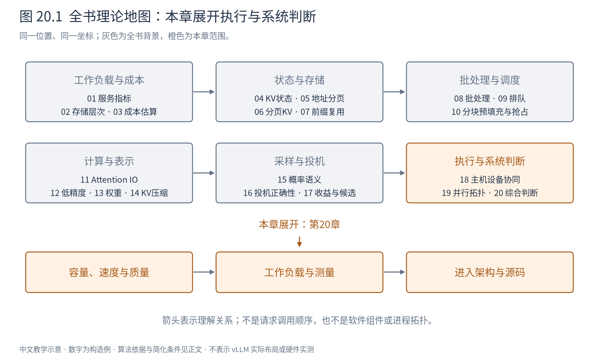
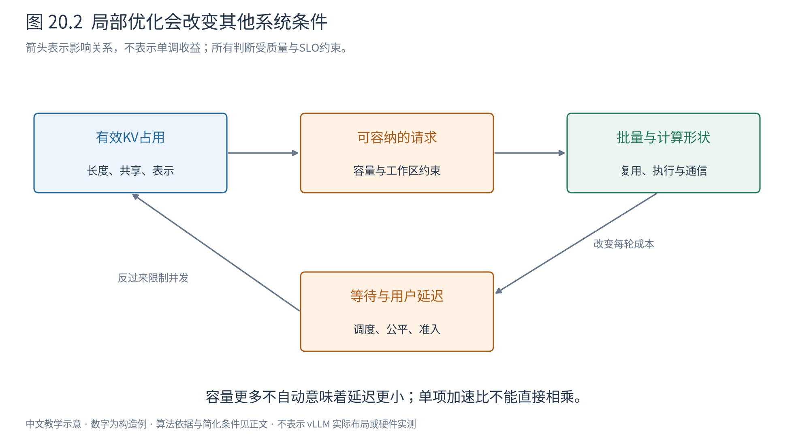
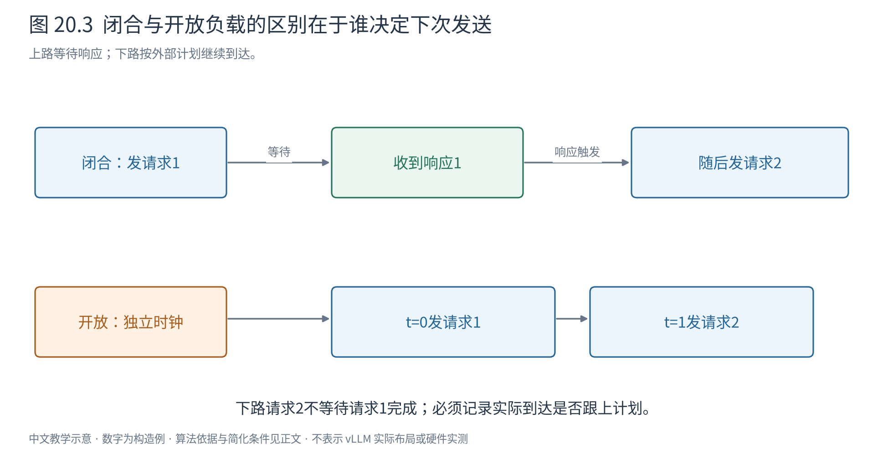

# 第 20 章 把所有理论放回同一次服务

前面各章逐步拆开了计算、存储、调度、数值与生成；第19章又把它们放到多设备上。最后一章回到最初的问题：面对一项真实推理服务，我们怎样判断哪里受限、该改什么，以及改完以后是否真的更好？

本章沿A、B、C的小例把全书接起来，再讨论测量方法。所有新数字仍是构造例；第19章保留的历史实测、附录中的旧实验与这里的推演分别标识。

## 20.1 先写服务契约，才有“更快”的含义

假设服务接收长度不同的提示词，逐token返回结果。用户关心首字等待、生成是否连贯、答案质量和请求失败率；运营者还关心吞吐、设备数量与成本。仅把某个kernel缩短一半，不能回答这些问题。

先固定四类条件：输入及输出长度分布、到达过程、生成策略与质量目标、延迟和可用性要求。同一个模型，“低并发长文问答”和“短提示高并发补全”会产生不同瓶颈。把长输出改短、把采样改为贪心或降低质量后得到的速度，不能直接算作相同服务的性能改善。

成本也需要明确分母。设设备每小时成本c元，稳定提供g个满足目标的请求/秒，则只计这部分设备成本时，每千个合格请求约为 $1000c/(3600g)$ 元。若只用原始吞吐而忽略超时、失败和质量要求，分母会虚高；模型加载、主机与网络费用也需在完整预算中另列。

## 20.2 让三条请求穿过同一套理论

回到12个物理块、每块4token、每块64字节的教学设备。A提示词[a,b,c,d,e,f]，B为[u,v,w]。它们分别需要2块和1块，先消耗3块。C稍后到达，提示词[a,b,c,d,x,y]，与A共享前4个token，而且模型、位置和其他计算条件一致。

如果只缓存完整块，C可以引用A的第一块，另分配自己的尾块。三条请求有5个逻辑块引用，却只有4个独立物理块，共256字节；不共享时是5块、320字节。这个节省来自相同计算的状态复用，不来自降低精度，也不代表C后两个token不用算。

A和C同时增长时，独占尾块尚有余位，可以继续写；如果以后发生分叉共享部分尾块，则需要第6章的写时复制。B结束后，还要等设备不再访问其状态，才能把块安全归还。第7章的缓存策略可能选择保留无活动引用的完整前缀，因此“请求结束”也不总等于“立即清掉所有缓存内容”。

调度方面，A/B正在decode时，C需要prefill。若把C整段一次算完，可能让A/B的后续token等待；分块可以提供插入decode的机会，却可能推迟C首输出，并增加部分重复开销。token预算规定每轮安排多少工作，实际耗时还受上下文长度、批形状与执行方式影响。

一旦容量不足，调度器不能只看“还有token预算”。它可能等待、驱逐无人引用的前缀、抢占请求，或在支持的策略中换出状态；每种办法都将存储问题传导成等待或重算成本。具体组件如何协调是Book7的任务，本册提供的是判断这些决定的资源与算法依据。

读图20.2时从“有效KV占用”开始：减少它可能容纳更多请求，更多请求又可能增加权重复用，但也增加排队和每轮成本。箭头不是“越多越好”，而是提醒每个局部变化会改变其他条件。

## 20.3 哪一项先成为限制，决定优先研究什么

可以先建立粗略资源表，再用测量缩小范围。

|观察与必要复核|可能涉及的理论|不能直接推出的结论|
|模型加载后剩余容量很少|权重表示、工作区、并行切分|不能仅除以卡数就确定能运行|
|长上下文导致批量下降|KV增长、分页、共享、压缩、DCP|不能认为分页会减少有效KV数学内容|
|高并发吞吐上升但尾延迟恶化|排队、连续批、准入与公平|不能只看设备利用率宣布服务改善|
|长prefill期间ITL突增|混合干扰、分块预算、PD分离|不能把chunk越小当成永远越好|
|设备小算子之间常有间隙|CPU准备、提交、同步与图执行|不能仅靠增加stream解决依赖|
|单用户decode慢且设备带宽忙|权重/KV流量、量化、投机|不能把低bit或高接受率直接等同于加速|
|多卡后单请求反而变慢|通信量、报文延迟、拓扑、关键路径|不能只提高链路峰值带宽解释小报文等待|

这张表只是诊断入口。先验证假设，再设计改动：若怀疑权重读取主导，就比较不同batch下的流量与耗时；若怀疑CPU提交，观察设备空隙是否确由提交延迟引起；若怀疑缓存，分别记录命中长度、节省的计算和缓存占用。

多个优化也可能互相削弱。权重量化减少了目标模型每步成本，独立draft的相对成本便更高，投机盈亏点可能改变；投机增加验证token和暂存KV，又可能压缩并发空间；图执行的桶会影响动态调度可选择的形状。评估组合时必须重新测整个系统，不能相乘各篇论文的单项加速比。

## 20.4 开放负载与闭合负载回答不同问题

闭合负载维持固定数量的客户端，每个客户端收到结果后再发下一条。系统变慢时，客户端发新请求也变慢，所以到达率被响应速度自动限制。它适合研究固定并发下的表现，却可能掩盖外部请求仍持续到达时的排队压力。

开放负载根据独立时间计划发请求，例如平均每秒若干条。即使上一条没完成，下一条仍按计划到达。它更适合观察给定外部到达率下是否稳定，但发压机本身也必须能跟上计划。

图20.3上方下一次发送依赖上一响应，下方发送时刻由独立时钟给出。假设服务突然停顿1秒，闭合客户端在等待期间不会继续制造新请求；开放计划仍会积累待发或待处理请求，两种延迟样本自然不同。

如果发压器因为系统慢而推迟发送，又只从“实际发送”开始计时，原计划本应经历的等待可能被漏掉，这类偏差称为coordinated omission。至少应记录计划到达、实际发送、首输出和完成时间，区分客户端欠发与服务端排队。[wrk2作者对负载与计时偏差的说明](https://github.com/giltene/wrk2)

开放负载不一定更正确，闭合负载也不是错误；正确的是选与问题一致的模型，并报告到达过程。第9章Little定律中的系统边界和稳定条件，在这里又成为测量解释的前提。

## 20.5 一个分位数必须有样本身份

p95表示按所声明规则计算的95%分位数，不是“最慢请求的平均”。对LLM，可以计算每请求TTFT的p95，也可以计算每个token间隔的p95，还可以先求各请求TPOT再取p95；三者权重不同。长输出请求贡献更多token间隔，因此token级统计会更偏重这些请求。

不要把不同批次的p95再平均成全局p95。分位数不是线性统计量，必须合并原始样本或可合并的分布摘要后重算。样本很少时，高分位只反映少数观测与插值规则；第19章已经对5请求历史试验的p95作出限制。

报告时还应包括预热与测量窗口、请求总数、失败和超时、实际输入输出长度、缓存冷暖状态、重复轮次及波动。若测量窗口结束时丢掉尚未完成的长请求，就会偏向快请求；应说明排空、截尾或失败统计规则。

原始吞吐与满足服务目标的有效吞吐也应分开。例如10秒处理1000条请求，其中800条同时满足规定TTFT、TPOT与成功条件，则原始吞吐100请求/秒，合格吞吐80请求/秒。不能只对成功且快速的800条重算一个更短窗口，假装另外200条未消耗资源。

## 20.6 把对照实验设计成可以解释的证据

四版mini引擎保留在实践附录，它们展示静态批、连续批、分页分配和前缀复用怎样逐步进入一个小系统。但若某一版同时启用KV缓存、改变批处理和输入准备，版本间整体差值就不等于某一种优化的独立收益。

一个可解释的对照至少要固定模型权重、精度与生成语义、输入请求及到达计划、资源配额、预热和计时边界，再只改变要研究的因素。若必须同时改变多项，应明确它是整体方案比较，并补充必要的拆分对照。失败、负收益和无法支持的配置都应保留。

理论推导、CPU同构算例、教学引擎、真实模型部署构成不同层次的证据。算例能检查索引与概率是否按预期计算，却不能证明NPU速度；真实设备上的更快结果，也不能代替投机分布正确性的证明。把这些层次连接起来，比给每章放一张吞吐表更有价值。

实践附录完整保留旧命令、代码和小型结果的历史身份，不要求用当前v0.30环境重跑旧实验。原有失败记录是约束的一部分，不因重写而删除。

## 20.7 带着问题进入Book7与Book8

读完本册，应该能从依赖关系回答：哪些数据必须保留，哪些计算可以复用，哪些工作可以并行，哪些近似会改变质量，以及一个性能结论依赖哪些条件。

下一册把这些约束变成软件职责；再下一册把职责落实到真实源码。可以按下表带着问题继续读，而不必预先记住类名。

|本册理论问题|Book7架构观察点|Book8源码观察点|
|请求如何跨多轮推进|入口、引擎与结果交付的边界|输入对象、请求状态、完成与取消路径|
|token预算为何受KV容量限制|调度与状态管理协作|调度计划、块分配、抢占与释放|
|一个批次包含哪些位置|执行层与持久状态|输入打包、位置、mask与KV写入|
|为什么同一Attention有多条路径|模型与硬件适配边界|后端契约、元数据、布局与kernel选择|
|为什么异步后状态更难管理|执行循环、进程与消息|提交/完成进度、事件和输出处理|
|投机为什么必须回滚|扩展功能跨组件影响|候选、验证结果、采样与状态修正|
|并行如何改变数据归属|多设备组织|通信组、切分权重与结果归并|

[Book7《vLLM V1架构剖析》](../book7-vllm-v1-architecture/README.md)建立整机地图；[Book8《vLLM V1源码剖析》](../book8-vllm-v1-source-code/README.md)沿v0.30源码把地图落到对象、接口与运行数据。它们负责回答“vLLM选择了怎样实现”，本册负责让你能够判断“这样的选择为什么成立、代价在哪里”。
