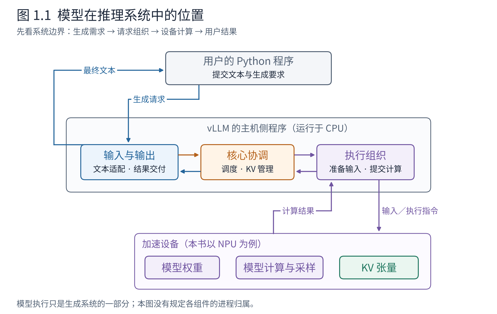
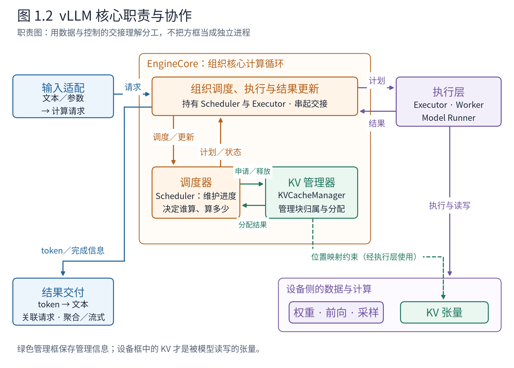
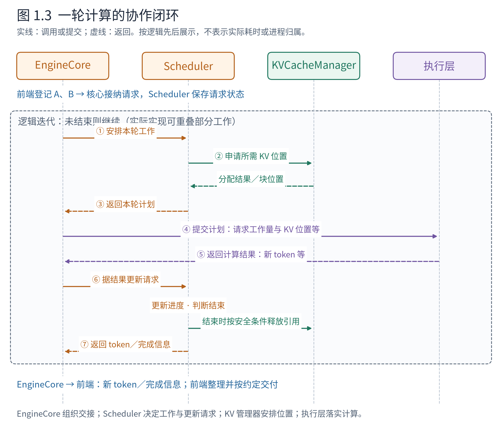
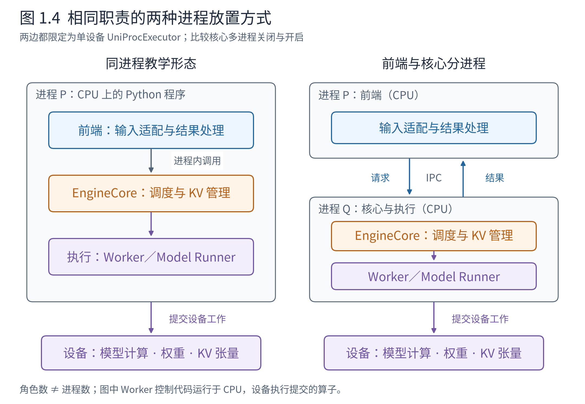

# 第 1 章 从模型计算到推理系统：vLLM 全景

假设我们已经有了一个可以运行的语言模型。给它一段文本，先把文本变成 token，做一次前向计算，选出下一个 token，再把这个 token 接回输入。重复下去，就能得到一段续写。模型架构基础和 Book6 已经使我们理解了这个过程，也理解了 KV cache、批处理和调度为什么能提高推理效率。

现在把两段长度不同的文本交给同一个模型：一段只想补两个 token，另一段还要生成三个。它们能一起算，但不会一起结束。系统必须记住各自的进度，保存各自的 KV 状态，决定每一步拿哪些 token 去算，并把结果还给正确的调用者。如果这时又来了一条请求，还要决定它何时能够加入。

这些事情由谁来做，又怎样连接成一个可靠的整体？这就是理解 vLLM 的起点。**模型规定一次计算怎样进行；推理引擎组织许多请求怎样持续使用这套计算。** 本章先把这些责任放回一张完整地图，说明每个组件保存什么、决定什么、向谁交付，再让两条请求走过它。后续阅读任何局部实现时，我们都可以返回这张地图，判断它在替整个系统解决什么问题。

## 1.1 模型之外，还需要一个什么系统

先明确我们站在哪里：一个 Python 程序已经准备好两段文本，想调用模型生成结果。这里的“离线推理”是指程序通过 Python 接口直接使用引擎，无须先启动一个 HTTP 推理服务；它不表示计算只能使用一个进程，也不表示请求只能逐条执行。

从使用者看，事情很简单：提交文本和生成要求，等待结果。从系统内部看，这个动作跨越了三种不同的工作。第一种是理解输入和组织输出，例如把文本转换为 token、检查生成要求、把生成的 token 转回文本。第二种是持续协调请求，例如记录谁还没结束、下一步推进谁、缓存容量够不够。第三种才是在设备上执行模型需要的计算。

**图 1.1　模型在推理系统中的位置。** 从上往下看：用户程序提出生成需求，vLLM 的主机侧程序组织请求和执行，NPU 承担设备计算并保存权重与 KV 张量。返回箭头表示计算结果最终还要经过处理，才成为用户可读的文本。这是职责与系统边界示意，不是进程部署图。依据：[官方架构说明](https://docs.vllm.ai/en/v0.30.0/design/arch_overview/)及 v0.30.0 核心、执行层源码；NPU 为本书设备示例，图不宣称某种平台的实测进程数。

读这张图时，请先找到模型的位置。它位于计算路径中，却不负责决定“当前有多少位调用者在等结果”。模型通常也不判断“请求 A 已经完成，是否应让请求 C 使用空出来的容量”。这些是引擎根据请求状态和资源约束作出的决定。

为什么要分开？假如把排队规则写进模型层，那么换一种调度策略就可能需要修改许多模型实现；假如让每位调用者独自管理一套执行循环，又很难把不同请求组合成高效的计算批次。将请求组织工作集中到引擎，使模型计算可以被复用，也使多个请求有机会共享设备能力。代价是系统必须明确约定：调用者提交什么，引擎如何记录，计算结果怎样交回。这些约定构成了组件之间的接口。

这里的“接口”并不特指 HTTP API。只要两个部件需要协作，就需要约定交给对方什么、期待得到什么。例如调度器告诉执行层本步有哪些工作，也是一种接口。先理解这种约定，之后再看到函数参数和数据结构，就能知道它们为什么存在。

## 1.2 先按职责看清整台引擎

图 1.1 把主机侧分成了输入输出、核心协调和执行组织三个责任范围。现在把中间打开：谁保存请求进度，谁决定下一轮的工作，谁管理存储位置，又由谁把这些决定变成模型计算？

这些工作发生在已经准备好的引擎中。启动时，系统会根据配置识别模型、加载权重，并准备设备与缓存资源；请求到达后，才使用这些资源持续生成。我们先看准备好之后的协作，第 4 章再解释启动过程。

**图 1.2　vLLM 核心职责与协作。** 先沿蓝色输入找到 EngineCore，再看它怎样调用调度器、向执行层提交计划，最后沿返回箭头找到结果交付。橙色容器表示核心协调范围，内部的 Scheduler 管理请求推进，并使用绿色的 KVCacheManager 管理存储；紫色执行层单独展开。实线表示调用或数据交接，绿色虚线表示 KV 位置约定经执行层落实到设备。此图按职责展开，不表示完整对象包含关系或进程归属；设备上的 KV 张量与主机上的管理信息分别画出。依据：v0.30.0 固定源码，入口见章末导航。

### EngineCore：把一次次工作组织成持续运行的引擎

先看图中最外层的核心协调者。引擎核心（EngineCore）要完成这样一个循环：请调度器安排本轮工作，把计划交给执行层，取得执行结果，再让调度器据此更新请求，向前端送出需要交付的结果。只要还有请求需要推进，这个过程就会继续。

这就是它封装的抽象：**一个持续推进计算请求的核心引擎。** “封装”在这里是把某项责任所需的状态和操作放在一起，并给协作者一个明确的使用方式。前端把计算请求交进来、接收内部结果，无须自己逐轮安排每条请求；EngineCore 则依靠内部的专门组件完成这些工作。

因此，“核心负责推进请求”不意味着 EngineCore 独自决定所有细节。在阅读锚的对象关系中，EngineCore 持有调度器 Scheduler 和执行器 Executor；Scheduler 又持有 KVCacheManager。图中为了讲清分工，把执行层单独画在右侧，把调度和 KV 管理放进核心协调范围。**对象由谁持有、职责怎样拆分、代码在哪个进程运行，是三个不同的问题。** 本节先解决前两个，1.4 节再讨论运行位置。

对 A、B 来说，EngineCore 不需要亲自判断“A 本轮应算 3 个还是 1 个 token”，也不需要亲自挑选某个 KV 块。它负责让“安排—执行—更新”正确衔接。这种组织也使以后更换调度策略或设备执行实现时，可以保留核心循环的基本协作方式。

### Scheduler 与 KVCacheManager：把工作安排和存储管理接起来

要安排一轮工作，首先得知道请求当前在哪里。调度器（Scheduler）维护等待与运行中的请求，掌握各请求已有多少 token、计算推进到了哪里、还允许生成多少，以及本轮可用的 token 预算。它封装的是**有资源约束的请求推进策略**：本轮选谁，各处理多少 token；结果回来后，谁继续、谁结束。

这里的工作量是“送进模型计算的 token 数”。A 的提示词若有 3 个尚未处理的 token，本轮可能处理这 3 个；提示词已处理、只新增一个待计算 token 时，本轮就可能只处理这 1 个。请求的身份和生成要求跨轮保留，每轮的工作量却可以改变。Book6 的连续批处理，在这里成为持续维护的工作安排。

但预算允许计算，不代表存储也允许。每条请求要读取自己的历史 KV，还要为本轮将产生的 KV 找到位置。KV 缓存管理器（KVCacheManager）封装的是**请求对 KV 存储的占用关系**：哪些块可用，哪些块被请求引用，新增计算需要哪些位置，结束后哪些引用可以解除。调度器安排工作时向它申请位置，依据分配结果决定该工作能否进入本轮。

两者的边界可以用一个问题辨认：若 A、B 都希望继续，但存储不够，KVCacheManager 判断相应分配能否成立，Scheduler 根据资源约束与调度策略决定如何处理请求。块管理器不替调度器决定谁应优先服务；调度器也不自行维护每个块的空闲与引用细节。

还要区分**管理位置与计算内容**。KVCacheManager 保存块的归属、引用和分配等管理信息；实际 K、V 张量位于设备内存中，由执行路径读写。给 A 分配了块，只说明为它的计算安排好了存储，尚未计算的 token 不会因此凭空拥有 K、V。这个区别会在下一节的逐轮过程里变得具体。

### 执行层：把工作计划变成模型计算

调度器交出的计划说明“哪些请求、本轮处理多少、使用哪些 KV 位置”等信息。执行层封装的是**落实这份计划所需的设备执行能力**：维护执行侧所需的请求状态，把当步输入组织成张量，准备位置和 KV 访问映射，运行模型、写入新 KV，再将采样得到的 token 等结果返回。

这里还可以细分三层。执行器（Executor）组织对一个或多个工作单元的调用；工作单元（Worker）承担相应设备的初始化和执行职责；模型运行器（Model Runner）维护执行所需状态、准备当步模型输入，并连接前向计算与采样。第 7 章会展开它们；此时先把执行层视为能接收工作计划、返回计算结果的整体。

**Scheduler 决定工作量，执行层落实工作量；KVCacheManager 管理存储位置与归属，执行层读写实际 KV。** 执行层必须知道如何将 A、B 放进同一次计算，同时保证它们各自访问正确的历史。调度器则可以专注于请求和资源安排，无须为每一轮亲自编排设备算子。两侧通过计划和结果协作，计划中的请求身份、计算位置与 KV 映射必须保持一致。

### 从计算结果回到用户结果

执行层返回结果以后，EngineCore 让 Scheduler 更新计算进度和结束状态，再把需要交付的新 token 与完成信息送往前端。前端的输出处理器（OutputProcessor）关联请求、恢复文本，按约定聚合或逐段交付；在文本生成路径中，它还参与停止字符串判断，并可将终止信息反馈给核心。

这让整台引擎形成两个相接的过程：核心内部持续安排并推进计算，前端持续把内部结果整理成用户结果。A 的计算已经结束，与包含 A、B 的整次离线调用可以返回，是不同的时刻。下一节先走完计算闭环，第 2 章再展开交付边界。

在 v0.30.0 中，LLMEngine 或 AsyncLLM 等前端对象协调输入、输出与核心客户端。本书的“前端”指面向调用者的一侧，是一个责任范围。现在再看图 1.2：前端交入需求，EngineCore 组织循环，Scheduler 决定推进方式，KVCacheManager 提供存储约束，执行层完成计算，结果再沿返回路径推动状态更新与交付。下面让同一组 A、B 走过这个过程。

## 1.3 两条请求怎样共同走完一次生成

我们构造两条请求：A 的输入有 3 个 token，最多生成 2 个；B 的输入有 5 个 token，最多生成 3 个。两者都不提前遇到结束符，KV 容量充足，没有前缀缓存命中，也没有投机解码。假设第一轮选择了两条请求，每轮最多处理 8 个输入 token，并按逻辑先后展示计算。把 A 生成的 token 记为 a₁、a₂，B 的记为 b₁、b₂、b₃。

先从全程看三轮工作，再打开每一轮里的协作。以下数字是教学构造，不是模型实测或所有配置下默认调度顺序的承诺。

**表 1.1　两条请求的三步生成（教学构造）**

| 逻辑迭代 | A 本步处理什么 | B 本步处理什么 | 本步处理的输入 token 总数 | 得到什么，接着怎么办 |
|---|---|---|---:|---|
| 第 1 步 | 3 个提示词 token | 5 个提示词 token | 8 | 得到 a₁、b₁；A、B 都继续 |
| 第 2 步 | a₁ | b₁ | 2 | 得到 a₂、b₂；A 达到上限，B 继续 |
| 第 3 步 | 不再参与 | b₂ | 1 | 得到 b₃；B 达到上限 |

Book6 已经告诉我们，预填充（prefill）处理提示词并建立 KV，随后解码（decode）利用已有 KV 继续生成。表中要分清**送去计算的 token 数与新生成的 token 数**：第一轮处理 B 的 5 个提示词 token，得到的是 B 的第一个输出 b₁；第二轮将 b₁ 送进模型，才得到 b₂。普通自回归生成就是这样逐步继续的。

**图 1.3　一轮计算的协作闭环。** 从上往下读：EngineCore 调用 Scheduler；Scheduler 在安排工作时向 KVCacheManager 申请位置，再把计划返回 EngineCore；EngineCore 委托执行层计算，并将结果交给 Scheduler 更新状态。实线表示调用或提交，虚线表示返回；前端的登记与结果交付在上下两端标出。生命线表示职责对象，不表示独立进程；纵向间距不是耗时，实际异步执行可以重叠部分工作。依据：v0.30.0 `EngineCore.step`、`Scheduler.schedule`、`update_from_output` 与 KV 分配接口。

### 第一轮：先有工作计划，再有实际 KV 和输出

A、B 经过前端适配并进入核心后，Scheduler 中已有它们的请求状态：A 有 3 个提示词 token，B 有 5 个，都还没有完成计算。EngineCore 发起本轮调度，Scheduler 检查进度与预算，准备让 A 处理 3 个、B 处理 5 个，合计正好为 8。

计划成立还需要存储。为看清这一步，再作一个简化：只考虑普通全注意力的一组 KV 块，每块可容纳 4 个 token 的 KV。这里的块大小与编号完全是教学设定，不代表真实模型配置。Scheduler 为 A、B 申请本轮需要的位置，KVCacheManager 从已有块池中安排出以下关系：

**表 1.2　第一轮计算前安排的 KV 存储（教学构造）**

| 请求 | 本轮需容纳的 token 位置数 | 分配的块 | 可容纳的 token 位置数 |
|---|---:|---|---:|
| A | 3 | 块 7 | 4 |
| B | 5 | 块 2、块 9 | 8 |

A 的逻辑位置先使用块 7 的前三个位置；B 使用块 2 的四个位置以及块 9 的第一个位置。KVCacheManager 已经登记了归属，但这些位置上本轮所需的 KV 还没有算出来。**分配回答“放在哪里”，执行才产生“放进去的内容”。**

存储安排成功后，Scheduler 将工作计划返回 EngineCore。把真实接口中的辅助信息折叠掉，可以把这次交接读成：A 算 3 个 token、使用块 7；B 算 5 个 token、使用块 2 和块 9；并附上首次执行所需的请求输入与生成要求。这是 `SchedulerOutput` 所承担的契约：它交付当步工作和执行所需的信息，不把整个调度器交给执行层。

EngineCore 随即把计划交给执行层。Model Runner 等组件准备当步输入与访问映射，设备执行模型计算，生成各位置的实际 KV 并写入相应块，再采样得到 a₁、b₁。A、B 可以参加同一次计算，但各自的序列边界和 KV 访问关系仍然清楚；共享的是模型权重，各自的历史必须正确区分。

结果回来后，EngineCore 调用 Scheduler 的结果更新入口。按本例的逻辑轮次看，A 已计算 3 个 token、生成 1 个，B 已计算 5 个、生成 1 个；两者都还没达到生成上限。Scheduler 更新相应状态，并形成需要向前端返回的信息。EngineCore 完成本轮交接，随后继续推进。

### 第二轮：复用已有状态，并让 A 结束

现在 Scheduler 看到的工作已经改变：提示词都处理过了，A 只新增了尚未送进模型的 a₁，B 只新增了 b₁。本轮只需各处理 1 个 token。请求继续存在，工作计划却从“3 加 5”变成了“1 加 1”。

Scheduler 再次请 KVCacheManager 安排增长所需的位置。A 的已计算长度将从 3 变成 4，原块 7 正好够用；B 将从 5 变成 6，原有两块也够用。**需要安排新 token 的存储位置，并不等于每轮都要分配新块。** 检查容量、使用已有剩余位置、必要时追加块，是 KV 管理所封装的细节。

EngineCore 把本轮计划交给执行层。执行层保留了必要的请求状态，可以结合当步更新读取 A、B 各自的历史 KV，处理 a₁、b₁，写入这两个位置的新 KV，再生成 a₂、b₂。结果交回 Scheduler 后，A 已生成 2 个 token，达到上限；B 已生成 2 个，还能继续。

A 的结束使多个职责一起发生变化：Scheduler 停止为 A 安排后续工作，并通过 KVCacheManager 按安全时机解除块引用；完成标记随后通知执行侧清理它保存的 A 的状态；前端收到 A 的最终内部结果，整理并保存用户结果。EngineCore 组织这些交接，使计算完成能传递到其他协作者。这里只沿顺序执行且无额外传输的情景理解；存在尚未完成的设备写入时，回收还必须满足安全条件。

注意，a₂ 已经是最终输出，无须再送进模型。因此 A 最后计算过的是“3 个提示词 token 加 a₁”，对应 4 个位置的 KV；无需为了补齐 a₂ 的 KV 再运行一轮。**已经产生的输出长度，与已经完成 KV 计算的长度，可以不同。** 调度器正是需要掌握这种进度差异，才能知道下一轮还有什么工作。

### 第三轮：同一套协作，只推进仍在运行的 B

EngineCore 再次发起调度，Scheduler 只为 B 安排处理 b₂。KVCacheManager 确认原有两块能够容纳增长到 7 个位置的 KV。执行层处理 b₂，生成 b₃；Scheduler 根据结果判断 B 达到上限，随后完成相应清理与结果返回。

全程中，EngineCore 始终组织同一种“调度—执行—更新”循环；Scheduler 的计划从 A、B 各处理若干 token 变成只推进 B；KVCacheManager 维护的是每条请求需要的位置和块引用；执行层则按每轮计划完成计算。A 不必为了陪 B 而继续占据实际计算位置。这就是连续批处理在整机中的落点：一次调用提交的请求集合，与某轮模型执行的请求集合，可以不同。

如果 A 结束后有新请求 C 到达，它就有机会使用可重新分配的资源。这里“释放”主要指解除请求的占用和引用；开启缓存复用时，某些块的内容可以保留以供后续命中，并非必须立即擦除或把设备内存还给系统分配器。[前缀缓存设计](https://docs.vllm.ai/en/v0.30.0/design/prefix_caching/)区分了这些状态，第 6 章会继续展开。

到这里，再看图 1.2，就可以为每个框放入具体的状态与动作：Scheduler 记住 A、B 的进度，KVCacheManager 记住它们占用的块，执行侧保存所需执行状态并访问设备 KV，EngineCore 把它们连接成循环。**请求跨越多轮，计划描述一轮；各部分保存自己完成职责所需的状态，通过计划、结果和结束事件保持一致。** 接下来还剩一个问题：这些协作发生在同一进程，还是需要跨进程交接？

## 1.4 图上的组件，究竟在哪里运行

职责图回答“谁做什么”，没有回答“它们在哪里”。现在切换视角。

**进程（process）**是操作系统管理的一次程序运行，拥有自己的地址空间。两个对象在同一进程中，可以通过普通函数调用协作；放在不同进程后，通常需要把必要数据组织成消息传过去。**线程（thread）**是在进程内部执行工作的单元，同一进程的线程可以共享内存。**设备**则是执行算子的硬件，例如本书使用的 NPU。进程、线程和设备不是同一层级的东西。

因此，“Worker 使用 NPU”不表示 Worker 的 Python 代码跑在 NPU 上。它通常仍是 CPU 上的控制程序，通过运行时向设备提交计算；模型权重、计算张量及 KV 张量才位于相应设备存储中。这也是为什么只看 NPU 算力，无法说明整个推理系统的效率。

**图 1.4　相同职责的两种进程放置方式。** 两边都限定为单设备、选用 UniProcExecutor 的形态。左边显式关闭核心多进程，右边将前端与 EngineCore 分开；右边的 Worker 仍与核心同进程。箭头跨越进程框时需要进程间通信（IPC）。依据：v0.30.0 `EngineCoreClient.make_client`、`UniProcExecutor._init_executor` 与多进程环境开关。图示不覆盖所有 executor，也不是本机 NPU 进程测量结果。

请对比图的两边，而不是数类名。调度、KV 管理、执行等责任都还在，变化的是它们的放置方式。离线调用既可以使用左边的同进程形态，也可以通过多进程客户端连接独立核心。阅读锚的离线核心多进程开关默认开启；具体执行层如何部署，仍取决于 executor、平台及配置。

分开进程有什么价值？假如前端正在处理较费 CPU 的输入转换或输出文本，而核心同时有下一轮计算需要组织，隔离两边有助于减少相互阻塞，并允许它们的工作重叠。官方 V1 设计说明正是从 CPU 开销逐渐显著这个问题出发解释 EngineCore 隔离的。[设计背景](https://vllm.ai/blog/2025-01-27-v1-alpha-release)

代价也具体存在：跨进程要传消息，需要关联请求身份，需要处理一端结束而另一端还有未处理结果的情况。将模块放进不同进程不会自动获得性能收益；只有省下的等待值得付出这些成本时，边界才有意义。第 3 章会进一步说明消息如何连接两边。

## 1.5 架构为什么影响性能，也影响扩展

A、B 的三轮过程让我们看见了职责边界，也给了我们判断变化应落在哪里的方法。若要让短请求更早获得计算机会，首先检查 Scheduler 的策略；若要改变块的分配与复用，进入 KV 管理；若要更换 Attention 计算实现，进入执行层；若要调整调度与执行怎样重叠，进入 EngineCore 的循环组织。边界帮助我们定位变化，也让我们知道变化需要通知哪些协作者。

由此可以从整体看懂两类不同的优化。

一类优化让同样的设备计算更快，例如更合适的 Attention 后端；另一类优化让设备更少空等、让有限存储服务更多请求，例如减少输入准备开销、调度合适的工作量、复用已有 KV。前者主要发生在执行路径，后者跨越调度、状态和前端组织。一个快的模型算子，不会自行解决等待队列和交付流程中的问题。

继续看表 1.1。如果每轮都把所有未改变的请求信息完整重新整理、重新传递，那么 A、B 虽然只各增加一个 token，CPU 仍可能反复处理大量相同信息。保留跨轮状态、只更新变化部分，可以减少这种重复工作。但状态越持久，就越需要小心维护“谁还在、谁已结束、哪些内容可以复用”。[Model Runner V2 设计文档](https://docs.vllm.ai/en/v0.30.0/design/model_runner_v2/)讨论了持久状态与当步输入耦合造成的复杂性；第 7、9 章会继续解释这种取舍。

扩展性也来自相同的边界。新增一个输入协议时，希望它能把请求转换为核心理解的形式，而不是复制调度器；新增一个设备平台时，希望它能提供合适的执行实现，而不是复制整个输入输出系统。硬件插件设计正是为了降低平台代码分散在各处造成的维护负担。[硬件插件 RFC](https://github.com/vllm-project/vllm/issues/11162)

然而接口会对接入方提出要求。例如，若只调整块的分配策略，执行层可以继续遵守原来的访问约定；若连设备 KV 布局一起改变，就必须同步调整执行侧的读写。新的 Attention 实现必须与输入元数据和 KV 布局相容；新的平台必须正确承接执行和内存行为。不能只因为图上有一个“后端”框，就假定换个名字能替换全部硬件差异。**好的边界既把变化限制在适当范围，也把双方必须共同遵守的条件写清。** 本书会用具体组件逐次解释这些条件。

## 1.6 带着这张地图继续阅读

从现在起，全书各章是在不同视角下展开同一台机器。第 2 章先看面向调用者的一侧，理解一份需求怎样进入，结果又怎样返回；第 3、4 章把组件放到运行环境里，解释系统怎样组织和启动。第 5、6 章进入核心，讨论计算与存储的协调；第 7–9 章解释计划怎样变成执行，以及性能优化怎样嵌入。第 10、11 章再把这套认识扩展到多卡和高级功能。第 12 章回到全景，练习带着问题定位源码。

不需要一次记住全部英文名字。离开本章时，试着画三个相连的责任范围：面向调用者的前端、协调请求的核心、落实计算的执行层。在核心中标出 EngineCore 组织循环、Scheduler 决定推进、KVCacheManager 管理位置；在执行路径上标出计划怎样落实为模型计算与 KV 读写，最后画出结果返回与状态更新。只要能用 A、B 说明每个框保存什么、决定什么，箭头又交接什么，这张图就有了具体含义。

用两个问题检查这张图。第一，A 结束而 B 还没结束，谁需要更新？Scheduler 要结束 A 的调度生命周期，KVCacheManager 要按安全时机解除相应占用，执行侧要清理 A 的状态，前端要保存 A 的结果；EngineCore 组织计算与结果更新的交接。第二，把结果从最终一次返回改成逐段交付，哪些地方首先需要变化？面向调用者的输出与服务组织会变化；模型生成仍然需要核心持续安排计算。

第二个问题留下了入口层真正值得研究的内容：**它怎样在用户的调用方式与引擎的持续计算之间建立一份稳定约定？** 下一章从这份约定开始。

## 章末源码导航：把职责映射到实现

以下为选读，不影响前文理解。所有链接固定在阅读锚 `ced6857`。先带着一个问题进入一个文件，找到责任边界后即可停下，不要求沿每个调用继续追踪。

| 带着什么问题读 | 源码入口 | 读到哪里即可停止 |
|---|---|---|
| 核心怎样组织一轮计算？ | [core.py::EngineCore.step](https://github.com/vllm-project/vllm/blob/ced6857afa0ea7b2e3f0846a62e1394e90f15607/vllm/v1/engine/core.py#L589) | 先看初始化中持有的 scheduler 与 model_executor，再找到 schedule、execute、update 三个交接点；异步队列留待后文 |
| 调度器表达的工作量是什么？ | [scheduler.py::Scheduler.schedule](https://github.com/vllm-project/vllm/blob/ced6857afa0ea7b2e3f0846a62e1394e90f15607/vllm/v1/core/sched/scheduler.py#L561) | 读入口的进度与预算说明，再看同目录 output.py 的 SchedulerOutput 如何表达本轮计划；不逐分支展开 |
| KV 的分配责任在哪里？ | [kv_cache_manager.py::KVCacheManager.allocate_slots](https://github.com/vllm-project/vllm/blob/ced6857afa0ea7b2e3f0846a62e1394e90f15607/vllm/v1/core/kv_cache_manager.py#L370) | 看调用契约，理解“给请求安排块”；内部策略留第 6 章 |
| Worker 是否必然是独立进程？ | [uniproc_executor.py::UniProcExecutor._init_executor](https://github.com/vllm-project/vllm/blob/ced6857afa0ea7b2e3f0846a62e1394e90f15607/vllm/v1/executor/uniproc_executor.py#L52) | 找到 driver_worker 的创建与初始化，联系图 1.4 |
| 什么决定核心是否跨进程？ | [core_client.py::EngineCoreClient.make_client](https://github.com/vllm-project/vllm/blob/ced6857afa0ea7b2e3f0846a62e1394e90f15607/vllm/v1/engine/core_client.py#L91) | 识别同进程、同步多进程、异步多进程三类客户端即可 |
| 计算结果怎样进入交付环节？ | [output_processor.py::OutputProcessor.process_outputs](https://github.com/vllm-project/vllm/blob/ced6857afa0ea7b2e3f0846a62e1394e90f15607/vllm/v1/engine/output_processor.py#L629) | 看方法说明与处理阶段，不进入反分词器实现 |

[继续阅读第 2 章：请求如何进入引擎，又如何返回](ch02-请求的进入与返回.md)
