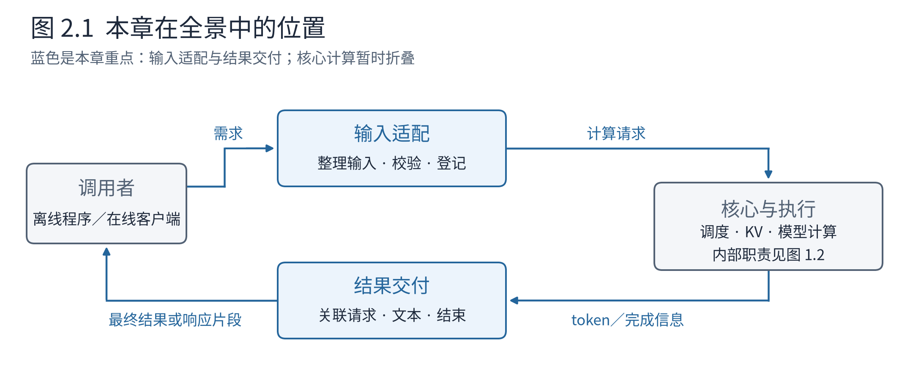
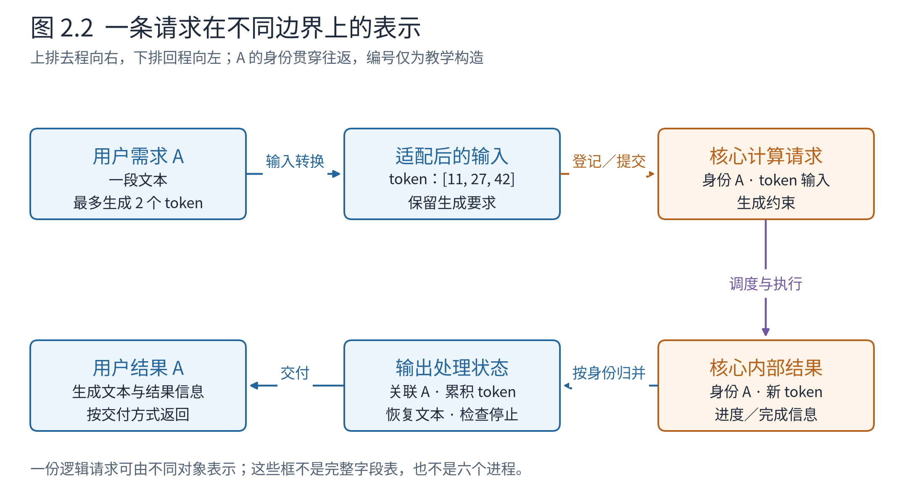
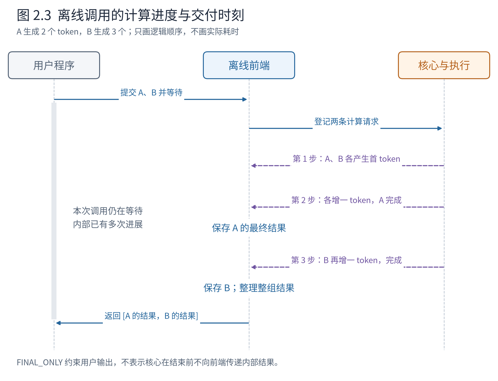
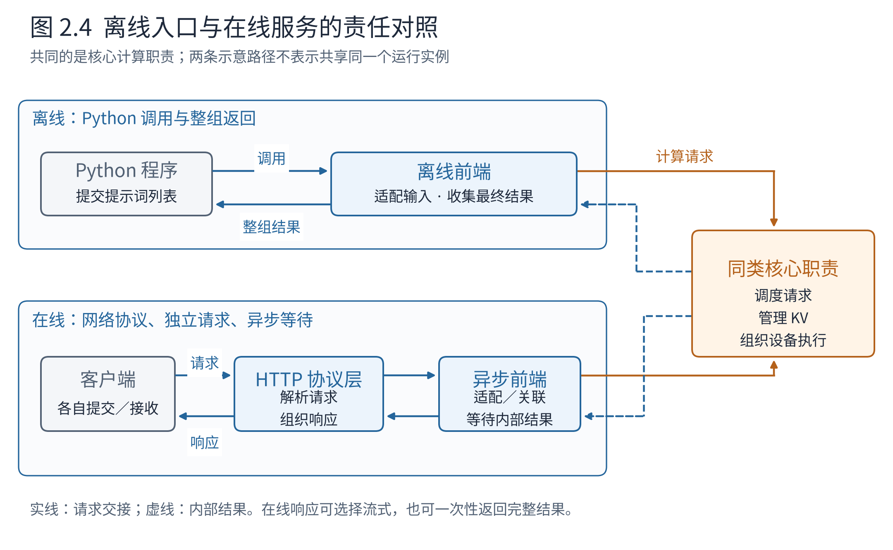
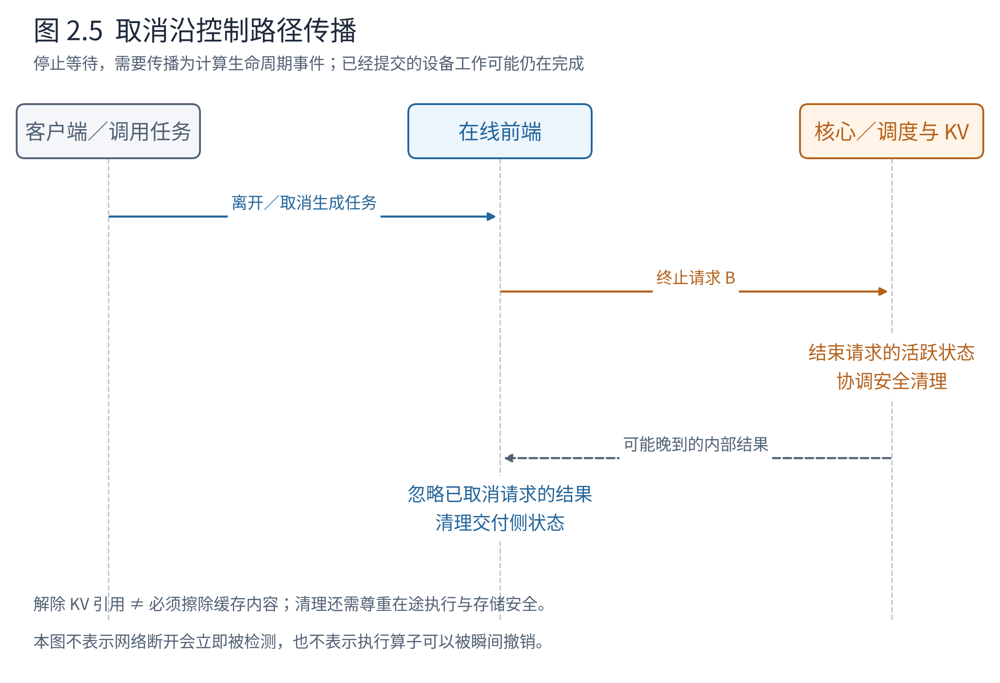

# 第 2 章 请求如何进入引擎，又如何返回

上一章建立了一幅整体图景：前端理解调用者的需求，核心协调请求和资源，执行层落实模型计算，结果再经前端交付。现在我们从这张图的左右两端展开，而把中间的调度与设备计算暂时看成一个已经认识、尚未深入的整体。

设想你的程序要为两段文本续写。你关心的是“把这两段文本提交进去，拿回各自的结果”；引擎内部关心的却是“本轮可以推进哪些 token，缓存位置是否足够，哪些请求还没结束”。入口层的价值，正是连接这两种不同的视角。它既要让调用者能够提出清楚的需求，也要让核心不必反复理解每一种外部表达方式。



**图 2.1　本章在全景中的位置。** 与图 1.2 使用相同职责和颜色。本章聚焦蓝色的输入适配、结果交付，以及它们与核心之间的双向约定；中间折叠表示本章暂不展开调度和模型执行，并非这些部件消失了。按 v0.30.0 的前端与核心边界作教学示意。

先读图中的两个方向：向右是需求逐渐变成计算工作，向左是计算结果逐渐变成用户可读的输出。等两条路都走通，我们再加上在线服务，看看它新增了什么，以及为什么仍然能够复用核心架构。

本章也给每次交接放上一份具体数据。下面的类名、字段与调用依据 v0.30.0 源码，token 编号、时间和 ID 后缀为教学构造，不是抓取的运行日志。标为“字段节选”的对象只展示当前问题所需字段，不是可直接运行的完整脚本；省略项不表示真实对象没有那些数据。

## 2.1 从一次离线调用的承诺开始

离线 Python 接口中，调用者可以向 `LLM.generate` 提交一组提示词及采样、长度等生成要求。这里先把接口当作一份约定：普通调用会等待这组请求完成，再返回结果列表；结果按输入顺序对应。调用者无须自行接收每一步内部 token，也无须知道请求在哪一轮与谁共同计算。[接口说明](https://docs.vllm.ai/en/v0.30.0/api/vllm/entrypoints/llm/)

沿用上一章的 A、B。A 只生成 2 个 token，B 生成 3 个。A 可以先结束，但调用者仍在等待整个调用返回。这并不矛盾，因为这里存在三个不同的“完成”：A 的计算完成、A 的最终结果已经整理好、包含 A 和 B 的整次调用可以返回。前两件事可以先发生，最后一件事要等 B 也结束。

把调用约定落到代码上，假设 `llm` 已完成初始化，`prompt_a`、`prompt_b` 是两段文本，调用者写下的是：

```python
results = llm.generate(
    prompts=[prompt_a, prompt_b],
    sampling_params=[
        SamplingParams(max_tokens=2, temperature=0.0, ignore_eos=True),
        SamplingParams(max_tokens=3, temperature=0.0, ignore_eos=True),
    ],
    use_tqdm=False,
)
```

`ignore_eos=True` 在本例中排除提前遇到 EOS 的情况，便于继续走完两次和三次生成；没有设置额外停止字符串。`results` 接到的是整组结果，核心内部可以在这条语句返回前推进许多轮。实际分词长度仍取决于模型，下面采用构造的 3-token 与 5-token 输入。

**表 2.1　调用者与引擎看到的同一次工作**

| 时刻 | 调用者看到什么 | 引擎可以已经做了什么 |
|---|---|---|
| 提交后 | 调用尚未返回 | 输入转换、登记请求，开始组织计算 |
| A 已结束、B 未结束 | 仍在等待整组结果 | 保存 A 的结果，停止继续调度 A，继续 B |
| A、B 均结束 | 收到按输入顺序组织的结果列表 | 完成相关请求的交付与生命周期清理 |

这份约定把内部复杂性挡在了接口之后。如果内部因调度而改变完成顺序，调用者仍可按原输入位置找到结果。如果计算批次中途缩小，调用者也不需要重组自己的输入列表。换句话说，**稳定的是用户可见的行为，内部工作安排可以变化。** v0.30.0 的离线结果收集器确实在完成后排序返回，章末会给出阅读位置。

同样重要的是，生成上限属于每条请求的约束，不是对全局调度的命令。“A 最多生成 2 个 token”不能翻译成“下一轮给 A 分配 2 个输入 token”，也不保证 A 恰好占用两轮计算。前者规定何时停止生成，后者涉及当前进度和预算。入口应将需求完整交给核心，再由核心结合其他请求作决定。

有了这份外部约定，接下来才能讨论内部转换。否则一上来阅读请求字段，很容易只记住名字，却不知道它在保护什么行为。

## 2.2 文本怎样变成一条可以计算的请求

用户给出的是文本，计算路径需要的是 token 及相应的执行要求。两者之间要完成三类工作：把输入组织成模型接受的形式，转换为 token 表示，检查请求能否被当前引擎支持。**输入适配（input adaptation）**是我们对这组职责的统称，不特指某一个函数。

对于普通文本续写，输入组织相对直接。对于聊天接口，外部输入通常是一串带角色的消息，例如系统、用户、助手的对话记录；需要先按模型使用的聊天模板组织，再交给分词器。聊天消息中的角色标记属于输入格式，不是调度器需要理解的业务逻辑。核心只应接收到已经转换好、能够用于计算的表示和参数。

分词（tokenization）还提醒我们一个基本事实：token 不等于汉字或英文单词。本文不指定某个模型的分词结果。为了沿途追踪，以下把 A 的 3 个输入 token 记成 `[11, 27, 42]`，B 的 5 个输入 token 记成 `[10, 14, 18, 22, 26]`。这些编号完全是教学构造，不能拿去解码为原始提示词。



**图 2.2　一条请求在不同边界上的表示。** 沿上排向右读，再沿下排向左读。去程把文本和生成要求转成核心计算请求；回程把新 token 和完成信息整理成用户结果。A 的身份贯穿往返，数据表示随职责改变。图中数字为构造例，框内不是完整真实 schema。依据：v0.30.0 Renderer／InputProcessor、EngineCoreRequest 与 OutputProcessor 的职责分工。

现在把图中的“计算请求”打开。离线前端的协调对象是 `LLMEngine`，它使用 Renderer 组织输入，使用 InputProcessor 校验并构造 `EngineCoreRequest`；裸输入回退等路径也由相应适配组件处理。关键路径可以这样读，辅助调用已折叠：

```text
LLM.generate → _run_completion
  → _add_completion_requests
      → Renderer：整理输入、分词
      → _add_request：设为 FINAL_ONLY、分配请求编号
      → LLMEngine.add_request
          → InputProcessor.process_inputs：形成 EngineCoreRequest
          → OutputProcessor.add_request：登记输出状态
          → EngineCoreClient.add_request：提交给核心
```

最后一行是前端向核心交付需求的接口。`LLMEngine.engine_core` 持有的是核心客户端；多进程时它发送消息，同进程时它调用本地核心。它不把 Scheduler 对象暴露给用户。输入检查在交付前确认任务与参数符合当前配置，避免不可执行的需求进入计算循环。

A 的请求对象如下。假设离线入口给 A、B 分配的外部编号为 `"0"`、`"1"`，默认内部 ID 另加八位随机后缀；这里用固定后缀便于跟踪：

```python
# EngineCoreRequest 对象视图；生成参数只列与本例有关的项
request_a = EngineCoreRequest(
    request_id="0-a1b2c3d4",
    external_req_id="0",
    prompt_token_ids=[11, 27, 42],
    sampling_params=SamplingParams(
        max_tokens=2, temperature=0.0, ignore_eos=True,
        output_kind=RequestOutputKind.FINAL_ONLY,
    ),
    arrival_time=1700000000.0,  # 构造的到达时间
    mm_features=None, pooling_params=None, lora_request=None,
    cache_salt=None, data_parallel_rank=None, client_index=0,
)
```

B 的同型对象将 `request_id` 换成 `"1-b2c3d4e5"`、`external_req_id` 换成 `"1"`，输入换成 `[10,14,18,22,26]`，生成上限换成 3。`client_index=0` 指向本例的前端接收者；它不是请求在批次中的行号。这里还没有 KV 块号，也没有“本轮 A 算 3 个”的计划：前端提交生成需求，资源与当步工作由核心随后决定。

字段依据 [EngineCoreRequest](https://github.com/vllm-project/vllm/blob/ced6857afa0ea7b2e3f0846a62e1394e90f15607/vllm/v1/engine/__init__.py#L107)；身份转换见 [InputProcessor.assign_request_id](https://github.com/vllm-project/vllm/blob/ced6857afa0ea7b2e3f0846a62e1394e90f15607/vllm/v1/engine/input_processor.py#L262)。后续章为了集中讨论计划与张量，会把这两个较长的内部 ID 简记为字符串 `"A"`、`"B"`；它们仍表示内部身份，不是另一次真实编号转换。

为什么不让模型运行器自行接受字符串、聊天消息、HTTP 请求等所有形式？这样会把协议变化和文本处理带到紧贴设备执行的路径上。先在前端统一表示，使核心和执行层面对相对稳定的计算需求。代价是转换要保持一致：模板、分词器、模型配置不能互相矛盾，某个参数也不能在传递中丢失。接口的价值包含这种一致性责任。

## 2.3 同一条请求，为什么在两侧都有状态

请求表示统一以后，是否把它发送出去就可以忘掉？还不行。系统既要记住“计算进行到哪里”，也要记住“结果该怎样交给调用者”。这两类问题持续的时间相近，却需要不同的信息。

核心侧需要维护 A 的计算进度、调度状态和 KV 占用关系。前端侧需要知道哪些返回 token 属于 A、目前已经形成什么文本、采用最终返回还是增量交付。两侧通过请求身份关联，但不必保存完全相同的对象。v0.30.0 的前端会先为输出处理登记状态，再向核心提交请求；这样计算结果回来时已经有接收位置。

单候选路径的提交点正体现这份顺序：

```python
# LLMEngine.add_request 中的两行真实调用
self.output_processor.add_request(request, prompt_text, None, 0)
self.engine_core.add_request(request)
```

第一行建立前端的 RequestState，第二行把 EngineCoreRequest 交给客户端。核心接收后通过 `Request.from_engine_core_request(...)` 建立自己的 Request，再经 `EngineCore.add_request(...)` 交给 `Scheduler.add_request(...)`。同一份 A 于是有了输出侧状态和计算侧状态，连接它们的是 ID，而不是跨进程共享同一个 Python 对象。

**表 2.2　A 的状态按责任分开保存**

| 状态所在的责任范围 | 它需要回答什么 | 在 A 生成第一个 token 后 |
|---|---|---|
| 核心侧 | 下步是否继续；已经计算到哪里；还需哪些 KV 位置 | A 尚未结束，下一轮可以继续推进 |
| 执行侧 | 如何将活跃请求组织成当步输入；设备状态怎样访问 | 保持后续计算所需的状态与映射 |
| 前端输出侧 | 结果属于谁；已有多少可交付文本；何时交付 | 整理 A 的内部结果，尚不满足最终返回条件 |

这不是三份任意重复的数据。它们分别服务于调度、执行和交付。可以想象，如果把所有请求状态都集中在前端，每次计算前都要完整搬过去，通信和整理成本会增长；如果只把状态放在核心，前端就很难独立处理文本和输出方式。架构选择让各侧持有所需状态，同时要求生命周期事件能正确传达。

最能检验这种分工的是“结束”：如果前端发现用户已取消，而核心仍然当作活跃请求，就会继续浪费计算；如果核心完成后前端丢失了对应身份，结果就无法正确交付。因此，请求身份和结束事件不是附属字段，而是跨边界协作的基本约定。我们稍后会沿取消路径再检验一次。

## 2.4 内部不断返回结果，为何用户只收到一次

先继续普通离线调用。上一章的三步计算每步都会推进请求；前端也需要处理核心送来的内部结果。A 在第 2 步完成，B 在第 3 步完成。用户却只在最后拿到整组结果。



**图 2.3　离线调用的计算进度与交付时刻。** 从上往下读，同一横线附近表示一次逻辑交接，不代表相同实际耗时。A、B 的内部结果先后到达前端，A 的最终结果先被保存，整组结果最后一次返回。核心栏折叠了图 1.3 的内部协作；消息合并、预处理与计算重叠等实现细节未画出。

关键是区分**计算进度**与**交付策略**。计算必须一轮轮推进，前端可能持续接收、整理 token；交付策略决定何时把结果作为用户可见输出交出去。离线普通调用采用最终结果方式，并不意味着核心在完成前永远不传中间结果。

核心返程的数据比“结果”两个字具体得多。假设 a₁、a₂ 的编号为 101、102，b₁、b₂、b₃ 为 201、202、203。第一轮的 `get_output()` 可以得到以下对象视图；这里按一轮一份消息展示，省略统计与事件，不要求实际消息与迭代始终一一对应：

```python
EngineCoreOutputs(
    engine_index=0,
    outputs=[
        EngineCoreOutput(request_id="0-a1b2c3d4",
                         new_token_ids=[101], finish_reason=None),
        EngineCoreOutput(request_id="1-b2c3d4e5",
                         new_token_ids=[201], finish_reason=None),
    ],
    timestamp=100.0,  # 构造的单调时钟值，与 arrival_time 不是同一时基
)
```

外层复数 `EngineCoreOutputs` 装着本次返回的一组请求更新；每个单数 `EngineCoreOutput` 关联一条请求。`new_token_ids` 是新增编号，`finish_reason=None` 表示尚未结束。本例的对象没有生成文本 `text`，也没有整份 KV 张量。字段依据 [EngineCoreOutput](https://github.com/vllm-project/vllm/blob/ced6857afa0ea7b2e3f0846a62e1394e90f15607/vllm/v1/engine/__init__.py#L196) 与 [EngineCoreOutputs](https://github.com/vllm-project/vllm/blob/ced6857afa0ea7b2e3f0846a62e1394e90f15607/vllm/v1/engine/__init__.py#L253)。

第二轮沿同一接口返回，但 A 的结束原因改变了：

```python
# 第二轮 EngineCoreOutputs.outputs 字段的内容
[
    EngineCoreOutput(request_id="0-a1b2c3d4",
                     new_token_ids=[102], finish_reason=FinishReason.LENGTH),
    EngineCoreOutput(request_id="1-b2c3d4e5",
                     new_token_ids=[202], finish_reason=None),
]
# 第三轮的 outputs 字段只剩 B
[
    EngineCoreOutput(request_id="1-b2c3d4e5",
                     new_token_ids=[203], finish_reason=FinishReason.LENGTH),
]
```

第二轮只带 A 新增的 `[102]`；前端把它接到已经保存的 `[101]` 后面。`LENGTH` 在这个例子中表示达到生成上限，输出对象的 `finished` 属性由 `finish_reason is not None` 得到。由此，核心无需把 Scheduler 的内部状态交给前端，就能告诉它哪些请求可以形成最终结果。

前端 `LLMEngine.step()` 先调用 `engine_core.get_output()`，再调用 `output_processor.process_outputs(...)`。离线入口设定的 `FINAL_ONLY` 在这里发挥作用：前端仍消费内部更新，但请求未完成时不产生它的最终用户结果。A 完成后，转换出的对象如下；`prompt_a` 表示原输入文本，`text_a` 表示实际分词器恢复的文本，不为构造编号编造字面译文：

```python
RequestOutput(
    request_id="0", prompt=prompt_a,
    prompt_token_ids=[11, 27, 42], prompt_logprobs=None,
    outputs=[CompletionOutput(
        index=0, text=text_a, token_ids=[101, 102],
        cumulative_logprob=None, logprobs=None,
        finish_reason="length", stop_reason=None,
    )],
    finished=True,
)
```

内部 ID 恢复为外部编号 `"0"`，增量 token 变成累计的 `[101,102]`，枚举结束原因变成用户结果中的字符串，文本也已经出现。对象构造见 [RequestState._new_request_output](https://github.com/vllm-project/vllm/blob/ced6857afa0ea7b2e3f0846a62e1394e90f15607/vllm/v1/engine/output_processor.py#L352)。第二轮，外层 `_run_engine()` 保存 A 的这个对象；第三轮再保存 B，并按输入编号整理顺序，最后使 `generate()` 返回整组列表。**核心返回一次内部更新、前端形成一条最终结果、用户收到整组结果，是三次不同的交接。**

反分词（detokenization）也属于这条回程路径：根据模型使用的 token 编码，把收到的编号逐步恢复为文本。它不是给每个编号独立找一个汉字然后拼接。某些 token 对应片段，某些序列需要结合相邻内容才能形成完整文本；特殊 token、停止字符串和输出缓冲也会影响当前能交付什么。

用一个文本层面的例子理解停止判断。假设调用者要求遇到字符串 `END` 就结束，而新增文本先后形成 `E` 和 `ND`。不能仅检查最后一个片段是否等于完整停止串，而应结合已经积累的上下文。这里的片段只说明文本拼接关系，不假定真实分词器会将 `END` 切成两枚 token。v0.30.0 的输出处理会更新反分词状态并检测停止串；必要时，它还会把终止信息反馈给核心。

这样，返回路径就不只是“将整数打印成文字”。它维护用户结果的语义，并能参与结束计算请求。将它单独放到职责图上，有助于看懂一个常见现象：结果已经在设备上产生，并不表示它立刻完整地出现在调用者面前。

## 2.5 增加在线服务时，哪些东西发生了变化

现在假设你的程序不再直接调用引擎，而是多个客户端通过网络提交请求。系统需要监听 HTTP，理解请求格式，把结果编码成响应。每位调用者的到达时间也不再由同一个 Python 程序统一安排。

这首先增加的是服务前端的责任。对于 OpenAI 兼容接口，服务端要理解相应的请求结构和响应约定；对于聊天请求，还要完成消息与模型输入之间的转换。“OpenAI 兼容”描述的是协议兼容，不表示推理发生在 OpenAI，也不表示本地模型能够跳过自己的输入模板。



**图 2.4　离线入口与在线服务的责任对照。** 上方从 Python 调用出发，下方多出 HTTP 协议与异步服务组织；两者都将需求交给同类核心职责。右侧共用一个框是为了对比共同架构，不表示一次离线运行和一次在线部署共享同一个 EngineCore 实例。依据：v0.30.0 LLMEngine、AsyncLLM 与 OpenAI 服务路径。

前端需要在等待一条请求的计算结果时，继续处理其他请求。因此在线路径采用异步（asynchronous）的组织方式：一项工作等待结果时，把执行机会让给其他就绪工作，结果就绪后再继续。这不要求读者先懂 Python 的协程语法；先理解“等待不必独占前端的执行机会”即可。

用普通文本补全接口看这条新增边界。HTTP 路由解析出 CompletionRequest，交给 OpenAIServingCompletion 对象；它负责协议检查、输入整理和响应组织。假设服务已登记模型名 `toy-model`，请求对象的相关字段可以是：

```python
CompletionRequest(
    model="toy-model", prompt=prompt_a, max_tokens=2,
    temperature=0.0, ignore_eos=True, stream=False,
)
```

OpenAIServingCompletion 将处理后的输入、SamplingParams 和请求 ID 交给其 `engine_client.generate(...)`；在这里讨论的 V1 在线路径中，`engine_client` 是 AsyncLLM。AsyncLLM 承担异步引擎前端的请求登记、核心客户端交接与结果处理，仍会形成 EngineCoreRequest。返程时它产出 RequestOutput，OpenAIServingCompletion 再将其中的 CompletionOutput 转成 CompletionResponseChoice，装入 CompletionResponse 后由 HTTP 层序列化。响应中的 `choices[0].text` 与 `choices[0].finish_reason="length"` 来自已整理的生成结果；服务协议对象没有穿进 Scheduler。两端的对象因此可以连成 `CompletionRequest → EngineCoreRequest → EngineCoreOutputs → RequestOutput → CompletionResponse`，每一次换形态都对应一段明确职责。协议字段见 [CompletionRequest](https://github.com/vllm-project/vllm/blob/ced6857afa0ea7b2e3f0846a62e1394e90f15607/vllm/entrypoints/openai/completion/protocol.py#L46)、[CompletionResponse](https://github.com/vllm-project/vllm/blob/ced6857afa0ea7b2e3f0846a62e1394e90f15607/vllm/entrypoints/openai/completion/protocol.py#L658)。

请求进入核心后，依然需要登记、调度、分配 KV 和组织执行。在线服务并没有让调度器失去作用，反而更需要它协调不断到来的请求。A、B 的三步生成仍然可以作为内部过程，只是现在可能有 C 在中途到达，某个客户端也可能在中途离开。

在线输出还可以选择流式（streaming）交付：在完整结果生成前，把已经可交付的部分分次返回。服务端需要把内部结果关联到正确的网络请求，并转换成响应片段。OpenAI 兼容的流式响应使用服务器发送事件（Server-Sent Events，SSE）等协议组织；这里先把它理解为“同一响应连接上分次送出数据”，无需记忆报文格式。

即使开启流式，也不能推断每生成一个 token 必定发出一个网络数据块。反分词、输出间隔、协议组织和传输缓冲都可能改变分块边界。模型生成的单位、引擎内部结果的单位和网络交付的单位可以不同。读架构图时，应在箭头上分别标“token 结果”和“响应片段”，不能用同一个“输出”把它们模糊掉。

这种分工也解释了为何服务协议可演进而不必重写核心调度。协议层负责把新的外部表示转换成内部约定；核心继续面对计算请求。边界带来的成本是身份关联、错误传播和生命周期协调，尤其在客户端取消时不能遗漏。

## 2.6 阻塞、并发和流式，是三个不同的问题

前面已经多次遇到三个容易混淆的词，现在用 A、B 把它们分清。

**阻塞（blocking）**描述某个调用是否要等待才能继续往下执行。你的程序调用普通 `LLM.generate` 后，这次调用没有返回，当前调用路径就继续等。它没有说明引擎内部只允许处理一条请求。

**并发（concurrency）**描述多项工作在同一时间段内被组织和推进。A、B 可以都处于未完成状态，交替或共同进入不同轮计算。**批处理（batching）**则更具体：某次模型执行实际组合了哪些输入。并发请求不一定全部进入同一个计算批次。

**流式**描述结果是全部完成后交付，还是分次交付。在线服务可以异步协调许多请求，却为某个请求选择一次性完整返回；它仍是异步服务组织，只是该请求没有流式响应。

**表 2.3　三种问题分别看什么**

| 问题 | 观察位置 | 本章的例子 |
|---|---|---|
| 调用是否等待？ | 调用者与接口之间 | 离线整组调用等 A、B 都完成 |
| 多个请求能否共同推进？ | 引擎的请求组织与执行之间 | A、B 参与前两轮，第三轮只剩 B |
| 用户何时收到结果？ | 结果交付边界 | 离线一次返回；在线可选逐段或完整返回 |

这三行没有一行在回答“有几个进程”。进程部署是另一种视角，已经在第 1 章建立，下一章还会展开。因此，“离线同步调用”“内部多进程计算”“多个请求共同推进”可以同时成立。把这几个维度分开，很多看似矛盾的描述就容易理解了。

## 2.7 当请求结束或调用者离开

现在回到图 2.1 的返回箭头。在普通生成中，达到生成上限、遇到结束 token，或满足停止字符串条件，都可能使一条请求结束。不同条件由不同位置检测，但整个系统最终要达成一致：不再继续为它安排无用计算，交付正确的结束结果，并清理相应状态。

取消又是另一种起点：调用者已经不需要结果。在线请求对应的生成任务取消或关闭时，前端应把这件事转化为核心能够理解的终止事件，而不是只停止向网络写数据。否则设备仍可能继续生成无人接收的结果。

终止接口携带的数据更小。若要停止 B，前端将外部身份解析为内部身份后，核心客户端接到的是 ID 列表：

```python
engine_core.abort_requests(["1-b2c3d4e5"])
```

多进程客户端将它编码成 `ABORT` 类型的消息；核心据 ID 找到自己的 Request，随后更新调度与资源状态。消息里不需要再带 B 的完整提示词或全部已生成文本。第 3 章会沿这条控制消息继续看跨进程交接。



**图 2.5　取消沿控制路径传播。** 从客户端离开或任务取消开始，前端发送终止请求，核心结束相应生命周期并协调资源清理。虚线说明晚到结果可能仍然出现，前端需要忽略已取消请求的结果。图表示已观察到的取消如何传播，不承诺网络断开必被瞬间检测，也不表示已经提交的设备算子能立即中断。依据：v0.30.0 `AsyncLLM.generate` 的取消分支、`Scheduler.finish_requests`、`OutputProcessor.process_outputs`。

以 B 在第 2 步后被取消为例：它已经有两个输出 token，原本还可以再生成一个。如果取消事件先于下一次有效调度被核心处理，B 就不应继续获得正常的后续工作；前端也不再等待它的完整第三个 token。但如果某步执行已经提交，控制消息不等于能立即撤销设备上的计算。清理必须尊重仍在执行的工作，避免把还会被写入的存储提前交给别的请求。

这也说明了状态分开保存的代价。核心要结束调度生命周期，执行侧要处理相应状态，前端要解除等待或收集关系。KV 管理要按安全时机解除引用；如果缓存内容仍可复用，它可能继续留在缓存池中。不能把所有这些事情简化成“删除一个 request 对象”就算完成。

在复杂功能下，还可能有远端 KV 传输等额外清理条件，本章不展开。这里需要带走的是生命周期原则：**一次请求既有进入系统的路径，也必须有正常完成和异常退出的路径。** 只有两端都能协调，接口所承诺的生成行为才完整。

## 2.8 再把入口层放回整机

现在再看图 2.1。左侧送入的不是一段未经解释的任意数据，而是一份带身份、输入与生成约束的需求。右侧返回的也不是模型刚产生的数字，而是经过关联、文本恢复、停止判断和交付组织的用户结果。核心夹在两者之间，专注于推进计算请求及其资源状态。

离线和在线路径的共同点，就位于这份协作约定中。离线把一组请求组织为一次等待和最终返回；在线需要接收独立到达的网络请求，异步等待并按协议交付。两种方式都可以把计算委托给同类核心机制，而不必在每一种协议里重写调度、KV 管理与模型执行。

可以用 A、B 自测一次。为什么 A 已完成，离线调用还没返回？因为整组交付仍在等 B。为什么用户尚未看到文本，内部却已经传过结果？因为内部推进与对外交付有不同的边界。为什么取消不能只断开输出？因为计算与资源状态仍需要被明确终止。能解释这三个问题，入口层就不再是一串陌生类名。

下一章把这套职责放入具体运行位置：前端和核心为什么分进程，消息怎样往返，Worker 又在哪里。我们已经知道要跨边界交接什么，现在可以进一步理解这些边界怎样实现。

## 章末源码导航：验证边界，而不逐跳追踪

以下链接均锚定 v0.30.0 的完整提交。每次只选择一个问题，不必从第一个文件一直追到算子。

| 带着什么问题读 | 源码入口 | 阅读停止点 |
|---|---|---|
| 离线完成顺序和返回顺序怎样分开？ | [offline_utils.py::_run_engine](https://github.com/vllm-project/vllm/blob/ced6857afa0ea7b2e3f0846a62e1394e90f15607/vllm/entrypoints/offline_utils.py#L581) | 看完成结果的收集及结尾排序 |
| 输入怎样形成核心请求？ | [input_processor.py::InputProcessor.process_inputs](https://github.com/vllm-project/vllm/blob/ced6857afa0ea7b2e3f0846a62e1394e90f15607/vllm/v1/engine/input_processor.py#L281) | 区分已渲染输入与裸输入回退，再看校验和请求构造，不枚举所有字段 |
| 为什么要同时登记两侧状态？ | [llm_engine.py::LLMEngine.add_request](https://github.com/vllm-project/vllm/blob/ced6857afa0ea7b2e3f0846a62e1394e90f15607/vllm/v1/engine/llm_engine.py#L223) | 看单候选路径的 output_processor 与 engine_core 两次登记，多候选暂跳过 |
| FINAL_ONLY 限制了哪一层的输出？ | [output_processor.py::RequestState.make_request_output](https://github.com/vllm-project/vllm/blob/ced6857afa0ea7b2e3f0846a62e1394e90f15607/vllm/v1/engine/output_processor.py#L286) | 看未完成时的判断，再回上一章导航的 process_outputs 确认它仍处理内部结果 |
| 在线怎样等待结果，并传播取消？ | [async_llm.py::AsyncLLM.generate](https://github.com/vllm-project/vllm/blob/ced6857afa0ea7b2e3f0846a62e1394e90f15607/vllm/v1/engine/async_llm.py#L638) | 看方法说明、收集器读取循环与取消分支；此处不必深入 asyncio 库 |
| 取消怎样进入计算生命周期？ | [scheduler.py::Scheduler.finish_requests](https://github.com/vllm-project/vllm/blob/ced6857afa0ea7b2e3f0846a62e1394e90f15607/vllm/v1/core/sched/scheduler.py#L2498) | 看结束状态及清理入口；延迟释放机制留第 6 章 |

[返回第 1 章：vLLM 全景](ch01-vLLM全景.md)
